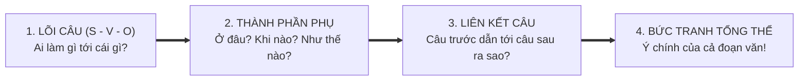
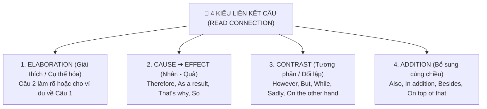
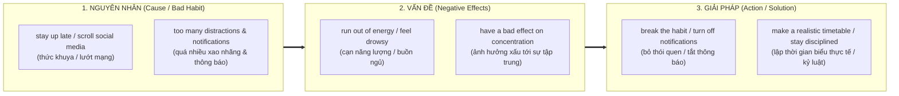
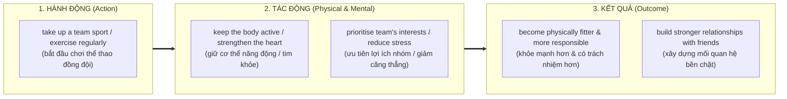

# 🧠 Cẩm Nang Toàn Diện: Hệ Phương Pháp Học Tiếng Anh Tư Duy Tuyến Tính (LINEARTHINKING)

> **Tài liệu chuyên sâu dành cho Bum (14 tuổi – THCS Lớp 8/9, ôn thi Tuyển sinh vào Lớp 10 THPT)**  
> **Mục tiêu**: Xây dựng hệ thống tư duy tiếng Anh logic, khoa học dành cho người Việt; chấm dứt triệt để việc học vẹt và dịch từng chữ (*word-by-word*); làm chủ toàn diện các phần Đọc hiểu, Từ vựng, Cấu tạo từ, Viết lại câu và Nói phản xạ ở ngưỡng điểm **8.5 – 9.5+**.

---

## 📑 MỤC LỤC TÀI LIỆU
1. [Phần 1: Bản Chất Của Linearthinking & 3 "Căn Bệnh" Khi Học Tiếng Anh](#phần-1-bản-chất-của-linearthinking--3-căn-bệnh-khi-học-tiếng-anh)
2. [Phần 2: Trụ Cột 1 – Linearthinking Trong Đọc Hiểu (`Simplify` & `Read Connection`)](#phần-2-trụ-cột-1--linearthinking-trong-đọc-hiểu-simplify--read-connection)
3. [Phần 3: Trụ Cột 2 – Linearthinking Trong Bẻ Khóa Cấu Trúc Đề Thi Mới (`Exam Logic Cracker`)](#phần-3-trụ-cột-2--linearthinking-trong-bẻ-khóa-cấu-trúc-đề-thi-mới-exam-logic-cracker)
4. [Phần 4: Trụ Cột 3 – Linearthinking Trong Học Từ Vựng & Cấu Tạo Từ (`Mental Model & Syntactic Word Family`)](#phần-4-trụ-cột-3--linearthinking-trong-học-từ-vựng--cấu-tạo-từ-mental-model--syntactic-word-family)
5. [Phần 5: Trụ Cột 4 – Linearthinking Trong Ngữ Pháp & Viết Lại Câu (`Core Action Preservation`)](#phần-5-trụ-cột-4--linearthinking-trong-ngữ-pháp--viết-lại-câu-core-action-preservation)
6. [Phần 6: Trụ Cột 5 – Linearthinking Trong Phản Xạ Nói (`Specify` & `Linear Flow O-R-E-O`)](#phần-6-trụ-cột-5--linearthinking-trong-phản-xạ-nói-specify--linear-flow-o-r-e-o)

---

## PHẦN 1: BẢN CHẤT CỦA LINEARTHINKING & 3 "CĂN BỆNH" KHI HỌC TIẾNG ANH

### 1.1. Ba "Căn Bệnh" Khiến Học Sinh Mất Điểm Và Sợ Tiếng Anh
Hầu hết học sinh cấp 2 khi ôn thi vào lớp 10 đều gặp phải 3 rào cản lớn do ảnh hưởng của tiếng mẹ đẻ và thói quen học truyền thống:

| Căn Bệnh | Biểu Hiện Cụ Thể Trong Phòng Thi | Hậu Quả Trực Tiếp |
| :--- | :--- | :--- |
| **1. Dịch từng chữ (Word-by-Word Translation)** | Khi đọc câu tiếng Anh, mắt nhìn từ trái sang phải và đầu cố dịch từng từ sang tiếng Việt. Khi viết hoặc nói, nghĩ một câu tiếng Việt rồi ghép từng từ tiếng Anh vào đúng vị trí đó. | • Đọc câu dài 3 dòng xong quên mất đầu câu nói gì.<br>• Viết ra những câu "Viet-glish" sai ngữ pháp, thiếu động từ hoặc sai trật tự từ. |
| **2. Sợ từ mới (Vocabulary Panic)** | Phụ thuộc 100% vào việc phải biết nghĩa của mọi từ trong câu. Chỉ cần gặp 1–2 từ lạ (như *indispensable, obsolete, pitons, substantiate*) là đơ người, đoán mò đáp án. | • Mất điểm oan ở các bài Đọc hiểu (Reading Comprehension) và Đọc điền từ (Cloze Test). |
| **3. Tư duy rời rạc (Disconnected Thinking)** | Học từ vựng theo danh sách rời rạc; đọc bài văn như đọc 10 câu độc lập không liên quan đến nhau; học hàng chục công thức viết lại câu theo kiểu học vẹt. | • Chọn sai câu hỏi *Main Idea* (Ý chính), sai bài *Sắp xếp đoạn văn (a–b–c)* và quên sạch từ vựng sau 1 tuần. |

---

### 1.2. Linearthinking (Tư Duy Tuyến Tính) Là Gì?
**Linearthinking** là hệ phương pháp tư duy tiếng Anh theo **một đường thẳng logic (`A ➔ B ➔ C`)**, kết hợp giữa tư duy phân tích cấu trúc câu, mối liên hệ nhân quả giữa các ý và mô hình hóa ngôn ngữ.



Thay vì xử lý 30 từ trong một câu cùng một lúc, bộ não của Bum chỉ cần xử lý **Bộ khung cốt lõi dưới 10 từ (`S - V - O`)** trước, sau đó mới lắp ghép các nhánh phụ và nối câu này với câu kia thành một đường thẳng!

---

## PHẦN 2: TRỤ CỘT 1 – LINEARTHINKING TRONG ĐỌC HIỂU (`SIMPLIFY` & `READ CONNECTION`)

Để giải quyết bất kỳ đoạn văn nào trong đề thi vào lớp 10, Linearthinking sử dụng bộ đôi kỹ thuật: **Simplify** (ở cấp độ Câu) và **Read Connection** (ở cấp độ Đoạn văn).

---

### 2.1. Kỹ Thuật 1: SIMPLIFY – Bóc Tách Câu Dài Về Khung Xương Sống `S - V - O`

#### A. Giải phẫu cấu trúc một câu tiếng Anh dài
Mọi câu tiếng Anh phức tạp trong đề thi đều được lắp ghép từ công thức:
$$\mathbf{\text{CÂU DÀI} = \text{KHUNG CHÍNH } (S - V - O) + \text{5 LOẠI THÀNH PHẦN PHỤ (MODIFIERS)}}$$

Bum chỉ cần nhận diện và **đóng ngoặc tròn `( ... )`** 5 loại thành phần phụ sau đây là khung xương sống `S - V - O` sẽ lập tức hiện ra:

| STT | Loại Thành Phần Phụ (Nhiễu) | Dấu Hiệu Nhận Biết Để Đóng Ngoặc `( ... )` | Ví Dụ Minh Họa Từ Đề Thi Thật |
| :---: | :--- | :--- | :--- |
| **1** | **Mệnh đề quan hệ (Relative Clause)** | Bắt đầu bằng **`who, whom, which, that, whose, where`** đứng ngay sau một danh từ để giải thích thêm cho danh từ đó. | *"The contestant **(who guesses the secret words)** stays in front of the board."*<br>➔ Khung chính: **The contestant stays in front of the board.** |
| **2** | **Cụm chú thích giữa 2 dấu phẩy (Parenthetical Phrase)** | Nằm kẹp giữa cặp dấu phẩy **`, ... ,`** ngay sau chủ ngữ. | *"The Green Café **(, whose wooden tables create a warm atmosphere,)** often attracts young people."*<br>➔ Khung chính: **The Green Café attracts young people.** |
| **3** | **Cụm giới từ (Prepositional Phrase)** | Bắt đầu bằng giới từ **`in, on, at, from, with, without, through, by, besides, instead of...`** chỉ thời gian, nơi chốn, cách thức. | *"A convincing fake video **(at a sensitive moment)** could damage a person's reputation **(before the truth is proved)**."*<br>➔ Khung chính: **A fake video could damage reputation.** |
| **4** | **Mệnh đề trạng ngữ phụ (Subordinate Clause)** | Bắt đầu bằng **`Although, While, When, Because, If, Since...`** đứng trước dấu phẩy mở đầu câu. | *"**(Although image controlling is not new,)** recent advances **(in AI)** have made deepfakes more realistic."*<br>➔ Khung chính: **Recent advances have made deepfakes more realistic.** |
| **5** | **Cụm `to + V-inf` chỉ mục đích (Purpose Infinitive)** | Bắt đầu bằng **`to + V`** hoặc **`in order to + V`** trả lời cho câu hỏi "Để làm gì?". | *"We used hands **(to hold onto roots)** and shoulders **(to get through narrow passages)**."*<br>➔ Khung chính: **We used hands and shoulders.** |

---

#### B. Quy trình 3 bước thực hành Simplify (`Bracket ➔ Strip ➔ Connect`)

Hãy xem cách Bum áp dụng 3 bước này vào một câu văn phức tạp trong **Đề thi TP.HCM 2025**:

- **Câu gốc**:  
  *"We also come to the homes of those who find it difficult to go out and about and give them the fresh food."*
- **Bước 1 – Bracket (Đóng ngoặc thành phần phụ)**:  
  *"We also come to the homes `(of those who find it difficult to go out and about)` and give them the fresh food."*
- **Bước 2 – Strip (Tách lấy lõi `S - V - O`)**:  
  **`We`** (S) + **`come to the homes and give them fresh food`** (V + O).
- **Bước 3 – Connect (Ghép lại nghĩa nhanh)**:  
  *Chúng tôi đến nhà (của những người khó đi lại) và tặng họ đồ ăn tươi.*

> 🛡️ **Lợi ích vàng của Simplify trong Ngữ Pháp (S-V Agreement)**:  
> Nhiều học sinh khi làm câu: *"The Green Café, whose wooden tables create a warm atmosphere, often ______ (attract / attracts) young people"* đã nhìn thấy chữ **`tables`** (số nhiều) nên chọn nhầm `attract`.  
> Nhờ **Simplify**, Bum gỡ bỏ phần phụ giữa 2 dấu phẩy, thấy ngay Chủ ngữ thật sự là **`The Green Café`** (1 quán cà phê – số ít) ➔ Chia động từ thêm `-s`: **`attracts`**!

---

### 2.2. Kỹ Thuật 2: READ CONNECTION – Đọc Liên Kết Câu & Đoán Từ Không Cần Từ Điển

#### A. Bốn sợi dây liên kết giữa các câu trong đoạn văn
Một đoạn văn chuẩn trong đề thi không phải là một đống gạch đổ lộn xộn, mà là một bức tường được xây theo **4 kiểu liên kết**:



---

#### B. Tuyệt chiêu dùng Read Connection để đoán 100% từ vựng mới (CLOSEST / OPPOSITE in meaning)

Trong đề thi Hà Nội 2025 & 2026 luôn có 2 câu hỏi từ vựng phân loại điểm 9–10:
- *"The word **[X]** in paragraph ... is **CLOSEST** in meaning to ______."* (Tìm từ đồng nghĩa)
- *"The word **[Y]** in paragraph ... is **OPPOSITE** in meaning to ______."* (Tìm từ trái nghĩa)

Người ra đề cố tình chọn những từ ở trình độ B1/B2 (như `indispensable`, `obsolete`, `collaborate`, `boost`). Nhưng họ **luôn để lại manh mối ở câu liền trước hoặc liền sau**!

##### 🔍 Công Thức 3 Bước Đoán Từ Bằng Read Connection:
1. **Bước 1**: Tìm vị trí từ in đậm trong đoạn văn và xem nó là từ loại gì (Noun, Verb, Adj).
2. **Bước 2**: Tìm **Mối liên kết** của nó với các từ cùng câu (liên kết song song `A, B, and C`) hoặc với câu liền trước/liền sau (liên kết giải thích / nhân quả / đối lập).
3. **Bước 3**: Xác định từ đó mang sắc thái **Tích cực (+)** hay **Tiêu cực (-)** rồi đối chiếu 4 đáp án A, B, C, D.

##### 📌 Bảng Tổng Hợp 4 Ví Dụ Thực Chiến Từ Đề Thi Hà Nội 2025 & 2026:

| Từ Khó Trong Đề Thi | Câu Văn Chứa Từ & Câu Liên Kết Xung Quanh | Phân Tích Tuyến Tính (Read Connection) | Kết Luận Đáp Án |
| :--- | :--- | :--- | :--- |
| **`indispensable`**<br>*(Hà Nội 2025 Q33 - Tìm từ TRÁI NGHĨA)* | *"Language is **indispensable** to humans. It helps us share our thoughts... Without language, we wouldn't be able to build relationships."* | Câu 2 & 3 giải thích: Không có ngôn ngữ thì không thể xây dựng mối quan hệ ➔ Vậy ngôn ngữ là thứ **không thể thiếu / cực kỳ quan trọng (+)**. | Trái nghĩa với "rất quan trọng" là **`unimportant`** *(không quan trọng)*. |
| **`boost`**<br>*(Hà Nội 2025 Q31 - Tìm từ ĐỒNG NGHĨA)* | *"Learning another language can help you personally. It can **boost** your self-confidence, **strengthen** your brain and **help** you understand cultures."* | `boost` nằm trong chuỗi 3 động từ song song cùng chiều tích cực (+): `boost` = `strengthen` (làm mạnh lên) = `help` (giúp đỡ). | Đồng nghĩa với "làm tăng/làm mạnh lên" là **`improve`** *(cải thiện)*. |
| **`obsolete`**<br>*(Hà Nội 2026 Q9 - Tìm từ TRÁI NGHĨA)* | *"When a machine can do a task faster, more accurately and at a lower cost, that task may become **obsolete**."* | Nhân - Quả: Khi máy móc làm nhanh hơn, chính xác hơn và rẻ hơn, công việc thủ công đó không còn ai dùng nữa ➔ **lỗi thời, vô dụng (-)**. | Trái nghĩa với "lỗi thời, vô dụng" là **`useful and up-to-date`** *(hữu ích và hiện đại)*. |
| **`collaborate`**<br>*(Hà Nội 2026 Q11 - Tìm từ ĐỒNG NGHĨA)* | *"They often have to **collaborate** with other people, **share** information, and **solve** problems **together**."* | Chuỗi hành động song song: `collaborate with other people` đi liền với `share information` và `solve problems together`. | Đồng nghĩa với "hợp tác cùng nhau" là **`work together`**. |

---

#### C. Tuyệt chiêu dùng Read Connection để tìm Ý Chính (Main Idea / Best Title)

> ⚠️ **Bẫy lớn nhất của câu hỏi Main Idea**:  
> Học sinh thường thấy một phương án (ví dụ: Phương án A) có chứa đúng một câu nằm ở Đoạn 2 hoặc Đoạn 3 nên vội vàng khoanh ngay!  
> **Quy tắc Linearthinking**: Một chi tiết chỉ xuất hiện ở 1 đoạn nhỏ được gọi là **Chi tiết phụ (Supporting Detail / Too Narrow)**, KHÔNG PHẢI là Ý chính của toàn bài!

**Thuật toán tìm Main Idea trong 15 giây**:
1. Đọc câu mở đầu của **Đoạn 1** (Topic Sentence của toàn bài).
2. Đọc câu đầu tiên của các đoạn thân bài (**Đoạn 2, Đoạn 3**) và câu kết luận (**To conclude / Therefore** ở đoạn cuối).
3. Nối các câu đó lại thành 1 trục thẳng: Phương án nào **bao trùm được toàn bộ trục thẳng đó** chính là đáp án đúng!

---

## PHẦN 3: TRỤ CỘT 2 – LINEARTHINKING TRONG BẺ KHÓA CẤU TRÚC ĐỀ THI MỚI (`EXAM LOGIC CRACKER`)

Từ năm 2025–2026, đề thi tuyển sinh vào lớp 10 có thêm 2 dạng bài kiểm tra tư duy mạch lạc của văn bản:
1. **Chọn câu chủ đề / câu hoàn thiện đoạn** & **Sắp xếp 3 câu (a–b–c) theo thứ tự logic**.
2. **Chèn 4 câu/cụm từ bị khuyết (Gapped Text)** vào một bài văn.

### 3.1. Bộ Công Cụ "Móc Xích Lego" (The 4 Linear Hooks)

Khi lắp ghép các câu rời rạc thành một đoạn văn, tuyệt đối không lắp theo cảm tính. Hãy tìm **4 Móc Xích Cứng** sau đây:

```
┌────────────────────────────────────────────────────────────────────────────┐
│ 🪝 MÓC XÍCH 1: ĐẠI TỪ CHỈ ĐỊNH & THAY THẾ (Reference Hooks)                │
│ • "These + [Danh từ số nhiều]" (VD: These non-verbal signals, These steps) │
│   ➔ BẮT BUỘC phải đứng sau một câu vừa liệt kê các danh từ số nhiều đó!    │
│ • "This means + V-ing..."                                                  │
│   ➔ BẮT BUỘC phải đứng ngay sau câu vừa nêu một quy tắc cần giải thích!    │
├────────────────────────────────────────────────────────────────────────────┤
│ 🪝 MÓC XÍCH 2: TỪ NỐI TRÌNH TỰ (Sequence Hooks)                            │
│ • Mở đầu: "To begin with," / "First of all,"                               │
│ • Tiếp theo: "Next," / "Second," / "Also," / "In addition,"                │
│ • Cuối cùng: "Finally," / "Lastly,"                                        │
│ • Tổng kết: "By taking these actions," / "As a result," / "Therefore,"     │
├────────────────────────────────────────────────────────────────────────────┤
│ 🪝 MÓC XÍCH 3: TỪ NỐI ĐỐI LẬP (Contrast Hooks)                             │
│ • "However," / "On the other hand,"                                        │
│   ➔ Đứng ở điểm gãy của đoạn văn: chuyển từ Lợi ích (+) sang Bất cập (-),  │
│     hoặc từ Hiện đại (Modern) sang Truyền thống (Traditional).             │
├────────────────────────────────────────────────────────────────────────────┤
│ 🪝 MÓC XÍCH 4: KHỚP CÚ PHÁP (Syntactic Slot Hooks – Dành cho Gapped Text)  │
│ • Nếu trước chỗ trống là "However, (37) ______." ➔ Cần 1 mệnh đề S + V.    │
│ • Nếu trước chỗ trống là Chủ ngữ "These activities (38) ______" ➔ Cần V.   │
│ • Nếu trước chỗ trống là động từ "can look (39) ______" ➔ Cần giới từ.     │
│ • Nếu trước chỗ trống đã đủ S - V - O ➔ Cần cụm "to + V" chỉ mục đích.     │
└────────────────────────────────────────────────────────────────────────────┘
```

---

## PHẦN 4: TRỤ CỘT 3 – LINEARTHINKING TRONG HỌC TỪ VỰNG & CẤU TẠO TỪ (`MENTAL MODEL & SYNTACTIC WORD FAMILY`)

### 4.1. Học Từ Vựng Theo Chuỗi Nhân Quả (`Cause ➔ Problem ➔ Solution`)
Bộ não con người rất kém trong việc nhớ các dữ liệu rời rạc, nhưng lại cực kỳ siêu phàm trong việc nhớ **một câu chuyện có nguyên nhân – kết quả**.

Thay vì học từng từ riêng lẻ, Linearthinking gom từ vựng của mỗi chủ đề đề thi thành **Bản đồ chuỗi tư duy**:

#### 🗺️ Bản Đồ Mental Model Số 1: Chủ Đề Thói Quen Số & Quản Lý Thời Gian *(Digital Habits & Time Management)*


#### 🗺️ Bản Đồ Mental Model Số 2: Chủ Đề Thể Thao & Sức Khỏe Tuổi Teen *(Sports & Teen Health)*


---

### 4.2. Thuật Toán Giải Bài Tập Cấu Tạo Từ Tự Luận (`Syntactic Word Formation`)
Trong đề thi TP.HCM, phần **Word Formation (Câu 29–34)** chiếm tới **1.5 điểm tự luận** (thí sinh tự viết từ, không có A/B/C/D). Linearthinking giải quyết phần này bằng **Thuật toán 3 bước soi vị trí trong khung `S - V - O`**:

```
BƯỚC 1: Nhìn từ đứng ngay TRƯỚC và ngay SAU chỗ trống để khóa chặt TỪ LOẠI (Noun / Adj / Adv / Verb).
   ├──► Vị trí DANH TỪ (Noun):
   │    • Sau mạo từ (a, an, the) + Tính từ: "a popular [attraction]" / "a virtual [exhibition]"
   │    • Sau tính từ sở hữu (my, your, their, teenagers'): "future [success]"
   │    • Sau giới từ (of, for, with, without) hoặc lượng từ (any, some, many): "words of [encouragement]"
   │
   ├──► Vị trí TÍNH TỪ (Adjective):
   │    • Đứng ngay trước Danh từ để bổ nghĩa cho danh từ đó: "a [global] village" / "[healthy] habits"
   │    • Đứng sau to-be (is, are, was, were) hoặc feel, stay, become, seem: "was [patient] enough"
   │
   └──► Vị trí TRẠNG TỪ (Adverb - đuôi -ly):
        • Bổ nghĩa cho Động từ thường: "speak English [fluently]" / "have [illegally] published"
        • Đứng đầu câu trước dấu phẩy bổ nghĩa cho cả câu: "[Amazingly], he finished ahead of schedule."
        • Đứng trước một Tính từ khác để chỉ mức độ: "stay [physically] fitter"

BƯỚC 2: Kiểm tra BẪY NGHĨA TÍCH CỰC (+) hay TIÊU CỰC (-) (Phủ định):
   • Nếu ngữ cảnh mang nghĩa tiêu cực/trái ngược, phải thêm tiền tố phủ định (un-, in-, il-, im-, dis-) hoặc hậu tố (-less):
     - legal (hợp pháp) + "without permission" (không xin phép) ➔ illegally (bất hợp pháp)
     - care (cẩn thận) + "lost his headset" (làm mất tai nghe) ➔ careless (bất cẩn)
     - depend (phụ thuộc) + "and responsible" (có trách nhiệm) ➔ independent (tự lập)

BƯỚC 3: Kiểm tra BẪY SỐ ÍT / SỐ NHIỀU (Đối với Danh từ đếm được):
   • Nếu trước chỗ trống có "many, several, a lot of, leading..." hoặc danh từ chỉ người chung chung ➔ PHẢI THÊM -S/-ES!
     - "many [explorers] made discoveries" (Đề TP.HCM 2026 Q34)
     - "meeting with leading [scientists]" (Đề TP.HCM 2025 Q33)
```

---

## PHẦN 5: TRỤ CỘT 4 – LINEARTHINKING TRONG NGỮ PHÁP & VIẾT LẠI CÂU (`CORE ACTION PRESERVATION`)

Khi làm phần **Sentence Transformation (Viết lại câu sao cho nghĩa không đổi – Câu 37–40 Đề TP.HCM & Câu 25–28 Đề Hà Nội)**, sai lầm lớn nhất của học sinh là dịch câu đề bài sang tiếng Việt rồi tự bịa câu mới.

**Nguyên tắc Linearthinking**: Hai câu đồng nghĩa luôn giữ nguyên **Lõi sự việc (Core Event)**, chỉ thay đổi **"Chiếc áo cấu trúc"** bên ngoài theo 5 phép biến đổi tương đương sau:

| Phép Biến Đổi Tuyến Tính | Cấu Trúc Gốc (Input) | Cấu Trúc Đích (Output) | Ví Dụ Thực Tế Từ Đề Thi |
| :--- | :--- | :--- | :--- |
| **1. Cụm danh từ $\iff$ Mệnh đề (`Noun Phrase ↔ Clause`)** | `Despite / In spite of` + **Cụm Danh Từ** (`the + Noun + of + S`) | `Although / Though` + **Mệnh Đề** (`S + be + Adj`) | *Despite **the practicality of the project**, nobody...*<br>➔ *Although **the project was practical**, nobody...* *(Đề TP.HCM 2026 Q40)* |
| **2. Hiện thực phủ định $\iff$ Câu ước lùi thì (`Reality ↔ Wish`)** | `S + don't / doesn't + V` (Thực tế hiện tại không có) | `S + wish(es) + S + V-quá khứ đơn` (Ước trái ngược hiện tại) | *Brenda **doesn't have** her own locker at school.*<br>➔ *Brenda wishes she **had** her own locker at school.* *(Đề TP.HCM 2026 Q37)* |
| **3. Trạng thái cạn kiệt $\iff$ Cụm động từ (`Zero Left ↔ Run Out Of`)** | `There is no / are no + [X] + left in [Y]` | `[Y] + has / have run out of + [X]` | *There are **no roses left** in the shop.*<br>➔ *The shop **has run out of roses**.* *(Đề TP.HCM 2026 Q39)* |
| **4. Chủ ngữ giả `It` $\iff$ Động từ chỉ thái độ (`It ↔ Mind`)** | `It doesn't matter to [Someone] to + V-inf` | `[Someone] doesn't mind + V-ing` | *It doesn't matter to Lucie **to help** her friends.*<br>➔ *Lucie doesn't mind **helping** her friends.* *(Đề TP.HCM 2026 Q38)* |
| **5. Câu hỏi trực tiếp $\iff$ Câu tường thuật lùi thì (`Direct ↔ Reported`)** | `"Do I have to... here?" S asked me.` | `S asked me whether/if + S + had to... there.` | *Linh asked me whether she **had to wait there** any longer.*<br>➔ *"Do I **have to wait here** any longer?" Linh asked me.* *(Đề Hà Nội 2025 Q26)* |

---

## PHẦN 6: TRỤ CỘT 5 – LINEARTHINKING TRONG PHẢN XẠ NÓI (`SPECIFY` & `LINEAR FLOW O-R-E-O`)

Khi nói tiếng Anh cùng AI Buddy Leo hoặc trong các bài thi vấn đáp, nhiều bạn bị "bí ý" (chỉ nói được 1 câu cụt lủn rồi im lặng) hoặc nói lan man không rõ ý. Linearthinking khắc phục bằng 2 bước:

### 6.1. Bước 1: SPECIFY (Cụ Thể Hóa Câu Hỏi Trừu Tượng)
Khi gặp một câu hỏi rộng, đừng trả lời chung chung. Hãy chẻ nó thành **2 đối tượng cụ thể** gắn liền với đời sống của Bum:
- Hỏi về *"Technology"* (Công nghệ nói chung – quá rộng!) ➔ Cụ thể hóa ngay thành: **`Smartwatch`** (đồng hồ thông minh) hoặc **`Cleaning robot`** (robot hút bụi).
- Hỏi về *"Sports"* (Thể thao nói chung) ➔ Cụ thể hóa ngay thành: **`Playing football with school friends on Sunday`**.
- Hỏi về *"Bad habits"* (Thói quen xấu) ➔ Cụ thể hóa ngay thành: **`Scrolling TikTok/YouTube Shorts past midnight`**.

### 6.2. Bước 2: LINEAR FLOW `O - R - E - O` (Trục Trả Lời Tuyến Tính 4 Bước)
Sau khi đã có đối tượng cụ thể, hãy lắp vào đường thẳng 4 bước **`O - R - E - O`**:

```
[O] OPINION (1 câu S-V-O trả lời trực diện vào câu hỏi)
       │
       ▼  (nối bằng: Because / Since...)
[R] REASON (1 câu giải thích nguyên nhân / cơ chế tác động)
       │
       ▼  (nối bằng: For example, / Last week,...)
[E] EXAMPLE (1-2 câu kể ví dụ cá nhân cụ thể của Bum)
       │
       ▼  (nối bằng: Therefore, / As a result, / So...)
[O] OUTCOME (1 câu chốt lại kết quả hoặc bài học)
```

> 👉 **Bước tiếp theo**: Sau khi đã tạo được câu trả lời mạch lạc bằng **Linearthinking**, làm thế nào để Bum phát âm và nói ra câu đó trôi chảy, có nhịp điệu tự nhiên như người bản xứ mà không bị giật cục?  
> Hãy mở ngay tài liệu số 2: **[02-sound-block-chunking-comprehensive-guide.md](file:///c:/Users/Admin/source/repos/nephew-english/english/documents/02-sound-block-chunking-comprehensive-guide.md)**!
