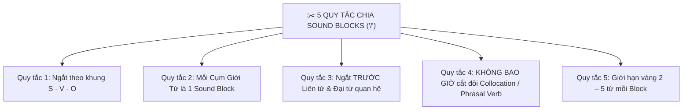

# 🎙️ Cẩm Nang Toàn Diện: Phương Pháp Ngắt Cụm Âm Thanh & Nhịp Điệu (SOUND-BLOCK CHUNKING – KEITH METHOD)

> **Tài liệu chuyên sâu dành cho Bum (14 tuổi – THCS Lớp 8/9, ôn thi Tuyển sinh vào Lớp 10 & Luyện phản xạ nói cùng AI Leo)**  
> **Mục tiêu**: Xóa bỏ thói quen đọc/nói tiếng Anh giật cục từng chữ như robot; làm chủ kỹ thuật chia câu thành các **Khối Âm Thanh (Sound Blocks `/`)**, kết hợp nhấn trọng âm cụm, lướt âm yếu (*Weak Forms*), nối âm (*Linking `‿`*) và điều khiển ngữ điệu (*Intonation `↗ ↘`*).

---

## 📑 MỤC LỤC TÀI LIỆU
1. [Phần 1: Bản Chất Của Sound-Block Chunking & Tại Sao Người Việt Hay Nói Giật Cục?](#phần-1-bản-chất-của-sound-block-chunking--tại-sao-người-việt-hay-nói-giật-cục)
2. [Phần 2: 5 Quy Tắc Vàng Để Chia Sound Blocks (`/`) Chuẩn Xác Nhất](#phần-2-5-quy-tắc-vàng-để-chia-sound-blocks--chuẩn-xác-nhất)
3. [Phần 3: 4 Kỹ Thuật Âm Học Bên Trong Mỗi Sound Block (Hạt Nhân Keith Method)](#phần-3-4-kỹ-thuật-âm-học-bên-trong-mỗi-sound-block-hạt-nhân-keith-method)
4. [Phần 4: Kết Hợp Linearthinking O-R-E-O Với Sound-Block Chunking](#phần-4-kết-hợp-linearthinking-o-r-e-o-với-sound-block-chunking)
5. [Phần 5: Thực Hành Sound-Block Chunking Trên Các Đoạn Văn & Hội Thoại Đề Thi Lớp 10](#phần-5-thực-hành-sound-block-chunking-trên-các-đoạn-văn--hội-thoại-đề-thi-lớp-10)
6. [Phần 6: Quy Trình 10 Phút Luyện Tập Hàng Ngày Cùng AI Buddy Leo](#phần-6-quy-trình-10-phút-luyện-tập-hàng-ngày-cùng-ai-buddy-leo)

---

## PHẦN 1: BẢN CHẤT CỦA SOUND-BLOCK CHUNKING & TẠI SAO NGƯỜI VIỆT HAY NÓI GIẬT CỤC?

### 1.1. Sự Khác Biệt Giữa Nhịp Điệu Tiếng Việt Và Nhịp Điệu Tiếng Anh
Tại sao nhiều học sinh phát âm từng từ đơn lẻ rất đúng, nhưng khi ghép vào một câu dài 15 từ thì nghe lại cứng nhắc, đứt quãng và hụt hơi?

| Đặc Điểm | Tiếng Việt (Syllable-Timed Language) | Tiếng Anh (Stress-Timed Language) |
| :--- | :--- | :--- |
| **Đơn vị nhịp điệu** | **Từng âm tiết (Từng chữ rời nhau)**: Mỗi chữ được phát âm với độ dài và lực gần như ngang nhau (*"Hôm - nay - tôi - đi - học"*). | **Cụm âm thanh (Sound Block / Thought Group)**: Nhiều từ (2–5 từ) dính liền vào nhau thành **1 khối âm thanh duy nhất**, có từ nhấn mạnh và từ lướt cực nhanh. |
| **Cách lấy hơi** | Dừng ở bất kỳ chữ nào khi hết hơi hoặc khi đang suy nghĩ từ tiếp theo. | Chỉ lấy hơi ở **ranh giới giữa các cụm nghĩa (dấu `/`)**, tuyệt đối không ngắt hơi ở giữa một cụm danh từ hay cụm động từ. |

---

### 1.2. Sound Block (Khối Âm Thanh) Là Gì?
Theo phương pháp của **Keith Speaking Academy (Keith Method)**, một **Sound Block** (hay *Chunk / Thought Group*) là một nhóm từ ngắn (**từ 2 đến 5 từ**) mang **một ý nghĩa trọn vẹn nhỏ**, được người nói phát âm liền một mạch trong **một luồng hơi duy nhất**, giống như thể cả nhóm từ đó chỉ là **một từ dài**!

Hãy xem sự khác biệt qua ví dụ sau:

- ❌ **Cách đọc từng từ (Word-by-word – Giật cục, hụt hơi)**:  
  `I` ... `am` ... `looking` ... `forward` ... `to` ... `presenting` ... `my` ... `robotics` ... `project` ... `to` ... `the` ... `class.` *(12 lần phát âm rời rạc)*.
- ✅ **Cách đọc theo Sound Blocks (3 khối âm thanh nhịp nhàng)**:  
  **`I'm looking forward`** `/` **`to presenting my robotics project`** `/` **`to the class.`** *(Chỉ cần 3 nhịp hơi êm ái!)*.

---

## PHẦN 2: 5 QUY TẮC VÀNG ĐỂ CHIA SOUND BLOCKS (`/`) CHUẨN XÁC NHẤT

Làm sao để Bum biết đặt dấu gạch chéo `/` (điểm ngắt nhịp và lấy hơi) ở đâu trong một câu tiếng Anh?  
Điểm tuyệt vời nhất là: **Cách chia Sound Blocks khớp 100% với cách bóc tách câu của Linearthinking!**

### 📋 Bảng Hướng Dẫn Chi Tiết 5 Quy Tắc Chia Sound Blocks

| Quy Tắc | Nguyên Lý Thực Hành | Ví Dụ Chuẩn (Có Dấu Ngắt `/`) | Lỗi Ngắt Sai Cần Tránh (❌) |
| :--- | :--- | :--- | :--- |
| **1. Ngắt theo khung `S - V - O`** | Nếu Chủ ngữ (Subject) dài từ 3 từ trở lên, hãy tách Chủ ngữ thành 1 Sound Block riêng trước khi sang `Verb + Object`. | *`Recent advances in AI` `/` `have made deepfakes` `/` `more realistic.`* | ❌ *`Recent advances in` `/` `AI have` `/` `made deepfakes...`* (Cắt đứt cụm chủ ngữ). |
| **2. Mỗi Cụm Giới Từ là 1 Block** | Các cụm bắt đầu bằng *in, on, at, for, with, without, through, before, after...* luôn tạo thành 1 Sound Block riêng biệt. | *`You should watch English movies` `/` `without subtitles` `/` `to improve listening.`* | ❌ *`...watch English movies without` `/` `subtitles to...`* (Tách giới từ khỏi danh từ của nó). |
| **3. Ngắt TRƯỚC Liên từ & Đại từ quan hệ** | Luôn đặt dấu `/` ngay **trước** các từ nối: *because, although, so, but, or, when, while, who, which, that*. | *`This smartwatch has sensors` `/` `that can track` `/` `your sleep pattern.`* | ❌ *`This smartwatch has sensors that` `/` `can track...`* |
| **4. Bảo toàn Cụm từ cố định (Collocations)** | Các cụm động từ (*run out of, turn off, pick up*) và cụm cố định (*break the habit, eating habits*) phải nằm trọn trong 1 Block. | *`I'm trying to break the habit` `/` `of staying up too late.`* | ❌ *`I'm trying to break` `/` `the habit of...`* (Làm vỡ collocation). |
| **5. Giới hạn 2 – 5 từ / Block** | Một luồng hơi tự nhiên đẹp nhất khi kéo dài từ 2 đến 5 từ. Nếu một vế câu dài 8–10 từ, hãy chia đôi nó ở điểm ranh giới ngữ pháp. | *`Playing outdoor sports` `/` `offers numerous benefits` `/` `for teenagers.`* | ❌ Đọc liền 12 từ không nghỉ khiến giọng bị đuối ở cuối câu. |

---

## PHẦN 3: 4 KỸ THUẬT ÂM HỌC BÊN TRONG MỖI SOUND BLOCK (HẠT NHÂN KEITH METHOD)

Chia câu thành các dấu `/` mới chỉ là bước 1. Để mỗi Sound Block nghe mượt mà, tự nhiên và chuẩn xác như người bản xứ, bên trong mỗi dấu `/` Bum cần áp dụng **4 kỹ thuật âm học** sau:

---

### 3.1. Kỹ Thuật 1: Từ Nội Dung (Content Words) vs Từ Chức Năng (Function Words)
Trong một Sound Block từ 3–5 từ, **không phải từ nào cũng được đọc to và rõ như nhau**:

- 🔊 **Từ Nội Dung (Content Words – ĐỌC TO, RÕ, NGÂN DÀI HƠN)**: Là những từ mang ý nghĩa chính của khối âm thanh, bao gồm:
  - Danh từ chính (*Nouns*: `habit, smartwatch, project, sports`)
  - Động từ chính (*Main Verbs*: `break, track, damage, focus`)
  - Tính từ & Trạng từ (*Adjectives & Adverbs*: `healthy, realistic, fluently, quickly`)
  - Trợ động từ phủ định (*Negative Auxiliaries*: `don't, didn't, can't, shouldn't`)
- 🔉 **Từ Chức Năng (Function Words – ĐỌC NHẸ, LƯỚT NHANH)**: Là những từ chỉ làm "keo dán ngữ pháp", bao gồm:
  - Mạo từ (*a, an, the*)
  - Giới từ (*to, for, of, in, on, at, with*)
  - Đại từ & Tính từ sở hữu (*I, you, he, them, my, your, our*)
  - Trợ động từ khẳng định & Liên từ (*am, is, are, can, and, but, that*)

> 🎯 **Ví dụ thực hành (Chữ IN HOA ĐẬM là từ nhấn mạnh, chữ thường nhỏ là từ lướt nhanh)**:  
> - *"It's **NOT** **EA**sy / for **CHIL**dren / to **BREAK** the **HA**bit / of **U**sing **DI**gital de**VI**ces."*

---

### 3.2. Kỹ Thuật 2: Âm Yếu (Weak Forms với nguyên âm `/ə/` – Schwa)
Làm sao để lướt nhanh qua các Từ chức năng (*Function Words*)? Người bản xứ biến nguyên âm của chúng thành âm lướt cực nhẹ **`/ə/` (âm ơ ngắn)**:

| Từ Chức Năng | Cách Đọc Mạnh (Khi đứng một mình - ❌ Không dùng khi nói câu) | Cách Đọc Yếu (Weak Form trong Sound Block - ✅ Chuẩn Bản Xứ) | Ví Dụ Trong Sound Block |
| :---: | :---: | :---: | :--- |
| **`to`** | /tuː/ | **/tə/** *(đọc nhẹ như "tơ")* | *`try` **tə** `break` / `easy` **tə** `spread`* |
| **`for`** | /fɔː(r)/ | **/fə(r)/** *(đọc nhẹ như "phơ")* | *`convenient` **fə** `family life`* |
| **`of`** | /ɒv/ | **/əv/** *(đọc nhẹ như "ơv")* | *`words` **əv** `encouragement` / `run out` **əv** `battery`* |
| **`and`** | /ænd/ | **/ən/** *(đọc nhẹ như "ân")* | *`seeing` **ən** `believing` / `scared` **ən** `excited`* |
| **`can`** | /kæn/ | **/kən/** *(đọc nhẹ như "cân")* | *`that` **kən** `track your sleep`* |

---

### 3.3. Kỹ Thuật 3: Nối Âm Liền Mạch Bên Trong Sound Block (`Linking ‿`)
Bên trong cùng một Sound Block (giữa hai dấu `/`), các từ không tách rời nhau mà **dính liền vào nhau**. Quy tắc nối âm quan trọng nhất cho Bum là:

$$\mathbf{\text{Phụ âm cuối của từ trước } + \text{ Nguyên âm đầu (u, e, o, a, i) của từ sau } \Longrightarrow \text{ NỐI LIỀN } (\mathbf{\‿})}$$

*(Lưu ý: Tuyệt đối KHÔNG nối âm vượt qua dấu gạch chéo `/`, vì dấu `/` là chỗ ngắt hơi!)*

#### 📌 6 Cụm Nối Âm Đề Thi Bum Gặp Hàng Ngày:
1. **`run‿out‿of`** /rʌ**n‿aʊ**t**‿əv**/ *(đọc liền như: "rân-nao-tơv")*  
   ➔ *"Our wireless mouse / has **run‿out‿of** battery."*
2. **`pick‿up`** /pɪ**k‿ʌ**p/ *(đọc liền như: "pi-cấp")*  
   ➔ *"Minh **picked‿up‿E**nglish / quite quickly."*
3. **`turn‿off`** /tɜː**n‿ɒ**f/ *(đọc liền như: "tơ-nóp")*  
   ➔ *"Remember to **turn‿off** / the lights**‿a**nd fans."*
4. **`look‿at‿items`** /lʊ**k‿æ**t**‿aɪ**təmz/ *(đọc liền như: "lu-cắt-tai-tờm")*  
   ➔ *"Shoppers can **look‿at‿i**tems closely / and try them**‿o**n."*
5. **`play‿an‿important role`** /pleɪ**‿ə**n**‿ɪ**mˈpɔːtnt rəʊl/  
   ➔ *"Parents **play‿an‿i**mportant role / in helping teens."*
6. **`bad‿effect‿on`** /bæ**d‿ɪ**ˈfek**t‿ɒ**n/  
   ➔ *"Misinformation / has a **bad‿effect‿on** the public."*

---

### 3.4. Kỹ Thuật 4: Ngữ Điệu Ở Cuối Mỗi Sound Block (`Intonation Arrows ↗ ↘`)
Ngữ điệu (lên giọng hay xuống giọng) chính là "dấu chấm, dấu phẩy bằng âm thanh" giúp người nghe (hoặc AI Leo) biết Bum đã nói xong ý hay chưa:

- ↗ **Ngữ điệu Lên nhẹ hoặc Giữ ngang (`↗` / `→`) ở cuối mỗi dấu `/`**:  
  Báo hiệu cho người nghe biết: *"Mình mới nói xong 1 cụm thôi, mình vẫn còn đang nói tiếp vế sau đấy!"*
- ↘ **Ngữ điệu Xuống dứt khoát (`↘`) ở cuối dấu chấm câu `.` (hoặc cuối câu hỏi Wh-question)**:  
  Báo hiệu: *"Mình đã hoàn thành trọn vẹn câu nói của mình rồi!"*
- ↗ **Ngữ điệu Lên cao (`↗`) ở cuối câu hỏi Yes/No hoặc Tag Question (*isn't it?*)**:  
  Ví dụ: *"It's rather expensive,↗ / **isn't‿it?↗**"*

---

## PHẦN 4: KẾT HỢP LINEARTHINKING O-R-E-O VỚI SOUND-BLOCK CHUNKING

Khi Bum kết hợp **Trục trả lời tuyến tính `O-R-E-O` của Linearthinking** với **Kỹ thuật ngắt nhịp `Sound-Block Chunking`**, khả năng nói tiếng Anh của Bum sẽ lột xác hoàn toàn!

Hãy xem bảng đối chiếu dưới đây cho câu hỏi:  
> ❓ **AI Leo hỏi**: *"Bum, what do you think about using a cleaning robot at home?"*

| Tiêu Chí | ❌ Cách Trả Lời Cũ (Chưa học Linearthinking & Sound-Block) | ✅ Cách Trả Lời Mới (Linearthinking O-R-E-O + Sound-Block Chunking) |
| :--- | :--- | :--- |
| **Tư duy & Âm thanh** | Nghĩ từng chữ tiếng Việt rồi lắp từ tiếng Anh, đọc đều đều từng từ không có điểm nhấn, câu cụt lủn. | Triển khai thẳng 4 bước O-R-E-O; mỗi câu chia thành 2–3 Sound Blocks `/` có nhấn **TỪ NỘI DUNG**, nối âm `‿` và ngữ điệu `↗ ↘`. |
| **Lời nói thực tế** | *"Uh... I... think... cleaning... robot... is... good... because... it... clean... the... house... very... fast... Yes."* | • **[O - Opinion]**: *"In my **O**pinion,↗ / a **CLEA**ning **RO**bot↗ / is **REAL**ly con**VE**nient / fə **FA**mily **LIFE**.↘"* • **[R - Reason]**: *"Be**CAUSE** it **VA**cuums the **FLOOR**↗ / auto**MA**tically↗ / ən **SAVES**‿us a **LOT**‿əv **TIME**.↘"* • **[E - Example]**: *"Fə‿ex**AM**ple,↗ / while the **RO**bot cleans my **BED**room,↗ / I kən **FO**cus‿on my **MATH** **HOME**work.↘"* • **[O - Outcome]**: *"There**FORE**,↗ / it's‿a **WON**derful **SMART** de**VICE**↗ / fə **BU**sy **STU**dents.↘"* |

---

## PHẦN 5: THỰC HÀNH SOUND-BLOCK CHUNKING TRÊN CÁC ĐOẠN VĂN & HỘI THOẠI ĐỀ THI LỚP 10

Dưới đây là 3 bài luyện đọc thành tiếng (*Read-Aloud Drills*) được trích từ các đề thi thật, đã được gắn đầy đủ bộ ký hiệu **Sound-Block (`/`)**, **Nối âm (`‿`)** và **Ngữ điệu (`↗ ↘`)** để Bum luyện cơ miệng mỗi ngày:

### 🎧 Bài Luyện 1: Hội Thoại Đời Sống & Công Nghệ *(Trích Đề Thi TP.HCM 2026)*

1. **Salesman**: *"This **SMART**watch / has **FEA**tures↗ / that kən **TRACK** your **SLEEP** **PAT**tern↗ / ən **HEART** **RATE**.↘"*
2. **Customer**: *"That **SOUNDS** **WON**derful!↘ / **HOW** **MUCH**‿is‿it?↘"*
3. **Han**: *"A **CLEA**ning **RO**bot / is **REAL**ly con**VE**nient↗ / fə **FA**mily **LIFE**.↘"*
4. **Nhien**: *"I **TO**tally‿a**GREE**,↗ / but‿it's **RA**ther‿ex**PEN**sive,↗ / **IS**n't‿it?↗"*
5. **Anh**: *"You should **WATCH**‿**ENG**lish **MO**vies / without **SUB**titles↗ / tə‿im**PROVE** your **LIS**tening **SKILLS**.↘"*

---

### 🎧 Bài Luyện 2: Đoạn Văn Thể Thao & Sức Khỏe Tuổi Teen *(Trích Đề Thi TP.HCM 2025)*

> *"Playing **SPORTS** / **OF**fers **NU**merous **BE**nefits↗ / fə **TEE**nagers,↗ / both **PHY**sically / ən **MEN**tally.↘ / It **HELPS** them **STAY** **HEAL**thy↗ / by **KEE**ping their **BO**dies‿**AC**tive.↘ / **PHY**sical‿ac**TI**vities / make **TEENS'** **HEARTS** **STRON**ger↗ / ən **GIVE** them **MORE**‿**E**nergy.↘ / **SPORTS** help the **BRAIN** **WORK** **BET**ter,↗ / so **TEENS** kən **FO**cus / **MORE**‿**EA**sily‿in **CLASS**.↘"*

---

### 🎧 Bài Luyện 3: Đoạn Văn Quản Lý Thời Gian *(Trích Đề Thi Hà Nội 2026)*

> *"To **STU**dy **MORE**‿ef**FEC**tively,↗ / **STU**dents should **BUILD** / **GOOD** **TIME**-management **HA**bits.↘ / **ONE** **USE**ful **WAY**↗ / is tə **MAKE**‿a **CLEAR** **TIME**table↗ / ən **WRITE** **DOWN**‿im**POR**tant **TASKS**.↘ / **AN**other **USE**ful **HA**bit↗ / is tə **KEEP**‿a**WAY** / from dis**TRAC**tions / while **STU**dying.↘ / **STU**dents should **TURN**‿**OFF** / un**NE**cessary notifi**CA**tions↗ / ən **CHOOSE**‿a **QUI**et **PLACE** / tə **WORK**.↘"*

---

## PHẦN 6: QUY TRÌNH 10 PHÚT LUYỆN TẬP HÀNG NGÀY CÙNG AI BUDDY LEO

Để biến **Linearthinking** và **Sound-Block Chunking** thành phản xạ tự nhiên trong não bộ, mỗi ngày Bum chỉ cần thực hiện **3 bước trong 10 phút**:

1. **Phút 1 – 3 (Pencil Slash – Cầm bút vạch nhịp `/`)**:  
   Khi đọc đoạn văn hoặc hội thoại trong bài học ngày (`01-knowledge.md`), dùng mắt (hoặc bút chì) chia câu thành các cụm Sound Blocks `/` (2–5 từ) và gạch chân từ nội dung chính (*Content Word*).
2. **Phút 4 – 6 (Rhythmic Read-Aloud – Đọc to thành tiếng theo cụm hơi)**:  
   Đọc to đoạn văn hoặc hội thoại đó 2 lần. Ở mỗi dấu `/`, dừng lại 0.5 giây để lấy hơi nhẹ bằng mũi, nối âm `‿` các cụm động từ (*turn‿off, run‿out‿of, pick‿up*).
3. **Phút 7 – 10 (Live Sparring with Leo – Đấu phản xạ O-R-E-O)**:  
   Mở ChatGPT Voice Mode hoặc Gemini Live và dùng câu lệnh:
   > *"Hey Leo! Let's practice speaking with Sound-Block Chunking and the O-R-E-O method about today's topic. Ask me 2 questions and tell me if my sentences are clear, logical, and well-paced!"*
