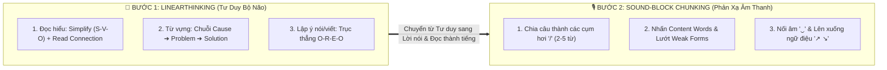

# 📚 Thư Viện Tài Liệu Phương Pháp Học Tiếng Anh Tư Duy (Bum's Methodology Library)

> **Dành riêng cho Bum (14 tuổi – THCS Lớp 8/9, chuẩn bị thi Tuyển sinh vào Lớp 10 THPT)**  
> Thư mục `english/documents/` lưu trữ bộ cẩm nang toàn diện (*Comprehensive Guides*) về 2 hệ phương pháp cốt lõi giúp Bum bứt phá trình độ từ **CEFR A2 lên B1+ (Mục tiêu 8.5 – 9.5+ điểm thi vào 10)** cả trong phòng thi viết lẫn giao tiếp phản xạ thực tế.

---

## 🗂️ Danh Mục Tài Liệu Toàn Diện (Comprehensive Guides)

| STT | Tên Tài Liệu | Trọng Tâm Phương Pháp | Ứng Dụng Trong Đề Thi & Thực Tế |
| :---: | :--- | :--- | :--- |
| **01** | **[01-linearthinking-comprehensive-guide.md](file:///c:/Users/Admin/source/repos/nephew-english/english/documents/01-linearthinking-comprehensive-guide.md)** | **Hệ Phương Pháp Học Tiếng Anh Tư Duy Tuyến Tính (Linearthinking)** | • **Simplify**: Bóc tách khung `S - V - O`, loại bỏ 5 loại nhiễu trong câu dài. • **Read Connection**: Đọc liên kết câu để tìm Main Idea, đoán từ vựng khó (*indispensable, obsolete*) không cần từ điển. • **Exam Logic**: Giải bài Sắp xếp đoạn văn (a–b–c) & Chèn câu khuyết (Gapped Text). • **Mental Model**: Học từ vựng theo chuỗi `Cause ➔ Problem ➔ Solution` & biến đổi Word Formation. • **Linear Transformation & O-R-E-O**: Viết lại câu bảo toàn lõi hành động & trả lời nói theo trục thẳng. |
| **02** | **[02-sound-block-chunking-comprehensive-guide.md](file:///c:/Users/Admin/source/repos/nephew-english/english/documents/02-sound-block-chunking-comprehensive-guide.md)** | **Phương Pháp Ngắt Cụm Âm Thanh & Nhịp Điệu (Sound-Block Chunking – Keith Method)** | • **5 Quy tắc chia Sound Blocks (`/`)**: Ngắt câu dài thành các cụm 2–5 từ thuận theo hơi thở. • **Focus Words & Weak Forms (`/ə/`)**: Nhấn từ nội dung, lướt nhẹ từ chức năng. • **Linking (`‿`) & Intonation (`↗ ↘`)**: Nối âm bên trong mỗi Sound Block và điều khiển ngữ điệu tự nhiên. • **O-R-E-O + Sound Blocks**: Luyện phản xạ nói trôi chảy, không giật cục cùng AI Buddy Leo. |

---

## 🔗 Sự Kết Hợp Giữa 2 Phương Pháp Trong Quá Trình Học Của Bum

---

## 🚀 Hướng Dẫn Sử Dụng Bộ Tài Liệu Này

1. **Trước khi làm bài Đọc hiểu hoặc Sắp xếp đoạn văn trong Đề thi**: Mở [Cẩm nang Linearthinking](file:///c:/Users/Admin/source/repos/nephew-english/english/documents/01-linearthinking-comprehensive-guide.md) để ôn lại quy trình 3 bước `Bracket ➔ Strip ➔ Connect` và bảng **Móc xích Lego**.
2. **Trước khi luyện nói với AI Buddy Leo hoặc đọc to đoạn văn**: Mở [Cẩm nang Sound-Block Chunking](file:///c:/Users/Admin/source/repos/nephew-english/english/documents/02-sound-block-chunking-comprehensive-guide.md) để thực hành kỹ thuật ngắt hơi `/` và nối âm `‿`.
3. **Khi cần AI kèm trực tiếp 1-1**: Gõ lệnh `/linearthinking` trong khung chat (theo workflow [`.antigravity/workflows/linearthinking.md`](file:///c:/Users/Admin/source/repos/nephew-english/.antigravity/workflows/linearthinking.md)).
