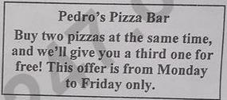
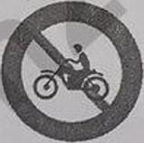

**SỞ GIÁO DỤC VÀ ĐÀO TẠO**

**KỲ THI TUYỂN SINH VÀO LỚP 10 THPT**

THÀNH PHỐ CẦN THƠ

NĂM HỌC 2025-2026

**ĐỀ CHÍNH THỨC**

Khóa ngày 05 tháng 6 năm 2025

(Đề thi có 04 trang)

**MÔN: TIẾNG ANH**

Thời gian làm bài: 60 phút, không kể thời gian phát đề

Mã đề 207

Đề thi gồm 2 phần: Trắc nghiệm và Tự luận

A. PHẦN TRẮC NGHIỆM (7,0 điểm; gồm 28 câu, từ câu 1 đến câu 28).

*Mark the letter A, B, C or D on your answer sheet to indicate the correct answer to each of the following*

questions.

**Question 1:** The teacher ________ is teaching us English is very experienced.

A. which
B. whose
C. whom
D. who

**Question 2:** This charity _________ free meals for old people.

A. presents
B. gives
C. sends
D. provides

**Question 3:** If you get enough sleep, you _________ better.

A. will feel
B. felt
C. have felt
D. would feel

**Question 4:** Our class plans to have the school-year-end party _________ Thursday.

A. at
B. for
C. on
D. in

**Question 5:** Ha Long Bay is considered a famous tourist _________ in Quang Ninh Province.

A. boat
B. destination
C. office
D. company

**Question 6:** _________ she doesn't have free time, she still cooks big meals for her family.

A. Because
B. So
C. However
D. Although

**Question 7:** You should ___________ books to read and have more ideas about your project.

A. turn off
B. look for
C. come in
D. go on

**Question 8:** This river in autumn is __________ than it is in summer.

A. peaceful
B. more peaceful
C. the most peaceful D. as peaceful

**Question 9:** Her classmate came to help her when she _________ math exercises.

A. was doing
B. is doing
C. did
D. does

*Mark the letter A, B, C or D on your answer sheet to indicate the sentence that best completes*

each of the following exchanges.

**Question 10:** Hoa and Tram are talking about next summer holiday.

Hoa: "I'm having a vacation in Ha Tien with my classmates."

Tram: "____________”

A. Not at all.
B. No problem.
C. Have a nice trip!
D. You're welcome.

**Question 11:** Two students are discussing what to do to relax.

Nam: "Let's go on a picnic after the examination."

Linh: “_____________”

A. That's a good idea. B. What a nice gift!
C. I'm fine, thanks.
D. I'm sorry to hear about that.

*Mark the letter A, B, C or D on your answer sheet to indicate the best arrangement of utterances*

or sentences to make a meaningful exchange or text in each of the following questions.

**Question 12:** Dear Grace,

a. During this time, you will also learn more about our company.

b. The interview will last for about 45 minutes.

c. We would like to invite you for an interview at 10 a.m. on 21st September at our offices.

d. I look forward to meeting you.

e. Thank you for your application for the position of sales manager.

Best regards,

Anna Green

A. c – a – b – e – d
B.e – c – b – a – d
C. e – a – c – b – d
D. c – b – a – e – d

**Question 13:** 

a. Todd: I guess I am healthy. I love junk food, but I try to eat lots of fruits to stay healthy.

b. Meg: What kind of fruits do you like to eat?

c. Meg: You look healthy, Todd. Do you eat lots of fruits and vegetables?

A. a – b – c
B. c – b – a
C. c – a – b
D. b – a – c

*Read the following sign or notice and mark the letter A, B, C or D on your answer sheet to indicate the*

correct answer to each of the following questions.

**Question 14:** What does the notice say?

A. Three pizzas cost the same as two on weekdays.

B. You get a free pizza when you buy one pizza.

C. The third time you visit, you get a free pizza.

D. Pedro's Pizza Bar only opens at weekends.

**Question 15:** What does the sign say?

A. Motorbikes must not go this way.

B. Motorbikes cannot avoid this way.

C. Motorbikes should not avoid this way.

D. Motorbikes must go this way.

*Read the following announcement and mark the letter A, B, C or D on your answer sheet to indicate the*

correct option that best fits each of the numbered blanks.

REGISTER TO DO THE DUKE OF EDINBURGH'S AWARD

Your leader: Mr. Jones

What you need to do:

- Fill in the online form with all your details.

- Choose the activities you are interested in (16) __________.

Here are some (17) __________ ideas:

- Supporting older people, picking up rubbish or working with animals

- Joining dance, sport (18) __________ exercise classes

- Playing an instrument, studying a language, learning chess or (19) _________ your life skills

You have to do each activity you choose for at least an hour a week for three months.

For more information, contact Mr. Jones in (20) __________ head office.

**Question 16:**

A. to doing

**Question 17:**

A. use

**Question 18:**

A. or

**Question 19:**

A. reducing

**Question 20:**

A. no article

*Mark the letter A, B, C or D on your answer sheet to indicate the sentence that best combines two*

sentences in the following question.

**Question 21:** My sister likes the new dress. I bought it last Sunday.

A. My sister likes the new dress which I bought last Sunday.

B. My sister likes the new dress who bought it last Sunday.

C. My sister likes the new dress who I bought it last Sunday.

D. My sister likes the new dress which I bought it last Sunday.

*Mark the letter A, B, C or D on your answer sheet to indicate the sentence that is closest in meaning to*

the original sentence in the following question.

**Question 22:** "Will you join The Lantern Festival when you come to Hoi An?" Minh asked me.

A. Minh asked me if he will join The Lantern Festival when he comes to Hoi An.

B. Minh asked me if he would join The Lantern Festival when he came to Hoi An.

C. Minh asked me if I would join The Lantern Festival when I came to Hoi An.

D. Minh asked me if I will join The Lantern Festival when I come to Hoi An.

*Read the following passage and mark the letter A, B, C or D on your answer sheet to indicate the best*

answer to each of the following questions.

It is common among parents to complain about the viewing habits of TV addicted teens. Do they know

something kids don't? Well, according to a recent study, too much TV could increase the odds of becoming

depressed as an adult.

Researchers observed a sample of about 4,100 American teenagers for seven years. When first

surveyed in 1995, they watched TV for an average of 2.3 hours each day. They also spent 37 minutes watching

videos, 25 minutes playing computer games and 2.3 hours listening to the radio.

In 2002, when the same group was interviewed, 7.4% of them had developed symptoms of depression.

The study showed that the number of hours of TV watched per day increased the risk of becoming depressed

while similar activities, such as playing computer games and watching videos, did not. Teens who became

depressed watched an average of 22 more minutes of TV per day than their peers. That relationship suggests

that TV may be a part of the problem.

The results don't prove that TV viewing itself makes us feel sad or moody, but the evidence suggests

a clear link. If you are a teenager, the next time your parents shout, "Turn that thing off!" don't roll your eyes

and ignore them; go jogging, listen to music, chat online, anything to keep physically, and emotionally healthy!

**Question 23:** What is the main idea of the passage?

A. Listening to the radio has no effect on mental health.

B. Parents should always monitor their children's online activities.

C. Too much TV in teens may be linked to depression later in life.

D. Teenagers should play more computer games to stay healthy.

**Question 24:** The word "increase" in paragraph 1 is OPPOSITE in meaning to _______.

A. promote
B. raise
C. reduce
D. multiply

**Question 25:** The word "they" in paragraph 2 refers to _________.

A. researchers
B. parents
C. adults
D. teenagers

**Question 26:** The word "showed" in paragraph 3 is CLOSEST in meaning to __________.

A. encouraged
B. taught
C. controlled
D. found

**Question 27:** According to the passage, what does the article say about computer games?

A. They are worse than watching videos.
B. They are not as bad as TV.

C. They are better than watching videos.
D. They are just as bad as TV.

**Question 28:** Which of the following is NOT TRUE about the findings in the study?

A. Watching videos was not linked to an increased risk of depression.

B. The study followed teenagers over a period of seven years./

C. Teens who watched more TV had a higher risk of depression.

D. Listening to the radio increased the chances of depression.

B. PHẦN TỰ LUẬN (3,0 điểm; gồm 12 câu, từ câu 1 đến câu 12).

### Part 1. Complete each of the following sentences with the correct forms of the words in the brackets.

**Question 1:** They think _________, so they don't agree with each other. (DIFFERENT)

**Question 2:** The little girl has a _________ of teddy bears in her bedroom. (COLLECT)

**Question 3:** All the countries have to work together to ________ the environment. (PROTECTION)

**Question 4:** Teenagers are __________ about their future because of their fluent English. (CONFIDENCE)

### Part 2. Complete the second sentence so that it has the same meaning as the original one.

**Question 5:** Ted was hard-working, so he got high marks.

→ Because ____________________________________.

**Question 6:** We don't have free time to join the picnic.

→ We wish that they had __________________________.

**Question 7:** Put the garbage in the bins or our school will not be clean.

→ If we ________________________________________.

**Question 8:** Why don't we take regular exercise to stay healthy?

→ Lan suggested _________________________________.

### Part 3. Use the words provided to make meaningful sentences.

**Question 9:** Our class / go to the cinema / last week.

→ ______________________________________________.

**Question 10:** The grandma / read stories to her grandson / 8 o'clock last night.

→ ______________________________________________.

**Question 11:** Instead of / ride motorbikes, / many people should go to work / bus / reduce traffic jams.

→ ______________________________________________.

**Question 12:** The lady / be / such / kind person / she / always spend / her free time/help homeless people

her community.

→ ______________________________________________.

---
**------------------- HẾT -------------------**

---

## 📖 ĐÁP ÁN & HƯỚNG DẪN GIẢI CHI TIẾT

<b>Click to reveal answers & explanations 🔍</b>

HƯỚNG DẪN GIẢI

Thực hiện: Ban chuyên môn Loigiaihay.com

A. PHẦN TRẮC NGHIỆM

| 1. D | 2. D | 3. A | 4. C | 5. B | 6. D | 7. B |
| :---: | :---: | :---: | :---: | :---: | :---: | :---: |
| 8. B | 9. A | 10. C | 11. A | 12. B | 13. C | 14. A |
| 15. A | 16. B | 17. B | 18. A | 19. D | 20. C | 21. A |
| 22. C | 23. C | 24. C | 25. D | 26. D | 27. B | 28. D |

B. PHẦN TỰ LUẬN

**1.** differently

**2.** collection

**3.** protect

**4.** confident

**5.** Ted was hard-working, he got high marks

**6.** we had free time to join the picnic

**7.** don’t put the garbage in the bins, our school will not be clean

Hoặc: put the garbage in the bins, our school will be clean

**8.** taking regular exercise to stay healthy / that we (should) take regular exercise to stay healthy

**9.** Our class went to the cinema last week.

**10.** The grandma was reading stories to her grandson at 8 o’clock last night.

**11.** Instead of riding motorbikes, many people go to work by bus to reduce traffic jams.

**12.** The lady is such a kind person that she always spends her free time helping homeless people in her

community.

