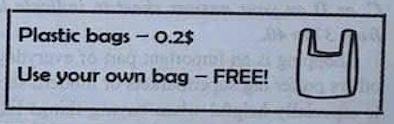
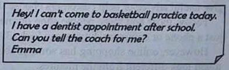

**SỞ GIÁO DỤC VÀ ĐÀO TẠO**

**KỲ THI TUYỂN SINH VÀO LỚP 10 THPT**

HÀ NỘI

NĂM HỌC 2025 – 2026

**Môn thi: TIẾNG ANH**

**ĐỀ CHÍNH THỨC**

Ngày thi: 07/6/2025

(Đề thi gồm có 04 trang)

Thời gian làm bài: 60 phút

Mã đề: 011

Họ và tên thí sinh: .................................................................... Số báo danh:  ............................................................

Lưu ý: - Thí sinh làm bài vào Phiếu trả lời trắc nghiệm và không được sử dụng bất cứ tài liệu nào, kể cả từ điển.

- Giám thị coi thi không giải thích gì thêm.

*Mark the letter A, B, C, or D on your answer sheet to indicate the word whose underlined part differs from the other*

three in pronunciation in each of the following questions.

**Question 1.**

A. beloved

**Question 2.**

A. fashion

*Mark the letter A, B, C or D on your answer sheet to indicate the correct answer to each of the following questions.*

**Question 3.** Two of ______ festivals in Viet Nam are the Ban Flower Festival and the Spring Festival.

A. as famous as
B. the most famous
C. much famous
D. more famous

**Question 4.** While living in France, Marie ______ French quite quickly by interacting with locals daily.

A. put up
B. brought up
C. picked up
D. took up

**Question 5.** The teacher’s kind words of ______ helped me speak confidently in front of the class.

A. encouragement
B. encouraging
C. encouraged
D. encourage

**Question 6.** Emily shares that she failed the drama club interview, and Phuong responds.

– Emily: “I didn’t perform well at our school’s drama club interview.”

– Phuong: “________”

A. I think I should join something else.
B. That club is too hard for them to try.

C. Don’t give up! You’ll have another chance. D. Maybe you should try something more challenging.

**Question 7.** Her daughter didn’t ______ eat chips when she was younger.

A. got used to
B. not use to
C. use to
D. used to

**Question 8.** Your effort and creativity made one of ______ events of our company a huge success.

A. a
B. Ø (no article)
C. an
D. the

**Question 9.** Our English test ______ next Monday at nine o’clock, so please arrive ten minutes early!

A. will be start
B. starts
C. has started
D. starting

**Question 10.** If the cost of public transportation ______ more people ______ it regularly.

A. will decrease – uses
B. decrease – can’t use

C. may decrease – won’t use
D. decreases – will use

*Mark the letter A, B, C, or D on your answer sheet to indicate the word that differs from the other three in the position*

of primary stress in each of the following questions.

**Question 11.**

A. electrical

**Question 12.**

A. culture

*Read the following announcement and mark the letter A, B, C, or D on your answer sheet to indicate the correct*

option that best fits each of the numbered blanks from 13 to 16.

TAKE PART IN A MOCK INTERVIEW FOR A SUMMER JOB

Your friend and you are planning to apply for a summer job in Da Nang. Prepare!

- Choose one of the jobs you’d like. The interview will be (13) ______ July 20ᵗʰ

- Decide who is going to apply and who is going to hire.

- Prepare the interview in pairs.

+ Interviewee: Get ready to present yourself with personal information, qualities, skills, experience and

availability. Prepare (14) ______ questions about what you want to know about the job such as tasks, working hours

and colleagues.

+ Interviewer: Prepare the questions you are going to ask: personal information, qualities, skills, experience and

availability.

- Give the job interview.

- Your classmates will comment on your (15) ______ during the interview.

- For (16) ______ information, contact 19007666.

**Question 13.**

A. in

**Question 14.**

A. much of

**Question 15.**

A. performance

**Question 16.**

A. wider

*Mark the letter A, B, C, or D on your answer sheet to indicate the correct answer to each of the following questions*

from 17 to 18.

(17) ______ It helps people understand each other more clearly by using eye contact, body language, and facial

expressions. (18) ______ Because of these advantages, face-to-face communication is still very important in our daily

lives.

**Question 17.** Choose the TOPIC SENTENCE that can BEGIN the text most appropriately.

A. Face-to-face communication brings many important benefits.

B. Talking in person helps avoid confusion caused by unclear messages.

C. Eye contact and body language help make a message easier to understand.

D. Nowadays, people often text or call instead of meeting in person.

**Question 18.** Put the sentences (a–c) in the correct order, then fill in the blank to make a logical text.

a. Talking in person also builds stronger relationships and creates more trust.

b. These non-verbal signals make the message easier to understand and help avoid confusion.

c. Spending time together allows friends and family to feel closer and more connected.

A. a – c – b
B. c – a – b
C. b – a – c
D. a – b – c

*Mark the letter A, B, C, or D on your answer sheet to indicate the correct option that best fits each of the numbered*

blanks from 19 to 24.

A lot of teenagers love music. It helps them express themselves and connect with others. Teens often listen to

music through headphones or go to concerts with friends. However, (19) ______ good or bad effects on teen behaviour?

Some people believe that music has a couple of positive effects. It can make teens feel better when they are sad,

and it helps them connect (20) ______ like the same music. Also, learning to play an instrument or write songs can

make teens more creative and disciplined.

(21) ______ some people worry about the negative effects. Some songs with violent or bad words might influence

teens to act in risky ways. Music (22) ______ teens’ hearing if they listen to it too loudly through headphones.

Parents (23) ______ an important role in helping teens make good choices about music. They (24) ______ talk to

teens about the meaning of songs and help them avoid harmful music. With the right guidance, music can have a good

influence on teenagers.

**Question 19.**

A. do music has

**Question 20.**

A. with others whom

**Question 21.**

A. Therefore

**Question 22.**

A. hurt also can

**Question 23.**

A. play

**Question 24.**

A. ought

*Mark the letter A, B, C or D on your answer sheet to indicate the sentence that is closest in meaning to the original*

sentence in each of the following questions.

**Question 25.** These old photos remind us of the fun times we had on our family holiday.

A. The fun times we had on our family holiday brings back the memory of these photos.

B. These old photos make us remember the fun times we had on our family holiday.

C. These photos help me experienced the fun times during our family holiday.

D. We took these photos during the fun times we had on our family holiday.

**Question 26.** Linh asked me whether she had to wait there any longer.

A. “Do I have to wait here any longer?” Linh asked me.

B. “Does she has to wait here any longer?” Linh asked me.

C. “Do you have to wait here any longer?” Linh asked me.

D. “Did I had to wait there any longer?” Linh asked me.

*Mark the letter A, B, C or D on your answer sheet to indicate the sentence that is best made from the given cues*

in each of the following questions.

**Question 27.** I / look / forward / present / robotics project / class / winter break.

A. I’m looking forward presenting my robotics project to the class after a winter break.

B. I look forward to present my robotics project to the class after the winter break.

C. I’m looking forward to presenting my robotics project to the class after winter break.

D. I’m looking forward to present my robotics project for the class after winter break.

**Question 28.** The contestant / who / guess / the secret words / stay / in front of / the board.

A. The contestant who guesses the secret words stay in front of the board.

B. The contestant who guesses the secret words stays in front of the board.

C. The contestant who guess the secret words stays in front of the board.

D. The contestant who guess the secret words stay in front of the board.

*Read the following notice or message and mark the letter A, B, C or D on your answer sheet to indicate the correct*

answer to each of the following questions.

**Question 29.** What does the notice say?

A. Customers can get plastic bags free of charge.

B. Customers have to pay for plastic bags.

C. The shop sells two different kinds of bag.

D. The shop doesn’t sell bags to customers.

**Question 30.** What does the message say?

A. Emma is asking you to tell the coach she won’t come.

B. Emma is asking you to reschedule her appointment.

C. Emma wants you to meet her after basketball practice.

D. Emma invites you to go to the dentist with her.

*Read the following passage and mark the letter A, B, C or D on your answer sheet to indicate the correct answer to*

each of the following questions from 31 to 36.

Language is indispensable to humans. It helps us share our thoughts, express our emotions, and understand one

another. Without language, we wouldn’t be able to build relationships or learn from others. Over time, languages have

gradually developed, changing in sounds, grammar, and vocabulary. That’s why the way people speak today is often

very different from how their grandparents spoke.

Around the world, there are thousands of languages. Some are spoken by millions of people, while others are

used by only a small group. Sadly, many of these smaller languages are disappearing. When a language dies, we also

lose part of a culture and history. That’s why many specialists are working hard to protect endangered languages before

they are lost forever.

Not all languages are spoken with voices. Sign languages use hand movements and facial expressions to share

meaning. They are used by people who are deaf or hard of hearing and are just as rich and meaningful as spoken ones.

Learning another language can also help you personally. It can boost your self-confidence, strengthen your brain

and help you understand different cultures. In today’s global world, speaking more than one language can help you open

doors in both life and work.

**Question 31.** According to the passage, the word “boost” is CLOSEST in meaning to ______.

A. worsen
B. lessen
C. reduce
D. improve

**Question 32.** What is the main idea of the passage?

A. Sign languages are more useful than spoken languages.

B. Only major languages help people in daily situations.

C. Language connects people and changes across history.

D. Language is used only for speaking with other people.

**Question 33.** According to the passage, the word “indispensable” is OPPOSITE in meaning to ______.

A. uncommon
B. unimportant
C. unavailable
D. unusual

**Question 34.** Which of the following is TRUE according to the passage?

A. The way people speak today is often the same as how their grandparents spoke.

B. The way people speak today is often similar to how their grandparents spoke.

C. The way people speak today is often like how their grandparents spoke.

D. The way people speak today often differs from how their grandparents spoke.

**Question 35.** Why do a lot of experts want to protect small languages according to the passage?

A. Because they help people travel easily to new places.

B. Because their disappearance means losing culture and history.

C. Because their speakers often forget how to use them.

D. Because they are spoken in places with no written signs.

**Question 36.** What does the passage say about sign languages?

A. They are only used in small schools abroad.
B. They are easier to understand than grammar.

C. They use hands and faces to show meaning.
D. They cannot express feelings in daily life.

Four phrases/sentences have been removed from the text below. For each question, mark the letter A, B, C or D on

your answer sheet to indicate the correct option that best fits each of the numbered blanks from 37 to 40.

Shopping is an important part of everyday life. (37) ______ Some enjoy going to small local shops, while others

prefer big supermarkets or modern shopping malls. In these places, shoppers can look (38) ______. This is especially

helpful when buying things like clothes, shoes, or furniture. Sometimes, shop assistants also give useful advice or help

customers choose the right product.

Today, more and more people shop online. It is easy, fast, and can be done at any time from home. With just a

phone or computer, buyers can look (39) ______. Items are then delivered to their homes.

However, online shopping has some problems. (40) ______ There may also be delivery delays, or the item might

look different from the pictures.

Both online and in-person shopping have advantages, so people can choose what works best for them.

A. People cannot feel or test the product before buying it

B. People visit many kinds of stores to buy food, clothes, and other items

C. at items closely, touch them, and even try them on

D. through hundreds of products and order them with a few clicks

**Question 37.** ______
Question 38. ______
Question 39. ______ Question 40. _______

---
**------------------- HẾT -------------------**

Họ tên, chữ ký của giám thị coi thi số 1: .........................................

Họ tên, chữ ký của giám thị coi thi số 2: .........................................

---

## 📖 ĐÁP ÁN & HƯỚNG DẪN GIẢI CHI TIẾT

<b>Click to reveal answers & explanations 🔍</b>

HƯỚNG DẪN GIẢI

Thực hiện: Ban chuyên môn Loigiaihay.com

| 1. A | 2. A | 3. B | 4. C | 5. A | 6. C | 7. C | 8. D | 9. B | 10. D |
| :---: | :---: | :---: | :---: | :---: | :---: | :---: | :---: | :---: | :---: |
| 11. D | 12. B | 13. D | 14. C | 15. A | 16. D | 17. A | 18. C | 19. B | 20. C |
| 21. C | 22. C | 23. A | 24. D | 25. B | 26. A | 27. C | 28. B | 29. B | 30. A |
| 31. D | 32. C | 33. B | 34. D | 35. B | 36. C | 37. B | 38. C | 39. D | 40. A |

