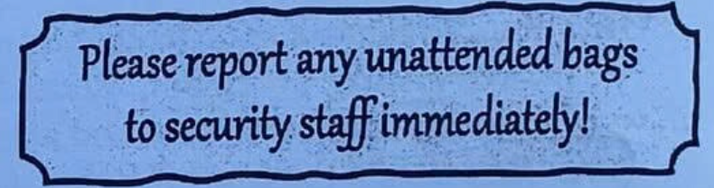
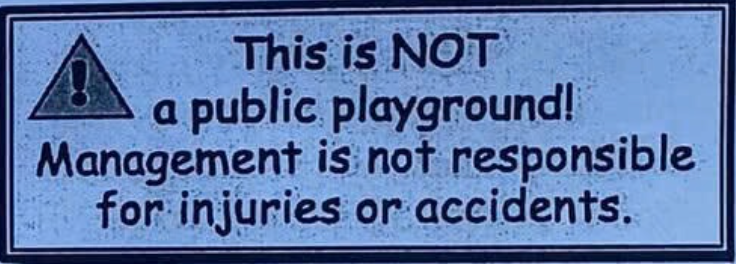

**SỞ GIÁO DỤC VÀ ĐÀO TẠO**

**KỲ THI TUYỂN SINH VÀO LỚP 10 THPT**

HÀ NỘI

NĂM HỌC 2026 – 2027

**Môn thi: TIẾNG ANH**

**ĐỀ CHÍNH THỨC**

Ngày thi: 30/5/2026

(Đề thi gồm có 04 trang)

Thời gian làm bài: 60 phút

Mã đề: 019

Họ và tên thí sinh: .................................................................... Số báo danh:  ............................................................

Lưu ý: - Thí sinh làm bài vào Phiếu trả lời trắc nghiệm và không được sử dụng bất cứ tài liệu nào, kể cả từ điển.

- Giám thị coi thi không giải thích gì thêm.

*Mark the letter A, B, C, or D on your answer sheet to indicate the word that differs from the other three in the position*

of primary stress in each of the following questions.

**Question 1.**

A. suddenly

**Question 2.**

A. emotiona

*Mark the letter A, B, C, or D on your answer sheet to indicate the sentence that is closest in meaning to the original*

sentence in each of the following questions.

**Question 3.** “Don’t forget to bring your student card to the library,” I said to NanA.

A. I asked Nana not to forget bringing her student card to the library.

B. I remind Nana of bringing her student card to the library.

C. I reminded Nana to bring her student card to the library.

D. I tell Nana not to forget to bring her student card to the library.

**Question 4.** Students who don’t organise their ideas before writing complete their essays more slowly than those who

start with a plan.

A. Students who organise their ideas before writing complete their essays more slower than those who start without a

plan.

B. Students who organise their ideas before writing complete their essays more quicker than those who start without a

plan.

C. Students who organise their ideas before writing complete their essays more quickly than those who start without a

plan.

D. Students who start without a plan complete their essays quicker than those who organise their ideas first.

*Read the following announcement and mark the letter A, B, C, or D on your answer sheet to indicate the correct*

option that best fits each of the numbered blanks.

GREEN SCHOOL WEEK

To help protect the environment, all students are invited to join Green School Week.

Please follow these instructions:

•
Sign up for the activity (5) ______ the school website before Friday.

•
Remember to (6) ______ a clear goal for your group before you start.

•
Bring (7) ______ reusable water bottle instead of buying plastic ones.

•
Try to (8) ______ down on plastic waste by reusing bags and boxes whenever possible

**Question 5.**

A. by

**Question 6.**

A. set

**Question 7.**

A. few

**Question 8.**

A. turn

*Read the following passage and mark the letter A, B, C, or D on your answer sheet to indicate the correct answer to*

each of the following questions.

For young people, planning a career now means more than choosing a job they like. They also need to

understand how work is changing. In the past, a person might learn one set of skills and use it for many years. Today,

however, technology and new customer needs are changing the way people work.

Automation is one clear example. When a machine can do a task faster, more accurately and at a lower cost, that task

may become obsolete. This has happened to some simple jobs in ticket offices, factories and service counters. However,

technology does not only take work away. It also creates new opportunities in fields such as online business, video

editing, digital services and software development.

Because of these changes, workers need more than technical knowledge. They often have to collaborate with

other people, share information, and solve problems together. A doctor may work with nurses and technicians to manage

digital records, and a hairdresser may use an online booking app to arrange visits and communicate with customers

before they arrive. Even jobs that seem practical or traditional may now require basic digital skills.

There is no single career path that suits every student. University may be the right choice for some, while

vocational courses may help others prepare for skilled work sooner. To build a successful future, teenagers should

develop useful skills, stay curious, and be prepared for further changes in the job market.

**Question 9.** The word “obsolete” in paragraph 2 is OPPOSITE in meaning to ______.

A. useful and up-to-date
B. cheap and common

C. simple and repeated
D. useless and outdated

**Question 10.** The word “It” in paragraph 2 refers to ______.

A. machine
B. technology
C. business
D. work

**Question 11.** The word “collaborate” in paragraph 3 is CLOSEST in meaning to ______.

A. work longer
B. work alone
C. work harder
D. work together

**Question 12.** Which of the following is TRUE according to the passage?

A. Students should believe that one career path is suitable for everyone.

B. Workers in practical jobs never need to use digital tools at work.

C. Automation can change some jobs, but technology can also create new roles.

D. Hairdressers use online booking apps to avoid meeting customers.

**Question 13.** According to the passage, why might a hairdresser use an online booking app?

A. To make appointments with customers before their arrivals.

B. To work without speaking to any other people.

C. To stop customers from visiting the salon in person.

D. To replace all practical skills needed in hairdressing.

**Question 14.** What is the main idea of the passage?

A. Students should choose one job and never change their career plans.

B. Teenagers should build skills to adapt to changes in the job market.

C. Technology has made all practical jobs disappear from the future job market.

D. Vocational courses are always better than university courses for teenagers.

*Mark the letter A, B, C, or D on your answer sheet to indicate the correct answer to each of the following questions.*

**Question 15.** The students at Sentosa School suggested using leftover food from the school ______ to make biogas.

A. playground
B. gym
C. library
D. cafeteria

**Question 16.** ______ a healthy lifestyle helps teenagers reduce stress and study more effectively.

A. With maintaining
B. Maintain
C. Have maintained
D. Maintaining

**Question 17.** If you visit a new place, ______ its culture and customs to behave appropriately.

A. will learn
B. be learn
C. learn
D. learning

**Question 18.** Ms. Lan has just helped a foreign tourist find the way to the nearest bus stop.

Tourist: “Thank you very much for your help.”

Ms. Lan: “________”

A. No problem!
B. Certainly!

C. You can say that again.
D. You’re absolutely right!

**Question 19.** Teaching young children can be a ______ job because it requires energy, creativity, and patience.

A. hard-working
B. demanding
C. private
D. simple

**Question 20.** Back then, her mother ran a small stall in the village market, and she always ______ fresh vegetables to

nearby families.

A. was selling
B. sells
C. has sold
D. sold

**Question 21.** Her grandson has taken a coding course to ______ his dream of becoming a software developer.

A. make
B. carry
C. pursue
D. win

**Question 22.** The more time teenagers spend on social media, ______ for outdoor activities.

A. the less time they have
B. they have fewer time

C. the less time do they have
D. the fewer time they have

*Mark the letter A, B, C, or D on your answer sheet to indicate the sentence that is best made from the given cues in*

each of the following questions.

**Question 23.** Green Café / wooden tables / create / warm atmosphere / often / attract / young people.

A. The Green Café, which wooden tables create a warm atmosphere, often attract young people.

B. The Green Café, whose wooden tables create a warm atmosphere, often attracts young people.

C. The Green Café in which wooden tables create a warm atmosphere often attract young people.

D. The Green Café where wooden tables create a warm atmosphere often attracts young people.

**Question 24.** swimming pool / use / heating equipment / people / swim / cold days.

A. The swimming pool uses a heating equipment, so people can swim for cold days.

B. The swimming pool uses a heating equipment that people can swim for cold days.

C. The swimming pool uses heating equipment, so people can swim on cold days.

D. The swimming pool uses heating equipment enough for people to swim in cold days.

*Mark the letter A, B, C, or D on your answer sheet to indicate the correct answer to each of the following questions*

from 25 to 26.

**Question 25.** Choose the correct sentence to complete the first half of the following text.

To save energy at school, students should practise a few simple habits. To begin with, try to avoid wasting energy during

lessons and at break time. ______

A. This means turning off lights, fans, and electronic devices when they are not in use, especially when leaving the

classroom.

B. However, students need to keep the schoolyard completely clean by picking up trash and putting plastic bottles into

the correct recycling bins.

C. In short, learners must stop using all electronic devices during their lessons and only read printed books to save the

school’s electricity.

D. Otherwise, the school can save a lot of money on monthly electricity bills and help the earth become a greener place.

**Question 26.** Reorder the following sentences to complete the second half of the text in a logical way.

a. By taking these simple actions, students can help reduce energy waste and protect the environment.

b. Finally, they should advise their classmates to save energy and work together to build good habits in the classroom.

c. Next, they should make use of sunlight and fresh air whenever possible by opening windows instead of using electric

lights and air conditioners.

A. a - b - c
B. c - b - a
C. b - c - a
D. b - a - c

*Mark the letter A, B, C, or D on your answer sheet to indicate the word whose underlined part differs from the other*

three in pronunciation in each of the following questions.

**Question 27.**

A. exhausted

**Question 28.**

A. campus

*Mark the letter A, B, C, or D on your answer sheet to indicate the correct option that best fits each of the numbered*

blanks.

MANAGING YOUR TIME BETTER

Many teenagers feel stressed because they have too much schoolwork and too many activities after class. To

study more effectively, students should build good time-management habits. One useful way is to make a clear timetable

and write down important tasks. This helps students avoid forgetting homework or leaving everything until the last

minute.

Students can also divide big tasks into smaller steps. For example, instead of trying to finish a whole project in

one evening, they can complete one part each day. This makes the work less difficult and gives students more

confidence. (29) ______ can also help them stay calm before exams.

Another useful habit is to keep away from distractions while studying. Students should turn off unnecessary

notifications and choose a quiet place to work. This (30) ______ their lessons more carefully and finish their homework

faster.

Good time management is not only about studying. Teenagers also need time for rest, exercise and family. If

they plan their day well, they can have enough time to relax without feeling guilty. This can improve both their physical

and mental health. It may also help them (31) ______ better results at school.

However, students should not make their timetable too strict. A good plan should be realistic and flexible. When

something unexpected happens, they can change their schedule instead of feeling stressed. Learning to manage time

well is an important skill because it has a strong (32) ______ students’ future success. If (33) ______ students practise

these habits regularly, they will become more independent and responsible. They will understand that (34) ______ is

not only about working hard, but also about working wisely.

**Question 29.** 

A. These steps are simple
B. These simple are steps

C. These steps simple
D. These simple steps

**Question 30.** 

A. allows students to review
B. allows students reviewing

C. students allows to review
D. allows to students review

**Question 31.** 

A. achieve
B. revise
C. ignore
D. appear

**Question 32.** 

A. access of
B. distance from
C. link between
D. connection to

**Question 33.** 

A. Unless
B. If
C. During
D. Although

**Question 34.** 

A. successive
B. succeed
C. successful
D. success

*Read the following notice or message and mark the letter A, B, C, or D on your answer sheet to indicate the correct*

answer to each of the following questions.

**Question 35.** What does the message mean?

A. You should move strange bags away from public areas yourself.

B. You must tell security staff if you see a bag left alone.

C. You should take lost bags to your home and check them later.

D. You can open unattended bags to find the owner’s name.

**Question 36.** What does the notice say?

A. The playground opens only during certain hours for visitors.

B. Visitors may enter this playground with the permission.

C. Public visitors may play here if they follow rules.

D. Staff are not responsible if people get hurt here.

Four phrases/sentences have been removed from the text below. For each question, mark the letter A, B, C, or D on

your answer sheet to indicate the correct option that best fits each of the numbered blanks.

PRESERVING TRADITIONS IN MODERN LIFE

Many young people today live in a fast-changing world. They use smartphones, study online and enjoy modern

forms of entertainment. However, (37) ______. Many schools and families are finding creative ways to teach teenagers

about cultural heritage. For example, many families still prepare traditional dishes during festivals and special occasions.

Grandparents often teach children how to make spring rolls, sticky rice or other local dishes. These activities (38) ______

and understand the value of family traditions more clearly.

Traditional games are also worth preserving. In the past, (39) ______. Today, some schools organize Cultural

Days, where students can try these games and learn about their meanings. Digital tools can also be used to introduce

traditional music, costumes and festivals to young people through online videos and digital stories.

Preserving traditions does not mean refusing modern life. Instead, it means choosing useful ways to keep

cultural values alive. Young people can share photos of family festivals online, interview older family members or learn

traditional songs from their grandparents. They can also join local cultural events (40) ______.

In conclusion, traditions help young people understand who they are and where they come from. When traditions

and modern life go together, culture can continue to grow in meaningful ways.

A. help them learn practical skills

B. to understand traditions better

C. traditional customs still play an important role in family and community life

D. children often played folk games in the village yard or school playground

**Question 37.** ______
Question 38. ______
Question 39. ______ Question 40. _______

---
**------------------- HẾT -------------------**

Họ tên, chữ ký của giám thị coi thi số 1: .........................................

Họ tên, chữ ký của giám thị coi thi số 2: .........................................

---

## 📖 ĐÁP ÁN & HƯỚNG DẪN GIẢI CHI TIẾT

<b>Click to reveal answers & explanations 🔍</b>

HƯỚNG DẪN GIẢI

Thực hiện: Ban chuyên môn Loigiaihay.com

| 1.C | 2.B | 3.C | 4.C | 5.D | 6.A | 7.C | 8.C | 9.A | 10.B |
| :---: | :---: | :---: | :---: | :---: | :---: | :---: | :---: | :---: | :---: |
| 11.D | 12.C | 13.A | 14.B | 15.D | 16.D | 17.C | 18.A | 19.B | 20.D |
| 21.C | 22.A | 23.B | 24.C | 25.A | 26.B | 27.D | 28.B | 29.D | 30.A |
| 31.A | 32.D | 33.B | 34.D | 35.B | 36.D | 37.C | 38.A | 39.D | 40.B |

