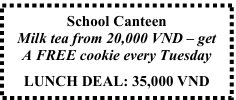

**SỞ GIÁO DỤC VÀ ĐÀO TẠO**

**KỲ THI TUYỂN SINH LỚP 10 THPT NĂM HỌC 2025 – 2026**

THÀNH PHỐ HỒ CHÍ MINH

KHÓA NGÀY 06, 07 tháng 6 năm 2025

**MÔN THI: TIẾNG ANH**

**ĐỀ CHÍNH THỨC**

Ngày thi: 06 tháng 6 năm 2025

(Đề thi gồm 04 trang)

Thời gian làm bài: 90 phút (Không tính thời gian phát đề)

I. Choose the word / phrase / sentence (A, B, C or D) that best fits the space or best answers the question

given in each sentence. (3.5 pts) (Từ câu 1 đến câu 14, thí sinh chỉ viết mẫu tự A, B, C hoặc D đại diện cho

câu trả lời đúng vào Phần ANSWERS.)

**1.** Which word has the underlined part pronounced differently from that of the others?

A. delayed
B. frightened
C. remembered
D. attacked

**2.** Which word has the underlined part pronounced differently from that of the others?

A. plane
B. training
C. lack
D. table

**3.** Which word has a different stress pattern from that of the others?

A. answer
B. repeat
C. surprise
D. decide

**4.** Which word has a different stress pattern from that of the others?

A. brilliant
B. tradition
C. dangerous
D. serious

**5.** Henry: I have found some difficult words in this reading passage!

Sophie: You should ______ in the dictionary for their meanings.

A. look them for
B. look them up   C. look them at   D. look them on

**6.** Taylor: When do people celebrate Father’s Day in America?

Jane: It is annually celebrated ______ the third Sunday of June.

A. on
B. in
C. at
D. from

**7.** Minh: Have you ever been to Hanoi?

Hoang: Yes, I ______ there last year with my family.

A. go
B. am going
C. went
D. have gone

**8.** Duy: Which place is usually favored for photo shooting, the mountain or the sea?

Khang: I  ______ the mountain. The views there are often amazing!

A. like more
B. prefer
C. love more
D. dislike

**9.** Jack: Did everything go well with your presentation yesterday?

Lucy: I had prepared everything carefully, _____ the projector didn’t work, unfortunately.

A. so
B. because
C. but
D. although

**10.** Ms Lan: What’s your favorite holiday destination?

Ms Mai: I love a town or city _____ has quiet streets and a lot of museums.

A. who
B. who m
C. that
D. whose

**11.** Mark: Hey, Alice! You look really happy today. What’s going on?

Alice: Hi, Mark! I’m so ______ about our school trip this Saturday.

A. amazed
B. confused
C. worried
D. excited

**12.** John: What’s the weather like today?

Sam: It’s sunny and warm – a perfect day ______ a walk!

A. for
B. on
C. in
D. through

**13.** Danny: Are you free after work? Shall we do some shopping together?

Emma: ______

A. Oh, I need to buy something. Let’s do it!
B. I’m not sure. Don’t worry about the time.

C. Perfect! I can’t make it for this evening.
D. OK, have a good time there.

**14.** Anna: _______

Ben: It starts at 7:15 pm. Don’t be late!

A. How long does the film last?
B. We’re arriving there at 7:15, aren’t we?

C. What time does the movie start?
D. When did you reach the theatre yesterday?

II. Look at the sign or the notice. Choose the best answer (A, B, C or D) for questions 15 and 16.

(Từ câu 15 đến câu 16, thí sinh chỉ viết mẫu tự A, B, C hoặc D đại diện cho câu trả lời đúng vào Phần

ANSWERS.) (0.5 pt)

**15.** What does the sign say?

A. You are not allowed to jump into the water.

B. You must be careful when jumping up and down.

C. Jumping into the water alone is great fun.

D. Before you jump into the water, ask for help.

**16.** What does the notice tell us?

A. You buy milk tea and get a free cookie every day.

B. Milk tea and cookies are always free on Tuesday.

C. You will get a free cookie when you buy milk tea on Tuesday.

D. You get milk tea and a cookie for 35,000 VND every day.

III. Choose the word (A, B, C or D) that best fits each space in the following passage. (1.5 pts)

(Từ câu 17 đến câu 22, thí sinh chỉ viết mẫu tự A, B, C hoặc D đại diện cho câu trả lời đúng vào Phần

ANSWERS.)

Dear Mai,

I hope this letter finds you well. Thanks to your lovely letter, which advised me to do something (17)

______ a hobby but still beneficial for the community, I’m delighted to let you know that I have (18) ______

the  school cooking club. Now I cook meals for old people in our neighborhood every Friday. We usually

make simple dishes such as rice, soup, fish and vegetables. We also come to the homes of those who have find

it difficult to go out and about and give them the fresh food. (19) _____ the elderly who live alone feel very

happy to see us.

I love their smile weh they receive the meats. They often share their favorite (20) _____, which help us

enrich our offered menu. Sometimes, we even sing songs together to create a joyful atmosphere.

I enjoy talking with them and (21) _____ to their stories. Interestingly, they are willing to tell us about

their families and how optimistic they are about their grandchildren’s future. It’s always great to help others

and learn kindness. I know you are doing the same thing at your school too. Let’s both try to make community

(22) ______!

Love,

Lan

**17.**

A. on

**18.**

A. got

**19.**

A. Some of

**20.**

A. cookers

**21.**

A. learning

**22.**

A. harder

IV. Read the following passage. Decide whether the statements from 23 to 26 are True or False and choose

the correct answer (A, B, C or D) for questions 27 and 28. (1.5 pts)

(Từ câu 23 đến câu 26, thí sinh viết đầy đủ từ True hoặc False vào ô trả lời. Mọi cách viết khác đều không

được chấm điểm. Đối với câu 27 và 28, thí sinh chỉ viết mẫu tự A, B, C hoặc D vào ô trả lời đúng trong

phần ANSWERS.)

Today, many teenagers are attracted to screen-based activities such as online games, social media or

web surfing. But if they haven’t tried playing a sport yet, now is the perfect time to give it a try!

Playing sports offers numerous benefits for teenagers, both physically and mentally. It helps them stay

healthy by keeping their bodies active. Physical activities make teens’ hearts stronger and give them more

energy. Sports help the brain work better, so teens can focus more easily in class. Through sports, teens also

learn values and sportsmanship. Team sports teach them that the team’s success depends on how well the

players work together. They learn to prioritise the team’s interests over individual performance. These ways

of thinking aren’t just they can become more organized and responsible. On top of that, playing sports is a

great way to reduce stress. Spending time with friends through games also makes teens more relaxed and

socially connected.

To conclude, playing sports helps teenagers be physically fitter, think more positively, and build better

relationships. Therefore, teenagers should take up a sport they enjoy!

**23.** A lot of young boys and girls are now fond of online activities.

**24.** Sports have some bad effects on teens’ concentration in class.

**25.** Palying sports is stressful because of its competition.

**26.** Building relationships is one of the benefits of playing sports.

**27.** What is the main idea of the passage?

A. The negative side of screen-based activities

B. The benefits of playing sports for teens

C. The effectiveness of time management in sports.

D. Teenagers' responsibilities in society

**28.** Which of the following is NOT mentioned in the text?

A. Having a balanced diet makes teenagers much healthier.

B. Playing sports improves teen’s focus on their schoolwork.

C. Sports help teens develop both physically and mentally.

D. Playing with friends through games is quite relaxing.

V. Use the correct form of the word given in each sentence. (1.5 pts)

(Từ câu 29 đến câu 34, thí sinh viết câu trả lời vào Phần ANSWERS.)

**29.** The amusement park is a popular ______________ for children in summer.  (attract)

**30.** They are glad to move into a new house with ______________ surroundings. (please)

**31.** To have a successful gala, we spent weeks ______________ for the music performances. (prepare)

**32.** ____________, the new employee finished the project ahead of schedule. (amaze)

**33.** The students had a beneficial meeting with leading ______________ on conservation. (science)

**34.** Climate change has caused ______________ storms around the world. (damage)

VI. Look at the entry of the word “provide” in a dictionary. Use what you can get from the entry to complete

the sentences with two or three words. (0.5 pt)

provide /prəˈvaɪd/

verb

to give something to somebody or make it available for them to use

SYNONYM supply

• Please provide the following information.

• The exhibition provides an opportunity for local artists to show their work.

• We did not provide any evidence to substantiate the claims.

• We are here to provide a service for the public.

• We provide financial support to low-income families.

(Từ câu 35 đến câu 36, thí sinh phải viết cụm từ cần điền để hoàn chỉnh mỗi câu bên dưới)

**35.** Volunteers are ready to ______________________________ about how to get to the museum.

**36.** The summer program ______________________________ for learners to better their English skills.

VII. Rewrite each of the following sentences in another way so that it means almost the same as the sentence

printed before it. (1.0 pt)

(Từ câu 37 đến câu 40, thí sinh viết câu trả lời vào Phần ANSWER.)

**37.** Something went wrong with our car on the way to the beach.

→ Our car broke _____________________________________________________.

**38.** If he doesn’t catch the first metro, he will be late for the conference.

→ Unless he ________________________________________________________.

**39.** The last time she wrote to her grandparents was last April.

→ She hasn’t ________________________________________________________.

**40.** The weather was so awful that we couldn’t go picnicking as planned.

→ It was such ________________________________________________________.

THE END OF THE TEST

---

## 📖 ĐÁP ÁN & HƯỚNG DẪN GIẢI CHI TIẾT

<b>Click to reveal answers & explanations 🔍</b>

HƯỚNG DẪN GIẢI

Thực hiện: Ban chuyên môn Loigiaihay.com

| 1. D | 7. C | 13. A | 19. A | 25. False | 31. preparing |
| :---: | :---: | :---: | :---: | :---: | :---: |
| 2. C | 8. B | 14. C | 20. D | 26. True | 32. Amazingly |
| 3. A | 9. C | 15. A | 21. C | 27. B | 33. scientists |
| 4. B | 10. C | 16. C | 22. B | 28. A | 34. damaging |
| 5. B | 11. D | 17. B | 23. True | 29. attraction | 35. provide information |
| 6. A | 12. A | 18. C | 24. False | 30. pleasant | 36. provides an opportunity |

**37.** down on the way to the beach

**38.** catches the first metro, he will be late for the conference

**39.** written to her grandparents since last April

**40.** awful weather that we couldn’t go picnicking as planned

