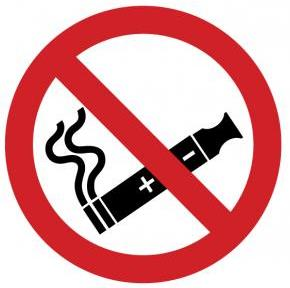

LƯU Ý QUAN TRỌNG: Đề thi gồm 04 trang. Thí sinh làm bài ngay trên đề thi này. Thí sinh phải làm đúng theo hướng dẫn cách ghi
câu trả lời ở mỗi phần. Bài làm chỉ được chấm ở các phần ANSWERS. Mọi cách ghi khác đều KHÔNG được chấm điểm.

I. Choose the word / phrase / sentence (A, B, C or D) that best fits the space or best answers the question
given in each sentence. (3.5 pts) (Từ câu 1 đến câu 14, thí sinh chỉ viết mẫu tự (A, B, C hoặc D) đại diện cho
câu trả lời đúng vào Phần ANSWERS.)
1. Which word has the underlined part pronounced differently from that of the others?
A. avoided
B. frightened
C. attracted
D. suggested
2. Which word has the underlined part pronounced differently from that of the others?
A. chemist
B. sensor
C. pencil
D. device
3. Which word has a different stress pattern from that of the others?
A. listen
B. control
C. begin
D. decide
4. Which word has a different stress pattern from that of the others?
A. brilliant
B. beautiful
C. natural
D. important
5. Son: Where should I put the vegetables you bought from the supermarket?
Mom: You’d better put them _____ the fridge.
A. in
B. with
C. at
D. to
6. Claire: I haven’t had any revision for the English exam.
Teacher: I think you should start now, _____ it will be too late.

A. and
B. nor
C. so
D. or
7. Thomas: Have you ever visited the Museum of Fine Arts?
Daisy: Yes, I _____ there with my classmates last summer.

A. go
B. am going
C. went
D. have been
8. Khoa: The new metro system in Ho Chi Minh City is useful.
Thanh: It is. It reduces _____.
A. traffic jams
B. power cuts
C. building sites
D. road signs
9. Jack: What’s your cousin like?
Sarah: He’s _____. He always tells the truth.
A. careful                            B. noisy
C. honest                            D. busy
10. Salesman: This smart watch has features _____ can track your sleep pattern and heart rate.
Customer: That sounds wonderful! How much is it?

A. who
B. whom
C. that
D. whose
11. Anh: You should watch English movies without _____ to improve your listening skills.
Nam: Oh, thanks for your advice.
A. themes
B. subtitles                       C. lyrics
D. details

1

| 12. Han: A cleaning robot is really for family life. _____ Nhien: I totally agree, but it’s rather expensive, isn’t it? A. convenient B. stressful C. dangerous D. talkative 13. Linda: _____ Jimmy: I’ve got a terrible stomachache. A. What are you doing? B. What’s the matter with you? C. What’s your plan for the weekend? D. What are you up to? 14. David: Would you like another cup of tea? Dennis: . I have had enough already. _____ A. No problem B. Sure |  |  |
| :---: | :---: | :---: |
|  | 12. 13. 14. |  |

**12.** Han: A cleaning robot is really _____ for family life.
Nhien: I totally agree, but it’s rather expensive, isn’t it?
A. convenient
B. stressful
C. dangerous
D. talkative
13. Linda: _____
Jimmy: I’ve got a terrible stomachache.
A. What are you doing?
B. What’s the matter with you?
C. What’s your plan for the weekend?                           D. What are you up to?
14. David: Would you like another cup of tea?
Dennis: _____. I have had enough already.
A. No problem
B. Sure
C. Yes, please
D. No, thanks
II. Look at the sign or the notice. Choose the best answer (A, B, C or D) for questions 15 and 16. (0.5 pt)
(Từ câu 15 đến câu 16, thí sinh chỉ viết mẫu tự (A, B, C hoặc D) đại diện cho câu trả lời đúng vào Phần
ANSWERS.)

**15.** What does the sign say?
A. You should not use batteries here.
B. You must not use electricity for charging devices.
C. E-cigarettes are not allowed here.
D. All electronic devices are banned.

SALES
TOMORROW
Half price for two weeks only!

**16.** What does the notice tell us?
A. Some items in this store will soon be free of charge.
B. It’s possible to get cheap items in this shop now.
C. The special sales will last for 14 days.
D. You can buy only two items at half price tomorrow.

III. Choose the word (A, B, C or D) that best fits each space in the following passage. (1.5 pts)
(Từ câu 17 đến câu 22, thí sinh chỉ viết mẫu tự (A, B, C hoặc D) đại diện cho câu trả lời đúng vào Phần
ANSWERS.)

Deepfake technology has challenged the relationship between seeing and believing. A deepfake is a digitally
changed image, video or audio recording that makes a person (17)_____ to say or do something they never
actually said or did. Although image controlling is not new, recent advances in artificial intelligence have made the
deepfakes more realistic, cheaper to produce, and (18)_____ to spread. As a result, deepfakes have come into
entertainment, business and personal life. (19)_____ a deepfake is released, it continues to influence public
opinion. A convincing fake video at a sensitive moment could damage a person’s (20)_____, affect opinions, or
create panic before the truth is proved. Misinformation has a bad effect (21)_____ the public even after it is
corrected. (22)_____, deepfakes even make the public disbelieve and doubt all real information. Therefore,
everyone should treat information with caution.

2

**17.**

A. appearing

**18.**

A. bigger

**19.**

A. When

**20.**

A. way

**21.**

A. in

**22.**

A. Luckily

IV. Read the following passage. Decide whether the statements from 23 to 26 are True or False and choose
the correct answer (A, B, C or D) for questions 27 and 28. (1.5 pts)
(Từ câu 23 đến câu 26, thí sinh viết đầy đủ từ True hoặc False vào ô trả lời. Mọi cách viết khác đều không được
chấm điểm. Đối với câu 27 và 28, thí sinh chỉ viết mẫu tự (A, B, C hoặc D) đại diện cho câu trả lời đúng vào Phần
ANSWERS.)
I do a lot of mountain hiking, not climbing, so you know I’m talking about using feet, not ropes or pitons, to get
me wherever I want, but my first law of relaxation is never to do a sport where a mistake can mean death.
I recently discovered the hike of a lifetime: Cliff Trail on Vermont’s highest peak, the 4,393-foot (1,338-meter)
Mount Mansfield. There are many ways to climb the Mansfield, but Cliff Trail starts near the top, so I took a van up
there. I was hiking with a local guide.
When we reached our destination, we hiked down a short path to Cliff Trail. For the rest of the morning, instead
of going ever upwards, we climbed down wooden ladders, passed up rock faces, and crossed the side of the
mountain. Besides mostly using feet, we used hands to hold onto roots, arms to pull us over steep rocks, and
shoulders to get through narrow passages. Occasionally, my guide pushed and pulled me through the difficult
spots. I was both scared and excited.
We started at 10 a.m., reached the summit around 3 p.m., and stopped there for a long slow look at Vermont.
The view was marvellous.
23. Pitons are equipment which hikers use.
24. The writer started his Cliff Trail hike from the bottom of the Mansfield.
25. The writer and the guide went down, up, and straight across the side of the mountain.
26. The writer and the guide reached the summit in the afternoon.
27. What is the best title of the passage?
A. Mount Mansfield – the Highest Peak of Vermont
B. Great Help from Local Guides
C. Mountain Climbing – A Risky Sport
D. Cliff Trail – The Hike of A Lifetime
28. What were the writer’s feelings during the hike?
A. fear and excitement
B. worry and regret
C. annoyance and boredom
D. fun and tiredness

3

V. Use the correct form of the word given in each sentence. (1.5 pts)
(Từ câu 29 đến câu 34, thí sinh viết câu trả lời vào Phần ANSWERS.)
29. The world is becoming a ________ village thanks to communication technology.
(globe)
30. We are looking forward to ________ the audience with our impressive variety show.
(entertain)
31. The old lady was ________ enough to wait for her turn at the busy bank.
(patience)
32. The virtual ________ has taken place since May 19th, 2026.
(exhibit)
33. Some music-streaming platforms have ________ published songs without permission.
(legal)
34. In the 19th century, many ________ made great discoveries which changed the world knowledge.   (explore)

**29.** __________________
30.__________________
31.__________________

**32.** __________________
33.__________________
34.__________________

VI. Look at the entry of the word “habit” in a dictionary. Complete the sentences with phrases from the
entry. Do not use more than THREE words for each phrase. (0.5 pt) (Từ câu 35 đến câu 36, dựa vào bảng
bên dưới, thí sinh chọn cụm từ thích hợp (không quá 3 từ) để hoàn chỉnh mỗi câu và viết câu trả lời vào
Phần ANSWERS.)

> ### 📖 Dictionary Entry
>
> habit /ˈhæbɪt/
> noun
> 1. [countable] a thing that you do often and almost without thinking, especially something that is hard to
> stop doing
> - You need to change your eating habits.
> - Most of us have some undesirable habits.
> - The strategy is helping children develop the habit of reading for fun.
> - It's all right to borrow money occasionally, but don't let it become a habit.
> - It’s not easy for children to break the habit of using digital devices while having meals.

**35.** I'm trying to ___________________________________ of staying up too late.

**36.** Your ___________________________________ play an important role in body weight control.

VII. Rewrite each of the following sentences in another way so that it means almost the same as the
sentence printed before it. (1.0 pt)
(Từ câu 37 đến câu 40, thí sinh viết câu trả lời vào Phần ANSWER.)

**37.** Brenda doesn’t have her own locker at school, and she really wants to have one.

 Brenda wishes she  ______________________________________________________________

**38.** It doesn’t matter to Lucie to help her friends with exercises after class.

 Lucie doesn’t mind ______________________________________________________________

**39.** There are no roses left in the shop.

 The shop has run _______________________________________________________________

**40.** Despite the practicality of the project, nobody wanted to carry it out.

 Although the project  ____________________________________________________________

THE END OF THE TEST

4
