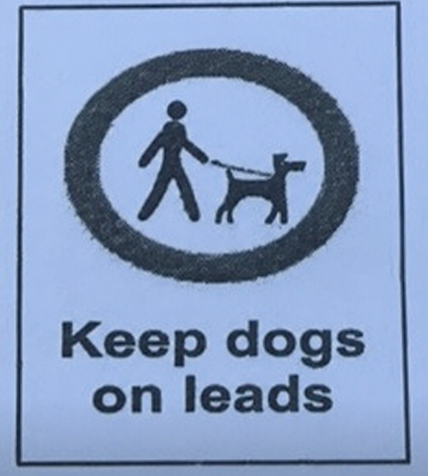

**SỞ GIÁO DỤC VÀ ĐÀO TẠO**

**KỲ THI TUYỂN SINH LỚP 10 THPT**

THÀNH PHỐ HUẾ

NĂM HỌC 2026 – 2027

**Môn thi: Tiếng Anh**

**ĐỀ CHÍNH THỨC**

Thời gian: 60 phút (không kể thời gian phát đề)

(Đề thi có 4 trang)

Mã đề thi 156

*Read the following passage and mark the letter A, B, C or D on your answer sheet to indicate the correct*

word or phrase that best fits each of the numbered blanks from 1 to 7.

Cheaper Holidays

We can save money on all aspects of our holiday, from where and when to go to how to get to and from

the airport; here are some (1) _____ on how to get the most for your money when choosing (2) _____ holiday.

For the best deals, book your holiday between the high and (3) _____ seasons; you could save up to 70%

on some holiday resorts while still enjoying good weather and other high season advantages and there will be

fewer crowds.

You can also save money by going somewhere where living costs are lower. It might cost more to get there

but once you are there, you will (4) _____ less on eating out and getting around as food and transport will be

significantly cheaper.

And start saving before you even leave the country by choosing the most cost-effective way to the airport.

There are many bus services from major cities to airports (5) _____ are cheaper than trains. If you go by train,

book well in advance to get cheaper tickets and if you decide to go by car, book your carparking as soon as

possible; some airports offer up to 50% (6) _____ for early bookings.

Finally, make sure you research all the available options online. Signing up to email alerts can be a good

idea as then you will be the first to know about cheap offers. The earlier you book, the (7) _____ the bargains

are likely to be.

**Question 1.**

A. way

**Question 2.**

A. some

**Question 3.**

A. low

**Question 4.**

A. pay

**Question 5.**

A. who

**Question 6.**

A. over

**Question 7.**

A. best

*Mark the letter A, B, C or D on your answer sheet to indicate the word that differs from the other three in*

the position of the primary stress in each of the following questions from 8 to 9.

**Question 8:**

A. consider

**Question 9:**

A. physics

*Look at the sign/notice and mark the letter A, B, C or D on your answer sheet to indicate the correct answer*

to each of the questions from 10 to 11.

**Question 10:** What does the sign mean?

A. You must lead your dogs out frequently.

B. You must keep your dogs under control.

C. You must let your dogs run about.

D. You must tie your dogs to a post.

**Question 11:** What does the notice say?

A. Members must let the receptionist know when they have finished playing.

B. You must return the club's tennis equipment after using them.

C. You needn't ask a receptionist for any tennis equipment.

D. If you join the club, you should bring your own equipment.

*Mark the letter A, B, C or D on your answer sheet to indicate the word that is CLOSEST in meaning to the*

underlined part in each of the following questions from 12 to 13.

**Question 12.** Humans depend on species diversity to provide food, clean air and water, and fertile soil for

agriculture.

A. supply
B. raise
C. produce
D. prepare

**Question 13.** She decided to turn down the job offer because the salary was too low.

A. accept
B. discuss
C. refuse
D. consider

*Mark the letter A, B, C or D on your answer sheet to indicate the correct answer to each of the following*

questions from 14 to 26.

**Question 14.** I like my current job because of its ______ working hours.

A. flexibility
B. flex
C. flexible
D. inflexible

**Question 15.** Although Minh was very nervous, he managed to ______ his presentation successfully.

A. carry out
B. turn up
C. go off
D. come across

**Question 16.** He left home early to avoid ______ stuck in traffic jams during rush hours.

A. to get
B. got
C. to getting
D. getting

**Question 17.** The more you practise speaking English, ______ confidently you can speak to foreigners.

A. less
B. the more
C. more
D. the less

**Question 18.** Last weekend, my father bought me ______ interesting book about space at the bookshop near

our house.

A. Ø (no article)
B. the
C. an
D. a

**Question 19.** Tourists who can’t visit the museum in person can take a ______ tour on its website.

A. virtual
B. direct
C. physical
D. foreign

**Question 20.** Many scientists recommended that the government ______ strict laws to control deforestation.

A. to apply
B. applying
C. apply
D. applies

**Question 21.** Tim told me that he ______ an email to his friend in America then.

A. was writing
B. would write
C. writes
D. is writing

**Question 22.** They asked their teacher ______ wear uniform to join the trip to the farm the next weekend.

A. if they have to
B. if they had to
C. whether they may  D. whether they must

**Question 23.** We’re going camping this weekend, so we need a/an ______ stove that we can easily pack and

transport.

A. cheap
B. ancient
C. huge
D. portable

**Question 24.** According to the timetable, the train to Da Nang ______ at 6:30 tomorrow morning.

A. left
B. leave
C. leaves
D. is leaving

**Question 25.** If it keeps raining tomorrow, we ______ our eco-tour in the forest.

A. will cancel
B. cancelled
C. could cancel
D. cancel

**Question 26.** I love going to this park ______ it’s the quietest place in the city.

A. because of
B. since
C. despite
D. due to

*Mark the letter A, B, C or D on your answer sheet to indicate the word that is OPPOSITE in meaning to*

the underlined part in each of the following questions from 27 to 28.

**Question 27.** The thick walls were built to protect the village from dangerous wild animals.

A. defend
B. shelter
C. guard
D. attack

**Question 28.** Going snorkelling in the coral reef was an exhilarating experience for me.

A. interesting
B. amazing
C. boring
D. exciting

*Mark the letter A, B, C or D on your answer sheet to indicate the sentence that best COMBINES each pair*

of sentences in the following questions from 29 to 33.

**Question 29.** We all like talking to Jim. His sense of humour is amazing.

A. We all like talking to Jim, whose sense of humour is amazing.

B. Jim, who likes talking about his sense of humour, is amazing.

C. We are talking about Jim, whose sense of humour is amazing.

D. Jim, who has an amazing sense of humour, always likes talking to us.

**Question 30.** The mountain is very high. No one can climb up to the top.

A. The mountain is so high that climbing up to the top is easy.

B. It is such a high mountain that no one can climb up to the top.

C. The mountain is very high since no one can climb up to the top.

D. The mountain is high enough for everyone to climb up to the top.

**Question 31.** She feels more stressful when she works harder.

A. Though she feels more stressful, she works harder.

B. She works harder in spite of her stress.

C. The more stressful she feels, the harder she works.

D. The harder she works, the more stressful she feels.

**Question 32.** Don’t smoke here. It’s harmful to the children.

A. You mustn’t smoke here since it does harm to the children.

B. The children shouldn’t smoke because of its harmful effects.

C. As smoking is harmful, the children aren’t allowed to smoke.

D. You can smoke here with the children although it’s harmful.

**Question 33.** You want to stay healthy. You should play sports.

A. Unless you play sports, you will stay healthy.

B. You will stay healthy if you play sports.

C. If you don’t play sports, you may stay healthy.

D. You may play sports if you stay healthy.

*Mark the letter A, B, C or D on your answer sheet to indicate the correct reply to the situation in each of*

the following questions from 34 to 35.

**Question 34.** Linda: “We’ve just moved to a new house in the countryside”.

Tom: “______”

A. Alright. Why don’t you drop in?

B. Congratulations! I hope you enjoy living there.

C. Exactly. Everyone prefers living in the city.

D. Sure. I moved here three years ago.

**Question 35.** Tim: “Thank you so much for your birthday present. I really love it!”

Nancy: “______”

A. You’re welcome. I’m glad you like it.

B. What a pity! It’s the most expensive.

C. Never mind. It’s my birthday.

D. Don’t worry. I’ll give you a present.

*Mark the letter A, B, C or D on your answer sheet to indicate the sentence that is CLOSEST in meaning to*

the original sentence in each of the following questions from 36 to 40.

**Question 36.** She is very sad because she can’t speak English well.

A. She wishes she could speak English well when she was sad.

B. She wishes she weren’t sad to speak English better.

C. She wishes she were happy when she spoke English.

D. She wishes she could speak English better.

**Question 37.** They were walking in the forest and it started to rain heavily.

A. It started to rain heavily while they were walking in the forest.

B. They were walking in the forest during the heavy rain.

C. It started to rain heavily in the middle of the forest.

D. They walked in the forest after the heavy rain.

**Question 38.** “Why don’t we buy a new bike tomorrow?” said Jim.

A. Jim promised to buy a new bike the next day.

B. Jim denied buying a new bike the following day.

C. Jim suggested buying a new bike the next day.

D. Jim refused to buy a new bike the following day.

**Question 39.** “How can I decorate my house for the important party tonight?” said Jenny.

A. Jenny wondered how could she decorate her house for the important party that night.

B. Jenny asked how she can decorate her house for the important party tonight.

C. Jenny wondered how to decorate her house for the important party that night.

D. Jenny asked her friends how to decorate her house for the important party tonight.

**Question 40.** Public transport is more popular in big cities than in small towns.

A. People in small towns use public transport more often than in big cities.

B. Public transport is less commonly used in big cities than in small towns.

C. People in small towns prefer public transport more than those in big cities.

D. In big cities, people use public transport more often than in small towns.

*Mark the letter A, B, C or D on your answer sheet to indicate the correct arrangement of the sentences to*

make a meaningful conversation in each of the following questions from 41 to 42.

**Question 41.** 

a. We can also use reusable bottles and bags instead of plastic ones.

b. I think we should turn off the lights and fans when we leave the classroom.

c. What should we do to go green at school?

d. I agree. If everyone does these things, our environment will be cleaner.

e. That’s a good idea. What else can we do?

A. c-b-d-a-e
B. c-a-e-b-d
C. c-a-d-b-e
D. c-b-e-a-d

**Question 42.** 

a. Thanks, Nguyen! I practised speaking regularly and watched English videos.

b. Hi, Mai! Your English is getting better. How did you improve it?

c. That sounds great! I will try that to improve my English too.

A. c-a-b
B. b-a-c
C. b-c-a
D. c-b-a

*Mark the letter A, B, C or D on your answer sheet to indicate the word whose underlined part differs from*

the other three in pronunciation in each of the following questions from 43 to 44.

**Question 43.** 

A. intended
B. allowed
C. covered
D. mentioned

**Question 44.** 

A. social
B. local
C. global
D. moral

*Read the following passage and mark the letter A, B, C or D on your answer sheet to indicate the correct*

answer to each of the questions from 45 to 50.

Welcome to life in the future! You get up in the morning and look into the mirror. You’ve recently had a

new anti-aging treatment, so you look like a 30-year-old. And many people your age could live to be 120 now,

so at 60 you’re not old at all.

Science has also found amazing ways to keep people healthy. Nanotechnology can help cure many

illnesses, including cancer. And if any part of your body is unhealthy, you can “grow” a new one in a

laboratory.

As you get dressed, you say to your shirt, “Turn red.” It becomes red. In 2045, “smart” clothes contain

nanoparticles that carry electricity. So you can program clothes to change colors or patterns.

On the way to the kitchen, you want to call a friend. Your cell phone is by the window because it gets its

energy from the sun. But you don’t need to pick up the phone. You can just touch your jacket sleeve to make

the call.

It’s breakfast time. You reach for the milk, but a voice says, “Don’t drink that!” Your fridge knows the

milk is old, and tells the supermarket to replace it. Ten minutes later, it’s delivered by a drone.

As you leave for work, the lights turn off by themselves. Your home goes into the “sleep” mode to save

energy. In 2045, cars drive themselves, so you just tell your driverless car where you want to go.

Will all this come true? Perhaps the future is much closer than we think.

**Question 45.** What is the main idea of the passage?

A. Future technology may change people’s daily lives.

B. People in 2045 will wear the same clothes every day.

C. People in the future will only work from home.

D. Scientists may stop using nanotechnology in 2045.

**Question 46.** What does the writer say about aging in the future?

A. Only young people will receive anti-aging treatment.

B. All people who are 60 can expect to live 120 years.

C. People who are 120 will be very healthy.

D. Age 60 will not be thought of as old.

**Question 47.** According to the passage, what is NOT mentioned as a reason why people are healthier in 2045?

A. New body parts can be grown by scientists.

B. Nanotechnology helps treat dangerous diseases.

C. Robot doctors work in hospitals.

D. Serious illnesses have been cured.

**Question 48.** The word “one” in paragraph 2 refers to ______.

A. science
B. nanotechnology
C. cancer
D. body part

**Question 49.** The phrase “pick up” in paragraph 4 can be best replaced by ______.

A. drop
B. lift
C. hide
D. answer

**Question 50.** Which of the following is TRUE according to the passage?

A. Smart clothes can change colors.

B. Nanotechnology cannot cure cancer.

C. People must drive their own cars.

D. The fridge throws old milk away.

-----THE END-----

---

## 📖 ĐÁP ÁN & HƯỚNG DẪN GIẢI CHI TIẾT

<b>Click to reveal answers & explanations 🔍</b>

HƯỚNG DẪN GIẢI

THỰC HIỆN: BAN CHUYÊN MÔN LOIGIAIHAY.COM

| 1. D | 2. C | 3. A | 4. C | 5. C | 6. D | 7. D | 8. C | 9. B | 10. B |
| :---: | :---: | :---: | :---: | :---: | :---: | :---: | :---: | :---: | :---: |
| 11. B | 12. A | 13. C | 14. A | 15. A | 16. D | 17. B | 18. C | 19. A | 20. C |
| 21. A | 22. B | 23. D | 24. C | 25. A | 26. B | 27. D | 28. C | 29. A | 30. B |
| 31. D | 32. A | 33. B | 34. B | 35. A | 36. D | 37. A | 38. C | 39. C | 40. D |
| 41. D | 42. B | 43. A | 44. D | 45. A | 46. D | 47. C | 48. D | 49. B | 50. A |

