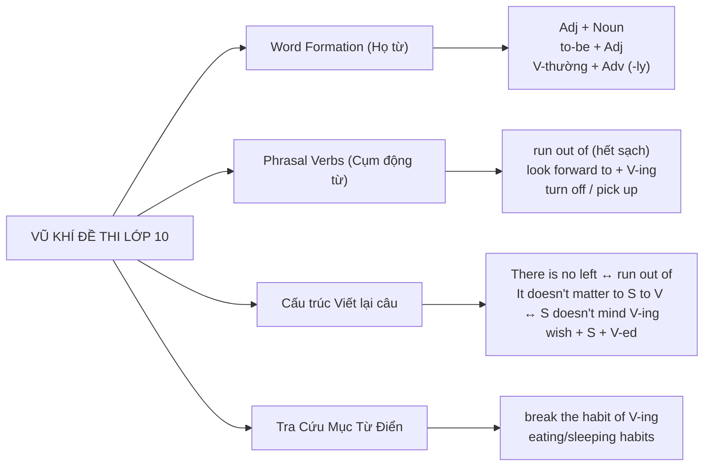

# Day 5: The 24-Hour Life Hack Boss Battle 🏆

Chào mừng Bum đến với trận **Boss Battle** của Tuần 4! Sau 4 ngày rèn luyện liên tục, hôm nay Bum sẽ tổng kết toàn bộ vũ khí ngữ pháp và cấu tạo từ để sẵn sàng chinh phục các câu hỏi thi thật hóc búa nhất trích từ Đề thi tuyển sinh Hà Nội, TP.HCM và Cần Thơ!

---

## 1. Word Power: Mastery & Milestones (Vốn Từ Đỉnh Cao Tuần 4) 🌲

Bộ 5 từ vựng cao cấp giúp Bum nâng tầm diễn đạt và chạm tới mốc điểm 8–9+:

| Base Word | Type | IPA | Vietnamese Meaning | Word Family & Forms | Example Sentence |
| :--- | :---: | :---: | :--- | :--- | :--- |
| **mastery** | *(n)* | /ˈmɑːstəri/ | sự thành thạo, làm chủ | • **master** *(v/n)*: làm chủ / bậc thầy | *Achieving **mastery** of English grammar requires daily practice drills.* |
| **transform** | *(v)* | /trænsˈfɔːm/ | biến đổi, chuyển hóa | • **transformation** *(n)*: sự biến đổi ngoạn mục | *A disciplined routine brings a positive **transformation** to Bum's life.* |
| **discipline** | *(n/v)* | /ˈdɪsəplɪn/ | kỷ luật | • **disciplined** *(adj)*: có tính kỷ luật | *A **disciplined** gamer knows exactly when to stop and study.* |
| **productive** | *(adj)* | /prəˈdʌktɪv/ | năng suất, hiệu quả | • **productivity** *(n)*: năng suất làm việc/học tập | *Putting your smartphone in another room boosts your study **productivity**.* |
| **milestone** | *(n)* | /ˈmaɪlstəʊn/ | cột mốc quan trọng | • **reach a milestone** *(collocation)*: đạt được cột mốc | *Scoring 9 points on the Grade 10 English mock exam is an awesome **milestone**.* |

---

## 2. Grammar Bite: 'Bản Đồ Diệt Bẫy' Tuyển Sinh Tuần 4 ⚡

Hãy ôn lại 4 bí kíp quyết định điểm số trong đề thi tuyển sinh:

### 🎯 4 Công Thức Viết Lại Câu Tuyển Sinh 'Bách Phát Bách Trúng':
1. **Câu Điều Ước (Wish) ở hiện tại**:
   $$\text{S1 + wish(es) + S2 + } \mathbf{V\text{-quá khứ đơn / couldn't + V}}$$
   *(Ví dụ: Bum doesn't have a smartwatch → Bum wishes he **had** a smartwatch.)*
2. **Cấu trúc Không Phiền (Don't Mind)**:
   $$\text{It doesn't matter to [Someone] to V} \iff \text{[Someone] } \mathbf{doesn't\ mind + V\text{-ing}}$$
3. **Cấu trúc Hết Sạch Đồ (Run Out Of)**:
   $$\text{There is no / are no [X] left} \iff \text{Subject + } \mathbf{has/have\ run\ out\ of\ [X]}$$
4. **Cấu trúc Mong Đợi (Look Forward To)**:
   $$\text{S + be eager / excited to V} \iff \text{S + } \mathbf{look(s)\ forward\ to + V\text{-ing}}$$

---

## 3. Real-Life Teen Dialogue: Ready for the Boss Battle 🎧

Đoạn thoại khích lệ tinh thần giữa Bum và AI Buddy Leo trước giờ thử sức:

- **Bum**: "Leo, I can't believe we just finished four days of intense grammar and word formation!"  
  *(Leo ơi, mình không thể tin nổi là chúng ta vừa hoàn thành 4 ngày luyện ngữ pháp và cấu tạo từ căng đét!)*
- **Leo**: "You should be proud of yourself, Bum! Look at your daily scorecards: three stars every single day!"  
  *(Bạn nên tự hào về bản thân đi Bum! Nhìn vào bảng điểm mỗi ngày của bạn xem: ngày nào cũng trọn vẹn 3 ngôi sao!)*
- **Bum**: "Today is the Friday Boss Battle. I will face real exam questions from Hanoi and Ho Chi Minh City, right?"  
  *(Hôm nay là trận Boss Battle thứ Sáu rồi. Mình sẽ đối đầu với các câu hỏi đề thi thật từ Hà Nội và TP.HCM đúng không?)*
- **Leo**: "Exactly! Ten authentic questions are waiting for you. Remember: take your time to analyze the word types and watch out for prepositions."  
  *(Chính xác luôn! 10 câu hỏi chính gốc đang chờ đón bạn. Nhớ nhé: hãy bình tĩnh phân tích từ loại và để mắt tới các giới từ bẫy.)*
- **Bum**: "I'm ready! With my new disciplined study habits, I'm going to defeat this boss battle and unlock another milestone!"  
  *(Mình sẵn sàng rồi! Với nề nếp học tập kỷ luật mới này, mình sẽ hạ gục trận boss battle này và mở khóa một cột mốc mới!)*
- **Leo**: "Let's do this, Champion! The exam room is yours!"  
  *(Triển thôi nào, Nhà vô địch! Phòng thi hôm nay là của bạn!)*

