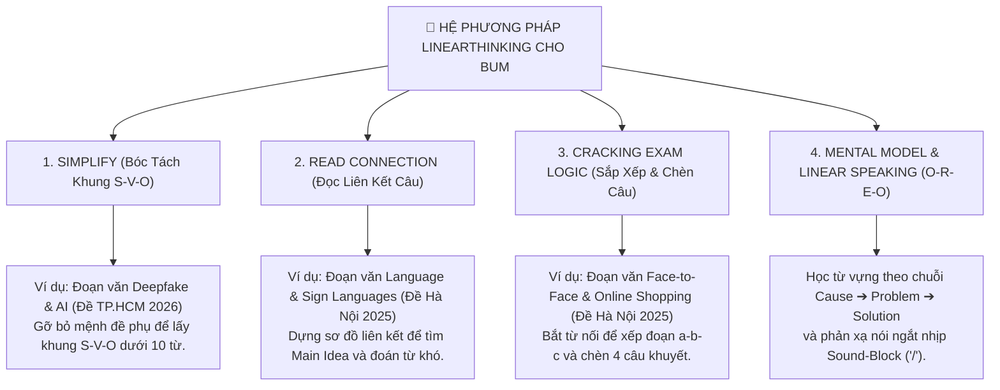

# ⚡ Week 5: Làm Quen Phương Pháp Linearthinking & Sound-Block Chunking Qua Đề Thi Thật 🧠📖🎯

> **Target Audience**: Bum (14 tuổi – THCS Lớp 8/9, chuẩn bị thi vào Lớp 10 THPT)  
> **Level**: CEFR A2 → B1 (Chuyên đề đặc biệt làm chủ tư duy đọc hiểu, bóc tách câu dài và phản xạ tuyến tính)  
> **Cấu trúc chuyên đề**: Không chia lẻ theo từng ngày (Day 1, Day 2) mà gom trọn vào **2 tệp tài liệu cốt lõi** để Bum học liền mạch và thực hành xuyên suốt trên các đoạn văn (*paragraphs*) trích nguyên văn từ Đề thi tuyển sinh Hà Nội 2025, 2026 và TP.HCM 2025, 2026.

---

## 📂 Cấu Trúc Tệp Tin Tuần 5

```
english/lessons/week-05-linearthinking-exam-reading/
├── week-overview.md   # Tổng quan chuyên đề & Bản đồ 4 kỹ thuật Linearthinking
├── 01-knowledge.md    # Cẩm nang 4 kỹ thuật Linearthinking giải phẫu trực tiếp trên Paragraph Đề thi thật
└── 02-exercises.md    # Bài tập thực chiến 5 cấp độ (Level 1 -> 5) trên các Paragraph Đề thi Hà Nội & TP.HCM
```

---

## 🎯 Bản Đồ 4 Kỹ Thuật Linearthinking Trọng Tâm Của Tuần 5



---

## 📋 Danh Mục Các Đoạn Văn Đề Thi Thật Được Sử Dụng Trong Tuần 5

| STT | Tên Đoạn Văn (Paragraph) | Nguồn Đề Thi Chính Thức | Ứng Dụng Kỹ Thuật Linearthinking | Vị Trí Tài Liệu |
| :---: | :--- | :--- | :--- | :---: |
| **1** | **Deepfake Technology & AI** | Đề TP.HCM 2026 (Câu 17–22) | Kỹ thuật 1: **Simplify** (Bóc tách khung `S - V - O` trong câu phức) | `01-knowledge.md` |
| **2** | **Language & Sign Languages** | Đề Hà Nội 2025 (Câu 31–36) | Kỹ thuật 2: **Read Connection** (Liên kết câu & Đoán nghĩa từ *indispensable, boost*) | `01-knowledge.md` |
| **3** | **Face-to-Face Communication** | Đề Hà Nội 2025 (Câu 17–18) | Kỹ thuật 3A: **Topic Sentence & Sentence Ordering** (Sắp xếp đoạn a–b–c) | `01-knowledge.md` |
| **4** | **In-Person vs Online Shopping** | Đề Hà Nội 2025 (Câu 37–40) | Kỹ thuật 3B: **Gapped Text** (Chèn 4 câu khuyết vào bài luận) | `01-knowledge.md` |
| **5** | **Cliff Trail Hike on Mount Mansfield** | Đề TP.HCM 2026 (Câu 23–28) | Thực hành **Simplify** bóc tách câu dài trong văn tự sự | `02-exercises.md` (Part 1) |
| **6** | **Benefits of Playing Sports for Teens** | Đề TP.HCM 2025 (Câu 23–28) | Thực hành **Read Connection** giải quyết bài đọc True/False & Main Idea | `02-exercises.md` (Part 2A) |
| **7** | **Planning a Career & Automation** | Đề Hà Nội 2026 (Câu 9–14) | Thực hành **Read Connection** đoán từ khó (*obsolete, collaborate*) | `02-exercises.md` (Part 2B) |
| **8** | **Saving Energy at School** | Đề Hà Nội 2026 (Câu 25–26) | Thực hành **Exam Logic** chọn câu hoàn thiện & xếp đoạn a–b–c | `02-exercises.md` (Part 3A) |
| **9** | **Preserving Traditions in Modern Life** | Đề Hà Nội 2026 (Câu 37–40) | Thực hành **Exam Logic** chèn 4 câu khuyết vào đoạn văn | `02-exercises.md` (Part 3B) |
| **10** | **Managing Your Time Better** | Đề Hà Nội 2026 (Câu 29–34) | Thực hành tổng hợp **Cloze Reading & Chuỗi từ vựng Mental Model** | `02-exercises.md` (Part 3C & 4) |
