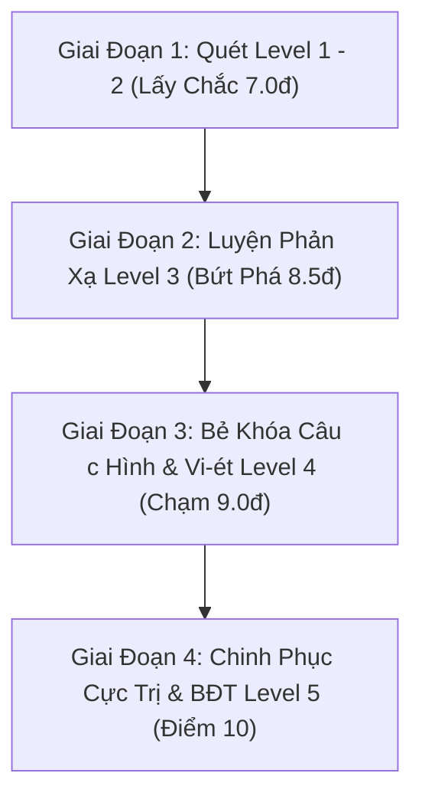

# 📋 Quy Trình (Workflow) Review, Phân Loại Dạng Bài & Độ Khó 1–5 Cho Đề Thi Vào 10 Môn Toán

Tài liệu hướng dẫn quy trình vận hành và khai thác ngân hàng **112+ câu hỏi thi tuyển sinh vào lớp 10 môn Toán** (từ 21 đề thi chính thức/tham khảo Hà Nội & TP.HCM) phục vụ lộ trình học tập của **Bum (14 tuổi)**.

---

## 🎯 1. Khung Tiêu Chí Phân Loại Dạng Bài & Thang Đo Độ Khó (Level 1 – 5)

Mỗi câu hỏi trong đề thi được hệ thống tự động bóc tách, đánh giá theo thang điểm chuẩn tuyển sinh vào lớp 10 THPT:

| Thang Độ Khó | Trọng Tâm Đánh Giá | Mục Tiêu Điểm Thi | Các Dạng Bài Điển Hình |
| :---: | :--- | :---: | :--- |
| ⭐ **Level 1**<br>*(Nhận biết - Dễ)* | Nhớ công thức, thay số tính toán trực tiếp, không biến đổi phức tạp. | **5.0 – 6.0 điểm** | • Tính giá trị biểu thức căn khi $x = x_0$<br>• Đọc số liệu từ bảng/biểu đồ tần số ghép nhóm<br>• Vẽ đồ thị hàm số Parabol $y = ax^2$ cơ bản<br>• Tìm tọa độ điểm thuộc đồ thị khi biết hoành độ |
| ⭐⭐ **Level 2**<br>*(Thông hiểu - Cơ bản)* | Áp dụng đúng thuật toán giải, quy đồng rút gọn cơ bản, nhận diện tính chất hình học. | **6.0 – 7.5 điểm** | • Rút gọn biểu thức căn thức có 2-3 phân thức đơn giản<br>• Chứng minh PT bậc hai có 2 nghiệm phân biệt ($\Delta > 0$ hoặc $ac < 0$)<br>• Tính xác suất cổ điển của biến cố ngẫu nhiên<br>• Câu a hình học: Chứng minh tứ giác nội tiếp (2 góc vuông đối nhau)<br>• Tính diện tích xung quanh, thể tích hình trụ/hình nón cơ bản |
| ⭐⭐⭐ **Level 3**<br>*(Vận dụng - Khá)* | Phân tích đề bài, lập phương trình/hệ phương trình, phối hợp nhiều bước biến đổi. | **7.5 – 8.5 điểm** | • Rút gọn biểu thức nâng cao, giải bất phương trình $|P| > P$ hoặc tìm $x$ nguyên<br>• Định lý Vi-ét tính biểu thức đối xứng ($x_1^2+x_2^2$, $(x_1-x_2)^2$)<br>• Giải bài toán bằng cách lập HPT (chuyển động, năng suất, kinh tế giảm giá)<br>• Câu b hình học: Chứng minh tia phân giác, góc nội tiếp bằng nhau<br>• Toán thực tế hình không gian nhiều bước tính |
| ⭐⭐⭐⭐ **Level 4**<br>*(Vận dụng cao - Giỏi)* | Biến đổi linh hoạt, tư duy liên kết hình học & đại số, giải bài toán có điều kiện phụ. | **8.5 – 9.25 điểm** | • Vi-ét bất đối xứng, tìm tham số $m$ để PT có nghiệm thỏa mãn điều kiện phức tạp<br>• Câu c hình học: Chứng minh đẳng thức tích $DM \cdot CA = CF \cdot CO$, thẳng hàng, vuông góc<br>• Toán thực tế hình không gian biến thiên (phễu trong nón cụt, cắt góc gập lăng trụ) |
| ⭐⭐⭐⭐⭐ **Level 5**<br>*(Xuất sắc - Điểm 10)* | Kỹ thuật tách ghép bất đẳng thức, đánh giá điểm rơi, cực trị hình học. | **9.5 – 10.0 điểm** | • Bất đẳng thức Cauchy (AM-GM) cho 3 số dương, chọn điểm rơi<br>• Tìm GTLN / GTNN của biểu thức đại số nhiều biến<br>• Cực trị hình học (tìm vị trí điểm để diện tích/chu vi đạt min/max) |

---

## 🛠️ 2. Công Cụ Hỗ Trợ Tự Động (CLI Tools)

### Bước 1: Quét và Cập Nhật Toàn Bộ Ngân Hàng Câu Hỏi
Khi có thêm file đề thi Markdown mới trong `math/exams/md/`, chỉ cần chạy:
```bash
py scripts/build_math_registry.py
```
*Tác vụ tự động*:
- Đọc toàn bộ 21 đề thi, trích xuất từng câu hỏi kèm hình ảnh minh họa.
- Phân loại Dạng bài, Tỉnh/Thành, Điểm số và Độ khó từ 1 đến 5.
- Xuất dữ liệu ra file database [`math/exams/math-question-registry.json`](math-question-registry.json) và danh mục tra cứu trực quan [`math/exams/QUESTION_REGISTRY.md`](QUESTION_REGISTRY.md).

---

### Bước 2: Tra Cứu Câu Hỏi Theo Yêu Cầu

#### Xem bảng phân bố thống kê tổng quan:
```bash
py scripts/query_math_registry.py --stats
```

#### Lọc câu hỏi theo độ khó (Ví dụ: Level 1 & 2 để Bum luyện tập chống sai ngu):
```bash
py scripts/query_math_registry.py --difficulty 2 --limit 5
```

#### Lọc câu hỏi theo chuyên đề (Ví dụ: Căn thức bậc hai):
```bash
py scripts/query_math_registry.py --category can_thuc --difficulty 2
```

#### Tìm kiếm câu hỏi chứa từ khóa thực tế:
```bash
py scripts/query_math_registry.py --keyword "xe khách"
py scripts/query_math_registry.py --keyword "parabol"
```

---

### Bước 3: Xuất Đề Luyện Tập Cá Nhân Hóa Cho Bum
Hệ thống hỗ trợ xuất trực tiếp một bài kiểm tra theo cấp độ mong muốn:

```bash
# Xuất đề luyện tập 5 câu mức độ Vận dụng (Level 3 - Mục tiêu 8.0đ):
py scripts/query_math_registry.py --difficulty 3 --random --limit 5 --export-quiz "math/assessments/de-luyen-tap-level-3.md"

# Xuất đề thử thách câu điểm 10 (Level 5):
py scripts/query_math_registry.py --difficulty 5 --limit 3 --export-quiz "math/assessments/thu-thach-diem-10.md"
```

---

## 📈 3. Lộ Trình 4 Bước Áp Dụng Cho Bum



1. **Tuần 1 – Tuần 4**: Tập trung 100% vào các câu **Level 1 và Level 2** (Căn thức, Đồ thị, Bảng tần số, Xác suất). Mục tiêu: Không bao giờ làm sai câu dễ, triệt tiêu bẫy tính toán.
2. **Tuần 5 – Tuần 7**: Luyện các bài **Level 3** (Toán thực tế lập hệ phương trình, bài toán chuyển động, năng suất, câu b hình chứng minh tia phân giác/tứ giác).
3. **Tuần 8 – Tuần 10**: Thực chiến các bài **Level 4** (Hệ thức Vi-ét có tham số $m$, câu c hình học chứng minh hệ thức $DM \cdot CA = CF \cdot CO$).
4. **Giai đoạn nước rút**: Thử sức các dạng **Level 5** về Bất đẳng thức Cauchy để tìm kiếm điểm 10 tuyệt đối.
