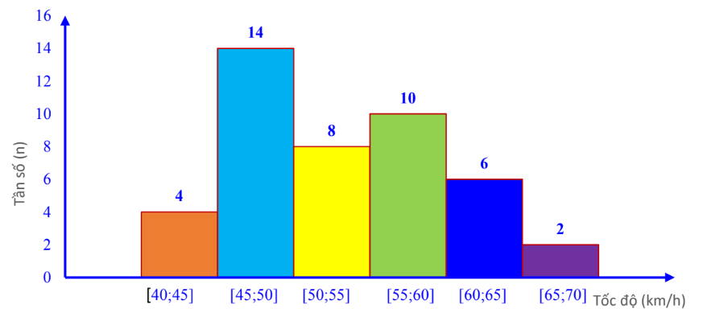
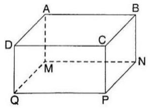
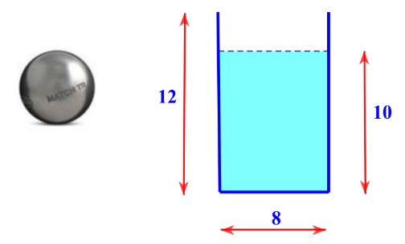
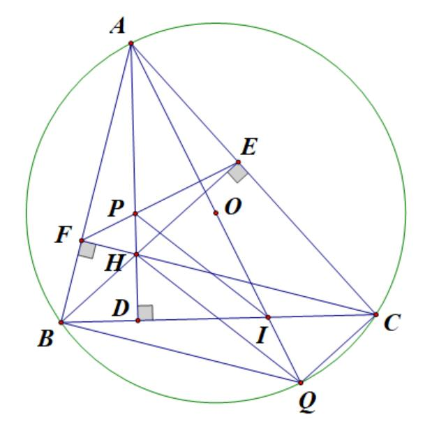

# De Tham Khao Thi Vao 10 Mon Toan Ha Noi Nam 2025 De So 10 1746432567

*Thời gian hoàn thành sản xuất 75 sản phẩm theo kế hoạch là 75 x (ngày).*  

---

### Câu 1: (1,5 điểm)

1) Biểu đồ tần số ghép nhóm dưới đây ghi lại tốc độ (đơn vị: km/h) của 44 ô tô khi đi qua một trạm đo tốc
độ.

Hãy cho biết số lượng ô tô ở nhóm nào nhiều nhất, tính tần số tương đối ghép nhóm đó (làm tròn kết quả đến chữ số thập phân thứ nhất).
2) Một hộp có 20 viên bi với kích thước và khối lượng như nhau. Bạn Ngân viết lên các viên bi đó các số 1,
2, 3, …, 20; hai viên bi khác nhau thì viết hai số khác nhau. Xét phép thử “Lấy ngẫu nhiên một viên bi trong hộp”. Tính xác suất biến cố: “Số xuất hiện trên viên bi lấy ra chia 7 dư 2”.

### Câu 2: (1,5 điểm) Cho biểu thức x 1 A x 3 - = -

và 2 x x 2 6 x 8 B x 2 x 3 x 5 x 6 + - = - + - - - + với x 0 \ge , x 4 \ne , x 9 \ne .
1) Tính giá trị của A khi x = 16.
2) Chứng minh
x 2 B x 3 + = - .
3) Cho P = A : B. Tìm x để
1 P 2 < .

### Câu 3: (2,5 điểm)

1) Trong một thí nghiệm, Bình muốn pha để được 36 ml dung dịch HCl nồng độ 12%. Trong phòng thí
nghiệm chỉ có sẵn dung dịch HCl nồng độ 8% và dung dịch HCl nồng độ 20%. Hỏi Bình cần sử dụng bao nhiêu mililit mỗi loại dung dịch để có được dung dịch mong muốn?
2) Một xí nghiệp theo kế hoạch phải sản xuất 75 sản phẩm trong một số ngày dự kiến. Trong thực tế, do cải
tiến kỹ thuật nên mỗi ngày xí nghiệp làm vượt mức 5 sản phẩm, vì vậy không những họ đã làm được 80 sản ĐỀ THAM KHẢO THI TUYỂN SINH VÀO 10 - ĐỀ SỐ 10 MÔN TOÁN Thời gian: 120 phút BIÊN SOẠN: BAN CHUYÊN MÔN LOIGIAIHAY.COM

2 phẩm mà còn hoàn thành trước kế hoạch 1 ngày. Hỏi theo kế hoạch, mỗi ngày xí nghiệp sản xuất bao nhiêu sản phẩm?
3) Biết rằng phương trình bậc hai
( ) 2 2x 2 3 x m 0 - + + = có một nghiệm 3 x 2 = . Tìm tổng bình phương hai nghiệm của phương trình trên.

### Câu 4: (4 điểm)

1) Một cốc nước có dạng hình trụ với đường kính đáy bằng 8 cm, chiều cao 12 cm và chứa một lượng nước
cao 10 cm.
a) Tính thể tích lượng nước chứa trong cốc (làm tròn đến hàng phần trăm).
b) Người ta thả từ từ một viên bi làm bằng thép đặc (không thấm nước) có thể tích là 4\pi (
) 3 cm vào trong cốc. Hỏi mực nước trong cốc lúc này là bao nhiêu cm?

2) Cho tam giác ABC nhọn nội tiếp đường tròn (O), các đường cao AD, BE, CF cắt nhau tại H. Kẻ đường
kính AQ của đường tròn (O) cắt cạnh BC tại I.
a) Chứng minh bốn điểm A, F, H, E cùng thuộc một đường tròn.
b) Chứng minh BAD
CAQ = .
c) Gọi P là giao điểm của AH và EF. Chứng minh AEP
\Delta đồng dạng với ABI \Delta và PI song song với HQ.

### Câu 5: (0,5 điểm) Một bể bơi mini có dạng hình hộp chữ nhật với mặt đáy MNPQ là hình vuông. Hãy tìm độ dài cạnh MN của mặt đáy và chiều cao AM của bể bơi sao cho tổng diện tích các mặt làm bể bơi (bao gồm 4 mặt xung quanh và một mặt đáy) là nhỏ nhất, biết rằng thể tích của bể bơi là 4 3 m .

---
*------------------- HẾT -------------------*

---

## 📖 ĐÁP ÁN & HƯỚNG DẪN GIẢI CHI TIẾT

<b>Click để xem lời giải chi tiết 🔍</b>

### Câu 1: (1,5 điểm)

1) Biểu đồ tần số ghép nhóm dưới đây ghi lại tốc độ (đơn vị: km/h) của 44 ô tô khi đi qua một trạm đo tốc
độ.

Hãy cho biết số lượng ô tô ở nhóm nào nhiều nhất, tính tần số tương đối ghép nhóm đó (làm tròn kết quả đến chữ số thập phân thứ nhất).
2) Một hộp có 20 viên bi với kích thước và khối lượng như nhau. Bạn Ngân viết lên các viên bi đó các số 1,
2, 3, …, 20; hai viên bi khác nhau thì viết hai số khác nhau. Xét phép thử “Lấy ngẫu nhiên một viên bi trong hộp”. Tính xác suất biến cố: “Số xuất hiện trên viên bi lấy ra chia 7 dư 2”.

**Phương pháp**

1) Xác định nhóm có lượng ô tô nhiều nhất.
Tần số tương đối của nhóm bằng: tần số của nhóm : tổng . 100%.
2) Xác định không gian mẫu của phép thử, tính số phần tử của không gian mẫu.
Tính số kết quả thuận lợi của biến cố.
Xác suất của biến cố = số kết quả thuận lợi của biến cố : số phần tử của không gian mẫu.

**Lời giải**

1) Nhóm có tần số lớn nhất là [45;50), với tần số là 14.
Tần số tương đối ghép nhóm của nhóm [45;50) là 14 .100% 31,8% 44  .
2) Số phần tử của không gian mẫu là ( )
n 20 \Omega = .
Gọi A là biến cố “Số xuất hiện trên viên bi lấy ra chia 7 dư 2”.
Các kết quả thuận lợi cho A là 2; 9; 16. Suy ra n(A) = 3.
Xác suất của biến cố A là ( ) ( ) n A 3 P(A) n 20 = = \Omega .

### Câu 2: (1,5 điểm) Cho biểu thức x 1 A x 3 - = -

và 2 x x 2 6 x 8 B x 2 x 3 x 5 x 6 + - = - + - - - + với x 0 \ge , x 4 \ne , x 9 \ne .
1) Tính giá trị của A khi x = 16.
2) Chứng minh
x 2 B x 3 + = - .
3) Cho P = A : B. Tìm x để
1 P 2 < . Phương pháp
1) Kiểm tra điều kiện của x. Nếu thỏa mãn, thay x = 16 vào A.
2) Kết hợp các tính chất của căn thức bậc hai để rút gọn biểu thức.
3) Rút gọn P = A : B giải bất phương trình
1 P 2 < . Lời giải
1) Thay x = 16 (thỏa mãn điều kiện) vào A, ta được:
16 1 4 1 A 3 4 3 16 3 - - = = = - - .
Vậy khi x = 16 thì A = 3.
2) 2 x x 2 6 x 8 B x 2 x 3 x 5 x 6 + - = - + - - - + (với x 0 \ge , x 4 \ne , x 9 \ne ) ( ) ( )( ) ( )( ) ( )( ) ( )( ) 2 x x 3 x 2 x 2 6 x 8 x 2 x 3 x 2 x 3 x 2 x 3 - + - - = - + - - - - - -

( )( ) ( )( ) ( )( ) 2x 6 x x 4 6 x 8 x 2 x 3 x 2 x 3 x 2 x 3 - - - = - + - - - - - -

( )( ) x 4 x 2 x 3 - = - -

x 2 x 3 + = - (đpcm). 3) x 1 x 2 x 1 x 3 x 1 P A : B : . x 3 x 3 x 3 x 2 x 2 - + - - - = = = = - - - + + . Ta có 1 P 2 <

x 1 1 2 x 2 - < +

( ) 2 x 1 x 2 - < + (vì ( ) 2 x 2 0 + > ) x 4 <

x 16 < .
Kết hợp ĐK, ta có 0 x 16 \le < , x 4 \ne , x 9 \ne thì 1 P 2 < .

### Câu 3: (2,5 điểm)

1) Trong một thí nghiệm, Bình muốn pha để được 36 ml dung dịch HCl nồng độ 12%. Trong phòng thí
nghiệm chỉ có sẵn dung dịch HCl nồng độ 8% và dung dịch HCl nồng độ 20%. Hỏi Bình cần sử dụng bao nhiêu mililit mỗi loại dung dịch để có được dung dịch mong muốn?
2) Một xí nghiệp theo kế hoạch phải sản xuất 75 sản phẩm trong một số ngày dự kiến. Trong thực tế, do cải
tiến kỹ thuật nên mỗi ngày xí nghiệp làm vượt mức 5 sản phẩm, vì vậy không những họ đã làm được 80 sản phẩm mà còn hoàn thành trước kế hoạch 1 ngày. Hỏi theo kế hoạch, mỗi ngày xí nghiệp sản xuất bao nhiêu sản phẩm?
3) Biết rằng phương trình bậc hai
( ) 2 2x 2 3 x m 0 - + + = có một nghiệm 3 x 2 = . Tìm tổng bình phương hai nghiệm của phương trình trên.

**Phương pháp**

1) Gọi số ml dung dịch HCl nồng độ 8% và 20% cần sử dụng để tạo thành 36 ml dung dịch HCl nồng độ
12% lần lượt là x và y (x, y > 0).
Biểu diễn lượng dung dịch theo x, y.
Lập hệ phương trình, giải hệ để tìm x, y.
2) Gọi số sản phẩm mỗi ngày xí nghiệp phải làm theo kế hoạch là x (sản phẩm;
* x \in , x < 75).
Biểu diễn thời xí nghiệp sản xuất theo kế hoạch và trên thực tế.
Vì xí nghiệp hoàn thành kế hoạch sớm 1 ngày nên ta lập được phương trình.
Giải phương trình và kết luận.
3) Thay nghiệm vào phương trình, tính m.
Tổng bình phương hai nghiệm là 2 2 1 2 x x + .
Biến đổi biểu thức và áp dụng định lí Viète:
1 2 b S x x a = + = - ; 1 2 c P x .x a = = . Lời giải
1) Gọi số ml dung dịch HCl nồng độ 8% và 20% cần sử dụng để tạo thành 36 ml dung dịch HCl nồng độ
12% lần lượt là x và y (x, y > 0).
Vì Bình muốn pha 36 ml dung dịch HCl nồng độ 12% nên ta có phương trình x y 36 + = (1) Mặt khác, Bình muốn pha 36 ml dung dịch HCl nồng độ 12% từ các dung dịch HCl 8% và 20% nên ta có phương trình 8%x 20%y 12%.36 + = hay 0,08x 0,2y 4,32 + = (2)

Từ (1) và (2) ta có hệ x y 36 0,08x 0,2y 4,32 + = \begin{cases}

+ = \end{cases}

Giải hệ được x = 24 (TM) và y = 12 (TM).
Vậy Bình cần 24 ml dung dịch HCl 8% và 12 ml dung dịch HCl 20% để pha chế 36 ml dung  dịch HCl 12%.
2) Gọi số sản phẩm mỗi ngày xí nghiệp phải làm theo kế hoạch là x (sản phẩm;
* x \in , x < 75).
Thực tế, mỗi ngày xí nghiệp làm được x + 5 sản phẩm, tổng cộng được 80 sản phẩm.
Thực tế, thời gian hoàn thành kế hoạch là 80 x 5 + (ngày).
Xí nghiệp hoàn thành sớm 1 ngày so với kế hoạch nên ta có phương trình:
80 75 1 x 5 x + = +

( ) ( ) ( ) ( ) ( ) x x 5 75 x 5 80x x x 5 x x 5 x x 5 + + + = + + +

( ) ( ) 80x x x 5 75 x 5 + + = +

2 80x x 5x 75x 375 + + = +

2 x 10x 375 0 + - =

Giải phương trình trên, ta được x = 15 (TM) và x = -25 (loại).
Vậy theo kế hoạch, mỗi ngày xí nghiệp sản xuất 15 sản phẩm.
3) Thay 3 x 2 =
vào phương trình ( ) 2 2x 2 3 x m 0 - + + = , được: ( ) 2 3 3 2 2 3 m 0 2 2 ( ) - + + = ( ) ( ) ( )

m 3 = .
Phương trình bậc hai đã cho là ( ) 2 2x 2 3 x 3 0 - + + = . Gọi 1 x , 2 x là hai nghiệm của phương trình.
Áp dụng hệ thức Viète:
( ) 1 2 1 2 2 3 b 2 3 x x a 2 2 c 3 x x a 2 \begin{cases}
- + +
 + = - = - =   = = \end{cases}

Ta có ( ) 2 2 2 2 1 2 1 2 1 2 2 3 3 7 x x x x 2x x 2. 2 2 4 ( ) + + = + - = - = ( ) ( ) ( ) .

Vậy tổng bình phương hai nghiệm của phương trình là 7 4 .

### Câu 4: (4 điểm)

1) Một cốc nước có dạng hình trụ với đường kính đáy bằng 8 cm, chiều cao 12 cm và chứa một lượng nước
cao 10 cm.
a) Tính thể tích lượng nước chứa trong cốc (làm tròn đến hàng phần trăm).
b) Người ta thả từ từ một viên bi làm bằng thép đặc (không thấm nước) có thể tích là 4\pi (
) 3 cm vào trong cốc. Hỏi mực nước trong cốc lúc này là bao nhiêu cm?

2) Cho tam giác ABC nhọn nội tiếp đường tròn (O), các đường cao AD, BE, CF cắt nhau tại H. Kẻ đường
kính AQ của đường tròn (O) cắt cạnh BC tại I.
a) Chứng minh bốn điểm A, F, H, E cùng thuộc một đường tròn.
b) Chứng minh BAD
CAQ = .
c) Gọi P là giao điểm của AH và EF. Chứng minh AEP
\Delta đồng dạng với ABI \Delta và PI song song với HQ.

**Phương pháp 1)**

a) Tính bán kính đáy cốc.
Tính thể tích lượng nước áp dụng công thức thể tích hình trụ 2 V r h = \pi . b) Gọi 1h là chiều cao nước dâng thêm.
Thể tích nước dâng thêm bằng thể tích viên bi nên ta tìm được 1h .
Mực nước hiện tại bằng 1 h h + . 2)
a) Chứng minh
o AEH AFH 90 = = suy ra A, F, H, E cùng thuộc đường tròn đường kính AH.
b) Chứng minh BAD
QBC = (cùng bằng BCF) và QBC QAC = . Từ đó suy ra BAD QAC = . c) AEP \Delta đồng dạng với ABI \Delta : Chứng minh EAP BAI = và AEP ABI = .
PI // HQ: Chứng minh AP AH AE AI AQ AB ( ) = = ( ) ( ) và áp dụng định lí Thalès đảo để kết luận.

**Lời giải 1)**

a) Bán kính đáy cốc nước là r = 8 : 2 = 4 (cm); mực nước ban đầu là h = 10 (cm).
Thể tích lượng nước chứa trong cốc là 2 2 V r h .4 .10 160 502,65 = \pi = \pi = \pi ( ) 3 cm . b) Gọi 1h là chiều cao nước dâng thêm.
Thể tích nước dâng thêm bằng thể tích viên bi nên 2 1 r h 4 \pi = \pi 2 1 .4 h 4 \pi = \pi 1h 0,25 = (cm).
Vậy mực nước trong cốc sau khi thả viên bi là 10 + 0,25 = 10,25 (cm).
2)

a) BE, CF là đường cao của tam giác ABC nên BE
AC \perp , CF AB \perp . Vì o AEH AFH 90 = = nên E, F cùng thuộc đường tròn đường kính AH.
Vậy A, F, H, E cùng thuộc đường tròn đường kính AH.
b) Có BAD BCF =
(cùng phụ với ABC ) (1) Vì B thuộc đường tròn (O) đường kính AQ nên o ABQ 90 = , suy ra BQ AB \perp . Mà CF AB \perp nên BQ // CF. Do đó, QBC BCF = (góc so le trong) (2) Từ (1) và (2) suy ra BAD QBC = .
Mặt khác, QBC QAC = (góc nội tiếp chắn cung QC).
Do đó BAD QAC = (đpcm).
c) Từ chứng minh trên, ta có BAD
QAC =

BAD DAI QAC DAI + = +

BAI EAP = . Vì o BFC BEC 90 = = nên F, E cùng thuộc đường tròn đường kính BC, hay tứ giác BFEC nội tiếp.

Suy ra o FBC FEC 180 + = (hai góc đối của tứ giác nội tiếp).
Mặt khác o AEF FEC 180 + = (góc kề bù). Do đó FBC AEF = (cùng bù với FEC ) (3) Xét AEP \Delta và ABI \Delta , có: + EAP BAI = ; + AEP ABI = (chứng minh trên).
Suy ra AEP ABI \Delta \Delta \backsim (g.g) (đpcm), do đó AE AP AB AI = (4) Vì tứ giác BFEC nội tiếp nên FEB FCB = (góc nội tiếp cùng chắn cung FB).
Mà FCB CBQ = (chứng minh trên) nên FEB CBQ = (5) Từ (4) và (5) suy ra AEP FEB ABI CBQ + = + , do đó AEH ABQ = . Xét AEH \Delta và ABQ \Delta , có: + EAH BAQ = ; + AEH ABQ = . Suy ra AEH ABQ \Delta \Delta \backsim (g.g) (đpcm), do đó AE AH AB AQ = (6) Từ (4) và (6) suy ra AP AH AI AQ = hay AP AI AH AQ = .
Vậy PI // HQ (định lí Thalès đảo).

### Câu 5: (0,5 điểm) Một bể bơi mini có dạng hình hộp chữ nhật với mặt đáy MNPQ là hình vuông. Hãy tìm độ dài cạnh MN của mặt đáy và chiều cao AM của bể bơi sao cho tổng diện tích các mặt làm bể bơi (bao gồm 4 mặt xung quanh và một mặt đáy) là nhỏ nhất, biết rằng thể tích của bể bơi là 4 3 m .

**Phương pháp Gọi độ dài cạnh MN của mặt đáy và chiều cao AM của bể bơi lần lượt là x và y (mét; x > 0, y > 0).**

Biểu diễn y theo x.
Biểu diễn diện tích các mặt của bể bơi theo x.
Áp dụng bất đẳng thức Cauchy cho ba số dương, tìm x để diện tích nhỏ nhất.

**Lời giải**

Gọi độ dài cạnh MN của mặt đáy và chiều cao AM của bể bơi lần lượt là x và y (mét; x > 0, y > 0).
Do thể tích bể bơi là 4 3 m nên 2 x y 4 = hay 2 4 y x = .
Tổng diện tích các mặt của bể bơi là:
2 2 2 16 8 8 S 4xy x x x x x x = + = + = + + .
Áp dụng bất đẳng thức Cauchy cho ba số dương 8 x , 8 x và 2 x , ta được: 2 2 3 8 8 8 8 S x 3 x . . 3.4 12 x x x x = + + \ge = = .
Dấu “=” xảy ra khi và chỉ khi 2 8 x x = , suy ra x = 2, y = 1.
Vậy để tổng diện tích các mặt làm bể bơi là nhỏ nhất thì MN = 2 (m), AM = 1 (m).

