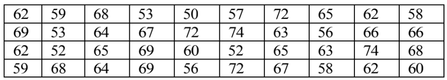
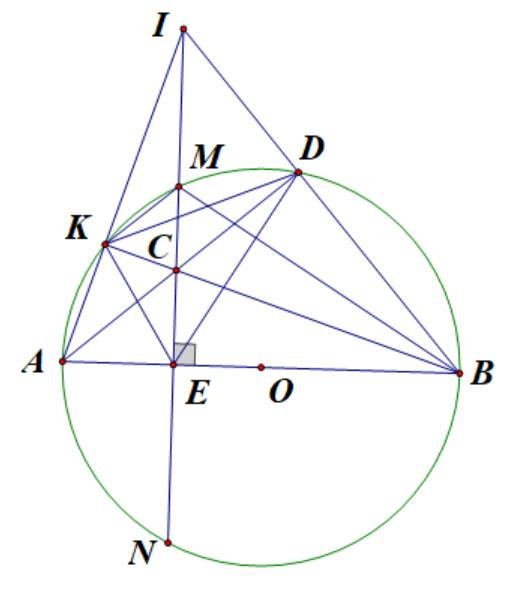

# De Tham Khao Thi Vao 10 Mon Toan Ha Noi Nam 2025 De So 11 1747019276

### Câu 1: (1,5 điểm)

1) Cân nặng của các bạn học sinh lớp 9A (đơn vị: kilogam) có kết quả như sau:

Mẫu số liệu thống kê ở trên đã được ghép thành năm nhóm ứng với năm nửa khoảng: [50;55), [55;60), [60;65), [65;70), [70;75). Lập bảng tần số ghép nhóm của mẫu số liệu trên và tính tần số tương đối ghép nhóm của nhóm [50;55).
2) Một hộp đựng 20 tấm thẻ như nhau được đánh số từ 1 đến 20. Rút ngẫu nhiên một tấm thẻ trong hộp.
Tính xác suất của biến cố A: “Số ghi trên tấm thẻ là bội của 4”.

### Câu 2: (1,5 điểm) Cho hai biểu thức 3 x x 8 x P x 4 x 2 2 x = + + - + -

và 1 Q x 2 = + (với x 0 \ge , x 4 \ne ).
1) Tính giá trị của biểu thức Q khi x = 9.
2) Rút gọn biểu thức P.
3) Biết P M Q =
. Tìm các giá trị của x để M = 18.

### Câu 3: (2,5 điểm)

1) Mai mua hai loại hàng và phải trả tổng cộng 165 000 đồng, trong đó đã tính 15 000 đồng là thuế giá trị
gia tăng (viết tắt là VAT). Biết rằng thuế VAT với loại hàng thứ nhất là 12%, thuế VAT với loại hàng thứ hai là 9%. Hỏi nếu không kể thuế thì Mai phải trả bao nhiêu tiền cho mỗi loại hàng?
2) Hưởng ứng phong trào thi đua “Xây dựng trường học thân thiện, học sinh tích cực”, lớp 9A trường THCS
Hoàng Hoa Thám dự định trồng 300 cây xanh. Đến ngày lao động, có 5 bạn được Liên Đội triệu tập tham gia chiến dịch an toàn giao thông nên mỗi bạn còn lại phải trồng thêm 2 cây mới đảm bảo kế hoạch đặt ra.
Hỏi lớp 9A có bao nhiêu học sinh?
3) Phương trình
2 x 2x m 1 0 - - + = (m là tham số) có một nghiệm là x 1 7 = + . Tính giá trị của biểu thức 2 2 1 2 2 1 A x x x x = + .

### Câu 4: (4 điểm)

1) Trong truyện ngụ ngôn La Phông ten, Cò mời Cáo đến ăn tiệc với món súp hảo hạng. Món súp đó Cò
thường cho vào một cái bình hình trụ, có bán kính đáy là 4 cm, chiều cao 30 cm. Nhưng khi Cáo đến, Cò chỉ ĐỀ THAM KHẢO THI TUYỂN SINH VÀO 10 - ĐỀ SỐ 11 MÔN TOÁN Thời gian: 120 phút BIÊN SOẠN: BAN CHUYÊN MÔN LOIGIAIHAY.COM

2 đổ súp sao cho phần súp trong bình đó cao 10 cm và mới Cáo dùng bữa.
a) Tính thể tích của phần súp mà Cò mời Cáo ăn.
b) Cổ của Cáo quá ngắn nên không thể lấy được súp, Cáo nhìn quanh và phát hiện ra nhà Cò có những viên
sỏi hình cầu giống hệt nhau, bán kính 2 cm. Cáo bèn cho từng viên sỏi vào bình súp đến khi súp dâng lên vừa đầy đến miệng bình rồi Cáo thảnh thơi ăn súp. Hỏi Cáo đã cho vào bình bao nhiêu viên sỏi?
2) Cho đường tròn (O;R) và dây MN cố định (MN < 2R). Kẻ đường kính AB vuông góc với dây MN tại E
(điểm A thuộc cung nhỏ MN). Lấy điểm C thuộc dây MN (C khác M, N, E). Đường thẳng BC cắt (O;R) tại điểm K (K khác B).
a) Chứng minh AKCE là tứ giác nội tiếp.
b) Chứng minh
2 BM BK.BC = .
c) Gọi I là giao điểm của hai đường thẳng AK và MN; D là giao điểm của hai đường thẳng AC và BI. Chứng
minh C cách đều ba cạnh của DEK \Delta .

### Câu 5: (0,5 điểm) Công ty sản xuất thùng gỗ muốn thiết kế số lượng lớn thùng đựng hàng hóa bên trong, dang hình lăng trụ tứ giác đều không nắp với thể tích là 62,5 3 dm . Để tiết kiệm vật gỗ làm thùng, người ta cần thiết kế thùng sao cho có tổng S diện tích xung quanh và diện tích mặt đáy là nhỏ nhất. Hỏi S có giá trị nhỏ nhất bằng bao nhiêu?

---
*------------------- HẾT -------------------*

---

## 📖 ĐÁP ÁN & HƯỚNG DẪN GIẢI CHI TIẾT

<b>Click để xem lời giải chi tiết 🔍</b>

### Câu 1: (1,5 điểm)

1) Cân nặng của các bạn học sinh lớp 9A (đơn vị: kilogam) có kết quả như sau:

Mẫu số liệu thống kê ở trên đã được ghép thành năm nhóm ứng với năm nửa khoảng: [50;55), [55;60), [60;65), [65;70), [70;75). Lập bảng tần số ghép nhóm của mẫu số liệu trên và tính tần số tương đối ghép nhóm của nhóm [50;55).
2) Một hộp đựng 20 tấm thẻ như nhau được đánh số từ 1 đến 20. Rút ngẫu nhiên một tấm thẻ trong hộp.
Tính xác suất của biến cố A: “Số ghi trên tấm thẻ là bội của 4”.

**Phương pháp**

1) Xác định tần số cho các nhóm để lập bảng tần số ghép nhóm.
Tần số tương đối của nhóm bằng: tần số của nhóm : tổng . 100%.
2) Xác định không gian mẫu của phép thử, tính số phần tử của không gian mẫu.
Tính số kết quả thuận lợi của biến cố.
Xác suất của biến cố = số kết quả thuận lợi của biến cố : số phần tử của không gian mẫu.

**Lời giải**

1) Bảng tần số ghép nhóm của mẫu số liệu trên:
Nhóm Tần số (n) [50;55) 5 [55;60) 7 [60;65) 10 [65;70) 13 [70;75) 5 Cộng N = 40 Tần số tương đối ghép nhóm của nhóm [50;55) là 5 .100% 12,5% 40 = .
2) Số phần tử của không gian mẫu là ( )
n 20 \Omega = .
Kết quả thuận lợi cho biến cố A là {4; 8; 12; 16; 20}, suy ra n(A) = 5.
Vậy xác suất của biến cố A là ( ) ( ) n A 5 1 P(A) n 20 4 = = = \Omega .

### Câu 2: (1,5 điểm) Cho hai biểu thức 3 x x 8 x P x 4 x 2 2 x = + + - + -

và 1 Q x 2 = + (với x 0 \ge , x 4 \ne ).
1) Tính giá trị của biểu thức Q khi x = 9.
2) Rút gọn biểu thức P.
3) Biết P M Q =
. Tìm các giá trị của x để M = 18.

**Phương pháp**

1) Kiểm tra điều kiện của x. Nếu thỏa mãn, thay x = 9 vào Q.
2) Kết hợp các tính chất của căn thức bậc hai để rút gọn biểu thức.
3) Rút gọn P M Q =
rồi giải phương trình M = 18.

**Lời giải**

1) Thay x = 9 (thỏa mãn điều kiện) vào Q, ta được:
1 1 1 Q 3 2 5 9 2 = = = + + .
Vậy khi x = 9 thì 1 Q 5 = . 2) 3 x x 8 x P x 4 x 2 2 x = + + - + - (với x 0 \ge , x 4 \ne ) ( )( ) 3 x x 8 x x 2 x 2 x 2 x 2 = - + + - + -

( ) ( )( ) ( ) ( )( ) ( )( ) 3 x x 2 x x 2 8 x x 2 x 2 x 2 x 2 x 2 x 2 - + = - + + - + - + -

( )( ) 3x 6 x x 2 x 8 x x 2 x 2 - - - + = + -

( )( ) 2x x 2 x 2 = + - . 3) ( )( ) ( )( ) ( ) P 2x 1 2x 2x M : . x 2 Q x 2 x 2 x 2 x 2 x 2 x 2 = = = + = + - + - + - .
Để M = 18 thì 2x 18 x 2 = -

( ) 2x 18 x 2 = -

2x 18 x 36 0 - + =

x 9 x 18 0 - + = .

Giải phương trình trên, ta được x 3 = hoặc x 6 = .
Suy ra x = 9 hoặc x = 36 (cả hai nghiệm đều thỏa mãn).
Vậy để M = 18 thì x {9;36} \in .

### Câu 3: (2,5 điểm)

1) Mai mua hai loại hàng và phải trả tổng cộng 165 000 đồng, trong đó đã tính 15 000 đồng là thuế giá trị
gia tăng (viết tắt là VAT). Biết rằng thuế VAT với loại hàng thứ nhất là 12%, thuế VAT với loại hàng thứ hai là 9%. Hỏi nếu không kể thuế thì Mai phải trả bao nhiêu tiền cho mỗi loại hàng?
2) Hưởng ứng phong trào thi đua “Xây dựng trường học thân thiện, học sinh tích cực”, lớp 9A trường THCS
Hoàng Hoa Thám dự định trồng 300 cây xanh. Đến ngày lao động, có 5 bạn được Liên Đội triệu tập tham gia chiến dịch an toàn giao thông nên mỗi bạn còn lại phải trồng thêm 2 cây mới đảm bảo kế hoạch đặt ra.
Hỏi lớp 9A có bao nhiêu học sinh?
3) Phương trình
2 x 2x m 1 0 - - + = (m là tham số) có một nghiệm là x 1 7 = + . Tính giá trị của biểu thức 2 2 1 2 2 1 A x x x x = + . Phương pháp
1) Gọi x, y lần lượt là số tiền của loại hàng thứ nhất và loại hàng thứ hai không kể thuế VAT mà Mai đã mua
(đồng; x , y > 0).
Biểu diễn tổng số tiền Mai phải trả và tổng số tiền thuế theo x, y.
Lập hệ phương trình, giải hệ tìm x, y.
2) Gọi số học sinh lớp 9A là x (học sinh;
* x \in , x > 5).
Biểu diễn số cây mỗi học sinh phải trồng theo kế hoạch và thực tế.
Vì thực tế mỗi học sinh phải trồng thêm 2 cây so với kế hoạch nên ta lập được phương trình.
Giải phương trình và kết luận.
3) Thay nghiệm vào phương trình, tính m.
Biến đổi biểu thức và áp dụng định lí Viète:
1 2 b S x x a = + = - ; 1 2 c P x .x a = = . Lời giải
1) Gọi x, y lần lượt là số tiền của loại hàng thứ nhất và loại hàng thứ hai không kể thuế VAT mà Mai đã mua
(đồng; x , y > 0).
Số tiền thuế của hai loại hàng lần lượt là 12%x = 0,12x (đồng) và 9%y = 0,09y (đồng).
Vì tổng số tiền thuế là 15 000 đồng nên ta có phương trình 0,12x 0,09y 15000 + = (1) Số tiền mua loại hàng thứ nhất sau tính thuế là x + 0,12x = 1,12x (đồng), số tiền mua loại hàng thứ hai sau tính thuế là y + 0,09y = 1,09y (đồng).
Vì số tiền phải trả tổng cộng là 165 000 cả thuế nên ta có phương trình 1,12x 1,09y 165000 + = (2) Từ (1) và (2) ta có hệ phương trình 0,12x 0,09 15000 1,12x 1,09y 165000 + = \begin{cases}

+ = \end{cases}

Giải hệ trên, ta được x = 50 000 (thỏa mãn) và y = 100 000 (thỏa mãn).
Vậy giá tiền không kể thuế của loại hàng thứ nhất là 50 000 đồng, giá tiền không kể thuế của loại hàng thứ hai là 100 000 đồng.
2) Gọi số học sinh lớp 9A là x (học sinh;
* x \in , x > 5).
Số học sinh thực tế tham gia trồng cây là x - 5 (học sinh).
Theo kế hoạch, mỗi học sinh phải trồng 300 x (cây).
Thực tế, mỗi học sinh phải trồng 300 x 5 - (cây).
Vì thực tế, mỗi học sinh phải trồng thêm 2 cây so với kế hoạch nên ta có phương trình:
300 300 2 x 5 x - = -

300x 300(x 5) 2x(x 5) x(x 5) x(x 5) x(x 5) - - - = - - -

300x 300(x 5) 2x(x 5) - - = -

2 300x 300x 1500 2x 10x - + = -

2 2x 10x 1500 0 - - =

2 x 5x 750 0 - - = .
Giải phương trình trên, được x = 30 (thỏa mãn) và x = -25 (loại).
Vậy lớp 9A có 30 học sinh.
3) Thay x 1 7 = +
vào phương trình, ta có: ( ) ( ) 2 1 7 2 1 7 m 1 0 + - + - + =

8 2 7 2 2 7 m 1 0 + - - - + =

m 7 = .
Vậy phương trình đã cho là 2 x 2x 6 0 - - = . Gọi 1 x , 2 x là hai nghiệm của phương trình.
Áp dụng hệ thức Viète:
1 2 1 2 b 2 x x 2 a 1 c 6 x x 6 a 1 -
\begin{cases} + = - = - =  -
 = = = -
\end{cases}

Ta có ( ) 2 2 1 2 2 1 1 2 1 2 A x x x x x x x x 6.2 12 = + = + = - = - . Vậy A = - 12.

### Câu 4: (4 điểm)

1) Trong truyện ngụ ngôn La Phông ten, Cò mời Cáo đến ăn tiệc với món súp hảo hạng. Món súp đó Cò
thường cho vào một cái bình hình trụ, có bán kính đáy là 4 cm, chiều cao 30 cm. Nhưng khi Cáo đến, Cò chỉ đổ súp sao cho phần súp trong bình đó cao 10 cm và mới Cáo dùng bữa.

a) Tính thể tích của phần súp mà Cò mời Cáo ăn.
b) Cổ của Cáo quá ngắn nên không thể lấy được súp, Cáo nhìn quanh và phát hiện ra nhà Cò có những viên
sỏi hình cầu giống hệt nhau, bán kính 2 cm. Cáo bèn cho từng viên sỏi vào bình súp đến khi súp dâng lên vừa đầy đến miệng bình rồi Cáo thảnh thơi ăn súp. Hỏi Cáo đã cho vào bình bao nhiêu viên sỏi?
2) Cho đường tròn (O;R) và dây MN cố định (MN < 2R). Kẻ đường kính AB vuông góc với dây MN tại E
(điểm A thuộc cung nhỏ MN). Lấy điểm C thuộc dây MN (C khác M, N, E). Đường thẳng BC cắt (O;R) tại điểm K (K khác B).
a) Chứng minh AKCE là tứ giác nội tiếp.
b) Chứng minh
2 BM BK.BC = .
c) Gọi I là giao điểm của hai đường thẳng AK và MN; D là giao điểm của hai đường thẳng AC và BI. Chứng
minh C cách đều ba cạnh của DEK \Delta . Phương pháp 1)
a) Áp dụng công thức tính thể tích hình trụ
2 V r h = \pi .
b) Thể tích các viên sỏi = Thể tích bình - Thể tích lượng nước ban đầu.
Tính thể tích mỗi viên sỏi áp dụng công thức 3 4 V r 3 = \pi .
Số viên sỏi = Thể tích các viên sỏi : Thể tích mỗi viên sỏi.
2)
a) Chứng minh
o AKC AEC 90 = = suy ra K, E cùng thuộc đường tròn đường kính AC.
b) Chứng minh BMK
BCM \Delta \Delta \backsim (g.g) rồi suy ra tỉ lệ thức.
c) Chứng minh C là giao điểm của hai đường phân giác trong DEK
\Delta . Lời giải 1)
a) Thể tích phần súp Cò mới Cáo ăn là
2 1 V .4 .10 160 = \pi = \pi ( ) 3 cm .
b) Thể tích bình trụ là
2 0 V .4 .30 480 = \pi = \pi ( ) 3 cm .
Vì súp dâng đầy bình khi Cáo thả các viên sỏi vào nên thể tích các viên sỏi là:
0 1 V V V 480 160 320 = - = \pi - \pi = \pi ( ) 3 cm .
Thể tích 1 viên sỏi là 3 soi 4 32 V .2 3 3 = \pi = \pi ( ) 3 cm .
Số viên sỏi được thả vào bình là 32 320 : 30 3 \pi \pi = (viên).
Vậy Cáo đã cho 30 viên sỏi vào bình.
2)

a) Vì K thuộc đường tròn đường kính AB nên
o AKC 90 = .
Theo giả thiết, MN AB \perp nên o AEC 90 = . Vì o AKC AEC 90 = = nên K, E cùng thuộc đường tròn đường kính AC.
Vậy AKCE là tứ giác nội tiếp.
b) Vì AKCE là tứ giác nội tiếp nên
o KAE KCE 180 + = .
Mặt khác, AKMB là tứ giác nội tiếp (O;R) nên o KAE KMB 180 + = . Suy ra KCE KMB = (cùng bù với KAE ); mà KCE MCB = (góc đối đỉnh) nên ( ) KMB MCB KCE = = . Xét BMK \Delta và BCM \Delta có: + MBC chung; + KMB MCB = (chứng minh trên).
Do đó BMK BCM \Delta \Delta \backsim (g.g), suy ra BM BK BC BM = , như vậy 2 BM BC.BK = . c) Xét IAB \Delta có hai đường cao BK, IE cắt nhau tại C, do đó C là trực tâm IAB \Delta .
Khi đó AD cũng là đường cao của IAB \Delta , hay AD IB \perp . Vì o ADB 90 = nên D thuộc đường tròn đường kính AB, hay D thuộc (O;R).
Vì tứ giác AKDB nội tiếp (O;R) nên DKB DAB = (góc nội tiếp cùng chắn cung BD).
Mà tứ giác AKCE nội tiếp (chứng minh trên) nên BKE DAB = (góc nội tiếp cùng chắn cung CE).
Suy ra ( ) DKB BKE DAB = = hay KB là phân giác của DKE .
Vì o CDB CEB 90 = = nên D, E thuộc đường tròn đường kính BC hay tứ giác BDCE nội tiếp.
Khi đó EBC EDC = (góc nội tiếp cùng chắn cung CE).

Mà tứ giác AKDB nội tiếp nên EBC CDK = (góc nội tiếp cùng chắn cung AK).
Suy ra ( ) EDC CDK EBC = = hay DC là phân giác của KDE .
Xét DEK \Delta có các đường phân giác góc DKE , KDE cắt nhau tại C.
Do đó, C là tâm đường tròn nội tiếp DEK \Delta , hay C cách đều các cạnh của DEK \Delta .

### Câu 5: (0,5 điểm) Công ty sản xuất thùng gỗ muốn thiết kế số lượng lớn thùng đựng hàng hóa bên trong, dang hình lăng trụ tứ giác đều không nắp với thể tích là 62,5 3 dm . Để tiết kiệm vật gỗ làm thùng, người ta cần thiết kế thùng sao cho có tổng S diện tích xung quanh và diện tích mặt đáy là nhỏ nhất. Hỏi S có giá trị nhỏ nhất bằng bao nhiêu?

**Phương pháp Gọi a là độ dài cạnh đáy của hình lăng trụ (dm; a > 0).**

Biểu diễn diện tích S theo a.
Áp dụng bất đẳng thức Cauchy cho ba số dương, tìm giá trị nhỏ nhất của S.

**Lời giải Gọi a là độ dài cạnh đáy của hình lăng trụ (dm; a > 0).**

Thùng gỗ là lăng trụ tứ giác đều nên đáy thùng là hình vuông có diện tích 2 a ( ) 2 dm .
Thể tích lăng trụ là 62,5 3 dm nên chiều cao là 2 62,5 h a = (dm).
Diện tích gỗ làm một chiếc thùng là:
2 2 2 2 62,5 250 125 125 S 4. .a a a a a a a a = + = + = + + ( ) 2 dm .
Áp dụng bất đẳng thức Cauchy cho ba số dương 125 a , 125 a , 2 a , ta có: 2 2 3 125 125 125 125 S a 3. . .a 75 a a a a = + + \ge = .
Dấu “=” xảy ra khi 2 125 a a = , suy ra a = 5.
Vậy S nhỏ nhất bằng 75 2 dm khi độ dài cạnh đáy là 5 dm.

