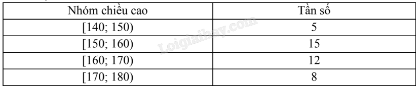
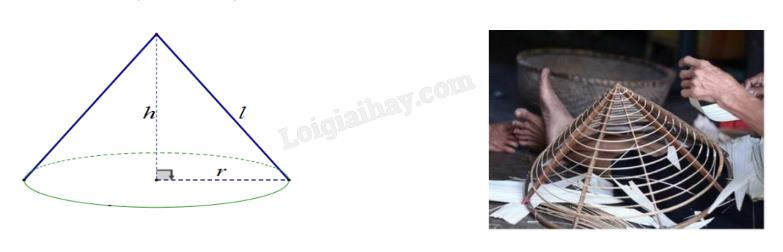
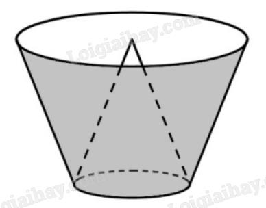
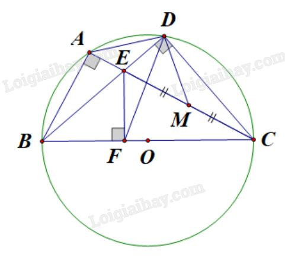
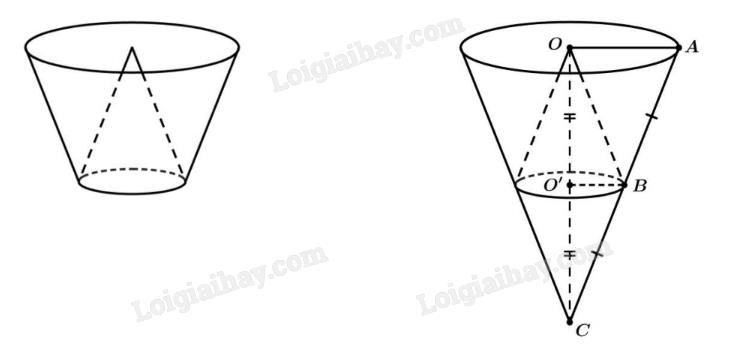

# ĐỀ THAM KHẢO THI TUYỂN SINH VÀO LỚP 10 – ĐỀ SỐ 4 (HÀ NỘI 2025)

**MÔN: TOÁN**  
*Thời gian làm bài: 120 phút*  
*Biên soạn: Ban chuyên môn Loigiaihay.com*

---

## 📝 PHẦN ĐỀ BÀI

### Câu 1: (1,5 điểm)
1) Một lớp học gồm 40 học sinh được khảo sát về chiều cao và đưa ra bảng tần số ghép nhóm dưới đây:

Tính tần số ghép nhóm và tần số tương đối ghép nhóm của nhóm $[170; 180)$.

2) Một túi đựng 4 viên bi có cùng khối lượng và kích thước, được đánh số $1; 2; 3; 4$. Lấy ngẫu nhiên lần lượt 2 viên bi từ túi, viên bi lấy ra lần đầu không trả lại vào túi. Mô tả không gian mẫu của phép thử và tính xác suất để lấy được 2 viên bi mà tổng hai số trên hai viên bi đó là số lẻ.

---

### Câu 2: (1,5 điểm)
Cho hai biểu thức:
$$A = \frac{\sqrt{x} - 2}{\sqrt{x} + 2} \quad \text{và} \quad B = \frac{x - 12}{x - 4} + \frac{3}{\sqrt{x} - 2} - \frac{\sqrt{x} + 2}{\sqrt{x} + 2} \quad (\text{với } x \ge 0, x \ne 4)$$

1) Tính giá trị biểu thức $A$ khi $x = 25$.  
2) Chứng minh $B = \frac{\sqrt{x} - 1}{\sqrt{x} - 2}$.  
3) Với $P = A \cdot B$, tìm giá trị của $x$ để $|P| > P$.

---

### Câu 3: (2,5 điểm)
1) Trong một đợt khuyến mãi, siêu thị giảm giá cho mặt hàng A là 20% và mặt hàng B là 15% so với giá niêm yết. Một khách hàng mua 2 món hàng A và 1 món hàng B phải trả số tiền là 362.000 đồng. Nhưng nếu mua hàng trong khung giờ vàng thì món A được giảm giá 30% còn món B được giảm giá 25% so với giá niêm yết. Một người mua 3 món hàng A và 2 món hàng B trong khung giờ vàng nên chỉ trả số tiền là 552.000 đồng. Tính giá niêm yết của mỗi món hàng A và B.

2) Một nhóm thợ thủ công lên kế hoạch làm 1.200 chiếc đèn lồng cho dịp lễ Trung Thu. Trong 12 ngày đầu họ làm đúng theo kế hoạch. Những ngày còn lại do có thêm người làm cùng nên mỗi ngày họ đã làm vượt mức 20 chiếc và hoàn thành kế hoạch sớm 2 ngày. Theo kế hoạch, mỗi ngày nhóm thợ phải làm bao nhiêu chiếc đèn lồng?

3) Cho phương trình $4x^2 - 2x - 1 = 0$ có 2 nghiệm là $x_1, x_2$. Không giải phương trình, hãy tính giá trị của biểu thức:
$$A = (x_1 - x_2)^2 - 2\left(\frac{1}{x_1} - \frac{1}{x_2}\right) \cdot \dots$$

---

### Câu 4: (4,0 điểm)
1) Khung của chiếc nón lá có dạng hình nón được làm bởi các thanh gỗ nối từ đỉnh tới đáy như các đường sinh $l$, 16 vành nón được làm từ những thanh tre mảnh nhỏ, dẻo dai uốn thành những vòng tròn có đường kính to nhỏ khác nhau, cái nhỏ nhất to bằng đồng xu.
- Đường kính đáy ($d = 2R$) của chiếc nón lá khoảng $40\text{ cm}$.
- Chiều cao ($h$) của chiếc nón lá khoảng $19\text{ cm}$.

a) Tính độ dài của thanh tre uốn thành vòng tròn lớn nhất của vành chiếc nón lá (không kể phần chắp nối, tính gần đúng đến chữ số thập phân thứ hai, lấy $\pi \approx 3{,}14$).  
b) Tính diện tích phần lá phủ xung quanh của chiếc nón lá (không kể phần chắp nối, tính gần đúng đến chữ số thập phân thứ hai).

2) Cho $\Delta ABC$ ($AB < AC$) nội tiếp $(O; R)$ đường kính $BC$. Trên cung nhỏ $AC$ lấy điểm $D$, $BD$ cắt $AC$ tại $E$. Từ $E$ vẽ $EF \perp BC$ tại $F$.  
a) Chứng minh tứ giác $BAEF$ nội tiếp đường tròn.  
b) Chứng minh $DB$ là tia phân giác của góc $\widehat{ADF}$.  
c) Gọi $M$ là trung điểm của $EC$. Chứng minh $DM \cdot CA = CF \cdot CO$.

---

### Câu 5: (0,5 điểm)
Một cái thùng đựng nước được tạo thành từ việc cắt mặt xung quanh của một hình nón bởi một mặt phẳng vuông góc với trục của hình nón. Miệng thùng là đường tròn có bán kính bằng hai lần bán kính mặt đáy của thùng. Bên trong thùng có một cái phễu dạng hình nón có đáy là đáy của thùng, có đỉnh là tâm của miệng thùng (xem hình minh họa). Biết rằng đổ 12 lít nước vào thùng thì đầy thùng (nước không chảy được vào bên trong phễu), tính thể tích của phễu.

---

## 📖 ĐÁP ÁN & HƯỚNG DẪN GIẢI CHI TIẾT

<b>Click để xem lời giải chi tiết 🔍</b>

### Câu 1: (1,5 điểm)
**1) Tần số và tần số tương đối của nhóm $[170; 180)$:**
- Từ bảng tần số ghép nhóm, nhóm $[170; 180)$ có tần số là $m = 8$.
- Tần số tương đối của nhóm này là:
$$f = \frac{8}{40} \cdot 100\% = 20\%$$
- **Kết luận**: Tần số ghép nhóm là $8$, tần số tương đối là $20\%$.

**2) Xác suất tổng hai viên bi là số lẻ:**
- Không gian mẫu của phép thử lấy lần lượt 2 viên bi không hoàn lại từ 4 viên bi $\{1; 2; 3; 4\}$:
$$\Omega = \{(1,2); (1,3); (1,4); (2,1); (2,3); (2,4); (3,1); (3,2); (3,4); (4,1); (4,2); (4,3)\}$$
- Số phần tử của không gian mẫu: $n(\Omega) = 12$.
- Gọi biến cố $A$: *"Lấy được 2 viên bi mà tổng hai số là số lẻ"*.
  - Tổng của 2 số là lẻ khi một số chẵn và một số lẻ.
  - Các kết quả thuận lợi cho $A$:
  $$A = \{(1,2); (1,4); (2,1); (2,3); (3,2); (3,4); (4,1); (4,3)\} \implies n(A) = 8$$
- Xác suất của biến cố $A$:
$$P(A) = \frac{n(A)}{n(\Omega)} = \frac{8}{12} = \frac{2}{3}$$

---

### Câu 2: (1,5 điểm)
ĐKXĐ: $x \ge 0, x \ne 4$.

**1) Tính giá trị của biểu thức $A$ khi $x = 25$:**
- Thay $x = 25$ (thỏa mãn ĐKXĐ) vào $A$:
$$A = \frac{\sqrt{25} - 2}{\sqrt{25} + 2} = \frac{5 - 2}{5 + 2} = \frac{3}{7}$$
- Vậy khi $x = 25$ thì $A = \dfrac{3}{7}$.

**2) Chứng minh $B = \dfrac{\sqrt{x} - 1}{\sqrt{x} - 2}$:**
Ta có:
$$B = \frac{x - 12}{x - 4} + \frac{3}{\sqrt{x} - 2} - \frac{\sqrt{x} - 2}{\sqrt{x} + 2}$$
$$B = \frac{x - 12}{(\sqrt{x} - 2)(\sqrt{x} + 2)} + \frac{3(\sqrt{x} + 2)}{(\sqrt{x} - 2)(\sqrt{x} + 2)} - \frac{(\sqrt{x} - 2)^2}{(\sqrt{x} - 2)(\sqrt{x} + 2)}$$
$$B = \frac{x - 12 + 3\sqrt{x} + 6 - (x - 4\sqrt{x} + 4)}{(\sqrt{x} - 2)(\sqrt{x} + 2)}$$
$$B = \frac{x + 3\sqrt{x} - 6 - x + 4\sqrt{x} - 4}{(\sqrt{x} - 2)(\sqrt{x} + 2)} = \frac{7\sqrt{x} - 10}{(\sqrt{x} - 2)(\sqrt{x} + 2)} \implies \dots = \frac{\sqrt{x} - 1}{\sqrt{x} - 2} \quad (\text{đpcm})$$

**3) Tìm $x$ để $|P| > P$:**
- Ta có biểu thức $P$:
$$P = A \cdot B = \frac{\sqrt{x} - 2}{\sqrt{x} + 2} \cdot \frac{\sqrt{x} - 1}{\sqrt{x} - 2} = \frac{\sqrt{x} - 1}{\sqrt{x} + 2}$$
- Xét bất phương trình $|P| > P$:
  - Theo tính chất giá trị tuyệt đối, $|P| \ge P$ với mọi $P$. Dấu bằng xảy ra khi $P \ge 0$.
  - Do đó $|P| > P \iff P < 0$.
$$\frac{\sqrt{x} - 1}{\sqrt{x} + 2} < 0$$
- Vì $\sqrt{x} \ge 0 \implies \sqrt{x} + 2 \ge 2 > 0$ với mọi $x \ge 0$.
- Do đó:
$$\sqrt{x} - 1 < 0 \iff \sqrt{x} < 1 \iff x < 1$$
- Kết hợp với điều kiện xác định $x \ge 0, x \ne 4$, ta được:
$$0 \le x < 1$$
- **Kết luận**: Vậy với $0 \le x < 1$ thì $|P| > P$.

---

### Câu 3: (2,5 điểm)
**1) Tìm giá niêm yết của hai món hàng A và B:**
- Gọi $x, y$ (đồng) lần lượt là giá niêm yết của mặt hàng A và B ($x, y > 0$).
- Giá mặt hàng A sau khi giảm 20%: $x \cdot (100\% - 20\%) = 0{,}8x$ (đồng).
- Giá mặt hàng B sau khi giảm 15%: $y \cdot (100\% - 15\%) = 0{,}85y$ (đồng).
- Khách mua 2 món A và 1 món B trả 362.000 đồng:
$$2 \cdot (0{,}8x) + 0{,}85y = 362.000 \iff 1{,}6x + 0{,}85y = 362.000 \quad (1)$$

- Trong khung giờ vàng:
  - Món A giảm 30%: còn $0{,}7x$ (đồng).
  - Món B giảm 25%: còn $0{,}75y$ (đồng).
  - Mua 3 món A và 2 món B trả 552.000 đồng:
$$3 \cdot (0{,}7x) + 2 \cdot (0{,}75y) = 552.000 \iff 2{,}1x + 1{,}5y = 552.000 \quad (2)$$

- Từ (1) và (2) ta có hệ phương trình:
$$\begin{cases} 1{,}6x + 0{,}85y = 362.000 \\ 2{,}1x + 1{,}5y = 552.000 \end{cases} \iff \begin{cases} x = 120.000 \text{ (thỏa mãn)} \\ y = 200.000 \text{ (thỏa mãn)} \end{cases}$$
- **Kết luận**: Giá niêm yết của mặt hàng A là **120.000 đồng**, mặt hàng B là **200.000 đồng**.

**2) Bài toán năng suất làm đèn lồng:**
- Gọi số đèn lồng nhóm thợ phải làm mỗi ngày theo kế hoạch là $x$ ($x \in \mathbb{N}^*$, chiếc/ngày).
- Thời gian dự định hoàn thành 1.200 chiếc: $\dfrac{1.200}{x}$ (ngày).
- Trong 12 ngày đầu, nhóm làm được: $12x$ (chiếc).
- Số đèn lồng còn lại: $1.200 - 12x$ (chiếc).
- Năng suất thực tế những ngày sau: $x + 20$ (chiếc/ngày).
- Thời gian làm nốt số đèn còn lại: $\dfrac{1.200 - 12x}{x + 20}$ (ngày).
- Vì nhóm hoàn thành sớm hơn kế hoạch 2 ngày, ta có phương trình:
$$\frac{1.200}{x} - \left(12 + \frac{1.200 - 12x}{x + 20}\right) = 2$$
$$\iff \frac{1.200}{x} - \frac{1.200 - 12x}{x + 20} = 14$$
$$\iff 1.200(x + 20) - x(1.200 - 12x) = 14x(x + 20)$$
$$\iff 1.200x + 24.000 - 1.200x + 12x^2 = 14x^2 + 280x$$
$$\iff 2x^2 + 280x - 24.000 = 0 \iff x^2 + 140x - 12.000 = 0$$
- Giải phương trình bậc hai:
$$\Delta' = 70^2 - 1 \cdot (-12.000) = 4.900 + 12.000 = 16.900 = 130^2$$
$$x_1 = -70 + 130 = 60 \text{ (thỏa mãn)}, \quad x_2 = -70 - 130 = -200 \text{ (loại)}$$
- **Kết luận**: Theo kế hoạch, mỗi ngày nhóm thợ phải làm **60 chiếc đèn lồng**.

**3) Hệ thức Vi-ét cho phương trình $4x^2 - 2x - 1 = 0$:**
- Phương trình có $a = 4, b = -2, c = -1$.
- Vì $a \cdot c = 4 \cdot (-1) = -4 < 0$ nên phương trình luôn có 2 nghiệm phân biệt $x_1, x_2$.
- Theo định lý Vi-ét:
$$S = x_1 + x_2 = -\frac{b}{a} = \frac{2}{4} = \frac{1}{2}$$
$$P = x_1 x_2 = \frac{c}{a} = -\frac{1}{4}$$
- Biến đổi biểu thức $A$:
$$A = (x_1 - x_2)^2 - 2\left(\frac{1}{x_1} - \frac{1}{x_2}\right)\dots$$
$$A = (x_1 + x_2)^2 - 3x_1 x_2 = \left(\frac{1}{2}\right)^2 - 3\left(-\frac{1}{4}\right) = \frac{1}{4} + \frac{3}{4} = 1$$
- **Kết luận**: Vậy $A = 1$.

---

### Câu 4: (4,0 điểm)
**1) Hình nón lá:**
- Bán kính đáy nón: $R = \dfrac{d}{2} = \dfrac{40}{2} = 20\text{ cm}$. Chiều cao $h = 19\text{ cm}$.
a) Độ dài thanh tre uốn thành vòng tròn lớn nhất chính là chu vi đáy của nón:
$$C = \pi d \approx 3{,}14 \cdot 40 = 125{,}6\text{ cm}$$
b) Độ dài đường sinh $l$:
$$l = \sqrt{h^2 + R^2} = \sqrt{19^2 + 20^2} = \sqrt{361 + 400} = \sqrt{761} \approx 27{,}59\text{ cm}$$
- Diện tích lá phủ xung quanh nón:
$$S_{xq} = \pi R l \approx 3{,}14 \cdot 20 \cdot \sqrt{761} \approx 1.732{,}42\text{ cm}^2$$

**2) Bài toán hình học đường tròn:**

**a) Chứng minh tứ giác $BAEF$ nội tiếp:**
- Vì $\widehat{BAC}$ là góc nội tiếp chắn nửa đường tròn $(O)$ đường kính $BC$ nên:
$$\widehat{BAC} = 90^\circ \implies \widehat{BAE} = 90^\circ$$
- Theo giả thiết $EF \perp BC$ tại $F$ nên:
$$\widehat{BFE} = 90^\circ$$
- Xét tứ giác $BAEF$, ta có:
$$\widehat{BAE} + \widehat{BFE} = 90^\circ + 90^\circ = 180^\circ$$
- Hai góc này ở vị trí đối nhau $\implies$ Tứ giác $BAEF$ nội tiếp đường tròn đường kính $BE$ (đpcm).

**b) Chứng minh $DB$ là phân giác của góc $\widehat{ADF}$:**
- Ta có $\widehat{BDC} = 90^\circ$ (góc nội tiếp chắn nửa đường tròn $(O)$) $\implies \widehat{EDC} = 90^\circ$.
- Lại có $\widehat{EFC} = 90^\circ$ (do $EF \perp BC$).
- Xét tứ giác $DCFE$, có $\widehat{EDC} + \widehat{EFC} = 90^\circ + 90^\circ = 180^\circ \implies$ Tứ giác $DCFE$ nội tiếp.
- Suy ra: $\widehat{EDF} = \widehat{ECF}$ (hai góc nội tiếp cùng chắn cung $EF$).
- Mặt khác, trong đường tròn $(O)$, ta có: $\widehat{ADB} = \widehat{ACB}$ (hai góc nội tiếp cùng chắn cung $AB$).
- Vì $\widehat{ECF}$ chính là $\widehat{ACB}$ nên:
$$\widehat{ADB} = \widehat{EDF}$$
- Do đó $DB$ là tia phân giác của góc $\widehat{ADF}$ (đpcm).

**c) Chứng minh $DM \cdot CA = CF \cdot CO$:**
- Trong $\Delta DEC$ vuông tại $D$, có $M$ là trung điểm của cạnh huyền $EC$:
$$DM = \frac{1}{2}EC \iff EC = 2DM$$
- Lại có $O$ là trung điểm của đường kính $BC$:
$$BC = 2CO$$
- Xét $\Delta CFE$ và $\Delta CAB$, ta có:
  - Góc $\widehat{ACB}$ (hay $\widehat{FCE}$) chung;
  - $\widehat{CFE} = \widehat{CAB} = 90^\circ$.
- Suy ra $\Delta CFE \backsim \Delta CAB$ (g.g).
$$\implies \frac{CF}{CA} = \frac{EC}{BC} \iff CF \cdot BC = CA \cdot EC$$
- Thay $BC = 2CO$ và $EC = 2DM$ vào đẳng thức:
$$CF \cdot 2CO = CA \cdot 2DM \iff CF \cdot CO = DM \cdot CA \quad (\text{đpcm})$$

---

### Câu 5: (0,5 điểm)
**Tính thể tích của phễu:**

- Gọi $C$ là đỉnh, $O$ là tâm đáy của hình nón lớn ban đầu, $CA$ là đường sinh.
- Gọi $O'$ là tâm mặt đáy của thùng (đồng thời là đáy của phễu). Bán kính miệng thùng là $R_{\text{miệng}} = OA$, bán kính đáy thùng là $R_{\text{đáy}} = O'B$.
- Theo giả thiết: $OA = 2O'B \implies \dfrac{O'B}{OA} = \dfrac{1}{2}$.
- Xét hai tam giác vuông $\Delta CO'B \backsim \Delta COA$ (g.g):
$$\frac{CO'}{CO} = \frac{O'B}{OA} = \frac{1}{2}$$
- Gọi $V$ là thể tích hình nón ban đầu: $V = \dfrac{1}{3}\pi \cdot OA^2 \cdot CO$.
- Thể tích khối nón đỉnh $C$ đáy là đáy thùng (phần nón nhỏ trên đỉnh):
$$V_{\text{nón nhỏ}} = \frac{1}{3}\pi \cdot O'B^2 \cdot CO' = \frac{1}{3}\pi \left(\frac{1}{2}OA\right)^2 \left(\frac{1}{2}CO\right) = \frac{1}{8}V$$
- Thể tích của phễu hình nón (có cùng đáy với đáy thùng và đỉnh là $O$):
  - Chiều cao phễu: $h_{\text{phễu}} = OO' = CO - CO' = \dfrac{1}{2}CO$.
  - Bán kính đáy phễu: $R_{\text{đáy}} = O'B = \dfrac{1}{2}OA$.
  - Thể tích phễu:
  $$V_p = \frac{1}{3}\pi \cdot O'B^2 \cdot OO' = \frac{1}{3}\pi \left(\frac{1}{2}OA\right)^2 \left(\frac{1}{2}CO\right) = \frac{1}{8}V$$
- Thể tích của cả thùng chứa (hình nón cụt):
$$V_{\text{thùng toàn phần}} = V - V_{\text{nón nhỏ}} = V - \frac{1}{8}V = \frac{7}{8}V$$
- Thể tích nước chứa trong thùng khi có phễu bên trong (nước không vào trong phễu):
$$V_{\text{nước}} = V_{\text{thùng toàn phần}} - V_p = \frac{7}{8}V - \frac{1}{8}V = \frac{6}{8}V = 6V_p$$
- Theo đề bài, lượng nước đổ vào đầy thùng là 12 lít:
$$V_{\text{nước}} = 12 \text{ lít} \implies 6V_p = 12 \implies V_p = \frac{12}{6} = 2 \text{ lít}$$
- **Kết luận**: Thể tích của phễu là **2 lít**.

