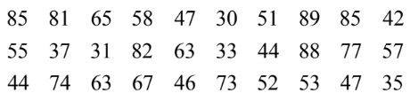
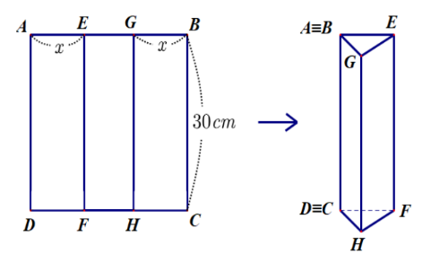
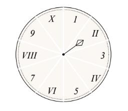
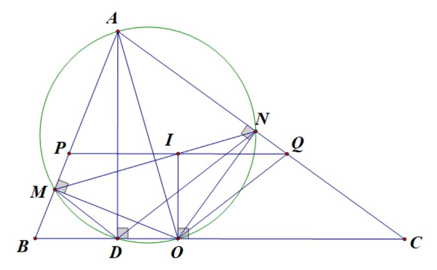
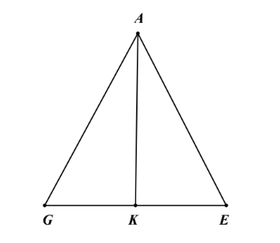

# ĐỀ THAM KHẢO THI TUYỂN SINH VÀO 10 - ĐỀ SỐ 5 MÔN TOÁN Thời gian: 120 phút BIÊN SOẠN: BAN CHUYÊN MÔN LOIGIAIHAY.COM

*Thời gian xe khách đi từ A đến B là: 100 x (giờ).*  
*Thời gian xe du lịch đi từ A đến B là: 100 x 20 + (giờ).*  

---

### Câu 1: (1,5 điểm)

1) Thống kê số lần truy cập Internet của 30 người trong một tuần là:

Lập bảng tần số ghép nhóm của mẫu số liệu đó sau khi được ghép nhóm theo sáu nhóm sau: [30;40), [40;50), [50;60), [60;70), [70;80), [80;90). Tìm tần số tương đối ghép nhóm.
2) Một hình tròn được chia thành 10 hình quạt như nhau, được đánh số như hình bên và được gắn vào trục
quay có mũi tên cố định ở tâm.
Xét phép thử “Quay đĩa tròn một lần” và biến cố A: “Mũi tên chỉ vào các số La Mã”.
Tính xác suất của biến cố A.

### Câu 2: (1,5 điểm) Cho biểu thức x A x 3 = - ; ( )( ) 7 12 B x 1 x 1 3 x = - + + - với x 0 \ge ; x 9 \ne .

1) Tính giá trị của A khi
9 x 4 = . 2) Rút gọn M A B = - .
3) Tìm các giá trị của x sao cho
2 25 M 4 < .

### Câu 3: (2,5 điểm)

1) Một trường THCS tổ chức cho 250 người bao gồm giáo viên và học sinh đi tham quan khu du lịch Đảo
Ngọc Xanh. Biết giá vé vào cổng của một giáo viên là 80 000 đồng, vé vào cổng của một học sinh là 60 000 đồng. Nhà trường tổ chức đi vào đúng dịp Khai trương nên được giảm giá 5% cho mỗi vé vào cổng, vì vậy nhà trường chỉ phải trả tổng số tiền là 14 535 000 đồng. Hỏi có bao nhiêu giáo viên và học sinh của trường đi tham quan?

2) Một xe khách và một xe du lịch khởi hành đồng thời từ A đi đến B. Biết vận tốc của xe du lịch lớn hơn
vận tốc của xe khách là 20 km/h nên xe du lịch đến B trước xe khách 50 phút. Tính vận tốc của mỗi xe, biết quãng đường AB dài 100 km.
3) Cho phương trình
2 2x 4x 3 0 - - = có hai nghiệm là 1x , 2 x . Không giải phương trình, hãy tính giá trị của biểu thức ( ) 2 1 2 A x x = - .

### Câu 4: (4 điểm)

1) Một ly đựng đầy nước dạng hình trụ có chiều cao là 15 cm, bán kính đáy bằng 5 cm.
a) Tính thể tích nước chứa trong ly.
b) Người ta thả vào ly 5 viên bi đặc không thấm nước có dạng hình cầu, đường kính mỗi viên bi bằng 3 cm.
Tính thể tích nước tràn ra ngoài ly.
2) Cho tam giác ABC nhọn (AB < AC) có đường cao AD và đường phân giác trong AO (D, O thuộc cạnh
BC). Kẻ OM AB \perp tại M, ON AC \perp tại N.
a) Chứng minh bốn điểm O, M, D, N cùng nằm trên một đường tròn.
b) Chứng minh: BDM
ODN = .
c) Qua O kẻ đường thẳng vuông góc với BC cắt MN tại I, AI cắt BC tại K. Chứng minh K là trung điểm của
BC.

### Câu 5: (0,5 điểm) Cho hình vuông ABCD có cạnh là 30 cm. Trên cạnh AB lấy hai điểm E, G sao cho AE = GB = x (cm) và điểm E nằm giữa điểm A và điểm G. Qua E kẻ đường thẳng vuông góc với AB cắt CD tại F;

qua G kẻ đường thẳng vuông góc với AB cắt CD tại H. Người ta gập hình vuông theo hai cạnh EF và GH sao cho cạnh AD trùng cạnh BC như hình vẽ để tạo thành hình lăng trụ đứng khuyết đáy. Tìm x để thể tích hình lăng trụ lớn nhất.

---
*------------------- HẾT -------------------*

---

## 📖 ĐÁP ÁN & HƯỚNG DẪN GIẢI CHI TIẾT

<b>Click để xem lời giải chi tiết 🔍</b>

### Câu 1: (1,5 điểm)

1) Thống kê số lần truy cập Internet của 30 người trong một tuần là:

Lập bảng tần số ghép nhóm của mẫu số liệu đó sau khi được ghép nhóm theo sáu nhóm sau: [30;40), [40;50), [50;60), [60;70), [70;80), [80;90). Tìm tần số tương đối ghép nhóm.
2) Một hình tròn được chia thành 10 hình quạt như nhau, được đánh số như hình bên và được gắn vào trục
quay có mũi tên cố định ở tâm.
Xét phép thử “Quay đĩa tròn một lần” và biến cố A: “Mũi tên chỉ vào các số La Mã”.
Tính xác suất của biến cố A.

**Phương pháp**

1) - Xác định tần số cho các nhóm để lập bảng tần số ghép nhóm.
- Tần số tương đối của nhóm bằng: tần số của nhóm : tổng . 100%.
2) - Xác định không gian mẫu của phép thử, tính số phần tử của không gian mẫu.
- Tính số kết quả thuận lợi của biến cố.
- Xác suất của biến cố = số kết quả thuận lợi của biến cố : số phần tử của không gian mẫu.

**Lời giải**

1) Lập bảng tần số ghép nhóm:
Nhóm [30;40) [40;50) [50;60) [60;70) [70;80), [80;90) Tổng Tần số (n) 5 6 6 4 3 6 N = 30 Tần số tương đối ghép nhóm của của nhóm [50;60) là:
6 f .100% 20% 30 = = .
2) Xét phép thử “Quay đĩa tròn một lần”. Ta thấy, các kết quả có thể xảy ra của phép thử đó là đồng khả
năng.
Tập hợp các kết quả có thể xảy ra của phép thử đó là: W = {1; II; 3; IV; 5; VI; 7; VIII; 9; X}.
Số phần tử của tập hợp W là 10.

Các kết quả thuận lợi cho biến cố A là: II, IV, VI, VIII, X.
Do đó, có 5 kết quả thuận lợi cho biến cố A.
Vậy 5 1 P(A) 10 2 = = .

### Câu 2: (1,5 điểm) Cho biểu thức x A x 3 = - ; ( )( ) 7 12 B x 1 x 1 3 x = - + + - với x 0 \ge ; x 9 \ne .

1) Tính giá trị của A khi
9 x 4 = . 2) Rút gọn M A B = - .
3) Tìm các giá trị của x sao cho
2 25 M 4 < . Phương pháp
1) Kiểm tra điều kiện của x. Nếu thỏa mãn, thay
9 x 4 = vào A.
2) Kết hợp các tính chất của căn thức bậc hai để rút gọn biểu thức.
3) Rút gọn P rồi giải bất đẳng thức
2 25 M 4 < , kết hợp điều kiện để tìm x.

**Lời giải 1) Thay 9 x 4 = (thỏa mãn điều kiện) vào A, ta được:**

9 3 3 4 2 2 A 1 3 3 9 3 3 2 2 4 = = = = - - - - . Vậy khi 9 x 4 = thì A = - 1. 2) ĐKXĐ: $x \ge 0, x \ne 9$ . ( )( ) ( )( ) x 7 12 x 7 12 M A B x 3 x 1 x 3 x 1 x 1 3 x x 1 x 3 [ ]   = - = - - = - -
 
- + - + + - + -
 

( ) ( ) ( )( ) ( )( ) ( )( ) x x 1 7 x 3 12 x x 7 x 21 12 x 6 x 9 x 1 x 3 x 1 x 3 x 1 x 3 + - - - + - + - - + = = = + - + - + -

( ) ( )( ) 2 x 3 x 3 x 1 x 1 x 3 - - = = + + - . 3) 2 25 M 4 <

2 2 x 3 5 2 x 1 ( ) - ( ) < ( ) ( ) ( ) + ( ) ( )

2 2 x 3 5 0 2 x 1 ( ) - ( ) - < ( ) ( ) ( ) + ( ) ( )

x 3 5 x 3 5 0 2 2 x 1 x 1 ( )( ) - - - + < ( )( ) ( )( ) + + ( )( )

( ) ( ) 2 x 6 5 x 5 2 x 6 5 x 5 . 0 2 x 1 2 x 1 - - - - + + < + +

( ) ( ) 3 x 11 7 x 1 . 0 2 x 1 2 x 1 - - - < + +

( ) ( ) ( ) 2 3 x 11 . 7 x 1 0 4 x 1 - - - < + . Vì ( ) 2 4 x 1 0 + > nên để ( ) ( ) ( ) 2 3 x 11 . 7 x 1 0 4 x 1 - - - < + thì ( ) ( ) 3 x 11 . 7 x 1 0 - - - < . Mà x 0 \ge nên 3 x 0 - \le , suy ra 3 x 11 0 - - < . Do đó, để ( ) ( ) 3 x 11 . 7 x 1 0 - - - < thì: 7 x 1 0 - >

1 x 7 >

1 x 49 > . Vậy, với 1 x 49 > , x 9 \ne thì 2 25 M 4 < .

### Câu 3: (2,5 điểm)

1) Một trường THCS tổ chức cho 250 người bao gồm giáo viên và học sinh đi tham quan khu du lịch Đảo
Ngọc Xanh. Biết giá vé vào cổng của một giáo viên là 80 000 đồng, vé vào cổng của một học sinh là 60 000 đồng. Nhà trường tổ chức đi vào đúng dịp Khai trương nên được giảm giá 5% cho mỗi vé vào cổng, vì vậy nhà trường chỉ phải trả tổng số tiền là 14 535 000 đồng. Hỏi có bao nhiêu giáo viên và học sinh của trường đi tham quan?
2) Một xe khách và một xe du lịch khởi hành đồng thời từ A đi đến B. Biết vận tốc của xe du lịch lớn hơn
vận tốc của xe khách là 20 km/h nên xe du lịch đến B trước xe khách 50 phút. Tính vận tốc của mỗi xe, biết quãng đường AB dài 100 km.

3) Cho phương trình
2 2x 4x 3 0 - - = có hai nghiệm là 1x , 2 x . Không giải phương trình, hãy tính giá trị của biểu thức ( ) 2 1 2 A x x = - . Phương pháp
1) Gọi số giáo viên và số học sinh lần lượt là x, y (0 < x, y < 250; x, y  \in
; đơn vị: người).
Biểu diễn tổng số người tham gia, số tiền mua vé theo hai biến x, y.
Lập hệ phương trình, giải hệ để tìm x, y.
2) Gọi x là vận tốc của xe khách (x > 0, đơn vị: km/h).
Biểu diễn vận tốc, thời gian di chuyển của xe khách và xe du lịch theo x.
Do xe du lịch đến B trước xe khách 50 phút nên ta lập được phương trình.
Giải phương trình để tìm x, kiểm tra điều kiện và kết luận.
3) Kiểm tra sự tồn tại của
1 2 x ,x dựa vào \Delta.
Biến đổi biểu thức A và áp dụng định lí Viète:
1 2 b S x x a = + = - ; 1 2 c P x .x a = = . Lời giải
1) Gọi x là số giáo viên, y là số học sinh của trường tham gia tham quan (0 < x, y < 250; x, y  \in
; đơn vị: người).
Vì tổng số giáo viên và học sinh tham gia là 250 người nên ta có phương trình: x y 250 + = (1).
Số tiền vé của một giáo viên sau khi được giảm là: 80000.95% 76000 = (đồng).
Số tiền vé của một học sinh sau khi được giảm là: 60000.95% 57000 = (đồng).
Vì nhà trường chỉ phải trả tổng số tiền là 14 535 000 đồng nên ta có phương trình:
76000x 57000y 14535000 + = (2).
Từ (1) và (2), ta có hệ phương trình: x y 250 76000x 57000y 14535000 + = \begin{cases}

+ = \end{cases}

x 15 y 235 = \begin{cases} = \end{cases}

Giải hệ, được x = 15 (TM) và y = 235 (TM).
Vậy số giáo viên tham gia là 15 người, số học sinh tham gia là 235 người.
2) Đổi: 50 phút = 5
6 giờ.
Gọi vận tốc của xe khách là x (km/h, x > 0), khi đó vận tốc của xe du lịch là x + 20 (km/h).
Vì xe du lịch đi đến B trước xe khách 50 phút nên ta có phương trình:

100 100 5 x x 20 6 - = +

100.6(x 20) 100.6x 5x(x 20) 6x(x 20) 6x(x 20) 6x(x 20) + + - = + + +

100.6(x 20) 100.6x 5x(x 20) + - = +

2 600x 12000 600x 5x 100x + - = +

2 5x 100x 12000 0 + - =

Giải phương trình trên, ta được x = 40 (thỏa mãn) và x = -60 (loại).
Vậy, vận tốc của xe khách là 40 km/h, vận tốc của xe du lịch là 60 km/h.
3) Xét ac = 2.(-3) = -6 < 0 nên phương trình
2 2x 4x 3 0 - - = có hai nghiệm phân biệt 1x , 2 x .
Áp dụng hệ thức Viète, ta có:
1 2 1 2 b 4 x x 2 a 2 c 3 x x a 2 -
\begin{cases} + = - = - =  -
 = = \end{cases}

( ) 2 1 2 A x x = -

( ) 2 1 2 1 2 x x 4x x = + -

2 3 2 4. 10 2 - ( ) = - = ( ) ( ) . Vậy A = 10.

### Câu 4: (4 điểm)

1) Một ly đựng đầy nước dạng hình trụ có chiều cao là 15 cm, bán kính đáy bằng 5 cm.
a) Tính thể tích nước chứa trong ly.
b) Người ta thả vào ly 5 viên bi đặc không thấm nước có dạng hình cầu, đường kính mỗi viên bi bằng 3 cm.
Tính thể tích nước tràn ra ngoài ly.
2) Cho tam giác ABC nhọn (AB < AC) có đường cao AD và đường phân giác trong AO (D, O thuộc cạnh
BC). Kẻ OM AB \perp tại M, ON AC \perp tại N.
a) Chứng minh bốn điểm O, M, D, N cùng nằm trên một đường tròn.
b) Chứng minh: BDM
ODN = .
c) Qua O kẻ đường thẳng vuông góc với BC cắt MN tại I, AI cắt BC tại K. Chứng minh K là trung điểm của
BC. Phương pháp 1)
a) Áp dụng công thức tính thể tích khối trụ:
2 V R h = \pi .
b) Thể tích nước tràn ra ngoài ly bằng thể tích 5 viên bi.

Áp dụng công thức tính thể tích khối cầu:
3 4 V R 3 = \pi . 2)
a) Chứng minh
o AMO 90 = và o ANO 90 = , từ đó suy ra các điểm M, N, D, O cùng thuộc đường tròn đường kính AO.
b) Chứng minh:
+ AMO ANO = (do AMO ANO $\Delta = \Delta ). + AOM ADM $= (góc nội tiếp chắn cung AM).
+ AON ADN = (góc nội tiếp chắn cung AN).
Từ đó ta được ADM ADN = , suy ra BDM ODN = .
c) Qua I, kẻ đường thẳng song song với BC cắt AB, AC tại P, Q. Chứng minh:
+ OI là phân giác của POQ, suy ra PI = IQ (do POQ \Delta cân tại O). + PI QI BK CK = (theo hệ quả định lí Thales).
Từ đó suy ra BK = CK, hay K là trung điểm của BC.

**Lời giải 1)**

a) Thể tích nước chứa trong ly là:
2 2 V R h 5 .15 375 = \pi = \pi = \pi ( ) 3 cm .
b) Thể tích nước tràn ra ngoài ly bằng thể tích 5 viên bi.
Bán kính viên bi là:
3 R 2 = (cm).
Thể tích 1 viên bi là:
3 3 4 4 3 9 V R 3 3 2 2 ( ) = \pi = \pi = \pi ( ) ( ) ( ) 3 cm .
Thể tích nước tràn ra ngoài ly là:
9 45 5V 5. 2 2 = \pi = \pi ( ) 3 cm . 2)

a) Ta có: + OM AB \perp tại M nên o AMO 90 =
. Do đó, M thuộc đường tròn đường kính AO.
+ ON AC \perp tại N nên o ANO 90 = . Do đó, N thuộc đường tròn đường kính AO.
+ AD là đường cao của ABC \Delta nên o ADO 90 = . Do đó, D thuộc đường tròn đường kính AO.
Vậy, bốn điểm M, N, D, O cùng thuộc đường tròn đường kính AO.
b) Xét AMO \Delta và ANO \Delta , có: AO chung; o AMO ANO 90 = = ; OAM OAN =
(OA là đường phân giác trong của ABC \Delta ). Suy ra AMO ANO $\Delta = \Delta (g.c.g), do đó AOM AON $= (1) Vì các điểm M, D, N cùng thuộc đường tròn đường kính AO nên ta có:
AOM ADM = (góc nội tiếp chắn cung AM) (2) AON ADN = (góc nội tiếp chắn cung AN) (3) Từ (1), (2) và (3) suy ra ADM = ADN.
Do đó o o 90 ADM 90 ADN - = - , suy ra BDM ODN = .
c) Qua I, kẻ đường thẳng song song với BC cắt AB, AC tại P, Q.
Vì OI BC \perp , mà PQ // BC nên OI PQ \perp . Ta có: + o OMP 90 = nên M thuộc đường tròn đường kính OP.
+ Vì OI PQ \perp , suy ra o OIP 90 = nên I thuộc đường tròn đường kính OP.
Do đó OMPI là tứ giác nội tiếp, suy ra POI PMI = (góc nội tiếp chắn cung PI) (4) Ta có: + o ONQ 90 = nên N thuộc đường tròn đường kính OQ.
+ Vì OI PQ \perp , suy ra o OIQ 90 = nên I thuộc đường tròn đường kính OQ.
Do đó ONQI là tứ giác nội tiếp, suy ra o IOQ INQ 180 + = ; mà o INQ INA 180 + = (góc kề bù) nên IOQ INA = (5) Ta có: + INA AOM = (góc nội tiếp chắn cung AM).
+ PMI AON = (góc nội tiếp chắn cung AN).
+ AOM AON = (chứng minh trên).
Do đó, INA PMI = (6)

Từ (4), (5) và (6) suy ra POI IOQ = , do đó OI là phân giác của POQ .
Mặt khác, OI PQ \perp nên OI vừa là đường cao, vừa là đường phân giác của POQ \Delta . Suy ra POQ \Delta cân tại O và OI cũng là đường trung tuyến của POQ \Delta nên PI = IQ.
Vì PQ // BC nên theo hệ quả của định lí Thales: PI AI QI BK AK CK = = . Ta có PI QI BK CK = , mà PI = QI nên BK = CK.
Vậy K là trung điểm của BC.

### Câu 5: (0,5 điểm) Cho hình vuông ABCD có cạnh là 30 cm. Trên cạnh AB lấy hai điểm E, G sao cho AE = GB = x (cm) và điểm E nằm giữa điểm A và điểm G. Qua E kẻ đường thẳng vuông góc với AB cắt CD tại F;

qua G kẻ đường thẳng vuông góc với AB cắt CD tại H. Người ta gập hình vuông theo hai cạnh EF và GH sao cho cạnh AD trùng cạnh BC như hình vẽ để tạo thành hình lăng trụ đứng khuyết đáy. Tìm x để thể tích hình lăng trụ lớn nhất.

**Phương pháp**

- Tính thể tích lăng trụ theo x.
- Áp dụng bất đẳng thức Cauchy cho ba số dương để tìm thể tích lớn nhất của lăng trụ.
- Xét dấu “=” xảy ra để tìm x.

**Lời giải Ta có AE = GB = x (0 < x < 15, đơn vị: cm), suy ra EG = 30 - 2x (cm).**

Kẻ đường cao AK của AGE \Delta .

Vì AGE \Delta cân tại A nên EG 30 2x KE 15 x 2 2 - = = = - (cm).
Áp dụng định lí Pythagore cho AKE \Delta vuông tại K, ta có:
2 2 2 AK KE AE + =

2 2 2 AK AE KE = -

2 2 AK AE KE = -

2 2 AK x (15 x) = - -

AK 30x 225 = - .
Diện tích đáy lăng trụ là:
AGE 1 1 S AK.GE 30x 225.(30 2x) 30x 225.(15 x) 2 2 = = - - = - - ( ) 2 cm .
Thể tích lăng trụ là:
AGE V S .AD 30x 225.(15 x).30 15(2x 15). 15 x. 15 x.30 = = - - = - - -

30 15. (2x 15)(15 x)(15 x) = - - - ( ) 3 cm . Vì AKE \Delta vuông tại K nên AE > KE hay 15 x 2 > , suy ra 2x - 15 > 0.
Áp dụng bất đẳng thức Cauchy cho ba số dương 2x - 15, 15 - x, 15 - x, ta được:
3 3. (2x 15)(15 x)(15 x) (2x 15) (15 x) (15 x) - - - \le - + - + -

3 3. (2x 15)(15 x)(15 x) 15 - - - \le

3 (2x 15)(15 x)(15 x) 5 - - - \le

3 (2x 15)(15 x)(15 x) 5 - - - \le

3 (2x 15)(15 x)(15 x) 5 - - - \le

(2x 15)(15 x)(15 x) 5 5 - - - \le .
30 15. (2x 15)(15 x)(15 x) 30 15.5 5 - - - \le

V 750 3 \le .
Dấu “=” xảy ra khi và chỉ khi: 2x - 15 = 15 - x, suy ra x = 10.
Vậy, để thể tích lăng trụ lớn nhất thì x = 10.

