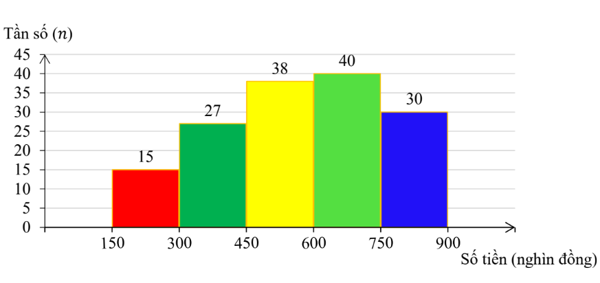
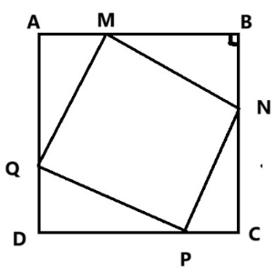
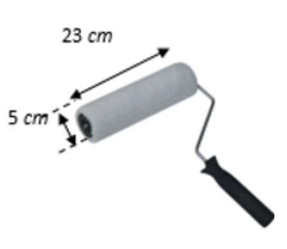
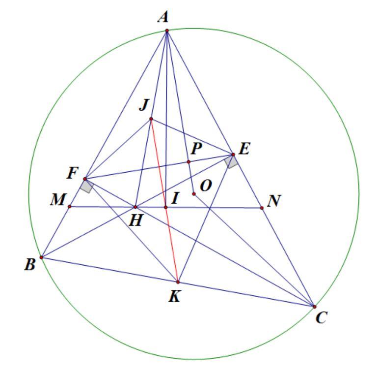
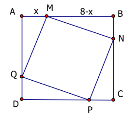

# ĐỀ THAM KHẢO THI TUYỂN SINH VÀO 10 - ĐỀ SỐ 6 MÔN TOÁN Thời gian: 120 phút BIÊN SOẠN: BAN CHUYÊN MÔN LOIGIAIHAY.COM

*Thời gian di chuyển từ A đến B của xe ô tô ít hơn xe máy 30 phút nên ta lập được phương trình.*  
*Thời gian xe máy đi hết quãng đường AB là: 90 x (h).*  
*Thời gian ô tô đi hết quãng đường AB là:*  

---

### Câu 1: (1,5 điểm)

1) Một siêu thị thống kê hóa đơn mua hàng (đơn vị: nghìn đồng) của 150 khách hàng đầu tiên trong ngày. Số
liệu được ghi lại trong biểu đồ tần số ghép nhóm sau:

Tính tần số tương đối của nhóm có tần số nhỏ nhất.
2) Cho tập hợp A = {1;2;3}. Từ các chữ số của tập hợp A, viết ngẫu nhiên một số tự nhiên có hai chữ số.
Tính xác suất để số được viết có hai chữ số giống nhau.

### Câu 2: (1,5 điểm) Cho biểu thức x 2 x A 4 + = ; x x 4 x B : 4 x 2 x x 2 x ( ) + = + ( ) ( ) - + - ( ) với x 0 > , x 4 \ne .

1) Tính giá trị của A với x = 9.
2) Rút gọn biểu thức B.
3) Xét biểu thức P = A.B. Chứng minh P < 0.

### Câu 3: (2,5 điểm)

1) Anh Bình đến siêu thị để mua 1 cái bàn ủi và 1 cái quạt điện có tổng giá niêm yết là 850 nghìn đồng. Tuy
nhiên, thực tế khi trả tiền, nhờ siêu thị khuyến mãi để tri ân khách hàng nên giá bán bàn ủi và quạt điện đã giảm lần lượt 10% và 20% so với giá niêm yết. Do đó, anh Bình đã được giảm 125 nghìn đồng khi mua hai sản phẩm trên. Hỏi số tiền chênh lệch giữa giá bán niêm yết với giá bán thực tế của mỗi sản phẩm mà anh Bình đã mua nói trên là bao nhiêu?
2) Cho quãng đường từ địa điểm A tới địa điểm B dài 90 km. Lúc 6 giờ, một xe máy đi từ A tới B. 6 giờ 30
phút cùng ngày, một ô tô cũng đi từ A tới B với vận tốc lớn hơn vận tốc xe máy 15 km/h. Hai xe cùng chạy trên một con đường và đến B cùng lúc. Tính vận tốc mỗi xe.

3) Biết rằng phương trình bậc hai
2 2x 4x m 0 - + = có một nghiệm 2 10 x 2 + = . Tính tổng nghịch đảo hai nghiệm của phương trình trên.

### Câu 4: (4 điểm)

1) Một trục lăn sơn nước có dạng một hình trụ. Đường kính của đường tròn đáy trục lăn là 5 cm, chiều dài
trục lăn là 23 cm (hình bên). Sau khi lăn trục lăn trọn 15 vòng trên một bức tường phẳng thì diện tích phủ sơn là bao nhiêu 2 cm (giả sử các đường lăn không chồng lấn lên nhau, lấy 3,14 \pi = ).

2) Cho tam giác ABC nhọn (AB < AC) nội tiếp đường tròn (O). Hai đường cao BE và CF của tam giác ABC
cắt nhau tại điểm H. Gọi K là trung điểm của BC.
a) Chứng minh AEF
\Delta đồng dạng ABC \Delta .
b) Chứng minh đường thẳng OA vuông góc với đường thẳng EF.
c) Đường phân giác góc FHB cắt AB và AC lần lượt tại M và N. Gọi I là trung điểm của MN, J là trung
điểm của AH. Chứng minh tứ giác AFHI nội tiếp và ba điểm I, J, K thẳng hàng.

### Câu 5: (0,5 điểm) Một cái sân hình vuông ABCD có cạnh là 8 m. Người ta muốn lát gạch màu khác để trang trí lên mảnh sân hình vuông MNPQ nội tiếp trong sân hình vuông ABCD. Tìm vị trí của M, N, P, Q để hình vuông MNPQ có diện tích nhỏ nhất.

---
*------------------- HẾT -------------------*

---

## 📖 ĐÁP ÁN & HƯỚNG DẪN GIẢI CHI TIẾT

<b>Click để xem lời giải chi tiết 🔍</b>

### Câu 1: (1,5 điểm)

1) Một siêu thị thống kê hóa đơn mua hàng (đơn vị: nghìn đồng) của 150 khách hàng đầu tiên trong ngày. Số
liệu được ghi lại trong biểu đồ tần số ghép nhóm sau:

Tính tần số tương đối của nhóm có tần số nhỏ nhất.
2) Cho tập hợp A = {1;2;3}. Từ các chữ số của tập hợp A, viết ngẫu nhiên một số tự nhiên có hai chữ số.
Tính xác suất để số được viết có hai chữ số giống nhau.

**Phương pháp**

1) Chọn nhóm có tần số nhỏ nhất.
Tần số tương đối của nhóm bằng: tần số của nhóm : tổng . 100%.
2) Xác định không gian mẫu của phép thử, tính số phần tử của không gian mẫu.
Tính số kết quả thuận lợi của biến cố.
Xác suất của biến cố = số kết quả thuận lợi của biến cố : số phần tử của không gian mẫu.

**Lời giải**

1) Nhóm có tần số nhỏ nhất là nhóm [150;300) với tần số 15.
Tần số tương đối của nhóm có tần số nhỏ nhất là 15 .100% 10% 150 = .
2) Không gian mẫu là:
{11;12;13;21;22;23;31;32;33} \Omega = . Do đó n( ) 9 \Omega = .
Có 3 kết quả thuận chơi của biến cố “Số được viết có hai chữ số giống nhau” là {11;22;33}.
Vậy xác suất để số được viết có hai chữ số khác nhau là 3 1 P 9 3 = = .

### Câu 2: (1,5 điểm) Cho biểu thức x 2 x A 4 + = ; x x 4 x B : 4 x 2 x x 2 x ( ) + = + ( ) ( ) - + - ( ) với x 0 > , x 4 \ne .

1) Tính giá trị của A với x = 9.
2) Rút gọn biểu thức B.
3) Xét biểu thức P = A.B. Chứng minh P < 0.

**Phương pháp**

1) Kiểm tra điều kiện của x. Nếu thỏa mãn, thay x = 9 vào A.
2) Kết hợp các tính chất của căn thức bậc hai để rút gọn biểu thức.
3) Rút gọn P rồi chứng minh P < 0.

**Lời giải**

1) Thay x = 9 (thỏa mãn điều kiện) vào A, ta được:
9 2 9 15 A 4 4 + = = .
Vậy khi x = 9 thì 15 A 4 = . 2) x x 4 x B : 4 x 2 x x 2 x ( ) + = + ( ) ( ) - + - ( ) (với x 0 > , x 4 \ne ) ( ) ( )( ) ( )( ) x 2 x x 4 x 2 x . x 2 x 2 x 2 x 2 x [ ] - + -
  = +   + - + -
 

( )( ) 2 x x x 4 x 2 x . x 2 x 2 x - + + - = + -

( )( ) ( ) x x 2 2 x 4 . x 2 x 2 x - + = + -

( )( ) ( ) x x 2 2 x 4 . x 2 x x 2 - - - = + -

( ) 2 x 2 x . x 2 x - + = +

2 x - = . 3) ( ) ( ) 2 x x 2 x 2 x 2 x 2 P . 4 2 x 4 x - + - + + - ( ) = = = ( ) ( ) . Ta có x 2 0 + > , suy ra ( ) x 2 0 - + < , do đó ( ) x 2 0 2 - + < .
Vậy P = A.B < 0.

### Câu 3: (2,5 điểm)

1) Anh Bình đến siêu thị để mua 1 cái bàn ủi và 1 cái quạt điện có tổng giá niêm yết là 850 nghìn đồng. Tuy
nhiên, thực tế khi trả tiền, nhờ siêu thị khuyến mãi để tri ân khách hàng nên giá bán bàn ủi và quạt điện đã giảm lần lượt 10% và 20% so với giá niêm yết. Do đó, anh Bình đã được giảm 125 nghìn đồng khi mua hai sản phẩm trên. Hỏi số tiền chênh lệch giữa giá bán niêm yết với giá bán thực tế của mỗi sản phẩm mà anh Bình đã mua nói trên là bao nhiêu?
2) Cho quãng đường từ địa điểm A tới địa điểm B dài 90 km. Lúc 6 giờ, một xe máy đi từ A tới B. 6 giờ 30
phút cùng ngày, một ô tô cũng đi từ A tới B với vận tốc lớn hơn vận tốc xe máy 15 km/h. Hai xe cùng chạy trên một con đường và đến B cùng lúc. Tính vận tốc mỗi xe.
3) Biết rằng phương trình bậc hai
2 2x 4x m 0 - + = có một nghiệm 2 10 x 2 + = . Tính tổng nghịch đảo hai nghiệm của phương trình trên.

**Phương pháp**

1) Gọi giá tiền niêm yết của một cái bàn ủi và một cái quạt điện lần lượt là x, y (0 < x, y < 850; đơn vị:
nghìn đồng).
Biểu diễn tổng số tiền theo giá niêm yết và tổng số tiền sau khi được giảm giá theo hai biến x, y.
Lập hệ phương trình, giải hệ để tìm x, y.
2) Gọi x là vận tốc của xe máy (x > 0, đơn vị: km/h).
Biểu diễn vận tốc, thời gian di chuyển của xe máy và xe ô tô theo x.
Giải phương trình để tìm x, kiểm tra điều kiện và kết luận.
3) Thay nghiệm vào phương trình để tìm m.
Áp dụng định lí Viète để tính 1 2 1 1 x x + với 1x , 2 x là hai nghiệm của phương trình.

**Lời giải**

1) Gọi giá tiền niêm yết của một cái bàn ủi là x (nghìn đồng), giá tiền niêm yết của một cái quạt điện là y
(nghìn đồng).
Điều kiện: 0 < x < 850, 0 < y < 850.
Tổng số tiền niêm yết của hai sản phẩm là 850 nghìn đồng nên ta có phương trình: x y 850 + = (1) Thực tế khi trả tiền:
- Số tiền anh Bình được giảm khi mua một cái bàn ủi là: 10%x
0,1x = (nghìn đồng).
- Số tiền anh Bình được giảm khi mua một cái quạt điện là: 20%x
0,2x = (nghìn đồng).
Vì anh Bình đã được giảm giá 125 nghìn đồng khi mua hai sản phẩm trên nên ta có phương trình:
0,1x 0,2y 125 + = (2) Từ (1) và (2), ta có hệ phương trình: x y 850 0,1x 0,2y 125 + = \begin{cases}

+ = \end{cases}

Giải hệ phương trình, được x = 450 (TMĐK) và y = 400 (TMĐK).
Vậy số tiền chênh lệch giữa giá bán niêm yết với giá bán thực tế của một chiếc bàn ủi mà anh Bình đã mua là: 0,1.450 = 45 (nghìn đồng).
Số tiền chênh lệch giữa giá bán niêm yết với giá bán thực tế của một chiếc quạt điện mà anh Bình đã mua là:
0,2.400 = 80 (nghìn đồng).
2) Xe máy đi trước ô tô 30 phút = 1
2 giờ.
Gọi vận tốc của xe máy là x (x > 0, đơn vị: km/h).
Vì vận tốc ô tô lớn hơn vận tốc xe máy 15 km/h nên vận tốc của ô tô là x + 15 (km/h).
90 x 15 + (h).
Do xe máy đi trước ô tô 1 2 giờ và hai xe đều tới B cùng một lúc nên ta có phương trình:
90 90 1 x x 15 2 - = +

90.2(x 15) 90.2x x(x 15) 2x(x 15) 2x(x 15) 2x(x 15) + + - = + + +

90.2(x 15) 90.2x x(x 15) + - = +

2 180x 2700 180x x 15x 0 + - - - =

2 x 15x 2700 0 - - + =

Giải phương trình trên, ta được x = -60 (không thỏa mãn) và x = 45 (thỏa mãn).
Vậy, vận tốc của xe máy là 45 km/h, vận tốc của ô tô là 60 km/h.
3) Phương trình
2 2x 4x m 0 - + = có một nghiệm 2 10 x 2 + = nên ta thay nghiệm đó vào phương trình:
2 2 10 2 10 2. 4. m 0 2 2 ( ) ( ) + + - + = ( ) ( ) ( ) ( ) ( ) ( )

( ) 7 2 10 2 2 10 m 0 + - + + =

m 3 = - .
Vậy phương trình bậc hai đề bài cho là 2 2x 4x 3 0 - - = .
Theo định lí Viète, ta có:
1 2 1 2 b 4 x x 2 a 2 c 3 x x a 2 -
\begin{cases} + = - = - =  -
 = = \end{cases}

Tổng nghịch đảo hai nghiệm là:

1 2 1 2 1 2 x x 1 1 2 4 3 x x x x 3 2 + + = = = - - .

### Câu 4: (4 điểm)

1) Một trục lăn sơn nước có dạng một hình trụ. Đường kính của đường tròn đáy trục lăn là 5 cm, chiều dài
trục lăn là 23 cm (hình bên). Sau khi lăn trục lăn trọn 15 vòng trên một bức tường phẳng thì diện tích phủ sơn là bao nhiêu 2 cm (giả sử các đường lăn không chồng lấn lên nhau, lấy 3,14 \pi = ).

2) Cho tam giác ABC nhọn (AB < AC) nội tiếp đường tròn (O). Hai đường cao BE và CF của tam giác ABC
cắt nhau tại điểm H. Gọi K là trung điểm của BC.
a) Chứng minh AEF
\Delta đồng dạng ABC \Delta .
b) Chứng minh đường thẳng OA vuông góc với đường thẳng EF.
c) Đường phân giác góc FHB cắt AB và AC lần lượt tại M và N. Gọi I là trung điểm của MN, J là trung
điểm của AH. Chứng minh tứ giác AFHI nội tiếp và ba điểm I, J, K thẳng hàng.

**Phương pháp**

1) Tìm bán kính đường tròn đáy trục lăn.
Tính diện tích xung quanh xq S của trục lăn.
Diện tích phủ sơn sau 15 vòng là xq 15S ( ) 2 cm . 2)
a) Chứng minh tứ giác BFEC nội tiếp, suy ra FBC
AEF = .
Từ đó chứng minh AEF ABC \Delta \Delta \backsim (g.g).
b) Gọi P là giao điểm của AO và EF.
Chứng minh o EAP AEP 90 + = , từ đó suy ra AO EF \perp .
c) Các bước chứng minh tứ giác AFHI nội tiếp:
+ AMN \Delta cân tại A (do AMN MBH MHB NCH NHC ANM = + = + = ). + o AFH AIH 90 = = .
Các bước chứng minh ba điểm I, J, K thẳng hàng:
+ IJ là đường trung trực của EF.
+ K cách đều E, F.

**Lời giải**

1) Bán kính đường tròn đáy trục lăn là 5 : 2 = 2,5 cm.
Trục lăn sơn có dạng hình trụ nên diện tích xung quanh trục lăn là:
xq S 2 rh 2.3,14.2,5.23 361,1 = \pi = = ( ) 2 cm .
Sau khi lăn 15 vòng trên một bức tường phẳng thì diện tích phủ sơn là:
361,1.15 = 5416,5 ( ) 2 cm . 2)

a) Vì BE, CF là hai đường cao của ABC
\Delta nên o BFC BEC 90 = = .
Do đó, E, F cùng thuộc đường tròn đường kính BC, tức tứ giác BFEC nội tiếp.
Suy ra o FBC FEC 180 + = ; mà o FEA FEC 180 + = (góc kề bù) nên FBC AEF = . Xét AEF \Delta và ABC \Delta có: BAC chung; FBC AEF = (chứng minh trên).
Suy ra AEF ABC \Delta \Delta \backsim (g.g).
b) Gọi P là giao điểm của AO và EF.
Ta có 1 ABC AOC 2 = vì ABC là góc nội tiếp và AOC là góc ở tâm cùng chắn cung AC.
Vì A, C cùng thuộc đường tròn tâm O nên OA = OC, suy ra OAC \Delta cân tại O. Do đó o o o 180 AOC 180 AOC EAO 90 ABC 2 2 2 - = = - = - . Mà ABC AEF = nên o EAO 90 AEF = - , suy ra o EAO AEF 90 + = hay o EAP AEP 90 + = .

Xét APE \Delta có: o APE EAP AEP 180 + + =

+ o o APE 90 180 + =

+ o APE 90 = . Vậy AO EF \perp .
c) Vì HM là phân giác của FHB nên
1 MHB FHB 2 = .
Vì HN là phân giác của EHC nên 1 NHC EHC 2 = . Mà FHB EHC = (góc đối đỉnh) nên MHB NHC = . Ta có: + MBH MHB AMN + = (cùng bù với HMB );
+ NCH NHC ANM + = (cùng bù với HNC );
+ MHB NHC = (chứng minh trên);
+ MBH NCH = (góc nội tiếp cùng chắn cung EF).
Suy ra AMN ANM = , do đó AMN \Delta cân tại A.
Mà I là trung điểm của MN nên AI vừa là đường trung tuyến, vừa là đường cao của AMN \Delta , suy ra AI MN \perp . Ta có o AFH AIH 90 = = nên F, I cùng thuộc đường tròn đường kính AH, hay tứ giác AFHI nội tiếp.
Suy ra FAH FEH = (góc nội tiếp cùng chắn cung FH) (1) Ta có: + o PAE PEA 90 + = ; + o FEH PEA 90 + = . Suy ra PAE FEH = (2) Từ (1) và (2) suy ra FAH PAE = (3) Ta có AI là đường cao đồng thời là đường phân giác của AMN \Delta cân tại A nên MAI NAI = , suy ra FAH HAI PAE PAI + = + (4) Từ (3) và (4) suy ra HAI PAI = (5) Vì HAI \Delta vuông tại I có đường trung tuyến IJ ứng với cạnh huyền nên JA = JI, do đó AJI \Delta cân tại J, suy ra HAI JIA = (6) Từ (5) và (6) suy ra JIA PAI = , mà hai góc trên ở vị trí so le trong nên JI // AO.
Mà AO EF \perp nên IJ EF \perp (*)

Ta có o AFH AEH 90 = = nên F, E cùng thuộc đường tròn đường kính AH, hay tứ giác AFHI nội tiếp đường tròn tâm J. Do đó JF = JE (**) Từ (*) và (**) suy ra JI là đường trung trực của đoạn thẳng EF.
Vì tứ giác BFEC nội tiếp đường tròn đường kính BC với K là trung điểm của BC, suy ra KF = KE.
Do đó, K thuộc đường trung trực của IJ của EF, hay J, I, K thẳng hàng.

### Câu 5: (0,5 điểm) Một cái sân hình vuông ABCD có cạnh là 8 m. Người ta muốn lát gạch màu khác để trang trí lên mảnh sân hình vuông MNPQ nội tiếp trong sân hình vuông ABCD. Tìm vị trí của M, N, P, Q để hình vuông MNPQ có diện tích nhỏ nhất.

**Phương pháp Diện tích hình vuông MNPQ nhỏ nhất khi tổng diện tích S của 4 tam giác vuông ở 4 góc hình vuông ABCD lớn nhất.**

Lập công thức tính diện tích tổng 4 tam giác, áp dụng bất đẳng thức Cauchy để tìm giá trị lớn nhất.

**Lời giải**

Đặt AM = x (0 < x < 8, đơn vị: mét), khi đó MB = 8 - x (m).
Ta có AMQ BNM CPN DQP $\Delta = \Delta $= $\Delta = \Delta .$
Diện tích hình vuông MNPQ nhỏ nhất khi tổng diện tích S của 4 tam giác vuông ở 4 góc hình vuông ABCD lớn nhất. Ta có 1 S 4. AM.AQ 2AM.AQ 2AM.MB 2 = = = ( ) 2 m .
Áp dụng bất đẳng thức Cauchy cho hai số dương là độ dài đoạn thẳng AM và MB, ta có:
2 2 AM MB 2AM.MB + \ge

2 2 AM 2AM.MB MB 4AM.MB + + \ge

( ) 2 AM MB 4AM.MB + \ge

( ) 2 AM MB 2AM.MB 2 + \le

28 S 2 \le

S 32 \le .
Dấu “=” xảy ra khi AB 8 AM MB 4 2 2 = = = = .
Vậy, khi M, N, P, Q lần lượt là trung điểm của các cạnh AB, BC, CD, DA thì hình vuông MNPQ có diện tích nhỏ nhất.

