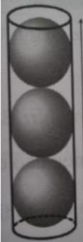
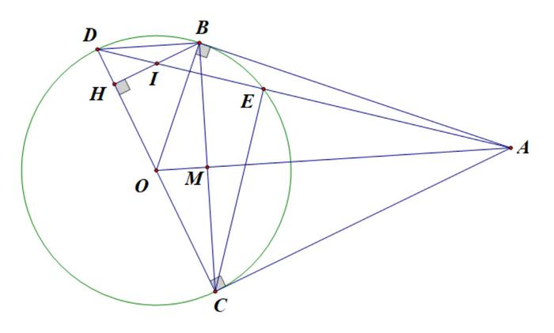

# ĐỀ THAM KHẢO THI TUYỂN SINH VÀO 10 - ĐỀ SỐ 7 MÔN TOÁN Thời gian: 120 phút BIÊN SOẠN: BAN CHUYÊN MÔN LOIGIAIHAY.COM

### Câu 1: (1,5 điểm)

1) Sau khi thống kê độ dài (đơn vị: cm) của 60 lá dương xỉ trưởng thành, người ta có bảng tần số ghép nhóm
như sau: Nhóm [10;20) [20;30) [30;40) [40;50) Tổng Tần số (n) 7 16 27 10 60 Tìm tần số ghép nhóm và tần số tương đối của nhóm [30;40).
2) Trên mặt phẳng cho năm điểm phân biệt A, B, C, D, E, trong đó không có ba điểm nào thẳng hàng. Hai
điểm A, B được tô màu đỏ; ba điểm C, D, E được tô màu xanh. Bạn Châu chọn ra ngẫu nhiên một điểm tô màu đỏ, sau đó chọn ngẫu nhiên một điểm tô màu xanh để nối thành một đoạn thẳng.
Tính xác suất của biến cố X: “Trong hai điểm được chọn ra có điểm A”.

### Câu 2: (1,5 điểm) Cho hai biểu thức x 4 A x 1 + = -

và 3 x 1 2 B x 2 x 3 x 3 + = - + - + với x 0 \ge , x 1 \ne .
1) Tính giá trị của biểu thức A khi x = 9.
2) Chứng minh
1 B x 1 = - .
3) Tìm tất cả các giá trị của x để A
x 5 B 4 \ge + .

### Câu 3: (2,5 điểm)

1) Có hai loại dung dịch acid cùng loại có nồng độ acid lần lượt là 10% và 20%, trộn hai dung dịch acid đó
để được 0,5 kg dung dịch có nồng độ acid là 16%. Hỏi cần dùng bao nhiêu gam mỗi loại dung dịch acid nói trên?
2) Xe máy thứ nhất đi quãng đường từ Hà Nội về Nam Định hết 3 giờ 20 phút. Xe máy thứ hai đi hết 3 giờ
40 phút. Mỗi giờ xe máy thứ nhất đi nhanh hơn xe máy thứ hai là 3 km. Tính vận tốc của mỗi xe máy và quãng đường từ Hà Nội về Nam Định.
3) Cho phương trình
2 x 4 3x 8 0 - + = có hai nghiệm 1x , 2 x . Không giải phương trình, hãy tính giá trị biểu thức 3 3 1 2 Q x x = + .

### Câu 4: (4 điểm)

1) Một hộp đựng bóng có dạng hình trụ đựng được vừa khít 3 quả bóng như hình vẽ bên. Coi quả bóng có
dạng hình cầu với đường kính 6 cm.

a) Tính thể tích hộp đựng.
b) Tính thể tích phần khoảng không trong hộp.
2) Từ điểm A nằm ngoài (O), vẽ hai tiếp tuyến AB, AC với đường tròn (B, C là các tiếp điểm). Kẻ đường
kính CD của (O).
a) Chứng minh BD // AO.
b) AD cắt (O) tại E (A, E, D theo thứ tự). Chứng minh rằng
2 AB AE.AD = . c) Vẽ BH DC \perp tại H. Gọi I là trung điểm của BH. Chứng minh ba điểm A, I, D thẳng hàng.

### Câu 5: (0,5 điểm) Một cửa hàng xăng dầu cần xây một bồn chứa dầu hình trụ bằng thép có thể tích 54\pi ( ) 3 m và giá mỗi mét vuông thép là 500 nghìn đồng. Hỏi số tiền thấp nhất mà cửa hàng phải trả là bao nhiêu (kết quả làm tròn đến hàng đơn vị)?

---
*------------------- HẾT -------------------*

---

## 📖 ĐÁP ÁN & HƯỚNG DẪN GIẢI CHI TIẾT

<b>Click để xem lời giải chi tiết 🔍</b>

### Câu 1: (1,5 điểm)

1) Sau khi thống kê độ dài (đơn vị: cm) của 60 lá dương xỉ trưởng thành, người ta có bảng tần số ghép nhóm
như sau: Nhóm [10;20) [20;30) [30;40) [40;50) Tổng Tần số (n) 7 16 27 10 60 Tìm tần số ghép nhóm và tần số tương đối của nhóm [30;40).
2) Trên mặt phẳng cho năm điểm phân biệt A, B, C, D, E, trong đó không có ba điểm nào thẳng hàng. Hai
điểm A, B được tô màu đỏ; ba điểm C, D, E được tô màu xanh. Bạn Châu chọn ra ngẫu nhiên một điểm tô màu đỏ, sau đó chọn ngẫu nhiên một điểm tô màu xanh để nối thành một đoạn thẳng.
Tính xác suất của biến cố X: “Trong hai điểm được chọn ra có điểm A”.

**Phương pháp**

1) Xác định tần số của nhóm [30;40).
Tần số tương đối của nhóm bằng: tần số của nhóm : tổng . 100%.
2) Xác định không gian mẫu của phép thử, tính số phần tử của không gian mẫu.
Tính số kết quả thuận lợi của biến cố.
Xác suất của biến cố = số kết quả thuận lợi của biến cố : số phần tử của không gian mẫu.

**Lời giải**

1) Tần số ghép nhóm của nhóm [30;40) là 27.
Tần số tương đối ghép nhóm của nhóm [30;40) là 27.100% 45% 60 = .
2) Không gian mẫu của phép thử là
{AC;AD;AE;BC;BD;BE} \Omega = . Do đó, n( ) 6 \Omega = .
Có 3 kết quả thuận lợi cho biến cố X là AC; AD; AE.
Xác suất của biến cố X là 3 1 P(X) 6 2 = = .

### Câu 2: (1,5 điểm) Cho hai biểu thức x 4 A x 1 + = -

và 3 x 1 2 B x 2 x 3 x 3 + = - + - + với x 0 \ge , x 1 \ne .
1) Tính giá trị của biểu thức A khi x = 9.
2) Chứng minh
1 B x 1 = - .
3) Tìm tất cả các giá trị của x để A
x 5 B 4 \ge + . Phương pháp

1) Kiểm tra điều kiện của x. Nếu thỏa mãn, thay x = 9 vào A.
2) Kết hợp các tính chất của căn thức bậc hai để rút gọn biểu thức.
3) Rút gọn A B rồi giải A x 5 B 4 \ge + để tìm x. Lời giải
1) Thay x = 9 (thỏa mãn điều kiện) vào A, ta được:
x 4 9 4 7 A 2 x 1 9 1 + + = = = - - .
Vậy khi x = 9 thì 7 A 2 = . 2) 3 x 1 2 B x 2 x 3 x 3 + = - + - + (với x 0 \ge , x 1 \ne ) ( )( ) ( ) ( )( ) 2 x 1 3 x 1 x 1 x 3 x 1 x 3 - + = - - + - +

( )( ) 3 x 1 2 x 2 x 1 x 3 + - + = - +

( )( ) x 3 x 1 x 3 + = - +

1 x 1 = - .
Vậy 1 B x 1 = - với x 0 \ge , x 1 \ne . 3) ( ) A x 4 1 x 4 : . x 1 x 4 B x 1 x 1 x 1 + + = = - = + - - - (với x 0 \ge , x 1 \ne ). Để A x 5 B 4 \ge + thì: x x 4 5 4 + \ge +

x x 1 0 4 - + \le

x 4 x 4 0 - + \le

( ) 2 x 2 0 - \le . Mà ( ) 2 x 2 0 - \ge với mọi x thỏa mãn điều kiện xác định nên:

x 2 0 - =

x 2 =

x 4 = (thỏa mãn điều kiện).
Vậy để A x 5 B 4 \ge + thì x = 4.

### Câu 3: (2,5 điểm)

1) Có hai loại dung dịch acid cùng loại có nồng độ acid lần lượt là 10% và 20%, trộn hai dung dịch acid đó
để được 0,5 kg dung dịch có nồng độ acid là 16%. Hỏi cần dùng bao nhiêu gam mỗi loại dung dịch acid nói trên?
2) Xe máy thứ nhất đi quãng đường từ Hà Nội về Nam Định hết 3 giờ 20 phút. Xe máy thứ hai đi hết 3 giờ
40 phút. Mỗi giờ xe máy thứ nhất đi nhanh hơn xe máy thứ hai là 3 km. Tính vận tốc của mỗi xe máy và quãng đường từ Hà Nội về Nam Định.
3) Cho phương trình
2 x 4 3x 8 0 - + = có hai nghiệm 1x , 2 x . Không giải phương trình, hãy tính giá trị biểu thức 3 3 1 2 Q x x = + . Phương pháp
1) Gọi khối lượng dung dịch acid có nồng độ 10%, nồng độ 20% cần dùng lần lượt là x, y (0 < x, y < 500;
đơn vị: gam).
Biểu diễn khối lượng dung dịch theo hai biến x, y.
Lập hệ phương trình, giải hệ để tìm x, y.
2) Gọi x là vận tốc của xe máy thứ nhất (x > 0, đơn vị: km/h).
Biểu diễn quãng đường di chuyển của hai xe máy theo x.
Vì cả hai xe cùng di chuyển từ Hà Nội về Nam Định (cùng quãng đường) nên ta lập được phương trình.
Giải phương trình để tìm x, kiểm tra điều kiện và kết luận.
3) Kiểm tra sự tồn tại của
1 2 x ,x dựa vào \Delta.
Biến đổi biểu thức A và áp dụng định lí Viète:
1 2 b S x x a = + = - ; 1 2 c P x .x a = = . Lời giải
1) Đổi: 0,5 kg = 500 g.
Gọi khối lượng dung dịch acid có nồng độ 10% đem trộn là x (0 < x < 500, đơn vị: gam).
Gọi khối lượng dung dịch acid có nồng độ 20% đem trộn là y (0 < y < 500, đơn vị: gam).
Vì trộn x (g) dung dịch acid nồng độ 10% với y (g) dung dịch acid nồng độ 20% được 500 g acid mới nên ta có phương trình: x y 500 + = (1) Vì trộn hai dung dịch acid cùng loại có nồng độ lần lượt là 10% và 20% được 500 g dung dịch có nồng độ 16% nên ta có phương trình: 10%.x 20%.y 16%.500 + = , rút gọn được 0,1x 0,2y 80 + = (2)

Từ (1) và (2), ta có hệ: x y 500 0,1x 0,2y 80 + = \begin{cases}

+ = \end{cases}

Giải hệ phương trình, được x = 200 và y = 300 (thỏa mãn điều kiện).
Vậy ta cần lượng dung dịch acid loại có nồng độ 10% là 200 g, lượng dung dịch acid loại có nồng độ 20% là 300 g.
2) Đổi: 3 giờ 20 phút = 10
3 giờ, 3 giờ 40 phút = 11 3 giờ.
Gọi vận tốc của xe máy thứ nhất là x (km/h), khi đó vận tốc của xe máy thứ hai là x - 3 (km/h).
Điều kiện: x > 3.
Xe máy thứ nhất đi từ Hà Nội về Nam Định với tốc độ x (km/h) trong thời gian 10 3 (giờ); xe máy thứ hai đi cùng quãng đường với tốc độ x - 3 (km/h) trong thời gian 11 3 (giờ). Do đó, quãng đường từ Hà Nội đến Nam Định là: 10 11 x (x 3) 3 3 = -

10 11 x x 11 3 3 = -

10x 11x 33 = -

x 33 = (thỏa mãn).
Vậy tốc độ của xe máy thứ nhất là 33 km/h, tốc độ của xe máy thứ hai là 30 km/h, quãng đường từ Hà Nội về Nam Định là 10.33 110 3 = km.
3) Phương trình
2 x 4 3x 8 0 - + = có ( ) 2 ' 2 3 1.8 4 0 $\Delta = - - $= > nên phương trình có hai nghiệm 1x , 2 x .
Áp dụng hệ thức Viète, ta có:
1 2 1 2 b 4 3 x x 4 3 a 1 c 8 x x 8 a 1 \begin{cases}
- + = - = - =
  = = = \end{cases}

3 3 1 2 Q x x = +

( )( ) 2 2 1 2 1 1 2 2 x x x x x x = + - +

( ) ( ) 2 1 2 1 2 1 2 x x x x 3x x [ ] = + + -
  ( ) ( ) 2 4 3 4 3 3.8 96 3 [ ] = - =     .
Vậy 3 3 1 2 Q x x 96 3 = + = .

### Câu 4: (4 điểm)

1) Một hộp đựng bóng có dạng hình trụ đựng được vừa khít 3 quả bóng như hình vẽ bên. Coi quả bóng có
dạng hình cầu với đường kính 6 cm.

a) Tính thể tích hộp đựng.
b) Tính thể tích phần khoảng không trong hộp.
2) Từ điểm A nằm ngoài (O), vẽ hai tiếp tuyến AB, AC với đường tròn (B, C là các tiếp điểm). Kẻ đường
kính CD của (O).
a) Chứng minh BD // AO.
b) AD cắt (O) tại E (A, E, D theo thứ tự). Chứng minh rằng
2 AB AE.AD = . c) Vẽ BH DC \perp tại H. Gọi I là trung điểm của BH. Chứng minh ba điểm A, I, D thẳng hàng.

**Phương pháp 1)**

a) Tính chiều cao, bán kính của hộp dựa vào số các quả bóng vừa khít trong hộp.
Áp dụng công thức tính thể tích khối trụ:
2 V r h = \pi .
b) Tính thể tích 3 quả bóng trong hộp.
Lấy thể tích hộp trừ đi thể tích 3 quả bóng, ta được thể tích phần trống trong hộp.
2)
a) Chứng minh OA và BD cùng vuông góc với BC, suy ra OA // BD.
b) Chứng minh AEC
ACD \Delta \Delta \backsim , suy ra 2 AC AE.AD = , mà AB = AC nên 2 AB AE.AD = .
c) Chứng minh HDB
COA \Delta \Delta \backsim , suy ra HD HI CD AC = .
Từ đó, chứng minh HDI CDA \Delta \Delta \backsim , suy ra hai tia DI và DA trùng nhau.
Kết luận A, I, D thẳng hàng.

**Lời giải 1)**

a) Chiều cao của hộp là: 6.3 = 18 (cm).
Bán kính của đáy hộp là: 6 : 2 = 3 (cm).
Thể tích hộp là:
2 2 h V r h .3 .18 162 = \pi = \pi = \pi ( ) 3 cm .

b) Thể tích 3 quả bóng là:
3 3 b 4 4 V 3. r 3. .3 108 3 3 = \pi = \pi = \pi ( ) 3 cm .
Tính thể tích phần khoảng không trong hộp là:
h b V V V 162 108 54 = - = \pi - \pi = \pi ( ) 3 cm . 2)

a) Gọi M là giao điểm của OA và BC.
Vì B thuộc (O) có đường kính CD nên o CBD 90 = , hay BD BC \perp (1) Vì AB, AC là hai tiếp tuyến của (O) nên OA là tia phân giác của BOC .
Mà BOC \Delta cân tại O (do OB = OC), suy ra OM vừa là đường phân giác, vừa là đường cao của BOC \Delta . Do đó OA BC \perp (2) Từ (1) và (2) suy ra OA // BD (cùng vuông góc với BC).
b) Vì E thuộc (O) có đường kính CD nên
o CED 90 = , hay CE AD \perp . Xét AEC \Delta và ACD \Delta : + o AEC ACD 90 = = ; + A chung. Suy ra AEC ACD \Delta \Delta \backsim (g.g), do đó AE AC AC AD = , suy ra 2 AC AE.AD = .
Mà AB = AC nên 2 AB AE.AD = .
c) Vì BD // AO (chứng minh trên) nên HDB
COA = (góc đồng vị).
Xét HDB \Delta và COA \Delta : + o DHB OCA 90 = = ; + HDB COA = (chứng minh trên).
Suy ra HDB COA \Delta \Delta \backsim (g.g), do đó HD BH OC AC = , vì vậy HD BH 2OC 2AC = .
Mà CD = 2OC, BH = 2HI (vì O, I lần lượt là trung điểm của CD, BH).

Suy ra HD 2HI CD 2AC = , do đó HD HI CD AC = . Xét HDI \Delta và CDA \Delta : + o DHI DCA 90 = = ; + HD HI CD AC = (chứng minh trên).
Suy ra HDI CDA \Delta \Delta \backsim (c.g.c), khi đó HDI CDA = , tức hai tia DI, DA trùng nhau.
Vậy ba điểm A, I, D thẳng hàng.

### Câu 5: (0,5 điểm) Một cửa hàng xăng dầu cần xây một bồn chứa dầu hình trụ bằng thép có thể tích 54\pi ( ) 3 m và giá mỗi mét vuông thép là 500 nghìn đồng. Hỏi số tiền thấp nhất mà cửa hàng phải trả là bao nhiêu (kết quả làm tròn đến hàng đơn vị)?

**Phương pháp Gọi bán kính đáy bồn chứa là r (mét, r > 0), chiều cao bồn chứa là h (mét, h > 0).**

Tính h theo r. Lập công thức tính diện tích toàn phần của bồn chứa theo r.
Áp dụng bất đẳng thức Cauchy cho ba số dương để tìm diện tích xung quanh nhỏ nhất của bồn chứa.
Tính giá tiền ứng với diện tích xung quanh nhỏ nhất vừa tìm được.

**Lời giải Gọi bán kính đáy bồn chứa là r (mét, r > 0), chiều cao bồn chứa là h (mét, h > 0).**

Thể tích bồn chứa là 2 V r h 54 = \pi = \pi, suy ra 2 2 54 54 h r r \pi = = \pi (m).
Diện tích toàn phần của bồn chứa là:
2 2 2 2 2 54 108 54 54 S 2 r 2 rh 2 r 2 r. 2 r 2 r r r r r \pi \pi \pi = \pi + \pi = \pi + \pi = \pi + = \pi + + ( ) 2 m .
Để chi phí xây dựng thấp nhất thì diện tích toàn phần của bồn phải nhỏ nhất.
Ta có: 2 2 3 54 54 54 54 S 2 r 3 2 r . . r r r r \pi \pi \pi \pi = \pi + + \ge \pi (bất đẳng thức Cauchy cho ba số dương) 3 3 S 3 2.54.54. \ge \pi S 54 \ge \pi.
Dấu “=” xảy ra khi 2 54 2 r r \pi \pi =

3 2r 54 =

r 3 = .
Khi đó số tiền thấp nhất mà cửa hàng phải trả là 54 .500000 84823002 \pi  (đồng).

