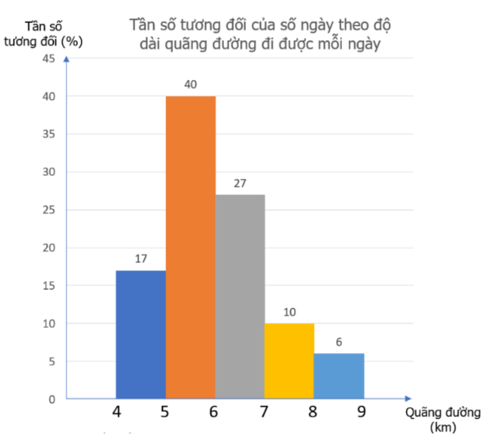
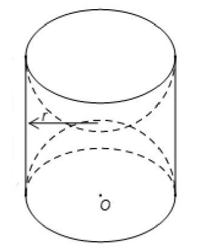
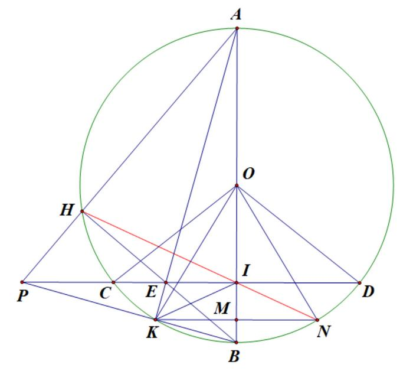
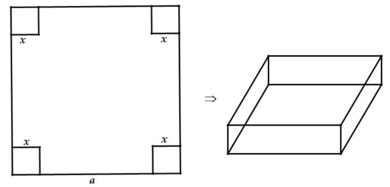

# ĐỀ THAM KHẢO THI TUYỂN SINH VÀO 10 - ĐỀ SỐ 8 MÔN TOÁN Thời gian: 120 phút BIÊN SOẠN: BAN CHUYÊN MÔN LOIGIAIHAY.COM

### Câu 1: (1,5 điểm)

1) Nam thống kê lại độ dài quãng đường (đơn vị: km) mình đi bộ mỗi ngày trong tháng 9 và biểu diễn dưới
dạng biểu đồ tần số tương đối ghép nhóm sau:

Tìm nhóm có tần số tương đối ghép nhóm lớn nhất. Xác định tần số của nhóm đó.
2) Một hộp có 20 viên bi với kích thước và khối lượng như nhau. Bạn Ngân viết lên các viên bi đó các số 1,
2, 3, …, 20; hai viên bi khác nhau thì viết hai số khác nhau. Xét phép thử “Lấy ngẫu nhiên một viên bi trong hộp”. Tính xác suất biến cố “Số xuất hiện trên viên bi được lấy ra chia 7 dư 1”.

### Câu 2: (1,5 điểm) Cho biểu thức x 2 A x 1 - = - , x 1 2 B x 1 x 1 1 x = + + - + - với x 0 \ge , x 1 \ne .

1) Tính giá trị biểu thức A tại x = 9.
2) Chứng minh
x 1 B x 1 - = + .
3) Cho P = A.B. Tìm các giá trị nguyên của x để |P| + P = 0.

### Câu 3: (2,5 điểm)

1) Nhân dịp ngày Giỗ Tổ Hùng Vương, một siêu thị điện máy đã giảm giá nhiều mặt hàng để kích cầu mua
sắm. Tổng giá niêm yết của một chiếc tủ lạnh và một chiếc máy giặt là 25,4 triệu đồng. Tuy nhiên, trong dịp này tủ lạnh giảm 40% giá niêm yết và máy giặt giảm 25% giá niêm yết. Vì thế, cô Liên đã mua hai mặt hàng trên với tổng số tiền là 16,77 triệu đồng. Hỏi giá niêm yết của mỗi mặt hàng trên là bao nhiêu?

2) Một xí nghiệp sản xuất nước mắm dự định thu mua 120 tấn cá trong một thời gian nhất định. Nhờ đổi mới

**phương pháp thu mua, xí nghiệp đã mua vượt mức 6 tấn mỗi tuần. Vì vậy, xí nghiệp đã hoàn thành kế hoạch sớm hơn 1 tuần và vượt mức 10 tấn cá. Tính số cá mà xí nghiệp phải mua mỗi tuần theo kế hoạch.**

3) Cho phương trình
2 4x 5x 3 0 - - = có hai nghiệm là 1x , 2 x . Không giải phương trình, hãy tính giá trị của biểu thức ( )( ) ( ) 2 1 2 1 2 F x 1 x 1 x x = + + - - .

### Câu 4: (4 điểm)

1) Một khối gỗ dạng hình trụ, bán kính đường tròn đáy r = 10 (cm), chiều cao h = 20 (cm). Người ta khoét
rỗng hai nửa hình cầu có bán kính 10 (cm) như hình vẽ.

a) Tính thể tích của khối gỗ khi chưa khoét.
b) Hãy tính diện tích bề mặt của khối gỗ còn lại sau khi khoét (diện tích cả ngoài lẫn trong).
Các kết quả làm tròn đến hàng đơn vị.
2) Cho đường tròn (O), dây CD cố định. Gọi B là điểm chính giữa cung nhỏ CD, kẻ đường kính AB cắt CD
tại I. Lấy điểm H bất kì trên cung lớn CD, HB cắt CD tại E. Đường thẳng AH cắt CD tại P.
a) Chứng minh tứ giác PHIB nội tiếp.
b) Chứng minh AH.AP = AI.AB.
c) Gọi K là giao điểm của đường thẳng AE và BP. Kẻ KM
AB \perp , cắt AB tại M, cắt đường tròn (O) tại N.
Chứng minh N, I, H thẳng hàng.

### Câu 5: (0,5 điểm) Một miếng tôn phẳng hình vuông với kích thước a (cm), người ta muốn cắt đi ở bốn góc bốn hình vuông cạnh bằng x (cm) để uốn thành một hình hộp chữ nhật không có nắp. Phải cắt như thế nào để hình hộp có thể tích lớn nhất?

---
*------------------- HẾT -------------------*

---

## 📖 ĐÁP ÁN & HƯỚNG DẪN GIẢI CHI TIẾT

<b>Click để xem lời giải chi tiết 🔍</b>

### Câu 1: (1,5 điểm)

1) Nam thống kê lại độ dài quãng đường (đơn vị: km) mình đi bộ mỗi ngày trong tháng 9 và biểu diễn dưới
dạng biểu đồ tần số tương đối ghép nhóm sau:

Tìm nhóm có tần số tương đối ghép nhóm lớn nhất. Xác định tần số của nhóm đó.
2) Một hộp có 20 viên bi với kích thước và khối lượng như nhau. Bạn Ngân viết lên các viên bi đó các số 1,
2, 3, …, 20; hai viên bi khác nhau thì viết hai số khác nhau. Xét phép thử “Lấy ngẫu nhiên một viên bi trong hộp”. Tính xác suất biến cố “Số xuất hiện trên viên bi được lấy ra chia 7 dư 1”.

**Phương pháp**

1) Xác định nhóm có tần số tương đối ghép nhóm lớn nhất.
Tần số của nhóm = tổng . tần số tương đối.
2) Xác định không gian mẫu của phép thử, tính số phần tử của không gian mẫu.
Tính số kết quả thuận lợi của biến cố.
Xác suất của biến cố = số kết quả thuận lợi của biến cố : số phần tử của không gian mẫu.

**Lời giải**

1) Nhóm có tần số tương đối ghép nhóm lớn nhất là [5;6) với tần số tương đối ghép nhóm là 40%.
Vì tháng 9 có 30 ngày nên có tất cả 30 số liệu trong mẫu số liệu.
Tần số của nhóm [5;6) là: n = 30.40% = 12.
2) Tập hợp các kết quả có thể xảy ra là:
{1;2;...;20} \Omega = , suy ra ( ) n 20 \Omega = .
Gọi T: “Số xuất hiện trên viên bi được lấy ra chia 7 dư 1”.
Các kết quả thuận lợi cho T là: 1; 8; 15. Do đó ( ) n T 3 = .

Vậy xác suất của biến cố “Số xuất hiện trên viên bi được lấy ra chia 7 dư 1” là n(T) 3 P(T) n( ) 20 = = \Omega .

### Câu 2: (1,5 điểm) Cho biểu thức x 2 A x 1 - = - , x 1 2 B x 1 x 1 1 x = + + - + - với x 0 \ge , x 1 \ne .

1) Tính giá trị biểu thức A tại x = 9.
2) Chứng minh
x 1 B x 1 - = + .
3) Cho P = A.B. Tìm các giá trị nguyên của x để |P| + P = 0.

**Phương pháp**

1) Kiểm tra điều kiện của x. Nếu thỏa mãn, thay x = 9 vào A.
2) Kết hợp các tính chất của căn thức bậc hai để rút gọn biểu thức.
3) Rút gọn P. Lập luận suy ra P
0 \le . Giải bất phương trình, kết hợp ĐKXĐ để tìm x.

**Lời giải**

1) Thay x = 9 (thỏa mãn điều kiện) vào A, ta được:
x 2 9 2 1 A 2 x 1 9 1 - - = = = - - .
Vậy khi x = 9 thì 1 A 2 = . 2) x 1 2 B x 1 x 1 1 x = + + - + - ( x 0 \ge , x 1 \ne ) x 1 2 x 1 x 1 x 1 = - + - + -

( ) ( )( ) ( )( ) ( )( ) x x 1 x 1 2 x 1 x 1 x 1 x 1 x 1 x 1 - + = - + + - + - + -

( )( ) x x x 1 2 x 1 x 1 - - - + = + -

( )( ) x 2 x 1 x 1 x 1 - + = + -

( ) ( )( ) 2 x 1 x 1 x 1 - = + -

x 1 x 1 - = + (đpcm).

3) x 2 x 1 x 2 P AB . x 1 x 1 x 1 - - - = = = - + + .
Ta có |P| + P = 0, suy ra |P| = -P. Do đó, P 0 \le . Suy ra x 2 0 x 1 - \le + . Mà x 1 0 + > nên x 2 0 - \le

x 2 \le

x 4 \le .
Kết hợp với điều kiện x 0 \ge , x 1 \ne  và x nguyên ta có các giá trị x {0;2;3;4} \in thỏa mãn.
Vậy để |P| + P = 0 thì x {0;2;3;4} \in .

### Câu 3: (2,5 điểm)

1) Nhân dịp ngày Giỗ Tổ Hùng Vương, một siêu thị điện máy đã giảm giá nhiều mặt hàng để kích cầu mua
sắm. Tổng giá niêm yết của một chiếc tủ lạnh và một chiếc máy giặt là 25,4 triệu đồng. Tuy nhiên, trong dịp này tủ lạnh giảm 40% giá niêm yết và máy giặt giảm 25% giá niêm yết. Vì thế, cô Liên đã mua hai mặt hàng trên với tổng số tiền là 16,77 triệu đồng. Hỏi giá niêm yết của mỗi mặt hàng trên là bao nhiêu?
2) Một xí nghiệp sản xuất nước mắm dự định thu mua 120 tấn cá trong một thời gian nhất định. Nhờ đổi mới

**phương pháp thu mua, xí nghiệp đã mua vượt mức 6 tấn mỗi tuần. Vì vậy, xí nghiệp đã hoàn thành kế hoạch sớm hơn 1 tuần và vượt mức 10 tấn cá. Tính số cá mà xí nghiệp phải mua mỗi tuần theo kế hoạch.**

3) Cho phương trình
2 4x 5x 3 0 - - = có hai nghiệm là 1x , 2 x . Không giải phương trình, hãy tính giá trị của biểu thức ( )( ) ( ) 2 1 2 1 2 F x 1 x 1 x x = + + - - . Phương pháp
1) Gọi giá niêm yết của một chiếc tủ lạnh và một chiếc máy giặt lần lượt là x, y (triệu đồng; 0 < x < 25,4, 0 <
y < 25,4).
Biểu diễn tổng số tiền mua tủ lạnh và máy giặt trước và sau khi giảm giá.
Lập hệ phương trình, giải hệ tìm x, y.
2) Gọi số cá mà xí nghiệp phải mua mỗi tuần theo kế hoạch là x (tấn; 0 < x < 120).
Biểu diễn số tuần xí nghiệp phải thu mua cá theo kế hoạch và thực tế.
Vì xí nghiệp hoàn thành kế hoạch sớm 1 tuần nên ta lập được phương trình.
Giải phương trình để tìm x, kiểm tra điều kiện và kết luận.
3) Kiểm tra sự tồn tại của
1 2 x ,x dựa vào \Delta.
Biến đổi biểu thức và áp dụng định lí Viète:
1 2 b S x x a = + = - ; 1 2 c P x .x a = = . Lời giải
1) Gọi giá niêm yết của một chiếc tủ lạnh và một chiếc máy giặt lần lượt là x, y (triệu đồng; 0 < x < 25, 0 < y
< 25).
Vì tổng giá niêm yết của một chiếc tủ lạnh và một chiếc máy giặt là 25,4 triệu đồng nên ta có phương trình:

x y 25,4 + = (1) Do tủ lạnh được giảm 40% giá niêm yết nên giá của một chiếc tủ lạnh sau giảm giá là:
(1 40%)x 60%x 0,6x - = = (triệu đồng).
Do máy giặt được giảm 25% giá niêm yết nên giá của một chiếc máy giặt sau giảm giá là:
(1 25%)y 75%y 0,75y - = = (triệu đồng).
Cô Liên mua một chiếc tủ lạnh và một chiếc máy giặt hết 16,77 triệu đồng sau giảm giá nên ta có phương trình: 0,6x 0,75y 16,77 + = (2) Từ (1) và (2), ta có hệ phương trình: x y 25,4 0,6x 0,75y 16,77 + = \begin{cases}

+ = \end{cases}

Giải hệ, được x = 15,2 và y = 10,2 (đều TMĐK).
Vậy giá niêm yết của một chiếc tủ lạnh là 15,2 triệu đồng và giá niêm yết của một chiếc máy giặt là 10,2 triệu đồng.
2) Gọi số cá mà xí nghiệp phải mua mỗi tuần theo kế hoạch là x (tấn; 0 < x < 120).
Số tuần xí nghiệp đó định mua cá là 120 x tuần.
Thực tế, mỗi tuần xí nghiệp đó thu mua được x + 6 tấn cá.
Tổng số cá vượt mức kế hoạch 10 tấn nên xí nghiệp đó đã thu mua tất cả 120 + 10 = 130 tấn cá.
Do đó, thực tế số tuần xí nghiệp thu mua cá là 130 x 6 + tuần.
Vì xí nghiệp đã hoàn thành kế hoạch sớm hơn 1 tuần nên ta có phương trình:
120 130 1 x x 6 - = +

120(x 6) 130x x(x 6) x(x 6) x(x 6) x(x 6) + + - = + + +

2 120x 720 130x x 6x + - = +

2 x 16x 720 0 + - =

Giải phương trình trên, được x = 20 (thỏa mãn) và x = -36 (không thỏa mãn).
Vậy theo kế hoạch, mỗi tuần xí nghiệp phải thu mua 20 tấn cá.
3) Phương trình
2 4x 5x 3 0 - - = có ( ) 2 5 4.4.( 3) 73 0 $\Delta = - - - $= > nên phương trình có hai nghiệm 1x , 2 x .
Áp dụng hệ thức Viète, ta có:
1 2 1 2 b 5 5 x x a 4 4 c 3 x x a 4 -
\begin{cases} + = - = - =  -
 = = \end{cases}

( )( ) ( ) 2 1 2 1 2 F x 1 x 1 x x = + + - -

( ) 2 2 1 2 1 2 1 1 2 2 x x x x 1 x 2x x x = + + + - - +

( ) 2 2 1 2 1 2 1 1 2 2 x x x x 1 x 2x x x = + + + - + -

( ) ( ) 2 2 1 2 1 2 1 2 3x x x x 1 x x = + + + - +

( ) ( ) 2 1 2 1 2 1 2 1 2 3x x x x 1 x x 2x x [ ] = + + + - + -
  ( ) ( ) 2 1 2 1 2 1 2 5x x x x 1 x x = + + + - +

2 3 5 5 49 5 1 4 4 4 16 - ( ) ( ) = + + - = - ( ) ( ) ( ) ( ) .
Vậy ( )( ) ( ) 2 1 2 1 2 49 F x 1 x 1 x x 16 = + + - - = - .

### Câu 4: (4 điểm)

1) Một khối gỗ dạng hình trụ, bán kính đường tròn đáy r = 10 (cm), chiều cao h = 20 (cm). Người ta khoét
rỗng hai nửa hình cầu có bán kính 10 (cm) như hình vẽ.

a) Tính thể tích của khối gỗ khi chưa khoét.
b) Hãy tính diện tích bề mặt của khối gỗ còn lại sau khi khoét (diện tích cả ngoài lẫn trong).
Các kết quả làm tròn đến hàng đơn vị.
2) Cho đường tròn (O), dây CD cố định. Gọi B là điểm chính giữa cung nhỏ CD, kẻ đường kính AB cắt CD
tại I. Lấy điểm H bất kì trên cung lớn CD, HB cắt CD tại E. Đường thẳng AH cắt CD tại P.
a) Chứng minh tứ giác PHIB nội tiếp.
b) Chứng minh AH.AP = AI.AB.
c) Gọi K là giao điểm của đường thẳng AE và BP. Kẻ KM
AB \perp , cắt AB tại M, cắt đường tròn (O) tại N.
Chứng minh N, I, H thẳng hàng.

**Phương pháp 1)**

a) Áp dụng công thức tính thể tích hình trụ:
2 V r h = \pi .
b) Diện tích bề mặt khối gỗ sau khi khoét gồm diện tích xung quanh hình trụ ban đầu và diện tích hai nửa
mặt cầu đã khoét.

Áp dụng công thức tính diện tích xung quanh hình trụ và mặt cầu:
tru S 2 rh = \pi ; 2 cau S 4 r = \pi . 2)
a) Chứng minh
o PIB PHB 90 = = .
b) Chứng minh ABP
AHI \Delta \Delta \backsim (g.g), suy ra AB AP AH AI = rồi kết luận.
c) Chứng minh HIP
DIN = , suy ra o PIN HIP 180 + = rồi kết luận.

**Lời giải 1)**

a) Thể tích khối gỗ lúc chưa khoét là:
2 2 V r h .10 .20 6283 = \pi = \pi  ( ) 3 cm .
b) Diện tích bề mặt khối gỗ sau khi khoét gồm diện tích xung quanh hình trụ ban đầu và diện tích hai nửa
mặt cầu đã khoét.
2 2 S 2 rh 4 r 2 .10.20 4 .10 2513 = \pi + \pi = \pi + \pi  ( ) 2 cm . 2)

a) Vì B là điểm chính giữa cung nhỏ CD nên B cách đều C và D.
Mà C, D thuộc (O) nên O cũng cách đều C và D.
Do đó, OB là đường trung trực của đoạn thẳng CD, suy ra o PIB 90 = .
Vì vậy, I thuộc đường tròn đường kính PB.
Mặt khác, H thuộc đường tròn (O) đường kính AB nên o BHA BHP 90 = = .
Do đó, H thuộc đường tròn đường kính PB.
Vì I, H cùng thuộc đường tròn đường kính PB nên tứ giác PHIB nội tiếp.
b) Tứ giác PHIB nội tiếp nên
o HPB HIB 180 + = , mà o AIH HIB 180 + = (góc kề bù), suy ra HPB AIH = . Xét ABP \Delta và AHI \Delta có:

+ HAI chung; + APB AIH = (chứng minh trên).
Suy ra ABP AHI \Delta \Delta \backsim (g.g), do đó AB AP AH AI = , vì vậy AH.AP = AI.AB.
c) Xét APB \Delta
có hai đường cao PI và BH cắt nhau tại E, do đó E là trực tâm APB \Delta .
Suy ra AK cũng là đường cao của APB \Delta , do đó o AKB 90 = và K thuộc (O).
Ta có o EKB EIB 90 = = nên K, I cùng thuộc đường tròn đường kính EB, hay tứ giác EIBK nội tiếp.
Suy ra EBK EIK = (góc nội tiếp cùng chắn cung EK).
Mặt khác, do tứ giác PHIB nội tiếp nên EBK HIP = (góc nội tiếp cùng chắn cung PH).
Suy ra EIK HIP = (1) Xét OKN \Delta cân tại O có OM là đường cao, do đó OM đồng thời là đường trung trực của đoạn KN.
Vì I thuộc đường trung trực OM của đoạn thẳng KN nên IK = IN, suy ra IKN \Delta cân tại I. IKN \Delta cân tại I có IM là đường trung tuyến, đồng thời là phân giác của KIN .
Do đó KIM NIM = , suy ra o o 90 KIM 90 NIM - = -
, ta được EIK DIN = (2) Từ (1) và (2) suy ra HIP DIN = . Mặt khác o PIN DIN 180 + = (góc kề bù), suy ra o PIN HIP 180 + = , hay o HIN 180 = .
Vậy H, I, N thẳng hàng.

### Câu 5: (0,5 điểm) Một miếng tôn phẳng hình vuông với kích thước a (cm), người ta muốn cắt đi ở bốn góc bốn hình vuông cạnh bằng x (cm) để uốn thành một hình hộp chữ nhật không có nắp. Phải cắt như thế nào để hình hộp có thể tích lớn nhất?

**Phương pháp Biểu diễn thể tích hình hộp sau khi cắt góc theo x.**

Áp dụng bất đẳng thức Cauchy cho ba số dương, tìm x.

**Lời giải Vì cạnh hình vuông bị cắt là x (cm) nên ta có điều kiện: 0 < x < a (cm).**

Chiều dài cạnh miếng tôn sau khi cắt là a - 2x (cm), chiều cao hộp là x (cm).

Thể tích hình hộp là 1 V x(a 2x)(a 2x) 4x(a 2x)(a 2x) 4 = - - = - -

3 (cm ) .
Áp dụng bất đẳng thức Cauchy cho ba số dương, ta có:
3 4x a 2x a 2x 4x(a 2x)(a 2x) 3 + - + - ( ) - - \le ( ) ( )

3 1 1 2a 4x(a 2x)(a 2x) 4 4 3 ( ) - - \le ( ) ( )

3 2a S 27 \le .
Dấu “=” xảy ra khi 4x = a - 2x, suy ra a x 6 = (cm).
Vậy để thể tích hộp lớn nhất, cần cắt 4 góc hình vuông cạnh a 6 (cm).

