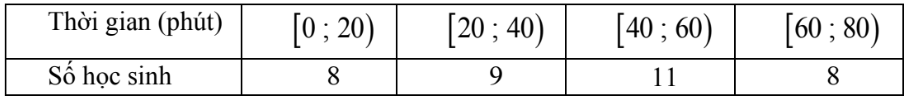
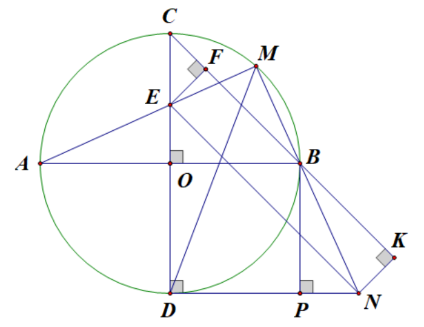
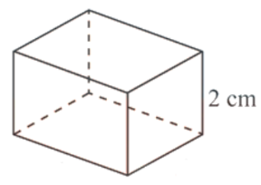

# ĐỀ THAM KHẢO THI TUYỂN SINH VÀO 10 - ĐỀ SỐ 9 MÔN TOÁN Thời gian: 120 phút BIÊN SOẠN: BAN CHUYÊN MÔN LOIGIAIHAY.COM

*Thời gian lúc đi là 100 x (giờ).*  
*Thời gian lúc về là 120 x 20 + (giờ).*  

---

### Câu 1: (1,5 điểm)

1) Khảo sát thời gian tập thể dục của một số học sinh lớp 9 thu được mẫu số liệu ghép nhóm sau:

Tính tần số tương đối của nhóm [40;60) (làm tròn đến hàng phần mười).
2) Hình dưới đây mô tả một đĩa tròn, cân đối bằng bìa cứng được chia làm tám phần bằng nhau và ghi các số
1; 2; 3; 4; 5; 6; 7; 8. Chiếc kim được gắn cố định vào trục quay ở tâm của đĩa. Quay đĩa tròn một lần. Tính xác suất của biến cố sau: “Mũi tên chỉ vào hình quạt ghi số là ước của 8”.

### Câu 2: (1,5 điểm) Cho biểu thức x 1 M x - = ; x 2 2 8 x 2 P x 1 x 1 1 x - + = + - - + - với x > 0; x 1 \ne .

1) Tính M khi x = 0,49.
2) Chứng minh
x 6 P x 1 + = - . 3) Đặt x 5 Q M.P x - = + . So sánh Q với 3.

### Câu 3: (2,5 điểm)

1) Hai vòi nước cùng chảy vào một cái bể không có nước thì trong 5 giờ sẽ đầy bể. Nếu vòi thứ nhất chảy
trong 3 giờ và vòi thứ hai chảy trong 4 giờ thì được 2 3 bể nước. Hỏi nếu mỗi vòi nước chảy một mình thì sau bao nhiêu giờ mới đầy bể?
2) Một người đi ô tô từ A đến B cách nhau 100 km với vận tốc xác định. Khi từ B trở về A, người đó đi theo
đường khác dài hơn đường cũ 20 km nhưng với vận tốc lớn hơn vận tốc lúc đi mỗi giờ 20 km. Vì vậy thời gian về ít hơn thời gian đi 30 phút. Tính vận tốc lúc đi.

3) Biết phương trình bậc hai
2 x 5x a 0 + + = có một nghiệm là 5 13 x 2 - + = . Tìm tổng các lập phương hai nghiệm của phương trình trên.

### Câu 4: (4 điểm)

1) Một téc nước hình trụ tròn có bán kính 60 cm, chiều cao 220 cm.
a) Diện tích inox cần làm ra cái téc nước (có nắp) là bao nhiêu mét vuông (giả sử phần nắp cong không đáng
kể)?
b) Téc nước hình trụ có thể chứa tối đa bao nhiêu lít nước?
Các kết quả làm tròn tới hàng phần trăm.
2) Cho (O) đường kính AB. Kẻ đường kính CD vuông góc với AB. Lấy M thuộc cung nhỏ BC, AM cắt CD
tại E. Qua D kẻ tiếp tuyến với (O) cắt đường thẳng BM tại N. Gọi P là hình chiếu vuông góc của B lên DN.
a) Chứng minh các điểm M, N, D, E cùng thuộc một đường tròn.
b) Chứng minh EN // CB.
c) Chứng minh
2 AB.BN 2R = và tìm vị trí điểm M trên cung nhỏ BC để diện tích tam giác BNC đạt giá trị lớn nhất.

### Câu 5: (0,5 điểm) Người ta muốn chế tạo một chiếc hộp hình chữ nhật có thể tích 500 3 cm , chiều cao của hộp là 2 cm. Tìm kích thước đáy của hộp sao cho sử dụng ít vật liệu nhất.

---
*------------------- HẾT -------------------*

---

## 📖 ĐÁP ÁN & HƯỚNG DẪN GIẢI CHI TIẾT

<b>Click để xem lời giải chi tiết 🔍</b>

### Câu 1: (1,5 điểm)

1) Khảo sát thời gian tập thể dục của một số học sinh lớp 9 thu được mẫu số liệu ghép nhóm sau:

Tính tần số tương đối của nhóm [40;60) (làm tròn đến hàng phần mười).
2) Hình dưới đây mô tả một đĩa tròn, cân đối bằng bìa cứng được chia làm tám phần bằng nhau và ghi các số
1; 2; 3; 4; 5; 6; 7; 8. Chiếc kim được gắn cố định vào trục quay ở tâm của đĩa. Quay đĩa tròn một lần. Tính xác suất của biến cố sau: “Mũi tên chỉ vào hình quạt ghi số là ước của 8”.

**Phương pháp**

1) Tính tổng số học sinh.
Tần số tương đối của nhóm bằng: tần số của nhóm : tổng . 100%.
2) Xác định không gian mẫu của phép thử, tính số phần tử của không gian mẫu.
Tính số kết quả thuận lợi của biến cố.
Xác suất của biến cố = số kết quả thuận lợi của biến cố : số phần tử của không gian mẫu.

**Lời giải**

1) Tổng số học sinh là: 8 + 9 + 11 + 8 = 36.
Tần số tương đối của nhóm [40;60) là 11.100% 30,6% 36  .
2) Số phần tử của không gian mẫu là ( )
n 8 \Omega = .
Gọi A là biến cố “Mũi tên chỉ vào hình quạt ghi số là ước của 8”.
Các kết quả thuận lợi cho A là 1; 2; 4; 8. Suy ra n(A) = 4.
Xác suất của biến cố A là ( ) ( ) n A 4 1 P(A) n 8 2 = = = \Omega .

### Câu 2: (1,5 điểm) Cho biểu thức x 1 M x - = ; x 2 2 8 x 2 P x 1 x 1 1 x - + = + - - + - với x > 0; x 1 \ne .

1) Tính M khi x = 0,49.

2) Chứng minh
x 6 P x 1 + = - . 3) Đặt x 5 Q M.P x - = + . So sánh Q với 3.

**Phương pháp**

1) Kiểm tra điều kiện của x. Nếu thỏa mãn, thay x = 0,49 vào M.
2) Kết hợp các tính chất của căn thức bậc hai để rút gọn biểu thức.
3) Rút gọn x 5 Q M.P x - = +
rồi xét hiệu Q - 3.

**Lời giải**

1) Thay x = 0,49 (thỏa mãn điều kiện) vào M, ta được:
0,49 1 3 M 7 0,49 - = = - .
Vậy khi x = 0,49 thì 3 M 7 = - . 2) x 2 2 8 x 2 P x 1 x 1 1 x - + = + - - + -
(với x > 0; x 1 \ne ). ( )( ) ( )( ) ( )( ) ( ) ( )( ) x 2 x 1 2 x 1 2 8 x x 1 x 1 x 1 x 1 x 1 x 1 - - + + = + + + - + - + -

( )( ) ( ) ( )( ) x 2 x 1 2 8 x 2 x 1 x 1 x 1 - - + + + + = + -

( )( ) x 3 x 2 2 8 x 2 x 2 x 1 x 1 - + + + + + = + -

( )( ) x 7 x 6 x 1 x 1 + + = + -

( )( ) ( )( ) x 1 x 6 x 1 x 1 + + = + -

x 6 x 1 + = - (đpcm). 3) x 1 x 6 x 5 x 6 x 5 x x 1 Q . x x 1 x x x x - + - + - + + = + = + = - . Xét hiệu ( ) 2 x 1 x x 1 x 2 x 1 Q 3 3 x x x - + + - + - = - = = .

Với x > 0; x 1 \ne thì ( ) 2 x 1 0 x - > hay Q > 3.

### Câu 3: (2,5 điểm)

1) Hai vòi nước cùng chảy vào một cái bể không có nước thì trong 5 giờ sẽ đầy bể. Nếu vòi thứ nhất chảy
trong 3 giờ và vòi thứ hai chảy trong 4 giờ thì được 2 3 bể nước. Hỏi nếu mỗi vòi nước chảy một mình thì sau bao nhiêu giờ mới đầy bể?
2) Một người đi ô tô từ A đến B cách nhau 100 km với vận tốc xác định. Khi từ B trở về A, người đó đi theo
đường khác dài hơn đường cũ 20 km nhưng với vận tốc lớn hơn vận tốc lúc đi mỗi giờ 20 km. Vì vậy thời gian về ít hơn thời gian đi 30 phút. Tính vận tốc lúc đi.
3) Biết phương trình bậc hai
2 x 5x a 0 + + = có một nghiệm là 5 13 x 2 - + = . Tìm tổng các lập phương hai nghiệm của phương trình trên.

**Phương pháp**

1) Gọi thời gian vòi I và vòi II chảy một mình đẩy bể lần lượt là x và y (giờ; x, y > 5).
Biểu diễn lượng nước mỗi vòi chảy được theo thời gian đề bài cho và lập hệ phương trình ẩn x, y.
Giải hệ phương trình tìm x, y và kết luận.
2) Gọi vận tốc lúc đi là x (km; x > 0).
Biểu diễn thời gian lúc đi và lúc về theo x.
Vì thời gian về ít hơn thời gian đi 30 phút nên ta lập được phương trình ẩn x.
Giải phương trình và kết luận.
3) Thay nghiệm vào phương trình, tính a.
Tổng lập phương các nghiệm là 3 3 1 2 x x + .
Biến đổi biểu thức và áp dụng định lí Viète:
1 2 b S x x a = + = - ; 1 2 c P x .x a = = . Lời giải
1) Gọi thời gian vòi I và vòi II chảy một mình đẩy bể lần lượt là x và y (giờ; x, y > 5).
Trong 1 giờ, vòi I chảy được 1 x bể, vòi II chảy được 1 y bể.
Hai vòi cùng chảy sau 5 giờ thì đầy bể, suy ra trong 1 giờ, hai vòi cùng chảy được 1 5 bể.
Ta có phương trình 1 1 1 x y 5 + = (1) Trong 3 giờ, vòi I chảy được 3 x bể. Trong 4 giờ, vòi II chảy được 4 y bể.

Vì vòi I chảy trong 3 giờ và vòi II chảy trong 4 giờ được 2 3 bể nên ta có phương trình 3 4 2 x y 3 + = (2) Ta có hệ 1 1 1 x y 5 3 4 2 x y 3 \begin{cases} + =   + = \end{cases}

Giải hệ phương trình được 1 2 x 15 = , 1 1 y 15 = , suy ra x = 7,5 và y = 15 (thỏa mãn).
Vậy vòi I chảy một mình mất 7,5 giờ để đầy bể, vòi II chảy một mình mất 15 giờ để đầy bể.
2) Gọi vận tốc lúc đi là x (km; x > 0).
Quãng đường lúc về là 100 + 20 = 120 (km).
Vận tốc lúc về là x + 20 (km/h).
Vì thời gian về ít hơn thời gian đi 30 phút = 1 2 giờ nên ta có:
100 120 1 x x 20 2 - = +

( ) ( ) ( ) ( ) ( ) 2.100 x 20 x x 20 2.120x 2x x 20 2x x 20 2x x 20 + + - = + + +

( ) ( ) 200 x 20 240x x x 20 + - = +

2 200x 4000 240x x 20x + - = +

2 x 60x 4000 0 + - =

Giải phương trình trên, ta được x = 40 (thỏa mãn) và x = -100 (loại).
Vậy vận tốc lúc đi là 40 km/h.
3) Vì 5 13 x 2 - + =
là một nghiệm của phương trình 2 x 5x a 0 + + = nên thay nghiệm đó vào phương trình, ta được 2 5 13 5 13 5. a 0 2 2 ( ) - + - + + + = ( ) ( ) ( ) , suy ra a = 3.
Vậy phương trình là 2 x 5x 3 0 + + = . Gọi 1 x , 2 x là hai nghiệm của phương trình.

Áp dụng hệ thức Viète:
1 2 1 2 b 5 x x 5 a 1 c 3 x x 3 a 1 \begin{cases} + = - = - = -
  = = = \end{cases}

Ta có 3 3 1 2 x x +

( )( ) 2 2 1 2 1 1 2 2 x x x x x x = + - +

( ) ( ) 2 1 2 1 2 1 2 x x x x 3x x [ ] = + + -
  ( ) 2 5 5 3.3 80 [ ] = - - - = -
  .
Vậy tổng lập phương các nghiệm là -80.

### Câu 4: (4 điểm)

1) Một téc nước hình trụ tròn có bán kính 60 cm, chiều cao 220 cm.
a) Diện tích inox cần làm ra cái téc nước (có nắp) là bao nhiêu mét vuông (giả sử phần nắp cong không đáng
kể)?
b) Téc nước hình trụ có thể chứa tối đa bao nhiêu lít nước?
Các kết quả làm tròn tới hàng phần trăm.
2) Cho (O) đường kính AB. Kẻ đường kính CD vuông góc với AB. Lấy M thuộc cung nhỏ BC, AM cắt CD
tại E. Qua D kẻ tiếp tuyến với (O) cắt đường thẳng BM tại N. Gọi P là hình chiếu vuông góc của B lên DN.
a) Chứng minh các điểm M, N, D, E cùng thuộc một đường tròn.
b) Chứng minh EN // CB.
c) Chứng minh
2 AB.BN 2R = và tìm vị trí điểm M trên cung nhỏ BC để diện tích tam giác BNC đạt giá trị lớn nhất. Phương pháp 1)
a) Áp dụng công thức tính diện tích toàn phần hình trụ:
2 S 2 r 2 rh = \pi + \pi .
b) Áp dụng công thức tính thể tích hình trụ:
2 V r h = \pi . 2)
a) Chứng minh
o AMB EMN 90 = = .
b) Chứng minh DEN
DCB = . c)
- Để chứng minh
2 AB.BN 2R = :
+ Chứng minh MBA PNB = , suy ra MBA PNB \Delta \Delta \backsim , từ đó được AM AB BP BN =

+ Chứng minh OBPD là hình vuông, suy ra BP = OB = R.
+ Biến đổi các đẳng thức trên và kết luận.

- Để tìm M trên cung nhỏ BC sao cho diện tích tam giác BNC đạt giá trị lớn nhất:
+ Kẻ EF BC \perp , NK BC \perp (F, K thuộc đường thẳng BC). Chứng minh EF = NK.dê + NBC 1 S BC.NK 2 = max khi EF = NK max.
+ Kết luận vị trí điểm M.

**Lời giải 1)**

a) Diện tích inox cần làm ra cái téc nước (có nắp) là diện tích toàn phần của hình trụ.
2 2 S 2 r 2 rh 2 .60 2 60.220 33600 = \pi + \pi = \pi + \pi = \pi 2 cm 10,56  ( ) 2 m .
b) Thể tích téc nước là
2 2 V r h .60 .220 792000 = \pi = \pi = \pi 3 cm 2488,14  (lít). 2)

a) Vì M thuộc đường tròn (O) đường kính AB nên
o AMB EMN 90 = = .
Mặt khác, DN là tiếp tuyến của (O) tại D nên đường kính CD DN \perp , do đó o EDN 90 = . Có o EMN EDN 90 = = nên D, M cùng thuộc đường tròn đường kính EN.
Vậy M, N, E, D cùng thuộc một đường tròn.
b) Vì tứ giác MNDE nội tiếp (chứng minh trên) nên DEN
DMN = (góc nội tiếp cùng chắn cung DN).
Mặt khác, xét (O) có DMB DCB = . Do đó DEN DCB = , mà hai góc trên ở vị trí đồng vị nên EN // BC.
c) Xét tứ giác OBPD có OB // DP (cùng vuông góc với CD), OD // BP (cùng vuông góc với DN) suy ra
OBPD là hình bình hành.
Mặt khác, o BOD 90 = và OB = OD nên OBPD là hình vuông, suy ra BP = OB = R.
Ta có AB // DN (cùng vuông góc với CD) nên MBA PNB = (góc đồng vị).
Xét MBA \Delta và PNB \Delta :

+ MBA PNB = (chứng minh trên);
+ o AMB BPN 90 = = . Do đó MBA PNB \Delta \Delta \backsim (g.g), suy ra AM AB BP BN =

AM.BN AB.BP =

AM.BN 2R.R =

2 AM.BN 2R = (đpcm). Kẻ EF BC \perp , NK BC \perp (F, K thuộc đường thẳng BC).
Xét từ giác EFKN có EN // FK, EF // NK (cùng vuông góc với BC), do đó EFKN là hình bình hành.
Mặt khác, o EFK 90 = nên EFKN là hình chữ nhật, suy ra EF = NK.
Diện tích tam giác NBC là NBC 1 S BC.NK 2 = .
Do BC không đổi nên NBC S max khi và chỉ khi NK = EF max. Khi đó, E trùng O và M trùng B.
Vậy, để diện tích tam giác NBC lớn nhất thì M trùng B.

### Câu 5: (0,5 điểm) Người ta muốn chế tạo một chiếc hộp hình chữ nhật có thể tích 500 3 cm , chiều cao của hộp là 2 cm. Tìm kích thước đáy của hộp sao cho sử dụng ít vật liệu nhất.

**Phương pháp Gọi chiều rộng của đáy hộp là x (x > 0, cm).**

Lập công thức tính diện tích toàn phần hình hộp theo x.
Áp dụng bất đẳng thức Cauchy để tìm x sao cho diện tích toàn phần hộp nhỏ nhất.

**Lời giải Gọi chiều rộng của đáy hộp là x (x > 0, cm). Khi đó, chiều dài đáy hộp là 500 2x (cm).**

Diện tích toàn phần của hộp là:
500 500 1000 S 2. x. 2x 2. 500 4x 2x 2x x ( ) = + + = + + ( ) ( ) ( ) 2 cm .
Áp dụng bất đẳng thức Cauchy cho hai số thực dương 4x và 1000 x : 1000 1000 4x 2 4x. x x + \ge

1000 4x 40 10 x + \ge

S 40 10 500 \ge + .
Dấu “=” xảy ra khi 1000 4x x = , suy ra x 5 10 = .
Vậy để sử dụng ít vật liệu nhất thì chiều rộng và chiều dài đáy hộp là 5 10 cm.

