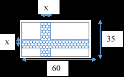
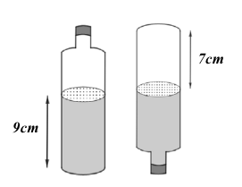
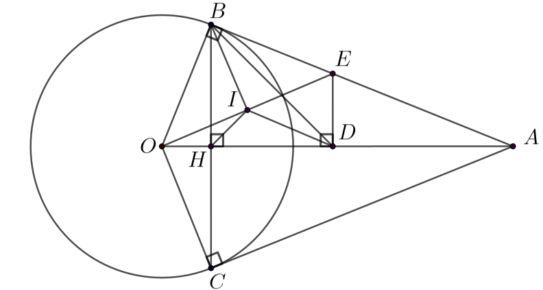

# ĐỀ THAM KHẢO THI TUYỂN SINH VÀO 10 - ĐỀ SỐ 10 MÔN TOÁN Thời gian: 120 phút BIÊN SOẠN: BAN CHUYÊN MÔN LOIGIAIHAY.COM

Câu 1 (1,5 điểm): Cho hàm số 2 2 1 y x  có đồ thị là Parabol (P).
a) Vẽ đồ thị (P) trên mặt phẳng tọa độ Oxy.
b) Tìm các điểm thuộc đồ thị có tung độ
3 y  .
Câu 2 (1 điểm): Cho phương trình bậc hai 2 7 5 0 x x -
   .
a) Chứng minh phương trình trên có hai nghiệm phân biệt.
b) Không giải phương trình, tính giá trị của biểu thức:
    1 1 2 2 2 1 3 3 A x x x x x x  -

- .
Câu 3 (1,5 điểm): Một cửa hàng bán túi mù Pokémon 2024 với các nhân vật ngẫu nhiên bên trong. Mỗi túi chứa một Pokémon thuộc các hệ khác nhau. Trong một ngày, cửa hàng ghi nhận số lượng túi đã bán theo bảng sau: Hệ Pokémon Điện (Pikachu) Lửa (Charmander) Nước (Squirtle) Cỏ (Bulbasaur) Bay (Pidgey) Rồng (Dragonite) Bí Ẩn (Mew) Số túi đã bán 25 18 22 15 20 12 8
a) Xác định cỡ mẫu, lập bảng tần số và tần số tương đối cho mẫu số liệu trên.
b) Nếu một khách hàng chọn ngẫu nhiên một túi mù, tính xác suất của mỗi biến cố sau:
A: “Túi mù được chọn thuộc hệ Điện hoặc Nước”.
B: “Túi mù được chọn không phải hệ Bí Ẩn”.
Câu 4 (1 điểm): Một mảnh vườn hình chữ nhật có chiều dài 60 m, chiều rộng 35 m. Trên mảnh vườn hình chữ nhật đó, người ta làm một lối đi có chiều rộng x (m) (0 10 x < < ) như hình vẽ.

a) Viết biểu thức S biểu thị diện tích lối đi của mảnh vườn theo x .
b) Tính chiều rộng lối đi, biết diện tích lối đi là
2 186m .
Câu 5 (1 điểm): Có một chai đựng nước suối như trong hình vẽ. Bạn An đo đường kính của đáy chai bằng 6cm, đo chiều cao của phần nước trong chai được 9cm rồi lật ngược chai và đo chiều cao của phần hình trụ không chứa nước được 7cm (hình minh họa).
a) Tính thể tích lượng nước trong chai.
b) Tính thể tích chai.
(Biết công thức thể tích hình trụ như sau:

. . V R h \pi  , kết quả làm tròn đến mililit, biết 3 1 1 cm ml  , lấy 3,14 \pi ).

Câu 6 (1 điểm):
a) Trong một suất chiếu đặc biệt vào cuối tuần, rạp chiếu phim bán ra hai loại vé: vé dành cho học sinh,
sinh viên (HSSV) và vé cho người lớn. Biết giá vé HSSV là 60 000 đồng/vé; giá vé cho người lớn là 100 000 đồng/vé. Trong suất chiếu đó, rạp đã bán tổng cộng 200 vé, thu được tổng doanh thu là 15 200 000 đồng. Tính số vé mỗi loại mà rạp chiếu phim bán được cho suất chiếu đó.
b) Biết rạp chiếu phim có sức chứa khoảng 1000 người. Với giá vé 100 000 đồng, trung bình sẽ có khoảng
300 người đến xem rạp mỗi ngày. Để tăng số lượng vé bán ra, rạp chiếu phim đã khảo sát thị trường và thấy rằng giá vé cứ giảm 5 000 đồng trên mỗi vé thì sẽ có thêm 50 người đến rạp mỗi ngày. Hỏi rạp chiếu phim phải bán ra giá vé sau khi giảm là bao nhiêu để đạt doanh thu cao nhất?
Câu 7 (3 điểm): Từ điểm A ở ngoài đường tròn (O;R), kẻ hai tiếp tuyến AB, AC đến (O), (B, C là tiếp điểm. Gọi H là giao điểm của OA và BC.
a) Chứng minh OA là đường trung trực của BC và tứ giác OBAC nội tiếp.
b) Chứng minh
2 . OH OA R  .
c) Trên đoạn AH lấy điểm D sao cho HB = HD, qua D kẻ DE vuông góc với OA (E  \in  AB), gọi I là trung
điểm của OE, cho R = 5 cm. Tính số đo góc IHB và độ dài cạnh BE.

---
*------------------- HẾT -------------------*

---

## 📖 ĐÁP ÁN & HƯỚNG DẪN GIẢI CHI TIẾT

<b>Click để xem lời giải chi tiết 🔍</b>

a) Vẽ đồ thị (P) trên mặt phẳng tọa độ Oxy.
b) Tìm các điểm thuộc đồ thị có tung độ
3 y  . Phương pháp
a) Lập bảng giá trị, vẽ đồ thị hàm số trên hệ trục tọa độ.
b) Thay 3
y  vào hàm số để tìm x .

**Lời giải**

a) Ta có bảng giá trị sau:
x 2 - 1 - 0 1 2 2 1 2 y x 

2 1 2

0 1 2

2 Đồ thị hàm số là đường cong parabol đi qua các điểm       0;0 ; 2;2 ; 1; ; 1; ; 1 1 2 2 2;2 O A B C D ( ) ( ) - - ( ) ( ) ( ) ( ) .
Ta vẽ được đồ thị hàm số 2 1 2 y x  như sau:

b) Thay 3
y  vào 2 1 2 y x  , ta có: 2 3 1 2 x 

suy ra 2 6 x 

do đó 6 x \pm

Vậy các điểm thuộc đồ thị có tung độ 3 y  là   6;3 và   6;3 - .
Câu 2 (1 điểm): Cho phương trình bậc hai 2 7 5 0 x x -
   .
a) Chứng minh phương trình trên có hai nghiệm phân biệt.
b) Không giải phương trình, tính giá trị của biểu thức:
    1 1 2 2 2 1 3 3 A x x x x x x  -

- . Phương pháp a) Sử dụng 0 ac <
để chứng minh phương trình có hai nghiệm phân biệt.
b) Áp dụng định lí Viète và biến đổi A để xuất hiện tổng và tích của hai nghiệm.
Định lí Viète:
1 2 1 2 ; b c x x x x a a -
   . Lời giải
a) Phương trình
2 7 5 0 x x -
   có  1 .5 5 0 ac -
- < nên phương trình có hai nghiệm phân biệt.
b)
    1 1 2 2 2 1 3 3 A x x x x x x  -
 -

4 Áp dụng Viète, ta có:
1 2 1 2 7 5 7; 5 1 1 x x x x -
    -
- -

Ta có:
          1 1 2 2 2 1 2 2 1 1 2 2 1 2 2 2 1 2 1 2 2 2 1 1 2 2 1 2 1 2 2 2 1 1 2 2 1 2 2 1 2 1 2 2 3 3 3 3 3 3 2 3 6 3 6 2 3 2 8 3 8 3.7 8. 5 187 A x x x x x x x x x x x x x x x x x x x x x x x x x x x x x x x x x x  -
 -
 -
 -
  -
  
- -
   -
  -

- -


Vậy 187 A  .
Câu 3 (1,5 điểm): Một cửa hàng bán túi mù Pokémon 2024 với các nhân vật ngẫu nhiên bên trong. Mỗi túi chứa một Pokémon thuộc các hệ khác nhau. Trong một ngày, cửa hàng ghi nhận số lượng túi đã bán theo bảng sau: Hệ Pokémon Điện (Pikachu) Lửa (Charmander) Nước (Squirtle) Cỏ (Bulbasaur) Bay (Pidgey) Rồng (Dragonite) Bí Ẩn (Mew) Số túi đã bán 25 18 22 15 20 12 8
a) Xác định cỡ mẫu, lập bảng tần số và tần số tương đối cho mẫu số liệu trên.
b) Nếu một khách hàng chọn ngẫu nhiên một túi mù, tính xác suất của mỗi biến cố sau:
A: “Túi mù được chọn thuộc hệ Điện hoặc Nước”.
B: “Túi mù được chọn không phải hệ Bí Ẩn”.

**Phương pháp**

a) Cỡ mẫu là tổng số túi Pokémon đã bán.
Xác định các giá trị, từ đó xác định tần số là số túi đã bán.
Tần số tương đối = [(tần số.100)/cỡ mẫu] %.
b) Xác suất của biến cố bằng tỉ số giữa số kết quả thuận lợi cho biến cố với tổng số kết quả có thể (cỡ
mẫu).
Số kết quả thuận lợi cho biến cố B bằng tổng số túi mù - số túi hệ Bí Ẩn.

**Lời giải**

a) Cỡ mẫu là tổng số túi Pokémon đã bán:
n 25 18 22 15 20 12 8 120       

Các giá trị: Điện (Pikachu); Lửa (Charmander); Nước (Squirtle); Cỏ (Bulbasaur); Bay (Pidgey); Rồng (Dragonite); Bí Ẩn (Mew) lần lượt có tần số, tần số tương đối là:

1 2 3 4 5 6 7 25; 18; 22; 15; 20; 12; 8 n n n n n n n        . 1 25.100 % 20,83% 120 f   ; 2 18.100 % 15% 120 f   ; 3 22.100 18,33% 120 f   ; 4 15.100 12,5% 120 f   ; 5 20.100 16,67% 120 f   ; 6 12.100 10% 120 f   ; 7 8.100 6,67% 120 f   .
Bảng tần số và tần số tương đối:
Hệ Pokémon Điện (Pikachu) Lửa (Charmander) Nước (Squirtle) Cỏ (Bulbasaur) Bay (Pidgey) Rồng (Dragonite) Bí Ẩn (Mew) Tần số 25 18 22 15 20 12 8

5 Tần số tương đối 20,83% 15% 18,33% 12,5% 16,67% 10% 6,67%
b) Vì cỡ mẫu là 120 nên số kết quả có thể khi chọn ngẫu nhiên một túi mù là 120.
Xác suất của biến cố A: “Túi mù được chọn thuộc hệ Điện hoặc Nước” là:
 25 22 47 P A 120 120    .
Xác suất của biến cố B: “Túi mù được chọn không phải hệ Bí Ẩn” là:
 120 8 14 P B 120 15 -
  .
Câu 4 (1 điểm): Một mảnh vườn hình chữ nhật có chiều dài 60 m, chiều rộng 35 m. Trên mảnh vườn hình chữ nhật đó, người ta làm một lối đi có chiều rộng x (m) (0 10 x < < ) như hình vẽ.

a) Viết biểu thức S biểu thị diện tích lối đi của mảnh vườn theo x .
b) Tính chiều rộng lối đi, biết diện tích lối đi là
2 186m .

**Phương pháp**

a) Xác định diện tích phần lối đi có chiều dài 35 m, 60 m và diện tích phần chung giữa hai phần lối đi.
Biểu thức S biểu thị diện tích lối đi của mảnh vườn = tổng diện tích hai phần lối đi - phần chung của hai lối đi (do phần chung được tính 2 lần nên ta trừ 1 lần)
b) Vì diện tích lối đi là
2 186m nên ta viết được phương trình bậc hai ẩn x .
Giải phương trình để tìm x .

**Lời giải**

a) Diện tích phần lối đi có chiều dài 35 m là:
  2 35x m

Diện tích phần lối đi có chiều dài 60 m là:
  2 60x m

Diện tích phần chung giữa hai phần lối đi là:
  2 2 .x x x m 

Vậy biểu thức S biểu thị diện tích lối đi của mảnh vườn theo x là:
2 2 35 60 95 S x x x x x   -
-
 .
b) Vì diện tích lối đi là
2 186m nên ta có phương trình:
2 95 186 x x -
  hay 2 95 186 0 x x -
 -


Giải phương trình ta được:
1 93 x  (không thoả mãn) và 2 2 x  (thoả mãn) Vậy chiều rộng lối đi là 2 m.
Câu 5 (1 điểm): Có một chai đựng nước suối như trong hình vẽ. Bạn An đo đường kính của đáy chai bằng 6cm, đo chiều cao của phần nước trong chai được 9cm rồi lật ngược chai và đo chiều cao của phần hình trụ không chứa nước được 7cm (hình minh họa).
a) Tính thể tích lượng nước trong chai.
b) Tính thể tích chai.
(Biết công thức thể tích hình trụ như sau:

. . V R h \pi  , kết quả làm tròn đến mililit, biết 3 1 1 cm ml  , lấy 3,14 \pi ).

**Phương pháp**

a) Tính bán kính đáy chai.
Sử dụng công thức tính thể tích hình trụ để tính thể tích nước trong chai.
b) Khi lật ngược chai, ta tính được thể tích phần còn trống trong chai bằng công thức tính thể tích hình trụ.
Thể tích chai = thể tích nước trong chai + thể tích phần còn trống.

**Lời giải**

a) Bán kính đáy chai là:
  6 3 2 cm 

Thể tích nước trong chai là:
    2 2 3 3,14.3 .9 254,34 . 254 n n V R h cm ml \pi     .
Vậy thể tích nước trong chai là khoảng 254ml.
b) Thể tích phần còn trống trong chai là:
  2 2 3 . 3,14.3 .7 197,82 t t V R h cm \pi   

Thể tích chai là:
    3 254,34 197,82 452,16 452 n t V V V cm ml      

Vậy thể tích chai là khoảng 452ml.
Câu 6 (1 điểm):
a) Trong một suất chiếu đặc biệt vào cuối tuần, rạp chiếu phim bán ra hai loại vé: vé dành cho học sinh,
sinh viên (HSSV) và vé cho người lớn. Biết giá vé HSSV là 60 000 đồng/vé; giá vé cho người lớn là 100 000 đồng/vé. Trong suất chiếu đó, rạp đã bán tổng cộng 200 vé, thu được tổng doanh thu là 15 200 000 đồng. Tính số vé mỗi loại mà rạp chiếu phim bán được cho suất chiếu đó.
b) Biết rạp chiếu phim có sức chứa khoảng 1000 người. Với giá vé 100 000 đồng, trung bình sẽ có khoảng
300 người đến xem rạp mỗi ngày. Để tăng số lượng vé bán ra, rạp chiếu phim đã khảo sát thị trường và thấy rằng giá vé cứ giảm 5 000 đồng trên mỗi vé thì sẽ có thêm 50 người đến rạp mỗi ngày. Hỏi rạp chiếu phim phải bán ra giá vé sau khi giảm là bao nhiêu để đạt doanh thu cao nhất?

**Phương pháp**

a) Gọi số vé HSSV và số vé cho người lớn bán được lần lượt là x và y (vé),
* ,x y \in ,0 , 200 x y < < .
Biểu diễn tổng số vé bán được và tổng doanh thu khi bán vé.
Từ đó lập được hệ phương trình.
Giải phương trình để tìm x và y . Kiểm tra điều kiện và kết luận.
b) Gọi giá vé sau khi giảm là a (nghìn đồng), 0
100 a < < .
Ta tính được số tiền vé đã giảm, số người đến rạp tăng lên và số người đến rạp khi vé đã giảm.
Từ đó lập biểu thức biểu diễn doanh thu của rạp sau khi giảm giá.
Sử dụng tính chất của bất đẳng thức để tính giá trị lớn nhất của biểu thức doanh thu. Từ đó tính được giá trị của a. Lời giải

a) Gọi số vé HSSV và số vé cho người lớn bán được lần lượt là x và y (vé),
* ,x y \in ,0 , 200 x y < < .
Vì rạp đã bán tổng cộng 200 vé nên ta có phương trình:
200 x y   . (1) Vì giá vé HSSV là 60 000 đồng/vé; giá vé cho người lớn là 100 000 đồng/vé thì thu được tổng doanh thu là 15 200 000 đồng nên ta có phương trình: 60000 100000 15200000 x y   . (2) Từ (1) và (2) ta có hệ phương trình:
200 60000 100000 15200000 x y x y   \begin{cases}

  \end{cases}

Giải phương trình, ta được:
120 80 x y  \begin{cases}

 \end{cases} (thoả mãn) Vậy số vé HSSV bán được là 120 vé, số vé cho người lớn bán được là 80 vé.
b) Gọi giá vé sau khi giảm là a (nghìn đồng), 0
100 a < < .
Khi đó số tiền vé đã giảm là: 100 a - (nghìn đồng) Số lần giảm 5 000 đồng là: 100 5 a -

Số người đến rạp tăng lên là:
  100 50. 10 100 1000 10 5 a a a -
 -

- (người)
Khi chưa giảm giá vé thì trung bình số người đến rạp mỗi ngày là 300 người. Số người đến rạp chiếu phim mỗi ngày sau khi giảm giá là: 300 1000 10 1300 10 a a  -

- (người)
Doanh thu của rạp sau khi giảm giá là:
            2 2 2 2 2 2 2 2 2 . 1300 10 10 1300 10 130 10 2.65 65 65 10 2.65 65 10. 65 10 65 42250 a a a a a a a a a a a -
-
 -
-
-
-
 -
-
-

- -
-
-


Ta có:   2 65 0 a - \ge

nên   2 10 65 0 a - - \le

suy ra   2 10 65 42250 42250 a - -
 \le

Dấu “=” xảy ra là giá trị lớn nhất của   2 10 65 42250 a - -
 . Khi đó 65 0 a -
 suy ra 65 a  .
Vậy rạp chiếu phim phải bán vé với giá 65 nghìn đồng để đạt doanh thu cao nhất.
Câu 7 (3 điểm): Từ điểm A ở ngoài đường tròn (O;R), kẻ hai tiếp tuyến AB, AC đến (O), (B, C là tiếp điểm. Gọi H là giao điểm của OA và BC.
a) Chứng minh OA là đường trung trực của BC và tứ giác OBAC nội tiếp.
b) Chứng minh
2 . OH OA R  .
c) Trên đoạn AH lấy điểm D sao cho HB = HD, qua D kẻ DE vuông góc với OA (E  \in  AB), gọi I là trung
điểm của OE, cho R = 5 cm. Tính số đo góc IHB và độ dài cạnh BE.

**Phương pháp**

a) Chứng minh OA là đường trung trực của BC
Chứng minh O và A cách đều B, C nên OA là đường trung trực của BC.
Chứng minh tứ giác OBAC nội tiếp Chứng minh OBA \Delta và OAC \Delta cùng thuộc đường tròn đường kính OA nên tứ giác OBAC nội tiếp.
b) Chứng minh
2 . OH OA R 

8 Chứng minh  

. OHB OBA g g \Delta \Delta \backsim suy ra · ² OH OA OB 

Mà OB R  (bán kính) nên 2 . OH OA R 

c) Tính số đo góc IHB
Chứng minh OBED nội tiếp đường tròn đường kính OE.
Chứng minh I là tâm đường tròn ngoại tiếp tứ giác OBED, suy ra IB = ID (bán kính) Chứng minh   . . IHB IHD c c c \Delta \Delta suy ra IHB IHD 

Kết hợp 90 BHD  ^\circ suy ra IHB.
Tính độ dài cạnh BE Chứng minh BHD \Delta vuông cân tại H để tính , HDB BDE Từ tứ giác OBED nội tiếp đường tròn nên 45 BOE BDE   ^\circ (hai góc nội tiếp cùng chắn cung BE) Chứng minh BOE \Delta vuông cân tại B để tính BE.

**Lời giải**

a) Chứng minh OA là đường trung trực của BC
Ta có:
OC = OB (bán kính) AB = AC (tính chất hai tiếp tuyến cắt nhau) nên OA là đường trung trực của BC.
Chứng minh tứ giác OBAC nội tiếp Xét OBA \Delta vuông tại B nên OBA \Delta nội tiếp đường tròn đường kính OA, suy ra O, B, A cùng thuộc đường tròn đường kính OA (1) Xét OAC \Delta vuông tại C nên OAC \Delta nội tiếp đường tròn đường kính OA, suy ra O, C, A cùng thuộc đường tròn đường kính OA (2) Từ (1) và (2) suy ra O, B, A, C cùng thuộc đường tròn đường kính OA hay tứ giác OBAC nội tiếp.
b) Chứng minh
2 . OH OA R 

Xét OHB \Delta và OBA \Delta : AOB chung 90 OHB OBA   ^\circ

9 nên  

. OHB OBA g g \Delta \Delta \backsim

suy ra OH OB OB OA  , do đó . ² OH OA OB 

Mà OB R  (bán kính) nên 2 . OH OA R 

c) Tính số đo góc IHB
Xét OBE \Delta vuông tại B nên OBE \Delta nội tiếp đường tròn đường kính OE, suy ra O, B, E cùng thuộc đường tròn, đường kính OE (3) Xét ODE \Delta vuông tại D nên ODE \Delta nội tiếp đường tròn đường kính OE, suy ra O, D, E cùng thuộc đường tròn, đường kính OE (4) Từ (3) và (4) suy ra O, B, D, E cùng thuộc đường tròn đường kính OE hay OBED nội tiếp đường tròn đường kính OE.
Mà I là trung điểm của OE (gt) nên OBED nội tiếp đường tròn tâm I, suy ra IB = ID (bán kính) Xét IHB \Delta và IHD \Delta :
IB = ID (cmt) IH là cạnh chung HB = HD (gt) nên   . . IHB IHD c c c \Delta \Delta

suy ra IHB IHD 

Mà 90 BHD BHA   ^\circ và IHB IHD BHD   nên 90 45 2 2 BHD IHB IHD ^\circ     ^\circ.
Tính độ dài cạnh BE Xét BHD \Delta vuông tại H có HB = HD (gt) nên BHD \Delta vuông cân tại H Suy ra 45 HBD HDB   ^\circ Mà 90 HDB BDE   ^\circ nên 90 90 45 45 BDE HDB  ^\circ -
 ^\circ -
^\circ ^\circ Xét tứ giác OBED nội tiếp đường tròn tâm I nên 45 BOE BDE   ^\circ (hai góc nội tiếp cùng chắn cung BE) Xét BOE \Delta vuông tại B có 45 BOE  ^\circ nên là tam giác vuông cân tại B, do đó 5 BE BO R cm    .
Vậy 45 , 5 BHI BE cm  ^\circ  .

