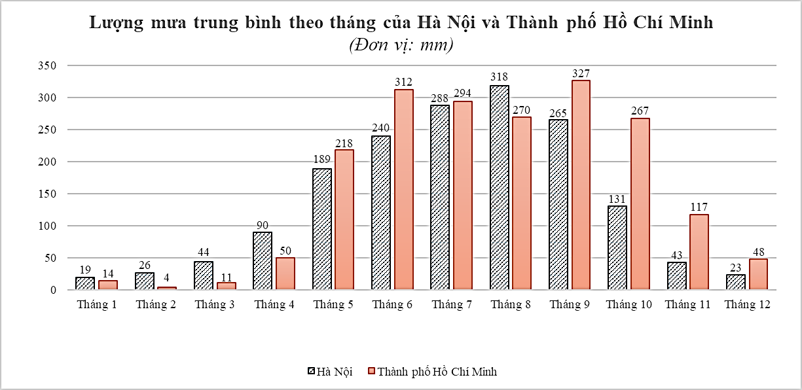
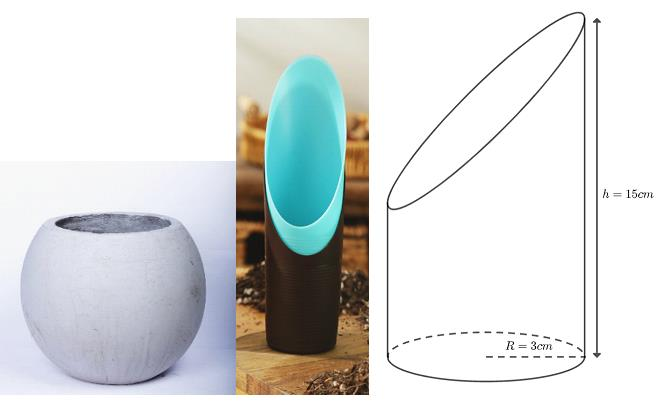
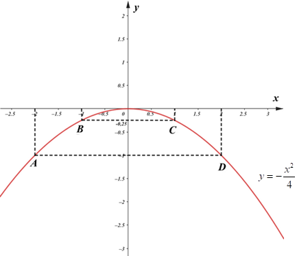
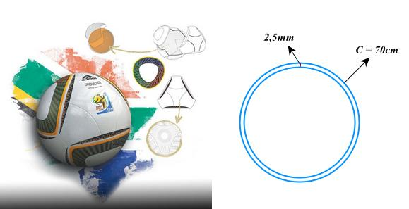
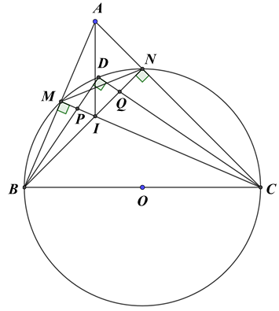

# De Tham Khao Thi Vao 10 Mon Toan Tp Ho Chi Minh Nam 2025 De So 2 1747631301

Câu 1 (1,5 điểm): Cho hàm số  2 : 4 x P y -
.
a) Vẽ đồ thị 
P của hàm số trên.
b) Tìm trên 
P những điểm có tung độ gấp 3 lần hoành độ.
Câu 2 (1 điểm): Cho phương trình 2 4 4 3 0 x x

a) Không giải phương trình, chứng minh phương trình luôn có hai nghiệm phân biệt.
b) Tính giá trị biểu thức
1 2 2 1 4 4 3 A x x x .
Câu 3 (1,5 điểm): Biểu đồ cột kép dưới đây biểu diễn lượng mưa trung bình (đơn vị: mm) của các tháng trong một năm ở Hà Nội và Thành phố Hồ Chí Minh.

a) Tính lượng mưa chênh lệch trung bình ở hai địa điểm Hà Nội và Thành phố Hồ Chí Minh.
b) Chọn ngẫu nhiên một tháng trong năm, tính xác suất của các biến cố sau:
P : “Lượng mưa trung bình của Thành phố Hồ Chí Minh lớn hơn 200 mm” Q : “Lượng mưa chênh lệch của Hà Nội và Thành phố Hồ Chí Minh không vượt quá 40 mm” ĐỀ THAM KHẢO THI TUYỂN SINH VÀO 10 - ĐỀ SỐ 2 MÔN TOÁN Thời gian: 120 phút BIÊN SOẠN: BAN CHUYÊN MÔN LOIGIAIHAY.COM

2 Câu 4 (1 điểm): Ông An có một mảnh đất hình chữ nhật có chiều rộng là 8 m và chiều dài là 20 m. Nhà nước làm một con đường đi ngang qua mảnh đất của ông An và thu hồi một phần đất của ông An (phần hình tam giác). Phần đất không bị thu hồi có kích thước như hình vẽ dưới (phần tô đậm).
a) Viết biểu thức (thu gọn) T biểu thị theo x (với 0
8 x < < ) diện tích đất bị thu hồi của nhà ông An.
b) Ông An được đền bù số tiền 455 triệu đồng cho diện tích đất bị thu hồi. Tìm giá trị x (m) biết giá đền bù
đất bị thu hồi là 13 triệu đồng 2 /m .
Câu 5 (1 điểm): Hiện nay, người ta thường dùng chất liệu PVC (polyvinylchloride) để chế tạo vỏ quả bóng cao su dùng trong bóng đá. Một quả bóng hình cầu thường sử dụng từ hai đến bốn lớp vải lót để làm vỏ bóng và một quả bóng đá thường có chu vi đường tròn lớn từ 58 71 -
cm tuỳ vào kích thước bóng để phù hợp cho từng lứa tuổi. Bác Minh có một quả bóng đá size số 7 có chu vi 70 cm và vỏ quả bóng được tạo thành từ 4 lớp vải lót có độ dày 2,5mm (xem hình ảnh minh hoạ).

a) Tính thể tích không khí tối đa bên trong quả bóng khi quả bóng căng tròn.
b) Sau một thời gian sử dụng, quả bóng không còn chất lượng như ban đầu nên bác Minh cắt quả bóng theo
mặt cắt là một đường tròn để tái chế quả bóng thành một chậu cây có dạng như ảnh minh hoạ. Bác Minh dùng dụng cụ xúc đất như hình trên để xúc đất vào quả bóng, biết thể tích dụng cụ xúc đất bằng 70% thể tích hình trụ có cùng bán kính đáy, chiều cao. Thể tích đất bác Minh cần bỏ vào quả bóng bằng 4 5 thể tích quả bóng ban đầu. Hỏi bác Minh cần xúc ít nhất bao nhiêu lần, biết mỗi lần xúc được một thể tích đất bằng thể tích dụng cụ xúc?
(Lấy 3,14 \pi , làm tròn kết quả đến hàng phần trăm) 2x x 20 m 8 m

Câu 6 (1 điểm): Cách Tết Trung thu 1 tháng, bà Hoa nhập 100 cái bánh dẻo đậu xanh và 150 cái bánh nướng thập cẩm hết 10 230 000 đồng. Thấy bán được, bà Hoa nhập thêm 400 cái bánh dẻo đậu xanh và 200 cái bánh nướng thập cẩm (cùng giá nhập đợt đầu) hết 22 920 000 đồng.
a) Hỏi giá nhập của mỗi chiếc bánh dẻo đậu xanh và bánh nướng thập cẩm là bao nhiêu?
b) Trước Tết Trung thu 3 ngày, bà Hoa đã bán hết bánh nướng thập cẩm nhưng vẫn còn 100 cái bánh dẻo đậu
xanh. Để nhanh chóng bán hết số bánh đã nhập về, bà Hoa thực hiện chương trình khuyến mại như sau: mua cái bánh thứ nhất bằng giá niêm yết, cái bánh thứ hai giảm 30% so với giá niêm yết, cái bánh thứ ba trở đi giảm 60% so với giá niêm yết. Bạn Mai đến cửa hàng bà Hoa mua 5 cái bánh dẻo đậu xanh phải trả 145 000 đồng. Hỏi giá niêm yết của mỗi cái bánh dẻo đậu xanh là bao nhiêu?
Câu 7 (3 điểm): Cho đường tròn tâm O đường kính BC , điểm A nằm ngoài đường tròn sao cho 90 BAC < ^\circ. Gọi , M N là giao điểm của AB và AC với đường tròn  O ( M khác B , N khác C ). Hai đường thẳng BN và CM cắt nhau tại I .
a) Chứng minh AI
BC \perp và tứ giác MANI là tứ giác nội tiếp.
b) Gọi D là điểm trên cung nhỏ MN sao cho MD
ND  , P là giao điểm của BD và CM , Q là giao điểm của CD và BN . Chứng minh rằng . . DQCD BD DP  và IPD IQD  . c) Giả sử 60 BAC  ^\circ và 10 BC  cm. Tính độ dài MN và chu vi đường tròn ngoại tiếp MIN \Delta . (lấy 3,14 \pi ) -------- HẾT --------

---

## 📖 ĐÁP ÁN & HƯỚNG DẪN GIẢI CHI TIẾT

<b>Click để xem lời giải chi tiết 🔍</b>

.
a) Vẽ đồ thị 
P của hàm số trên.
b) Tìm trên 
P những điểm có tung độ gấp 3 lần hoành độ.

**Phương pháp**

a) Lập bảng giá trị, vẽ đồ thị hàm số trên hệ trục tọa độ.
b) Gọi điểm thuộc 
P có tung độ gấp 3 lần hoành độ có toạ độ là   0 0 ;3 x x . Thay 0 0 3 y x  vào hàm số và giải phương trình đưa về phương trình tích.

**Lời giải**

a) Ta có bảng giá trị:
x 2 - 1 - 0 1 2 2 4 x y -

1 - 1 4 - 0 1 4 - 1 -
Đồ thị  P của hàm số là đường cong parabol đi qua các điểm       0;0 ; 2; 1 ; 1; ; 1; ; 2; 1 1 4 4 1 O A B C D ( ) ( ) - - - - - - ( ) ( ) ( ) ( )

Ta vẽ được đồ thị hàm số 2 4 x y -
như sau:

b) Gọi điểm thuộc 
P có tung độ gấp 3 lần hoành độ có toạ độ là   0 0 ;3 x x .

5 Vì điểm nằm trên đồ thị của hàm số 2 4 x y -
nên ta có:
  2 0 0 2 0 0 2 0 0 0 0 3 4 12 12 0 12 0 x x x x x x x x -
-
   

Suy ra 0 0 x  hoặc 0 12 x -
.
Vậy những điểm có tung độ gấp 3 lần hoành độ trên  P là   0;0 và   12; 36 - - .
Câu 2 (1 điểm): Cho phương trình 2 4 4 3 0 x x

a) Không giải phương trình, chứng minh phương trình luôn có hai nghiệm phân biệt.
b) Tính giá trị biểu thức
1 2 2 1 4 4 3 A x x x . Phương pháp
a) Kiểm tra nghiệm của phương trình theo .a c .
b) Áp dụng định lí Viète và biến đổi.
Định lí Viète:
1 2 1 2 ; b c x x x x a a -
  

**Lời giải**

a) Phương trình
2 4 4 3 0 x x có:
  . 4. 3 12 0 a c  -
-
< nên phương trình có hai nghiệm phân biệt 1 2 , x x .
b) Áp dụng định lí Viète, ta có:
1 2 1 2 4 1 4 3 4 x x x x -
\begin{cases}   -
 -
  \end{cases}

Ta có: 1 2 2 1 4 4 3 A x x x       ( )  -

- ( ) ( )
-
1 1 2 2 1 2 1 2 1 4 4 3 1 4( ) 3 1 3 4.( 1) . 3 4 17 4 x x x x x x x x

Vậy 17 4 A -
.

6 Câu 3 (1,5 điểm): Biểu đồ cột kép dưới đây biểu diễn lượng mưa trung bình (đơn vị: mm) của các tháng trong một năm ở Hà Nội và Thành phố Hồ Chí Minh.

a) Tính lượng mưa chênh lệch trung bình ở hai địa điểm Hà Nội và Thành phố Hồ Chí Minh.
b) Chọn ngẫu nhiên một tháng trong năm, tính xác suất của các biến cố sau:
P : “Lượng mưa trung bình của Thành phố Hồ Chí Minh lớn hơn 200 mm” Q : “Lượng mưa chênh lệch của Hà Nội và Thành phố Hồ Chí Minh không vượt quá 40 mm” Phương pháp
a) Quan sát biểu đồ, xác định lượng mưa chênh lệch ở hai địa điểm Hà Nội và Thành phố Hồ Chí Minh theo
từng tháng = giá trị lớn hơn - giá trị nhỏ hơn.
Lượng mưa chênh lệch trung bình = tổng lượng lượng mưa chênh lệch của 12 tháng : 12 tháng.
b) Xác định số phần tử của không gian mẫu, biến cố P và Q, từ đó tính xác suất của biến cố = số phần tử của
biến cố : số phần tử của không gian mẫu.

**Lời giải**

a) Lượng mưa chênh lệch ở hai địa điểm Hà Nội và Thành phố Hồ Chí Minh theo từng tháng là:
Tháng 1: 19 14 5 -
 Tháng 2: 26 4 22 -


Tháng 3: 44 11 33 -


Tháng 4: 90 50 40 -


Tháng 5: 218 189 29 -


Tháng 6: 312 240 72 -


Tháng 7: 294 288 6 -


Tháng 8: 318 270 48 -


Tháng 9: 327 265 62 -


Tháng 10: 267 131 136 -


Tháng 11: 117 43 74 -


Tháng 12: 48 23 25 -


Lượng mưa chênh lệch trung bình là:

7 5 22 33 40 29 72 6 48 62 136 74 25 46 12            (mm)
b) Không gian mẫu có số phần tử là 12.
Xét biến cố P : “Lượng mưa trung bình của Thành phố Hồ Chí Minh lớn hơn 200 mm”.
Số tháng được chọn có lượng mưa trung bình của Thành phố Hồ Chí Minh lớn hơn 200 mm là 6 tháng: tháng 5, 6, 7, 8, 9, 10.
Suy ra số phần tử của biến cố P là 6.
Vậy xác suất của biến cố P là:  6 1 12 2 p P   .
Xét biến cố Q : “Lượng mưa chênh lệch của Hà Nội và Thành phố Hồ Chí Minh không vượt quá 40 mm”.
Số tháng được chọn có lượng mưa chênh lệch của Hà Nội và Thành phố Hồ Chí Minh không vượt quá 40 mm là 7 tháng: tháng 1; 2; 3; 4; 5; 7; 12.
Suy ra số phần tử của biến cố Q là 7 .
Vậy xác suất của biến cố Q là:  7 12 p Q  .
Câu 4 (1 điểm): Ông An có một mảnh đất hình chữ nhật có chiều rộng là 8 m và chiều dài là 20 m. Nhà nước làm một con đường đi ngang qua mảnh đất của ông An và thu hồi một phần đất của ông An (phần hình tam giác). Phần đất không bị thu hồi có kích thước như hình vẽ dưới (phần tô đậm).
a) Viết biểu thức (thu gọn) T biểu thị theo x (với 0
8 x < < ) diện tích đất bị thu hồi của nhà ông An.
b) Ông An được đền bù số tiền 455 triệu đồng cho diện tích đất bị thu hồi. Tìm giá trị x (m) biết giá đền bù
đất bị thu hồi là 13 triệu đồng 2 /m . Phương pháp
a) Phần đất bị cắt đi có hình tam giác vuông.
Sử dụng công thức tính diện tích tam giác để viết biểu diễn diện tích đất bị thu hồi của nhà ông An.
b) Từ T lập phương trình bậc hai một ẩn x biểu diễn số tiền ông An được đền bù.
Giải phương trình để tìm x .

**Lời giải**

a) Độ dài hai cạnh góc vuông của phần đất hình tam giác bị cắt đi là: 20
2x - và 8 x - .
Biểu thức T biểu thị theo x diện tích đất bị thu hồi của nhà ông Thành là      2 2 1 20 2 8 18 80 2 T x x x x m 
- -
 -
 với 0 8 x < < .
b) Vì ông Thành được đền bù số tiền 455 triệu đồng cho diện tích đất bị thu hồi nên ta có phương trình:
2x x 20 m 8 m

8   2 18 80 13 455 x x -
 \cdot 

2 18 80 455:13 x x -
 

2 18 80 35 x x -
 

2 18 45 0 x x -
  .
Giải phương trình, ta được 15 x  (KTM) hoặc 3 x  (TM).
Vậy 3 x  m.
Câu 5 (1 điểm): Hiện nay, người ta thường dùng chất liệu PVC (polyvinylchloride) để chế tạo vỏ quả bóng cao su dùng trong bóng đá. Một quả bóng hình cầu thường sử dụng từ hai đến bốn lớp vải lót để làm vỏ bóng và một quả bóng đá thường có chu vi đường tròn lớn từ 58 71 -
cm tuỳ vào kích thước bóng để phù hợp cho từng lứa tuổi. Bác Minh có một quả bóng đá size số 7 có chu vi 70 cm và vỏ quả bóng được tạo thành từ 4 lớp vải lót có độ dày 2,5mm (xem hình ảnh minh hoạ).

a) Tính thể tích không khí tối đa bên trong quả bóng khi quả bóng căng tròn.
b) Sau một thời gian sử dụng, quả bóng không còn chất lượng như ban đầu nên bác Minh cắt quả bóng theo
mặt cắt là một đường tròn để tái chế quả bóng thành một chậu cây có dạng như ảnh minh hoạ. Bác Minh dùng dụng cụ xúc đất như hình trên để xúc đất vào quả bóng, biết thể tích dụng cụ xúc đất bằng 70% thể tích hình trụ có cùng bán kính đáy, chiều cao. Thể tích đất bác Minh cần bỏ vào quả bóng bằng 4 5 thể tích quả bóng ban đầu. Hỏi bác Minh cần xúc ít nhất bao nhiêu lần, biết mỗi lần xúc được một thể tích đất bằng thể tích dụng cụ xúc?
(Lấy 3,14 \pi , làm tròn kết quả đến hàng phần trăm)

**Phương pháp**

a) Đổi về cùng đơn vị.
Sử dụng công thức tính chu vi đường tròn 2 C R \pi  để tính bán kính đường tròn lớn.
Từ đó tính được bán kính phần trong của quả bóng.
Tính thể tích phần không khí bên trong khi quả bóng căng tròn bằng công thức tính thể tích hình cầu 3 4 3 V r \pi  .
b) Tính thể tích của phần đất:
4. 5 V V  d .
Tính thể tích đất thu được sau mỗi lần xúc là:
2 70%. .
. V R h \pi  dc dc dc (dc: dụng cụ) Tính tỉ số V V d dc . Khi đó ta tính được số lần xúc.

**Lời giải**

a) Đổi 2,5mm = 0,25cm.
Vì chu vi đường tròn lớn của quả bóng là 70 cm nên ta có:
2 70 R \pi  hay 70 70 11,15 2 2.3,14 R \pi    (cm) Bán kính phần trong của quả bóng là:
0,25 11,15 0,25 10,9 r R  -
 -
 (cm).
Vậy thể tích phần không khí bên trong khi quả bóng căng tròn là:
    3 3 3 4 4.3,14. 10,9 5421,85 3 3 V r \pi    cm

b) Thể tích của phần đất là:
  3 4 4 . .5421,85 4337,48 5 5 V V    d cm

10 Thể tích đất thu được sau mỗi lần xúc là:
  2 2 3 70%. .
.
70%.3,14.3 .15 296,73 dc dc dc cm V R h \pi   

Ta có: 4337,48 14,62 296,73 V V   d dc

Do số lần xúc là số tự nhiên nên bác Minh cần xúc ít nhất 15 lần để được thể tích đất cần thiết.
Câu 6 (1 điểm): Cách Tết Trung thu 1 tháng, bà Hoa nhập 100 cái bánh dẻo đậu xanh và 150 cái bánh nướng thập cẩm hết 10 230 000 đồng. Thấy bán được, bà Hoa nhập thêm 400 cái bánh dẻo đậu xanh và 200 cái bánh nướng thập cẩm (cùng giá nhập đợt đầu) hết 22 920 000 đồng.
a) Hỏi giá nhập của mỗi chiếc bánh dẻo đậu xanh và bánh nướng thập cẩm là bao nhiêu?
b) Trước Tết Trung thu 3 ngày, bà Hoa đã bán hết bánh nướng thập cẩm nhưng vẫn còn 100 cái bánh dẻo đậu
xanh. Để nhanh chóng bán hết số bánh đã nhập về, bà Hoa thực hiện chương trình khuyến mại như sau: mua cái bánh thứ nhất bằng giá niêm yết, cái bánh thứ hai giảm 30% so với giá niêm yết, cái bánh thứ ba trở đi giảm 60% so với giá niêm yết. Bạn Mai đến cửa hàng bà Hoa mua 5 cái bánh dẻo đậu xanh phải trả 145 000 đồng. Hỏi giá niêm yết của mỗi cái bánh dẻo đậu xanh là bao nhiêu?

**Phương pháp**

a) Gọi giá nhập của mỗi chiếc bánh dẻo đậu xanh và bánh nướng thập cẩm là x (đồng) và y (đồng). Điều
kiện: * ,x y \in .
Viết phương trình biểu diễn tiền nhập bánh lần 1 và lần 2 theo ,x y .
Giải hệ phương trình vừa lập.
Kiểm tra lại điều kiện và kết luận.
b) Gọi giá niêm yết của mỗi cái bánh dẻo đậu xanh là a (đồng). Điều kiện :
* a \in .
Vì bạn Mai đến cửa hàng bà Hoa mua 5 cái bánh dẻo đậu xanh phải trả 145 000 đồng nên ta viết được phương trình.
Giải phương trình.
Kiểm tra lại điều kiện và kết luận.

**Lời giải**

a) Gọi giá nhập của mỗi chiếc bánh dẻo đậu xanh và bánh nướng thập cẩm là x (đồng) và y (đồng). Điều
kiện: * ,x y \in .
Vì bà Hoa nhập 100 cái bánh dẻo đậu xanh và 150 cái bánh nướng thập cẩm hết 10 230 000 đồng nên ta có phương trình:
100 150 10 230 000 x y   (1) Vì bà Hoa nhập 400 cái bánh dẻo đậu xanh và 200 cái bánh nướng thập cẩm hết 22 920 000 đồng nên ta có phương trình:
400 200 22 920 000 x y   (2) Từ (1) và (2) ta có hệ phương trình:

100 150 10 230 000 400 200 22 920 000. x y x y   \begin{cases}

  \end{cases}

Giải hệ phương trình ta được 34 800 45 000 x y  \begin{cases}

 \end{cases} (thỏa mãn điều kiện).
Vậy giá nhập của mỗi chiếc bánh dẻo đậu xanh và bánh nướng thập cẩm là 34 800 (đồng) và 45 000 (đồng).
b) Gọi giá niêm yết của mỗi cái bánh dẻo đậu xanh là a (đồng). Điều kiện :
* a \in .
Vì bạn Mai đến cửa hàng bà Hoa mua 5 cái bánh dẻo đậu xanh phải trả 145 000 đồng nên ta có phương trình:
    0,7 1,2 145000 2,9 145000 50000 100% 30% 3 100% 60% 145 000 x x x x x x x x      \cdot   \cdot -
 -

Giải phương trình ta được 50 000 x  (thỏa mãn điều kiện).
Vậy giá niêm yết của mỗi cái bánh dẻo đậu xanh là 50 000 đồng.
Câu 7 (3 điểm): Cho đường tròn tâm O đường kính BC , điểm A nằm ngoài đường tròn sao cho 90 BAC < ^\circ. Gọi , M N là giao điểm của AB và AC với đường tròn  O ( M khác B , N khác C ). Hai đường thẳng BN và CM cắt nhau tại I .
a) Chứng minh AI
BC \perp và tứ giác MANI là tứ giác nội tiếp.
b) Gọi D là điểm trên cung nhỏ MN sao cho MD
ND  , P là giao điểm của BD và CM , Q là giao điểm của CD và BN . Chứng minh rằng . . DQCD BD DP  và IPD IQD  . c) Giả sử 60 BAC  ^\circ và 10 BC  cm. Tính độ dài MN và chu vi đường tròn ngoại tiếp MIN \Delta . (lấy 3,14 \pi ) Phương pháp
a) Chứng minh AI
BC \perp

Chứng minh BN và CM là hai đường cao của tam giác ABC và cắt nhau tại I nên I là trực tâm của tam giác ABC . Suy ra AI BC \perp .
Chứng minh tứ giác MANI là tứ giác nội tiếp Chứng minh AMI \Delta và ANI \Delta nội tiếp đường tròn đường kính AI .
Do đó bốn điểm , , , A N I M thuộc đường tròn đường kính AI hay tứ giác MANI là tứ giác nội tiếp.
b) Chứng minh
. . DQCD BD DP 

Chứng minh DQB DPC \Delta \Delta \backsim (g - g) suy ra . . DQ DC DP DP  (đpcm).
Chứng minh IPD IQD 

Từ DQB DPC \Delta \Delta \backsim suy ra IPD IQD  . c) Tính MN

12 Chứng minh BAN CAM \Delta \Delta \backsim (g-g), suy ra AN AM AB AC 

Chứng minh AMN ACB \Delta \Delta \backsim (c-g-c), suy ra cos MN AN A CB AB   . Do đó .cos MN CB A  .
Tính chu vi đường tròn ngoại tiếp tam giác MIN Chứng minh NAI NBC  .
Chứng minh ANI BNC \Delta \Delta \backsim (g-g), suy ra cot AI NI NIC BC NC   . Chứng minh 60 NIC MAN   ^\circ suy ra cot60 . AI BC  ^\circ .
Đường tròn ngoại tiếp tam giác MIN có đường kính là AI nên ta có chu vi của đường tròn đó là:
. C AI \pi  . Lời giải

a) Chứng minh AI
BC \perp

Do BMC và BNC là hai góc nội tiếp chắn nửa đường tròn nên 90 BMC BNC   ^\circ.
Suy ra BN và CM là hai đường cao của tam giác ABC .
Mà BN và CM cắt nhau tại I nên I là trực tâm của tam giác ABC .
Do đó AI BC \perp .
Chứng minh tứ giác MANI là tứ giác nội tiếp Vì 90 AMI  ^\circ nên AMI \Delta nội tiếp đường tròn đường kính AI .
Vì 90 ANI  ^\circ nên ANI \Delta nội tiếp đường tròn đường kính AI .
Do đó bốn điểm , , , A N I M thuộc đường tròn đường kính AI hay tứ giác MANI là tứ giác nội tiếp.
b) Chứng minh
. . DQCD BD DP 

13 Xét DQB \Delta và DPC \Delta , ta có: BDQ chung DBQ DCQ  (là hai góc nội tiếp chắn cung DN , DM và s® s® DN DM  ) Suy ra DQB DPC \Delta \Delta \backsim (g - g) Do đó DQ DB DP DC  hay . . DQ DC DP DP  (đpcm).
Chứng minh IPD IQD 

Vì DQB DPC \Delta \Delta \backsim nên IQD CPD  hay IPD IQD  . c) Tính MN Xét BAN \Delta và CAM \Delta , ta có: BAN chung 0 90 BNA CMA  

Suy ra BAN CAM \Delta \Delta \backsim (g-g), suy ra AN AM AB AC 

Xét AMN \Delta và ACB \Delta , ta có BAC chung AN AM AB AC  (cmt) Suy ra AMN ACB \Delta \Delta \backsim (c-g-c), suy ra 1 cos cos60 2 MN AN A CB AB    ^\circ . Do đó,   1 1 . 10. 5 2 2 cm MN CB    .
Tính chu vi đường tròn ngoại tiếp tam giác MIN Ta có: NAI NMI  (tứ giác MANI nội tiếp và NAI và NMI là góc nội tiếp chắn NI ) Và NMI NBC  (góc nội tiếp chắn NC ).
Suy ra NAI NBC  . Xét ANI \Delta và BNC \Delta có: 90 ANI BNC   ^\circ NAI NBC  (cmt) Suy ra ANI BNC \Delta \Delta \backsim (g-g), suy ra cot AI NI NIC BC NC   . Mà 60 NIC MAN   ^\circ (vì NIC và MAN cùng bù với MIN ) Suy ra 3 cot 60 3 AI BC  ^\circ , do đó   3 3 10 3 . .10 3 3 3 AI BC    cm .
Mà đường tròn ngoại tiếp tam giác MIN có đường kính là AI nên ta có chu vi của đường tròn đó là:
  10 3 . 3,14. 18,13 3 C AI \pi    cm .

