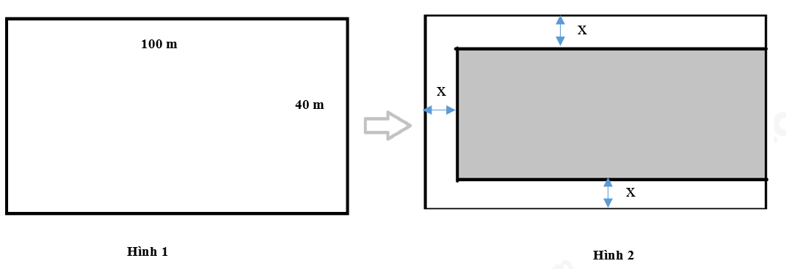
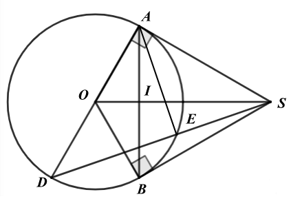

# ĐỀ THAM KHẢO THI TUYỂN SINH VÀO 10 - ĐỀ SỐ 3 MÔN TOÁN Thời gian: 120 phút BIÊN SOẠN: BAN CHUYÊN MÔN LOIGIAIHAY.COM

1 Câu 1 (1,5 điểm): Cho hàm số  2 1 : 2 P y x  .
a) Vẽ đồ thị 
P của hàm số trên.
b) Minh đang thiết kế một mô hình Parabol để mô phỏng quỹ đạo của một quả bóng trong trò chơi của mình.
Quỹ đạo được biểu diễn bằng hàm số sau:
2 1 2 y x  . Minh muốn tìm các vị trí trên quỹ đạo mà độ cao của quả bóng so với mặt đất là 0,5 mét. Hỏi tại những điểm nào trên mặt phẳng, quả bóng đạt được độ cao này?
Câu 2 (1 điểm): Cho phương trình 2 5 8 0 x x  -


a) Không giải phương trình, chứng minh phương trình luôn có hai nghiệm phân biệt.
b) Tính giá trị biểu thức
1 2 2 1 2 2 x x A x x  
- - .
Câu 3 (1,5 điểm): Ở giữa mùa giải AFF Cup 2024 - 2025, nơi mà những đội bóng hàng đầu Đông Nam Á tranh tài quyết liệt để giành lấy danh hiệu cao quý. Kết quả bảng B như sau:
Đội bóng Số trận đấu Số trận thắng Số trận hòa Số trận thua Việt Nam 4 3 1 0 Philippines 4 2 1 1 Indonesia 4 1 1 2 Myanmar 4 1 0 3 Lào 4 0 0 4 Trong mỗi trận đấu, các đội sẽ được thưởng điểm như sau:
 Một trận thắng: 3 điểm  Một trận hòa: 1 điểm  Một trận thua: 0 điểm
a) Giả sử chọn ngẫu nhiên một đội bóng từ bảng B. Hãy tính xác suất của đội bóng có số trận thắng là 1.
b) Hãy tính xác suất để một đội bóng được chọn ngẫu nhiên có số điểm từ 4 trở lên.
Câu 4 (1 điểm): Ông An có một mảnh đất hình chữ nhật có chiều dài 100(m) và chiều rộng 40(m) (Hình 1). Ông dự định xây dựng khu nghỉ dưỡng nên ông cho đào mương xung quanh mảnh đất để lấy đất bồi thêm đất nền cao hơn. Ông cho đào 3 mặt của mảnh đất như hình 2, độ rộng mương là  x m   0 10 x < <

a) Gọi S là diện tích phần đất nền (phần in đậm) sau khi được bồi thêm. Hãy viết biểu thức dưới
dạng thu gọn tính S theo x.

b) Phần đất nền sau khi được bồi thêm đo được diện tích là
2 3298m . Để tránh rủi ro trẻ em có thể té xuống mương, ông cho làm hàng rào bao quanh phần đất nền tiếp giáp với mương bằng lưới B40.
Tính chiều dài lưới B40 mà ông cần mua.

Câu 5 (1 điểm): Một ống đựng các viên vitamin C có dạng hình trụ với đường kính đáy là 4cm và chiều cao là 12cm . Mỗi viên vitamin C hình cầu với bán kính là 0,5 cm .
a) Tính thể tích của ống vitamin C và thể tích của một
viên vitamin C (tính theo đơn vị cm3 và làm tròn đến hàng phần trăm).
Biết công thức tính thể tích hình trụ là 2 V R h \pi  (R là bán kính đáy, h đường cao của hình trụ) Thể tích hình cầu là 3 4 3 V R \pi  (R là bán của kính hình cầu).
b) Biết rằng trong ống có một lớp không khí chiếm 10% thể tích của ống. Tính số viên vitamin C tối đa có
thể chứa trong ống.
Câu 6 (1 điểm): Formalin là dung dịch có chứa từ 37 40% -
Formaldehyde. Formaldehyde có khả năng kháng khuẩn, kháng nấm nên được dùng làm chất bảo quản trong y tế. Một nhà máy sản xuất Formalin đang có một lượng dung dịch Formaldehyde nồng độ 15% và một lượng Formaldehyde nồng độ 65% .
a) Tính thể tích mỗi loại Formaldehyde trên để điều chế được 300 lít Formaldehyde 35%. Giả sử nguyên
liệu không bị hao hụt trong quá trình sản xuất.
b) Một cơ sở y tế đặt hàng nhà máy trên một đơn hàng Formalin. Nhà máy dùng 200 lít Formaldehyde
15% cùng một lượng Formaldehyde 65% để sản xuất ra Formalin. Hỏi thể tích của Formaldehyde 65% nằm trong khoảng nào thì có thể sản xuất được Formalin. (Kết quả làm tròn đến hàng đơn vị của lít) Câu 7 (3 điểm): Cho điểm S ngoài (O; R) với SO = 2.R, vẽ 2 tiếp tuyến SA và SB đến đường tròn (A, B là tiếp điểm). Gọi I là giao điểm của AB với SO.
a) Chứng minh: Bốn điểm S, A, O, B cùng thuộc một đường tròn và SO
AB \perp tại I.
b) Vẽ đường kính AD của đường tròn (O). Đoạn thẳng SD cắt đường tròn (O) tại điểm E (E khác D). Chứng
minh: 2 . SE SD SA  và . . SE SD SI SO  .
c) Biết bán kính R = 8cm. Tính diện tích hình phẳng giới hạn bởi OA, OB và cung AB nhỏ, làm tròn kết quả
đến hàng đơn vị, lấy 3,14 \pi .

---
*------------------- HẾT -------------------*

---

## 📖 ĐÁP ÁN & HƯỚNG DẪN GIẢI CHI TIẾT

<b>Click để xem lời giải chi tiết 🔍</b>

a) Vẽ đồ thị 
P của hàm số trên.
b) Minh đang thiết kế một mô hình Parabol để mô phỏng quỹ đạo của một quả bóng trong trò chơi của mình.
Quỹ đạo được biểu diễn bằng hàm số sau:
2 1 2 y x  . Minh muốn tìm các vị trí trên quỹ đạo mà độ cao của quả bóng so với mặt đất là 0,5 mét. Hỏi tại những điểm nào trên mặt phẳng, quả bóng đạt được độ cao này?

**Phương pháp**

a) Lập bảng giá trị, vẽ đồ thị hàm số trên hệ trục tọa độ.
b) Gọi điểm thuộc 
P thoả mãn đề bài là   ; M M M x y .
Vì Minh muốn tìm các vị trí trên quỹ đạo mà độ cao của quả bóng so với mặt đất là 0,5 mét nên 1 2 M y  .
Thay vào hàm số 2 1 2 y x  để tìm giá trị M x tương ứng. Lời giải
a) Ta có bảng giá trị sau:
x 2 - 1 - 0 1 2 2 1 2 y x 

2 1 2

0 1 2

2 Đồ thị hàm số là đường cong parabol đi qua các điểm       0;0 ; 2;2 ; 1; ; 1; ; 1 1 2 2 2;2 O A B C D ( ) ( ) - - ( ) ( ) ( ) ( )

Ta vẽ được đồ thị hàm số 2 1 2 y x  như sau:

b) Gọi điểm thuộc 
P thoả mãn đề bài là   ; M M M x y .
Minh muốn tìm các vị trí trên quỹ đạo mà độ cao của quả bóng so với mặt đất là 0,5 mét nên 1 2 M y  .

4 Do đó 2 1 1 2 2 M x 

Suy ra 2 1 M x  nên 1 M x  hoặc 1 M x -.
Vậy toạ độ điểm M là 1 1; 2 ( ) ( ) ( ) ; 1 1; 2 ( ) - ( ) ( ) .
Câu 2 (1 điểm): Cho phương trình 2 5 8 0 x x  -


a) Không giải phương trình, chứng minh phương trình luôn có hai nghiệm phân biệt.
b) Tính giá trị biểu thức
1 2 2 1 2 2 x x A x x  
- - . Phương pháp
a) Kiểm tra nghiệm của phương trình theo .a c .
b) Áp dụng định lí Viète và biến đổi.
Định lí Viète:
1 2 1 2 ; b c x x x x a a -
  

**Lời giải**

a) Phương trình
2 5 8 0 x x  -
 có:
  . 1. 8 8 0 a c  -
- < nên phương trình có hai nghiệm phân biệt 1 2 , x x .
b) Áp dụng định lí Viète, ta có:
1 2 1 2 5 5 8 1 1 8 x x x x  -
  -
\begin{cases}   -
-
  \end{cases}

Ta có: 1 2 2 1 2 2 x x A x x  
- -

                   2 2 1 1 2 2 1 2 2 1 2 1 2 1 2 1 2 1 2 2 2 2 2 2 2 2 2 4 5 2. 8 2. 5 8 2. 5 4 25 16 10 8 10 4 17 2 x x x x x x x x x x x x x x x x -
 -

- -

- -
  -
 
- - - - -

- - -
   -  

Vậy 17 2 A  .

5 Câu 3 (1,5 điểm): Ở giữa mùa giải AFF Cup 2024 - 2025, nơi mà những đội bóng hàng đầu Đông Nam Á tranh tài quyết liệt để giành lấy danh hiệu cao quý. Kết quả bảng B như sau:
Đội bóng Số trận đấu Số trận thắng Số trận hòa Số trận thua Việt Nam 4 3 1 0 Philippines 4 2 1 1 Indonesia 4 1 1 2 Myanmar 4 1 0 3 Lào 4 0 0 4 Trong mỗi trận đấu, các đội sẽ được thưởng điểm như sau:
 Một trận thắng: 3 điểm  Một trận hòa: 1 điểm  Một trận thua: 0 điểm
a) Giả sử chọn ngẫu nhiên một đội bóng từ bảng B. Hãy tính xác suất của đội bóng có số trận thắng là 1.
b) Hãy tính xác suất để một đội bóng được chọn ngẫu nhiên có số điểm từ 4 trở lên.

**Phương pháp**

a) Xác định các đội có số trận thắng là 1.
Xác suất của đội bóng có số trận thắng là 1 bằng tỉ số giữa số đội bóng có số trận thắng là 1 với tổng số đội bóng.
b) Tính điểm đạt được của các đội. Xác định các đội có số điểm từ 4 trở lên.
Xác suất để một đội bóng được chọn ngẫu nhiên có số điểm từ 4 trở lên bằng tỉ số giữa số đội bóng có số điểm từ 4 trở lên với tổng số đội bóng.

**Lời giải**

a) Số đội có số trận thắng là 1 là 2. Đó là Indonesia, Myanmar.
Tổng số đội là: 5 Vậy xác suất của đội bóng có số trận thắng là 1 là: 2 5 .
b) Ta có bảng điểm của các đội như sau:
Đội bóng Số trận đấu Việt Nam 3.3 + 1.1 + 0.0 = 10 Philippines 2.3 + 1.1 + 1.0 = 7 Indonesia 1.3 + 1.1 + 2.0 = 4 Myanmar 1.3 + 3.0 = 3 Lào 4.0 = 0 Có 3 đội có điểm từ 4 trở lên, đó là: Việt Nam, Philippines, Indonesia.
Tổng số đội là: 5 Vậy xác suất để một đội bóng được chọn ngẫu nhiên có số điểm từ 4 trở lên là: 3 5

6 Câu 4 (1 điểm): Ông An có một mảnh đất hình chữ nhật có chiều dài 100(m) và chiều rộng 40(m) (Hình 1). Ông dự định xây dựng khu nghỉ dưỡng nên ông cho đào mương xung quanh mảnh đất để lấy đất bồi thêm đất nền cao hơn. Ông cho đào 3 mặt của mảnh đất như hình 2, độ rộng mương là  x m   0 10 x < <

a) Gọi S là diện tích phần đất nền (phần in đậm) sau khi được bồi thêm. Hãy viết biểu thức dưới
dạng thu gọn tính S theo x.
b) Phần đất nền sau khi được bồi thêm đo được diện tích là
2 3298m . Để tránh rủi ro trẻ em có thể té xuống mương, ông cho làm hàng rào bao quanh phần đất nền tiếp giáp với mương bằng lưới B40.
Tính chiều dài lưới B40 mà ông cần mua.

**Phương pháp**

a) Tính chiều dài và chiều rộng của phần đất nền.
Từ đó tính diện tích phần đất nền bằng công thức tính diện tích hình chữ nhật.
b) Từ diện tích của phần đất nền, giải phương trình bậc hai để tìm x .
Chiều dài lưới B40 chính là tổng độ dài của phần đất nền một cạnh không tiếp giáp với mương.

**Lời giải**

a) Độ dài cạnh 100m giảm đi x m sau khi đào mương nên độ dài một cạnh của phần đất nền là: 100
x - (m) Độ dài cạnh 40m giảm đi 2x m sau khi đào mương nên độ dài cạnh còn lại của phần đất nền là: 40 2x - (m) Do đó sau khi đào mương thì độ dài hai cạnh của phần đất nền là: 100 x - (m) và 40 2x - (m) Khi đó diện tích phần đất nền là:
   2 2 100 40 2 4000 40 200 2 2 240 4000 S x x x x x x x 
- -

- -
  -


b) Phần đất nền sau khi được bồi thêm đo được diện tích là
2 3298m . Để tránh rủi ro trẻ em có thể té xuống mương, ông cho làm hàng rào bao quanh phần đất nền tiếp giáp với mương bằng lưới B40.
Tính chiều dài lưới B40 mà ông cần mua.
Vì phần đất nền sau khi được bồi thêm đo được diện tích là 2 3298m nên ta có phương trình:
2 2 2 2 240 4000 3298 2 240 702 0 120 351 0 x x x x x x -
  -
  -
 

7 Giải phương trình, ta được:
    1 2 3 ; 117 x TM x KTM  

Khi đó hai cạnh của phần đất nền là:
 100 3 97 m -
 và  40 2.3 34 m -
 .
Tổng độ dài các cạnh tiếp giáp với mương là:
 97.2 34 228 m   .
Vậy chiều dài lưới B40 mà ông cần mua là 228m.
Câu 5 (1 điểm): Một ống đựng các viên vitamin C có dạng hình trụ với đường kính đáy là 4cm và chiều cao là 12cm . Mỗi viên vitamin C hình cầu với bán kính là 0,5 cm .
a) Tính thể tích của ống vitamin C và thể tích của một
viên vitamin C (tính theo đơn vị cm3 và làm tròn đến hàng phần trăm).
Biết công thức tính thể tích hình trụ là 2 V R h \pi  (R là bán kính đáy, h đường cao của hình trụ) Thể tích hình cầu là 3 4 3 V R \pi  (R là bán của kính hình cầu).
b) Biết rằng trong ống có một lớp không khí chiếm 10% thể tích của ống. Tính số viên vitamin C tối đa có
thể chứa trong ống.

**Phương pháp**

a) Tính bán kính của ống đựng = đường kính : 2.
Thể tích của ống vitamin C bằng công thức tính thể tích hình trụ.
Thể tích của viên vitamin C bằng công thức tính thể tích hình cầu.
b) Tính thể tích có thể chứa của ống vitamin C là: 
 100% 10% . tV -

Tính tỉ số giữa thể tích có thể chứa : thể tích viên vitamin C.
Từ đó ta có số viên vitamin C tối đa có thể chứa trong ống.

**Lời giải**

a) Bán kính của ống đựng là:
  4: 2 2 cm 

Thể tích của ống vitamin C là:
  2 3 .2 .12 48 150,8 tV cm \pi \pi   

Thể tích của viên vitamin C là:
  3 3 4. .0,5 0,52 3 6 c V cm \pi \pi   

b) Biết rằng trong ống có một lớp không khí chiếm 10% thể tích của ống. Tính số viên vitamin C tối đa có
thể chứa trong ống.
Thể tích có thể chứa của ống vitamin C là:     3 100% 10% .
90%.150,8 135,72 tV cm -
 

Ta có: 135,72 261 0,52  . Do đó số viên vitamin C tối đa có thể chứa trong ống là 261 viên.

8 Câu 6 (1 điểm): Formalin là dung dịch có chứa từ 37 40% -
Formaldehyde. Formaldehyde có khả năng kháng khuẩn, kháng nấm nên được dùng làm chất bảo quản trong y tế. Một nhà máy sản xuất Formalin đang có một lượng dung dịch Formaldehyde nồng độ 15% và một lượng Formaldehyde nồng độ 65% .
a) Tính thể tích mỗi loại Formaldehyde trên để điều chế được 300 lít Formaldehyde 35%. Giả sử nguyên
liệu không bị hao hụt trong quá trình sản xuất.
b) Một cơ sở y tế đặt hàng nhà máy trên một đơn hàng Formalin. Nhà máy dùng 200 lít Formaldehyde
15% cùng một lượng Formaldehyde 65% để sản xuất ra Formalin. Hỏi thể tích của Formaldehyde 65% nằm trong khoảng nào thì có thể sản xuất được Formalin. (Kết quả làm tròn đến hàng đơn vị của lít) Phương pháp
a) Gọi 
 , l l x y lần lượt là thể tích của dung dịch Formaldehyde 15% và Formaldehyde 65% cần sử dụng (0 , 300 x y < < ).
Viết phương trình biểu diễn tổng thể tích hai loại dung dịch, nồng độ Formaldehyde trong dung dịch.
Từ đó ta lập được hệ phương trình.
Giải hệ phương trình vừa lập.
Kiểm tra lại điều kiện và kết luận.
b) Gọi l
x là thể tích Formaldehyde 65% ( 0 x > ).
Biểu diễn tồng độ của Formaldehyde sau khi trộn hai loại dung dịch lại.
Do Formalin có nồng độ Formaldehyde từ 37 40% -
nên ta viết bất phương trình nồng độ dung dịch.
Giải các bất phương trình.

**Lời giải**

a) Gọi 
 , l l x y lần lượt là thể tích của dung dịch Formaldehyde 15% và Formaldehyde 65% cần sử dụng (0 , 300 x y < < ).
Vì tổng thể tích hai loại dung dịch là 300 nên ta có phương trình:
300 x y   (1).
Vì nồng độ Formaldehyde trong dung dịch lúc sau là 35% nên ta có: 0,15 0,65 300.0,35 x y   hay 0,15 0,65 105 x y   (2).
Từ (1) và (2) ta có hệ phương trình:
300 0,15 0,65 105 x y x y   \begin{cases}

  \end{cases}

Giải hệ phương trình, ta được     180 120 x TM y TM  \begin{cases} \end{cases} .
Vậy thể tích của Formaldehyde 15% và Formaldehyde 65% lần lượt là 180 lít và 120 lít.
b) Gọi l
x là thể tích Formaldehyde 65% ( 0 x > ).
Nồng độ của Formaldehyde sau khi trộn hai loại dung dịch lại là 200.15% .65% 0,65 30 200 200 x x x x      .
Do Formalin có nồng độ Formaldehyde từ 37 40%
- nên ta có: 0,65 30
37% 40% 200 x x  \le \le  hay 0,65 30 0,37 0,4 200 x x  \le \le 

9 +) Giải bất phương trình:
0,65 30 0,37 200 x x  \le 

  0,65 30 0,37 200 0,37 200 0,65 30 0,37 74 0,65 30 0 0,28 44 0 157 x x x x x x x x  \le   \le  
- - \le -
 \le \ge

+) Giải bất phương trình: 0,65 30 0,4 200 x x  \le 

0,65 30 0,4 200 0,65 30 0,4 80 0,25 50 200 x x x x x x  \le   \le  \le \le

Ta được 157 x \ge và 200 x \le hay 157 200 x \le \le .
Vậy thể tích Formaldehyde từ 157 lít đến 200 lít thì thu được Formalin.
Câu 7 (3 điểm): Cho điểm S ngoài (O; R) với SO = 2.R, vẽ 2 tiếp tuyến SA và SB đến đường tròn (A, B là tiếp điểm). Gọi I là giao điểm của AB với SO.
a) Chứng minh: Bốn điểm S, A, O, B cùng thuộc một đường tròn và SO
AB \perp tại I.
b) Vẽ đường kính AD của đường tròn (O). Đoạn thẳng SD cắt đường tròn (O) tại điểm E (E khác D). Chứng
minh: 2 . SE SD SA  và . . SE SD SI SO  .
c) Biết bán kính R = 8cm. Tính diện tích hình phẳng giới hạn bởi OA, OB và cung AB nhỏ, làm tròn kết quả
đến hàng đơn vị, lấy 3,14 \pi . Phương pháp
a) Chứng minh: Bốn điểm S, A, O, B cùng thuộc một đường tròn
Chứng minh OAS \Delta và OBS \Delta cùng nội tiếp đường tròn đường kính OS.
Do đó bốn điểm S, A, O, B thuộc đường tròn đường kính OS.
Chứng minh SO AB \perp tại I.
Chứng minh SO là đường trung trực của AB.
Suy ra SO AB \perp tại I.
b) Chứng minh
2 . SE SD SA 

Chứng minh   . AES DAS g g \Delta \Delta \backsim suy ra 2 . SE SD SA  . Chứng minh . . SE SD SI SO 

Chứng minh SAO SIA \Delta \Delta \backsim (g.g), suy ra 2 . SA SI SO  .
Từ (1) và (2) suy ra . . SE SD SI SO  .
c) Biết bán kính R = 8cm. Tính diện tích hình phẳng giới hạn bởi OA, OB và cung AB nhỏ, làm tròn kết
quả đến hàng đơn vị.
Sử dụng tỉ số lượng giác để tính cosSOA suy ra SOA .
Sử dụng tính chất của hai tiếp tuyến cắt nhau để tính AOB .

10 Diện tích hình phẳng giới hạn bởi OA, OB và cung AB nhỏ chính là diện tích hình quạt tròn ứng với cung AB nhỏ.
Diện tích được tính bởi công thức:
2 360 R n S \pi  . Lời giải

a) Chứng minh: Bốn điểm S, A, O, B cùng thuộc một đường tròn
Vì SA và SB là tiếp tuyến của đường tròn  O nên SA OA \perp , SB OB \perp suy ra 90 OAS OBS   ^\circ Do đó OAS \Delta vuông tại A nên OAS \Delta nội tiếp đường tròn đường kính OS.
OBS \Delta vuông tại B nên OBS \Delta nội tiếp đường tròn đường kính OS.
Do đó bốn điểm S, A, O, B thuộc đường tròn đường kính OS.
Chứng minh SO AB \perp tại I.
Ta có: SA = SB (tính chất hai tiếp tuyến cắt nhau) OA = OB (= R) nên SO là đường trung trực của AB.
Suy ra SO AB \perp tại I.
b) Chứng minh
2 . SE SD SA 

Ta có 90 AED  ^\circ nên 90 AES  ^\circ (góc nội tiếp chắn nửa đường tròn) Xét AES \Delta và DAS \Delta có: 90 DAS AES   ^\circ ASD chung nên   . AES DAS g g \Delta \Delta \backsim suy ra SE AS AS SD  , do đó 2 . SE SD SA  . (1) Chứng minh . . SE SD SI SO 

Xét SAO \Delta và SIA \Delta có: 90 SAO SIA   ^\circ (SA là tiếp tuyến, SO AB \perp tại I) ASO chung nên SAO SIA \Delta \Delta \backsim (g.g), suy ra SA SI SO SA  , do đó 2 . SA SI SO  . (2) Từ (1) và (2) suy ra . . SE SD SI SO  .

c) Tính diện tích hình phẳng giới hạn bởi OA, OB và cung AB nhỏ.
Diện tích hình phẳng giới hạn bởi OA, OB và cung AB nhỏ chính là diện tích hình quạt tròn ứng với cung AB nhỏ. Xét SAO \Delta vuông tại A, ta có:
1 cos 2 2 OA R SOA OS R    nên 60 SOA  ^\circ.
Theo tính chất của hai tiếp tuyến cắt nhau, ta có OS là tia phân giác của AOB , suy ra 2. 2.60 120 AOB SOA   ^\circ ^\circ.
Diện tích hình phẳng giới hạn bởi OA, OB và cung AB nhỏ là:
  2 2 2 3,14.8 .120 67 360 360 R n S cm \pi   

Vậy diện tích hình phẳng giới hạn bởi OA, OB và cung AB nhỏ khoảng 2 67cm .

