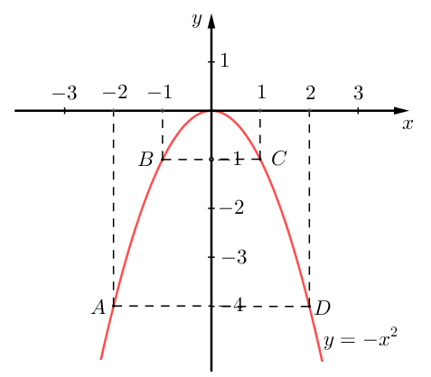
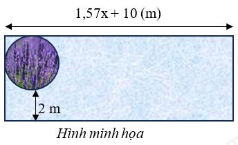
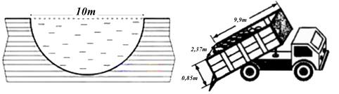
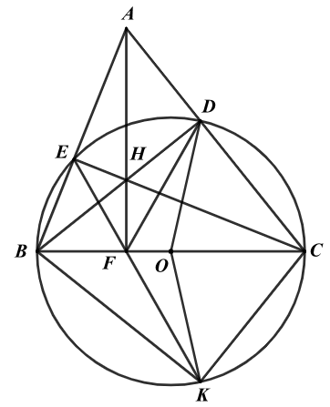

# De Tham Khao Thi Vao 10 Mon Toan Tp Ho Chi Minh Nam 2025 De So 4 1742965420

Câu 1 (1,5 điểm): Cho hàm số 2 ( ): P y x -

a) Vẽ đồ thị ( )
P của hàm số trên.
b) Tìm những điểm N thuộc ( )
P có hoành độ và tung độ là những số đối nhau.
Câu 2 (1 điểm): Cho phương trình 2 4 6 0 x x - -
 .
a) Chứng minh phương trình trên có hai nghiệm phân biệt
1 2 , x x .
b) Không giải phương trình, hãy tính giá trị của biểu thức
1 2 1 2 1 2 4 4 x x x x A x x  
- - .
Câu 3 (1,5 điểm): Biểu đồ cột kép bên dưới biểu diễn số học sinh khối 9 của trường THCS A trên địa bàn Thành phố Hồ Chí Minh tham gia các câu lạc bộ do nhà trường tổ chức. Biết rằng mỗi bạn chỉ tham gia đúng một câu lạc bộ.

a) Câu lạc bộ nào có sự chênh lệch nhiều nhất giữa số nam sinh và nữ sinh?
b) Chọn ngẫu nhiên một học sinh khối 9, tính xác suất của các biến cố sau:
A: “Học sinh được chọn là nữ”.
B: “Học sinh được chọn không tham gia câu lạc bộ bơi lội và câu lạc bộ khiêu vũ”.
Câu 4 (1 điểm): Một cái sân hình chữ nhật có độ dài của một cạnh như hình vẽ. Ở góc sân, người ta làm một cái bồn hoa hình tròn có bán kính x mét ( 0 x > ). Biết vòng tròn tiếp xúc với 2 cạnh của hình chữ nhật và khoảng cách từ cạnh (chiều dài) của hình chữ nhật đến đường tròn là 2 mét (xem hình minh họa). (lấy 3,14 \pi ).
a) Viết biểu thức biểu thị diện tích đất còn lại sau khi đã xây bồn hoa.
b) Hãy tính bán kính của bồn hoa hình tròn biết diện tích đất còn lại
sau khi xây bồn hoa là 2 54,71m . 28 17 24 45 15 24 35 40 0 5 10 15 20 25 30 35 40 45 50 Cờ vua Dân ca Khiêu vũ Bơi lội Số học sinh tham gia các câu lạc bộ Nam Nữ ĐỀ THAM KHẢO THI TUYỂN SINH VÀO 10 - ĐỀ SỐ 4 MÔN TOÁN Thời gian: 120 phút BIÊN SOẠN: BAN CHUYÊN MÔN LOIGIAIHAY.COM

2 Câu 5 (1 điểm): Để phòng tránh trẻ em bị đuối nước, người ta quyết định dùng đất để lấp một cái ao dạng nửa hình cầu, mặt ao hình tròn có đường kính 10m.

a) Tính thể tích nước trong ao theo
3 m . Giả sử mực nước trong ao bằng với mặt đất xung quanh và các sinh vật, vật thể trong ao có thể tích không đáng kể.
b) Người ta thuê những xe tải có thùng xe dạng hình hộp chữ nhật, lòng trong thùng dài 9,9 mét, rộng 2,37
mét và cao 0,85 mét. Nhưng con đường từ nơi cung cấp đất đến ao bị giới hạn trọng tải của phương tiện tham gia giao thông nên xe chỉ chở được 85% thể tích của lòng trong thùng xe. Hỏi cần thuê ít nhất bao nhiêu xe để lấp đầy cái ao? (Đất chở trên xe gần được nén chặt và gần như không có khoảng trống trong khối đất) (Cho biết công thức tính thể tích hình cầu là 3 4 3 V R \pi  , trong đó R là bán kính hình cầu. Kết quả làm tròn đến hàng phần mười) Câu 6 (1 điểm): Một ô tô dự định đi từ A đến B trong một thời gian nhất định. Nếu xe chạy mỗi giờ nhanh hơn 12,5km/h thì đến sớm hơn dự định 2 giờ, còn xe chạy chậm đi 10km/h thì đến nơi chậm mất 2,5 giờ.
a) Tính vận tốc của xe lúc đầu, thời gian dự định và chiều dài quãng đường AB.
b) Trên quãng đường cao tốc CD = 150km có vận tốc giới hạn từ 50km/h đến 120km/h thì một ô tô đi hết
cao tốc trong khoảng thời gian nào?
Câu 7 (3 điểm): Cho ABC \Delta nhọn ( ) AB AC < . Đường tròn  O đường kính BC cắt , AB AC lần lượt tại , E D ( E không trùng B , D không trùng C ). BD cắt CE tại H , AH cắt BC tại F .
AF BC \perp BEHF
a) Chứng minh
và tứ giác nội tiếp. FA EFD FE FD FH FA \cdot  \cdot
b) Chứng minh
là tia phân giác của và . FE K FK FD  11 BC cm  4 FE cm  6 FK cm 
c) Trên tia đối của tia
lấy điểm sao cho . Với , ,

( ) FB FC < BKC , tính số đo góc và độ dài FO.

---
*------------------- HẾT -------------------*

---

## 📖 ĐÁP ÁN & HƯỚNG DẪN GIẢI CHI TIẾT

<b>Click để xem lời giải chi tiết 🔍</b>

a) Vẽ đồ thị ( )
P của hàm số trên.
b) Tìm những điểm N thuộc ( )
P có hoành độ và tung độ là những số đối nhau.

**Phương pháp**

a) Lập bảng giá trị, vẽ đồ thị hàm số trên hệ trục tọa độ.
b) Điểm có hoành độ và tung độ là những số đối nhau có dạng
  0 0 ; N x x - . Vì ( ) N P \in nên   2 0 0 ; N x x - . Do đó 2 0 0 x x -
-

Giải phương trình để tìm N thoả mãn.

**Lời giải Ta có bảng giá trị sau:**

x 2 - 1 - 0 1 2 2 y x -

4 - 1 - 0 1 - 4 -
Đồ thị hàm số là đường cong parabol đi qua các điểm           0;0 ; 2; 4 ; 1; 1 ; 1; 1 ; 2; 4 O A B C D - - - - - -

Hệ số 1 0 a - < nên parabol có bề cong hướng xuống. Đồ thị hàm số nhận Oy làm trục đối xứng.
Ta vẽ được đồ thị hàm số 2 y x -
như sau:

b) Điểm có hoành độ và tung độ là những số đối nhau có dạng
  0 0 ; N x x - . Vì ( ) N P \in nên   2 0 0 ; N x x - . Do đó 2 0 0 x x -
-

2 0 0 0 x x -


  0 0 1 0 x x -


suy ra 0 0 x  hoặc 0 1 0 x -

0 0 x  hoặc 0 1 x  Khi đó 0 0 y  hoặc 0 1 y -
Vậy điểm N cần tìm là   0;0 N và   1; 1 N - .

4 Câu 2 (1 điểm): Cho phương trình 2 4 6 0 x x - -
 .
a) Chứng minh phương trình trên có hai nghiệm phân biệt
1 2 , x x .
b) Không giải phương trình, hãy tính giá trị của biểu thức
1 2 1 2 1 2 4 4 x x x x A x x  
- - . Phương pháp
a) Kiểm tra nghiệm của phương trình theo .a c .
b) Áp dụng định lí Viète và biến đổi.
Định lí Viète:
1 2 1 2 ; b c x x x x a a -
  

**Lời giải a) Vì   . 1. 6 6 0 a c  -**

- < nên phương trình có hai nghiệm phân biệt 1 2 , x x .
b) Theo định lí Viète, ta có:
1 2 1 2 ( 4) 4 1 6 6 1 b x x a c x x a - - -
\begin{cases}      -
   -
\end{cases}

Ta có: 1 2 1 2 1 2 4 4 x x x x A x x  
- -

1 2 2 1 2 1 1 2 (4 ) (4 ) (4 )(4 ) x x x x x x x x -
 -

- -

2 2 1 2 1 2 1 2 1 2 1 2 1 2 4 4 16 4 4 x x x x x x x x x x x x -
 -

- -


  1 2 1 2 1 2 2 2 1 1 1 4( 8 6 ) x x x x x x x x x x 
- -
  

  1 2 1 1 2 1 2 2 1 8 6 4( ) x x x x x x x x   -

- [ ]
  

  6. 8 4 16 4.4 6 - -

- -

24 6 -
-

4  .
Vậy 4 A  .
Câu 3 (1,5 điểm): Biểu đồ cột kép bên dưới biểu diễn số học sinh khối 9 của trường THCS A trên địa bàn Thành phố Hồ Chí Minh tham gia các câu lạc bộ do nhà trường tổ chức. Biết rằng mỗi bạn chỉ tham gia đúng một câu lạc bộ.

a) Câu lạc bộ nào có sự chênh lệch nhiều nhất giữa số nam sinh và nữ sinh?
b) Chọn ngẫu nhiên một học sinh khối 9, tính xác suất của các biến cố sau:
A: “Học sinh được chọn là nữ”.
B: “Học sinh được chọn không tham gia câu lạc bộ bơi lội và câu lạc bộ khiêu vũ”.

**Phương pháp**

a) Từ các cột số liệu, tính sự chênh lệch giữa số nam sinh và nữ sinh bằng số lớn - số bé.
Giá trị nào lớn nhất thì sự chênh lệch giữa số nam sinh và nữ sinh là lớn nhất.
b) Xác định tổng số học sinh tham gia câu lạc bộ của khối 9.
Xác định số kết quả thuận lợi cho biến cố A, B.
Xác suất của biến cố bằng tỉ số giữa số kết quả thuận lợi và tổng số kết quả có thể (tổng số học sinh).

**Lời giải**

a) Từ biểu đồ, ta có sự chênh lệch giữa số nam sinh và nữ sinh như sau:
Câu lạc bộ cờ vua: 28 - 15 = 13 Câu lạc bộ dân ca: 24 - 17 = 7 Câu lạc bộ khiêu vũ: 35 - 24 = 11 Câu lạc bộ bơi lội: 45 - 40 = 5 Vì 13 > 11 > 7 > 5 nên câu lạc bộ cờ vua có sự chênh lệch nhiều nhất giữa số nam sinh và nữ sinh.
b) Tổng số học sinh tham gia câu lạc bộ của khối 9 là:
28 + 15 + 17 + 24 + 24 + 35 + 45 + 40 = 228 (học sinh) Số kết quả thuận lợi của biến cố A: “Học sinh được chọn là nữ” là:
15 + 24 + 35 + 40 = 114.
Vậy xác suất của các biến cố A: “Học sinh được chọn là nữ” là: 114 1 228 2  .
Số kết quả thuận lợi của biến cố B: “Học sinh được chọn không tham gia câu lạc bộ bơi lội và câu lạc bộ khiêu vũ” là:
28 + 15 + 17 + 24 = 84 Vậy xác suất của các biến cố B: “Học sinh được chọn không tham gia câu lạc bộ bơi lội và câu lạc bộ khiêu vũ” là: 84 7 228 19  .
Câu 4 (1 điểm): Một cái sân hình chữ nhật có độ dài của một cạnh như hình vẽ. Ở góc sân, người ta làm một cái bồn hoa hình tròn có bán kính x mét ( 0 x > ). Biết vòng tròn tiếp xúc với 2 cạnh của hình chữ nhật 28 17 24 45 15 24 35 40 0 5 10 15 20 25 30 35 40 45 50 Cờ vua Dân ca Khiêu vũ Bơi lội Số học sinh tham gia các câu lạc bộ Nam Nữ

6 và khoảng cách từ cạnh (chiều dài) của hình chữ nhật đến đường tròn là 2 mét (xem hình minh họa). (lấy 3,14 \pi )

a) Viết biểu thức biểu thị diện tích đất còn lại sau khi đã xây bồn hoa.
b) Hãy tính bán kính của bồn hoa hình tròn biết diện tích đất còn lại sau khi xây bồn hoa là
2 54,71m . Phương pháp
a) Biểu diễn chiều rộng của sân theo x .
Khi đó tính diện tích của sân: S = CD.CR.
Diện tích của bồn hoa:
2 S r \pi  .
Diện tích còn lại = diện tích của sân - diện tích của bồn hoa.
b) Vì diện tích đất còn lại sau khi xây bồn hoa là
2 54,71m nên ta viết được phương trình.
Từ đó giải phương trình để tìm x .

**Lời giải**

a) Chiều rộng của sân là:
 2 2 x m 

Khi đó diện tích của sân là:      2 2 1,57 10 2 2 3,14 23,14 20 x x x x m     

Diện tích của bồn hoa là:
  2 2 2 3,14 x x m \pi

Diện tích đất còn lại sau khi đã xây bồn hoa là:
  2 2 2 3,14 23,14 20 3,14 23,14 20 x x x x m   -
  .
b) Vì diện tích đất còn lại sau khi xây bồn hoa là
2 54,71m nên ta có phương trình:
23,14 20 54,71 x  

23,14 34,71 x 

1,5 x 

Vậy bán kính của bồn hoa là 1,5m.
Câu 5 (1 điểm): Để phòng tránh trẻ em bị đuối nước, người ta quyết định dùng đất để lấp một cái ao dạng nửa hình cầu, mặt ao hình tròn có đường kính 10m.

a) Tính thể tích nước trong ao theo
3 m . Giả sử mực nước trong ao bằng với mặt đất xung quanh và các sinh vật, vật thể trong ao có thể tích không đáng kể.
b) Người ta thuê những xe tải có thùng xe dạng hình hộp chữ nhật, lòng trong thùng dài 9,9 mét, rộng 2,37
mét và cao 0,85 mét. Nhưng con đường từ nơi cung cấp đất đến ao bị giới hạn trọng tải của phương tiện tham gia giao thông nên xe chỉ chở được 85% thể tích của lòng trong thùng xe. Hỏi cần thuê ít nhất bao

7 nhiêu xe để lấp đầy cái ao? (Đất chở trên xe gần được nén chặt và gần như không có khoảng trống trong khối đất) (Cho biết công thức tính thể tích hình cầu là 3 4 3 V R \pi  , trong đó R là bán kính hình cầu. Kết quả làm tròn đến hàng phần mười) Phương pháp
a) Thể tích nước trong ao bằng thể tích của nửa hình cầu:
1. 2 nc V  Vhình cầu.
b) Sử dụng công thức tính thể tích hình hộp chữ nhật để tính thể tích lòng trong thùng:
. . xe V d r c 

Tính thể tích đất mỗi xe chở được = 85%.
xe V .
Tính tỉ số giữa thể tích ao với thể tích đất mỗi xe chở được suy ra số xe cần thuê ít nhất.

**Lời giải**

a) Thể tích nước trong ao chính là thể tích của nửa hình cầu đường kính 10km.
Bán kính của ao là: 10 : 2 = 5 (m) Thể tích nước trong ao là:
  3 3 1 4 . . .5 261,8 2 3 nc V m \pi  

Vậy thể tích nước trong ao khoảng 2 261,8m .
b) Thể tích của lòng trong thùng xe tải là:
  3 9,9.2,37.0,85 19,9 xe V m  

Thể tích đất xe chở được là:
  3 85%.19,9 16,9 m 

Vì người ta dùng đất để lấp đầy ao nên lượng đất dùng để lấp đầy ao bằng thể tích nước trong ao.
Ta có: 261,8 15,5 16,9 nc xe V V  

Vậy cần thuê ít nhất 16 chiếc xe để lấp đầy cái ao.
Câu 6 (1 điểm): Một ô tô dự định đi từ A đến B trong một thời gian nhất định. Nếu xe chạy mỗi giờ nhanh hơn 12,5km/h thì đến sớm hơn dự định 2 giờ, còn xe chạy chậm đi 10km/h thì đến nơi chậm mất 2,5 giờ.
a) Tính vận tốc của xe lúc đầu, thời gian dự định và chiều dài quãng đường AB.
b) Trên quãng đường cao tốc CD = 150km có vận tốc giới hạn từ 50km/h đến 120km/h thì một ô tô đi hết
cao tốc trong khoảng thời gian nào?

**Phương pháp**

a) Gọi x (km/h) là vận tốc xe ô tô dự định (
10 x > ) Gọi y (h) là thời gian dự định của ô tô ( 3 y > ) Biểu diễn quãng đường AB theo ,x y .
Lập phương trình biểu diễn quãng đường đi được nếu vận tốc tăng 12,5km/h thì xe đến sớm hơn dự định 2 giờ.
Lập phương trình biểu diễn quãng đường đi được nếu vận tốc giảm 10km/h thì xe đến nơi chậm 2,5 giờ.
Từ đó lập hệ phương trình.
Giải hệ phương trình để tìm ,x y .
b) Gọi thời gian đi hết quãng đường của ô tô là 
a h .
Vì vận tốc của ô tô trong khoảng từ 50km/h đến 120km/h nên ta có bất phương trình 150 50 120 a \le \le

Giải các bất phương trình để tìm a.

**Lời giải**

a) Gọi x (km/h) là vận tốc xe ô tô dự định (
10 x > )

8 Gọi y (h) là thời gian dự định của ô tô ( 3 y > ) Khi đó quãng đường AB là: xy (km).
Nếu vận tốc tăng 12,5km/h thì xe đến sớm hơn dự định 2 giờ nên ta có phương trình:
    12,5 2 2 12,5 25 2 12,5 25 1 x y xy xy x y xy x y  -
 -
 -
 -
 

Nếu vận tốc giảm 10km/h thì đến nơi chậm 2,5 giờ nên ta có phương trình:
    10 2,5 2,5 10 25 2,5 10 25 2 x y xy xy x y xy x y -
  
- -
 -


Từ (1) và (2) ta có hệ phương trình:
2 12,5 25 2,5 10 25 x y x y -
  \begin{cases}

-
 \end{cases} .
Giải hệ phương trình ta được:
50 10 x y  \begin{cases}

 \end{cases}

Vậy vận tốc dự định của xe là 50km/h, thời gian dự định là 10 giờ và quãng đường AB là 50.10 500km  .
b) Gọi thời gian đi hết quãng đường của ô tô là 
a h .
Vì vận tốc của ô tô trong khoảng từ 50km/h đến 120km/h nên ta có bất phương trình:
150 50 120 a \le \le

* Giải bất phương trình
150 50 a \le ta được 150 3 50 a \le 

* Giải bất phương trình 150
120 a \le ta được 150 1,25 120 a \ge 

Suy ra 1,25 3 a \le \le .
Vậy xe đi hết cao tốc trong khoảng thời gian từ 1,25 giờ (= 1 giờ 15 phút) đến 3 giờ.
Câu 7 (3 điểm):
ABC \Delta ( ) AB AC <  O BC , AB AC Cho nhọn . Đường tròn đường kính cắt lần lượt tại , E D E B D C BD CE H AH BC F ( không trùng , không trùng ). cắt tại , cắt tại . AF BC \perp BEHF
a) Chứng minh
và tứ giác nội tiếp. FA EFD FE FD FH FA \cdot  \cdot
b) Chứng minh
là tia phân giác của và . FE K FK FD  11 BC cm  4 FE cm  6 FK cm 
c) Trên tia đối của tia
lấy điểm sao cho . Với , ,

( ) FB FC < BKC , tính số đo góc và độ dài FO.

**Phương pháp**

a) Chứng minh AF
BC \perp

AH Chứng minh H là trực tâm của tam giác ABC và cắt BC tại F nên AF là đường cao, suy ra AF BC \perp . BEHF Chứng minh tứ giác nội tiếp.
Chứng minh tam giác vuông BHE và BHF cùng nội tiếp đường tròn đường kính BH nên BEHF nội tiếp.
FA EFD
b) Chứng minh
là tia phân giác của

EFH EBH  Vì BEHF là tứ giác nội tiếp nên

CDHF HFD HCD  Chứng minh tứ giác là tứ giác nội tiếp nên

9 EBH HCD  Mà

EFH HFD  FA EFD suy ra , suy ra là tia phân giác của . FE FD FH FA \cdot  \cdot Chứng minh

ABFD BAF BDF  Chứng minh tứ giác là tứ giác nội tiếp nên

Chứng minh FAE FDH \Delta \Delta \backsim (g.g) Do đó FE FH FA FD  , suy ra FE FD FH FA \cdot  \cdot . BKC c) Tính

DFO KFO  Sử dụng tính chất hai góc đối đỉnh và góc nội tiếp cùng chắn một cung suy ra

FDO FKO \Delta \Delta Chứng minh suy ra OK OD  nên  K O \in , suy ra 90 BKC  ^\circ. Tính FO   FB x x r  < Đặt . BEF KCF \Delta \Delta \backsim FE FK FB FC \cdot  \cdot Chứng minh suy ra

Từ đó viết phương trình theo x .
Giải phương trình để tìm FB. Khi đó ta tính được FO = BO - FB.

**Lời giải**

a) AF BC \perp Chứng minh

Ta có: 90 BEC BDC   ^\circ (góc nội tiếp chắn nửa đường tròn) nên , CE AB BD AC \perp \perp . Do đó , BD CE là hai đường cao của tam giác ABC.
H Mà BD và CE cắt nhau tại nên H là trực tâm của tam giác ABC.
Do đó AF là đường cao của tam giác ABC (vì AH cắt BC tại F ) nên AF BC \perp . BEHF Chứng minh tứ giác nội tiếp BHE \Delta BHE \Delta Vì vuông tại E nên nội tiếp đường tròn đường kính BH.
BHF \Delta BHF \Delta Vì vuông tại F nên nội tiếp đường tròn đường kính BH.
BEHF Do đó bốn điểm B, E, H, F thuộc đường tròn đường kính BH hay tứ giác là tứ giác nội tiếp.

10 b) FA EFD Chứng minh là tia phân giác của

EFH EBH  Vì BEHF là tứ giác nội tiếp nên (hai góc nội tiếp cùng chắn cung EH). (1) CDH \Delta CDH \Delta Vì vuông tại D nên nội tiếp đường tròn đường kính CH.
CHF \Delta CHF \Delta Vì vuông tại F nên nội tiếp đường tròn đường kính CH.
CDHF Do đó bốn điểm C, D, H, F thuộc đường tròn đường kính CH hay tứ giác là tứ giác nội tiếp.
HFD HCD  Do đó (hai góc nội tiếp cùng chắn cung HD). (2) EBH HCD  Mà (hai góc nội tiếp cùng chắn cung ED) (3) EFH HFD  FA EFD Từ (1), (2) và (3) suy ra , suy ra là tia phân giác của . FE FD FH FA \cdot  \cdot Chứng minh

ABD \Delta ABD \Delta Vì vuông tại D nên nội tiếp đường tròn đường kính AB.
ABF \Delta ABF \Delta Vì vuông tại F nên nội tiếp đường tròn đường kính AB.
ABFD Do đó bốn điểm A, B, F, D thuộc đường tròn đường kính AB hay tứ giác là tứ giác nội tiếp.
BAF BDF  Suy ra (hai góc nội tiếp cùng chắn cung BF) FAE \Delta FDH \Delta Xét và có: EFH HFD  (cmt) BAF BDF  (cmt) FAE FDH \Delta \Delta \backsim Suy ra (g.g) Do đó FE FH FA FD  , suy ra FE FD FH FA \cdot  \cdot . c) BKC Tính

BHE DHC  Ta có:
(hai góc đối đỉnh) BFE KFO  (hai góc đối đỉnh) BFE BHE  Mà (hai góc nội tiếp cùng chắn cung BE).
DHC DFO  (hai góc nội tiếp cùng chắn cung DC) DFO KFO  Suy ra . FDO \Delta FKO \Delta Xét và có: DF FK  (gt) DFO KFO  (cmt) OF chung FDO FKO \Delta \Delta nên (c.g.c) Suy ra OK OD  = bán kính nên  K O \in , suy ra 90 BKC  ^\circ (góc nội tiếp chắn nửa đường tròn).
Tính độ dài FO 11 5,5 2  Ta có BC = 11cm nên BO = OC = cm.
  5,5 FB x x  < 11 FC x 
- Đặt , suy ra . BEF \Delta KCF \Delta Xét
và có: EBF FKC  (hai góc nội tiếp cùng chắn cung EC) BFE KFC  (hai góc đối đỉnh) FE FC FB FK  FE FK FB FC \cdot  \cdot nên suy ra , do đó

11 Thay số, ta được:
  2 4 6 11 11 24 0 x x x x \cdot  \cdot - -
 

Giải phương trình ta được 3 x  8 x  (TM) hoặc (KTM) suy ra 3 FB cm  . Do đó   5,5 3 2,5 FO cm  -
 .

