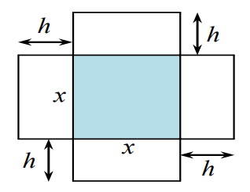
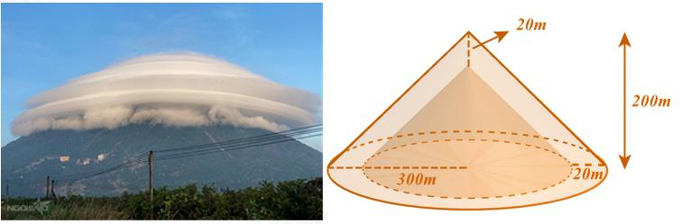
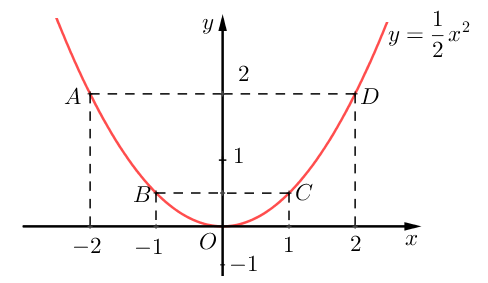
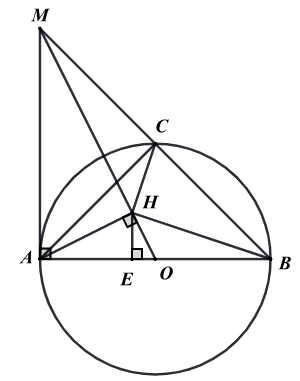

# De Tham Khao Thi Vao 10 Mon Toan Tp Ho Chi Minh Nam 2025 De So 6 1744346199

Câu 1 (1,5 điểm): Cho parabol 2 1 ( ) : 2 P y x  . a) Vẽ ( ) P trên mặt phẳng tọa độ Oxy .
b) Tìm giá trị của m để điểm 
 3 ; A m m thuộc (P).
Câu 2 (1 điểm): Cho phương trình 2 3 5 4 0 x x - -


a) Chứng minh phương trình có 2 nghiệm phân biệt.
b) Hãy tính giá trị của biểu thức
    1 1 2 2 12 12 P x x x x  -

- .
Câu 3 (1,5 điểm): Biểu đồ cột kép ở hình sau biểu diễn số lượng học sinh tham gia giải thi đấu thể thao của trường THCS A.

a) Tính tổng số học sinh của trường THCS A tham gia giải thi đấu thể thao.
b) Chọn ngẫu nhiên một học sinh tham gia giải thi đấu thể thao của trường đó. Tính xác suất của mỗi biến cố
sau:
A: “Học sinh được chọn là nam”.
B: “Học sinh được là nữ và không thuộc khối 9”.
Câu 4 (1 điểm): Một hình hộp không có nắp được làm từ một mảnh bìa giấy theo như hình vẽ. Hộp có đáy là một hình vuông cạnh x cm, chiều cao 10 h  cm.

7 9 9 9 9 7 8 8 0 2 4 6 8 10 6 7 8 9 Số học sinh Khối Số học sinh tham gia giải thi đấu thể thao của trường THCS A Nam Nữ ĐỀ THAM KHẢO THI TUYỂN SINH VÀO 10 - ĐỀ SỐ 6 MÔN TOÁN Thời gian: 120 phút BIÊN SOẠN: BAN CHUYÊN MÔN LOIGIAIHAY.COM

a) Viết công thức A biểu diễn theo x diện tích xung quanh của chiếc hộp.
b) Biết rằng tổng diện tích xung quanh và diện tích đáy của chiếc hộp là
2 225cm . Tính độ dài cạnh đáy chiếc hộp.
Câu 5 (1 điểm): Vừa qua trên mạng xã hội, nhiều người truyền tai nhau hình ảnh về một hiện tượng tự nhiên vô cùng kỳ lạ, xuất hiện vào sáng ngày 24/11/2022. Được biết, bức ảnh này được chụp lại núi Bà Đen, một địa điểm du lịch vô cùng nổi tiếng của Tây Ninh.

Trong hình ảnh, đỉnh núi được bao phủ bởi một lớp mây trắng xóa. Không chỉ có vậy, những đám mây còn tạo thành một lớp "vỏ" có phần kỳ bí. Nhiều người gọi đây là hiện tượng "mây vờn", có người nhận xét trông đám mây như một chiếc nón. Ước tính chiều cao của nón lớn là 200m, bán kính đáy của nón lớn là 300m , độ dày đám mây là 20 l m  . Với 3 1m mây chứa 0,5 gam nước. Hỏi đám mây trên chứa bao nhiêu kilôgam nước? (làm tròn đến hàng đơn vị của kilôgam) Biết thể tích hình nón là 2 1 3 V R h \pi  (trong đó R là bán kính đường tròn đáy; h là chiều cao hình nón, lấy 3,14 \pi ). Giả sử phần núi bị bao phủ cũng là một hình nón.
Câu 6 (1 điểm): Một xí nghiệp dự tính chuyển hàng bằng hai xe tải và đang phân vân giữa việc mua hẳn hai chiếc xe tải hoặc thuê hai xe tải. Nếu mua hai xe với giá mỗi xe là 200 triệu đồng thì mỗi ngày xí nghiệp phải tốn 5 triệu đồng cho tất cả tài xế và nhiên liệu. Còn nếu thuê xe thì giá thuê một xe tải là 10 triệu đồng/ngày (đã bao gồm tiền công cho tài xế và nhiên liệu).
a) Trong trường hợp xí nghiệp quyết định mua và xe tải mới mua cần phải bảo dưỡng định kì, xí nghiệp sẽ
sử dụng kết hợp cả xe tải mua và xe tải thuê. Khi đó, tổng chi phí vận chuyển cho một đợt chuyển hàng 300 ngày là 4 tỉ đồng (bao gồm cả tiền mua xe). Hãy tính số ngày sử dụng xe tải mua và số ngày sử dụng xe tải thuê trong đợt chuyển hàng này.
b) Trong trường hợp xí nghiệp vẫn đang phân vân giữa việc mua xe và thuê xe thì sau bao nhiêu ngày
phương án mua xe sẽ tiết kiệm hơn phương án thuê xe?
Câu 7 (3 điểm): Cho đường tròn   ;
O R đường kính AB . Trên tiếp tuyến tại A , lấy M sao cho 2 AM R  , MB cắt đường tròn  O tại C . a) Kẻ AH OM \perp tại H. Chứng minh tứ giác AMCH nội tiếp.
b) Chứng minh
2 . MA MB MC  và 2 2 MB AB MC AC  .
c) Chứng minh HB
HC \perp và tính diện tích tứ giác BCHO theo R .

---
*------------------- HẾT -------------------*

---

## 📖 ĐÁP ÁN & HƯỚNG DẪN GIẢI CHI TIẾT

<b>Click để xem lời giải chi tiết 🔍</b>

b) Tìm giá trị của m để điểm 
 3 ; A m m thuộc (P). Phương pháp
a) Lập bảng giá trị, vẽ đồ thị hàm số trên hệ trục tọa độ.
b) Thay toạ độ điểm m vào (P) và giải phương trình để tìm m.

**Lời giải**

a) Ta có bảng giá trị sau:
x 2 - 1 - 0 1 2 2 1 2 y x 

2 1 2

0 1 2

2 Đồ thị hàm số là đường cong parabol đi qua các điểm       0;0 ; 2;2 ; 1; ; 1; ; 1 1 2 2 2;2 O A B C D ( ) ( ) - - ( ) ( ) ( ) ( )

Ta vẽ được đồ thị hàm số 2 1 2 y x  như sau:

b) Vì 
  3 ; A m m P \in nên ta có: 3 2 3 2 2 1 2 1 0 2 1 0 2 m m m m m m  -
 ( ) -
 ( ) ( )

2 0 m  hoặc 1 0 2 m -


0 m  (TM) hoặc 1 2 m  (TM) Vậy 0 m  ; 1 2 m  thì điểm   3 ; A m m thuộc (P).
Câu 2 (1 điểm): Cho phương trình 2 3 5 4 0 x x - -


a) Chứng minh phương trình có 2 nghiệm phân biệt.
b) Hãy tính giá trị của biểu thức
    1 1 2 2 12 12 P x x x x  -

- . Phương pháp

4 a) Sử dụng 0 ac < để chứng minh phương trình có hai nghiệm phân biệt.
b) Áp dụng định lí Viète và biến đổi P để xuất hiện tổng và tích của hai nghiệm.
Định lí Viète:
1 2 1 2 ; b c x x x x a a -
   . Lời giải a) Ta có: 3, 5, 4 a b c  -
-
Vì   . 3. 4 12 0 a c  -
-
< nên phương trình luôn có hai nghiệm phân biệt 1 2 ; x x .
b) Theo định lí Viète, ta có:
1 2 1 2 5 5 4 ; 3 3 3 b c x x x x a a - -
 -
-
   . Ta có:
          1 1 2 2 2 1 1 2 2 2 2 1 2 1 2 2 1 2 1 2 1 2 2 2 12 12 12 12 12 2 12 5 4 5 131 2. 12. 3 3 3 9 P x x x x x x x x x x x x x x x x x x  -
 -
 -
 -
  -
 
- -

- ( ) ( ) - -
-
( ) (  ) ( (  ) )

Vậy 131 9 P -
.
Câu 3 (1,5 điểm): Biểu đồ cột kép ở hình sau biểu diễn số lượng học sinh tham gia giải thi đấu thể thao của trường THCS A.

a) Tính tổng số học sinh của trường THCS A tham gia giải thi đấu thể thao.
b) Chọn ngẫu nhiên một học sinh tham gia giải thi đấu thể thao của trường đó. Tính xác suất của mỗi biến cố
sau:
A: “Học sinh được chọn là nam”.
B: “Học sinh được là nữ và không thuộc khối 9”.

**Phương pháp**

a) Tổng số học sinh của trường tham gia giải thi đấu thể thao bằng tổng số học sinh 4 khối tham gia.
b) Xác định số kết quả thuận lợi cho biến cố.
Xác suất của biến cố bằng tỉ số giữa số kết quả thuận lợi và số phần tử của không gian mẫu (tổng số học sinh của trường). Lời giải
a) Nhìn vào biểu đồ ta thấy:
7 9 9 9 9 7 8 8 0 2 4 6 8 10 6 7 8 9 Số học sinh Khối Số học sinh tham gia giải thi đấu thể thao của trường THCS A Nam Nữ

- Lớp 6 có tất cả: 7 nam + 9 nữ = 16 (học sinh)
- Lớp 7 có tất cả: 9 nam + 7 nữ = 16 (học sinh)
- Lớp 8 có tất cả: 9 nam + 8 nữ = 17 (học sinh)
- Lớp 9 có tất cả: 9 nam + 8 nữ = 17 (học sinh)
Tổng số học sinh của trường THCS A tham gia giải thi đấu thể thao là:
16 + 16 + 17 + 17 = 66 (học sinh) Vậy có 66 học sinh của trường THCS A tham gia giải thi đấu thể thao.
b) Số kết quả thuận lợi cho biến cố A: “Học sinh được chọn là nam” là:
7 + 9 + 9 + 9 = 34 (học sinh) Xác suất để biến cố A xảy ra là:  34 17 66 33 P A   .
Số kết quả thuận lợi cho biến cố B: “Học sinh được là nữ và không thuộc khối 9” là:
9 + 7 + 8 = 24 (học sinh) Xác suất để biến cố B xảy ra là:
 24 4 66 11 P B   .
Câu 4 (1 điểm): Một hình hộp không có nắp được làm từ một mảnh bìa giấy theo như hình vẽ. Hộp có đáy là một hình vuông cạnh x cm, chiều cao 10 h  cm.

a) Viết công thức A biểu diễn theo x diện tích xung quanh của chiếc hộp.
b) Biết rằng tổng diện tích xung quanh và diện tích đáy của chiếc hộp là
2 225cm . Tính độ dài cạnh đáy chiếc hộp. Phương pháp Hình hộp không có nắp:
- Đáy là hình vuông cạnh x cm
- Chiều cao 10
h  cm
a) Sử dụng công thức tính diện tích xung quanh của hình hộp chữ nhật:
xq S  Chu vi đáy. chiều cao.
b) Viết phương trình biểu diễn tổng diện tích xung quanh và diện tích đáy của chiếc hộp. Từ đó tìm cạnh đáy
x của chiếc hộp.

**Lời giải Diện tích xung quanh của chiếc hộp là:**

  2 . 4 .10 40 xq day S C h x x cm   

Vậy 40 A x  .
b) Điều kiện:
* x N \in .
Diện tích đáy của chiếc hộp là:
2 day S x 

Vì tổng diện tích xung quanh và diện tích đáy của chiếc hộp là 2 225cm nên ta có phương trình:
2 40 225 x x  

6 2 40 225 0 x x  -


Ta có: 40 1; ' 20; 225 2 2 b a b c     -
. Do đó 2 ' 20 1 ( 225) 400 225 625 0 \Delta
- \cdot -
   > nên phương trình có hai nghiệm phân biệt    1 2 20 625 45 ; 20 625 5 x L x TM -
-
 -
   -

Vậy độ dài cạnh đáy là 5cm.
Câu 5 (1 điểm): Vừa qua trên mạng xã hội, nhiều người truyền tai nhau hình ảnh về một hiện tượng tự nhiên vô cùng kỳ lạ, xuất hiện vào sáng ngày 24/11/2022. Được biết, bức ảnh này được chụp lại núi Bà Đen, một địa điểm du lịch vô cùng nổi tiếng của Tây Ninh.

Trong hình ảnh, đỉnh núi được bao phủ bởi một lớp mây trắng xóa. Không chỉ có vậy, những đám mây còn tạo thành một lớp "vỏ" có phần kỳ bí. Nhiều người gọi đây là hiện tượng "mây vờn", có người nhận xét trông đám mây như một chiếc nón. Ước tính chiều cao của nón lớn là 200m, bán kính đáy của nón lớn là 300m , độ dày đám mây là 20 l m  . Với 3 1m mây chứa 0,5 gam nước. Hỏi đám mây trên chứa bao nhiêu kilôgam nước? (làm tròn đến hàng đơn vị của kilôgam) Biết thể tích hình nón là 2 1 3 V R h \pi  (trong đó R là bán kính đường tròn đáy; h là chiều cao hình nón, lấy 3,14 \pi ). Giả sử phần núi bị bao phủ cũng là một hình nón. Phương pháp Hình nón lớn bao gồm thể tích của phần núi bị bao phủ bởi mây (hình nón nhỏ) và thể tích đám mây.
Sử dụng công thức tính thể tích hình nón để tính thể tích hình nón lớn, hình nón nhỏ.
Từ đó tính được thể tích đám mây = thể tích hình nón lớn - thể tích hình nón nhỏ.
Lượng nước mà đám mây có thể chứa = thể tích đám mây. 0,5 (g) Đổi đơn vị về kg.

**Lời giải Hình nón lớn bao gồm thể tích của phần núi bị bao phủ bởi mây (hình nón nhỏ) và thể tích đám mây.**

Thể tích hình nón lớn là:
  2 2 3 1 1 1.3,14.300 .200 18840000 3 3 V R h m \pi   

Bán kính đáy của hình nón nhỏ là:
 300 20 280 m -


Chiều cao của hình nón nhỏ là:
 200 20 180 m -


Thể tích hình nón nhỏ là:
  2 2 3 2 1 1.3,14.280 .180 14770560 3 3 V r h m \pi   

7 Thể tích đám mây là:
  3 1 2 18840000 14770560 4069440 V V V m  -
 -


Lượng nước mà đám mây có thể chứa    4069440.0,5 2034720 2035 V g kg   

Vậy lượng nước mà đám mây có thể chứa khoảng 2035 kilôgam.
Câu 6 (1 điểm): Một xí nghiệp dự tính chuyển hàng bằng hai xe tải và đang phân vân giữa việc mua hẳn hai chiếc xe tải hoặc thuê hai xe tải. Nếu mua hai xe với giá mỗi xe là 200 triệu đồng thì mỗi ngày xí nghiệp phải tốn 5 triệu đồng cho tất cả tài xế và nhiên liệu. Còn nếu thuê xe thì giá thuê một xe tải là 10 triệu đồng/ngày (đã bao gồm tiền công cho tài xế và nhiên liệu).
a) Trong trường hợp xí nghiệp quyết định mua và xe tải mới mua cần phải bảo dưỡng định kì, xí nghiệp sẽ
sử dụng kết hợp cả xe tải mua và xe tải thuê. Khi đó, tổng chi phí vận chuyển cho một đợt chuyển hàng 300 ngày là 4 tỉ đồng (bao gồm cả tiền mua xe). Hãy tính số ngày sử dụng xe tải mua và số ngày sử dụng xe tải thuê trong đợt chuyển hàng này.
b) Trong trường hợp xí nghiệp vẫn đang phân vân giữa việc mua xe và thuê xe thì sau bao nhiêu ngày
phương án mua xe sẽ tiết kiệm hơn phương án thuê xe?

**Phương pháp**

a) Gọi số ngày sử dụng xe tải mua và số ngày sử dụng xe tải thuê lần lượt là x và y (đơn vị: ngày), điều
kiện: * ,x y \in và , 300 x y < .
Viết phương trình biểu diễn tổng số ngày vận chuyển.
Chi phí sử dụng xe mua = chi phí mua 2 xe + chi phí x ngày xí nghiệp tốn cho tất cả tài xế và nghiên liệu.
Chi phí sử dụng xe thuê = 2. chi phí thuê xe trong y ngày (vì thuê 2 xe).
Từ đó viết phương trình biểu diễn tổng chi phí vận chuyển cho 300 ngày.
Lập hệ phương trình, giải hệ phương trình tìm được.
Kiểm tra lại điều kiện của ,x y .
b) Gọi số ngày chuyển hàng là n 

* n \in .
Tính chi phí theo phương án mua xe, thuê xe.
Lập bất phương trình biểu diễn: chi phí phương án mua xe < chi phí phương án thuê xe.
Giải bất phương trình để tìm n.

**Lời giải**

a) Gọi số ngày sử dụng xe tải mua và số ngày sử dụng xe tải thuê lần lượt là x và y (đơn vị: ngày), điều
kiện: * ,x y \in và , 300 x y < .
Vì tổng số ngày sử dụng xe tải mua và số ngày sử dụng xe tải thuê là 300 ngày nên ta có phương trình:
300 x y   . (1) Chi phí sử dụng xe tải mua (bao gồm cả tiền mua xe) là: 2.200 5 400 5 x x    (đồng) Chi phí sử dụng xe tải thuê là: 2.10 20 y y  (đồng) Vì tổng chi phí vận chuyển là 4 tỉ đồng = 4 000 triệu đồng (bao gồm cả tiền mua xe) nên ta có phương trình:
400 5 20 4000 x y    hay 5 20 3600 x y   . (2) Từ (1) và (2) ta có hệ phương trình:
300 5 20 3600 x y x y   \begin{cases}

  \end{cases} .
Giải hệ phương trình, ta được 160 140 x y  \begin{cases}

 \end{cases} (TM) Vậy xí nghiệp sử dụng xe tải mua 160 ngày và xe tải thuê 140 ngày.
b) Gọi số ngày chuyển hàng là n 

* n \in .

8 Chi phí sử dụng xe mua (bao gồm cả tiền mua xe) sau n ngày là: 2.200 5 400 5 n n    (triệu đồng) Chi phí sử dụng xe thuê sau n ngày là: 2.10.
20 n n  (triệu đồng) Phương án mua xe sẽ tiết kiệm hơn phương án thuê xe khi:
400 5 20 400 15 26,67 n n n n  < < >

Suy ra 27 n \ge

Vậy sau 27 ngày thì phương án mua xe sẽ tiết kiệm hơn phương án thuê xe.
Câu 7 (3 điểm): Cho đường tròn   ;
O R đường kính AB . Trên tiếp tuyến tại A , lấy M sao cho 2 AM R  , MB cắt đường tròn  O tại C . a) Kẻ AH OM \perp tại H. Chứng minh tứ giác AMCH nội tiếp.
b) Chứng minh
2 . MA MB MC  và 2 2 MB AB MC AC  .
c) Chứng minh HB
HC \perp và tính diện tích tứ giác BCHO theo R .

**Phương pháp**

a) Chứng minh MAC
\Delta và MAH \Delta nội tiếp đường tròn đường kính AM, suy ra A, M, C, H cùng thuộc đường tròn đường kính AM nên tứ giác AMCH nội tiếp.
b) Chứng minh
2 . MA MB MC 

Chứng minh MAC MBA \Delta \Delta \backsim (g.g) suy ra tỉ số bằng nhau giữa các cặp cạnh tương ứng.
Chứng minh 2 2 MB AB MC AC 

Chứng minh ABM \Delta vuông cân tại A nên AC vừa là đường cao vừa là đường trung tuyến Suy ra 2 MB MC 

Sử dụng tính chất đường trung tuyến ứng với cạnh huyền suy ra AB CB 

Áp dụng định lí Pythagore vào CAB \Delta vuông cân tại C suy ra 2 2 2 AB AC 

Do đó 2 2 2 MB AB MC AC  

c) Chứng minh HB
HC \perp

Áp dụng định lí Pythagore vào AOM \Delta vuông tại A để tính cạnh huyền OM.
Chứng minh HOA AOM \Delta \Delta \backsim (g. g) suy ra tỉ số bằng nhau giữa các cặp cạnh tương ứng để tính HA theo R. Chứng minh AOM HAM \Delta \Delta \backsim (g. g) suy ra tỉ số bằng nhau giữa các cặp cạnh tương ứng để tính HM theo R. Do đó HOA HAM \Delta \Delta \backsim

Chứng minh HA AC HM MB 

Suy ra MHB AHC \Delta \Delta \backsim (c.g.c) suy ra MHB AHC  (cặp góc tương ứng) Hai góc có chung góc MHC nên 90 CHB AHM   ^\circ suy ra HB HC \perp

Tính diện tích tứ giác BCHO theo R

9 Từ H kẻ HE AO \perp

Chứng minh HOA HOB S S \Delta \Delta 

Vì HOA AOM \Delta \Delta \backsim (cmt) suy ra tỉ số diện tích hai tam giác đồng dạng HOA S\Delta và AOM S\Delta

Áp dụng định lí Pythagore vào ABC \Delta vuông cân tại C để tính BC.
Chứng minh HAB HBC 

Suy ra chứng minh HAO HBC \Delta \Delta \backsim (g.g) .
Biểu diễn tỉ số diện tích hai tam giác đồng dạng HBC S\Delta và HAO S\Delta

Ta có: BCHO HBC HOB S S S \Delta \Delta   , biến đổi về AOM S\Delta , ta tính được BCHO S . Lời giải

a) Ta có 90
ACB  ^\circ (góc nội tiếp chắn nửa đường tròn) nên 90 ACM  ^\circ Xét MAC \Delta vuông tại C   90 ACM  ^\circ nên MAC \Delta nội tiếp đường tròn đường kính AM, suy ra M, A, C cùng thuộc đường tròn đường kính AM.
Xét MAH \Delta vuông tại H   AH OM \perp nên MAH \Delta nội tiếp đường tròn đường kính AM, suy ra M, A, H cùng thuộc đường tròn đường kính AM.
Vậy A, M, C, H cùng thuộc đường tròn đường kính AM hay tứ giác AMCH nội tiếp.
b) Chứng minh
2 . MA MB MC 

Xét MAC \Delta và MBA \Delta có: AMB chung   90 MCA MAB   ^\circ Nên MAC MBA \Delta \Delta \backsim (g.g) Suy ra MA MC MB MA  hay 2 . MA MB MC 

Chứng minh 2 2 MB AB MC AC 

10 Xét ABM \Delta có: 90 MAB  ^\circ và AB = AM = 2R nên ABM \Delta vuông cân tại A Vì 90 ACM  ^\circ nên AC là đường cao, do đó AC cũng là đường trung tuyến Suy ra 1 2 MC CB MB   (C là trung điểm của BM) hay 2 MB MC  (1) và 1 2 AC CM CB MB    (tính chất đường trung tuyến ứng với cạnh huyền) Áp dụng định lí Pythagore vào CAB \Delta vuông cân tại C, ta có:
2 2 2 AB AC CB  

2 2 2 AB AC  (do AC = CB) Suy ra 2 2 2 AB AC  (2) Từ (1) và (2) suy ra 2 2 2 MB AB MC AC  

c) Chứng minh HB
HC \perp

Áp dụng định lí Pythagore vào AOM \Delta vuông tại A nên 2 2 2 OM AM AO  

2 2 2 2 4 5 OM AM AO R R R     

Xét HOA \Delta và AOM \Delta có:
  90 AHO MAO   ^\circ AOH chung nên HOA AOM \Delta \Delta \backsim (g. g) suy ra 1 5 5 HO HA OA R AO AM OM R    

do đó 2 5 5 AM R HA  

Xét AOM \Delta và HAM \Delta có:
  90 MAO MHA   ^\circ AMH chung nên AOM HAM \Delta \Delta \backsim (g. g) suy ra 5 5 2 2 AO AM OM R HA HM AM R    

do đó 2 4 5 5 AM R HM  

Vì HOA AOM \Delta \Delta \backsim và AOM HAM \Delta \Delta \backsim nên HOA HAM \Delta \Delta \backsim

Do đó 2 4 1 : 2 5 5 HO OA HA R R HA AM HM     (3) Mặt khác, 1 2 AC MB  (cmt) nên 1 2 AC MB  (4) Từ (3) và (4) suy ra:
1 2 HA AC HM MB ( )   ( ) ( )

Xét MHB \Delta và AHC \Delta có:

11 BMH CAH  (cùng chắn cung HC) HA AC HM MB  (cmt) Nên MHB AHC \Delta \Delta \backsim (c.g.c) suy ra MHB AHC  (cặp góc tương ứng) Mà MHB MHC CHB   ; AHC MHC AHM  

Suy ra 90 CHB AHM   ^\circ Vậy HB HC \perp

Tính diện tích tứ giác BCHO theo R .
Từ H kẻ HE AO \perp

Ta có 1 . 2 HOA S HE AO \Delta  ; 1 . 2 HOB S HE BO \Delta  ( AO BO R   ) Nên HOA HOB S S \Delta \Delta 

Vì HOA AOM \Delta \Delta \backsim (cmt) nên 2 2 1 5 5 HOA AOM S OA R S OM R \Delta \Delta ( ) ( )    ( ) ( ) ( ) ( ) , suy ra 1 5 HOA AOM S S \Delta \Delta 

Xét ABC \Delta có 90 ACB  ^\circ, AC  = BC nên ABC \Delta vuông cân tại C. Áp dụng định lí Pythagore, ta có:
2 2 2 2 2 2 2 2 2 2 4 2 2 2 AC BC AB BC AB AB R BC R      

Suy ra 2 2 2 BC R R  

Ta có: AMH ACH  (hai góc nội tiếp chắn cung AH) Mà AMH HAO  (do HOA AOM \Delta \Delta \backsim ) nên HCA HAO  hay HCA HAB 

Mà MHB AHC \Delta \Delta \backsim nên HCA HBC  (hai góc tương ứng) Suy ra HAB HBC 

Xét HAO \Delta và HBC \Delta có: 90 AHO CHB   ^\circ HAO HBC  (do HAB HBC  ) nên HAO HBC \Delta \Delta \backsim (g.g) suy ra 1 2 2 HA HO AO R HB HC BC R    

Do đó 2 1 1 2 2 HAO HBC S S \Delta \Delta ( )   ( ) ( ) , suy ra 2 HBC HAO S S \Delta \Delta 

Ta có: BCHO HBC HOB S S S \Delta \Delta  

2 BCHO HAO HOA S S S \Delta \Delta  

3 BCHO HAO S S\Delta 

1 3 3.5 5 BCHO AOM AOM S S S \Delta \Delta  

12 Do đó 2 3 1 3 1 3 . . . . .2 . 5 2 5 2 5 BCHO S AM OA R R R   

