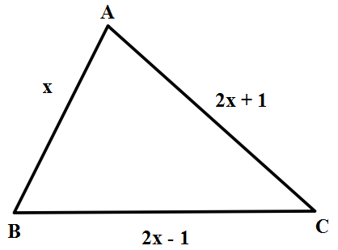
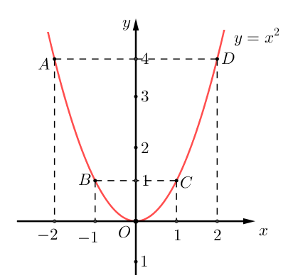
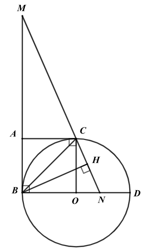

# De Tham Khao Thi Vao 10 Mon Toan Tp Ho Chi Minh Nam 2025 De So 7 1744883899

Câu 1 (1,5 điểm): Cho đồ thị hàm số 2 y x  có đồ thị  P .
a) Vẽ đồ thị 
P .
b) Tìm các điểm trên (P) (khác gốc tọa độ) cách đều hai trục tọa độ.
Câu 2 (1 điểm): Cho phương trình 2 4 6 0 x x - -
 .
a) Chứng minh phương trình trên có hai nghiệm phân biệt
1 2 , x x .
b) Không giải phương trình, hãy tính giá trị của biểu thức
1 2 1 2 1 2 4 4 x x x x x x 
- - .
Câu 3 (1,5 điểm): Một trường THCS khảo sát thời gian tiếp xúc với các thiết bị điện tử (điện thoại thông minh, ipad, máy tính, ti vi) trung bình trong một ngày của 150 học sinh và biểu diễn kết quả thu được trong biểu đồ sau:

a) Lập bảng tần số cho dữ liệu được biểu diễn trên biểu đồ.
b) Nhiều nghiên cứu đã chỉ ra rằng việc trẻ em tiếp xúc các thiết bị điện tử quá nhiều có thể gây rối loạn giấc
ngủ, mỏi mắt, cận thị, cũng như đau cổ, vai, lưng. Ngoài ra, trẻ dễ mất tập trung, học tập kém, ít vận động, dễ béo phì và gặp các vấn đề tâm lý. Các chuyên gia khuyến nghị thời gian trẻ em tiếp xúc các thiết bị điện tử an toàn là ít hơn 2 giờ mỗi ngày.
Chọn ngẫu nhiên một học sinh. Xác suất của biến cố học sinh được chọn đã thực hiện đúng khuyến cáo trên là bao nhiêu?

15 36 48 39 12 0 10 20 30 40 50 60 0.5 1 2 3 4 Số học sinh Thời gian (giờ) Thời gian tiếp xúc với các thiết bị điện tử trung bình trong một ngày ĐỀ THAM KHẢO THI TUYỂN SINH VÀO 10 - ĐỀ SỐ 7 MÔN TOÁN Thời gian: 120 phút BIÊN SOẠN: BAN CHUYÊN MÔN LOIGIAIHAY.COM

2 Câu 4 (1 điểm): Cho tam giác ABC có độ dài các cạnh như hình vẽ.
a) Viết biểu thức biểu diễn chu vi C của tam giác theo x .
b) Tìm x để tam giác ABC vuông tại B?

Câu 5 (1 điểm): Một tháp nước có bể chứa hình cầu, đường kính bên trong của bể đo được là 6 m. (lấy 3,14 \pi , kết quả làm tròn đến hàng phần trăm).

a) Tính thể tích của bể chứa đó?
b) Biết rằng lượng nước đựng đầy trong bể đủ dùng cho một khu dân cư trong 5 ngày. Cho biết khu dân cư
có 1304 người. Hỏi trong một ngày mức bình quân mỗi người dùng bao nhiêu lít nước?
Câu 6 (1 điểm): Nhân dịp khai trương, một nhóm gia đình muốn mua vé vào khu vui chơi. Biết rằng, khu vui chơi đã đưa ra hai chương trình khuyến mãi như sau:
- Chương trình 1: mua vé người lớn với giá 100 000 đồng/1 vé thì sẽ được giảm 20 000 đồng cho mỗi vé trẻ
em giá 50 0000 đồng/1 vé.
- Chương trình 2: mua vé người lớn với giá 80 000 đồng/1 vé thì giá vé trẻ em là 50 000 đồng/1 vé.
a) Nếu nhóm gia đình chọn mua theo chương trình 1 thì số tiền họ phải trả là 1 000 000 đồng, nếu nhóm gia
đình chọn mua theo chương trình 2 thì số tiền họ phải trả là 1 060 000 đồng. Hỏi nhóm gia đình có bao nhiêu người.
b) Một nhóm gia đình khác gồm a người lớn và 4 trẻ em. Hỏi nhóm người này phải có tối thiểu là bao
nhiêu người lớn để chọn chương trình 2 có lợi hơn chương trình 1?
Câu 7 (3 điểm): Cho đường tròn (O) đường kính BD = 2R, trên tiếp tuyến tại B của đường tròn (O) lấy điểm A sao cho BA = R. Từ A vẽ tiếp tuyến AC của (O) (C là tiếp điểm và C khác B). Một đường thẳng qua C lần lượt cắt tia BA và tia BO tại M và N. Vẽ BH vuông góc MN tại H.
a) Chứng minh OBAC là hình vuông và 5 điểm O, B, A, C, H cùng thuộc một đường tròn.
b) Chứng minh
2 . AM ON R  .
c) Tính độ dài AM và ON theo R biết diện tích tam giác MBN bằng
2 9 4 R .

---
*------------------- HẾT -------------------*

---

## 📖 ĐÁP ÁN & HƯỚNG DẪN GIẢI CHI TIẾT

<b>Click để xem lời giải chi tiết 🔍</b>

a) Vẽ đồ thị 
P .
b) Tìm các điểm trên (P) (khác gốc tọa độ) cách đều hai trục tọa độ.

**Phương pháp**

a) Lập bảng giá trị, vẽ đồ thị hàm số trên hệ trục tọa độ.
b) Điểm
  ; M M M x y thuộc  P cách đều hai trục toạ độ thì M M x y  . Lời giải
a) Ta có bảng giá trị sau:
x 2 - 1 - 0 1 2 2 y x 

4 1 0 1 4 Đồ thị hàm số là đường cong parabol đi qua các điểm           0;0 , 2;4 , 1;1 , 1;1 , 2;4 O A B C D - - .
Ta vẽ được đồ thị hàm số 2 y x  như sau:

b) Gọi
  ; M M M x y là điểm thuộc  P cách đều hai trục tọa độ.
Khoảng cách từ điểm M đến trục hoành là:
M x .
Khoảng cách từ điểm M đến trục tung là:
2 M M y x 

Vì điểm M cách đều hai trục toạ độ nên ta có:
M M x y  hay 2 M M x x  suy ra 2 M M x x  . Do đó 0 M x  hoặc 1 M x  (vì 2 2 0 0; 1 1  \pm ) Suy ra 0 M x  hoặc 1 M x  hoặc 1 M x -
+ Với 0 M x  thì 0 M y  , ta được điểm   0;0 M trùng với gốc toạ độ. (loại) + Với 1 M x  thì 21 1 M y  , ta được điểm   1;1 M (thoả mãn) + Với 1 M x - thì   2 1 1 M y -
, ta được điểm   1;1 M - (thoả mãn) Vậy các điểm   1;1 M và   1;1 M -
cách đều hai trục tọa độ.
Câu 2 (1 điểm): Cho phương trình 2 4 6 0 x x - -
 .
a) Chứng minh phương trình trên có hai nghiệm phân biệt
1 2 , x x .

b) Không giải phương trình, hãy tính giá trị của biểu thức
1 2 1 2 1 2 4 4 x x x x x x 
- - . Phương pháp a) Sử dụng 0 ac <
để chứng minh phương trình có hai nghiệm phân biệt.
b) Áp dụng định lí Viète và biến đổi P để xuất hiện tổng và tích của hai nghiệm.
Định lí Viète:
1 2 1 2 ; b c x x x x a a -
   . Lời giải a) Ta có: 1, 4, 6 a b c  -
-
Vì   . 1. 6 6 0 a c  -
- < nên phương trình luôn có hai nghiệm phân biệt 1 2 ; x x .
b) Theo định lí Viète, ta có:
1 2 1 2 4 4 1 6 6 1 x x x x -
\begin{cases}  -
  -
  -
\end{cases}

Ta có: 1 2 1 2 1 2 4 4 x x x x x x 
- -

             1 2 1 2 2 1 1 2 1 2 1 2 1 2 1 2 1 2 1 1 4 4 4 4 4 4 8 16 4 8 4 6 .16 4.4 6 6 .4 6 4 x x x x x x x x x x x x x x x x x x ( )   ( ) - - ( ) -
 -

- - -
  -
  -
-
-
-
-
 -


Vậy 1 2 1 2 1 2 4 4 4 x x x x x x  
- -

Câu 3 (1,5 điểm): Một trường THCS khảo sát thời gian tiếp xúc với các thiết bị điện tử (điện thoại thông minh, ipad, máy tính, ti vi) trung bình trong một ngày của 150 học sinh và biểu diễn kết quả thu được trong biểu đồ sau:

a) Lập bảng tần số cho dữ liệu được biểu diễn trên biểu đồ.
b) Nhiều nghiên cứu đã chỉ ra rằng việc trẻ em tiếp xúc các thiết bị điện tử quá nhiều có thể gây rối loạn giấc
ngủ, mỏi mắt, cận thị, cũng như đau cổ, vai, lưng. Ngoài ra, trẻ dễ mất tập trung, học tập kém, ít vận động, dễ béo phì và gặp các vấn đề tâm lý. Các chuyên gia khuyến nghị thời gian trẻ em tiếp xúc các thiết bị điện tử an toàn là ít hơn 2 giờ mỗi ngày.
Chọn ngẫu nhiên một học sinh. Xác suất của biến cố học sinh được chọn đã thực hiện đúng khuyến cáo trên là bao nhiêu?

**Phương pháp**

a) Dựa vào biểu đồ cột để xác định tần số tương ứng của các giá trị và lập bảng tần số theo mẫu:
Giá trị (thời gian) … … … … … Tần số (số học sinh) … … … … …
b) Xác định số kết quả có thể khi chọn ngẫu nhiên một học sinh (tổng số học sinh).
Xác định số kết quả thuận lợi cho biến cố học sinh được chọn đã thực hiện đúng khuyến cáo trên (tiếp xúc các thiết bị điện tử an toàn là ít hơn 2 giờ mỗi ngày).
Xác suất của biến cố bằng tỉ số giữa số kết quả thuận lợi cho biến cố với số kết quả có thể khi chọn ngẫu nhiên một học sinh.

**Lời giải**

a) Ta có bảng tần số sau:
Giá trị 0,5 1 2 3 4 Tần số 15 36 48 39 12
b) Tổng số học sinh được khảo sát là:
15 + 36 + 48 + 39 + 12 = 150 (học sinh) Theo khuyến nghị, thời gian trẻ em tiếp xúc các thiết bị điện tử an toàn là ít hơn 2 giờ mỗi ngày nên các học sinh thực hiện đúng khuyến cáo nằm trong các giá trị 0,5; 1.
Số kết quả thuận lợi cho biến cố học sinh được chọn đã thực hiện đúng khuyến cáo trên là:
15 + 36 = 51.
Vậy xác suất của biến cố học sinh được chọn đã thực hiện đúng khuyến cáo trên là: 51 17 150 50  .
Câu 4 (1 điểm): Cho tam giác ABC có độ dài các cạnh như hình vẽ.
a) Viết biểu thức biểu diễn chu vi C của tam giác theo x .
b) Tìm x để tam giác ABC vuông tại B?
15 36 48 39 12 0 10 20 30 40 50 60 0.5 1 2 3 4 Số học sinh Thời gian (giờ) Thời gian tiếp xúc với các thiết bị điện tử trung bình trong một ngày

**Phương pháp**

a) Biểu diễn chu vi tam giác bằng tổng các cạnh của tam giác.
b) Để tam giác ABC vuông tại B thì tổng bình phương hai cạnh AB và BC bằng bình phương cạnh AC.
Từ đó giải phương trình bậc hai ẩn x .

**Lời giải**

a) Biểu thức biểu diễn chu vi C của tam giác ABC là:
   2 1 2 1 2 1 2 1 5 C x x x x x x x     -
   -

b) Để tam giác ABC vuông tại B thì theo định lí Pythagore đảo, ta có:
2 2 2 AB BC AC  

      2 2 2 2 2 2 2 2 1 2 1 4 4 1 4 4 1 8 0 8 0 x x x x x x x x x x x x  -
   -
   -
 -


0 x  (loại do x là độ dài cạnh nên 0 x > ) hoặc 8( ) x TM 

Vậy với 8 x  thì tam giác ABC vuông tại B.
Câu 5 (1 điểm): Một tháp nước có bể chứa hình cầu, đường kính bên trong của bể đo được là 6 m. (lấy 3,14 \pi , kết quả làm tròn đến hàng phần trăm).

a) Tính thể tích của bể chứa đó?
b) Biết rằng lượng nước đựng đầy trong bể đủ dùng cho một khu dân cư trong 5 ngày. Cho biết khu dân cư
có 1304 người. Hỏi trong một ngày mức bình quân mỗi người dùng bao nhiêu lít nước?

**Phương pháp**

a) Tính bán kính bể chứa nước.

7 Tính thể tích bể chứa nước bằng công thức tính thể tích hình cầu:
3 4 3 V R \pi  .
b) Đổi thể tích về đơn vị lít:
3 1 1000 m  lít.
Tính lượng nước bình quân khu dân cư sử dụng trong một ngày, lượng nước bình quân mỗi người sử dụng trong một ngày.

**Lời giải**

a) Bán kính bể chứa nước là: 6:2
3  (m) Thể tích của bể chứa nước là:
  3 3 3 4 4 3,14.3 113,04 3 3 V R m \pi    .
Vậy thể tích của bể chứa nước là khoảng 3 113,04m . b) Đổi: 3 113,04 113040 m  lít Lượng nước bình quân khu dân cư sử dụng trong một ngày là:
113040:5 22608  (lít).
Lượng nước bình quân mỗi người sử dụng trong một ngày là:
22608:1304 17,34  (lít).
Vậy lượng nước bình quân mỗi người sử dụng trong một ngày là khoảng 17,34 lít.
Câu 6 (1 điểm): Nhân dịp khai trương, một nhóm gia đình muốn mua vé vào khu vui chơi. Biết rằng, khu vui chơi đã đưa ra hai chương trình khuyến mãi như sau:
- Chương trình 1: mua vé người lớn với giá 100 000 đồng/1 vé thì sẽ được giảm 20 000 đồng cho mỗi vé trẻ
em giá 50 0000 đồng/1 vé.
- Chương trình 2: mua vé người lớn với giá 80 000 đồng/1 vé thì giá vé trẻ em là 50 000 đồng/1 vé.
a) Nếu nhóm gia đình chọn mua theo chương trình 1 thì số tiền họ phải trả là 1 000 000 đồng, nếu nhóm gia
đình chọn mua theo chương trình 2 thì số tiền họ phải trả là 1 060 000 đồng. Hỏi nhóm gia đình có bao nhiêu người.
b) Một nhóm gia đình khác gồm a người lớn và 4 trẻ em. Hỏi nhóm người này phải có tối thiểu là bao
nhiêu người lớn để chọn chương trình 2 có lợi hơn chương trình 1?

**Phương pháp**

a) Gọi số người lớn và trẻ em của nhóm gia đình lần lượt là x và y (đơn vị: người), điều kiện:
* ,x y \in .
Biểu diễn số tiền mua vé người lớn, trẻ em theo chương trình 1 suy ra phương trình biểu diễn số tiền họ phải trả theo chương trình 1.
Biểu diễn số tiền mua vé người lớn, trẻ em theo chương trình 2 suy ra phương trình biểu diễn số tiền họ phải trả theo chương trình 2.
Từ đó lập được hệ phương trình và giải.
b) Biểu diễn số tiền mua vé người lớn, trẻ em theo chương trình 1, từ đó biểu diễn số tiền họ phải trả theo
chương trình 1.
Biểu diễn số tiền mua vé người lớn, trẻ em theo chương trình 2, từ đó biểu diễn số tiền họ phải trả theo chương trình 2.
Lập bất phương trình biểu diễn số tiền nhóm gia đình chọn chương trình 2 có lợi hơn chương trình 1:
Số tiền phải trả theo chương trình 1 > số tiền phải trả theo chương trình 2.
Giải bất phương trình.

**Lời giải**

a) Gọi số người lớn và trẻ em của nhóm gia đình lần lượt là x và y (đơn vị: người), điều kiện:
* ,x y \in .
Theo chương trình 1: số tiền mua vé người lớn là: 100000x (đồng);
số tiền mua vé trẻ em là: (50000
20000) 30000 y y -
 (đồng) Vì nếu nhóm gia đình chọn mua theo chương trình 1 thì số tiền họ phải trả là 1 000 000 đồng nên ta có phương trình:
100000 30000 1000000 x y   hay 10 3 100 x y   (1) Theo chương trình 2: số tiền mua vé người lớn là: 80000x (đồng);
số tiền mua vé trẻ em là: 50000y (đồng) Vì nếu nhóm gia đình chọn mua theo chương trình 2 thì số tiền họ phải trả là 1 060 000 đồng nên ta có phương trình:
80000 50000 1060000 x y   hay 8 5 106 x y   (2) Từ (1) và (2) ta có hệ phương trình: 10 3 100 8 5 106 x y x y     \begin{cases}

\end{cases} .
Giải hệ phương trình, ta được 7 10 x y  \begin{cases}

 \end{cases} (TM) Vậy nhóm gia đình có 7 người lớn và 10 trẻ em.
b) Theo chương trình 1: số tiền mua vé người lớn là: 100000a (đồng);
số tiền mua vé trẻ em là: (50000
20000).4 120000 -
 (đồng) Khi đó tổng số tiền mua vé theo chương trình 1 là: 100000 120000 a  (đồng) Theo chương trình 2: số tiền mua vé người lớn là: 80000a (đồng);
số tiền mua vé trẻ em là: 50000.4 200000  (đồng) Khi đó tổng số tiền mua vé theo chương trình 2 là: 80000 200000 a  (đồng) Nhóm gia đình chọn chương trình 2 có lợi hơn chương trình 1 thì ta có bất phương trình:
80000 200000 100000 120000 a a  < 

Giải bất phương trình:
100000 120000 80000 200000 100000 80000 200000 120000 20000 80000 80000 20000 4 a a a a a a a  > 
- > - > > >

Vậy nhóm người này phải có tối thiểu 5 người lớn để chọn chương trình 2 có lợi hơn chương trình 1.
Câu 7 (3 điểm): Cho đường tròn (O) đường kính BD = 2R, trên tiếp tuyến tại B của đường tròn (O) lấy điểm A sao cho BA = R. Từ A vẽ tiếp tuyến AC của (O) (C là tiếp điểm và C khác B). Một đường thẳng qua C lần lượt cắt tia BA và tia BO tại M và N. Vẽ BH vuông góc MN tại H.
a) Chứng minh OBAC là hình vuông và 5 điểm O, B, A, C, H cùng thuộc một đường tròn.
b) Chứng minh
2 . AM ON R  .
c) Tính độ dài AM và ON theo R biết diện tích tam giác MBN bằng
2 9 4 R . Phương pháp
a) Chứng minh OBAC là hình vuông

9 Chứng minh tứ giác OBAC là hình thoi có 1 góc vuông nên tứ giác OBAC là hình vuông.
Chứng minh 5 điểm O, B, A, C, H cùng thuộc một đường tròn OBAC là hình vuông nên nội tiếp đường tròn đường kính là đường chéo của hình vuông.
Chứng minh tam giác BHC vuông tại H nên điểm H thuộc đường tròn đường kính BC.
Do đó 5 điểm O, B, A, C, H cùng thuộc đường tròn đường kính BC.
b) Chứng minh
2 . AM ON R 

Chứng minh AC // BN (cùng vuông góc với AB) nên MA AC MB BN  suy ra . MB AC MA BN 

Chứng minh OC // BM (cùng vuông góc với BD) nên NO OC NB BM  suy ra . OC NB NO BM 

Suy ra 2 . AM ON R 

c) Tính độ dài AM và ON theo R biết diện tích tam giác MBN bằng
2 9 4 R Vì diện tích tam giác MBN bằng 2 9 4 R nên biểu diễn 2 1 9 . 2 4 MBN R BM N S B \Delta   .
Biến đổi để xuất hiện AM ON  theo R . Kết hợp với 2 . AM ON R  nên 2 R ON AM 

Ta tính được AM .
Từ đó tính ON theo AM .

**Lời giải**

a) Chứng minh OBAC là hình vuông
Ta có: AB = AC (tính chất 2 tiếp tuyến cắt nhau) OB = OC (= R) BA = R (gt) suy ra AB = AC = OB = OC (= R) nên tứ giác OBAC là hình thoi Mà 90 ABO  ^\circ (vì AB là tiếp tuyến của (O) nên AB OB \perp ) Do đó tứ giác OBAC là hình vuông.
Chứng minh 5 điểm O, B, A, C, H cùng thuộc một đường tròn Vì OBAC là hình vuông nên nội tiếp đường tròn đường kính BC nên 4 điểm O, B, A, C thuộc đường tròn đường kính BC.
Mà 90 BHC  ^\circ nên tam giác BHC vuông tại H, do đó điểm H thuộc đường tròn đường kính BC.
Vậy 5 điểm O, B, A, C, H cùng thuộc đường tròn đường kính BC.
b) Chứng minh
2 . AM ON R 

Vì tứ giác OBAC là hình vuông nên 90 BAC  ^\circ, suy ra AC AB \perp . Mà AB OB \perp (vì AB là tiếp tuyến của (O))

11 Do đó AC // OB (cùng vuông góc với AB) hay AC // BN, suy ra MA AC MB BN  (hệ quả của định lí Thalès) Suy ra . MB AC MA BN  (1) Chứng minh tương tự, ta được OC // BM (cùng vuông góc với BD), suy ra NO OC NB BM  (hệ quả của định lí Thalès) Suy ra . OC NB NO BM  (2) Từ (1) và (2) suy ra 2 . . . . . . MB AC OC NB MA NO AC OC R R R BN BM    

c) Tính độ dài AM và ON theo R biết diện tích tam giác MBN bằng
2 9 4 R Vì diện tích tam giác MBN bằng 2 9 4 R nên ta có:
           2 2 2 2 2 2 2 2 2 2 2 2 2 2 9 4 1 9 . 2 4 9 . 2 9 2 9 2 9 . . . 2 9 . . 2 9 2 5 2 5 3 2 MBN R R BM BN R BM BN R BA AM BO ON R R AM R ON R R R AM R ON AM ON R R R AM R ON R R S R AM ON R R R R AM ON R AM ON \Delta                 
- -
     

Mà 2 . AM ON R  nên 2 R ON AM  (4) Thay (4) vào (3) ta được:

12        2 2 2 2 2 5 2 2 2 5 . 2 4 . . 2 0 2 2 2 0 2 2 0 R R AM AM AM R R AM AM R AM R AM R AM AM R R AM R AM R AM R    
- -
 
- - -

- -


2 0 AM R -
 hoặc 2 0 AM R -


2 R AM  hoặc 2 AM R 

+ Với 2 R AM  thì 2 : 2 2 R ON R R  

+ Với 2 AM R  thì   2 : 2 2 R ON R R  

Vậy ; 2 2 R AM ON R   hoặc 2 ; 2 R AM R ON   .

