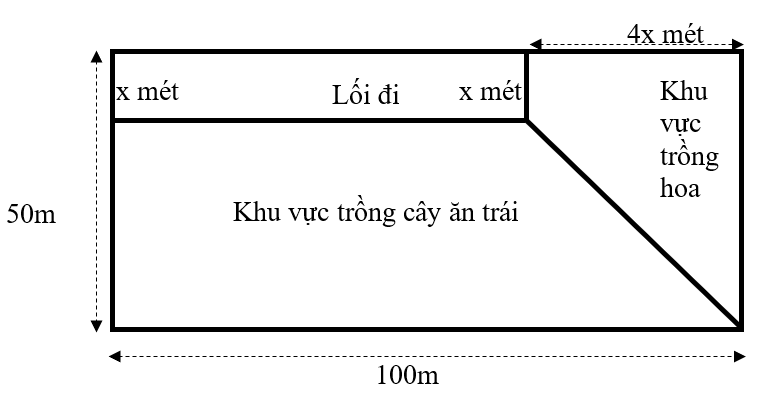
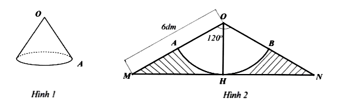
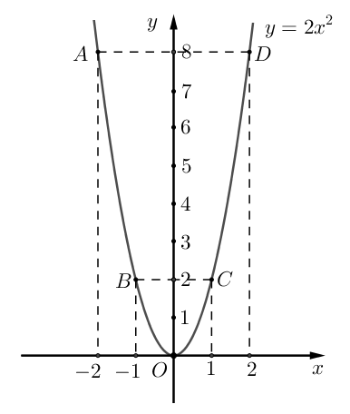
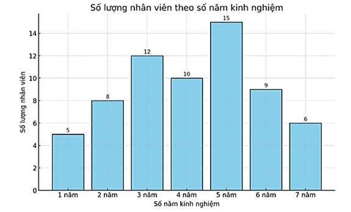
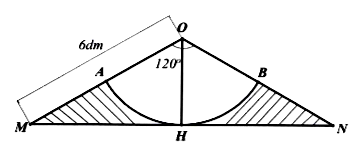
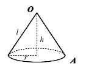
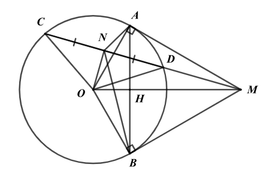

# ĐỀ THAM KHẢO THI TUYỂN SINH VÀO 10 - ĐỀ SỐ 8 MÔN TOÁN Thời gian: 120 phút BIÊN SOẠN: BAN CHUYÊN MÔN LOIGIAIHAY.COM

Câu 1 (1,5 điểm): Cho hàm số 2 2 y x  có đồ thị là Parabol (P).
a) Vẽ đồ thị (P) trên mặt phẳng tọa độ Oxy.
b) Bạn An đang thiết kế một chiếc cầu có hình dạng giống đồ thị của hàm số
2 2 y x  , bạn cần xác định những điểm trên cầu có độ cao bằng 2 mét so với mặt đất. Hãy tìm các tọa độ đó để bạn An hoàn thành bản vẽ.
Câu 2 (1 điểm): Cho phương trình bậc hai 2 3 2 3 0 x x - -


a) Chứng minh phương trình trên có hai nghiệm phân biệt.
b) Không giải phương trình, tính giá trị của biểu thức:
2 2 1 1 2 1 2 2 3 3( ) C x x x x x 
- - - - .
Câu 3 (1,5 điểm):
a) Biểu đồ dưới đây thống kê số lượng nhân viên trong một công ty theo số năm kinh nghiệm làm việc của
họ. Dựa vào biểu đồ trên, hãy cho biết tổng số nhân viên của công ty là bao nhiêu?
b) Một quản lý của công ty có 4 phần thưởng khác nhau A, B, C, D và sẽ trao cho hai nhóm nhân viên, mỗi
nhóm được nhận 2 phần thưởng. Tính xác suất để nhóm thứ nhất nhận được phần thưởng A và C.
Câu 4 (1 điểm): Một khu vườn hình chữ nhật có chiều dài 100m, chiều rộng 50m. Người ta làm một lối đi có dạng hình chữ nhật, khu vực trồng hoa có dạng hình thang vuông, còn lại là khu vực trồng cây ăn trái với kích thước như hình vẽ bên dưới.

a) Viết biểu thức S biểu diễn theo
(0 50) x x < < diện tích phần đất của khu vực trồng cây ăn trái?
b) Tìm giá trị của x biết phần đất của khu vực trồng cây ăn trái có diện tích là
2 4608 m ?

2 Câu 5 (1 điểm): Để làm một cái gàu tát nước có dạng hình nón (hình 1), bác An dùng một tấm tôn hình OMN \Delta cân tại O có cạnh bên OM = 6dm, 120 MON  ^\circ (hình 2). Bác xác định trung điểm H của MN, vẽ cung tròn tâm O bán kính OH cắt các cạnh OM, ON lần lượt tại A, B. Sau đó bác cắt bỏ phần gạch sọc, cuộn phần còn lại của tấm tôn sao cho mép OA trùng khít với mép OB tạo thành chiếc gàu (giả sử phần diện tích của mép nối không đáng kể). (lấy 3,14 \pi )
a) Tính diện tích tôn cần dùng để làm chiếc gàu? (kết quả làm tròn 1 chữ số thập phân)
b)  Hỏi khi múc đầy thì chiếc gàu chứa được bao nhiêu lít nước? (kết quả làm tròn đến hàng đơn vị). Biết
2 1 3 V r h \pi  , trong đó h là chiều cao hình nón, r là bán kính mặt đáy hình nón.

Câu 6 (1 điểm): Một bài thi trắc nghiệm gồm 20 câu hỏi, nếu trả lời đúng thì được 5 điểm, nếu trả lời sai thì bị trừ 2 điểm, nếu bỏ qua câu trả lời thì được 0 điểm.
a) Bạn An tham dự bài thi và được 47 điểm. Biết An bỏ qua 5 câu. Hỏi An trả lời đúng mấy câu và trả lời
sai mấy câu?
b) Bạn Hoa tham dự bài thi và được 59 điểm. Hỏi Hoa trả lời đúng mấy câu, trả lời sai mấy câu và bỏ qua
bao nhiêu câu?
Câu 7 (3 điểm): Từ điểm M nằm ngoài đường tròn (O), vẽ 2 tiếp tuyến MA, MB (A, B là 2 tiếp điểm). Gọi H là giao điểm của OM và AB. Vẽ cát tuyến MDC và (O), C nằm ngoài M và D. Gọi N là trung điểm CD.
a) Chứng minh MO \perp AB và
2 . MA MO MH  .
b) Chứng minh O, A, M, B, N cùng thuộc đường tròn đường kính OM và MN là tia phân giác của ANB .
c) Giả sử OA = R, OM = 2R . Tính
BHM OBM S S \Delta \Delta .

---
*------------------- HẾT -------------------*

---

## 📖 ĐÁP ÁN & HƯỚNG DẪN GIẢI CHI TIẾT

<b>Click để xem lời giải chi tiết 🔍</b>

a) Vẽ đồ thị (P) trên mặt phẳng tọa độ Oxy.
b) Bạn An đang thiết kế một chiếc cầu có hình dạng giống đồ thị của hàm số
2 2 y x  , bạn cần xác định những điểm trên cầu có độ cao bằng 2 mét so với mặt đất. Hãy tìm các tọa độ đó để bạn An hoàn thành bản vẽ. Phương pháp
a) Lập bảng giá trị, vẽ đồ thị hàm số trên hệ trục tọa độ.
b) Thay y = 2 vào (P) để xác định các giá trị x tương ứng.

**Lời giải**

a) Ta có bảng giá trị sau:
x 2 - 1 - 0 1 2 2 2 y x 

8 2 0 2 8 Đồ thị hàm số là đường cong parabol đi qua các điểm           0;0 ; 2;8 ; 1;2 ; 1;2 ; 2;8 O A B C D - -

Ta vẽ được đồ thị hàm số 2 2 y x  như sau:

b) Những điểm trên cầu có độ cao bằng 2 mét so với mặt đất là các điểm có tung độ
2 y  .
Thay y = 2 vào (P) ta được:
2 2 2x 

2 1 x  suy ra 1 x  hoặc 1 x -
Vậy bạn An cần xác định những điểm (1; 2) và (-1; 2).
Câu 2 (1 điểm): Cho phương trình bậc hai 2 3 2 3 0 x x - -


a) Chứng minh phương trình trên có hai nghiệm phân biệt.
b) Không giải phương trình, tính giá trị của biểu thức:
2 2 1 1 2 1 2 2 3 3( ) C x x x x x 
- - - - . Phương pháp a) Sử dụng 0 ac <
để chứng minh phương trình có hai nghiệm phân biệt.
b) Áp dụng định lí Viète và biến đổi P để xuất hiện tổng và tích của hai nghiệm.
Định lí Viète:
1 2 1 2 ; b c x x x x a a -
   . Lời giải
a) Phương trình
2 3 2 3 0 x x - -
 có 3 a  ; 2 b -;
3 c -

4 Vì   . 3. 3 9 0 a c  -
- < nên phương trình có hai nghiệm phân biệt.
b) 2 2 1 1 2 1 2 2 3 3( ) C x x x x x

- - - -

Áp dụng Viète, ta có:
1 2 2 2 3 3 x x -
 -
 ; 1 2 3 . 1 3 x x -
 -
Ta có: 2 2 1 1 2 1 2 2 3 3( ) C x x x x x 
- - - -

        2 2 1 1 2 1 2 2 2 1 2 1 2 2 1 2 1 2 1 2 2 2 3 3 3 3 3 3 2 2 2 3. 2. 1 3 3 4 2 2 3 4 3 C x x x x x C x x x x C x x x x x x C C C 
- - -
   -
 [ ]   -
 -
  [ ] ( ) 
- - -
  ( ) ( )     
- -
-

Vậy 4 3 C -
.
Câu 3 (1,5 điểm):
a) Biểu đồ dưới đây thống kê số lượng nhân viên trong một công ty theo số năm kinh nghiệm làm việc của
họ. Dựa vào biểu đồ trên, hãy cho biết tổng số nhân viên của công ty là bao nhiêu?
b) Một quản lý của công ty có 4 phần thưởng khác nhau A, B, C, D và sẽ trao cho hai nhóm nhân viên, mỗi
nhóm được nhận 2 phần thưởng. Tính xác suất để nhóm thứ nhất nhận được phần thưởng A và C.

**Phương pháp**

a) Tính tổng số nhân viên = tổng số lượng nhân viên theo số năm kinh nghiệm.
b) Xác định số phần tử của không gian mẫu.
Xác định số kết quả thuận lợi của nhóm thứ nhất nhận được phần thưởng A và C.
Xác suất để nhóm thứ nhất nhận được phần thưởng A và C bằng tỉ số giữa số kết quả thuận lợi với số phần tử của không gian mẫu.

**Lời giải**

a) Từ biểu đồ trên, ta có tổng số nhân viên là:
5 + 8 + 12 + 10 + 15 + 9 + 6 = 65 (nhân viên) Vậy tổng số nhân viên của công ty là 65 nhân viên.

b) Không gian mẫu là: \Omega {(AB,CD), (AC, BD), (AD, BC), (BC, AD), (BD, AC), (CD, AB)}.
Không gian mẫu có 6 phần tử.
Nhóm thứ nhất nhận được phần thưởng A và C là: (AC, BD) nên có 1 kết quả thuận lợi.
Vậy xác suất để nhóm thứ nhất nhận được phần thưởng A và C là 1 6 .
Câu 4 (1 điểm): Một khu vườn hình chữ nhật có chiều dài 100m, chiều rộng 50m. Người ta làm một lối đi có dạng hình chữ nhật, khu vực trồng hoa có dạng hình thang vuông, còn lại là khu vực trồng cây ăn trái với kích thước như hình vẽ bên dưới.

a) Viết biểu thức S biểu diễn theo
(0 50) x x < < diện tích phần đất của khu vực trồng cây ăn trái?
b) Tìm giá trị của x biết phần đất của khu vực trồng cây ăn trái có diện tích là
2 4608 m ?

**Phương pháp**

a) Sử dụng công thức tính diện tích hình chữ nhật để tính diện tích khu vườn, lối đi:
Shình chữ nhật = chiều dài.chiều rộng.
Sử dụng công thức tính diện tích hình thang để tính diện tích khu vực trồng hoa:
Shình thang = 1 2 .chiều cao.tổng hai đáy.
Diện tích phần đất của khu vực trồng cây ăn trái = diện tích khu vườn - diện tích lối đi - diện tích khu vực trồng hoa.
b) Giải phương trình bậc hai một ẩn
4608 S  để tìm x . Lời giải
a) Diện tích khu vườn hình chữ nhật là:
2 50 100 5000 (m ) \cdot 

Diện tích lối đi là:
2 2 (100 4 ) 100 4 (m ) x x x x - \cdot  -

Diện tích khu vực trồng hoa là:
2 2 1 4 ( 50) 2 100 (m ) 2 x x x x \cdot \cdot   

Vậy biểu thức S biểu diễn theo (0 50) x x < < diện tích phần đất của khu vực trồng cây ăn trái là:
   2 2 2 2 2 5000 100 4 2 100 5000 100 4 2 100 2 200 5000 S x x x x S x x x x S x x 
- - -
  -

- -
 -


b) Vì phần đất của khu vực trồng cây ăn trái có diện tích là
2 4608 m nên ta có phương trình:
2 2 200 5000 4608 x x -
 

2 2 200 392 0 x x -
 

Giải phương trình ta được 98 x  (không thoả mãn điều kiện) hoặc 2 x  (thoả mãn điều kiện)

6 Vậy 2 x  là giá trị cần tìm.
Câu 5 (1 điểm): Để làm một cái gàu tát nước có dạng hình nón (hình 1), bác An dùng một tấm tôn hình OMN \Delta cân tại O có cạnh bên OM = 6dm, 120 MON  ^\circ (hình 2). Bác xác định trung điểm H của MN, vẽ cung tròn tâm O bán kính OH cắt các cạnh OM, ON lần lượt tại A, B. Sau đó bác cắt bỏ phần gạch sọc, cuộn phần còn lại của tấm tôn sao cho mép OA trùng khít với mép OB tạo thành chiếc gàu (giả sử phần diện tích của mép nối không đáng kể). (lấy 3,14 \pi )
a) Tính diện tích tôn cần dùng để làm chiếc gàu? (kết quả làm tròn 1 chữ số thập phân)
b)  Hỏi khi múc đầy thì chiếc gàu chứa được bao nhiêu lít nước? (kết quả làm tròn đến hàng đơn vị). Biết
2 1 3 V r h \pi  , trong đó h là chiều cao hình nón, r là bán kính mặt đáy hình nón.

**Phương pháp**

a) Diện tích tôn cần dùng chính là diện tích xung quanh của hình nón:
xq S rl \pi  .
Để tính diện tích xung quanh, ta cần có r và l .
Chứng minh OH là đường phân giác đồng thời là đường cao để tính được OH theo tỉ số lượng giác trong tam giác vuông.
Từ đó ta tính được độ dài cung tròn AB nhỏ:
180 AB Rn l \pi  , chính là chu vi đường tròn đáy của hình nón.
Dùng công thức tính chu vi đường tròn để tính bán kính đáy r của hình nón.
Đường sinh l của hình nón chính là độ dài đoạn OA.
Tính diện tích xung quanh hình nón, chính là diện tích tôn cần dùng.
b) Áp dụng công thức liên hệ giữa bán kính, đường sinh và đường cao để tính đường cao:
2 2 2 l r h   .
Từ đó tính thể tích gàu nước.
Đổi về lít: 3 1dm = 1 lít. Lời giải a)

Vì OH là trung tuyến tam giác MON \Delta (gt) và MON \Delta cân tại O (gt) nên OH đồng thời là phân giác của MON và đường cao của tam giác MON \Delta . Do đó 120 60 2 2 MON MOH ^\circ    ^\circ và OH MN \perp tại H .
Trong tam giác MOH vuông tại H , ta có:

7 cos OH MOH OM  suy ra   .cos 6.cos60 3 OH OM MOH dm   ^\circ

Do đó độ dài cung tròn AB nhỏ là:
  3,14 3 120 6,28 dm 180 180 AB Rn l \pi \cdot \cdot   

Vì cuộn phần còn lại của tấm tôn sao cho mép OA trùng khít với mép OB tạo thành chiếc gàu nên độ dài cung tròn AB nhỏ là chu vi của miệng chiếc gàu (chu vi hình tròn) nên 6,28 2 3,14 r  \cdot \cdot suy ra   6,28 1 2.3,14 r dm  

Diện tích tôn cần dùng để làm chiếc gàu chính là diện tích xung quanh hình nón.
Diện tích xung quanh của hình nón là:
  2 3,14 1 3 9,42 9,4 dm xq S rl \pi   \cdot  \cdot   (vì đường sinh 3 l OA   dm) Vậy diện tích tôn cần dùng để làm chiếc gàu khoảng 9,4 2 dm . b)

Ta có: 2 2 2 l r h  

2 2 2 3 1 h  

2 9 1 h 

2 8 h  suy ra   8 2 2 h dm  

Thể tích gàu nước:
  2 2 3 1 1 3,14 1 2 2 3 3 3 V r h dm \pi  \cdot  \cdot \cdot \cdot  = 3 lít Vậy khi múc đầy thì chiếc gàu chứa được khoảng 3 lít nước.
Câu 6 (1 điểm): Một bài thi trắc nghiệm gồm 20 câu hỏi, nếu trả lời đúng thì được 5 điểm, nếu trả lời sai thì bị trừ 2 điểm, nếu bỏ qua câu trả lời thì được 0 điểm.
a) Bạn An tham dự bài thi và được 47 điểm. Biết An bỏ qua 5 câu. Hỏi An trả lời đúng mấy câu và trả lời
sai mấy câu?
b) Bạn Hoa tham dự bài thi và được 59 điểm. Hỏi Hoa trả lời đúng mấy câu, trả lời sai mấy câu và bỏ qua
bao nhiêu câu?

**Phương pháp**

a) Gọi x là số câu An trả lời đúng, y là số câu sai ( ,
; , 20 x y x y \in < ).
Lập phương trình biểu diễn tổng số câu, tổng số điểm bạn An đạt được, từ đó ta có hệ phương trình.
Giải hệ phương trình để tính số câu bạn An làm đúng, sai, bỏ qua.
b) Gọi x là số câu đúng, y là số câu sai, z là số câu bỏ qua của bạn Hoa ( , ,
; , , 20 x y z x y z \in < ).
Lập phương trình tổng số câu của bạn Hoa, từ đó ta có bất phương trình 20 x y  \le .
Lập phương trình biểu diễn số điểm của bạn Hoa, từ đó biểu diễn y theo x .
Từ phương trình trên, ta xác định được điều kiện bổ sung của x là 5 59 x \ge .
Thay y vào bất phương trình 20 x y  \le , giải để tìm x .
Từ đó thay các giá trị thoả mãn của x và tìm các giá trị ,y z tương ứng.
Kiểm tra lại điều kiện và kết luận.

**Lời giải**

a) Gọi x là số câu An trả lời đúng, y là số câu sai ( ,
; , 20 x y x y \in < ).
Vì An bỏ qua 5 câu nên ta có phương trình:
5 20 x y    suy ra 15 (1) x y  

Mỗi câu đúng được 5 điểm, mỗi câu sai bị trừ 2 điểm và An được 47 nên ta có phương trình:
5 2 47 (2) x y -


Từ (1) và (2) ta có hệ phương trình:
15 5 2 47 x y x y \begin{cases}

\end{cases}   -
 .
Giải hệ phương trình, ta có:
11 4 x y  \begin{cases}

 \end{cases} (TM).
Vậy An trả lời đúng 11 câu, trả lời sai 4 câu, bỏ qua 5 câu.
b) Gọi x là số câu đúng, y là số câu sai, z là số câu bỏ qua của bạn Hoa ( , ,
; , , 20 x y z x y z \in < ). Khi đó 20 x y z    nên 20 (1) x y  \le

Vì Hoa được 59 điểm nên ta có phương trình:
5 2 59 x y -


2 5 59 y x  -

 5 59 2 2 x y -


Vì 0 y \ge nên 5 59 0 2 x - \ge

suy ra 5 59 0 x - \ge nên 59 11,8 5 x \ge  . Do đó 12 x \ge (3) Thay (2) vào (1), ta được:
 5 59 20 2 7 59 20 2 7 59 40 7 99 99 14.14 7 14 4 x x x x x x x -
 \le - \le - \le \le \le  \le

Từ (3) và (4) suy ra 12 14 x \le \le

+ Với 14 x  thì 5.14 59 5,5 2 y -
  (không thoả mãn điều kiện) + Với 13 x  thì 5.13 59 3 2 y -
  (thoả mãn), suy ra 20 20 13 3 4 z x y 
- -
 -
- (thoả mãn) + Với 12 x  thì 5.12 59 1 2 2 y -
  (không thoả mãn điều kiện) Vậy Hoa trả lời đúng 13 câu, trả lời sai 3 câu, bỏ qua 4 câu.
Câu 7 (3 điểm): Từ điểm M nằm ngoài đường tròn (O), vẽ 2 tiếp tuyến MA, MB (A, B là 2 tiếp điểm). Gọi H là giao điểm của OM và AB. Vẽ cát tuyến MDC và (O), C nằm ngoài M và D. Gọi N là trung điểm CD.
a) Chứng minh MO \perp AB và
2 . MA MO MH  .
b) Chứng minh O, A, M, B, N cùng thuộc đường tròn đường kính OM và MN là tia phân giác của ANB .
c) Giả sử OA = R, OM = 2R . Tính
BHM OBM S S \Delta \Delta .

9 Phương pháp
a) Chứng minh MO \perp AB
Chứng minh MO là đường trung trực của AB Suy ra  MO \perp AB Chứng minh 2 . MA MO MH 

Chứng minh ( . ) AHM OAM g g \Delta \Delta \backsim

suy ra 2 . MA MO MH 

b) Chứng minh O, A, M, B, N cùng thuộc đường tròn đường kính OM
Chứng minh MAO \Delta , MBO \Delta , ONM \Delta cùng thuộc đường tròn đường kính OM nên O, N, A, M, B cùng thuộc đường tròn đường kính OM.
Chứng minh MN là tia phân giác của ANB Dựa vào tính chất của hai tiếp tuyến cắt nhau để chứng minh AOM BOM  . Suy ra AM BM 

nên ANM BNM  (2 góc nội tiếp cùng chắn 2 cung bằng nhau) Do đó NM là phân giác của ANB .
c) Giả sử OA = R, OM = 2R . Tính
BHM OBM S S \Delta \Delta . Chứng minh ( . ) BHM OBM g g \Delta \Delta \backsim , suy ra 2 BHM OBM S BM S OM \Delta \Delta ( ) ( ) ( )

Áp dụng định lí Pythagore vào tam giác vuông OBM để tính BM.
Thay số để tính BHM OBM S S \Delta \Delta . Lời giải

a) Chứng minh MO \perp AB
Ta có:
MA = MB (tính chất 2 tiếp tuyến cắt nhau) OA = OB = R Suy ra MO là đường trung trực của AB Suy ra  MO \perp AB

10 Chứng minh 2 . MA MO MH 

Xét AHM \Delta và OAM \Delta có: 90 AHM OAM   ^\circ OMA chung nên ( . ) AHM OAM g g \Delta \Delta \backsim

suy ra AM MH OM MA  , do đó 2 . MA MO MH 

b) Chứng minh O, A, M, B, N cùng thuộc đường tròn đường kính OM
Vì MAO \Delta vuông tại A (MA là tiếp tuyến) nên A, O, M cùng thuộc đường tròn đường kính MO (1) Vì MBO \Delta vuông tại B (MB là tiếp tuyến) nên M, B, O cùng thuộc đường tròn đường kính OM (2) Xét OCD \Delta cân tại O (OD = OC = R) có:
ON là đường trung tuyến (N là trung điểm của CD) nên ON CD \perp . Vì ONM \Delta vuông tại N nên O, N, M cùng thuộc đường tròn đường kính OM (3) Từ (1), (2), (3) suy ra O, N, A, M, B cùng thuộc đường tròn đường kính OM.
Chứng minh MN là tia phân giác của ANB Vì MA và MB là hai tiếp tuyến nên OM là tia phân giác của AOB , suy ra AOM BOM  .
Mà AOM là góc nội tiếp chắn cung AM, BOM là góc nội tiếp chắn cung BM của đường tròn đường kính OM nên AM BM 

suy ra ANM BNM  (2 góc nội tiếp cùng chắn 2 cung bằng nhau) Do đó NM là phân giác của ANB .
c) Giả sử OA = R, OM = 2R . Tính
BHM OBM S S \Delta \Delta . Xét BHM \Delta và OBM \Delta có: 90 BHM OBM   ^\circ OMB chung nên ( . ) BHM OBM g g \Delta \Delta \backsim , suy ra 2 BHM OBM S BM S OM \Delta \Delta ( ) ( ) ( )

Áp dụng định lí Pythagore vào tam giác vuông OBM, ta có:
2 2 2 OB BM OM   , suy ra   2 2 2 2 2 2 2 3 BM OM OB R R R  -
 -
 , suy ra 3 BM R  . Do đó 2 2 2 3 3 3 2R 2 4 BHM OBM S BM R S OM \Delta \Delta ( ) ( ) ( )     ( ) ( ) ( ) ( ) ( ) ( ) ( ) ( ) .

