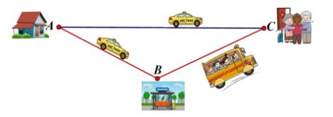
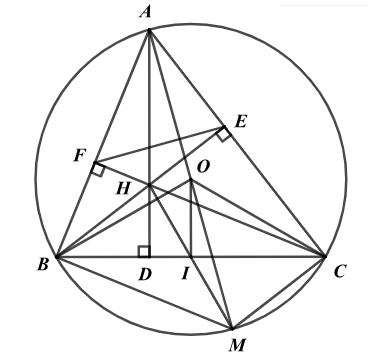

# ĐỀ THAM KHẢO THI TUYỂN SINH VÀO 10 - ĐỀ SỐ 9 MÔN TOÁN Thời gian: 120 phút BIÊN SOẠN: BAN CHUYÊN MÔN LOIGIAIHAY.COM

Câu 1 (1,5 điểm): Cho hàm số 2 1 4 y x  có đồ thị là Parabol (P).
a) Vẽ đồ thị (P) trên mặt phẳng tọa độ Oxy.
b) Tìm toạ độ điểm A thuộc đồ thị (P) sao cho A có hoành độ hơn tung độ một đơn vị.
Câu 2 (1 điểm): Cho phương trình bậc hai 2 6 3 0 x x  -


a) Chứng minh phương trình trên có hai nghiệm phân biệt.
b) Không giải phương trình, tính giá trị của biểu thức:
1 2 1 2 1 2 5 3 x x x x A x x - -

- .
Câu 3 (1,5 điểm): Bảng sau cho biết số chuyến bay bị chậm do tàu bay về muộn trong tháng 02/2025 của sáu hãng hàng không Việt Nam (Nguồn: Cục Hàng không Việt Nam).
Hãng hàng không Vietnam Airlines (VN) VietJet Air (VJ) Pacific Airlines (BL) VASCO (0V) Bamboo Airway (QH) Vietravel (VU) Số chuyến bay 1403 2418 59 85 192 110
a) Tính tỉ số phần trăm số chuyến bay bị chậm chuyến do tàu bay về muộn của Vietnam Airlines so với
tổng số chuyến bay bị chậm do tàu bay về muộn của cả sáu hãng hàng không trên.
b) Chọn ngẫu nhiên một chuyến bay bị chậm chuyến do tàu bay về muộn trong tháng 02/2025. Tính xác
suất để chuyến bay không thuộc Vietnam Airlines hoặc VietJet Air?
Câu 4 (1 điểm): Chợ Dân Sinh chuẩn bị được đưa vào hoạt động. Nếu mỗi gian hàng của chợ này cho thuê với mức giá 31 triệu đồng/năm (đã bao gồm phí duy trì) thì sẽ có 60 gian hàng được thuê. Theo khảo sát và nghiên cứu, nếu chợ Dân Sinh giảm giá thuê và ước tính cứ mỗi lần giảm giá thuê 1 triệu đồng/năm thì số lượng gian hàng được thuê sẽ tăng thêm 20 gian hàng. Gọi x (triệu đồng) là giá cho thuê mới.
a) Viết biểu thức
( ) P x biểu diễn theo x doanh thu của chợ Dân Sinh.
b) Phí duy trì một gian hàng của chợ dân sinh là 27 triệu đồng/năm. Hỏi giá cho thuê mới của chợ Dân
Sinh là bao nhiêu để lợi nhuận thu được của chợ là 245 triệu đồng?
Biết lợi nhuận bằng doanh thu trừ đi phí duy trì gian hàng.
Câu 5 (1 điểm): Một chiếc cốc đang chứa nước. Khối nước trong cốc có một dạng hình trụ, bán kính đáy bằng 6cm. Bạn Nam lấy một viên bi thủy tinh hình cầu thả vào trong cốc và quan sát thấy viên bi bị ngập trong nước đồng thời nước không bị tràn khỏi cốc (như hình minh họa). Bạn Nam đo được mực nước trong cốc dâng lên một khoảng bằng 1cm.

a) Tính thể tích của phần nước đã dâng lên trong cốc.
b) Tính bán kính R của viên bi mà bạn Nam đã thả vào cốc.
Câu 6 (1 điểm): Một người đi taxi sẽ phải trả chi phí gồm: phí lúc mở cửa và cứ mỗi km di chuyển sẽ trả một số tiền cố định. Nhà ông bà ngoại của Nam cách nhà Nam 32 km. Biết rằng một chuyến đi 10km thì phải trả 109 000 đồng và một chuyến đi 6km thì phải trả 69 000 đồng.
a) Nam muốn về thăm ông bà ngoại bằng cách đi xe taxi từ nhà. Hỏi Nam phải trả bao nhiêu tiền cho
chuyến đi.
b) Để giảm chi phí, Nam tính toán cách di chuyển thứ hai đến nhà ông bà ngoại như sau: Nam đi taxi đến
trạm xe buýt, rồi sau đó đi xe buýt theo tuyến đường đến nhà ông bà ngoại. Biết giá vé xe buýt là 50000 đồng. Hỏi trạm xe buýt cách nhà Nam bao xa thì với cách di chuyển thứ hai sẽ ít tốn chi phí hơn?

Câu 7 (3 điểm): Cho tam giác ABC nhọn (với AB < AC) nội tiếp (O;R). Các đường cao AD, BE, CF của tam giác ABC cắt nhau tại H. Gọi I là trung điểm của BC.
a) Chứng minh tứ giác BFEC nội tiếp đường tròn đường kính BC và OI vuông góc BC.
b) Kẻ đường kính AM của (O). Chứng minh: AB AC
AD AM \cdot  \cdot và ba điểm H, I, M thẳng hàng.
c) Biết AH = R = 10cm. Tính độ dài đoạn thẳng BC và EF.

---
*------------------- HẾT -------------------*

---

## 📖 ĐÁP ÁN & HƯỚNG DẪN GIẢI CHI TIẾT

<b>Click để xem lời giải chi tiết 🔍</b>

a) Vẽ đồ thị (P) trên mặt phẳng tọa độ Oxy.
b) Tìm toạ độ điểm A thuộc đồ thị (P) sao cho A có hoành độ hơn tung độ một đơn vị.

**Phương pháp**

a) Lập bảng giá trị, vẽ đồ thị hàm số trên hệ trục tọa độ.
b) Vì điểm A thuộc đồ thị (P) và A có hoành độ hơn tung độ một đơn vị nên ta biểu diễn được tung độ y
của A theo hoành độ x , từ đó giải tìm x .

**Lời giải**

a) Ta có bảng giá trị sau:
x 2 - 1 - 0 1 2 2 1 4 y x 

1 1 4

0 1 4

1 Đồ thị hàm số là đường cong parabol đi qua các điểm      0;0 ; 2;1 ; 1; ; 1; ; 2;1 1 1 4 4 ( )( ) - - ( )( ) ( )( ) .
Ta vẽ được đồ thị hàm số 2 1 4 y x  như sau:

b) Vì điểm A thuộc đồ thị (P) nên ta có
2 1 ; 4 A x x ( ) ( ) ( ) .
Mà A có hoành độ hơn tung độ một đơn vị nên   ; 1 A x x - . Do đó 2 1 1 4 x x -

suy ra 2 1 1 0 4 x x -


2 4 4 0 x x -
 

  2 2 0 x -


2 0 x -
 2 x 

Với 2 x  thì 2 1 1 y  -.
Vậy   2;1 A .

4 Câu 2 (1 điểm): Cho phương trình bậc hai 2 6 3 0 x x  -


a) Chứng minh phương trình trên có hai nghiệm phân biệt.
b) Không giải phương trình, tính giá trị của biểu thức:
1 2 1 2 1 2 5 3 x x x x A x x - -

- . Phương pháp a) Sử dụng 0 ac <
để chứng minh phương trình có hai nghiệm phân biệt.
b) Áp dụng định lí Viète và biến đổi A để xuất hiện tổng và tích của hai nghiệm.
Định lí Viète:
1 2 1 2 ; b c x x x x a a -
   . Lời giải
a) Phương trình
2 6 3 0 x x  -
 có   . 1. 3 3 0 a c  -
- < nên phương trình có hai nghiệm phân biệt.
b) 1 2 1 2 1 2 5 3 x x x x A x x - -
 -

Áp dụng Viète, ta có:
1 2 6 6 1 x x -
  -;
1 2 3 . 3 1 x x -
 -.
Ta có: 1 2 1 2 1 2 5 3 x x x x A x x - -
 -

            2 1 2 1 1 2 1 2 1 2 2 2 1 2 2 1 1 2 1 2 2 2 1 2 1 2 1 2 2 1 2 1 2 1 2 2 5 3 5 3 8 10 6 10. 3 22 3 x x x x x x A x x x x x x x x x x A x x x x x x A x x x x x x A x x A - -

- - -
  -
   -
  
- -
 -
  -

Vậy 22 A  .
Câu 3 (1,5 điểm): Bảng sau cho biết số chuyến bay bị chậm do tàu bay về muộn trong tháng 02/2025 của sáu hãng hàng không Việt Nam (Nguồn: Cục Hàng không Việt Nam).
Hãng hàng không Vietnam Airlines (VN) VietJet Air (VJ) Pacific Airlines (BL) VASCO (0V) Bamboo Airway (QH) Vietravel (VU) Số chuyến bay 1403 2418 59 85 192 110
a) Tính tỉ số phần trăm số chuyến bay bị chậm chuyến do tàu bay về muộn của Vietnam Airlines so với
tổng số chuyến bay bị chậm do tàu bay về muộn của cả sáu hãng hàng không trên.
b) Chọn ngẫu nhiên một chuyến bay bị chậm chuyến do tàu bay về muộn trong tháng 02/2025. Tính xác
suất để chuyến bay không thuộc Vietnam Airlines hoặc VietJet Air?

**Phương pháp**

a) Tính tổng số chuyến bay.
Từ đó tính tỉ số phần trăm giữa số chuyến bay của Vietnam Airlines so với tổng số chuyến bay.

b) Tính tổng số chuyến bay của Pacific Airlines (BL); VASCO (0V); Bamboo Airway (QH); Vietravel
(VU) = tổng số chuyến bay - Vietnam Airlines (VN) - VietJet Air (VJ) Xác suất = tổng số chuyến bay của Pacific Airlines (BL); VASCO (0V); Bamboo Airway (QH); Vietravel (VU) : tổng số chuyến bay.

**Lời giải**

a) Tổng số chuyến bay của sáu hãng hàng không là:
1403 2418 59 85 192 110 4267       (chuyến) Tỉ số phần trăm số chuyến bay bị chậm chuyến do tàu bay về muộn của Vietnam Airlines so với tổng số chuyến bay bị chậm do tàu bay về muộn của cả sáu hãng hàng không trên là:
1403.100 % 32,88% 4267  .
b) Số chuyến bay không thuộc Vietnam Airlines hoặc VietJet Air là:
4267 1403 2418 446 - -
 (chuyến) Xác suất để chuyến bay không thuộc Vietnam Airlines hoặc VietJet Air là:
446 0,1 4267  .
Câu 4 (1 điểm): Chợ Dân Sinh chuẩn bị được đưa vào hoạt động. Nếu mỗi gian hàng của chợ này cho thuê với mức giá 31 triệu đồng/năm (đã bao gồm phí duy trì) thì sẽ có 60 gian hàng được thuê. Theo khảo sát và nghiên cứu, nếu chợ Dân Sinh giảm giá thuê và ước tính cứ mỗi lần giảm giá thuê 1 triệu đồng/năm thì số lượng gian hàng được thuê sẽ tăng thêm 20 gian hàng. Gọi x (triệu đồng) là giá cho thuê mới.
a) Viết biểu thức
( ) P x biểu diễn theo x doanh thu của chợ Dân Sinh.
b) Phí duy trì một gian hàng của chợ dân sinh là 27 triệu đồng/năm. Hỏi giá cho thuê mới của chợ Dân
Sinh là bao nhiêu để lợi nhuận thu được của chợ là 245 triệu đồng?
Biết lợi nhuận bằng doanh thu trừ đi phí duy trì gian hàng.

**Phương pháp**

a) Từ giá cho thuê mới, tính số lần giảm giá.
Khi đó biểu diễn số gian hàng được thuê sau khi giảm giá.
Biểu thức biểu diễn doanh thu = giá cho thuê . số gian hàng.
b) Tính phí duy trì của số gian hàng được thuê.
Tính lợi nhuận = doanh thu - phí duy trì.
Từ đó lập được phương trình bậc hai ẩn x .
Giải phương trình để tìm x . Kiểm tra điều kiện và kết luận.

**Lời giải**

a) Với x (triệu đồng) là giá cho thuê mới thì số lần giảm giá là: 31
x - (lần) Khi giảm 31 x -
lần thì số gian hàng tăng lên   20 31 x - (gian hàng) Khi đó số gian hàng được thuê là:
  60 20 31 680 20 x x  -

- (gian hàng) Biểu thức ( )
P x biểu diễn theo x doanh thu của chợ Dân Sinh là:    2 680 20 20 680 P x x x x x  -
-
 .
b) Vì phí duy trì mỗi gian hàng là 27 (triệu đồng) nên phí duy trì của 680
20x -
gian hàng là:
  27. 680 20 18360 540 x x -

- (triệu đồng)
Khi đó lợi nhuận thu được là:    2 2 20 680 18360 540 20 1220 18360 x x x x x -

- -
-
 -

Vì lợi nhuận thu được là 245 triệu nên ta có phương trình:
2 20 1220 18360 245 x x -
 -
 hay 2 20 1220 18605 0 x x -
 -


Giải phương trình ta được 30,5 x  (TM)

6 Vậy giá cho thuê mới của chợ Dân Sinh là 30,5 triệu đồng (30 triệu 500 nghìn đồng).
Câu 5 (1 điểm): Một chiếc cốc đang chứa nước. Khối nước trong cốc có một dạng hình trụ, bán kính đáy bằng 6cm. Bạn Nam lấy một viên bi thủy tinh hình cầu thả vào trong cốc và quan sát thấy viên bi bị ngập trong nước đồng thời nước không bị tràn khỏi cốc (như hình minh họa). Bạn Nam đo được mực nước trong cốc dâng lên một khoảng bằng 1cm.

a) Tính thể tích của phần nước đã dâng lên trong cốc.
b) Tính bán kính R của viên bi mà bạn Nam đã thả vào cốc.

**Phương pháp**

a) Dựa vào công thức tính thể tích hình trụ để tính thể tích phần nước dâng lên: Vtrụ
2r h \pi  (r là bán kính đáy, h là chiều cao).
b) Vì thể tích phần nước dâng lên bằng thể tích của viên bi nên áp dụng công thức tính thể tích hình cầu để
tìm bán kính hình của viên bi: Vcầu 3 4 3 R \pi  (R là bán kính) Lời giải
a) Vì mực nước trong cốc dâng lên một khoảng bằng 1cm và bán kính phần nước dâng lên chính là bán
kính đáy của cốc nên thể tích của phần nước đã dâng lên trong cốc là:
  2 2 .6 .1 36 cm \pi \pi 

Vậy thể tích của phần nước đã dâng lên trong cốc là 2 36 cm \pi .
b) Vì thể tích phần nước dâng lên bằng thể tích của viên bi nên ta có:
3 4 36 3 R \pi \pi 

suy ra 3 36 27 4 3 R \pi \pi  

Do đó 3 R  Vậy bán kính R của viên bi là 3cm.
Câu 6 (1 điểm): Một người đi taxi sẽ phải trả chi phí gồm: phí lúc mở cửa và cứ mỗi km di chuyển sẽ trả một số tiền cố định. Nhà ông bà ngoại của Nam cách nhà Nam 32 km. Biết rằng một chuyến đi 10km thì phải trả 109 000 đồng và một chuyến đi 6km thì phải trả 69 000 đồng.
a) Nam muốn về thăm ông bà ngoại bằng cách đi xe taxi từ nhà. Hỏi Nam phải trả bao nhiêu tiền cho
chuyến đi.
b) Để giảm chi phí, Nam tính toán cách di chuyển thứ hai đến nhà ông bà ngoại như sau: Nam đi taxi đến
trạm xe buýt, rồi sau đó đi xe buýt theo tuyến đường đến nhà ông bà ngoại. Biết giá vé xe buýt là 50000 đồng. Hỏi trạm xe buýt cách nhà Nam bao xa thì với cách di chuyển thứ hai sẽ ít tốn chi phí hơn?

**Phương pháp**

a) Gọi x (nghìn đồng) là phí mở cửa (
0 x > ) Gọi y (nghìn đồng) là số tiền trả 1km di chuyển ( 0 y > ) Biết rằng một chuyến đi 10km thì phải trả 109 000 đồng và một chuyến đi 6km thì phải trả 69 000 đồng nên ta lập được hai phương trình theo x và y . Từ đó ta có hệ phương trình.
Giải hệ phương trình để tìm ,x y .
b) Gọi a (km) là khoảng cách từ nhà Nam đến trạm xe buýt,
0 a > .
Biểu diễn số tiền Nam phải trả khi di chuyển theo cách thứ hai theo a .
Lập bất phương trình biểu diễn số tiền phải trả theo cách di chuyển thứ hai ít tốn chi phí hơn cách di chuyển thứ nhất.
Giải bất phương trình để tìm a.

**Lời giải**

a) Gọi x (nghìn đồng) là phí mở cửa (
0 x > ) Gọi y (nghìn đồng) là số tiền trả 1km di chuyển ( 0 y > ) Biết một chuyến đi 10km thì phải trả 109 000 đồng nên ta có phương trình:
10 109 x y   (1) Biết một chuyến đi 6km thì phải trả 69 000 đồng nên ta có phương trình:
6 69 x y   (2) Từ (1) và (2) ta có hệ phương trình:
10 109 6 69 x y x y   \begin{cases}   \end{cases}

Giải hệ phương trình ta được:
9 10 x y  \begin{cases}

 \end{cases} (TM) Vậy khi di chuyển trên quãng đường 32 km thì Nam phải trả số tiền là: 9 32.10 329   nghìn đồng.
b) Gọi a (km) là khoảng cách từ nhà Nam đến trạm xe buýt,
0 a > .
Số tiền Nam phải trả khi di chuyển theo cách thứ hai là:
  9 10 50 10 59 a a     (nghìn đồng) Nếu cách di chuyển thứ hai sẽ ít tốn chi phí hơn thì ta có bất phương trình:
59 10 329 10 329 59 10 270 27 a a a a  < < - < <

Vây nếu trạm xe buýt cách nhà Nam ít hơn 27km thì với cách di chuyển thứ hai sẽ ít tốn chi phí hơn.
Câu 7 (3 điểm): Cho tam giác ABC nhọn (với AB < AC) nội tiếp (O;R). Các đường cao AD, BE, CF của tam giác ABC cắt nhau tại H. Gọi I là trung điểm của BC.
a) Chứng minh tứ giác BFEC nội tiếp đường tròn đường kính BC và OI vuông góc BC.
b) Kẻ đường kính AM của (O). Chứng minh: AB AC
AD AM \cdot  \cdot và ba điểm H, I, M thẳng hàng.
c) Biết AH = R = 10cm. Tính độ dài đoạn thẳng BC và EF.

**Phương pháp**

a) Chứng minh tứ giác BFEC nội tiếp đường tròn đường kính BC
Chứng minh BFC \Delta và BEC \Delta nội tiếp đường tròn đường kính BC.
Suy ra B, F, E, C cùng thuộc đường tròn đường kính BC.
Do đó tứ giác BFEC nội tiếp đường tròn đường kính BC.
Chứng minh OI BC \perp

Chứng minh tam giác OBC cân tại O, OI là đường trung tuyến của tam giác OBC.
Do đó OI cũng là đường cao của tam giác OBC.
Suy ra OI BC \perp .
b) Chứng minh AB AC
AD AM \cdot  \cdot

Chứng minh ADB ACM \Delta \Delta \backsim (g.g) suy ra AD AB AC AM  , do đó AB AC AD AM \cdot  \cdot

Chứng minh ba điểm H, I, M thẳng hàng Chứng minh BH // MC, BM // CH nên tứ giác BHCM là hình bình hành Lại có I là trung điểm của BC Nên I cũng là trung điểm của HM Suy ra ba điểm H, I, M thẳng hàng.
c) Tính độ dài đoạn thẳng BC
Chứng minh OI là đường trung bình của AHM \Delta và tính OI theo AH.
Áp dụng định lí Pythagore vào tam giác OIC vuông tại I (do OI BC \perp ) để tính BC.
Tính độ dài đoạn thẳng EF Tính IOC theo tỉ số lượng giác.
Suy ra BOC Tính BAC theo BOC (góc nội tiếp và góc ở tâm cùng chắn cung BC) Chứng minh AEF ABC \Delta \Delta \backsim (c.g.c) Suy ra cos EF AE BAC BC AB  

Tính EF theo BC.

**Lời giải**

a) Chứng minh tứ giác BFEC nội tiếp đường tròn đường kính BC
Vì BE và CF là đường cao của tam giác ABC nên BE AC \perp và CF AB \perp , suy ra 90 BFC BEC   ^\circ. Xét BFC \Delta và BEC \Delta lần lượt vuông tại F và E ( 90 BFC BEC   ^\circ) nên BFC \Delta và BEC \Delta nội tiếp đường tròn đường kính BC.
Suy ra B, F, E, C cùng thuộc đường tròn đường kính BC.
Do đó tứ giác BFEC nội tiếp đường tròn đường kính BC.
Chứng minh OI BC \perp

Xét tam giác OBC có OB = OC nên tam giác OBC cân tại O.
Mà I là trung điểm của BC nên OI là đường trung tuyến của tam giác OBC.
Do đó OI cũng là đường cao của tam giác OBC.
Suy ra OI BC \perp .
b) Chứng minh AB AC
AD AM \cdot  \cdot

Xét ADB \Delta và ACM \Delta có:
  90 ADB ACM   ^\circ (AD là đường cao, ACM là góc nội tiếp chắn nửa đường tròn) ABD AMC  (hai góc nội tiếp cùng chắn cung AC) nên ADB ACM \Delta \Delta \backsim (g.g) suy ra AD AB AC AM  , do đó AB AC AD AM \cdot  \cdot

Chứng minh ba điểm H, I, M thẳng hàng Vì , BE AC MC AC \perp \perp (BE là đường cao, 90 ACM  ^\circ) nên BE // MC hay BH // MC.
Vì , CF AB MB AB \perp \perp (CF là đường cao, 90 ABM  ^\circ (góc nội tiếp chắn nửa đường tròn)) nên BM // CF hay BM // CH.
Xét tứ giác BHCM có:
BH // MC BM // CH Suy ra tứ giác BHCM là hình bình hành Lại có I là trung điểm của BC

10 Nên I cũng là trung điểm của HM Suy ra ba điểm H, I, M thẳng hàng.
c) Tính độ dài đoạn thẳng BC
Xét AHM \Delta có O là trung điểm của AM (AM là đường kính), I là trung điểm của HM (cmt) nên OI là đường trung bình của AHM \Delta . Do đó 1 1 10 5 2 2 OI AH   \cdot  (cm) Áp dụng định lí Pythagore vào tam giác OIC vuông tại I (do OI BC \perp ), ta có: 2 2 2 OI IC OC   , suy ra 2 2 2 2 10 5 75 5 3 (cm) IC OC OI -
 -
  

suy ra 2 10 3 (cm) BC IC  \cdot 

Tính độ dài đoạn thẳng EF Xét tam giác vuông OIC có:
5 1 cos 10 2 OI IOC OC    nên 60 IOC  ^\circ Suy ra 2 120 BOC IOC  \cdot  ^\circ (OI là đường cao đồng thời là đường phân giác của tam giác BOC) Ta có: 1 1.120 60 2 2 BAC BOC  \cdot  ^\circ ^\circ (góc nội tiếp và góc ở tâm cùng chắn cung BC) Xét ABE \Delta và ACF \Delta có:
  90 AEB AFC   ^\circ BAC chung nên ABE ACF \Delta \Delta \backsim (g.g) suy ra AE AB AF AC  hay AE AF AB AC 

Xét AEF \Delta và ABC \Delta có: BAC chung AE AF AB AC  (cmt) nên AEF ABC \Delta \Delta \backsim (c.g.c) Suy ra 1 cos cos60 2 EF AE BAC BC AB    ^\circ

Do đó   1 1 10 3 5 3 2 2 EF BC cm  \cdot  \cdot 

Vậy 10 3 , 5 3 BC cm EF cm   .

