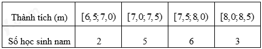
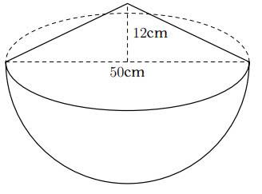

# ĐỀ THAM KHẢO THI TUYỂN SINH VÀO 10 - ĐỀ SỐ 1 MÔN TOÁN Thời gian: 120 phút BIÊN SOẠN: BAN CHUYÊN MÔN LOIGIAIHAY.COM

*Thời gian thực tế người đó trồng xong cây trên là: 216 6 x - (ngày).*  

---

1 Câu 1: (1,5 điểm)
1) Thành tích chạy 50 m của 16 học sinh nam lớp 9A ở một trường THCS (đơn vị: giây) được cho bằng bảng
sau:

Tìm tần số ghép nhóm và tần số tương đối ghép nhóm [7,5;8,0) .
2) Đội văn nghệ lớp 9A gồm 2 bạn nam là Hùng, Bình và 3 bạn nữ là Nga, Thảo, Mai. Cô giáo phụ trách đội
văn nghệ chọn ngẫu nhiên hai bạn để hát song ca. Tính xác suất của biến cố “Trong hai bạn được chọn có bạn Nga”.

### Câu 2: (2 điểm) Cho hai biểu thức:

1 3 x A x   -
và 1 . 1 1 2 1 x x x B x x x ( ) -
  ( ) ( ) - -
 ( ) với 0, 9; 1 x x x \ge \ne \ne .
1) Tính giá trị của biểu thức A khi
25 x  .
2) Chứng minh
1 x B x   .
3) Xét biểu thức P
AB  . Tìm các số nguyên tố x để 1 P < .

### Câu 3: (2,5 điểm)

1) Tại một cửa hàng điện máy tủ lạnh được giảm giá 18% và tivi được giảm giá 12% . Tổng giá niêm yết của
hai mặt hàng này là 45 triệu đồng, giá sau khi giảm của hai mặt hàng là 38,64 triệu đồng. Tìm giá niêm yết của tủ lạnh, tivi.
2) Một người dự định trồng 216 cây theo thời gian định trước. Nhưng do thời tiết xấu nên mỗi ngày trồng
được ít hơn 6 cây, vì thế trồng xong chậm mất 6 ngày so với dự kiến. Hỏi theo kế hoạch mỗi ngày người đó trồng được bao nhiêu cây.
3) Phương trình
2 5 0 x x k -
  có một nghiệm 1 5 13 2 x -
 . Tính giá trị của biểu thức 2 2 1 2 1 2 x x x x  .

2 Câu 4: (4 điểm)
1) Một cái thùng dùng để đựng gạo có dạng nửa hình cầu với
đường kính 50cm, phần gạo vun lên có dạng hình nón cao 12cm.
a) Tính thể tích phần gạo trong thùng.
b) Nhà bạn An dùng lon sữa bò dạng hình trụ với bán kính đáy là
5cm, chiều cao 14cm dùng để đong gạo mỗi ngày. Biết rằng mỗi ngày nhà An ăn 4 lon gạo và mỗi lần đong thì lượng gạo chiếm 90% thể tích của lon. Hỏi cần ít nhất bao nhiêu ngày để nhà An có thể ăn hết số gạo trong thùng?
2) Cho đường tròn tâm ( )
O và dây BC cố định không đi qua O . Trên cung lớn BC lấy điểm A sao cho AB AC < . Kẻ đường kính , AK E là hình chiếu của C trên AK . M là trung điểm của BC .
a) Chứng minh bốn
, , , C E M O cùng thuộc một đường tròn.
b) Kẻ AD BC \perp
tại D . Chứng minh . . AD AK AB AC  và MDE \Delta cân.
c) Gọi F là hình chiếu của B trên AK . Chứng minh khi
di chuyển trên cung lớn BC thì tâm đường tròn ngoại tiếp DEF \Delta là 1 điểm cố định.

### Câu 5: (0,5 điểm) Bác An muốn đặt đóng một chiếc hộp đựng quà lưu niệm có dạng hình hộp chữ nhật với mặt đáy ABCD là hình vuông như hình dưới đây.

Để món quà trở nên đặc biệt, bác An muốn mạ bốn mặt xung quanh và mặt đáy dưới (mặt MNPQ ) của chiếc hộp bằng kim loại quý (không mạ nắp hộp). Em hãy tìm độ dài cạnh MN của mặt đáy và chiều cao AM của hộp quà sao cho tổng diện tích các mặt được mạ kim loại quý của chiếc hộp là nhỏ nhất biết rằng thể tích của chiếc hộp là 3 4dm .

---
*------------------- HẾT -------------------*

A C D B P M Q N A

---

## 📖 ĐÁP ÁN & HƯỚNG DẪN GIẢI CHI TIẾT

<b>Click để xem lời giải chi tiết 🔍</b>

1) Thành tích chạy 50 m của 16 học sinh nam lớp 9A ở một trường THCS (đơn vị: giây) được cho bằng bảng
sau:
Thành tích (m) [6,5;7,0) [7,0;7,5) [7,5;8,0) [8,0;8,5) Số học sinh nam 2 5 6 3 Tìm tần số ghép nhóm và tần số tương đối ghép nhóm [7,5;8,0) .
2) Đội văn nghệ lớp 9A gồm 2 bạn nam là Hùng, Bình và 3 bạn nữ là Nga, Thảo, Mai. Cô giáo phụ trách đội
văn nghệ chọn ngẫu nhiên hai bạn để hát song ca. Tính xác suất của biến cố “Trong hai bạn được chọn có bạn Nga”.

**Phương pháp**

1) - Quan sát bảng số liệu xác định tần số ghép nhóm tương ứng với nhóm [7,5;8,0) .
- Tần số tương đối ghép nhóm bằng tỉ số giữa tần số nhóm [7,5;8,0) và tổng số học sinh.
2) - Xác định số kết quả có thể xảy ra.
- Xác định số kết quả thuận lợi cho biến cố “Trong hai bạn được chọn có bạn Nga”.
- Xác suất của biến cố “Trong hai bạn được chọn có bạn Nga” bằng tỉ số giữa số kết quả thuận lợi cho biến cố
với số kết quả có thể.

**Lời giải**

1) Dựa vào bảng ta thấy nhóm [7,5;8,0) có tần số là 6.
Tần số tương đối của nhóm [7,5;8,0) là: 6 .100% 37,5% 16  .
2) Có 10 kết quả có thể xảy ra khi chọn ngẫu nhiên hai bạn để hát song ca là: (Hùng và Bình); (Hùng và
Nga); (Hùng và Thảo); (Hùng và Mai); (Bình và Nga); (Bình và Thảo); (Bình và Mai); (Nga và Thảo); (Nga và Mai); (Thảo và Mai).
Có 4 kết quả thuận lợi cho biến cố “Trong hai bạn được chọn có bạn Nga” là: (Hùng và Nga); (Bình và Nga); (Nga và Thảo); (Nga và Mai).
Vậy xác suất của biến cố “Trong hai bạn được chọn có bạn Nga” là:
4 2 10 5 P   .

### Câu 2: (2 điểm) Cho hai biểu thức:

1 3 x A x   -
và 1 . 1 1 2 1 x x x B x x x ( ) -
  ( ) ( ) - -
 ( ) với 0, 9; 1 x x x \ge \ne \ne .
1) Tính giá trị của biểu thức A khi
25 x  .
2) Chứng minh
1 x B x   .
3) Xét biểu thức P
AB  . Tìm các số nguyên tố x để 1 P < . Phương pháp
1) Kiểm tra điều kiện của x.
Nếu thỏa mãn, thay 25 x  vào biểu thức A .
2) Kết hợp các tính chất của căn thức bậc hai để rút gọn biểu thức.
3) Rút gọn P sau đó giải bất đẳng thức
1 P  < . Kết hợp điều kiện để tìm x .

**Lời giải 1) Với 25 x  (thỏa mãn điều kiện), ta có:**

25 1 5 1 6 3 5 3 2 25 3 A      
- -

Vậy 3 A  khi 25 x  . 2) Ta có:
                    1 . 1 1 2 1 1 1 . 2 1 1 1 1 1 1 1 . 2 1 1 1 2 1 1 1 1 2 1 1 x x x B x x x x x x x x x x x x x x x x x x x x x x x x x x x ( ) -
  ( ) ( ) - -
 ( ) [ ] -
        -
 -
   -
   -
  -
 -
   

Vậy 1 x B x   .

3) Ta có: 1. 3 1 3 . P x x x x A B x x
    -
 -

Để 1 P < thì 1 3 x x < -

1 0 3 3 0 3 3 0 3 x x x x x x - < - -
 < - < -

Vì 3 > 0 nên 3 0 3 x < -
khi 3 0 x - < suy ra 3 x < nên 9 x < . Kết hợp với 0, 9; 1 x x x \ge \ne \ne  suy ra 0 9 x \le <

Mà x là số nguyên tố nên \{ \} 2;3;5;7 x \in .
Vậy \{ \} 2;3;5;7 x \in thì 1 P < .

### Câu 3: (2,5 điểm)

1) Tại một cửa hàng điện máy tủ lạnh được giảm giá 18% và tivi được giảm giá 12% . Tổng giá niêm yết của
hai mặt hàng này là 45 triệu đồng, giá sau khi giảm của hai mặt hàng là 38,64 triệu đồng. Tìm giá niêm yết của tủ lạnh, tivi.
2) Một người dự định trồng 216 cây theo thời gian định trước. Nhưng do thời tiết xấu nên mỗi ngày trồng
được ít hơn 6 cây, vì thế trồng xong chậm mất 6 ngày so với dự kiến. Hỏi theo kế hoạch mỗi ngày người đó trồng được bao nhiêu cây.
3) Phương trình
2 5 0 x x k -
  có một nghiệm 1 5 13 2 x -
 . Tính giá trị của biểu thức 2 2 1 2 1 2 x x x x  . Phương pháp
1) Gọi giá niêm yết của tủ lạnh và ti vi lần lượt là ,x y (triệu đồng) (0
, 45 x y < < ).
Lập luận để có hệ phương trình 45 0,18 0,12 6,36 x y x y   \begin{cases}

  \end{cases}

Sử dụng phương pháp thế hoặc cộng đại số để tìm ,x y .
2) Giả sử theo kế hoạch mỗi ngày người đó trồng được số cây là: x (cây) (
6 x > ).
Biểu diễn số cây thực tế mỗi ngày người đó trồng được.

Từ đó biểu diễn thời gian trồng xong cây theo kế hoạch và thực tế.
Lập phương trình và giải để tìm x .
3) Thay nghiệm
1 5 13 2 x -
 vào phương trình để tìm k.
Biến đổi 2 2 1 2 1 2 x x x x  và áp dụng định lí Viète:
1 2 1 2 ; b c x x x x a a -
   . Lời giải
1) Gọi giá niêm yết của tủ lạnh và ti vi lần lượt là ,x y (triệu đồng) (0
, 45 x y < < ).
Vì tổng giá niêm yết của hai mặt hàng này là 45 triệu đồng nên 45 x y   (1) Số tiền được giảm khi mua hai mặt hàng này là: 45 38,64 6,36 -
 (triệu đồng).
Vì tủ lạnh được giảm giá 18% và tivi được giảm giá 12% nên ta có phương trinh: 18% 12% 6,36 x y  

hay 0,18 0,12 6,36 x y   (2) Từ (1) và (2) ta có hệ phương trình:
45 0,18 0,12 6,36 x y x y   \begin{cases}

  \end{cases} suy ra   16 29 x TM y  \begin{cases}

 \end{cases}

Vậy giá niêm yết của tủ lạnh là 16 triệu đồng, giá niêm yết của ti vi là 29 triệu đồng.
2) Giả sử theo kế hoạch mỗi ngày người đó trồng được số cây là: x (cây) (
6 x > ).
Trên thực tế mỗi ngày người đó trồng được số cây là:
6 x - (cây) Thời gian người đó trồng xong cây theo kế hoạch là: 216 x (ngày).
Vì thời gian trồng xong chậm 6 ngày so với dự kiến nên ta có phương trình: 216 216 6 6 x x -
 -

216 216 6 6 x x -
 -

1296 6 ( 6) x x  -

2 6 36 1296 0 x x - -


Giải phương trình ta được 18 x  hoặc 12 x -
(loại).
Vậy theo kế hoạch người đó trồng 18 cây mỗi ngày.

3) Vì phương trình
2 5 0 x x k -
  có một nghiệm 1 5 13 2 x -
 nên thay 1 5 13 2 x -
 vào phương trình, ta được: 2 5 13 5 13 5 0 2 2 19 5 13 25 5 13 0 2 2 19 5 13 25 5 13 0 2 3 0 3 k k k k k ( ) ( ) - - -
  ( ) ( ) ( ) ( ) ( ) ( ) - - -
 
- -
   -  

Do đó phương trình cần tìm là 2 5 3 0 x x -
  .
Theo định lí Viète ta có:
1 2 1 2 5 3 x x x x   \begin{cases}

 \end{cases}

Ta có:
  2 2 1 2 1 2 1 2 1 2 3.5 15 x x x x x x x x      .

### Câu 4: (4 điểm)

1) Một cái thùng dùng để đựng gạo có dạng nửa hình cầu với
đường kính 50cm, phần gạo vun lên có dạng hình nón cao 12cm.
a) Tính thể tích phần gạo trong thùng.
b) Nhà bạn An dùng lon sữa bò dạng hình trụ với bán kính đáy là
5cm, chiều cao 14cm dùng để đong gạo mỗi ngày. Biết rằng mỗi ngày nhà An ăn 4 lon gạo và mỗi lần đong thì lượng gạo chiếm 90% thể tích của lon. Hỏi cần ít nhất bao nhiêu ngày để nhà An có thể ăn hết số gạo trong thùng?
2) Cho đường tròn tâm ( )
O và dây BC cố định không đi qua O . Trên cung lớn BC lấy điểm A sao cho AB AC < . Kẻ đường kính , AK E là hình chiếu của C trên AK . M là trung điểm của BC .
a) Chứng minh bốn
, , , C E M O cùng thuộc một đường tròn.
b) Kẻ AD BC \perp
tại D . Chứng minh . . AD AK AB AC  và MDE \Delta cân.
c) Gọi F là hình chiếu của B trên AK . Chứng minh khi
di chuyển trên cung lớn BC thì tâm đường tròn ngoại tiếp DEF \Delta là 1 điểm cố định.

**Phương pháp**

1) a) Tính bán kính của hình cầu.
- Thể tích phần gạo nửa hình cầu = 1
2 thể tích hình cầu.
A

Thể tích hình cầu:
3 4 3 c V R \pi  .
- Thể tích phần gạo hình nón tính bằng công thức tính thể tích hình nón:
2 1 3 n V R h \pi 

- Thể tích gạo = thể tích phần gạo nửa hình cầu + thể tích phần gạo hình nón.
b) Tính thể tích lon bằng thể tích hình trụ:
2 tV R h \pi 

Tính thể tích gạo mỗi ngày múc = 4.90%. tV .
Lấy thể tích gạo : thể tích gạo mỗi ngày múc để xác định số ngày ít nhất để dùng hết số gạo trong thùng.
2) a) Chứng minh OMC
\Delta và OEC \Delta lần lượt vuông tại M và E nên cùng nội tiếp đường tròn đường kính OC.
Gọi I là trung điểm của OC thì , , , C E M O cùng thuộc một đường tròn (I) đường kính OC (bán kính OI).
b) *Chứng minh
. . AD AK AB AC 

Chứng minh A DBA CK \Delta \Delta \backsim (g.g) suy ra AD AC AB AK  (cặp cạnh tương ứng tỉ lệ) nên . . AD AK AB AC  .
*Chứng minh MDE \Delta cân.
Để chứng minh MDE \Delta cân ta chứng minh MDE MED  .
- Lập luận CAE
CDE  và CBK CAE  suy ra CBK CDE 

- Lập luận EMC
EOC  , 1 2 KBC KOC  suy ra 2 EMC CDE 

- Sử dụng tính chất góc ngoài của tam giác MDE
\Delta suy ra 2 EMC MDE 

Do đó MDE MED  .
c) Chứng minh OBM
MFO  và MEO MCO  , mà OBM OCM  suy ra MFO MEO  . Do đó EMF \Delta cân tại M , nên ME MF  . Mà ME MD  nên MD ME MF  

Suy ra M là tâm đường tròn ngoại tiếp tam giác DEF .
Mà M là trung điểm của BC nên M là điểm cố định.

**Lời giải**

1) a) Bán kính của hình cầu là:
  50 25 2 2 d R cm   

Thể tích phần gạo nửa hình cầu là:
  3 3 3 1 4 1 4 31250 25 2 3 2 3 3 c V R cm \pi \pi \pi  \cdot  \cdot 

Thể tích phần gạo vun lên dạng hình nón là:
  2 2 3 1 1 25 12 2500 3 3 n V R h cm \pi \pi \pi   \cdot \cdot 

Thể tích gạo trong thùng là:
  3 31250 38750 2500 3 3 g V cm \pi \pi \pi   

b) Thể tích lon là:
  2 3 .5 .14 350 cm \pi \pi 

Thể tích gạo một ngày múc là:
  3 4.90%.350 1260 cm \pi \pi 

Ta có: 38750 :1260 10,3 \pi \pi 

Vậy cần ít nhất 11 ngày để dùng hết số gạo trong thùng.
2)

a) Chứng minh bốn
, , , C E M O cùng thuộc một đường tròn.
OBC \Delta cân tại O , M là trung điểm của BC nên OM vừa là đường trung tuyến vừa là đường cao. Suy ra OM BC \perp suy ra 90 OMC  ^\circ.
Tam giác OMC vuông tại M nên tam giác OMC nội tiếp đường tròn đường kính OC.
Theo bài ra, E là hình chiếu của C trên AK nên CE AK \perp suy ra CE EO \perp hay 90 OEC  ^\circ.
Tam giác OEC vuông tại E nên tam giác OEC nội tiếp đường tròn đường kính OC.
Gọi I là trung điểm của OC Do đó , , , C E M O cùng thuộc một đường tròn (I) đường kính OC (bán kính OI).
b) *Chứng minh
. . AD AK AB AC 

Xét DBA \Delta và A CK \Delta có 90 ADB ACK   ^\circ ABD AKC  (Hai góc nội tiếp cùng chắn cung ) Nên A DBA CK \Delta \Delta \backsim (g.g) Do đó ta có: AD AC AB AK  (cặp cạnh tương ứng tỉ lệ) Hay . . AD AK AB AC  (đpcm).
*Chứng minh MDE \Delta cân.
Theo bài ra AD BC AE EC \perp \begin{cases}

\perp \end{cases} suy ra 90 90 ADC AEC \begin{cases}  ^\circ   ^\circ \end{cases}

Gọi Q là trung điểm của AC P Q I F E D M K O C B A AC

Tam giác ADC và tam giác AEC vuông tại D và E nên nội tiếp đường tròn (Q; AC), suy ra QA QC QD QE   

Suy ra bốn điểm , , , A C D E cùng thuộc đường tròn  Q Suy ra CAE CDE  (Hai góc nội tiếp cùng chắn cung CE ) (1) Xét  O ta có: CBK CAE  (Hai góc nội tiếp cùng chắn cung CK ) (2) Từ (1) và (2) suy ra CBK CDE  mà hai góc này ở vị trí đồng vị  (3) Suy ra / / DE BK Xét đường tròn  I có: EMC EOC  (Hai góc nội tiếp cùng chắn EC ). (4) Xét đường tròn  O có: 1 2 KBC KOC  (Góc nội tiếp và góc ở tâm cùng chắn KC ). (5) Từ (3); (4) và (5) suy ra 2 EMC CDE  . MDE \Delta có EMC MDE MED   (góc ngoài của tam giác) mà 2 EMC MDE 

Nên MDE MED  . Do đó, MDE \Delta cân tại M .
c) Gọi P là trung điểm của BO
Tam giác BFO và tam giác BMO vuông tại F và M nên nội tiếp đường tròn (P; OP) suy ra PB PO PF PM   

Suy ra bốn điểm , , , O M B F cùng thuộc đường tròn  P Nên OBM MFO  (Hai góc nội tiếp cùng chắn MO ).
Xét đường tròn  I có: MEO MCO  (Hai góc nội tiếp cùng chắn MO ).
Mà OBM OCM  ( OCB \Delta cân tại O ). Do đó MFO MEO  suy ra EMF \Delta cân tại M , do đó ME MF  . Mà ME MD  (Tam giác MDE cân tại M ).
Suy ra MD ME MF   .
Suy ra M là tâm đường tròn ngoại tiếp tam giác DEF .
Mà M là trung điểm của BC nên M là điểm cố định.
Vậy khi A di chuyển trên cung lớn BC thì tâm đường tròn ngoại tiếp tam giác DEF là một điểm cố định.

### Câu 5: (0,5 điểm) Bác An muốn đặt đóng một chiếc hộp đựng quà lưu niệm có dạng hình hộp chữ nhật với mặt đáy ABCD là hình vuông như hình dưới đây.

Để món quà trở nên đặc biệt, bác An muốn mạ bốn mặt xung quanh và mặt đáy dưới (mặt MNPQ ) của chiếc hộp bằng kim loại quý (không mạ nắp hộp). Em hãy tìm độ dài cạnh MN của mặt đáy và chiều cao AM của C D B P M Q N A

hộp quà sao cho tổng diện tích các mặt được mạ kim loại quý của chiếc hộp là nhỏ nhất biết rằng thể tích của chiếc hộp là 3 4dm . Phương pháp Gọi độ dài cạnh MN là   x dm ( 0 x > ) Gọi độ dài chiều cao AM là   h dm ( 0 h > ) Biểu diễn h theo x dựa vào thể tích của chiếc hộp.
Tính diện tích cần mạ kim loại = diện tích bốn mặt xung quanh và diện tích mặt đáy dưới.
Sử dụng bất đẳng thức Cô - si cho 3 số để tìm giá trị nhỏ nhất của S.
Từ đó tính được ,x h.

**Lời giải Gọi độ dài cạnh MN là   x dm ( 0 x > ) Gọi độ dài chiều cao AM là   h dm ( 0 h > ) Do thể tích của chiếc hộp là 4dm3 nên ta có:**

2 4 x h 

Suy ra 2 4 h x 

Diện tích cần mạ kim loại quý của chiếc hộp là:
2 2 2 2 2 4 16 4 4 . 8 8 S x xh x x x x x x x x         

Chứng minh bất đẳng thức Cô - si.
Áp dụng bất đẳng thức Cô - si cho 3 số 4 0 x > , 8 0 x > và 8 0 x > ta có: 2 2 3 3 8 8 8 8 3. . . 3. 64 3.4 12

S x x x x x x    \ge   

Dấu “=” xảy ra khi 2 8 x x  , suy ra 3 8 x  , do đó 2 x 

Suy ra 2 4 1 2 h   Vậy khi độ dài cạnh đáy 2 MN dm  và chiều cao 1 AM dm  thì diện tích cần mạ kim loại quý của chiếc hộp là nhỏ nhất bằng 2 12dm .

