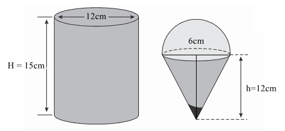
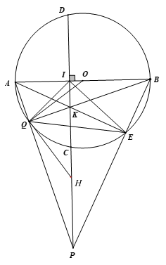

# ĐỀ THAM KHẢO THI TUYỂN SINH VÀO 10 - ĐỀ SỐ 2 MÔN TOÁN Thời gian: 120 phút BIÊN SOẠN: BAN CHUYÊN MÔN LOIGIAIHAY.COM

### Câu 1: (1,5 điểm)

1) Đo chiều cao (đơn vị là cm) của học sinh lớp 9A cho kết quả như sau:
156 157 164 166 166 165 157 156 155 158 160 163 163 161 162 159 159 160 160 160 159 158 160 160 158 163 162 162 162 161 162 161 163 161 163 161 164 166 165 165 Hãy lập bảng tần số ghép nhóm với các nhóm [155; 158), [158; 161), [161; 164), [164;167).
Tính tần số tương đối của nhóm [161; 164)
2) Viết ngẫu nhiên một số tự nhiên lẻ có 2 chữ số. Xét biến cố A: “Số tự nhiên viết ra là bình phương của
một số tự nhiên”.
Tính xác suất của biến cố A.

### Câu 2: (1,5 điểm) Cho hai biểu thức:

1 x A x -
 ; 2 4 4 15 9 3 3 x x x B x x x -
    -
 -
với 0; 9 x x > \ne

1) Tính giá trị của biểu thức A khi
25 x  .
2) Chứng minh
1 3 x B x -

- .
3) Cho P = A: B. Tìm x nguyên để
0 P P   .

### Câu 3: (2,5 điểm)

1) Bác Bình An vay ở một ngân hàng 500 triệu đồng để sản xuất trong thời hạn một năm. Lẽ ra đúng một năm
sau bác phải trả cả tiền vốn lẫn tiền lãi, song bác đã được ngân hàng cho kéo dài thời hạn thêm 1 năm nữa, số tiền lãi của năm đầu được gộp vào với tiền vốn để tính lãi năm sau và lãi suất vẫn như cũ. Hết hai năm bác Bình An phải trả tất cả 605 triệu đồng. Hỏi lãi suất cho vay của ngân hàng đó là bao nhiêu phần trăm trong một năm?
2) Một người mua hai loại hàng và phải trả tổng cộng 2,17 triệu đồng, kể cả thuế giá trị gia tăng (VAT) với
mức 10% đối với loại hàng loại hàng thứ nhất và 8% đối với loại hàng thứ hai. Nếu thuế VAT là 9% đối với cả hai loại hàng thì người đó phải trả tổng cộng 2,18 triệu đồng. Hỏi nếu không kể thuế VAT thì người đó phải trả bao nhiêu tiền cho mỗi loại hàng?
3) Gọi 1 2 ,
x x là hai nghiệm của phương trình:
2 3 5 6 0 x x  -
 . Không giải phương trình, tính các giá trị của các biểu thức 1 2 2 1 D = 2 2 x x x x    .

### Câu 4: (4 điểm)

1) Một hộp kem hình trụ có đường kính 12cm và chiều cao 15cm đựng đầy kem được đặt trên mặt bàn
phẳng.
a) Tính thể tích hộp kem.
b) Hộp kem chứa kem sẽ được chia vào các bánh ốc quế hình nón có chiều cao 12cm và đường kính 6cm ,
có hình bán cầu trên đỉnh như hình vẽ. Hãy tìm số que kem có thể chia được.

2) Cho đường tròn 
 ;
O R , đường kính AB vuông góc với dây CD tại điểm I ( I nằm giữa A và O ). Lấy điểm E bất kì trên cung nhỏ BC( E khác B và C ). AE cắt CD tại K .
a) Chứng minh bốn điểm K, E, B, I cùng thuộc một đường tròn.
b) Chứng minh
. . AK AE AI AB  .
c) Gọi P là giao điểm của tia BE và tia DC, Q là giao điểm của AP và BK. Chứng minh IK là phân giác
của EIQ . Chứng minh OQ là tiếp tuyến của đường tròn ngoại tiếp tam giác PQE.

### Câu 5: (0,5 điểm) Tìm diện tích lớn nhất của hình chữ nhật MNPQ nội tiếp trong nửa đường tròn  O bán kính 10 , cm biết một cạnh của hình chữ nhật nằm dọc trên đường kính của đường tròn (như hình vẽ).

---
*------------------- HẾT -------------------*

x P N M O A B Q

---

## 📖 ĐÁP ÁN & HƯỚNG DẪN GIẢI CHI TIẾT

<b>Click để xem lời giải chi tiết 🔍</b>

### Câu 1: (1,5 điểm)

1) Đo chiều cao (đơn vị là cm) của học sinh lớp 9A cho kết quả như sau:
156 157 164 166 166 165 157 156 155 158 160 163 163 161 162 159 159 160 160 160 159 158 160 160 158 163 162 162 162 161 162 161 163 161 163 161 164 166 165 165 Hãy lập bảng tần số ghép nhóm với các nhóm [155; 158), [158; 161), [161; 164), [164;167).
Tính tần số tương đối của nhóm [161; 164)
2) Viết ngẫu nhiên một số tự nhiên lẻ có 2 chữ số. Xét biến cố A: “Số tự nhiên viết ra là bình phương của
một số tự nhiên”.
Tính xác suất của biến cố A.

**Phương pháp**

1) - Xác định tần số cho các nhóm để lập bảng tần số ghép nhóm.
- Tần số tương đối của nhóm bằng: tần số của nhóm : tổng . 100%.
2) - Xác định không gian mẫu của phép thử, tính số phần tử của không gian mẫu.
- Tính số kết quả thuận lợi của biến cố.
- Xác suất của biến cố = số kết quả thuận lợi của biến cố : số phần tử của không gian mẫu.

**Lời giải**

1) Bảng tần số ghép nhóm
Chiều cao (cm) [155; 158) [158; 161) [161; 164) [164;167)

Tần số 5 12 15 8 Cộng: 40 Tần số tương đối của nhóm [161; 164) là:
15 .100% 37,5% 40 

2) - Không gian mẫu của phép thử “Viết ngẫu nhiên một số tự nhiên lẻ có 2 chữ số” là:
\{ \} 11;13;15;...;97;99 \Omega

- Số phần tử của tập hợp \Omega là: 99 11 1
45 2 -
 (phần tử)
- Các kết quả thuận lợi của biến cố A : “Số tự nhiên viết ra là bình phương của 1 số tự nhiên” là: \{
\} 25;49;81 . Biến cố này gồm 3 phần tử.
- Xác suất của biến cố A là:
1 3:45 15 

### Câu 2: (1,5 điểm) Cho hai biểu thức:

1 x A x -
 ; 2 4 4 15 9 3 3 x x x B x x x -
    -
 -
với 0; 9 x x > \ne

1) Tính giá trị của biểu thức A khi
25 x  .
2) Chứng minh
1 3 x B x -

- .
3) Cho P = A: B. Tìm x nguyên để
0 P P   . Phương pháp
1) Kiểm tra điều kiện của x.

Nếu thỏa mãn, thay 25 x  vào biểu thức A .
2) Kết hợp các tính chất của căn thức bậc hai để rút gọn biểu thức.
3) Rút gọn biểu thức P.
Lập luận 0 P \le .
Giải bất phương trình, kết hợp điều kiện ban đầu của x Lời giải 1) Thay 25 x  (tmđk) vào A ta được 25 1 4 5 25 A -
 

Vậy với 25 x  thì 4 5 A 

2) 2 4 4 15 9 3 3 x x x B x x x -
  
- -
 -

            2 3 4 3 4 15 3 3 3 3 3 3 x x x x x x x x x x x -
 -
  
- -
 -
 -


      2 6 4 12 4 15 3 3 x x x x x x x -
 
- -
  -


   2 3 3 3 x x x x  -
 -


      3 1 3 3 x x x x  -
 -


1 3 x x -
 -

Vậy 1 3 x B x -

- . 3) P : A B
 1 1 : 3 x x x x - -

- 1 3 . 1 x x x x - -

- 3 x x -
 (điều kiện bổ sung:
1 x \ne ) Vì 0 P P   nên P P -

Do đó 0 P \le , suy ra 3 0 x x - \le

Vì 0 x > nên 0 x > , do đó 3 0 x x - \le khi 3 0 x - \le

suy ra 3 x \le nên 9 x \le

Kết hợp với điều kiện 0; 9 x x > \ne , ta được 0 9; 1 x x < < \ne Mà x \in nên \{ \} 2;3;4;5;6;7;8 x \in .
Vậy \{ \} 2;3;4;5;6;7;8 x \in .

### Câu 3: (2,5 điểm)

1) Bác Bình An vay ở một ngân hàng 500 triệu đồng để sản xuất trong thời hạn một năm. Lẽ ra đúng một năm
sau bác phải trả cả tiền vốn lẫn tiền lãi, song bác đã được ngân hàng cho kéo dài thời hạn thêm 1 năm nữa, số

tiền lãi của năm đầu được gộp vào với tiền vốn để tính lãi năm sau và lãi suất vẫn như cũ. Hết hai năm bác Bình An phải trả tất cả 605 triệu đồng. Hỏi lãi suất cho vay của ngân hàng đó là bao nhiêu phần trăm trong một năm?
2) Một người mua hai loại hàng và phải trả tổng cộng 2,17 triệu đồng, kể cả thuế giá trị gia tăng (VAT) với
mức 10% đối với loại hàng loại hàng thứ nhất và 8% đối với loại hàng thứ hai. Nếu thuế VAT là 9% đối với cả hai loại hàng thì người đó phải trả tổng cộng 2,18 triệu đồng. Hỏi nếu không kể thuế VAT thì người đó phải trả bao nhiêu tiền cho mỗi loại hàng?
3) Gọi 1 2 ,
x x là hai nghiệm của phương trình:
2 3 5 6 0 x x  -
 . Không giải phương trình, tính các giá trị của các biểu thức 1 2 2 1 D = 2 2 x x x x    . Phương pháp
1) Gọi lãi suất của ngân hàng đó là x (
0 x > ) Biểu diễn số tiền phải trả sau năm thứ nhất, sau năm thứ 2 theo công thức:
Số tiền phải trả = số tiền gốc + x . số tiền gốc.
Ta viết được phương trình biểu diễn số tiền phải trả sau hai năm.
Giải phương trình để tìm x , kiểm tra điều kiện và kết luận.
2) Gọi số tiền không kể thuế của loại hàng thứ nhất là x (triệu đồng), của loại hàng thứ hai là y (triệu đồng)
(0 , 2,17 x y < < ).
Viết hai phương trình biểu diễn số tiền phải trả khi:
+ thuế của loại hàng thứ nhất là 10% và thuế của loại hàng thứ hai là 8% + thuế của loại hàng thứ nhất và thuế của loại hàng thứ hai đều là 9% Lập được hệ phương trình, giải hệ để tìm ,x y .
3) Kiểm tra sự tồn tại của
1 2 , x x theo .a c .
Áp dụng định lí Viète và biến đổi.
Định lí Viète:
1 2 1 2 ; b c x x x x a a -
  

**Lời giải**

1) Gọi lãi suất của ngân hàng đó là x (
0 x > ) Số tiền phải trả sau năm thứ nhất là: 500 500x  (triệu đồng).
Số tiền phải trả sau năm thứ hai là:

  2 500 500 500 500 500 1000 500 x x x x x       (triệu đồng).
Vì sau hai năm bác Bình An phải trả 605 triệu đồng nên ta có phương trình:

2 2 500 1000 500 605 500 1000 105 0 x x x x     -


Giải phương trình ta được 1 0,1 x  (thỏa mãn); 2 2,1 x -
(loại).
Vậy lãi suất mỗi năm của ngân hàng đó là 0,1 10%  .
2) Gọi số tiền không kể thuế của loại hàng thứ nhất là x (triệu đồng), của loại hàng thứ hai là y (triệu đồng)
(0 , 2,17 x y < < ).
Tổng số tiền phải trả là 2,17 triệu đồng, kể cả thuế giá trị gia tăng (VAT) với mức 10% đối với loại hàng loạt hàng thứ nhất và 8% đối với loại hàng thứ hai nên ta có phương trình:

10% 8% 2,17 1,1 1,08 2,17 (1) x x y y x y      

Nếu thuế VAT là 9% đối với cả hai loại hàng thì người đó phải trả tổng cộng 2,18 triệu đồng nên ta có

phương trình:

9% 9% 2,18 1,09 1,09 2,18 (2) x x y y x y      

Vậy ta có hệ: 1,1 1,08 2,17 1,09 1,09 2,18 x y x y   \begin{cases}

  \end{cases} .
Giải hệ phương trình ta được:
0,5 1,5 x y  \begin{cases}

 \end{cases} (thỏa mãn).
Vậy không kể thuế VAT thì loại hàng thứ nhất phải trả 0,5 triệu đồng, loại hàng thứ hai phải trả 1,5 triệu đồng.
3) Phương trình
2 3 5 6 0 x x  -
 có tích   3 . 6 18 0 ac  -
-
< nên có nghiệm phân biệt 1x , 2x . Theo định lí Viète, ta có:
1 2 5 3 x x -
  và 1 2 6 2 3 x x -
 - (*).
Ta có: 1 2 2 1 2 2 x x D x x     (điều kiện: 1 2 2, 2 x x \ne - \ne - )        1 1 2 2 1 2 2 2 2 2 x x x x D x x      

      2 2 1 2 1 2 1 2 1 2 2 2 4 x x x x D x x x x       

      2 1 2 1 2 1 2 1 2 1 2 2 2 2 4 x x x x x x D x x x x  -
     

Thay (*) vào D , ta được:
    2 5 5 2 . 2 2 31 3 3 5 12 2 2 4 3 D - - ( ) ( ) - -
 \cdot ( ) ( ) - ( ) ( )  
- ( ) -
 \cdot  ( ) ( )

### Câu 4: (4 điểm)

1) Một hộp kem hình trụ có đường kính 12cm và chiều cao 15cm đựng đầy kem được đặt trên mặt bàn
phẳng.
a) Tính thể tích hộp kem.
b) Hộp kem chứa kem sẽ được chia vào các bánh ốc quế hình nón có chiều cao 12cm và đường kính 6cm ,
có hình bán cầu trên đỉnh như hình vẽ. Hãy tìm số que kem có thể chia được.

2) Cho đường tròn 
 ;
O R , đường kính AB vuông góc với dây CD tại điểm I ( I nằm giữa A và O ). Lấy điểm E bất kì trên cung nhỏ BC( E khác B và C ). AE cắt CD tại K .
a) Chứng minh bốn điểm K, E, B, I cùng thuộc một đường tròn.
b) Chứng minh
. . AK AE AI AB  .
c) Gọi P là giao điểm của tia BE và tia DC, Q là giao điểm của AP và BK. Chứng minh IK là phân giác
của EIQ . Chứng minh OQ là tiếp tuyến của đường tròn ngoại tiếp tam giác PQE.

**Phương pháp**

1) a) Tính thể tích kem trong hộp hình trụ:
2. T T T V R h \pi 

b) Tính thể tích kem trong hộp = thể tích hình nón + thể tích hình bán cầu.
+ Thể tích hình nón:
2 1 . 3 N N N R h V \pi 

+ Thể tích nửa hình cầu:
3 1 1 4 . 2 2 3 C C V R \pi 

Số que kem có thể chia được = thể tích kem trong hộp : thể tích kem trong một chiếc bánh ốc quế.
2) a) Chứng minh
90 KEB  ^\circ và 90 KIB  ^\circ nên KEB \Delta và KIB \Delta cùng thuộc đường tròn đường kính KB.
Do đó K, E, B, I cùng thuộc một đường tròn.
b) Chứng minh AKI
ABE \Delta \Delta \backsim suy ra tỉ số giữa hai cặp cạnh tương ứng của hai tam giác.
c) * Chứng minh IK là phân giác của EIQ .
Chứng minh K là trực tâm của APB \Delta nên   BQ AP Q AP \perp \in

Tam giác AQK và tam giác AIK lần lượt vuông tại Q và I nên nội tiếp đường tròn đường kính AK suy ra AIKQ là tứ giác nội tiếp, nên QAK QIK  .
Kết hợp với KIE KBE  và QAK KBE  suy ra KIE KIQ  hay IK là phân giác của EIQ
* Chứng minh OQ là tiếp tuyến của đường tròn ngoại tiếp tam giác PQE.
Gọi H là trung điểm của PK, khi đó đường tròn (H; HP) ngoại tiếp tam giác PQE.
Ta cần chứng minh 90 OQH  ^\circ hay OQ QH \perp :
+ Chứng minh OQB \Delta là tam giác cân tại O nên OQK OBQ 

+ Chứng minh IBK QPK \Delta \Delta \backsim (g-g) suy ra OBQ QPK 

+ Chứng minh HQP QPK  (tam giác HPQ cân tại H).
Ta được OQK HQP  .
Sử dụng cộng góc để được 90 OQH KQP   ^\circ nên OQ QH \perp . Lời giải
1) a) Thể tích kem trong hộp hình trụ là:
2. T T T V R h \pi  2 12 .15 2 \pi( )  ( ) ( ) 3 540 ( ) cm \pi 

b) Thể tích kem trong bánh ốc quế hình nón có hình bán cầu trên đỉnh là
2 3 1 1 4 . . 3 2 3 kem N N C V R h R \pi \pi   2 3 1 6 1 4 6 .12 . . . 3 2 2 3 2 \pi \pi ( ) ( )   ( ) ( ) ( ) ( ) 3 54 ( ) cm \pi 

Vậy số que kem có thể chia được là:  540 10 54 \pi \pi que. 2)

a) Xét 
 ; O R có: 90 AEB  ^\circ (góc nội tiếp chắn nửa đường tròn) hay 90 KEB  ^\circ Đường kính AB vuông góc với dây CD tại điểm I nên 90 KIB  ^\circ Xét KEB \Delta vuông tại E có cạnh huyền KB suy ra K, E, B thuộc đường tròn đường kính KB (1) Xét KIB \Delta vuông tại I có cạnh huyền KB suy ra K, I, B thuộc đường tròn đường kính KB (2) Do đó K, E, B, I cùng thuộc một đường tròn.
b) Xét AKI \Delta và ABE \Delta , ta có:
ˆA là góc chung 90 AIK AEB   ^\circ suy ra AKI ABE \Delta \Delta \backsim   g g -

Do đó AK AI AB AE  nên . . AK AE AI AB  (đpcm)
c) * Chứng minh IK là phân giác của EIQ .
Xét APB \Delta có:
  PI AB I AB \perp \in ;
  AE PB E PB \perp \in ; PI cắt AE tại K nên K là trực tâm của APB \Delta

Suy ra   BQ AP Q AP \perp \in nên 90 AQB  ^\circ hay 90 AQK  ^\circ Đường kính AB vuông góc với dây CD tại điểm I nên 90 AIK  ^\circ Tam giác AQK và tam giác AIK lần lượt vuông tại Q và I nên nội tiếp đường tròn đường kính AK, do đó bốn điểm A, I, Q, K cùng thuộc đường tròn đường kính AK suy ra AIKQ là tứ giác nội tiếp suy ra QAK QIK  (hai góc nội tiếp cùng chắn QK ) Ta có: KEBI là tứ giác nội tiếp (cmt) nên KIE KBE  (hai góc nội tiếp cùng chắn EK ) Ta có: 90 AQB  ^\circ nên AQB \Delta nội tiếp   ; O R , do đó   ; Q O R \in

Lại có: QAK KBE  (hai góc nội tiếp cùng chắn QE ) suy ra KIE KIQ  hay IK là phân giác của EIQ (đpcm)
* Chứng minh OQ là tiếp tuyến của đường tròn ngoại tiếp tam giác PQE.
Xét OQB \Delta , ta có:

OQ OB R  

Suy ra OQB \Delta là tam giác cân tại O Do đó OQB OBQ  hay OQK OBQ  1 Xét IBK \Delta và QPK \Delta , ta có: IKB QKP  (hai góc đối đỉnh) 90 KQP KIB   ^\circ Suy ra IBK QPK \Delta \Delta \backsim (g - g) Do đó IBK QPK  (hai góc tương ứng) hay OBQ QPK   2 Xét tam giác KQP và tam giác KEP lần lượt vuông tại Q và E nên nội tiếp đường tròn đường kính PK, suy ra P, Q, K, E thuộc đường tròn đường kính PK và đường tròn (H; HP) ngoại tiếp tam giác PQE.
Gọi H là trung điểm của PK, khi đó HP = HP nên tam giác HPQ cân tại H, do đó PQH QPK  hay HQP QPK  (3) Từ (1), (2) và (3) suy ra: OQK HQP 

Mà 90 HQO OQK KQH HQP KQH HQP       ^\circ Suy ra 90 OQH  ^\circ hay OQ QH \perp

Do đó OQ là tiếp tuyến của đường tròn ngoại tiếp tam giác PQE (đpcm).

### Câu 5: (0,5 điểm) Tìm diện tích lớn nhất của hình chữ nhật MNPQ nội tiếp trong nửa đường tròn  O bán kính 10 , cm biết một cạnh của hình chữ nhật nằm dọc trên đường kính của đường tròn (như hình vẽ).

**Phương pháp Gọi   x cm là độ dài cạnh hình chữ nhật không nằm dọc theo đường kính đường tròn   0 10 x < <**

Khi đó áp dụng định lí Pythagore để tính OQ theo x , ta tính được 2. MQ OQ  .
Tính diện tích hình chữ nhật MNPQ theo x .
Áp dụng bất đẳng thức Cauchy cho 2 số: 2 ab a b \le  . Dấu bằng xảy ra khi 0 a b  \ge

Dấu “=” xảy ra khi là diện tích lớn nhất của hình chữ nhật.

**Lời giải Gọi   x cm là độ dài cạnh hình chữ nhật không nằm dọc theo đường kính đường tròn   0 10 x < <**

Áp dụng định lí Pythagore trong tam giác OPQ, ta có:
2 2 2 2 10 OQ OP PQ x  -
 -

Khi đó độ dài cạnh MQ của hình chữ nhật nằm dọc trên đường kính của đường tròn là:
  2 2 2. 2 10 MQ OQ x cm   -

Diện tích hình chữ nhật MNPQ là:
   2 2 2 2 .2 100 2 . 100 S x x x x cm  -
 -

Áp dụng bất đẳng thức Cauchy cho hai số, ta có:
x P N M O A B Q

  2 2 2 2 2 . 100 100 100 x x x x - \le  -
 .
Dấu “=” xảy ra khi 2 2 100 x x  -

Suy ra 2 2 100 x 

2 50 x 

5 2 x  (vì 0 x > ) Vậy diện tích lớn nhất của hình chữ nhật là 2 100cm khi   5 2 x cm  .

