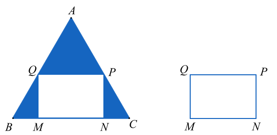
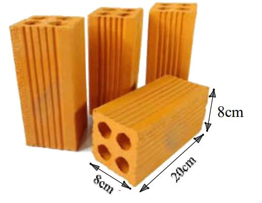
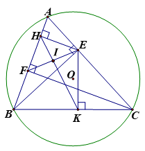
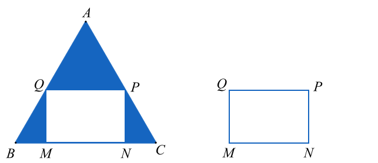

# De Tham Khao Thi Vao 10 Toan Ha Noi Nam 2025 Co Dap An Va Loi Giai Chi Tiet De 3 1747626042

*Thời gian làm xong sản phẩm theo kế hoạch là: 600 x (ngày) Số sản phẩm làm được trong thực tế là: 600 100 700   (sản phẩm) Thời gian làm xong sản phẩm theo thực tế là: 700 10 x  (ngày) Do thực tế hoàn thành sớm hơn kế hoạch 1 ngày nên ta có phương trình:*  

---

### Câu 1: (1,5 điểm)

1) Để chuẩn bị cho tiết mục kỉ niệm 70 năm Chiến thắng Điện Biên Phủ, phường Mỹ Đình có cử một số
lượng người tham gia, được biểu diễn dưới biểu đồ tỉ lệ sau:
(Biết rằng có 54 người từ 25 tuổi đến 35 tuổi)

a) Có bao nhiêu người tham gia biểu diễn?
b) Một người cho rằng có trên 50% số người biểu diễn dưới 45 tuổi. Nhận định đó đúng hay sai? Tại sao?
2) Bạn An là một thành viên của câu lạc bộ nhảy hiện đại khối 9 trong trường THCS. Để chọn học sinh trong
CLB đó tham gia hoạt động văn nghệ chào mừng “Ngày nhà giáo Việt Nam” của trường, các học sinh trong CLB sử dụng hình thức bốc thăm với 20 lá thăm giống hệt nhau lần lượt ghi các số tự nhiên từ 1 tới 20 và được để trong hộp kín. Học sinh lấy được lá thăm ghi số chia hết cho 6 sẽ được tham gia. Bạn An là người được bốc thăm đầu tiên.
Xét phép thử “Bạn An bốc ngẫu nhiên 1 lá thăm” và biến cố A: “Bạn An được tham gia hoạt động văn nghệ chào mừng Ngày nhà giáo Việt Nam của trường”. Tính xác suất của biến cố A.

### Câu 2: (1,5 điểm) Cho 2 2 1 2 1 x x M x x x  -


- -
  và 1 x N x   (với 0; 1 x x > \ne ).
1) Tính giá trị của N khi
25 x  . 2) Rút gọn . S M N  . 3) Tìm x để 1 S < - .

### Câu 3: (2,5 điểm)

1) Một người mua một cái bàn là và một cái quạt điện với tổng số tiền theo giá niêm yết là 850 nghìn đồng.
Khi trả tiền người đó được khuyến mại giảm 20% đối với giá tiền bàn là và 10% đối với giá tiền quạt điện với giá niêm yết. Vì vậy, người đó phải trả tổng cộng 740 nghìn đồng. Tính giá tiền của cái bàn là và cái quạt điện theo giá niêm yết.
33.75% 28.75% 26.25% 11.25% 0% 5% 10% 15% 20% 25% 30% 35% 40% 25 35 45 55 65 Tần số tương đối (%) Độ tuổi Tỉ lệ đại biểu theo độ tuổi ĐỀ THAM KHẢO THI TUYỂN SINH VÀO 10 - ĐỀ SỐ 3 MÔN TOÁN Thời gian: 120 phút BIÊN SOẠN: BAN CHUYÊN MÔN LOIGIAIHAY.COM

2) Một cơ sở sản xuất lập kế hoạch làm 600 sản phẩm trong một thời gian nhất định. Do cải tiến kĩ thuật,
năng suất mỗi ngày tăng 10 sản phẩm. Vì thế không những hoàn thành sớm kế hoạch 1 ngày, mà còn vượt mức 100 sản phẩm. Hỏi theo kế hoạch mỗi ngày phải làm bao nhiêu sản phẩm.
(Giả định rằng số sản phẩm mà tổ đó làm được trong mỗi ngày là bằng nhau).
3) Cho phương trình
2 2 2 3 0 x x -
  có 2 nghiệm phân biệt là 1 2 , x x . Không giải phương trình, hãy tính giá trị của biểu thức 2 1 1 2 1 1 1 1 x x A x x    
- - .

### Câu 4: (4 điểm)

1) Gạch ống là một sản phẩm được tạo hình thành từ đất sét và nước, được
kết hợp lại với nhau theo một công thức chung hợp lí mới có thể tạo ra hỗn hợp dẻo quánh, sau đó chúng được đổ vào khuôn, rồi đem phơi hoặc sấy khô và cuối cùng là đưa vào lò nung. Một viên gạch hình hộp chữ nhật có kích thước dài 8cm, rộng 8cm, cao 20cm (như hình vẽ). Bên trong có bốn lỗ hình trụ bằng nhau có đường kính 2,5cm .
a) Tính thể tích đất sét để làm một viên gạch. (lấy
3,14 \pi )
b) Bác Ba muốn xây một ngôi nhà phải mua 10 thiên gạch, giá một viên là 1 100 đồng. Nhưng khi thi công,
bác Ba phải mua dư 2% số gạch cần dùng dự phòng cho hư hao. Tính số tiền bác Ba mua gạch để xây căn nhà, biết 1 thiên gạch là 1 000 viên.
2) Cho tam giác

ABC có ba góc nhọn nội tiếp đường tròn  O , kẻ đường cao BE của ABC \Delta . Gọi H và K lần lượt là chân các đường vuông góc kẻ từ E đến AB và BC .
a) Chứng minh tứ giác BHEK là tứ giác nội tiếp.
b) Chứng minh:
. . BH BA BK BC  .
c) Kẻ đường cao CF của tam giác
  ABC F AB \in và I là trung điểm của EF . Chứng minh ba điểm , , H I K thẳng hàng.

### Câu 5: (0,5 điểm) Cho một tấm nhôm có hình tam giác đều có cạnh bằng 100cm . Người ta cắt ở ba góc của tấm nhôm đó ba tam giác như hình vẽ dưới đây để được hình chữ nhật MNPQ. Tìm độ dài MB để hình chữ nhật MNPQ có diện tích lớn nhất.

---
*------------------- HẾT -------------------*

---

## 📖 ĐÁP ÁN & HƯỚNG DẪN GIẢI CHI TIẾT

<b>Click để xem lời giải chi tiết 🔍</b>

### Câu 1: (1,5 điểm)

1) Để chuẩn bị cho tiết mục kỉ niệm 70 năm Chiến thắng Điện Biên Phủ, phường Mỹ Đình có cử một số
lượng người tham gia, được biểu diễn dưới biểu đồ tỉ lệ sau:
(Biết rằng có 54 người từ 25 tuổi đến 35 tuổi)

a) Có bao nhiêu người tham gia biểu diễn?
b) Một người cho rằng có trên 50% số người biểu diễn dưới 45 tuổi. Nhận định đó đúng hay sai? Tại sao?
2) Bạn An là một thành viên của câu lạc bộ nhảy hiện đại khối 9 trong trường THCS. Để chọn học sinh trong
CLB đó tham gia hoạt động văn nghệ chào mừng “Ngày nhà giáo Việt Nam” của trường, các học sinh trong CLB sử dụng hình thức bốc thăm với 20 lá thăm giống hệt nhau lần lượt ghi các số tự nhiên từ 1 tới 20 và được để trong hộp kín. Học sinh lấy được lá thăm ghi số chia hết cho 6 sẽ được tham gia. Bạn An là người được bốc thăm đầu tiên.
Xét phép thử “Bạn An bốc ngẫu nhiên 1 lá thăm” và biến cố A: “Bạn An được tham gia hoạt động văn nghệ chào mừng Ngày nhà giáo Việt Nam của trường”. Tính xác suất của biến cố A.

**Phương pháp**

1) a) Xác định số phần trăm tương ứng với 54 người từ 25 tuổi đến 35 tuổi.
Tìm số người khi biết giá trị phần trăm của số đó.
b) Quan sát biểu đồ, tính tổng số phần trăm số người tham gia biểu diễn dưới 45 tuổi.
2) Xác định số kết quả có thể của phép thử.
Xác định số kết quả thuận lợi cho biến cố A.
Xác suất của biến cố A bằng tỉ số giữa số kết quả thuận lợi cho biến cố A và số kết quả có thể của phép thử.

**Lời giải 1)**

a) Quan sát biểu đồ ta thấy nhóm [25; 35) chiếm 33,75% so với tổng số người. Khi đó 54 tương ứng với
33,75% nên số người tham gia biểu diễn là:
54: 33,75% = 160 (người) Vậy tổng số người tham gia biểu diễn là 160 người.
b) Tổng số phần trăm số người tham gia biểu diễn dưới 45 tuổi là:
33,75% 28,75% 62,5% 50%.
  >

33.75% 28.75% 26.25% 11.25% 0% 5% 10% 15% 20% 25% 30% 35% 40% 25 35 45 55 65 Tần số tương đối (%) Độ tuổi Tỉ lệ đại biểu theo độ tuổi

Vậy nhận định trên là đúng.
2) Xét phép thử “Bạn An bốc ngẫu nhiên 1 lá thăm”.
Kết quả của phép thử là An rút được 1 lá thăm có ghi 1 số tự nhiên (trong khoảng từ 1 tới 20) từ trong hộp.
Do các lá thăm giống nhau nên có 20 kết quả có thể đồng khả năng.

Biến cố A: ”Bạn An được tham gia hoạt động văn nghệ chào mừng Ngày nhà giáo Việt Nam của trường” tương ứng với việc An bốc được lá thăm có ghi số 6, hoặc số 12 hoặc số 18.
Do đó, có 3 kết quả thuận lợi của biến cố A.
Xác suất của biến cố A là:
3 ( ) 15% 20 P A   .

### Câu 2: (1,5 điểm) Cho 2 2 1 2 1 x x M x x x  -


- -
  và 1 x N x   (với 0; 1 x x > \ne ).
1) Tính giá trị của N khi
25 x  . 2) Rút gọn . S M N  . 3) Tìm x để 1 S < - . Phương pháp
1) Kiểm tra điều kiện của x .
Nếu thỏa mãn, thay 25 x  vào biểu thức N .
2) Kết hợp các phép biến đổi của căn thức bậc hai để rút gọn biểu thức M.
Rút gọn biểu thức . S M N  . 3) Lập luận 1 S < - .
Giải bất phương trình, kết hợp điều kiện ban đầu của x .

**Lời giải 1) Thay 25 x  (thoả mãn ĐKXĐ) vào biểu thức 1 x N x   , ta có: 25 1 6 5 25 N   **

Vậy với 25 x  thì giá trị của biểu thức 6 5 N  . 2) Ta có: 2 2 1 2 1 x x M x x x  -

- -
 

     2 2 2 1 1 1 x x M x x x  -

- -
 

        2 2 1 2 1 1 1 x x x x M x x 
- - -
   -

     2 2 2 2 2 1 1 x x x x x x M x x 
- - - -
 -
  -

   2 2 2 1 1 x x x x M x x 
- -
    -

   2 2 1 1 x M x x   -

Ta có: . S M N 

   2 2 1 . 1 1 x x S x x x    -

     2 2 . 1 . 1 1 x x S x x x    -

   2 1 1 S x x   -

2 1 S x  -
Vậy 2 1 S x 
- 3) Ta có: 2 1 S x

- ( 0; 1 x x > \ne ). Vì 1 S < - nên 2 1 1 x < - - , suy ra 2 1 0 1 x
 <
- . Do đó: 2 1 0 1 x x
- < -
hay 1 0 1 x x  <
- (1) Vì 0 x > nên 1 0
x  > (2) Từ (1) và (2) suy ra:
1 0 x - < nên 1 x < .
Kết hợp điều kiện xác định 0; 1 x x > \ne , ta được: 0 1 x < < Vậy với 0 1 x < < thì 1 S < - .

### Câu 3: (2,5 điểm)

1) Một người mua một cái bàn là và một cái quạt điện với tổng số tiền theo giá niêm yết là 850 nghìn đồng.
Khi trả tiền người đó được khuyến mại giảm 20% đối với giá tiền bàn là và 10% đối với giá tiền quạt điện với giá niêm yết. Vì vậy, người đó phải trả tổng cộng 740 nghìn đồng. Tính giá tiền của cái bàn là và cái quạt điện theo giá niêm yết.
2) Một cơ sở sản xuất lập kế hoạch làm 600 sản phẩm trong một thời gian nhất định. Do cải tiến kĩ thuật,
năng suất mỗi ngày tăng 10 sản phẩm. Vì thế không những hoàn thành sớm kế hoạch 1 ngày, mà còn vượt mức 100 sản phẩm. Hỏi theo kế hoạch mỗi ngày phải làm bao nhiêu sản phẩm.
(Giả định rằng số sản phẩm mà tổ đó làm được trong mỗi ngày là bằng nhau).
3) Cho phương trình
2 2 2 3 0 x x -
  có 2 nghiệm phân biệt là 1 2 , x x . Không giải phương trình, hãy tính giá trị của biểu thức 2 1 1 2 1 1 1 1 x x A x x    
- - . Phương pháp
1) Gọi giá tiền của bàn là và quạt điện theo giá niêm yết lần lượt là: ;x y (đơn vị: nghìn đồng; điều kiện
0 ; 850 x y < < ).
Biểu diễn tổng số tiền mua bàn là và quạt điện theo giá niêm yết và theo giá đã giảm.

Lập được hệ phương trình, giải hệ để tìm ,x y .
2) Gọi x là số sản phẩm phải làm mỗi ngày theo kế hoạch (sản phẩm,
* x \in )
Biểu diễn số sản phẩm làm trong một ngày thực tế, thời gian làm xong sản phẩm theo kế hoạch, thực tế theo x .
Do thực tế hoàn thành sớm hơn kế hoạch 1 ngày nên ta lập được phương trình.
Giải phương trình để tìm x , kiểm tra điều kiện và kết luận.
3) Kiểm tra sự tồn tại của
1 2 , x x theo . a c .
Áp dụng định lí Viète và biến đổi.
Định lí Viète:
1 2 1 2 ; b c x x x x a a -
  

**Lời giải**

1) Gọi giá tiền của bàn là và quạt điện theo giá niêm yết lần lượt là: ;x y (đơn vị: nghìn đồng; điều kiện
0 ; 850 x y < < ).
Do tổng số tiền mua bàn là và quạt điện theo giá niêm yết là 850 nghìn đồng nên ta có phương trình:
850 x y   (1).
Bàn là giảm giá 20% nên số tiền cần trả cho bàn là là:
20 4 100 5 x x x -
 (nghìn đồng).
Quạt điện giảm giá 10% nên số tiền trả cho quạt điện là:
10 9 100 10 y y y -
 (nghìn đồng).
Tổng số tiền phải trả theo giá khuyến mại là 740 nghìn nên ta có phương trình:
4 9 740 5 10 x y   (2) Từ (1) và (2) ta có hệ phương trình 850 4 9 740 5 10 x y x y   \begin{cases}   \end{cases}

8 8 6800 8 9 7400 x y x y   \begin{cases}

  \end{cases}

850 600 x y y   \begin{cases}

 \end{cases}

250 600 x y  \begin{cases}

 \end{cases} (Thỏa mãn điều kiện) Vậy giá tiền của bàn là là 250 nghìn đồng, của quạt điện là 600 nghìn đồng.
2) Gọi x là số sản phẩm phải làm mỗi ngày theo kế hoạch (sản phẩm,
* x \in )
Số sản phẩm làm trong một ngày theo thực tế là:
10 x  (sản phẩm)

600 700 1 10 x x -
 

        600 10 700 10 10 10 x x x x x x x x  -
   

Suy ra 2 600 6000 700 10 x x x x  -
 

2 110 6000 0 x x  -


Tính được     150 , 40 x ktm x tm -


Vậy số sản phẩm phải làm mỗi ngày theo kế hoạch là 40 sản phẩm.
3) Vì
  . 2 .3 3 2 0 a c \Delta -
-
< nên phương trình có hai nghiệm phân biệt 1 2 , x x .
Theo định lí Viète, ta có:
1 2 1 2 2 2; 2 3 3 . 2 2 b S x x a c P x x a - -
     -
   -
-

Do đó 2 1 1 2 1 1 1 1 x x A x x    
- -

            2 2 1 1 1 2 2 1 1 1 1 1 1 1 1 1 x x x x x x x x  -
 -
 
- - - -

2 2 2 1 2 1 1 2 1 1 1 x x x x x x -
-
-
-


    2 2 1 2 1 2 1 2 2 1 x x x x x x -
 -
 

    2 1 2 1 2 1 2 1 2 2 2 1 x x x x x x x x [ ] -
 -
   -
 

  2 2 2 1 S P S P - -
 -


  2 3 2 2 2. 2 3 1 2 2 [ ] ( ) - - - ( )   ( )    ( ) -
-
( ) ( )

30 6 2 23  

Vậy 30 6 2 23 A   .

### Câu 4: (4 điểm)

1) Gạch ống là một sản phẩm được tạo hình thành từ đất sét và nước, được
kết hợp lại với nhau theo một công thức chung hợp lí mới có thể tạo ra hỗn hợp dẻo quánh, sau đó chúng được đổ vào khuôn, rồi đem phơi hoặc sấy khô và cuối cùng là đưa vào lò nung. Một viên gạch hình hộp chữ nhật có kích thước dài 8cm, rộng 8cm, cao 20cm (như hình vẽ). Bên trong có bốn lỗ hình trụ bằng nhau có đường kính 2,5cm .
a) Tính thể tích đất sét để làm một viên gạch. (lấy
3,14 \pi )
b) Bác Ba muốn xây một ngôi nhà phải mua 10 thiên gạch, giá một viên là 1 100 đồng. Nhưng khi thi công,
bác Ba phải mua dư 2% số gạch cần dùng dự phòng cho hư hao. Tính số tiền bác Ba mua gạch để xây căn nhà, biết 1 thiên gạch là 1 000 viên.
2) Cho tam giác

ABC có ba góc nhọn nội tiếp đường tròn  O , kẻ đường cao BE của ABC \Delta . Gọi H và K lần lượt là chân các đường vuông góc kẻ từ E đến AB và BC .
a) Chứng minh tứ giác BHEK là tứ giác nội tiếp.
b) Chứng minh:
. . BH BA BK BC  .
c) Kẻ đường cao CF của tam giác
  ABC F AB \in và I là trung điểm của EF . Chứng minh ba điểm , , H I K thẳng hàng. Phương pháp
1) a) Thể tích đất sét để làm một viên gạch = thể tích hình hộp chữ nhật - thể tích bốn lỗ hình trụ.
b) Tính số viên gạch bác Ba mua.
Số tiền bác Ba mua gạch = số viên gạch . giá một viên.
2) a) Chứng minh BHE
\Delta và EKB \Delta là tam giác vuông nên cùng nội tiếp đường tròn đường kính BE.
Suy ra tứ giác BHEK nội tiếp.
b) Chứng minh BEC
BKE \Delta \Delta \backsim và BHE BEA \Delta \Delta \backsim nên   2 . . BK BC BH BA BE  

c) Chứng minh lần lượt BHK
BEK ECB HFE FHI    

+) Chứng minh BHK BEK  ( 2 góc nội tiếp cùng chắn BK ) +) Chứng minh BEK ECB  (cùng phụ KEC ) +) Chứng minh BCE HFE 

Chứng minh BFEC nội tiếp nên 180 BFE BCE   ^\circ; mà 180 HFE BFE   ^\circ (hai góc kề bù) suy ra BCE HFE  (cùng bù với BFE ) +) Chứng minh HFE FHI 

Sử dụng tính chất đường trung tuyến ứng với cạnh huyền trong tam giác vuông FHE \Delta suy ra 2 EF HI IF  

hay HIF \Delta cân tại I . Dẫn đến IFH FHI  hay HFE FHI 

Vì BHK FHI  nên , , H I K thẳng hàng.

**Lời giải**

1) a) Thể tích viên gạch hình hộp chữ nhật (chưa trừ bốn lỗ hình trụ) là:
  3 8.8.20 1280 V cm  

Thể tích của một lỗ hình trụ bằng nhau là:
  2 2 3 2,5 3,14. .20 98,125 2 tV R h cm \pi ( )    ( ) ( )

Thể tích đất sét để làm một viên gạch là:
  3 4. 1280 4.98,125 887,5 g t V V V cm  -
 -


b) 10 thiên gạch có số viên gạch là: 10.1000
10000  (viên) Vì bác Ba mua dư 2% để dự phòng nên số gạch bác Ba mua là:
10000 10000.2% 10 200   (viên) Số tiền bác Ba mua gạch để xây căn nhà là:
10 200. 1 100 = 11 220 000 (đồng) Vậy số tiền bác ba mua gạch là 11 220 000 đồng.
2)

a) Chứng minh tứ giác BHEK nội tiếp

Xét tam giác BHE và tam giác EKB có:
  90 BHE EH AB  ^\circ \perp và   90 EKB EK BC  ^\circ \perp nên nội tiếp đường tròn đường kính BE.
Xét BHE \Delta có   90 BHE EH AB  ^\circ \perp nên , , B H E thuộc đường tròn đường kính BE EKB \Delta có   90 EKB EK BC  ^\circ \perp nên , , E K B thuộc đường tròn đường kính BE Do đó B, H, E, K cùng thuộc đường tròn đường kính BE hay tứ giác BHEK nội tiếp.
b) Chứng minh
. . BH BA BK BC 

Xét BEC \Delta và BKE \Delta có: 90 BEC BKE   ^\circ; EBC là góc chung Do đó BEC BKE \Delta \Delta \backsim (g.g) Suy ra BE BC BK BE  nên 2 . BE BK BC  1 Chứng minh tương tự ta được 2 . BE BH BA   2 Từ 1 và  2 , suy ra: . . BH BA BK BC  .
c) Kẻ đường cao CF của tam giác
  ABC F AB \in và I là trung điểm của EF . Chứng minh ba điểm , , H I K thẳng hàng.
Theo câu a) ta có tứ giác BHEK nội tiếp nên BHK BEK  ( 2 góc nội tiếp cùng chắn BK )  3 Xét BEC \Delta vuông tại E có EK BC \perp nên BEK ECB  (cùng phụ KEC )  4 Xét BFC \Delta có   90 BFC CF AB  ^\circ \perp nên , , B F C thuộc đường tròn đường kính BC Lại có BEC \Delta có   90 BEC BE AC  ^\circ \perp nên , , B E C thuộc đường tròn đường kính BC Suy ra bốn điểm , , , B F E C cùng thuộc đường tròn đường kính BC hay tứ giác BFEC nội tiếp.
Suy ra 180 BFE BCE   ^\circ (hai góc đối trong tứ giác nội tiếp) Mà 180 HFE BFE   ^\circ (hai góc kề bù) Do đó BCE HFE  (cùng bù với BFE )  5 Xét FHE \Delta vuông tại H   EH AB \perp có HI là đường trung tuyến ứng với cạnh EF ( I là trung điểm của EF ) nên 2 EF HI IF   hay HIF \Delta cân tại I . Do đó IFH FHI  hay HFE FHI   6 Từ  3 ,  4 ,  5 và  6 suy ra BHK BEK ECB HFE FHI     hay BHK FHI  . Do đó , , H I K thẳng hàng.

### Câu 5: (0,5 điểm) Cho một tấm nhôm có hình tam giác đều có cạnh bằng 100cm . Người ta cắt ở ba góc của tấm nhôm đó ba tam giác như hình vẽ dưới đây để được hình chữ nhật MNPQ. Tìm độ dài MB để hình chữ nhật MNPQ có diện tích lớn nhất.

**Phương pháp Chứng minh   BMQ CNP ch cgv \Delta \Delta -**

suy ra MB = NC.
Áp dụng tỉ số lượng giác của góc nhọn để tìm QM theo BM.
Biểu diễn diện tích hình chữ nhật MNPQ theo BM, áp dụng bất đẳng thức Cauchy để xác định BM.
Áp dụng bất đẳng thức Cauchy cho 2 số:
2 2 a b ab  ( ) \le ( ) ( ) . Dấu bằng xảy ra khi 0 a b  \ge

Dấu “=” xảy ra khi là diện tích lớn nhất của hình chữ nhật.

**Lời giải Vì tam giác ABC đều nên AB AC BC   .**

Vì MNPQ là hình chữ nhật nên QP // MN, do đó AQ AP AB AC  . Mà AB AC  nên AQ AP  , do đó BQ PC  . Xét BMQ \Delta và CNP \Delta có: 90 M N   ^\circ (MNPQ là hình chữ nhật) BQ PC  (cmt) QM PN  (MNPQ là hình chữ nhật) Do đó   BMQ CNP ch cgv \Delta \Delta
- suy ra MB NC
 . Giả sử MB NC x   nên 100 2 MN x 
- .
Xét tam giác BMQ vuông tại M có:
0 tan60 . 3 MQ BM x   nên diện tích hình chữ nhật MNPQ là:

2 2 50 (100 2 ) 3 2 3(50 ) 2 3 1250 3 3.25 2 2 x x S x x x x -
 ( )  -
 -
 \le  ( ) ( ) .
Dấu “=” xảy ra khi và chỉ khi 50 x x -
 hay 25 x  .
Vậy 25 MB cm  thì diện tích hình chữ nhật MNPQ là lớn nhất.

