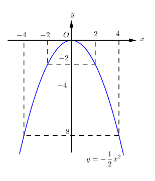
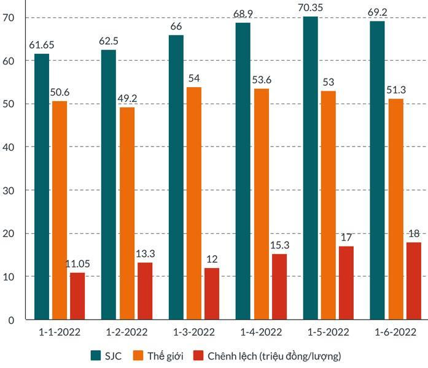
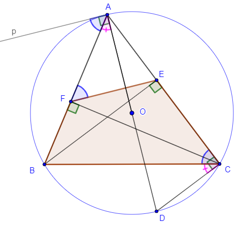

# ĐỀ THAM KHẢO THI TUYỂN SINH VÀO 10 - ĐỀ SỐ 1 MÔN TOÁN Thời gian: 120 phút BIÊN SOẠN: BAN CHUYÊN MÔN LOIGIAIHAY.COM

Câu 1 (1,5 điểm): Cho hàm số 2 2 x y -

a) Vẽ đồ thị (P) của hàm số trên.
b) Tìm các điểm thuộc đồ thị (P) có tung độ bằng một nửa hoành độ và khác (0;0).
Câu 2 (1 điểm): Cho phương trình 2 4 1 0 x x  -

a) Chứng minh phương trình trên có hai nghiệm phân biệt.
b) Không giải phương trình, hãy tính giá trị của biểu thức
1 2 2 1 5 2 x x A x x    .
Câu 3 (1,5 điểm): Tình trạng chênh lệch giữa giá vàng Việt Nam với quốc tế kéo dài sẽ khiến cho nền kinh tế nói chung và thị trường vàng nói riêng đều phải gánh thiệt hại. Đối với nền kinh tế, chênh lệch giá vàng quá cao gây ra tình trạng nhập lậu vàng và điều đó sẽ tác động lên tỉ giá chợ đen cũng như gây “chảy máu” ngoại tệ. Dưới đây là biểu đồ chênh lệch giá vàng trong nước và thế giới 6 tháng đầu năm 2022.

a) Trong bảng trên, mức chênh lệch giá vàng lớn nhất là bao nhiêu và vào lúc nào?
b) Chọn ngẫu nhiên 1 tháng trong 6 tháng đầu năm 2022. Tính xác suất các biến cố sau:
A: “Tháng được chọn có mức độ chênh lệch không quá 15 triệu”.
B: “Tháng được chọn có mức độ chênh lệch lớn hơn 16 triệu”.

2 Câu 4 (1 điểm): Một hộp bánh kẹo có dạng hình hộp chữ nhật với chiều dài 20cm, chiều rộng 10cm và chiều cao 5cm. Để giảm chi phí sản xuất, nhà sản xuất quyết định giữ nguyên chiều cao của hộp là 5cm, nhưng chiều dài và chiều rộng sẽ cùng giảm đi x (centimét).
a) Viết biểu thức V biểu diễn theo x thể tích hộp bánh kẹo sau khi giảm.
b) Biết rằng thể tích của hộp bánh giảm đi 15%. Tính giá trị của x (làm tròn đến hàng phần trăm của
centimét).
Câu 5 (1 điểm): Phở, món ăn quốc dân của Việt Nam, đã trở nên nổi tiếng trên toàn thế giới và được mọi người ưa thích. Từng miếng thịt mềm mại, nước dùng đậm đà và hương vị phong phú của gia vị đã làm say đắm biết bao thực khách.
Quán nhà bạn An dùng 1 chiếc nồi hình trụ có bán kính đáy nồi là 25cm, chiều cao nồi là 0,8m để nấu nước lèo phở bò.
Sau khi vớt xương và các gia vị thì lượng nước lèo trong nồi chiếm 90% thể tích nồi.
a) Tính thể tích nồi nước lèo nhà bạn An nấu, biết lượng nước lèo trong nồi chiếm 90% thể tích nồi. (ghi kết
quả đến 3 cm )
b) Để bán phở bò, mỗi lần bán 1 tô phở, mẹ bạn An dùng cái vá có dạng nửa hình cầu bán kính 6,5cm và múc
đúng 1 vá cho mỗi tô. Hỏi sau khi bán hết phở bò thì quán nhà bạn An thu được bao nhiêu tiền? Biết giá 1 tô phở bò là 35 000 đồng.
(biết công thức tính thể tích hình trụ là 2 3,14. . V r h  và công thức tính thể tích hình cầu là 3 4.3,14. 3 V R  ) Câu 6 (1 điểm): “Vàng 24K còn được gọi là vàng ròng (là loại vàng tinh khiết nhất, gần như không có pha lẫn tạp chất, có giá trị cao nhất trong các loại vàng) là một kim loại có ánh kim đậm nhất nhưng khá mềm.
Trong ngành công nghệ chế tạo trang sức”.
Một món trang sức được làm từ vàng 14K có thể tích 3 10cm và nặng 151,8g. Hãy tính thể tích vàng nguyên chất và đồng được dùng để làm ra món trang sức biết khối lượng riêng của vàng nguyên chất là 3 19,3 / g cm , khối lượng riêng của đồng là 3 9 / g cm và công thức liên hệ giữa khối lượng riêng và thể tích là m = D.V.
Câu 7 (3 điểm): Cho tam giác ABC ba góc nhọn nội tiếp (O;R), hai đường cao BE, CF cắt nhau tại H.
a) Chứng minh tứ giác BFCE nội tiếp và AO
EF \perp

b) Chứng minh:
2 2 sin o 1 BAC c s BAC   và 2 2 2 2. . . BC AB AC AB AC cosBAC   -

c) Gọi S là diện tích tam giác ABC, chứng minh
1 . .sin 2 S AB AC BAC  . Cho 6; 8; 2 13 AB AC BC    .
Tính diện tích tam giác ABC.

---
*------------------- HẾT -------------------*

---

## 📖 ĐÁP ÁN & HƯỚNG DẪN GIẢI CHI TIẾT

<b>Click để xem lời giải chi tiết 🔍</b>

a) Vẽ đồ thị (P) của hàm số trên.
b) Tìm các điểm thuộc đồ thị (P) có tung độ bằng một nửa hoành độ và khác (0;0).

**Phương pháp**

a) Lập bảng giá trị, vẽ đồ thị hàm số trên hệ trục tọa độ.
b) Viết dạng biểu diễn của các điểm có tung độ bằng một nửa hoành độ thuộc (P).
Giải phương trình biểu diễn tung độ = 1 2 hoành độ, ta được điểm thỏa mãn.
Kết hợp với điều kiện điểm cần tìm khác (0;0).

**Lời giải**

a) Ta có bảng giá trị sau:
x - 4 - 2 0 2 4 2 2 x y -

Đồ thị hàm số là đường cong parabol đi qua các điểm       4; 8 ;
2; 2 ; 0;0 ; 2; 2 ; 4; 8
- - - - - - .
Ta vẽ được đồ thị hàm số 2 2 x y -
như sau:

b) Tìm các điểm thuộc đồ thị (P) có tung độ bằng một nửa hoành độ.
Điểm có tung độ và hoành độ bằng nhau có dạng 0 0; 2 x M x ( ) ( ) ( ) thì 2 0 0 2 2 x x -

4 Suy ra 2 0 0 x x -

  2 0 0 0 0 0 1 0 x x x x    

0 0 x  và 0 1 x -
Ta được các điểm   0;0 và 1 1; 2 ( ) - - ( ) ( ) . Mà   0;0 M \ne .
Vậy điểm M thuộc (P) có tung độ bằng một nửa hoành độ là 1 1; 2 M ( ) - - ( ) ( ) .
Câu 2 (1 điểm): Cho phương trình 2 4 1 0 x x  -

a) Chứng minh phương trình trên có hai nghiệm phân biệt.
b) Không giải phương trình, hãy tính giá trị của biểu thức
1 2 2 1 5 2 x x A x x   

**Phương pháp**

a) Kiểm tra nghiệm của phương trình theo .a c .
b) Áp dụng định lí Viète và biến đổi.
Định lí Viète:
1 2 1 2 ; b c x x x x a a -
  

**Lời giải**

a) Phương trình
2 1 0 x x  - có   . 1. 1 1 0 a c  -
- < nên phương trình có hai nghiệm phân biệt 1 2 , x x .
b) Áp dụng định lí Viète, ta có:
1 2 1 2 4 4 1 1 1 1 x x x x -
\begin{cases}   -
 -
  -
\end{cases}

Ta có: 1 2 2 1 5 2 x x A x x   

5       1 2 2 1 2 2 1 2 1 2 2 2 1 1 2 2 1 2 1 2 2 1 2 1 2 1 2 2 5 2 5 . 2 2 2 5 . 2 2 5 . 2 4 2. 1 5 1 2 16 2 5 1 2 5 31 18 2 2 x x A x x x x x x x x x x x x x x x x x x x x         -
   -
 
- - -
  -
   -
-
 -

Vậy 31 2 A -
.
Câu 3 (1,5 điểm): Tình trạng chênh lệch giữa giá vàng Việt Nam với quốc tế kéo dài sẽ khiến cho nền kinh tế nói chung và thị trường vàng nói riêng đều phải gánh thiệt hại. Đối với nền kinh tế, chênh lệch giá vàng quá cao gây ra tình trạng nhập lậu vàng và điều đó sẽ tác động lên tỉ giá chợ đen cũng như gây “chảy máu” ngoại tệ. Dưới đây là biểu đồ chênh lệch giá vàng trong nước và thế giới 6 tháng đầu năm 2022.

a) Trong bảng trên, mức chênh lệch giá vàng lớn nhất là bao nhiêu và vào lúc nào?
b) Chọn ngẫu nhiên 1 tháng trong 6 tháng đầu năm 2022. Tính xác suất các biến cố sau:
A: “Tháng được chọn có mức độ chênh lệch không quá 15 triệu”.
B: “Tháng được chọn có mức độ chênh lệch lớn hơn 16 triệu”.

6 Phương pháp
a) Quan sát biểu đồ, xác định giá trị lớn nhất của cột Chênh lệch (triệu đồng/lượng).
b) Xác định tổng số tháng.
Dựa vào cột Chênh lệch, xác định các tháng có độ chênh lệch không quá 15 triệu, lớn hơn 16 triệu.
Xác suất của biến cố bằng tỉ số giữa các tháng thỏa mãn với tổng số tháng.

**Lời giải**

a) Mức chênh lệch giá vàng lớn nhất là: 18 triệu đồng/lượng.
b) Tổng số tháng trong biểu đồ là 6 tháng.
Có 3 tháng có mức độ chênh lệch không quá 15 triệu là: tháng 1, tháng 2, tháng 3.
Xác suất tháng được chọn có mức độ chênh lệch không quá 15 triệu là: 3 1 6 2 

Có 2 tháng có mức độ chênh lệch lớn hơn 16 triệu là: tháng 5, tháng 6.
Xác suất tháng được chọn có mức độ chênh lệch lớn hơn 16 triệu là: 2 1 6 3  .
Câu 4 (1 điểm): Một hộp bánh kẹo có dạng hình hộp chữ nhật với chiều dài 20cm, chiều rộng 10cm và chiều cao 5cm. Để giảm chi phí sản xuất, nhà sản xuất quyết định giữ nguyên chiều cao của hộp là 5cm, nhưng chiều dài và chiều rộng sẽ cùng giảm đi x (centimét).
a) Viết biểu thức V biểu diễn theo x thể tích hộp bánh kẹo sau khi giảm.
b) Biết rằng thể tích của hộp bánh giảm đi 15%. Tính giá trị của x (làm tròn đến hàng phần trăm của
centimét). Phương pháp
a) Tính chiều dài và chiều rộng sau khi giảm đi x centimét.
Viết biểu thức V thể tích của hộp bánh kẹo theo công thức tính thể tích hình hộp chữ nhật:
V = chiều dài.chiều rộng.chiều cao
b) Tính thể tích hộp bánh sau khi giảm đi 15% .
Từ biểu thức V ta lập phương trình bậc hai một ẩn x . Giải phương trình để tìm x .

**Lời giải**

a) Chiều dài của hộp bánh kẹo sau khi giảm là:
  20 x cm -

Chiều rộng của hộp bánh kẹo sau khi giảm là:
  10 x cm -

Thể tích của hộp bánh kẹo sau khi giảm là:
    3 5. 20 10 x x cm - -

b) ĐKXĐ: 0 10 x < <

Thể tích của hộp bánh kẹo sau khi giảm thể tích là:
    3 5.20.10. 100% 15% 850 cm -


Ta có phương trình biểu diễn thể tích của hộp bánh kẹo sau khi giảm:

7       2 2 5. 20 10 850 20 10 170 30 200 170 30 30 0 x x x x x x x x - -

- -
 -
  -
 

Ta có:
  2 ' 15 30 195 0 \Delta-
-
 > nên phương trình có hai nghiệm phân biệt: 1 15 195 1,04 x  -


(TM); 2 15 195 28,96 x    (L) Vậy giá trị của x khoảng 1,04cm.
Câu 5 (1 điểm): Phở, món ăn quốc dân của Việt Nam, đã trở nên nổi tiếng trên toàn thế giới và được mọi người ưa thích. Từng miếng thịt mềm mại, nước dùng đậm đà và hương vị phong phú của gia vị đã làm say đắm biết bao thực khách.
Quán nhà bạn An dùng 1 chiếc nồi hình trụ có bán kính đáy nồi là 25cm, chiều cao nồi là 0,8m để nấu nước lèo phở bò. Sau khi vớt xương và các gia vị thì lượng nước lèo trong nồi chiếm 90% thể tích nồi.
a) Tính thể tích nồi nước lèo nhà bạn An nấu, biết lượng nước lèo trong nồi chiếm 90% thể tích nồi. (ghi kết
quả đến 3 cm )
b) Để bán phở bò, mỗi lần bán 1 tô phở, mẹ bạn An dùng cái vá có dạng nửa hình cầu bán kính 6,5cm và múc
đúng 1 vá cho mỗi tô. Hỏi sau khi bán hết phở bò thì quán nhà bạn An thu được bao nhiêu tiền? Biết giá 1 tô phở bò là 35 000 đồng.
(biết công thức tính thể tích hình trụ là 2 3,14. . V r h  và công thức tính thể tích hình cầu là 3 4.3,14. 3 V R  ) Phương pháp
a) Đổi về cùng đơn vị.
Lượng nước lèo trong nồi = 90% thể tích nồi (tính theo công thức tính thể tích hình trụ).
b) Tính thể tích 1 vá nước lèo = 1
2 thể tích hình cầu (tính theo công thức tính thể tích hình cầu).
Lấy thể tích nước lèo : thể tích 1 vá nước lèo, xác định số tô phở bò quán nhà bạn An bán được (lưu ý làm tròn xuống).
Số tiền thu được = giá một tô phở . số tô bán được.

**Lời giải**

a) Đổi 0,8m = 80cm.
Lượng nước lèo trong nồi nhà bạn An nấu là:
  2 3 90%.3,14.25 .80 141300 cm 

b) Thể tích 1 vá nước lèo là:

8   3 3 1 4 . .3,14.6,5 574,88 2 3 V cm  

Vì 141300:574,88 245,79  nên số tô phở bò quán nhà bạn An bán được khoảng 245 tô.
Sau khi bán hết phở bò thì quán nhà bạn An thu được số tiền là:
35000.245 8575000  (đồng) Vậy sau khi bán hết phở bò thì quán nhà bạn An thu được 8 575 000 đồng.
Câu 6 (1 điểm): “Vàng 24K còn được gọi là vàng ròng (là loại vàng tinh khiết nhất, gần như không có pha lẫn tạp chất, có giá trị cao nhất trong các loại vàng) là một kim loại có ánh kim đậm nhất nhưng khá mềm. Trong ngành công nghệ chế tạo trang sức”.
Một món trang sức được làm từ vàng 14K có thể tích 3 10cm và nặng 151,8g. Hãy tính thể tích vàng nguyên chất và đồng được dùng để làm ra món trang sức biết khối lượng riêng của vàng nguyên chất là 3 19,3 / g cm , khối lượng riêng của đồng là 3 9 / g cm và công thức liên hệ giữa khối lượng riêng và thể tích là m = D.V.

**Phương pháp Gọi   3 , ; , 0 x y cm x y \ge lần lượt là thể tích của vàng nguyên chất và đồng có trong món trang sức.**

Viết phương trình biểu diễn thể tích và cân nặng của vàng và đồng theo ,x y .
Giải hệ phương trình vừa lập.
Kiểm tra lại điều kiện và kết luận.

**Lời giải Gọi   3 , ; , 0 x y cm x y \ge lần lượt là thể tích của vàng nguyên chất và đồng có trong món trang sức.**

Vì món trang sức có thể tích 3 10cm nên ta có:
10 x y   (1) Khối lượng vàng nguyên chất trong món trang sức là: 19,3x (g).
Khối lượng đồng trong món trang sức là: 9y (g).
Vì món trang sức nặng 151,8g nên ta có: 19,3 9 151,8 x y   (2) Từ (1) và (2) ta có hệ phương trình:
  10 19,3 9 151,8 9 9 90 19,3 9 151,8 10,3 61,8 10 6 4 x y x y x y x y x y x x TM y   \begin{cases}

  \end{cases}   \begin{cases}

  \end{cases}  \begin{cases}


- \end{cases}
 \begin{cases}

 \end{cases}

9 Vậy thể tích của vàng nguyên chất trong món trang sức là 3 6 / g cm ; thể tích của đồng trong món trang sức là 3 4 / g cm .
Câu 7 (3 điểm): Cho tam giác ABC ba góc nhọn nội tiếp (O;R), hai đường cao BE, CF cắt nhau tại H.
a) Chứng minh tứ giác BFCE nội tiếp và AO
EF \perp

b) Chứng minh:
2 2 sin o 1 BAC c s BAC   và 2 2 2 2. . . BC AB AC AB AC cosBAC   -

c) Gọi S là diện tích tam giác ABC, chứng minh
1 . .sin 2 S AB AC BAC  . Cho 6; 8; 2 13 AB AC BC    .
Tính diện tích tam giác ABC.

**Phương pháp**

a) Chứng minh tứ giác BFCE nội tiếp
Chứng minh tam giác BEC và tam giác CFB vuông tại E và F nên cùng nội tiếp đường tròn đường kính BC, do đó tứ giác BFCE nội tiếp đường tròn đường kính BC.
Chứng minh: AO EF \perp

Kẻ tiếp tuyến tại A của (O), suy ra 90 pAO  ^\circ Chứng minh pAB ACB  (hai góc phụ hai góc bằng nhau) và AFE ACB  (tính chất hai góc đối trong tứ giác nội tiếp và hai góc kề bù).
Suy ra pAB AFE  , hai góc so le trong nên Ap // EF.
Dẫn đến AO EF \perp

b) Chứng minh
2 2 sin o 1 BAC c s BAC   Sử dụng tỉ số lượng giác trong tam giác AEB vuông tại E để biểu diễn sin ,cos BAC BAC .
Sử dụng định lí Pythagore trong tam giác vuông ABE để chứng minh.
Chứng minh 2 2 2 2. . . BC AB AC AB AC cosBAC   -

Áp dụng định lý Pythagore trong tam giác BEC vuông tại E, biến đổi 2 CE theo AC và AE .
Suy ra 2 BC theo BE, AC, AE.
Kết hợp với tỉ số lượng giác cosBAE để chứng minh.
c) Chứng minh:
1 . .sin 2 S AB AC BAC 

Viết công thức tính diện tích tam giác ABC theo BE và AC.
Kết hợp hệ thức lượng trong tam giác vuông để biến đổi BE theo AB, ta được đpcm.
Tính diện tích tam giác ABC Dựa vào 2 2 2 2. . . BC AB AC AB AC cosBAC   -
, thay số để tính cos BAC .
Kết hợp với 2 2 sin o 1 BAC c s BAC   suy ra sin BAC .
Thay vào công thức 1 . .sin 2 S AB AC BAC  . Lời giải

a) Chứng minh tứ giác BFCE nội tiếp
Xét tam giác BEC ta có:
BE AC \perp (BE là đường cao trong tam giác ABC) Nên tam giác BEC vuông tại E. Do đó B, E, C cùng thuộc đường tròn đường kính BC (1) Xét tam giác CFB ta có:
CF AB \perp (CF là đường cao trong tam giác ABC) Nên tam giác CFB vuông tại F. Do đó C, F, B cùng thuộc đường tròn đường kính BC (2) Từ (1) và (2) suy ra B, F, E, C cùng thuộc đường tròn đường kính BC.
Hay tứ giác BFEC nội tiếp.
Chứng minh: AO EF \perp

Kẻ tiếp tuyến tại A của (O), suy ra 90 pAO  ^\circ Kẻ tia AO cắt (O) tại D, khi đó AD là đường kính, suy ra 90 ACD  ^\circ (góc nội tiếp chắn nửa đường tròn) Ta có: 90 pAB BAD pAO    ^\circ 90 ACB BCD ACD    ^\circ Mà BAD BCD  (hai góc nội tiếp cùng chắn cung BD trong (O)) Do đó pAB ACB  (3) Ta lại có: 180 ACB BFE   ^\circ(tứ giác BFEC nội tiếp) Và 180 AFE BFE   ^\circ (hai góc kề bù) Nên AFE ACB  (4) Từ (3), (4) suy ra pAB AFE 

Mà ;
pAB AFE ở vị trí so le trong nên Ap // EF Kết hợp AO Ap \perp (vì Ap là tiếp tuyến).
Vậy AO EF \perp

b) Chứng minh
2 2 sin o 1 BAC c s BAC   Xét tam giác AEB vuông tại E, ta có:
sin BE AB BAE  suy ra 2 2 2 sin BE AB BAE 

cos AE AB BAE  suy ra 2 2 2 cos AE AB BAE 

Nên 2 2 2 2 2 2 2 2 2 sin BE AE BE AE cos AB AB AB BAE BAE     

Mà 2 2 2 BE AE AB   (Định lí Pythagore trong tam giác ABE vuông tại E) Do đó 2 2 2 2 2 2 2 2 2 2 2 sin 1 BE AE BE AE AB cos AB AB AB AB BAE BAE        Hay 2 2 sin o 1 BAC c s BAC   (góc BAE cũng là BAC ) Chứng minh 2 2 2 2. . . BC AB AC AB AC cosBAC   -

Áp dụng định lý Pythagore trong tam giác BEC vuông tại E ta có:
2 2 2 BC BE CE  

Mà 2 2 2 2 ( ) 2. . CE AC AE AC AC AE AE  -
 -


Nên 2 2 2 2 2. . BC BE AC AC AE AE   -


  2 2 2 2 2. . BC BE AE AC AC AE    -

Ta lại có: 2 2 2 BE AE AB   (cmt) cos AE AB BAE  (cmt) suy ra AE = AB.cos AB.cos BAE BAC 

Vậy 2 2 2 2. . . BC AB AC AB AC cosBAC   -

c) Chứng minh:
1 . .sin 2 S AB AC BAC 

Ta có: 1 . 2 S BE AC 

Mà .sin BE AB BAC  (hệ thức giữa cạnh và góc trong tam giác ABE vuông tại E) Vậy 1 . .sin 2 S AB AC BAC 

Tính diện tích tam giác ABC Ta có: 2 2 2 2. . . BC AB AC AB AC cosBAC  
- (cmt)

12 2 2 2 13) (2 6 8 2.6.8.cosBAC  
- suy ra 1 2
cosBAC 

Mà 2 2 sin o 1 BAC c s BAC  (cmt) suy ra 2 3 1 2 sin o BAC c s BAC -
 

Vậy 1 1 3 . .sin .6.8. 12 3 2 2 2 S AB AC BAC   

