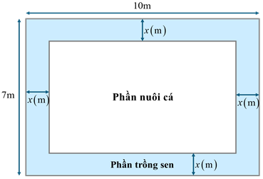
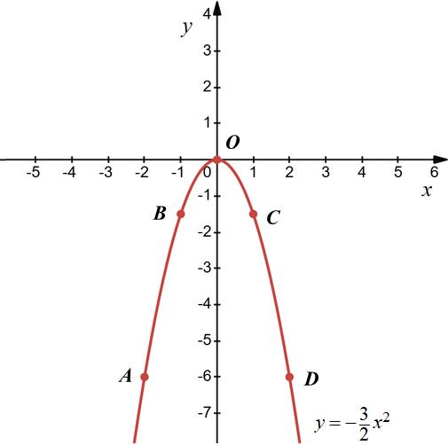
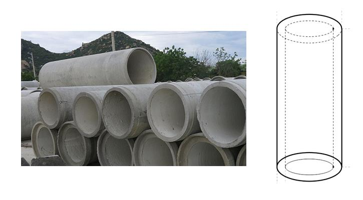
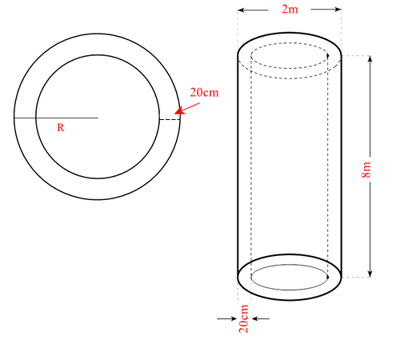
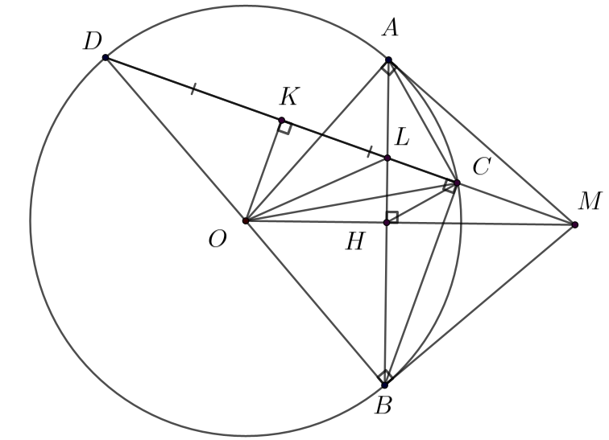

# ĐỀ THAM KHẢO THI TUYỂN SINH VÀO 10 - ĐỀ SỐ 5 MÔN TOÁN Thời gian: 120 phút BIÊN SOẠN: BAN CHUYÊN MÔN LOIGIAIHAY.COM

Câu 1 (1,5 điểm): Cho parabol 2 3 ( ) : 2 P y x -
. a) Vẽ ( ) P trên mặt phẳng tọa độ Oxy .
b) Tìm tọa độ những điểm thuộc (P) có tung độ bằng 6
- .
Câu 2 (1 điểm): Cho phương trình     2 2 4 1 x x x -
 -
a) Chứng tỏ phương trình có 2 nghiệm phân biệt.
b) Hãy tính giá trị của biểu thức
  
- -
  2 2 2 1 1 2 2 1 2 4 4 3 . 3 3 A x x x x x x .
Câu 3 (1,5 điểm): Thống kê điểm kiểm tra môn Anh Văn của các học sinh lớp 9A được cho bởi bảng sau:

Điểm số 7 8 9 10 Tần số tương đối 20% 40% 30% 10%

Chọn ngẫu nhiên 1 học sinh lớp 9A. Biết rằng có 4 học sinh lớp 9A được 10 điểm.
a) Lớp 9A có bao nhiêu học sinh? Có bao nhiêu học sinh đạt điểm khá?
b) Có bao nhiêu học sinh trên 8 điểm? Tính xác suất của biến cố A: “Học sinh được chọn đạt điểm tốt”.
(Biết điểm 7 là điểm khá; từ 8 trở lên là điểm tốt) Câu 4 (1 điểm): Một hồ nước có hình dạng là một hình chữ nhật có chiều dài và chiều rộng lần lượt là 10m và 7 m. Ở giữa hồ nước người ta dự định đổ đất để ngăn hồ thành 2 phần, phần ngoài trồng sen và phần trong nuôi cá (như hình vẽ). Biết khoảng cách các bờ của phần nuôi cá và bờ của hồ nước là x (m).

a) Biểu diễn diện tích của phần nuôi cá theo x .
b) Biết diện tích của phần trồng sen chiếm 3
7 tổng diện tích hồ nước. Hãy tính chiều dài, chiều rộng của phần nuôi cá.

2 Câu 5 (1 điểm): Để chống xói mòn bờ biển, một đơn vị thi công dự định làm các cống bê tông hình trụ như hình bên. Biết bề dày của cống bê tông là 20cm, chiều cao là 8m, đường kính đáy của hình trụ lớn là 2m.

a) Tính thể tích bê tông cần có để làm được 1 cống (lấy
3,14 \pi , làm tròn đến hàng đơn vị của 3 m ).
b) Biết rằng cứ 20m bờ biển thì cần 30 cống,
3 1m bê tông có giá 0,8 triệu đồng và 1 cống bê tông cần 5,2 triệu đồng tiền sắt. Tính số tiền vật tư làm cống để kè được 1km bờ biển.
Câu 6 (1 điểm): Một công ty du lịch dự định tổ chức một tour du lịch xuyên Việt nhân kỉ niệm ngày giải phóng hoàn toàn miền Nam 30/4.
a) Công ty dự kiến thuê hai loại xe: xe 45 chỗ và xe 30 chỗ để chở đoàn khách du lịch. Biết rằng số nhân
viên của công ty là 390 người. Nếu tất cả mọi người đi thì tổng số xe cần thuê là 10 chiếc. Hỏi công ty cần thuê bao nhiêu xe mỗi loại?
b) Công ty dự định nếu giá tour là 2 triệu đồng thì sẽ có khoảng 200 người tham gia. Để thu hút nhiều người
tham gia, công ty sẽ quyết định giảm giá, cứ mỗi lần giảm giá 100 nghìn đồng/tour thì sẽ có thêm 20 người tham gia. Hỏi công ty phải giảm giá tour còn bao nhiêu để doanh thu từ tour xuyên Việt đó là lớn nhất?
Câu 7 (3 điểm): Cho điểm M nằm ngoài đường tròn (O; R). Qua M kẻ hai tiếp tuyến MA, MB. Vẽ đường kính BD và MD cắt  O tại C. Gọi H là giao điểm của MO và AB.
a) Chứng minh tứ giác MAOB nội tiếp và
2 . MA MC MD  .
b) Gọi K là trung điểm của CD, L là giao điểm của AH và MC. Chứng minh
. . MH MO ML MK  . c) Cho 3 AB R  và 30 MHC  ^\circ. Tính MH và bán kính đường tròn ngoại tiếp tam giác OLH theo R.

---
*------------------- HẾT -------------------*

---

## 📖 ĐÁP ÁN & HƯỚNG DẪN GIẢI CHI TIẾT

<b>Click để xem lời giải chi tiết 🔍</b>

. a) Vẽ ( ) P trên mặt phẳng tọa độ Oxy .
b) Tìm tọa độ những điểm thuộc (P) có tung độ bằng 6
- . Phương pháp
a) Lập bảng giá trị, vẽ đồ thị hàm số trên hệ trục tọa độ.
b) Thay 6
y - vào hàm số 2 3 2 y x -
để tìm các giá trị x tương ứng.
Giải phương trình để tìm N thoả mãn.

**Lời giải**

a) Ta có bảng giá trị sau:
x - 2 - 1 0 1 2 2 3 2 y x -

- 6 3 2 -

0 3 2 -

- 6
Đồ thị hàm số 2 3 2 y x -
đi qua các điểm       3 3 2; 6 , 1; , 0;0 , 1; , 2; 6 2 2 A B O C D ( ) ( ) - - - - - - ( ) ( ) ( ) ( ) .

b) Các điểm thuộc (P) có tung độ bằng - 6 nên thay
6 y - vào 2 3 2 y x -
ta được:

4 2 2 2 3 6 2 3 6: 2 4 2 x x x x -
-
( ) -
- ( ) ( )
 \pm

Vậy điểm thuộc đồ thị 2 3 2 y x -
có tung độ bằng 6
- là (2; 6) - và ( 2; 6) - - .
Câu 2 (1 điểm): Cho phương trình     2 2 4 1 x x x -
 -
a) Chứng tỏ phương trình có 2 nghiệm phân biệt.
b) Hãy tính giá trị của biểu thức
  
- -
  2 2 2 1 1 2 2 1 2 4 4 3 . 3 3 A x x x x x x . Phương pháp
a) Đưa phương trình về dạng phương trình bậc hai một ẩn.
Sử dụng 2 4 b ac \Delta -
để kiểm tra nghiệm của phương trình.
b) Áp dụng định lí Viète và biến đổi A để xuất hiện tổng và tích của hai nghiệm.
Thay tổng, tích vào A để tính toán dễ dàng trong quá trình biến đổi.
Định lí Viète:
1 2 1 2 ; b c x x x x a a -
  

**Lời giải**

a) Ta có: 
   2 2 4 1 x x x -
 -
- -
 -
 2 2 2 4 4 1 0 3 4 1 0 x x x x x

Ta có:
  \Delta-
-
 -
 > 2 4 4.3.1 16 12 4 0 nên phương trình có 2 nghiệm phân biệt.
b) Theo định lí Viète, ta có:
-
 -
  1 2 1 2 4 4 1 ; . 3 3 3 x x x x

Ta có:
  
- -
  2 2 2 1 1 2 2 1 2 4 4 3 . 3 3 A x x x x x x

    
- - -
 2 2 2 1 2 1 2 1 2 4 9 . 3 x x x x x x

        -

- -
 2 1 2 1 2 1 2 1 2 4 . . 9 . 3 x x x x x x x x

Thay 1 2 4 3 x x   vào A, ta được:
       
- - -
 ( )    ( ) ( ) 2 1 2 1 2 1 2 2 2 1 2 4 4 . . 9 . 3 3 1 9 . 9 1 3 x x x x x x x x

Vậy 1 A  Câu 3 (1,5 điểm): Thống kê điểm kiểm tra môn Anh Văn của các học sinh lớp 9A được cho bởi bảng sau:
Điểm số 7 8 9 10 Tần số tương đối 20% 40% 30% 10%

Chọn ngẫu nhiên 1 học sinh lớp 9A. Biết rằng có 4 học sinh lớp 9A được 10 điểm.
a) Lớp 9A có bao nhiêu học sinh? Có bao nhiêu học sinh đạt điểm khá?
b) Có bao nhiêu học sinh trên 8 điểm? Tính xác suất của biến cố A: “Học sinh được chọn đạt điểm tốt”.
(Biết điểm 7 là điểm khá; từ 8 trở lên là điểm tốt) Phương pháp
a) Xác định tần số tương đối tương ứng với số học sinh được 10 điểm.
Từ đó tính số học sinh khi biết số phần trăm tương ứng với 4 học sinh.
Xác định tần số tương đối của số học sinh đạt điểm khá (điểm 7).
Từ đó tính số học sinh đạt điểm khá bằng cách tính tỉ số phần trăm của số học sinh.
b) Xác định tỉ số phần trăm số học sinh trên điểm 8 = tần số tương đối của điểm 9 và điểm 10.
Từ đó tính số học sinh trên 8 điểm bằng cách tính tỉ số phần trăm của số học sinh.
Xác suất của biến cố A: “Học sinh được chọn đạt điểm tốt” chính là tổng tần số tương đối của học sinh đạt điểm tốt (từ 8 điểm trở lên).

**Lời giải**

a) Số học sinh đạt điểm 10 có tần số tương đối là 10% nên số học sinh lớp 9A là:
10 4:10% 4: 40 100   (học sinh) Số học sinh đạt điểm khá (điểm 7) có tần số tương đối là 20% nên số học sinh đạt điểm khá là:
20 40.20% 40. 8 100   (học sinh)
b) Tần số tương đối của học sinh được chọn đạt trên 8 điểm là:
30% + 10% = 40% Số học sinh đạt trên 8 điểm là:
40.40% 16  (học sinh) Tổng tần số tương đối của học sinh đạt điểm tốt (từ 8 điểm trở lên) là:
40% 30% 10% 80%   

Do đó xác suất của biến cố A là:
 80% 0,8 P A   .
Câu 4 (1 điểm): Một hồ nước có hình dạng là một hình chữ nhật có chiều dài và chiều rộng lần lượt là 10m và 7 m. Ở giữa hồ nước người ta dự định đổ đất để ngăn hồ thành 2 phần, phần ngoài trồng sen và phần trong nuôi cá (như hình vẽ). Biết khoảng cách các bờ của phần nuôi cá và bờ của hồ nước là x (m).

a) Biểu diễn diện tích của phần nuôi cá theo x .
b) Biết diện tích của phần trồng sen chiếm 3
7 tổng diện tích hồ nước. Hãy tính chiều dài, chiều rộng của phần nuôi cá.

6 Phương pháp
a) Biểu diễn chiều dài và chiều rộng của phần nuôi cá theo x
Biểu diễn diện tích phần nuôi theo công thức tính diện tích hình chữ nhật.
b) Tính diện tích của phần trồng sen dựa vào diện tích hồ nước.
Từ đó ta tính được diện tích của phần nuôi cá và lập được phương trình.
Giải phương trình để tìm chiều dài, chiều rộng của phần nuôi cá.

**Lời giải**

a) Chiều dài của phần nuôi cá là: 10
2x - (m).
Chiều rộng của phần nuôi cá là: 7 2x - (m).
Suy ra diện tích của phần nuôi cá là:
     2 2 10 2 7 2 70 14 20 4 4 34 70 x x x x x x x - -

- -
  -
 2 m

b) Diện tích hồ nước là:
  2 7.10 70 m  .
Diện tích của phần trồng sen là:
  2 3.70 30 m 7 

Diện tích của phần nuôi cá là:
  2 70 30 40 -
 m

Ta có phương trình biểu diễn diện tích phần nuôi cá là:
2 2 4 34 70 40 4 34 30 0 x x x x -
  -
 

Giải phương trình trên, ta được 1 x  hoặc 7,5 x  .
Vì chiều rộng của phần nuôi cá là một số dương nên 7 2 0 x - > hay 3,5 x < . Do đó 1 x  thoả mãn.
Suy ra chiều dài của phần nuôi cá là: 10 - 2.1 = 8 (m) chiều rộng của phần nuôi cá là: 7 - 2.1 = 5 (m).
Vậy chiều dài và chiều rộng của phần nuôi cá lần lượt là 8m và 5m.
Câu 5 (1 điểm): Để chống xói mòn bờ biển, một đơn vị thi công dự định làm các cống bê tông hình trụ như hình bên. Biết bề dày của cống bê tông là 20cm, chiều cao là 8m, đường kính đáy của hình trụ lớn là 2m.

a) Tính thể tích bê tông cần có để làm được 1 cống (lấy
3,14 \pi , làm tròn đến hàng đơn vị của 3 m ).
b) Biết rằng cứ 20m bờ biển thì cần 30 cống,
3 1m bê tông có giá 0,8 triệu đồng và 1 cống bê tông cần 5,2 triệu đồng tiền sắt. Tính số tiền vật tư làm cống để kè được 1km bờ biển.

7 Phương pháp Đưa về cùng đơn vị m.
a) Tính bán kính đáy của hình trụ lớn, bán kính phần rỗng.
Từ đó tính thể tích hình trụ lớn, thể tích phần rỗng suy ra thể tích phần bê tông cần để làm cống.
Sử dụng công thức tính thể tích hình trụ:
2 V r h \pi 

b) Tính số tiền vật tư để làm một cống = tiền bê tông + tiền sắt.
Tính số cống cần dùng để kè 1km bờ biển.
Từ đó tính số tiền vật tư làm cống để kè được 1km bờ biển: số cống. số tiền vật tư để làm một cống.

**Lời giải Ta có hình minh hoạ như sau:**

Đổi 20cm = 0,2m
a) Bán kính đáy của hình trụ lớn là: 2 : 2 = 1 (m)
Bán kính phần rỗng là: 1 - 0,2 = 0,8 (m) Thể tích hình trụ lớn là:
  2 2 3 3,14.1 .8 25,12 T T V r h m \pi   

Thể tích phần rỗng là:
  2 2 3 3,14.0,8 .8 16,0768 r r V r h m \pi   

Thể tích phần bê tông cần để làm cống là:
  3 25,12 16,0768 9,0432 9 bt V m  -
 

Vậy thể tích phần bê tông cần để làm cống là khoảng 9 3 m .
b) Số tiền vật tư để làm một cống là:
9.0,8 5,2 12,4   (triệu đồng) Đổi 1km = 1000m Vì cứ 20m bờ biển thì cần 30 cống nên 1km bờ biển cần 1000:20.30 1500  (cống) Do đó số tiền vật tư làm cống để kè được 1km bờ biển là: 1500.12,4 18600  (triệu đồng).

8 Vậy số tiền vật tư làm cống để kè được 1km bờ biển là 18 600 triệu đồng.
Câu 6 (1 điểm): Một công ty du lịch dự định tổ chức một tour du lịch xuyên Việt nhân kỉ niệm ngày giải phóng hoàn toàn miền Nam 30/4.
a) Công ty dự kiến thuê hai loại xe: xe 45 chỗ và xe 30 chỗ để chở đoàn khách du lịch. Biết rằng số nhân
viên của công ty là 390 người. Nếu tất cả mọi người đi thì tổng số xe cần thuê là 10 chiếc. Hỏi công ty cần thuê bao nhiêu xe mỗi loại?
b) Công ty dự định nếu giá tour là 2 triệu đồng thì sẽ có khoảng 200 người tham gia. Để thu hút nhiều người
tham gia, công ty sẽ quyết định giảm giá, cứ mỗi lần giảm giá 100 nghìn đồng/tour thì sẽ có thêm 20 người tham gia. Hỏi công ty phải giảm giá tour còn bao nhiêu để doanh thu từ tour xuyên Việt đó là lớn nhất?

**Phương pháp**

a) Gọi số xe 45 chỗ và số xe 30 chỗ lần lượt là x (xe) và y (xe). (
* 0 , 10; , x y x y < < \in )
Viết phương trình biểu diễn tổng số nhân viên của công ty là 390 người và tổng số xe cần thuê là 10 chiếc theo x và y .
Từ đó lập hệ phương trình.
Giải hệ phương trình để tìm số chiếc xe mỗi loại.
b) Gọi số lần giảm giá 100 nghìn đồng/tour là n (lần) (
* 20, n n < \in ).
Biểu diễn giá của tour và số người tham gia sau khi giảm n lần.
Từ đó ta có biểu thức biểu diễn doanh thu của công ty sau khi giảm giá tour n lần.
Biến đổi biểu thức để tìm giá trị lớn nhất.
Từ đó, tính doanh thu công ty sẽ đạt lớn nhất.

**Lời giải**

a) Gọi số xe 45 chỗ và số xe 30 chỗ lần lượt là x (xe) và y (xe). (
* 0 , 10; , x y x y < < \in )
Số người đi xe 45 chỗ là 45x , số người đi xe 30 chỗ là 30y . Vì tổng số nhân viên của công ty là 390 người nên ta có phương trình:
45 30 390 x y   (1) Vì tổng số xe cần thuê là 10 chiếc nên ta có phương trình:
10 x y   (2) Từ (1) và (2) ta có hệ phương trình:
45 30 390 10 x y x y \begin{cases}

\end{cases}    

Giải hệ phương trình ta được 6 4 x y  \begin{cases}

 \end{cases} (thỏa mãn điều kiện).
Vậy công ty cần thuê 6 chiếc xe 45 chỗ và 4 chiếc xe 30 chỗ.

b) Đổi 100 nghìn đồng = 0,1 triệu đồng
Gọi số lần giảm giá 100 nghìn đồng/tour là n (lần) (
* 20, n n < \in ).
Giá của tour sau n lần giảm là: 2 0,1.n -
(triệu đồng).
Khi đó số người tham gia sau khi giảm n lần là: 200 20 n  (người).
Doanh thu của công ty sau khi giảm giá tour n lần là:
         2 0,1 200 20 20 2 0,1 10 2 20 10 n n n n n n -
  -
  -


Xét biểu thức    20 10 A n n  -


9        2 2 2 20 10 200 10 225 25 10 225 5 A n n n n n n n  -
   -

- -
 
- -

Vì   2 5 0 n - \ge với mọi n nên   2 225 5 225 n - - \le

Dấu “=” xảy ra khi 2 5 0 n -
 suy ra 5 n .
Để doanh thu của công ty sau khi giảm giá tour n lần là lớn nhất thì giá trị biểu thức A phải lớn nhất.
A đạt giá trị lớn nhất khi 5 n .
Khi đó, doanh thu công ty sẽ đạt lớn nhất là 2.225 450  (triệu đồng).
Vậy giá mỗi tour là 2 0,1.5 1,5 -
 triệu đồng thì doanh thu từ tour của công ty là lớn nhất.
Câu 7 (3 điểm): Cho điểm M nằm ngoài đường tròn (O; R). Qua M kẻ hai tiếp tuyến MA, MB. Vẽ đường kính BD và MD cắt  O tại C. Gọi H là giao điểm của MO và AB.
a) Chứng minh tứ giác MAOB nội tiếp và
2 . MA MC MD  .
b) Gọi K là trung điểm của CD, L là giao điểm của AH và MC. Chứng minh
. . MH MO ML MK  . c) Cho 3 AB R  và 30 MHC  ^\circ. Tính MH và bán kính đường tròn ngoại tiếp tam giác OLH theo R.

**Phương pháp**

a) Chứng minh tứ giác MAOB nội tiếp
Chứng minh OAM \Delta và OBM \Delta cùng nội tiếp đường tròn đường kính OM, suy ra M, A, O, B cùng thuộc đường tròn đường kính OM hay MAOB nội tiếp.
Chứng minh 2 . MA MC MD 

Chứng minh MCB MBD \Delta \Delta \backsim (g.g) suy ra MC MB MB MD  , do đó 2 . MB MC MD 

Sử dụng tính chất hai tiếp tuyến cắt nhau suy ra MB MA  nên 2 . MA MC MD  .
b) Chứng minh
. . MH MO MI MK 

Chứng minh ODC \Delta cân tại O có OK là đường trung tuyến nên OK đồng thời là đường cao của ODC \Delta , suy ra OK CD \perp .
Chứng minh OM là đường trung trực của AB.
Mà OM cắt AB tại H nên OM AB \perp tại H và H là trung điểm AB.
Chứng minh MKO MHL \Delta \Delta \backsim (g.g), suy ra MK MO MH ML  , do đó . . MK ML MH MO 

c) Tính MH theo R
Vì H là trung điểm của AB nên tính được HB theo AB.
Sử dụng tỉ số lượng giác trong  OHB \Delta vuông tại H: sin HB HOB OB  suy ra HOB hay MOB .
Sử dụng tỉ số lượng giác trong HBM \Delta vuông tại H: tan MH HBM HB  để tính MH.
Tính bán kính đường tròn ngoại tiếp tam giác OLH theo R

Xét OLH \Delta vuông tại H nên OLH \Delta nội tiếp đường tròn đường kính OL nên bán kính đường tròn ngoại tiếp OLH \Delta là :2 OL . Do đó ta cần tính độ dài OL.
Chứng minh MBO MHB \Delta \Delta \backsim (g.g), suy ra MB MO MH MB  , do đó 2 . MB MH MO 

10 kết hợp với 2 . MB MC MD  (cmt) để có MH MC MD MO 

Chứng minh MCH MOD \Delta \Delta \backsim (c.g.c), suy ra 30 MHC MDO   ^\circ Sử dụng tỉ số lượng giác trong  DKO \Delta vuông tại K: sin KO KDO DO  để tính KO.
Sử dụng tỉ số lượng giác trong OBM \Delta vuông tại B: cos OB MOB OM  để tính OM.
Áp dụng định lí Pythagore vào OKM \Delta vuông tại K để tính MK.
Từ MKO MHL \Delta \Delta \backsim để tính HL.
Tính OH dựa vào OM, MH.
Áp dụng định lí Pythagore vào OLH \Delta vuông tại L để tính OL.
Do đó ta tính được bán kính đường tròn ngoại tiếp OLH \Delta là :2 OL . Lời giải

a) Chứng minh tứ giác MAOB nội tiếp
Xét OAM \Delta vuông tại A ( 90 OAM  ^\circ) nên OAM \Delta nội tiếp đường tròn đường kính OM, suy ra O, A, M cùng thuộc đường tròn đường kính OM (1) Xét OBM \Delta vuông tại B ( 90 OBM  ^\circ) nên OBM \Delta nội tiếp đường tròn đường kính OM, suy ra O, B, M cùng thuộc đường tròn đường kính OM (2) Từ (1) và (2) suy ra M, A, O, B cùng thuộc đường tròn đường kính OM hay MAOB nội tiếp.
Chứng minh 2 . MA MC MD 

Ta có: 90 DCB  ^\circ (góc nội tiếp chắn nửa đường tròn) Xét MCB \Delta và MBD \Delta có: M chung 90 MCB MBD   ^\circ nên MCB MBD \Delta \Delta \backsim (g.g) suy ra MC MB MB MD  , do đó 2 . MB MC MD 

Mà MB MA  (tính chất 2 tiếp tuyến cắt nhau) nên 2 . MA MC MD  .
b) Chứng minh
. . MH MO MI MK 

Xét ODC \Delta có: OD OC  (bán kính) nên ODC \Delta cân tại O.
Mà OK là đường trung tuyến (K là trung điểm CD) nên OK đồng thời là đường cao của ODC \Delta , suy ra OK CD \perp . Ta có:

11 MA MB  (tính chất 2 tiếp tuyến cắt nhau) OA OB  (bán kính) nên OM là đường trung trực của AB.
Mà OM cắt AB tại H nên OM AB \perp tại H và H là trung điểm AB.
Xét MKO \Delta và MHL \Delta có: 90 MKO MHL   ^\circ   , OK CD OM AB \perp \perp . M chung nên MKO MHL \Delta \Delta \backsim (g.g), suy ra MK MO MH ML  , do đó . . MK ML MH MO 

c) Tính MH theo R
Vì H là trung điểm của AB nên 3 2 2 AB R HB  

Xét OHB \Delta vuông tại H, ta có:
3 3 2 sin 2 R HB HOB OB R   

suy ra 60 HOB  ^\circ hay 60 MOB  ^\circ Ta có: 60 HBM MOB   ^\circ (cùng phụ với HMB) Xét HBM \Delta vuông tại H có:
tan tan60 3 2 3 .tan60 2 3 2 MH HBM HB MH R R MH MH R  ^\circ  ^\circ 

Tính bán kính đường tròn ngoại tiếp tam giác OLH theo R Xét OLH \Delta vuông tại H nên OLH \Delta nội tiếp đường tròn đường kính OL nên bán kính đường tròn ngoại tiếp OLH \Delta là :2 OL . Xét MBO \Delta và MHB \Delta có: M chung HBM MOB  (cùng phụ với HMB) nên MBO MHB \Delta \Delta \backsim (g.g), suy ra MB MO MH MB  , do đó 2 . MB MH MO 

Mà 2 . MB MC MD  (cmt) nên . . MH MO MC MD 

suy ra MH MC MD MO 

Xét MCH \Delta và MOD \Delta có: M chung MH MC MD MO  (cmt) nên MCH MOD \Delta \Delta \backsim (c.g.c), suy ra 30 MHC MDO   ^\circ

12 Xét DKO \Delta vuông tại K, ta có:
sin KO KDO DO 

sin30 KO R ^\circ

sin30 . 2 R KO R  ^\circ  . Xét OBM \Delta vuông tại B, ta có:
cos cos60 2 cos60 OB MOB OM R OM R OM R  ^\circ   ^\circ

Áp dụng định lí Pythagore vào OKM \Delta vuông tại K, ta có:
2 2 2 2 2 2 15 4 4 4 R MK MO OK R R  -
 -
 suy ra 15 2 R MK 

Mà MKO MHL \Delta \Delta \backsim (cmt) nên MK KO MH HL 

Do đó 3 . . 3 15 2 2 . 10 15 2 15 2 R R KO MH HL R R MK R    

Ta có: 3 1 2 2 2 OH OM MH R R R  -
 -


Áp dụng định lí Pythagore vào OLH \Delta vuông tại L, ta có:
2 2 2 2 2 2 15 1 2 100 4 5 OL HL OH R R R      suy ra 2 5 OL R 

Xét OLH \Delta vuông tại H nên OLH \Delta nội tiếp đường tròn đường kính OL, do đó bán kính đường tròn ngoại tiếp OLH \Delta là: 2 10 :2 :2 5 10 OL R R   .

