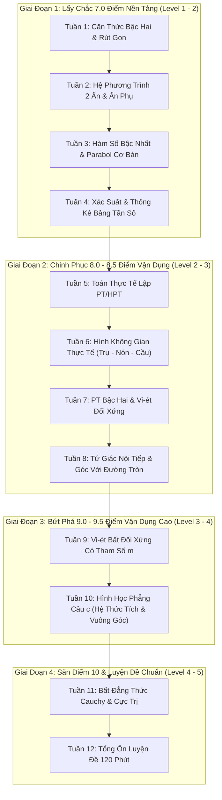

# 📐 Kế Hoạch Tuần Môn Toán Ôn Thi Vào 10 (Math Weekly Curriculum)
### Dành Riêng Cho Bum (14 Tuổi – Học Sinh THCS Lớp 8/9 Chuẩn Bị Thi Tuyển Sinh THPT)

> [!IMPORTANT]
> **Nguyên tắc cốt lõi**:
> 1. **Không phân theo ngày**: Mỗi tuần là một khối chuyên đề hoàn chỉnh gồm 2 tài liệu: `01-kien-thuc-va-phuong-phap.md` (lý thuyết, thuật toán 4 bước, bẫy thi) và `02-bai-tap-thuc-chien.md` (bộ bài tập thực hành).
> 2. **Đi từ dễ lên khó (Level 1 $\rightarrow$ Level 5)**: Giúp Bum đi từng nấc thang điểm từ 5.0 $\rightarrow$ 7.0 $\rightarrow$ 8.5 $\rightarrow$ 9.5+, tích lũy sự tự tin và không bao giờ bị nản lòng vì gặp ngay bài quá khó.
> 3. **Bám sát ngân hàng đề thi thật**: 100% dạng bài được đối chiếu với 21 bộ đề thi tuyển sinh vào lớp 10 chính thức của Hà Nội & TP.HCM.

---

## 🗺️ Lộ Trình 12 Tuần Đi Từ Dễ Lên Khó



---

## 📋 Chi Tiết Từng Tuần Học

### Giai Đoạn 1: Xây Nền Tảng Chắc Điểm 7.0 (Level 1 $\rightarrow$ Level 2)

| Tuần | Tên Thư Mục | Trọng Tâm Kiến Thức | Mục Tiêu Điểm Thi | Trạng Thái |
| :---: | :--- | :--- | :---: | :---: |
| **Tuần 1** | [`week-01-can-thuc-dai-so`](week-01-can-thuc-dai-so/) | Căn bậc hai số học, ĐKXĐ, hằng đẳng thức $\sqrt{A^2}=\|A\|$, rút gọn biểu thức đại số chứa biến $x$, bẫy TRAP-01 & TRAP-02. | **2.0 điểm** | 🟩 Sẵn sàng |
| **Tuần 2** | `week-02-he-phuong-trinh` | Phương pháp thế và cộng đại số, hệ phương trình đặt ẩn phụ (chứa căn, mẫu thức), giải hệ có tham số. | **1.0 điểm** | ⬜ Kế hoạch |
| **Tuần 3** | `week-03-ham-so-va-do-thi` | Đồ thị hàm số bậc nhất $y = ax+b$, vẽ Parabol $(P): y = ax^2$, tìm tọa độ giao điểm giữa $(d)$ và $(P)$. | **1.5 điểm** | ⬜ Kế hoạch |
| **Tuần 4** | `week-04-xac-suat-va-thong-ke` | Đọc số liệu bảng tần số ghép nhóm, biểu đồ đoạn thẳng, xác suất cổ điển của biến cố ngẫu nhiên. | **1.0 điểm** | ⬜ Kế hoạch |

---

### Giai Đoạn 2: Chinh Phục 8.0 – 8.5 Điểm Vận Dụng (Level 2 $\rightarrow$ Level 3)

| Tuần | Tên Thư Mục | Trọng Tâm Kiến Thức | Mục Tiêu Điểm Thi | Trạng Thái |
| :---: | :--- | :--- | :---: | :---: |
| **Tuần 5** | `week-05-toan-thuc-te-dai-so` | Giải bài toán bằng cách lập PT/HPT: chuyển động (quãng đường - vận tốc - thời gian), năng suất làm chung làm riêng, kinh tế phần trăm giảm giá. | **2.0 điểm** | ⬜ Kế hoạch |
| **Tuần 6** | `week-06-hinh-khong-gian-thuc-te` | Diện tích xung quanh, toàn phần và thể tích các hình tròn xoay: hình trụ (thùng nước), hình nón (nón lá, phễu), hình cầu (quả bóng). | **0.5 – 1.0 điểm** | ⬜ Kế hoạch |
| **Tuần 7** | `week-07-pt-bac-hai-va-viet-co-ban` | Công thức nghiệm $\Delta$ và $\Delta'$, điều kiện có 2 nghiệm phân biệt, định lý Vi-ét biểu thức đối xứng ($x_1^2+x_2^2$, $(x_1-x_2)^2$). | **1.5 điểm** | ⬜ Kế hoạch |
| **Tuần 8** | `week-08-hinh-hoc-phang-tu-giac-noi-tiep` | Câu a & b hình học phẳng: Chứng minh 4 điểm cùng thuộc đường tròn (tổng 2 góc đối bằng $180^\circ$, cùng nhìn một cạnh), tiếp tuyến và góc tạo bởi tiếp tuyến - dây cung. | **2.0 điểm** | ⬜ Kế hoạch |

---

### Giai Đoạn 3: Bứt Phá 9.0 – 9.5 Điểm Vận Dụng Cao (Level 3 $\rightarrow$ Level 4)

| Tuần | Tên Thư Mục | Trọng Tâm Kiến Thức | Mục Tiêu Điểm Thi | Trạng Thái |
| :---: | :--- | :--- | :---: | :---: |
| **Tuần 9** | `week-09-pt-bac-hai-va-viet-nang-cao` | Vi-ét có tham số $m$, hệ thức nghiệm bất đối xứng ($x_1 - 2x_2 = 1$), tương giao $(d)$ và $(P)$ cắt nhau tại 2 điểm thỏa mãn điều kiện hoành độ. | **1.0 – 1.5 điểm** | ⬜ Kế hoạch |
| **Tuần 10** | `week-10-hinh-hoc-phang-nang-cao` | Câu c hình học: Chứng minh hệ thức tích ($DM \cdot CA = CF \cdot CO$), chứng minh thẳng hàng, vuông góc, đồng quy bằng tam giác đồng dạng và tỷ số lượng giác. | **1.0 điểm** | ⬜ Kế hoạch |

---

### Giai Đoạn 4: Săn Điểm 10 & Luyện Đề Tuyển Sinh (Level 4 $\rightarrow$ Level 5)

| Tuần | Tên Thư Mục | Trọng Tâm Kiến Thức | Mục Tiêu Điểm Thi | Trạng Thái |
| :---: | :--- | :--- | :---: | :---: |
| **Tuần 11** | `week-11-bat-dang-thuc-cuc-tri` | Câu phân loại điểm 10: Bất đẳng thức Cauchy (AM-GM) cho 2 và 3 số dương, kỹ thuật thêm bớt chọn điểm rơi, tìm GTLN / GTNN biểu thức nhiều biến. | **0.5 – 1.0 điểm** | ⬜ Kế hoạch |
| **Tuần 12** | `week-12-luyen-de-tong-hop` | Bấm giờ làm bài thi thử trọn vẹn 120 phút (Đề Hà Nội & TP.HCM), rèn chiến thuật phân bổ thời gian và tâm lý phòng thi. | **10.0 điểm** | ⬜ Kế hoạch |

---

## 🛠️ Cấu Trúc File Mỗi Tuần

Trong mỗi thư mục tuần `math/lessons/week-<N>-<topic>/`, chỉ sử dụng đúng 3 file:
```
math/lessons/week-<N>-<topic>/
├── week-overview.md              # Mục tiêu tuần, phân tích lỗi sai và lộ trình hoàn thành
├── 01-kien-thuc-va-phuong-phap.md # Toàn bộ lý thuyết, công thức chuẩn, thuật toán 4 bước & bẫy thi
└── 02-bai-tap-thuc-chien.md       # Bộ bài tập sắp xếp từ DỄ LÊN KHÓ (Level 1 -> 4) kèm đáp án
```
