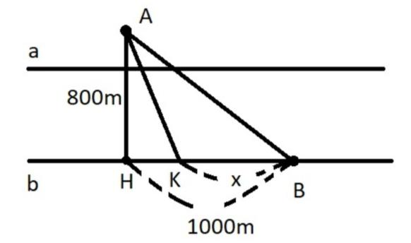
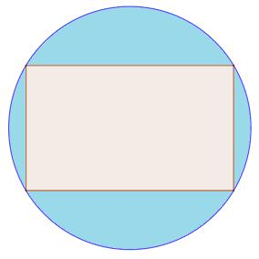
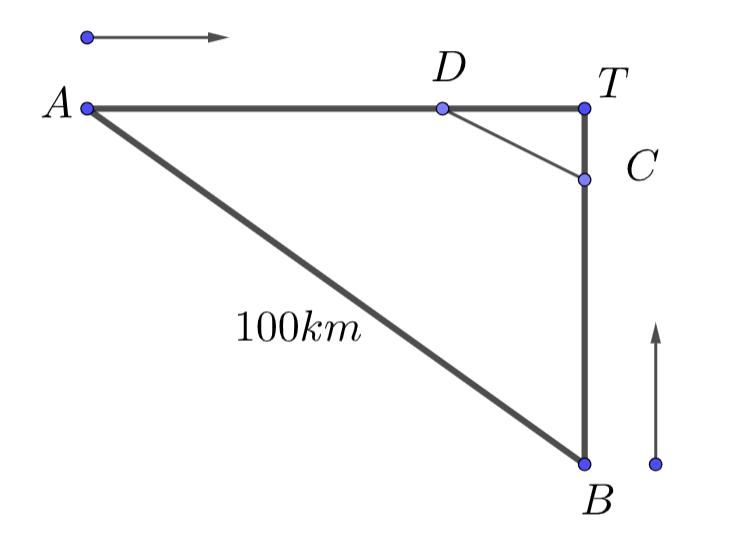
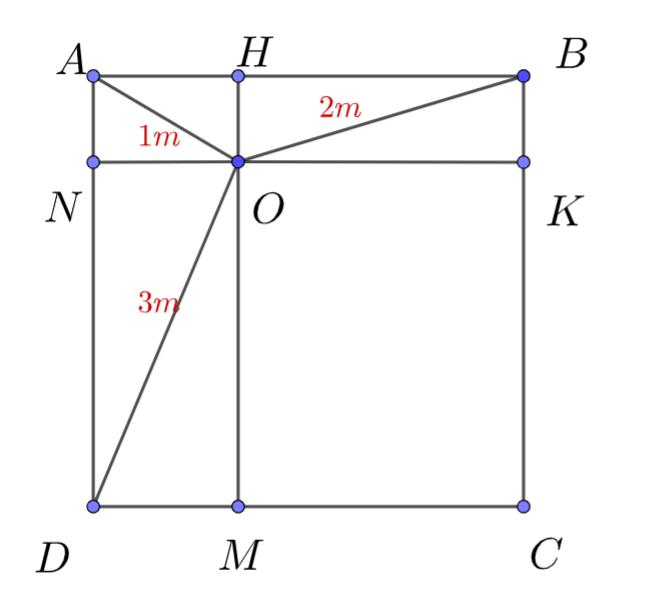
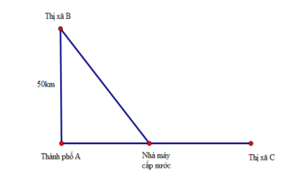
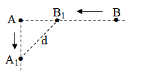
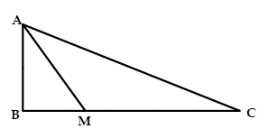
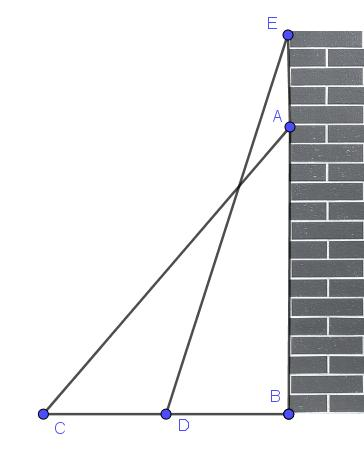
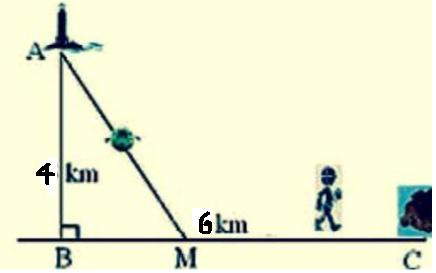

# Chuyen De Can Thuc On Thi Vao 10

TÀI LIỆU THAM KHẢO TOÁN HỌC PHỔ THÔNG CHUẨN BỊ HÀNH TRANG CHO KỲ THI TUYỂN SINH LỚP 10 THPT ______________________________________________________________

------------------------------------------------------------------------------------------

CẨM NANG CĂN THỨC

THÂN TẶNG TOÀN THỂ QUÝ THẦY CÔ VÀ CÁC EM HỌC SINH TRÊN TOÀN QUỐC

CREATED BY GIANG SƠN (FACEBOOK) ĐÁP ÁN CHI TIẾT QUÝ THẦY CÔ VUI LÒNG LIÊN HỆ TÁC GIẢ GACMA1431988@GMAIL.COM (GMAIL); TEL 0398021920

THÀNH PHỐ THÁI BÌNH - THÁNG 5/2025

__________________________

NỘI DUNG PHƯƠNG PHÁP GIẢI TOÁN

ĐIỀU KIỆN XÁC ĐỊNH CĂN THỨC

CÁC PHÉP TOÁN CĂN THỨC

RÚT GỌN BIỂU THỨC CHỨA CĂN ĐƠN GIẢN

RÚT GỌN BIỂU THỨC PHỨC TẠP CHỨA CĂN

PHƯƠNG TRÌNH CHỨA CĂN ĐƠN GIẢN

BẤT PHƯƠNG TRÌNH CHỨA CĂN ĐƠN GIẢN

GIÁ TRỊ NGUYÊN BIỂU THỨC CHỨA CĂN VỚI X NGUYÊN

GIÁ TRỊ NGUYÊN BIỂU THỨC CHỨA CĂN VỚI X THỰC

GIÁ TRỊ LỚN NHẤT, GIÁ TRỊ NHỎ NHẤT BIỂU THỨC CHỨA CĂN

ỨNG DỤNG THỰC TẾ PHƯƠNG TRÌNH CHỨA CĂN

CHUẨN BỊ HÀNH TRANG KỲ THI TUYỂN SINH LỚP 10 THPT PHƯƠNG PHÁP GIẢI TOÁN LỚP 9 THCS CHUYÊN ĐỀ CĂN THỨC ĐIỀU KIỆN XÁC ĐỊNH CĂN THỨC __________________________________________________

KIẾN THỨC CƠ SỞ Biểu thức A xác định khi 0 A \ge . Biểu thức 1 A xác định khi 0 A > . Biểu thức 1 A B - xác định khi 2 0; A A B \ge \ne . Biểu thức 2 A k  luôn xác định với 0 k \ge

GIÁO VIÊN MINH HỌA THÍ DỤ CƠ BẢN, VẬN DỤNG Thí dụ 1. Điều kiện xác định biểu thức A x  là A. 0 x \ge

B. 0 x >

C. 1 x >

D. 0 1 x < < Thí dụ 1. Điều kiện xác định biểu thức 3 B x 
- là A. 3 x \ge

B. 3 x >

C. 3 x <

D. 3 x \le

Thí dụ 3. Điều kiện xác định biểu thức 1 5 C x 
- là A. 6 x \ge

B. 5 x <

C. 5 x \le

D. 5 x >

**Lời giải. Điều kiện xác định 5 0 5 x x - > \implies > .**

Thí dụ 4. Điều kiện xác định biểu thức 2 9 D x 
- là A. 3 x >

B. 3 x <

C. 3 x \ge

D. 3 3 x - < <

**Lời giải. Điều kiện xác định 2 9 0 3 x x - \ge \implies \ge .**

Thí dụ 5. Điều kiện xác định biểu thức 2 1 K x  là A. 0 x >

B. 1 x > -

C. 1 x >

D. x \in  Lời giải. Điều kiện xác định x \in  Thí dụ 6. Điều kiện xác định biểu thức 2 4 5 Q x x  -
 là A. 0 x >

B. 1 x > -

C. 1 x >

D. x \in  Lời giải. Điều kiện xác định 2 2 4 5 0 ( 1) 1 0 x x x x -
 \ge \implies -
 \ge \implies \in  Thí dụ 7. Điều kiện xác định biểu thức 1 1 J x 
- là A. 0 x >

B. 0, 1 x x \ge \ne

C. 1 x >

D. x \in  Lời giải. Điều kiện xác định 0; 1 0, 1 x x x x \ge \ne  \implies \ge \ne .
Thí dụ 8. Điều kiện xác định biểu thức 10 3 2 x L x x   -
 là A. 1, 4 x x \ne \ne

B. 0 x \ge

C. 0, 1, 4 x x x \ge \ne \ne

D. 4 x \ge

**Lời giải. Điều kiện 0; 3 2 0 0, 1, 2 0, 1, 4 x x x x x x x x x \ge -**

 \ne \implies \ge \ne \ne \implies \ge \ne \ne

HỌC SINH THỰC HÀNH THÍ DỤ CƠ BẢN, VẬN DỤNG Thí dụ 9. Điều kiện xác định biểu thức 2 5 7 B x  -
 là A. 5 2 x \ge

B. 5 2 x >

C. 5 2 x <

D. 5 2 x \le

Thí dụ 10. Điều kiện xác định biểu thức 1 5 3 2 C x  
- là A. 5 2 x \ge

B. 3 2 x >

C. 2 3 x >

D. 2 3 x \ge

4 Thí dụ 11. Điều kiện xác định biểu thức 2 1 4 4 G x x  -
 là A. 0 x \ge

B. 2 x \ne

C. 2 x \ge

D. 2 x >

Thí dụ 12. Điều kiện xác định biểu thức 2 9 x D x   là A. 0 x >

B. 1 x > -

C. 1 x >

D. x \in  Thí dụ 13. Điều kiện xác định biểu thức 2 1 6 10 E x x  -
 là A. 0 x >

B. 6 x >

C. 1 x >

D. x \in  Thí dụ 14. Điều kiện xác định biểu thức 4 x T x 
- là A. 4 x \ge

B. 16, 0 x x \ne \ge

C. 0 x \ge

D. 16 x >

Thí dụ 15. Điều kiện xác định biểu thức 1 1 5 2 J x x  
- - là A. 2 x \ge

B. 5 x >

C. 2, 5 x x > \ne

D. 2 5 x \le <

Thí dụ 16. Điều kiện xác định biểu thức 5 6 5 x L x x   -
 là A. 0, 1, 4 x x x \ge \ne \ne

B. 0, 1, 25 x x x \ge \ne \ne

C. 2, 5 x x > \ne

D. 0, 1, 5 x x x \ge \ne \ne

CHUẨN BỊ HÀNH TRANG KỲ THI TUYỂN SINH LỚP 10 THPT PHƯƠNG PHÁP GIẢI TOÁN LỚP 9 THCS CHUYÊN ĐỀ CĂN THỨC CÁC PHÉP TOÁN CĂN THỨC __________________________________________________

KIẾN THỨC CƠ SỞ PHÉP KHAI PHƯƠNG MỘT TÍCH, KHAI PHƯƠNG MỘT THƯƠNG (KHAI CĂN THỨC)       0, 0 . 0, 0 . 0, 0 A A A B B B AB A B A B AB A B A B  > >  > > 
- - < <

ĐƯA THỪA SỐ VÀO TRONG DẤU CĂN, ĐƯA THỪA SỐ RA NGOÀI DẤU CĂN 2 2 2 ; 0 ; 0 M M M M M M C D C D C D C D \ge \begin{cases}  -
< \end{cases}  

TRỤC CĂN THỨC Ở MẪU(KHỬ MẪU) 2 2 1 1 1 ; ; ; A AB A B A B A B B B A B A B A B A B A B A B  -
    
- - - -
 -

GIÁO VIÊN MINH HỌA THÍ DỤ CHỨA SỐ Thí dụ 1. Kết quả phép khai phương 50 là A.6

B. 5 10

C. 5 2

D. 2 5 Lời giải. 50 2. 25 5 2   .
Thí dụ 2. Kết quả phép nhân 7 8 5 . . 2 35 9 là A.2

B. 2 3

C. 3 2

D. 5 6 Lời giải. 7 8 5 7.8.5 4 2 . . 2 35 9 2.35.9 9 3    .
Thí dụ 3. Kết quả phép tính   45 125 2 20 : 5 -
 bằng A.1

B. 2

C. 3

D. 4 Lời giải.
  45 125 2 20 : 5 25 : 5 125 : 5 2 20 : 5 9 25 2 4 3 5 4 2 -
  -
  -
  -
 

Thí dụ 4. Kết quả đưa thừa số vào trong căn 3 5 là A.40

B. 15

C. 45

D. 15 Lời giải. 3 5 9. 5 45   .
Thí dụ 5. Kết quả rút gọn 6 2 5  là A.2

B. 2 5

C. 5 1 

D. 5 1 - Lời giải.
  2 6 2 5 5 1 5 1 5 1       .
Thí dụ 6. Kết quả rút gọn 48 24 3 - là

6 A.8

B. 6 2 3 -

C. 4 4 3 -

D. 3 4 3 -

**Lời giải.**

  2 48 24 3 36 24 3 12 6 2 3 6 2 3 6 2 3 -
 -
  -
 -

- .
Thí dụ 7. Kết quả phép trục căn thức 1 2 1 - là A. 2 1 

B. 2 2 

C. 2 2 1 

D. 2 Lời giải. 1 2 1 2 1 2 1 2 1    
- - .
Thí dụ 8. Kết quả trục căn thức ở mẫu biểu thức 2 3 3 2 3 2  -
 là 3 a b - . Tính a b  . A.6

B. 7

C. 8

D. 9 Lời giải.
        2 3 2 3 3 2 2 3 2 3 2 3 3 2 2 5 3 7 3 4 3 4 3 2 3 2 a b  -
   -

- -

- \implies
 
- - -


HỌC SINH THỰC HÀNH THÍ DỤ CHỨA SỐ Thí dụ 9. Kết quả phép nhân 27 50 . 2 3 là A.10

B. 15

C. 20

D. 12 Thí dụ 10. Kết quả phép chia 48 3 là A.6

B. 4

C. 3

D. 2 Thí dụ 11. Kết quả đưa thừa số vào trong căn 5 6 là A. 150

B. 140

C. 180

D. 30 Thí dụ 12. Kết quả rút gọn 9 4 5  là A. 5 1 

B. 5 2 

C. 2 5

D. 5 2 

Thí dụ 13. Kết quả rút gọn 4 2 3 7 4 3 -

- là A.2

B. 1

C. 2 3

D. 2 3 3 -
Thí dụ 14. Kết quả rút gọn    3 1 3 2 - - là A. 5 3 3 -

B. 1

C. 3 3

D. 3 3 5 -

Thí dụ 15. Kết quả trục phép khai phương 500 là A.10

B. 3 50

C. 10 5

D. 5 10 Thí dụ 16. Kết quả trục căn thức ở mẫu biểu thức 1 7 2 2 3 3 2 - - - là 2 a b  . Tính a b  . A.6

B. - 9

C. - 8

D. - 5 Thí dụ 15. Kết quả trục căn thức ở mẫu biểu thức 1 1 2 6 5 5 2 6 2 A      -
là a b . Tính a b  . A.10

B. 6

C. 8

D. 9

GIÁO VIÊN MINH HỌA THÍ DỤ CHỨA BIẾN Thí dụ 1. Kết quả phép khai phương 2 2 25x y là A. 5 xy

B. 5xy -

C. 5 xy

D. 5xy Lời giải.
  2 2 2 25 5 5 x y xy xy   .
Thí dụ 2. Kết quả phép khai phương 2 4 9 16 a b là

7 A. 2 3 4 a b

B. 3 4 a b

C. 3 4 a b

D. 3 4 a b -

**Lời giải.**

    2 2 2 4 2 2 3 3 9 16 4 4 a a a b b b   .
Thí dụ 3. Đưa thừa số vào trong dấu căn 2 3 b a a ta có A. b a

B. 3 2a b

C. 4 a b

D. 3 a b Lời giải. 2 4 3 3 . b b a a ab a a  

Thí dụ 4. Kết quả trục căn thức 2 x y - bằng A.   2 x y x y  -

B. x y x y  -

C. 2 2 x y x y  -

D.   2 x y x y  

**Lời giải.**

  2 2 x y x y x y  
- - .
Thí dụ 5. Kết quả rút gọn 2 12 36 x x -
 với 6 x > là A. 6 x -

B. 6 x -

C. 6 x 

D. 6x Lời giải.
  2 2 12 36 6 6 6; 6 x x x x x x -
  -
 -

- > .
Thí dụ 6. Với2a b < , kết quả rút gọn biểu thức   2 . 16 2 2 b Q a b a b 
- - bằng A. 3a

B. 4a -

C. 4b -

D. 4b Lời giải   2 . 16 2 .4 2 .4(2 ) 4 2 2 2 b b b Q a b a b a b b a b a b a b  -
 -
 -

- - - .
HỌC SINH THỰC HÀNH THÍ DỤ CHỨA BIẾN Thí dụ 7. Điều kiện để có đẳng thức 2 2 25 20 4 10 4 x x x -
 
- là A. 0 x >

B. 5 2 x >

C. 5 2 x \ge

D. 2 5 x \ge

Thí dụ 8. Đưa thừa số vào trong dấu căn x y y x thu được A. x y

B. 2x y

C. x y

D. 2 x y

Thí dụ 9. Kết quả rút gọn 2 4 4 2 9 x x x -

- - là A. 2 3 x -

B. 2 3 x -

C. 2 9 x -

D. 2 2 3 x - -

Thí dụ 10. Kết quả phép khai phương 2 2 16 4 4 x xy y -
 với 2x y > là A. 4 2x y -

B. 2 2x y -

C. 2x y -

D. 16 2x y 

Thí dụ 11. Kết quả trục căn thức 1 3 x y - bằng

8 A. 3 9 x y x y  -

B. 3 9 x y x y  

C. 3 9 x y x y -


D. 3 9 x y xy 

Thí dụ 12. Kết quả rút gọn 2 2 1 x x  -
 bằng A. 1 1 x -

B. 1 1 x -

C. 1 1 x 

D. 1 x 

CHUẨN BỊ HÀNH TRANG KỲ THI TUYỂN SINH LỚP 10 THPT PHƯƠNG PHÁP GIẢI TOÁN LỚP 9 THCS CHUYÊN ĐỀ CĂN THỨC RÚT GỌN BIỂU THỨC ĐƠN GIẢN CHỨA CĂN __________________________________________________

GIÁO VIÊN MINH HỌA THÍ DỤ CƠ BẢN, VẬN DỤNG Thí dụ 1. Kết quả khai triển   2 3 x  bằng A. 6 9 x x  

B. 6 9 x x -


C. 6 x x 

D. 9 x  Thí dụ 2. Kết quả phép nhân    2 3 x x   là A. 5 6 x x  

B. 6 5 x x  

C. 5 6 x x -


D. 6 5 x x 

**Lời giải.    2 3 3 2 6 5 6 x x x x x x x          .**

Thí dụ 2. Kết quả rút gọn biểu thức   2 5 3 5 x x x  
- là A. 13 6
x 

B. 13 6 x -

C. 6 13 x 

D. 7 13 x 

**Lời giải.**

   2 5 3 5 5 3 10 6 5 13 6 x x x x x x x x   -
    -
 

Thí dụ 3. Kết quả rút gọn biểu thức    3 2 7 3 21 1 x x x - - -
là A. 23 7 x -


B. 23 6 x 

C. 8 12 x 

D. 23 7 x -

**Lời giải.    3 2 7 3 21 1 21 9 14 6 21 1 23 7 x x x x x x x x - - -**


- -
 -
-
 Thí dụ 4. Kết quả rút gọn biểu thức     2 2 2 3 2 1 x x 
- - bằng A. 8 8
x 

B. 3 6 x 

C. 16 8 x 

D. 4 1 x  Lời giải       2 2 2 3 2 1 4 12 9 4 4 1 16 8 x x x x x x x 
- -
  
- -
   .
Thí dụ 5. Kết quả rút gọn biểu thức là A. 5 44 9 x x  -

B. 5 44 x x 

C. 5 44 9 x x - -

D. 5 44 9 x x  

**Lời giải       2 2 3 4 2 5 9 24 16 4 20 25 5 44 9 x x x x x x x x **

- -
  
- -
   -

Thí dụ 6. Kết quả rút gọn biểu thức 3 2 1 1 x x  -
 bằng A.1

B. 5 1 1 x x - -

C. 5 1 1 x x  -

D. 2 1 x x - Lời giải.
    3 1 2 1 3 2 5 1 1 1 1 1 1 x x x x x x x x  -
    
- - - -


Thí dụ 7. Kết quả rút gọn    2 2 4 x x x x x  -

- bằng A.6

B. 8

C. 2 x

D. 2 8 x  Lời giải.      3 3 2 2 4 2 8 8 x x x x x x x x x x x x  -
 -
  -
 -
 .

10 Thí dụ 8. Kết quả rút gọn 1 1 x Q x x    bằng A. 1 1 x x -


B. 1 1 x x  

C. 1 2 1 x x -


D. 1 x x x -


**Lời giải. 1 1 1 1 ( 1)( 1) 1 x x Q x x x x x x x        -**

 -
 .
HỌC SINH THỰC HÀNH THÍ DỤ CƠ BẢN, VẬN DỤNG Thí dụ 9. Kết quả phép nhân    3 1 3 1 x x -
 bằng A. 9 1 x -

B. 9 1 x 

C. 4 1 x -

D. 4 1 x  Thí dụ 10. Cho 0, 0 x y \ge \ge . Kết quả rút gọn biểu thức     2 2 4 4 x y x y 
- - bằng A. 8 xy -

B. 12 xy

C. 9 xy

D. 16 xy Thí dụ 11. Kết quả rút gọn 1 4 3 x Q x x -
 -
 với 0; 1, 9 x x x \ge \ne \ne là A. 1 3 x -

B. 3 3 x -

C. 1 3 x 

D. 1 3 1 x -

Thí dụ 12. Kết quả phép khai phương 3 2 6 12 8 x x x -

- là
A.   2 2 x x - -

B. 2 4 x -

C. 2 x -

D. 2 2 x x -

Thí dụ 13. Kết quả rút gọn biểu thức 3 2 8 6 x x x - -
 bằng A. 1 2 x -

B. 2 1 x -

C. 1 2 1 x -

D. 1 2( 1) x -

Thí dụ 14. Kết quả phân tích nhân tử 1 x x - là A.    1 1 x x x -
 

B.    1 1 x x x  -


C.    1 1 x x x - -


D.    1 1 x x -


Thí dụ 15. Kết quả rút gọn biểu thức 1 1 1 1 x x  -
 bằng A.1

B. 2 1 x -

C. 2 1 x x -

D. 2 1 x x -
Thí dụ 16. Kết quả rút gọn      2 2 4 2 1 4 2 1 x x x x x x  -

- -
  bằng A. 7 9 x x -


B. 7 9 x x 

C. 7 9 x x -

D. 7 5 x x 

CHUẨN BỊ HÀNH TRANG KỲ THI TUYỂN SINH LỚP 10 THPT PHƯƠNG PHÁP GIẢI TOÁN LỚP 9 THCS CHUYÊN ĐỀ CĂN THỨC RÚT GỌN BIỂU THỨC PHỨC TẠP CHỨA CĂN __________________________________________________

KIẾN THỨC CƠ SỞ Để giải quyết các bài toán rút gọn biểu thức phức tạp ta cần chú ý các hằng đẳng thức, quy đồng mẫu thức.
Để giải quyết các bài toán phụ nhỏ ta cần chú ý giải bất phương trình, phương trình chứa căn, đánh giá thông thường, đánh giá qua BĐT Cauchy,… GIÁO VIÊN MINH HỌA THÍ DỤ VẬN DỤNG, VẬN DỤNG CAO Thí dụ 1. Tính tổng tất cả các giá trị để giá trị biểu thức sau bằng 15   2 2 1 2 1 1 x x x x x P x x x x - -
  -
   -

A.9

B. 16

C. 15

D. 12 Lời giải Điều kiện xác định của biểu thức 0; 1 x x > \ne Ta có   2 2 1 2 1 1 x x x x x P x x x x - -
  -
   -

       8 1 2 1 2 1 1 1 1 x x x x x x x x x x -
 -
  -
   -
     1 2 1 2 1 x x x x 
- -
   = 1 x x -
.
3 7 1 7 6 0 9 2 x P x x x x x x [   \implies -
 \implies - -
 \implies \implies   -


Thí dụ 2. Cho biểu thức :
3 16 7 1 7 2 2 3 3 1 1 x x x x x A x x x x x ( )( )  -
  
- -

- ( )( ) ( )( )
 -

- - ( )( ) . Giá trị a x b
 (phân số tối giản, ,a b \in ) thỏa mãn 2 A -. Tính a b  . A.170

B. 178

C. 160

D. 152 Lời giải Điều kiện xác định biểu thức :x

Ta có: 3 16 7 1 7 2 3 3 1 x x x x T x x x x  -
  
- -
 -
 -
      1 3 7 1 7 3 1 1 3 x x x x x x x x -
   
- -

- -
 2 6 7 3 1 x x x x    -
 -

  2 3 7 3 1 x x x x    -

- 7 2 1 x x
 
- -

0974734382 9 1 NDM T x S x -

- - - -

2 2 1 1 x x M x x -
 -

- -

: A T M 

9 2 : 1 1 x x x x - -

- -

9 2 x x -
 -

Vậy với 0; 1; 4 x x x \ge \ne \ne thì 9 2 x A x -

- . 9 13 169 2 9 2 4 3 9 2 x A x x x x x -
 - \implies -
-
 \implies  \implies 
- .

12 Thí dụ 3. Cho biểu thức 2 9 3 2 1 5 6 2 3 x x x B x x x x -
  
- - -

- - . Giá trị
0x thỏa mãn B x  . Tính 2 0 0 1 x x .
A.10

B. 18

C. 15

D. 12 Lời giải Điều kiện xác định của biểu thức B là 0; 4; 9 x x x \ge \ne \ne . Đúng 2 9 3 2 1 5 6 2 3 x x x B x x x x -
  
- - -

- -
   2 9 9 2 3 2 2 3 x x x x x x - -
 
- -

- -

   2 2 3 x x x x - -

- -
      2 1 2 3 x x x x -
 
- - 1 3 x x
  -

Theo bài ra 2 2 2 1 1 3 4 1 0 1 4 3 1 2 1 16 18 1 0 18 x x x x x x x x x x x x x x x x x   \implies 
- \implies -
- \implies - -
 \implies -
 \implies -
 \implies 

Thí dụ 4. Cho biểu thức:
6 3 9 3 3 x x A x x x 
- - - -
 . Tồn tại bao nhiêu số nguyên để biểu thức nhận giá trị nguyên. A.2

B. 1

C. 3

D. 4 Lời giải 6 3 9 3 3 x x A x x x 
- - - -


             3 3 3 6 3 3 3 3 3 3 x x x x x x x x x x  -

- - -
 -
 -
    6 9 3 3 x x x x -
  -
 3 3 x x -
 

3 6 1 3 3 x A x x -
 -
 

Để A  \in  thì   6 3 x   với 0; 9 x x \ge \ne

 \{ \} 3 6 3;6 x U \implies  \in  (Vì 3 3 x  \ge ) Lập bảng: 3 x 

3 6 x 0 9

Thoả mãn Loại Vậy \{\} 0 x \in

Thí dụ 5. Cho hai biểu thức 2 1 2 ; 1 1 1 1 x x A B x x x x -
   
- -
 -
với 0; 1 x x \ge \ne .
Cho . P AB  . Tìm tổng tất cả các giá trị nguyên của x để 0 P P   . A.10

B. 14

C. 12

D. 9 Lời giải    1 2 1 1 x x x B x x - - -
  
- (với 0, 1 x x \ge \ne )
   2 1 1 1 x x B x x -
   -

13      2 1 1 1 x B x x -
  -

1 1 x B x -
  ( đpcm) Ta có 2 1 2 . . 1 1 1 x x x P AB x x x - - -
   -
 

Ta có: 0 0 P P P P P   \implies -
\implies \le 2 0 1 x x - \implies \le 

Mà 0 0 1 0 x x x \ge \implies \ge \implies  > , với mọi x thoả mãn ĐKXĐ Suy ra 2 0 x - \le

2 x \le

4 x \le .
Vì x  \in , 0, 1 x x \ge \ne \{ \} 0;2;3;4 x \implies \in .
Vậy \{ \} 0;2;3;4 x \in thì 0 P P   .
Thí dụ 6. Cho hai biểu thức:
3 3 x A x -
  và 3 3 3 9 3 x B x x x x -
  
- -
với 0; 9. x x > \ne

Xét biểu thức P A B  \cdot . Giá trị 0x thỏa mãn 3 P  . Tính 2 0 0 1 1 x x -
.
A.8

B. 10

C. 12

D. 14 Lời giải Rút gọn biểu thức . B Ta có 3 3 3 9 3 x B x x x x -
  
- -

          3 3 9 3 3 3 3 x x x x x x x x x - -
  
- - -

  3 9 3 9 3 x x x x x x -
  -
 -

  3 x x x x  -

3 x x  -

Vậy 3 x B x  -

Ta có 3 . 3 3 3 x x x P A B x x x -
 \cdot    -


Với 0; 9 x x > \ne , ta có 3 0 x  > nên 0 3 x P x  > 

14 3 3 2 3 9 0 9 3 2 3 2 x x x x x x x [    \implies - -
 \implies \implies    -
 . Khi đó 2 0 0 1 1 x x -
 bằng 8.
HỌC SINH THỰC HÀNH THÍ DỤ VẬN DỤNG CAO Thí dụ 7. Cho hai biểu thức 3 9 4 x A x -
 -
và    1 3 2 2 3 2 3 x x x B x x x x   -
  -
 -

- ( 0; 4; 9 x x x \ge \ne \ne )
Tìm giá trị lớn nhất của biểu thức . P A B  . A.2

B. 1,5

C. 3

D. 2,5 Thí dụ 8. Cho hai biểu thức 3 2 1 x A x -
 -
và 15 11 2 3 2 3 3 x x B x x x -
  -
 -
 với 0, 1 x x \ge \ne Đặt P A B   . Có bao nhiêu số nguyên dương m để có các giá trị x thỏa mãn ( 3) P x m  

A.3

B. 2

C. 4

D. 1 Thí dụ 9. Cho biểu thức:
1 2 2 8 2 ; 1 1 1 x x x M P x x x x - -
   
- -
 -
với x > 0; x ≠ 1.
Đặt . 5 x Q M P x -
  . Giá trị biểu thức Qkhông thể bằng A.3

B. 4

C. 6

D. 2 2 Thí dụ 10. Cho biểu thức 2 x A x  -
và 2 9 9 3 x x x B x x  
- - -
với 0; 4; 9 x x x > \ne \ne

Tính tổng các giá trị nguyên của x để biểu thức : M A B  có giá trị nguyên.
A.50

B. 59

C. 47

D. 36 Thí dụ 11. Cho hai biểu thức 1 3 1 2 2 x x A x x x x  
- -
  -
và 3 1 x B x    với 0 x \ge ; 1 x \ne .
Tìm x để biểu thức . S A B  đạt giá trị lớn nhất.
A.1

B. 2

C. 1,5

D. 2,5 Thí dụ 12. Cho hai biểu thức 9 x A x -
 và 2 4 9 3 x B x x   
- - .
Xét biểu thức P AB  . Tìm giá trị biểu thức A khi 2 2 1 5 P P P -
 -
 . A.3

B. - 2,5

C. - 1

D. - 3,5

CHUẨN BỊ HÀNH TRANG KỲ THI TUYỂN SINH LỚP 10 THPT PHƯƠNG PHÁP GIẢI TOÁN LỚP 9 THCS CHUYÊN ĐỀ CĂN THỨC PHƯƠNG TRÌNH CHỨA CĂN ĐƠN GIẢN __________________________________________________

KIẾN THỨC CƠ SỞ PHÉP KHAI PHƯƠNG MỘT TÍCH, KHAI PHƯƠNG MỘT THƯƠNG (KHAI CĂN THỨC)       0, 0 . 0, 0 . 0, 0 A A A B B B AB A B A B AB A B A B  > >  > > 
- - < <

ĐƯA THỪA SỐ VÀO TRONG DẤU CĂN, ĐƯA THỪA SỐ RA NGOÀI DẤU CĂN 2 2 2 ; 0 ; 0 M M M M M M C D C D C D C D \ge \begin{cases}  -
< \end{cases}  

CÁC DẠNG PHƯƠNG TRÌNH CƠ BẢN     2 0 , 0 2 A B B A B A B A B A B A B C A B AB C  \ge \implies   \ge \implies    \implies   

GIÁO VIÊN MINH HỌA THÍ DỤ CƠ BẢN Thí dụ 1. Giải phương trình 3 x  thu được nghiệm là A. 9 x 

B. 5 x 

C. 6 x 

D. 7 x 

Thí dụ 2. Giải phương trình 1 4 x -
 thu được nghiệm là A. 9 x 

B. 17 x 

C. 6 x 

D. 7 x 

Thí dụ 3. Giải phương trình 2 2 2 1 x x -
 -
thu được nghiệm là A. 9 x 

B. 5 x 

C. 6 x 

D. 7 x 

**Lời giải. 2 2 2 1 2 1 5 x x x x -**

 -
 \implies -
 \implies 

Thí dụ 4. Giải phương trình 3 2 5 12 8 3 2 16 4 x x x - -

- -
 thu được nghiệm là A. 9 x 

B. 5 x 

C. 1 x 

D. 2 x 

**Lời giải. 3 2 5 1 5 12 8 3 2 2 3 2 3 2 3 2 16 4 4 4 5 5 3 2 3 2 1 3 2 1 1 4 4 x x x x x x x x x x - -**


- -
 \implies -

- - -
 \implies -
 \implies -
 \implies -
 \implies 

Thí dụ 5. Tính tổng các nghiệm của phương trình 3 2 1 x x    . A.3

B. 2

C. 1

D. 4 Lời giải. 3 2 3 2 2 1 1 1 x x x x x x   \implies    \implies  \implies   .
Thí dụ 6. Phương trình 2 8 11 5 x x x -
  -
có số nghiệm thực là A. 1

B. 2

C. 3

D. 4

16 Lời giải. 2 2 2 8 11 5 8 11 5 7 6 0 1; 6 x x x x x x x x x x -
 
- \iff -
 
- \iff -
  \iff   .
Thử lại ta thu được 1 nghiệm.
HỌC SINH THỰC HÀNH THÍ DỤ CƠ BẢN Thí dụ 7. Giải phương trình 3 2 2 3 x x    thu được nghiệm là A. 9 x 

B. 5 x 

C. 1 x 

D. 15 x 

Thí dụ 8. Giải phương trình 2 2 1 4 x x -
  thu được tổng các nghiệm là A.2

B. 1

C. 3

D. 0 Thí dụ 9. Tính tổng tất cả các nghiệm của phương trình 2 9 2 3 0 x x - - -
 . A.2

B. 1

C. 4

D. 3 Thí dụ 10. Giải phương trình 1 9 9 4 x x - -
 thu được nghiệm là A. 9 x 

B. 5 x 

C. 6 x 

D. 2 x 

Thí dụ 11. Giải phương trình 2 16 2 9 3 x x - -
  thu được nghiệm là A. 9 x 

B. 5 x 

C. 18 x 

D. 15 x 

Thí dụ 12. Tìm số nghiệm của phương trình 2 2 2 6 3 6 x x x x -
  -
 . A.2

B. 1

C. 3

D. 4 GIÁO VIÊN MINH HỌA THÍ DỤ VẬN DỤNG Thí dụ 1. Số nghiệm của phương trình   2 3 4 2 2 0 x x x -
 -
là A. 2

B. 0

C. 1

D. 4 Lời giải.   2 2 3 3 3 4 2 2 2 4 2 2 0 2 2 x x x x x x x x [ [ -
  \pm -
 -
 \iff \implies        .
Kết hợp điều kiện 3 2 x  \ge thu được 2 nghiệm.
Thí dụ 2. Tìm số nghiệm của phương trình 2 4 2 2 x x x  -

- . A.2

B. 1

C. 3

D. 4 Lời giải. 2 2 2 2 0 4 2 2 4 2 4 4 2 6 0 3 x x x x x x x x x x x  [  -

- \iff
 -
 -
 \iff -
 \iff  

Thử lại ta thu được 1 nghiệm.
Thí dụ 3. Tính tổng bình phương hai nghiệm phân biệt của phương trình   2 2 8 3 4 x x x - -

- . A.65

B. 60

C. 41

D. 17 Lời giải.
  2 2 2 4 4 2 8 3 4 2 8 3( 4) 2 3 12 7 x x x x x x x x x x x   [ [ - -

- \iff - -

- \iff \iff
    -
  

Tổng bình phương 2 nghiệm bằng 65.
Thí dụ 4. Tìm số nghiệm của phương trình 2 2 5 26 5 26 5 26 x x x x -
  -
 . A.2

B. 1

C. 3

D. 0 Lời giải. 2 2 2 2 2 5 26 5 26 5 26 5 26 5 26 5 26 21 21 21 0 x x x x x x x x x x -
  -
 \iff -
  -
 \iff    (Vô nghiệm.
Thí dụ 5. Tìm giá trị nhỏ nhất của tham số m để phương trình 1 1 2 x x x m  - -
- có nghiệm. A. 2
m 

B. 3 m 

C. 4 m 

D. 5 m  Lời giải. 1 1 2 2 2 1 3 x x x m x m m m  - -
- \iff

- \implies - \ge \iff \ge .
giá trị nhỏ nhất của tham số m là 3 m  Thí dụ 6. Giải phương trình 2 2 2 1 4 8 4 6 x x x x -
 -
  thu được tích các nghiệm là A.3

B. 2

C. - 2

D. - 3 Lời giải. 2 2 2 1 4 8 4 6 1 2 1 6 1 2 3; 1 x x x x x x x x x -
 -
  \implies - -
 \implies -
 \implies  -
HỌC SINH THỰC HÀNH THÍ DỤ VẬN DỤNG Thí dụ 7. Giải phương trình 2 3 4 4 1 2 1 2 x x x -
  -
 thu được tổng các nghiệm là

17 A.2

B. 1

C. 3

D. 4 Thí dụ 8. Tìm số nghiệm của phương trình 2 1 0 2 1 x x x x - -
 
- . A.2

B. 3

C. 1

D. 4 Thí dụ 9. Tìm số nghiệm của phương trình 2 2 2 6 1 6 x x x x -
    . A.3

B. 2

C. 1

D. 4 Thí dụ 10. Tìm số nghiệm của phương trình 2 3 4 6 x x x x      . A.2

B. 1

C. 3

D. 0 Thí dụ 11. Tìm số nghiệm của phương trình 3 2 3 3 1 1 x x x x -
   .
A.2

B. 1

C. 3

D. 4 Thí dụ 12. Giải phương trình 2 3 2 0 2 3 x x x -
  -
thu được tổng các nghiệm là A.1

B. 2

C. 3

D. 4

CHUẨN BỊ HÀNH TRANG KỲ THI TUYỂN SINH LỚP 10 THPT PHƯƠNG PHÁP GIẢI TOÁN LỚP 9 THCS CHUYÊN ĐỀ CĂN THỨC BẤT PHƯƠNG TRÌNH ĐƠN GIẢN CHỨA CĂN_GIÁO VIÊN __________________________________________________

KIẾN THỨC CƠ SỞ BẤT PHƯƠNG TRÌNH ĐƠN GIẢN CHỨA CĂN 2 2 2 2 0, 0 0, 0 0 ; 0 0, 0 0, 0 0 0; 1 1 0 0; 0 0 ; 0 0 0 0 0 ; 0 0 0 0 0 , A B A B A A A B A B B B A B A B B A B B A B M M M M p M q p M q M M M M M N N N N M M P P P P P P > > < > [ [ > \implies < \implies   < < < >   < \implies < < [ > \implies  \ge >  > \implies > < \implies < < < \implies < < \ge \begin{cases} \begin{cases}   \ge \le [ [   \implies \implies

  > <     \ge \le \end{cases} \end{cases} > \iff < \ge 

GIÁO VIÊN MINH HỌA THÍ DỤ CƠ BẢN Thí dụ 1. Có bao nhiêu số nguyên xthỏa mãn 2 x < . A.6

B. 5

C. 8

D. 4 Thí dụ 2. Tìm nghiệm của bất phương trình 3 0 x - < . A. 0 1 x \le \le

B. 0 1 x \le <

C. 0 9 x \le <

D. 0 9 x \le <

Thí dụ 3. Có bao nhiêu số nguyên xthỏa mãn 2 5 0 x - < . A.4

B. 5

C. 8

D. 7 Thí dụ 4. Có bao nhiêu số nguyên xthỏa mãn 3 6 10 x x  <  . A.3

B. 5

C. 8

D. 4 Lời giải. 3 6 10 2 0 4 x x x x  <  \implies < \implies \le < . Suy ra 4 số nguyên x.
Thí dụ 5. Tìm nghiệm của bất phương trình 1 0 1 x < - . A. 0 1 x \le \le

B. 0 1 x \le <

C. 0 9 x \le <

D. 0 9 x \le <

**Lời giải. 1 0 1 0 1 1 x x x < \implies < \implies \le < - .**

Thí dụ 6. Có bao nhiêu số nguyên xthỏa mãn 2 1 9 0 x -
< . A.20

B. 5

C. 8

D. 21 Lời giải. Điều kiện 1 x \ge - . 2 1 9 0 2 1 9 1 4,5 1 19,25 18,25 x x x x x -
< \implies  < \implies  < \implies  < \implies < .
Suy ra có 21 số nguyên.
HỌC SINH THỰC HÀNH THÍ DỤ CƠ BẢN Thí dụ 7. Có bao nhiêu số nguyên xthỏa mãn 4 x < .

19 A.4

B. 5

C. 8

D. 16 Thí dụ 8. Tìm nghiệm của bất phương trình 7 0 5 x - \le . A. 0 1 x \le \le

B. 0 1 x \le <

C. 0 9 x \le <

D. 0 49 x \le \le

Thí dụ 9. Có bao nhiêu số nguyên xthỏa mãn 3 7 0 x - < . A.4

B. 5

C. 8

D. 6 Thí dụ 10. Có bao nhiêu số nguyên xthỏa mãn   2 1 10 x x  <  . A.4

B. 5

C. 8

D. 21 Thí dụ 11. Tìm nghiệm của bất phương trình 1 0 4 x < - . A. 0 1 x \le \le

B. 0 4 x \le <

C. 0 16 x \le <

D. 0 16 x \le \le

Thí dụ 12. Có bao nhiêu số nguyên xthỏa mãn 3 1 11 0 x -
< . A.4

B. 5

C. 8

D. 16 GIÁO VIÊN MINH HỌA THÍ DỤ VẬN DỤNG Thí dụ 1. Có bao nhiêu số nguyên xthỏa mãn     2 2 3 3 4 x x  < -
 . A.4

B. 5

C. 8

D. 1 Lời giải.     2 2 4 3 3 4 6 9 6 9 4 6 4 9 x x x x x x x x  < -
 \implies   < -
  \implies < \implies <

Suy ra 1 số nguyên x.
Thí dụ 2. Tìm nghiệm của bất phương trình 3 0 10 x x - <  . A. 0 1 x \le \le

B. 0 1 x \le <

C. 0 9 x \le <

D. 0 9 x \le <

**Lời giải. 3 0 3 9 10 x x x x - < \implies < \implies <  .**

Thí dụ 3. Có bao nhiêu số nguyên xthỏa mãn 2 5 0 4 4 x x x - < -
 . A.4

B. 5

C. 8

D. 6 Lời giải.
  2 2 5 2 5 2 5 25 0 0 0 , 4 4 4 4 2 2 x x x x x x x x x \begin{cases} < - -
 < \iff < \implies \implies \le < \ne

-
 \ne 
- \end{cases}
. Suy ra 6 số nguyên x.
Thí dụ 4. Có bao nhiêu số nguyên xthỏa mãn 3 1 2 3 x x  <  . A.4

B. 5

C. 8

D. 25 Lời giải. 3 1 2 3 1 2 6 5 0 25 3 x x x x x x  < \implies  <  \implies < \implies \le <  .
Thí dụ 5. Có bao nhiêu số nguyên xthỏa mãn 2 3 1 1 x x  < - . A.1

B.2

C.3

D. 4 Lời giải. 2 3 2 3 4 1 1 0 0 1 1 1 1 1 x x x x x x x x    < \iff - < \iff < \implies < \implies < - - -
. Suy ra 1 số nguyên 0 x 

Thí dụ 6. Có bao nhiêu số nguyên xthỏa mãn 3 1 2 3 x x  > - . A.4

B. 15

C. 28

D. 33 Lời giải. 2 3 0 3 3 9 1 6 36 2 4 2 3 3 2 3 x x x x x x x \begin{cases}
- >
  > \implies \implies < < \implies < <

-
 > -
\end{cases} . Suy ra 33 số nguyên.

20 HỌC SINH THỰC HÀNH THÍ DỤ VẬN DỤNG Thí dụ 7. Có bao nhiêu số nguyên xthỏa mãn     2 2 2 2 3 4 x x x  <  -
 . A.4

B. 5

C. 8

D. 1 Thí dụ 8. Cho biểu thức 2 3 A x  -
. Tính tổng các giá trị nguyên xđể 1 2 A > . A.10

B. 15

C. 18

D. 36 Thí dụ 9. Có bao nhiêu số nguyên xthỏa mãn 4 4 0 1 x x x -
 \le  . A.4

B. 5

C. 8

D. 1 Thí dụ 10. Có bao nhiêu số nguyên xthỏa mãn 3 5 2 3 x x  \le  . A.4

B. 5

C. 8

D. 2 Thí dụ 11. Tìm nghiệm của bất phương trình 4 3 1 3 1 x x - < - . A. 0 1 x \le \le

B. 0 1 x \le <

C. 1 4 9 x < <

D. 4 x >

Thí dụ 12. Có bao nhiêu số nguyên xthỏa mãn 6 9 0 1 x x x -
 \le - . A.4

B. 5

C. 8

D. 2 GIÁO VIÊN MINH HỌA THÍ DỤ VẬN DỤNG CAO Thí dụ 1. Cho biểu thức 4 1 x Q x    . Có bao nhiêu số nguyên xthỏa mãn 2 3 2 0 Q Q -
 < . A.3

B. 2

C. 4

D. Vô số Lời giải. 2 3 2 0 ( 1)( 2) 0 1 2 4 1; 2 4 2 2 2 4 1 Q Q Q Q Q x Q Q x x x x x -
 < \iff - - < \implies < <   > < \iff  <  \implies > \implies > 

Suy ra có vô số số nguyên x.
Thí dụ 2. Cho biểu thức 3 3 1 x D x   -
. Có bao nhiêu số nguyên xthỏa mãn 2 2 0 D D - \le . A.2

B. 7

C. 4

D. Vô số Lời giải. 2 2 0 ( 2) 0 0 2 3 1 0 3 3 1 3 2 3 6 2 1 1 3 1 D D D D D x D x x x D x x x x x - \le \iff - \le \implies \le \le   \ge \implies > -
  \le \implies  \le - \implies \ge  \implies \ge -

Suy ra có vô số số nguyên x.
Thí dụ 3. Cho biểu thức 5 1 x x E x x -
 -
 . Có bao nhiêu số nguyên x nhỏ hơn 30 thỏa mãn E E \le . A.5

B. 6

C. 4

D. 2

**Lời giải.**

  0 0 0 5 0 5 0 25 1 5 E E E x x x x E x x x x x x \le \iff \ge  [  [ -
 \ge \implies - \ge \iff \iff   \ge -
 \ge  

21 Ta thu được 6 số nguyên thỏa mãn Thí dụ 4. Cho biểu thức 6 9 1 x x P x -
  -
. Có bao nhiêu số nguyên xthỏa mãn P P > . A.3

B. 2

C. 4

D. 1 Lời giải.
  2 3 3 6 9 0; 0 1 0 1 1 1 x x x x P P P P x x x x x -
\begin{cases} \ne -
  > \implies <   < \iff \implies < \implies 

- - <
\end{cases} .
Thí dụ 5. Cho biểu thức 3 1 2 1 x T x   -
. Có bao nhiêu số nguyên x thỏa mãn 2 T < . A.5

B. 2

C. 8

D. Vô số Lời giải.
Điều kiện xác định 0 2 1 T T x \implies \ge \implies > 3 1 2 3 1 4 2 3 9 2 1 x T x x x x x   < \implies  <
- \implies > \implies > - .
Vậy 9 x > . Có vô số số nguyên x.
Thí dụ 6. Cho biểu thức 3 3 1 x C x    . Tính tổng tất cả các giá trị nguyên x để C C < . A.7

B. 5

C. 3

D. Kết quả khác Lời giải.
   3 3 1 0; 1 1 3 3 1 3 2 0 1 2 0 1 2 1 4 x C x C C C C C x x x x x x x x    > < \implies < \implies < \iff  <  \implies -
 < \iff - - < \implies < < \implies < <

Suy ra 2 số nguyên x. Tổng các số nguyên bằng 5.
HỌC SINH THỰC HÀNH THÍ DỤ VẬN DỤNG CAO Thí dụ 7. Cho biểu thức 2 1 x M x  -
. Có bao nhiêu số nguyên x nhỏ hơn 20 thỏa mãn 2 M M  \le . A.3

B. 2

C. 4

D. 20 Thí dụ 8. Cho biểu thức 4 4 x K x   . Có bao nhiêu số nguyên xthỏa mãn 3 0 K K - \ge . A.2

B. 7

C. 4

D. 3 Thí dụ 9. Cho biểu thức 3 2 1 x G x  -
. Có bao nhiêu số nguyên xthỏa mãn 3 3 G G - > - . A.5

B. 6

C. 4

D. 0 Thí dụ 10. Cho biểu thức 2 9 x x B x -
  . Có bao nhiêu số nguyên xthỏa mãn 4 0 8 B B - < - . A.36

B. 29

C. 78

D. Vô số Thí dụ 11. Cho biểu thức 3 1 3 2 x L x   -
. Có bao nhiêu số nguyên xthỏa mãn 2 L < . A.3

B. 2

C. 4

D. Vô số Thí dụ 12. Cho biểu thức 2 2 1 x N x -
  . Có bao nhiêu số nguyên xthỏa mãn 2 0 2 1 N N  \le - . A.3

B. 2

C. 4

D. Vô số

22 CHUẨN BỊ HÀNH TRANG KỲ THI TUYỂN SINH LỚP 10 THPT PHƯƠNG PHÁP GIẢI TOÁN LỚP 9 THCS CHUYÊN ĐỀ CĂN THỨC GIÁ TRỊ NGUYÊN BIỂU THỨC CHỨA CĂN VỚI x NGUYÊN __________________________________________________ KIẾN THỨC CƠ SỞ Nếu x không là số chính phương thì x là số vô tỷ, giá trị biểu thức là số vô tỷ, loại.
Nếu x là số chính phương thì x  \in , biểu thức A B x C B x C \in \iff    là ước của A.
Chú ý đánh giá B x C  để loại đi các ước âm thừa.
GIÁO VIÊN MINH HỌA THÍ DỤ VẬN DỤNG [ x NGUYÊN] Thí dụ 1. Có tất cả bao nhiêu giá trị nguyên của xđể biểu thức 3 1 L x   nhận giá trị nguyên.
A.4

B. 3

C. 6

D. 2 Lời giải Nếu x không là số chính phương thì x là số vô tỷ, giá trị biểu thức là số vô tỷ, loại.
Nếu x là số chính phương thì x  \in ,   \{ \} \{ \} 3 3 1 1 1;3 0;4 1 L x x x x  \in \iff  \implies  \in \implies \in    .
Thí dụ 2. Có tất cả bao nhiêu giá trị nguyên của xđể biểu thức 3 1 x S x    nhận giá trị nguyên.
A.4

B. 3

C. 6

D. 2 Lời giải Nếu x không là số chính phương thì x là số vô tỷ, giá trị biểu thức là số vô tỷ, loại.
Nếu x là số chính phương thì x  \in .
  \{ \} \{ \} \{ \} 3 2 1 2 1 1 1 1 1 1 1;2 0;1 0;1 x S x x x x x x x    \in \implies     \ge  \implies  \in \implies \in \implies \in  

Thí dụ 3. Tìm giá trị nguyên lớn nhất của biểu thức 2 7 2 x T x   -
với biến số x nguyên.
A.4

B. 9

C. 6

D. 13 Lời giải Nếu x không là số chính phương thì x là số vô tỷ, giá trị biểu thức là số vô tỷ, loại.
Nếu x là số chính phương thì x  \in .
  \{ \} \{ \} \{ \} 2 7 2 4 11 11 2 ; 11 2 2 2 2 2 2 2 1;1;;11 1;3;13 1;9;169 x x T T x x x x x x x x  -
     \in \iff - - - - -
\ge - \implies
- \in - \implies \in \implies \in
 

Giá trị lớn nhất bằng 13.
Thí dụ 4. Có tất cả bao nhiêu giá trị nguyên của xđể biểu thức 9 7 3 1 x K x    nhận giá trị là một số nguyên chia hết cho 4.
A.4

B. 7

C. 6

D. 1 Lời giải Nếu x không là số chính phương thì x là số vô tỷ, giá trị biểu thức là số vô tỷ, loại.
Nếu x là số chính phương thì x  \in .

23   \{ \} 9 7 9 3 4 4 9 3 1 3 1 3 1 4 3 1 1 3 1 1 3 1 1;4;2 1;0; 0; 1 7; 4 9 x x K x x x K x x x x x x K K          \in \iff  \begin{cases}   \ge  \implies  \in \implies \in \implies   \implies  

 \end{cases}   

Thí dụ 5. Tính tổng tất cả các giá trị nguyên của xđể biểu thức 3 1 x M x   -
nhận giá trị là một số nguyên tố. A.27

B. 19

C. 24

D. 38 Lời giải Nếu x không là số chính phương thì x là số vô tỷ, giá trị biểu thức là số vô tỷ, loại.
Nếu x là số chính phương thì x  \in .
  \{ \} \{ \} \{ \} \{ \} 3 1 4 4 1 1 1 1 4 1 1 1 1 1;4;1;2 0;5;2;3 0;25;4;9 3;2;5;3 x x M x x x M x x x x x M  -   
- - - \in \iff -
- \ge - \implies
- \in - \implies \in \implies \in \implies \in -
 

Tổng các giá trị nguyên x bằng 38.
Thí dụ 6. Cho biểu thức 5 3 1 x Q x    . Có tất cả bao nhiêu giá trị nguyên của xđể biểu thức Q nhận giá trị nguyên.
A.4

B. 2

C. 6

D. 1 Lời giải Nếu x không là số chính phương thì x là số vô tỷ, giá trị biểu thức là số vô tỷ, loại.
Nếu x là số chính phương thì x  \in , \{ \} 5 3 5 5 2 2 5 ; 2 ( 1) 1 1 1 0 3 1 1 1 1;2 1 2 x x Q Q x x x x x Q x x x Q   -
  
- \in \iff
    [ \implies   \ge  \implies  \in \implies   \implies    

Như vậy có đúng 1 giá trị x.
Thí dụ 7. Cho biểu thức 5 4 2 1 x P x    . Có tất cả bao nhiêu giá trị nguyên xđể biểu thức 3 P nhận gía trị nguyên. A.4

B. 8

C. 6

D. 1 Lời giải Nếu x không là số chính phương thì x là số vô tỷ, giá trị biểu thức là số vô tỷ, loại.
Nếu x là số chính phương thì x  \in .
  \{ \} \{ \} 5 4 10 8 3 2 5 2 1 2 1 2 1 3 2 1 4 2 1 1 2 1 1;3 0;1 ; 1 3 3 3 x x P P x x x P x P P x x x    \implies       \in \iff   \ge  \implies  \in \implies \in \implies    

Như vậy có 1 giá trị x.

24 Thí dụ 8. Tìm giá trị nguyên x lớn nhất để biểu thức 5 1 2 1 x J x    nhận gía trị  nguyên.
A.4

B. 5

C. 6

D. 1 Lời giải Nếu x không là số chính phương thì x là số vô tỷ, giá trị biểu thức là số vô tỷ, loại.
Nếu x là số chính phương thì x  \in .
  \{ \} \{ \} 5 1 10 2 10 5 3 3 2 5 2 1 2 1 2 1 2 1 3 2 1 2 1 1 2 1 1;3 0;1 x x x J J x x x x J x x x x    -
 \implies    -
    \in \iff   \ge  \implies  \in \implies \in  

Thử lại ta thấy hai giá trị thỏa mãn.
HỌC SINH THỰC HÀNH THÍ DỤ VẬN DỤNG [ x NGUYÊN] Thí dụ 9. Có tất cả bao nhiêu giá trị nguyên của xđể biểu thức 5 2 D x  -
nhận giá trị nguyên.
A.4

B. 3

C. 5

D. 6 Thí dụ 10. Tính tổng tất cả các giá trị nguyên của xđể biểu thức 5 1 x A x    nhận giá trị nguyên.
A.4

B. 3

C. 5

D. 10 Thí dụ 11. Có tất cả bao nhiêu giá trị nguyên của xđể biểu thức 2 5 2 x T x   -
nhận giá trị là một số nguyên tố. A.4

B. 3

C. 2

D.
Thí dụ 12. Cho biểu thức 9 1 3 2 x C x    . Với biến số nguyên x, giá trị nguyên lớn nhất của biểu thức 2 C  bằng bao nhiêu A.4

B. 3

C. 2

D. Kết quả khác Thí dụ 13. Tính tổng tất cả các giá trị nguyên của xđể biểu thức 3 2 1 x F x   -
nhận giá trị nguyên.
A.4

B. 10

C. 36

D. 40 Thí dụ 14. Cho biểu thức 5 7 2 1 x P x    . Tính tổng tất cả các giá trị nguyên xđể biểu thức 2 P nhận gía trị nguyên. A.8

B. 7

C. 20

D. 17 Thí dụ 15. Tính tổng các giá trị nguyên của xđể 3 B nhận giá trị nguyên, trong đó 2 3 1 x B x  
- . A.4

B. 7

C. 6

D. 36 Thí dụ 16. Tìm giá trị nguyên x lớn nhất để biểu thức 5 1 2 1 x J x    nhận gía trị  nguyên.
A.4

B. 16

C. 9

D. Kết quả khác

25 CHUẨN BỊ HÀNH TRANG KỲ THI TUYỂN SINH LỚP 10 THPT PHƯƠNG PHÁP GIẢI TOÁN LỚP 9 THCS CHUYÊN ĐỀ CĂN THỨC GIÁ TRỊ NGUYÊN BIỂU THỨC CHỨA CĂN VỚI X THỰC __________________________________________________

KIẾN THỨC CƠ SỞ Biểu thức a x b A c x d    ta dùng đánh giá chặn miền giá trị ... ... b a x b b A d d c x d a a x b a A c c c x d  -
 -
   -
 -
 

Với các biểu thức khó hơn ta sử dụng BĐT Cauchy, hằng đẳng thức GIÁO VIÊN MINH HỌA THÍ DỤ VẬN DỤNG CAO [ x THỰC] Thí dụ 1. Có tất cả bao nhiêu giá trị thực xđể biểu thức 3 1 P x   nhận giá trị nguyên.
A.4

B. 2

C. 6

D. 3 Lời giải 3 1 1 0; 0 3 1 x P P x  \ge  >  \implies < \le  , suy ra P nhận 3 giá trị nguyên.
Thí dụ 2. Tính tổng tất cả các giá trị thực của xđể biểu thức 3 1 x J x    nhận giá trị nguyên.
A.4

B. 5

C. 6

D. 9 Lời giải 3 2 1 1; 1 1 3 1 3 1 1 x J x J J x x    >  \ge  \implies \le \implies  \le \le   .
Thí dụ 3. Tính tích tất cả các giá trị thực xđể biểu thức 4 7 2 1 x Q x -
  nhận giá trị nguyên.
A.4

B. 8

C. 6

D. 0 Lời giải \{ \} 4 7 4 2 9 9 2 2 2 1 2 1 2 1 4 7 9 7 7 0 7 2 1 2 1 7;...;1 ; 7 0 x x Q x x x x x Q Q x x Q Q x -
 -
  
- <
   -
    \ge \implies \ge -
  \in -
- \iff 

Tích các giá trị x bằng 0.
Thí dụ 4. Cho biểu thức 5 4 2 1 x N x    . Tính tích các giá trị thực của xđể biểu thức 3 N nhận giá trị nguyên. A.4

B. 8

C. 6

D. 1 Lời giải Trước hết cần N nhận giá trị là số nguyên chia hết cho 3

26 \{ \} 5 4 2 2 2 2 1 2 1 5 4 3 4 4 0 4 2 1 2 1 5 4 2 4 3;4 3 3 1 2 1 x x N x x x x N N x x x N N N x x      >   
- -
 -
 \le \implies \le    < \le \implies \in \implies  \implies  \implies  

Thí dụ 5. Cho biểu thức 5 3 1 x K x    . Tính tổng các giá trị thực xđể biểu thức K nhận giá trị  nguyên.
A.4

B. 3

C. 6

D. 1 Lời giải Trước hết cần K nguyên và là số chính phương 5 3 2 3 3 1 1 5 3 2 5 5 0 5 1 1 5 3 3 5 4 4 1 1 x x K x x x K K x x x K K x x     \ge   
- -
 -
 < \implies <    \le < \implies  \implies  \implies  

Tổng các giá trị bằng 1.
Thí dụ 6. Tính tổng các giá trị thực 1 2 , x x khi biểu thức 8 6 1 x E x -
  tương ứng nhận giá trị nguyên lớn nhất, giá trị nguyên nhỏ nhất.
A.4

B. 20

C. 16

D. 64 Lời giải 8 6 48 6 1 49 49 1 6 1 1 6 6 1 6 1 6 1 6 1 8 49 8 8 0 8 6 1 6 1 8 0 0 8 64 x x x E E E x x x x x x E E x x E x E x x - -
-
 \implies   -
< \implies <     -
    \ge \implies \ge -
  - \implies   \implies  \implies 

Tổng các giá trị x bằng 64 Thí dụ 7. Tính tổng tất cả các giá trị thực xđể biểu thức 7 2 2 1 x T x    nhận giá trị là một số nguyên tố.
A.4

B. 2

C. 6

D. 1 Lời giải 7 2 3 1 2 2 2 1 2 1 14 4 3 2 7 7 0 3,5 2 1 2 1 7 2 2 3,5 3 3 1 1 2 1 x x T x x x T T x x x T T x x x      >    -
 -
-
< \implies <    < < \implies  \implies  \implies  \implies  

Thí dụ 8. Tìm giá trị nguyên nhỏ nhất của biểu thức 2 7 3 2 x S x -
  . A.4

B. - 2

C. 6

D. - 3 Lời giải

27 2 7 6 21 6 4 25 25 2 3 2 2 3 3 2 3 2 3 2 3 2 4 14 25 7 2 7 7 0 2 3 2 3 2 x x x S S S x x x x x x S S x x - -
 -
 \implies   
- < \implies <
    -
    \ge \implies \ge -
 

S có giá trị nguyên nhỏ nhất là - 3.
HỌC SINH THỰC HÀNH THÍ DỤ VẬN DỤNG CAO [ x THỰC] Thí dụ 9. Có tất cả bao nhiêu giá trị thực xđể biểu thức 5 4 P x   nhận giá trị nguyên.
A.4

B. 2

C. 6

D. 1 Thí dụ 10. Tính tích tất cả các giá trị thực của xđể biểu thức 2 1 J x x  -
 nhận giá trị nguyên.
A.4

B. 5

C. 6

D. 8 Thí dụ 11. Có bao nhiêu giá trị thực xđể biểu thức 6 9 2 1 x Q x -
  nhận giá trị nguyên.
A.4

B. 8

C. 6

D. 13 Thí dụ 12. Cho biểu thức 5 7 2 1 x N x    . Tính tích các giá trị thực của xđể biểu thức 3 N nhận giá trị nguyên. A.4

B. 8

C. 6

D. 16 49 Thí dụ 13. Cho biểu thức 5 3 3 x K x    . Tính tích các giá trị thực xđể biểu thức 2 K nhận giá trị nguyên. A.4

B. 3

C. 60

D. 81 Thí dụ 14. Tính tích hai giá trị thực 1 2 , x x khi biểu thức 2 4 3 x E x x   -
 tương ứng nhận giá trị nguyên nhỏ nhất. A.4

B. 2

C. 6

D. 1 Thí dụ 15. Tính tổng tất cả các giá trị thực xđể biểu thức 5 1 1 x T x    nhận giá trị là một số nguyên tố.
A.4

B. 2

C. 6

D. 10 9

Thí dụ 16. Tìm giá trị nguyên lớn nhất của biểu thức 3 6 3 5 5 x L x x   -
 . A.4

B. 5

C. 6

D. 3

28 CHUẨN BỊ HÀNH TRANG KỲ THI TUYỂN SINH LỚP 10 THPT PHƯƠNG PHÁP GIẢI TOÁN LỚP 9 THCS CHUYÊN ĐỀ CĂN THỨC GTLN, GTNN BIỂU THỨC CHỨA CĂN __________________________________________________

KIẾN THỨC CƠ SỞ BẤT ĐẲNG THỨC CHỨA DẤU GIÁ TRỊ TUYỆT ĐỐI A A A B A B \ge  \ge 

BẤT ĐẲNG THỨC CHỨA CĂN THÔNG THƯỜNG A B A B  \ge 

Dấu đẳng thức xảy ra khi 0 0 0 A AB B  [  \iff   

BẤT ĐẲNG THỨC CAUCHY AM - GM (BĐT LIÊN HỆ TRUNG BÌNH CỘNG - TRUNG BÌNH NHÂN)   2 , 0 A B AB A B  \ge \ge

Dấu đẳng thức xảy ra khi A B 

BẤT ĐẲNG THỨC BUNYKOVKSY      2 2 2 2 2 Ax By A B x y  \le  

Dấu đẳng thức xảy ra khi A B x y 

BẤT ĐẲNG THỨC MINKOVKSY (BĐT TAM GIÁC, BĐT VECTOR)     2 2 2 2 2 2 a b c d a c b d    \ge   

Dấu đẳng thức xảy ra khi a c b d 

BẤT ĐẲNG THỨC CAUCHY SCHWAZRT (BĐT BUNYAKVOSKY MỞ RỘNG, BĐT BUNYAKOVSKY DẠNG PHÂN THỨC)   2 2 2 1 1 1 1 1 1 ... ... ... n n n n a a a a a b b b b b      \ge  

Dấu đẳng thức xảy ra khi 1 1 ... n n a a b b 

GIÁO VIÊN MINH HỌA THÍ DỤ VẬN DỤNG Thí dụ 1. Tìm giá trị nhỏ nhất của biểu thức 6 10 M x x  -
 . A.10

B. 6

C. 1

D. 4 Lời giải   2 6 10 3 1 1 M x x x  -
  -
 \ge Thí dụ 2. Tìm giá trị nhỏ nhất của biểu thức 2 4 1 4 N x x    . A.4

B. 3

C. 2

D. 5 Lời giải 2 4 1 4 1 2 3 N x x    \ge  

Thí dụ 3. Tìm giá trị lớn nhất của biểu thức 1 2 8 13 E x x  -
 . A.1

B. 0,2

C. 0,1

D. 3 Lời giải   2 1 1 1 5 2 8 13 2 2 5 E x x x   \le -
 -
 .

29 Thí dụ 4. Tìm giá trị nhỏ nhất của biểu thức 2 2 2 1 6 9 Q x x x x  -
 -
 . A.3

B. 2

C. 1

D. 4 Lời giải Sử dụng BĐT giá trị tuyệt đối ta có     2 2 2 2 2 1 6 9 1 3 1 3 1 3 2 Q x x x x x x x x x x  -
 -
  -
 -
 -

- \ge
- -


Thí dụ 5. Tìm giá trị nhỏ nhất của biểu thức 2 4 4 1 2 3 T x x x  -
  . A.3

B. 1

C. 4

D. 2 Lời giải Sử dụng BĐT giá trị tuyệt đối ta có   2 2 4 4 1 2 3 1 2 2 3 1 2 2 3 1 2 2 3 4 T x x x T x x x x x x  -
    -
   -
  \ge -
  

Thí dụ 6. Tìm giá trị nhỏ nhất của biểu thức 2 2 2 2 4 8 5 K x x x x  -
  -
 . A.7

B. 2

C. 3

D. 5 Lời giải     2 2 2 2 2 2 4 8 5 1 1 2 2 1 1 1 2 K x x x x x x  -
  -
  -
 -
 \ge  .
HỌC SINH THỰC HÀNH THÍ DỤ VẬN DỤNG Thí dụ 7. Tìm giá trị nhỏ nhất của biểu thức 2 2 9 J x x 
- -
 . A.8

B. 2

C. 4

D. 3 Thí dụ 8. Tìm giá trị nhỏ nhất của biểu thức 2 1 3 2 3 P x x 
- - - . A.4

B. - 1,25

C. 0,25

D. - 0,25 Thí dụ 9. Tìm giá trị lớn nhất của biểu thức 1 1 F x x  -
 . A.3

B. 4 3

C. 2 3

D. 1 3 Thí dụ 10. Tìm giá trị lớn nhất của biểu thức 2 1 9 6 1 3 4 S x x x  -
  . A. 4 3

B. 0,5

C. 1

D. 2 3 Thí dụ 11. Tìm giá trị nhỏ nhất của biểu thức 2 1 4 2 10 A x y x y  
- - - -
 . A.2

B. 5

C. 8

D. 3

Thí dụ 12. Tìm giá trị nhỏ nhất của biểu thức 2 5 4 1 M x x    -
.
A.5

B. 2

C. 7

D. 2 GIÁO VIÊN MINH HỌA THÍ DỤ VẬN DỤNG CAO Thí dụ 1. Tìm giá trị nhỏ nhất của biểu thức 9 x x T x -
  . A.6

B. 5

C. 4

D. 8 Lời giải Theo BĐT Cauchy 9 2 9 5 x x x x T x x -
 -
 \ge 

Thí dụ 2. Tìm giá trị lớn nhất của biểu thức 4 3 1 x K x x  -
 . A.3

B. 2

C. 1

D. 1,5 Lời giải

30 Theo BĐT Cauchy 1 4 3 1 2 4 3 x x K x x x x  \le  -

- .
Thí dụ 3. Tìm giá trị lớn nhất của biểu thức 2 3 10 3 2 K x x x    -
với 0 x \ge . A.5

B. 2

C. 3,25

D. 2,5 Lời giải Theo BĐT Cauchy    3 1 3 3 1 3 2 2 2 2 2 2 2 x x K x x x x x x     
- \le -
  -
 .
Thí dụ 4. Tìm giá trị nhỏ nhất của biểu thức 32 2 x S x    . A.6

B. 5

C. 4,25

D. 4 Lời giải Theo BĐT Cauchy

  32 4 36 36 36 2 2 4 2 2 2 2 36 2 2 . 4 2.6 4 8 2 x x S S x x x x x x S x x  -
     -
    -
    \ge  -
 -
 

Thí dụ 5. Tìm giá trị lớn nhất của biểu thức 2 2 2 2 6 13 K x x x x  -
  -
 . A. 10

B. 13

C. 2 2

D. 5 Lời giải Theo BĐT Minkovksy         2 2 2 2 2 2 2 2 6 13 1 1 3 4 1 3 1 2 13 K x x x x x x x x  -
  -
  -
 -
 \ge - -
  

Thí dụ 6. Tìm tích giá trị lớn nhất và giá trị nhỏ nhất của biểu thức 6 1 8 5 Q x x  -
- với 1 5 x \le \le . A.192

B. 180

C. 200

D. 240 Lời giải        2 2 2 2 6 1 8 5 6 8 1 5 400 20 6 1 8 5 6 1 6 5 6 1 5 6 1 5 12 Q x x x x Q Q x x x x x x x x  -
- \le
 - -
 \implies \le  -
- \ge
- -
 -
- \ge
- -


Tích hai giá trị min max bằng 240.
Thí dụ 7. Tìm tích giá trị nhỏ nhất, giá trị lớn nhất của biểu thức 1 1 x x P x x -
    . A.4

B. 1 3

C. 1

D. 1,5 Lời giải Sử dụng công thức đạo hàm dự đoán điểm rơi ta thu được       2 2 1 1 1 1 2 4 2 1 0 3 3 3 1 3 1 3 1 1 2 1 1 0 1 1 1 x x x x x P P x x x x x x x x x P P x x x x - -
 -
 -
 -
  \ge \implies \ge       -
 - --
\le \implies \le    

Thí dụ 8. Tìm giá trị lớn nhất của biểu thức 3 1 2 3 x F x -
  . A. 2 4

B. 3 2 22

C. 7 6 22

D. Kết quả khác Lời giải Sử dụng BĐT Cauchy sao cho sau khi áp dụng, tử số rút gọn được với mẫu số

31 11(6 2) 3 1 1 1 11 6 2 3 . . 2 3 2 3 2 3 22 2 22 2 22 x x x F x x x - -
 -
  \le    

HỌC SINH THỰC HÀNH THÍ DỤ VẬN DỤNG CAO Thí dụ 9. Tìm giá trị lớn nhất của biểu thức 4 1 x A x  .
A.3

B. 1

C. 0,5

D. 0,25

Thí dụ 10. Tìm giá trị nhỏ nhất của biểu thức M với 5 2 x M x  
- . A. 10

B. 3

C. 2 2

D. 5 Thí dụ 11. Tìm giá trị lớn nhất của biểu thức 1 6 14 x A x x -
 -
 . A.1

B. 0,5

C. 0,25

D. 0,45 Thí dụ 12. Tìm giá trị lớn nhất của biểu thức 2 x T x -
 . A.2

B. 2 4

C. 6 12

D. 2 6 Thí dụ 13. Tìm giá trị lớn nhất của biểu thức 1 2 1 x P x -
  . A. 2 4

B. 6 12

C. 2 6

D. 2 8 Thí dụ 14. Tìm giá trị nhỏ nhất của biểu thức 1 1 x y E y x  
- - . A.4

B. 6

C. 8

D. 2 Thí dụ 15. Tìm giá trị nhỏ nhất của biểu thức 2 2 4 1 2 2 2 S x x x   -
 . A. 10

B. 13

C. 2 2

D. 5 Thí dụ 16. Tìm giá trị lớn nhất của biểu thức 2 4 4 3 2 D x x  -

- . A.3

B. 2

C. 1

D. 4

CHUẨN BỊ HÀNH TRANG KỲ THI TUYỂN SINH LỚP 10 THPT PHƯƠNG PHÁP GIẢI TOÁN LỚP 9 THCS CHUYÊN ĐỀ CĂN THỨC ỨNG DỤNG THỰC TẾ PHƯƠNG TRÌNH CHỨA CĂN __________________________________________________

KIẾN THỨC CƠ SỞ Để giải quyết các bài toán thực tế chứa căn ta cần đặt ẩn phụ, biểu thị các đại lượng theo biến, sử dụng định lý Pytago, lượng giác, giải phương trình chứa căn GIÁO VIÊN MINH HỌA THÍ DỤ VẬN DỤNG CAO Thí dụ 1. Hai bờ sông a và b song song với nhau. Một cửa hàng đặt tại A trên bờ sông a và một xưởng sản xuất đặt tại B trên bờ sông b sao cho 800 ; 1000 AH m BH m   . Để vận chuyển hàng hóa từ B đến A, người ta vận chuyển theo bờ sông b với chi phí 1000đ/m và sau đó vận chuyển qua sông thẳng đến A với chi phí 2000đ/m. Với chi phí 2 triệu 400 ngàn đồng người ta vận chuyển hàng hóa trên bờ sông tối đa một đoạn bằng bao nhiêu mét (nhằm hạn chế di chuyển nhiều trên sông). Kết quả làm tròn dạng số nguyên.

A. 667

B. 680

C. 675

D. 685 Trả lời 667 Lời giải Gọi đoạn đường vận chuyển trên bờ là   8 x x \le .(trăm met).
Đoạn đường di chuyển trên sông là 2 2 8 (10 ) x 
- (trăm met).
Đoạn đường di chuyển từ B đến A là 2 2 1000 2000 8 (10 ) x x  
- .
Chi phí vận chuyển từ B đến A là 2 2 2 1000 .100 2000 8 (10 ) .100 2400000 4 2 20 264 24 20 3 x x x x x x x   -
  [  \implies -
  -
\implies  

Kết luận Với chi phí 2 triệu 400 ngàn đồng người ta vận chuyển hàng hóa trên bờ sông tối đa một đoạn bằng 2000 3 m .
Thí dụ 2. Người ta muốn thiết kế một vườn hoa hình chữ nhật nội tiếp trong một miếng đất hình tròn có đường kính bằng 50m. Xác định diện tích hình chữ nhật (đơn vị mét vuông) nếu tổng quãng đường đi xung quanh vườn hoa đó là 140m.

A. 1200

B. 1350

C. 1250

D. 1420 Lời giải Gọi độ dài một cạnh vườn hoa hình chữ nhật là   0 50 x x < < .
Độ dài cạnh còn lại vườn hoa hình chữ nhật là  2 2500 x m - .
Tổng quãng đường đi xung quanh vườn hoa đó là 140m nên 2 2 2 2 2 2500 140: 2 2500 70 30 2500 240 4900 70 1200 0 40 x x x x x x x x x x x -
  \implies -
 -
 [ \implies -
 -
 \implies -
  \implies  

Diện tích vườn hoa là 2 1200m .
Thí dụ 3. Lúc 8 giờ sáng, hai ô tô cùng xuất phát tại vị trí A và vị trí B cách nhau 100km chạy về thành phố T. Vận tốc của hai ô tô chạy từ vị trí A và vị trí B lần lượt là 55 / ;45 / km h km h. Biết rằng tại thời điểm ô tô đi từ vị trí A đến địa điểm D cách thành phố T là 14km thì ô tô đi từ vị trí B đến địa điểm C cách thành phố T là 6km. Hỏi thời điểm đó mỗi xe đã đi được bao nhiêu phút.

A.72

B. 80

C. 75

D. 90 Lời giải Tại cùng một thời điểm sau khi được t giờ thì 55 ; 45 55 14; 45 6 AD t BC t AT t BT t   \implies     .
Theo định lý Pytago     2 2 2 2 2 2 55 14 45 6 100 1,2 AT BT AB t t t   \implies     \implies  .
Như vậy thời điểm đó là 9,2 giờ. Mỗi xe đi được 72 phút.
Thí dụ 4. Xét nửa đường tròn đường kính 10 MN  . Xét điểm B (không trùng hai điểm , M N ) di động trên nửa đường tròn và hình chiếu của B trên đoạn MN là điểm A , vẽ hình chữ nhật ABCD với C cũng thuộc nửa đường tròn. Chu vi hình chữ nhật ABCD bằng 22. Độ dài đoạn thẳng IAlớn nhất bằng bao nhiêu

A. 4,8

B. 5,6

C. 5,4

D. 4,5 Lời giải Đặt (0;5) 2 2 IA x AD AI x  \in \implies   .
Xét tam giác IAB vuông tại A , ta có:
2 2 5 AB x 
- .

34 Chu vi hình chữ nhật ABCD là:
2 2 2 2 4 2 5 . AB AD x x    -

Ta có Chu vi hình chữ nhật  bằng 22:
2 2 2 2 2 2 2 2 4 2 5 22 25 11 2 11 11 11 2 0 24 2 4 . 2 24 5 25 121 44 4 4 5 44 96 0 5 AB AD x x x x x x x x x x x x x x x x    -
 \iff -
 -
\begin{cases} \begin{cases} \begin{cases} \le 
- \ge \le
   \iff \iff \iff \iff   

-
 -
      -
  \end{cases} \end{cases} \end{cases}

Vậy khoảng cách giữa hai điểm ,I A bằng 4 hoặc bằng 24 5 .
Thí dụ 5. Tại một bảo tàng có một sa bàn hình vuông, mô tả Thành cổ Quảng Trị, Quân đội Nhân dân Việt Nam cắm cờ chiến thắng tại một điểm cách ba đỉnh liên tiếp của sa bàn hình vuông là 1 ,2 ,3 m m m.
Tính diện tích của sa bàn theo đơn vị 2 m (làm tròn hai chữ số thập phân).
A. 2 8,9m

B. 2 9,8m

C. 2 7,8m

D. 2 9,5m Lời giải

Gọi độ dài AH là 0 x > . Theo định lý Pytago ta có       2 2 2 2 2 2 2 2 2 2 2 2 4 2 2 2 4 2 2 2 2 2 2 2 1 ; 4 1 3; 9 1 9 3 10 2 2 10 9 2 3 2 3 2 10 9 4 7 2 3 3 3 8,9 OH AN x HB x x DN x AN DN AH HB x x x x x x x x x x x x x x x x A S x x A A  -

- -
   -
   \implies -
 -
   \implies -
 -
    \implies -
  -
  \implies        

Thí dụ 6. Có một nhà máy nước nọ muốn tìm vị trí để xây dựng trạm cấp nước sao cho khoảng cách từ nhà máy đến 2 thị xã B, C là bằng nhau. Biết 2 thị xã trên lần lượt cách thành phố A lần lượt 50 km và 100 km ( như hình vẽ)

Hỏi khoảng cách từ thành phố A đến nhà máy cấp nước là bao nhiêu km ?

35 A. 37,25km

B. 37,5km

C. 38,5km

D. 38,25km Lời giải Chọn A Đặt   x km là khoảng cách từ thành phố A đến nhà máy cấp nước Khoảng cách từ thị xã C đến nhà máy cấp nước là:
  100 x km -

Vì khoảng cách từ 2 thị xã đến nhà máy cấp nước là như nhau nên ta có phương trình:

2 2 50 100 x x   -.  Giải phương trình này ta được km x 5, 37 

HỌC SINH THỰC HÀNH THÍ DỤ VẬN DỤNG CAO Thí dụ 7. Hằng ngày bạn Hùng chờ bạn Minh đi học tại một vị trí trên lề đường thẳng đến trường. Minh đứng ở vị trí A cách lề đường một khoảng 50m để chờ Hùng. Khi nhìn thấy Hùng đạp xe đến địa điểm B cách mình một đoạn 200m thì Minh bắt đầu đi bộ ra lề đường để bắt kịp xe. Vận tốc đi bộ của Minh là 5km/h, vận tốc đi xe đạp của Hùng là 15km/h. Giả sử Minh và Hùng gặp nhau trên đường tại một vị trí C mà không phải người này chờ người kia thì C cách B một khoảng bao nhiêu mét (làm tròn dạng số nguyên). Hùng 50m 200m Minh B H A C

A. 190

B. 195

C. 180

D. 200 Thí dụ 8. Hai con tàu đang ở cùng một vĩ tuyến và cách nhau 100 hải lý. Đồng thời cả hai tàu cùng khởi hành, một tàu chạy về hướng Nam với vận tốc 30 hải lý/giờ, còn tàu kia chạy về vị trí hiện tại của tàu thứ nhất với vận tốc 40 hải lý/ giờ. Khi hoảng cách của hai tàu là  60 hải lý thì mỗi tàu đã đi chạy được bao nhiêu phút ?
A.96

B. 100

C. 92

D. 85

Thí dụ 9. Nhà của ba bạn A , B , C nằm ở ba vị trí tạo thành một tam giác vuông tại B (như hình vẽ),   10 km AB  ,   25 km BC  và ba bạn tổ chức họp mặt ở nhà bạn C . Bạn B hẹn chở bạn A tại vị trí M trên đoạn đường BC .Từ nhà, bạn A đi xe buýt đến điểm hẹn M với tốc độ   30 km/h và từ M hai bạn A , B di chuyển đến nhà bạn C bằng xe máy với vận tốc   50 km/h . Biết thời gian bạn A đến nhà bạn C là 23 30 h. Tính thời gian (đơn vị phút) mà bạn A đi xe buýt từ nhà đến điểm hẹn M .
A.25 phút

B. 24 phút

C. 30 phút

D. 32 phút

Thí dụ 10. Một đường dây điện được nối từ một nhà máy điện ở B đến một hòn đảo ở C qua vị trí M như hình vẽ bên dưới ( M thuộc đoạn AB , M không trùng , A B ). Khoảng cách từ C đến A là 1 km. Bờ biển chạy thẳng từ A đến B với khoảng cách là 4 km. Tổng chi phí lắp đặt cho 1 km dây điện trên biển

36 là 40 triệu đồng, còn trên đất liền là 20 triệu đồng. Biết tổng chi phí là 120 triệu đồng. Hãy xác định  độ dài đoạn thẳng AM .

C A B M

A. 4 3

B. 5 3

C. 2

D. 7 3 Thí dụ 11. Một người dùng một cái thang 10m để trèo lên đỉnh E của một bức tường như hình vẽ. Nếu đặt thang tại D thì người đó trèo lên đến đỉnh. Nếu đặt thang ở vị trí C cách D 2m thì đầu thang ở vị trí A cách đỉnh E là 1m. Tính chiều cao bức tường tới 2 chữ số thập phân? Biết , , C D B thẳng hàng.

A. 8,39

B. 7,25

C. 8,52

D. 9,18 Thí dụ 12. Một ngọn hải đăng đặt tại vị trí A cách bờ biển 4 AB km  . Trên bờ biển có một kho hàng ở vị trí C cách B một khoảng 6km . Người gác hải đăng có thể chèo thuyền từ A đến M trên bờ biển với vận tốc 5 / km h rồi đi bộ đến C với vận tốc 6 / km h . Biết tổng thời gian chèo thuyền và đi bộ của người gác hải đăng là 1 giờ 30phút. Tính quãng đường (kilomet) mà người gác hải đăng đi bộ.
A.4

B. 5

C. 6

D. 10

