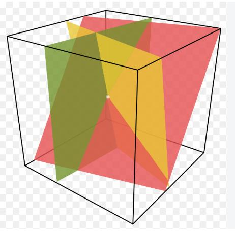

# Chuyen De He Phuong Trinh On Thi Vao 10

TÀI LIỆU THAM KHẢO TOÁN HỌC PHỔ THÔNG CHUẨN BỊ HÀNH TRANG CHO KỲ THI TUYỂN SINH LỚP 10 THPT ______________________________________________________________

------------------------------------------------------------------------------------------

CẨM NANG HỆ PHƯƠNG TRÌNH CƠ BẢN

THÂN TẶNG TOÀN THỂ QUÝ THẦY CÔ VÀ CÁC EM HỌC SINH TRÊN TOÀN QUỐC

CREATED BY GIANG SƠN (FACEBOOK) ĐÁP ÁN CHI TIẾT QUÝ THẦY CÔ VUI LÒNG LIÊN HỆ TÁC GIẢ GACMA1431988@GMAIL.COM (GMAIL); TEL 0398021920

THÀNH PHỐ THÁI BÌNH - THÁNG 5/2025

__________________________

NỘI DUNG PHƯƠNG PHÁP GIẢI TOÁN

GIẢI HỆ PHƯƠNG TRÌNH BẬC NHẤT HAI ẨN

GIẢI HỆ PHƯƠNG TRÌNH CHỨA THAM SỐ

SỬ DỤNG ẨN PHỤ GIẢI HỆ PHƯƠNG TRÌNH QUY VỀ HỆ BẬC NHẤT HAI ẨN

ỨNG DỤNG HỆ PHƯƠNG TRÌNH TRONG SỐ HỌC, VẬT LÝ, HÓA HỌC

ỨNG DỤNG HỆ PHƯƠNG TRÌNH TRONG BÀI TOÁN VÒI NƯỚC CHẢY, CÔNG VIỆC LÀM CHUNG LÀM RIÊNG

ỨNG DỤNG HỆ PHƯƠNG TRÌNH TRONG CHUYỂN ĐỘNG

ỨNG DỤNG HỆ PHƯƠNG TRÌNH TRONG KINH DOANH, TIỀN TỆ

ỨNG DỤNG HỆ PHƯƠNG TRÌNH TRONG HÌNH HỌC

ỨNG DỤNG HỆ PHƯƠNG TRÌNH TRONG NĂNG SUẤT, LAO ĐỘNG

ỨNG DỤNG HỆ PHƯƠNG TRÌNH TRONG SẮP XẾP, PHÂN BỐ

CHUẨN BỊ HÀNH TRANG KỲ THI TUYỂN SINH LỚP 10 THPT PHƯƠNG PHÁP GIẢI TOÁN LỚP 9 THCS CHUYÊN ĐỀ HỆ PHƯƠNG TRÌNH GIẢI HỆ PHƯƠNG TRÌNH BẬC NHẤT HAI ẨN __________________________________________________ KIẾN THỨC CƠ SỞ Cho hệ phương trình ax by c a x b y c   \begin{cases}      \end{cases}

Điều kiện hệ phương trình vô số nghiệm là a b c a b c     

Điều kiện hệ phương trình vô nghiệm là a b c a b c     \ne

Điều kiện hệ phương trình có nghiệm là a b a b   \ne

Hệ phương trình bậc nhất hai ẩn được giải bằng phương pháp thế hoặc phương pháp cộng đại số GIÁO VIÊN MINH HỌA THÍ DỤ CƠ BẢN Thí dụ 1. Hệ phương trình 2 5 2 3 8 x y x y   \begin{cases}

  \end{cases} có nghiệm là A.     ; 1; 2 x y 

B.     ; 1; 2 x y  -

C.     ; 1; 2 x y -
-

D.     ; 1; 2 x y -

**Lời giải Ta có 2 5 (1) 2 3 8 (2) x y x y   \begin{cases}**

  \end{cases}

Từ (1) suy ra 5 2 x y 
- . Thay 5 2 x y
 -
vào phương trình (2) ta được:
  2 5 2 3 8 y y -
  10 4 3 8 y y -
  4 3 8 10 y y -
  -

2 y -
-
y 2  Thay 2 y  vào 5 2 x y 
- ta được 5 2.2 1
x -
.
Vậy hệ phương trình có nghiệm duy nhất     ; 1;2 x y  .
Thí dụ 2. Hệ phương trình 5 1 x y x y   \begin{cases} -
 \end{cases} có nghiệm là   ;x y . Giá trị 2 2 x y  bằng A.10

B. 13

C. 17

D. 15 Lời giải Ta có: 5 (1) 1 (2) x y x y   \begin{cases} -
 \end{cases}

Từ (1) và (2) suy ra:
   5 1 x y x y   -
  6 x y x y   -


2 6 x  3 x  Thay 3 x  và phương trình (1) ta được 3 5 y   suy ra 2 y  .
Vậy hệ phương trình có nghiệm duy nhất     ; 3;2 x y  . Suy ra 2 2 x y  bằng 13.
Thí dụ 3. Hệ phương trình  3 2 5 3 5 2 x y x y   \begin{cases}

-
-
\end{cases} có một hệ quả là A. 6 3 3 x y -


B. 6 3 3 x y  

C. 6 3 4 x y -


D. 6 3 2 x y -


**Lời giải Cộng từng vế 2 pt của hệ ta có 6 3 3 x y -**

 .

Thí dụ 4. Trong các hệ phương trình sau hệ phương trình nào có nghiệm duy nhất.
A. 3 2 1 4 7 x y x y -
 \begin{cases} -
 \end{cases}

B. 3 2 1 3 2 7 x y x y -
 \begin{cases}

-
-
\end{cases}

C. 3 6 1 2 7 x y x y -
-
\begin{cases} -
 \end{cases}

D. 2 1 2 17 x y x y -
 \begin{cases} -
 \end{cases}

**Lời giải Chọn A Xét hệ phương trình  3 2 1 4 7 x y x y -**

 \begin{cases} -
 \end{cases} có 3 2 1 4 -
\ne - nên hệ phương trình có nghiệm duy nhất.
Xét hệ phương trình  3 2 1 3 2 7 x y x y -
 \begin{cases}

-
-
\end{cases} có 3 2 1 3 2 7 -
 \ne -
- nên hệ phương trình vô nghiệm.
Xét hệ phương trình  3 6 1 2 7 x y x y -
-
\begin{cases} -
 \end{cases} có 3 6 1 1 2 7 - -
 \ne -
nên hệ phương trình vô nghiệm.
Xét hệ phương trình 2 1 2 17 x y x y -
 \begin{cases} -
 \end{cases} có 1 2 1 1 2 17 -
 \ne -
nên hệ phương trình vô nghiệm.
Thí dụ 5. Trong các hệ phương trình sau hệ phương trình nào vô nghiệm.
A. 3 2 11 4 7 x y x y -
 \begin{cases} -
 \end{cases}

B. 5 2 1 2 4 x y x y -
 \begin{cases} -
 \end{cases}

C. 3 1 3 7 x y x y -
 \begin{cases} -
 \end{cases}

D. 3 5 1 6 10 2 x y x y -
 \begin{cases}

-
 \end{cases}

**Lời giải Chọn C Xét hệ phương trình  3 2 11 4 7 x y x y -**

 \begin{cases} -
 \end{cases} có 3 2 1 4 -
\ne - nên hệ phương trình có một nghiệm duy nhất.
Xét hệ phương trình  5 2 1 2 4 x y x y -
 \begin{cases} -
 \end{cases} có 5 2 1 2 -
\ne - nên hệ phương trình có một nghiệm duy nhất.
Xét hệ phương trình 3 1 3 7 x y x y -
 \begin{cases} -
 \end{cases} có 1 3 1 1 3 7 -
 \ne -
nên hệ phương trình vô nghiệm.
Xét hệ phương trình  3 5 1 6 10 2 x y x y -
 \begin{cases}

-
 \end{cases} có 3 5 1 6 10 2 -
  -
nên hệ phương trình vô số nghiệm.

Thí dụ 6. Trong các hệ phương trình sau hệ phương trình nào có vô số nghiệm.
A. 3 2 3 17 x y x y -
 \begin{cases} -
 \end{cases}

B. 2 17 2 17 x y x y \begin{cases}-
  -
 \end{cases}

C. 5 2 2 3 2 x y x y -
 \begin{cases}

-
 \end{cases}

D. 2 3 2 3 4 x y x y -
 \begin{cases} -
 \end{cases}

**Lời giải Chọn B Xét hệ phương trình 3 2 3 17 x y x y -**

 \begin{cases} -
 \end{cases} có 1 3 2 1 3 17 -
 \ne -
nên hệ phương trình vô nghiệm.
Xét hệ phương trình 2 17 2 17 x y x y \begin{cases}-
  -
 \end{cases} có 1 2 17 1 17 2 -
  -
nên hệ phương trình có vô số nghiệm.
Xét hệ phương trình 5 2 2 3 2 x y x y -
 \begin{cases}

-
 \end{cases} có 1 5 2 3 -
\ne - nên hệ phương trình có nghiệm duy nhất.
Xét hệ phương trình  2 3 2 3 4 x y x y -
 \begin{cases} -
 \end{cases} có 2 3 1 3 -
\ne - nên hệ phương trình có nghiệm duy nhất.

HỌC SINH THỰC HÀNH THÍ DỤ CƠ BẢN

5 Thí dụ 7. Hệ phương trình  3 2 1 4 7 x y x y   \begin{cases}   \end{cases} có nghiệm là A.     ; 1; 2 x y -
-

B.     ; 1; 2 x y 

C.     ; 1; 2 x y  -

D.     ; 1; 2 x y -

Thí dụ 8. Biết hệ 3 1 2 ax y x by   \begin{cases}  -
\end{cases} nhận cặp số   2;3 -
là một nghiệm. Khi đó giá trị của  , a b là A. 4; 0 a b  

B. 2; 2 a b  

C. 0; 4 a b  

D. 2; 2 a b -
-
Thí dụ 9. Hệ phương trình  3 2 8 3 4 2 x y x y   \begin{cases} -
 -
\end{cases} có nghiệm là A.     ; 2; 1 x y 

B.     ; 2; 1 x y  -

C.     ; 2; 1 x y -

D.     ; 2; 1 x y -
-

Thí dụ 10. Hệ phương trình  2( ) 3( ) 4 ( ) 2( ) 5 x y x y x y x y   -
 \begin{cases}

  -
 \end{cases} có nghiệm là A.     ; 1; 2 x y  -

B.   1 13 ; ; 2 2 x y ( ) ( ) ( )

C.   1 13 ; ; 2 2 x y - - ( ) ( ) ( )

D.   1 13 ; ; 2 2 x y - ( ) ( ) ( )

Thí dụ 11. Cho hệ phương trình        1 1 4 2 1 10 \begin{cases} -
     -
 -
\end{cases} x y xy x y xy . Nghiệm của hệ phương trình trên là A.     ; 2; 3 x y -
-

B.     ; 2; 3 x y  -

C.     ; 2;3 x y 

D.     ; 2;3 x y -

Thí dụ 12. Tìm cặp số   ;a b để hệ phương trình 9 13 4 ax y x by   \begin{cases} -
-
\end{cases} có nghiệm     ; 1;1 x y 

A.     ; 2;3 a b 

B.     ; 1;2 a b 

C.     ; 3;4 a b 

D.     ; 4;5 a b 

CHUẨN BỊ HÀNH TRANG KỲ THI TUYỂN SINH LỚP 10 THPT PHƯƠNG PHÁP GIẢI TOÁN LỚP 9 THCS CHUYÊN ĐỀ HỆ PHƯƠNG TRÌNH GIẢI HỆ PHƯƠNG TRÌNH CHỨA THAM SỐ __________________________________________________

KIẾN THỨC CƠ SỞ Cho hệ phương trình ax by c a x b y c   \begin{cases}      \end{cases}

Điều kiện hệ phương trình vô số nghiệm là a b c a b c     

Điều kiện hệ phương trình vô nghiệm là a b c a b c     \ne

Điều kiện hệ phương trình có nghiệm là a b a b   \ne

Đối với các bài toán tìm điều kiện để nghiệm thỏa mãn điều kiện K nào đó cần giải biện luận nghiệm theo tham số m, sau đó tùy theo yêu cầu bài toán để xử lý.
GIÁO VIÊN MINH HỌA THÍ DỤ CƠ BẢN, VẬN DỤNG Thí dụ 1. Điều kiện để hệ phương trình 6 4 2 8 x y x my m  -
\begin{cases}

 
- \end{cases}
có nghiệm   ;x y trong đó 2 x 

A. 8 m 

B. 10 m 

C. 12 m 

D. Kết quả khác Lời giải 6 4 2 8 2 6 6 1 2.2 8 6 x y x my m x y y m m m  -
\begin{cases}

 
- \end{cases}
 \implies - \implies - \implies -

- \implies


Thí dụ 2. Hệ phương trình  6 7 3 5 2 x y m x y m   \begin{cases}

-

- \end{cases}
có một hệ quả là A. 9 2 7 x y  

B. 9 2 5 x y -


C. 15 13 5 x y  

D. 3 2 x y m  

**Lời giải 6 7 12 14 2 15 13 2 5 2 5 3 5 2 3 5 2 x y m x y m x y m m x y m x y m     \begin{cases} \begin{cases} \implies \implies    -**



-

- -

- \end{cases} \end{cases}

Thí dụ 3. Tìm cặp số   ;a b để hệ phương trình      2 5 7 4 2 5 9 a x y x b y -
  \begin{cases}  -
 \end{cases} có nghiệm     ; 1;1 x y 

A.     ; 2;3 a b 

B.     ; 1;2 a b 

C.     ; 3;4 a b 

D.     ; 4;5 a b 

**Lời giải     2 5 7 4 2 5 9 2 5 7 4 1; 1 4 2 5 9 5 a x y x b y a a x y b b -**

  \begin{cases}  -
 \end{cases} -
   \begin{cases} \begin{cases}   \implies \implies

 -
  \end{cases} \end{cases}

Thí dụ 4. Điều kiện để hệ phương trình 6 4 2 5 x y x my m  -
\begin{cases}

 
- \end{cases} vô nghiệm là A. 8
m 

B. 10 m 

C. 12 m 

D. Kết quả khác Lời giải Điều kiện hệ vô nghiệm là  1 6 4 12 2 5 m m m -
 \ne \implies  -

7 Thí dụ 5. Điều kiện để hệ phương trình   4 4 2 4 7 x y x m y  -
\begin{cases}    \end{cases} có nghiệm duy nhất là A. 8 m 

B. 4 m 

C. 4 m \ne

D. 6 m \ne

**Lời giải Điều kiện hệ có nghiệm duy nhất là  1 4 4 2 4 m m \ne \implies \ne **

Thí dụ 6. Biết rằng hệ phương trình 3 4 2 5 x y x my n   \begin{cases}

   \end{cases} vô số nghiệm. Giá trị 2 m n  bằng A.10

B. 8

C. 12

D. 11 Lời giải Điều kiện hệ vô số nghiệm là  1 3 4 6; 3 2 12 2 5 m n m n m n   \implies   \implies   

Thí dụ 7. Tìm tích tất cả các giá trị tham số để hệ phương trình    2 4 2 7 3 2 5 m x my x y \begin{cases}       \end{cases} có nghiệm duy nhất   ;x y thỏa mãn 2 1 x y -
.
A.4

B. 2

C. - 3

D. - 4 Lời giải Giải hệ 2 1 1 3 2 5 x y x y x y -
 \begin{cases} \implies  

  \end{cases}

  2 2 4 2 7 4 2 7 1; 3 3 2 5 m x my m m m m x y \begin{cases}     \implies    \implies  -

  \end{cases} .
Thí dụ 8. Cho hệ phương trình  2 2 (1) 8 2 (2) mx y x my m   \begin{cases}

   \end{cases} (m  là tham số) Trong trường hợp hệ phương trình có nghiệm duy nhất    ;x y , hệ thức liên hệ giữa  x  và  y  không phụ thuộc vào  m là A. 1 4 y x 

B. 1 3 y x -

C. 1 3 y x 

D. 2 5 y x  

**Lời giải Với 2 \ne \pm - \implies m hệ phương trình có nghiệm duy nhất   1 4 ; ; 1 4 2 4 2  ( )  \implies  ( )   ( ) m x y y x m m**

HỌC SINH THỰC HÀNH THÍ DỤ CƠ BẢN, VẬN DỤNG Thí dụ 9. Cho hệ phương trình 2 (1) 4 6 (2) mx y m x my m -
 \begin{cases}

-
  \end{cases} ( m  là tham số) Trong trường hợp hệ phương trình có nghiệm duy nhất   ;x y , giá trị  2x y  luôn là một hằng số, hằng số đó có đặc điểm A.Là số nguyên tố

---
*------------------- HẾT -------------------*

---
*------------------- HẾT -------------------*

D. Là số nguyên âm Lời giải . 2 m  \ne \pm \implies  hệ phương trình có nghiệm duy nhất 2 3 ( ; ) ( ; ) 2 2 m m x y m m  -
  

+ ) Với 2 m - thì hệ vô nghiệm + ) Với 2 m  thì hệ phương trình vô số nghiệm Với 2 m \ne \pm Thay 2 3 ( ; ) ( ; ) 2 2 m m x y m m  -
   vào 2 3 x y   (thỏa mãn) Thí dụ 10. Cho hệ phương trình    1 3 1 2 5 m x my m x y m \begin{cases}
- -
 -
 -
  \end{cases} ( m  là tham số) Khi hệ phương trình có nghiệm duy nhất   ;x y  , biểu thức 2 2   S x y đạt giá trị nhỏ nhất bằng

8 A.2

B. 6

C. 8

D. 9 Lời giải Với 1 \ne - \implies m Hệ phương trình có nghiệm duy nhất   1; 3 
- m m . Khi đó
  2 2 2 2 1 8 8 8 1    -
 \ge \implies  \iff  min S x y m S m

Thí dụ 11. Có bao nhiêu giá trị nguyên  m \in  để hai đường thẳng 3 9; 2 16 x my mx y -
-
  cắt nhau tại 1 điểm nằm trong góc phần tư thứ IV trên mặt phẳng tọa độ A.3

B. 2

C. 1

D. 0 Lời giải 2 3 9 ( 6) 18 16 2 16 3 9 x my m x m mx y x my -
-
\begin{cases}  -
 \begin{cases} \iff

  -
-
\end{cases} \end{cases}

Ta có: m2 + 6 > 0 với mọi  m Vậy hệ phương trình có nghiệm duy nhất với mọi  m 2 2 16 18 18 96 ; 6 6 m m x y m m -
    

2 2 16 18 0 0 16 18 0 6 0 18 96 18 96 0 0 6 m x m m m y m m m -
\begin{cases} >  > - > \begin{cases} \begin{cases}   \iff \iff \iff \in 

<   < \end{cases} \end{cases}  <   \end{cases}

Thí dụ 12. Cho hệ phương trình  (
1) (1) ( 1) 2 (2) m x y m x m y -
  \begin{cases}  -
 \end{cases} ( m  là tham số) Giả sử hệ có nghiệm duy nhất   ;x y thỏa mãn 2 2 7 1 x y -
. Giá trị 3 2x y  bằng A.17

B. 15

C. 20

D. 23 Lời giải Từ (1) ( 1) y m m x \implies 
- -
thay vào (2) ta được:
           2 2 1 1 2 2 2 2 2 1 [ ] 
- - -
 \iff -

- - \iff -
 -
   x m m m x m m x m m m m x m m

Hệ có nghiệm duy nhất 0 1 1 ; 2 m m x y m m m \ne \begin{cases}  \iff \implies  

\ne \end{cases}

Hệ thức 1 x y -
 là hệ thức cần tìm.
b. Ta có: 1 1 x y x y -
 \implies   do đó:
2 2 2 1 2 7 1 2( 1) 7 1 2 3 1 0 1 2 y x y y y y y y  [  -
 \iff  -
 \iff -
 \iff   

+ ) Với 1 1 1 1 y m m  \implies  \iff  + ) Với 1 1 1 2( ) 2 2 y m loai m  \implies  \iff 

Vậy 1 m  là giá trị cần tìm Cho hệ phương trình 3 4 6 mx y x my   \begin{cases}

  \end{cases} (m  là tham số) Tìm điều kiện của tham số  m  để hệ phương tình có nghiệm   ;x y  thỏa mãn điều kiện 2; 0 > > x y .
Từ 3 3   \implies -
mx y y mx  thay vào phương trình  4 6   x my ta được:
    2 2 4 3 6 4 3 6 4 3 6  -
 \iff  -
 \iff -
-
 x m mx x m m x m x m

+ ) Với 2 - \implies m hệ phương trình vô nghiệm + ) Với 2  \implies m hệ phương trình có dạng  2 3,   x y mà 2; 0 2 4 > > \implies  > \implies x y x y hệ phương trình vô nghiệm. + ) Với 2 \ne \pm \implies m hệ phương trình có nghiệm duy nhất 3 6 ; . 2 2 ( ) ( )   ( ) m m

9 Khi đó 2 1 2 2 > \begin{cases}
- \iff - < <

> \end{cases} x m y

Thí dụ 13. Tìm giá trị nguyên lớn nhất của  m  để hệ phương trình   2 1 1 2 mx my m x m y    \begin{cases}   \end{cases} có nghiệm duy nhất   ;x y  sao cho  A x y  -
nhận giá trị nguyên.
A.3

B. 2

C. 4

D. 1 Lời giải Ta có:
  2 1 (1) 1 2 (2) mx my m x m y    \begin{cases}   \end{cases}

Từ (2) suy ra   2 1 x m y  -
 . Thay   2 1 x m y  -
 vào (1) ta được:
  2 1 2 1 m m y my m [ ] -
     

  2 1 2 1 m m m y my m -
      2 2 1 m m m y m -
 -
-

  2 1 m m y m - -
-

 1 1 m m y m - -
-

Để phương trình có nghiệm duy nhất thì 0; 1 m m \ne \ne . Khi đó 1 y m 

Suy ra 1 1 2 m m x m m  -
 -


Khi đó 1 1 2 2 1 m m A m m m m - -
 -
 -
.
Để  A nhận giá trị nguyên thì  2 m  nhận giá trị nguyên.
Suy ra \{ \} 1; 1;2; 2 m \in - - .
Kết hợp điều kiện 0; 1 m m \ne \ne suy ra \{ \} 1;2; 2 m \in - là thoả mãn.
Thí dụ 14. Cho hệ phương trình 2 1 (1) ( 1) 2 (2) mx my m x m y    \begin{cases}    \end{cases} ( m  là tham số) Trong  trường  hợp  hệ  phương  trình  có  nghiệm  duy  nhất    ;x y .  Xác  định  tích  các  giá  trị  của  m   để   ;
M x y  thuộc đường tròn có tâm là gốc tọa độ và bán kính bằng 5 . A.3

B. 2

C. 0,5

D. - 1 Lời giải Với 0; 1 m m \ne \ne  thì hệ phương trình có nghiệm duy nhất 1 1 ; - ( ) ( ) ( ) m m m + ) Với 0 m  thì hệ phương trình vô nghiệm + ) Với 1 m  thì hệ phương trình có vô số nghiệm   2 ;
-y y  với mọi  m  thuộc  
b) Ta tìm được hệ thức liên hệ giữa  ,x y  không phụ thuộc  m  là
1 - y x .
Vậy  M  chạy trên đường thẳng có phương trình:
1 - y x

-  M  thuộc góc phần tư thứ nhất khi  , 0 x y > . Vậy 1 m > - 1 (0; 5) 5 1; 2 M OM m -
\begin{cases}  \in \iff  \implies \in -

 \end{cases} 

Tích các giá trị m bằng 0,5 Thí dụ 15. Cho hệ phương trình      1 3 4, 1 . a x y a x a y a \begin{cases} -
  -
 -
 \end{cases} ; a là tham số thực.

10 Có bao nhiêu số nguyên dương 20 a < để hệ có nghiệm duy nhất (x;y) sao cho điểm M (x;y) cùng với hai điểm     2;3 , 3;4 P Q tạo thành một tam giác.
A.17

B. 16

C. 15

D. 19 Lời giải         2 1 3 4, 4 4 ( ) 4 4 1 . 4 4 4 ( 2) 1 ( 2) 4 2 4 4 2 3 2 2, 0 ; a x y a a a x y a x y a x a y a a a y a y a a y a a a a a a a a y a a x a a a a \begin{cases} -
 
- -
 \implies  
- \implies
   -
 \end{cases}
- - -
 -
 \implies -
 -
 
- - - - \implies
 \ne \ne  -


Đường thẳng : 1 PQ y x  .
Tam giác tạo thành khi 3 điểm không thẳng hàng, tức 3 2 2 1 a a M d a a a - - \notin \implies \ne  \implies .
Suy ra có 17 số nguyên dương a.
Thí dụ 16. Hệ phương trình 2 , 1. mx y m x my m   \begin{cases}    \end{cases} có nghiệm duy nhất (x;y) sao cho   2 2 2 16 4 x y x y  \le  . Giá trị 5 x y  khi đó bằng A.4

B. 3

C. 2

D. 5 Lời giải Ta có 2 , 3 1 ( 1)( ) 3 1 1. 1 mx y m m m x y m x y x my m m   \begin{cases}  \implies     \implies       \end{cases}

3 1 2 1 1 ; 1 1 1 m m m y my m y x m m m   -
   \implies      .
Theo BĐT Bunyakovsky     2 2 2 2 2 2 16 ( 4 ) 2 16 4 x y x y x y x y  \ge  \implies  \ge  .
Dấu đẳng thức xảy ra khi 1 4 1 4 2 1 4 ; 5 3 2 3 3 x y m m m x y x y  \implies  \implies  \implies   \implies  

CHUẨN BỊ HÀNH TRANG KỲ THI TUYỂN SINH LỚP 10 THPT PHƯƠNG PHÁP GIẢI TOÁN LỚP 9 THCS CHUYÊN ĐỀ HỆ PHƯƠNG TRÌNH SỬ DỤNG ẨN PHỤ GIẢI HỆ PHƯƠNG TRÌNH QUY VỀ HỆ BẬC NHẤT HAI ẨN __________________________________________________

KIẾN THỨC CƠ SỞ Đối với các bài toán hệ phương trình phức tạp ta cần đặt điều kiện, sau đó đặt ẩn phụ và điều kiện của ẩn tùy theo bài.
Sử dụng phép thế hoặc phép cộng trừ đại số để giải hệ tìm ẩn phụ mới, quay trở lại tìm các ẩn x, y ban đầu.
Một số bài toán cần tách ghép để xuất hiện ẩn phụ.
GIÁO VIÊN MINH HỌA THÍ DỤ CƠ BẢN, VẬN DỤNG Thí dụ 1. Hệ phương trình 1 7 8 5 1 4 x y x y \begin{cases}     -
 \end{cases} có nghiệm duy nhất   ;x y . Tính giá trị biểu thức 3 2 x y - . A.2

B. 1

C. 5

D. 0 Lời giải Đặt 1 1 ,a b x y   thu được 7 8 1 1 5 4 a b a b x y a b   \begin{cases} \implies   \implies  

-
 \end{cases} . Khi đó 3 2 x y - bằng 1.
Thí dụ 2. Hệ phương trình 2 2 3 2 3 4 x y x y \begin{cases} -
   -
  \end{cases} có nghiệm   ;x y . Giá trị nhỏ nhất của  x y -
bằng bao nhiêu A.3

B. 2

C. 0

D. 1 Lời giải      2 2 3 2 1 2 3 1 ; 3;1 , 1;1 3 4 2 3 4 1 x y x a b a b x y a b x y y \begin{cases} -
  \begin{cases} -
   \begin{cases}   \implies \implies   \implies  \implies \implies 

  -
    \end{cases}  \end{cases} \end{cases}

Thí dụ 3. Hệ phương trình 2 2 1 3 5 1 2 6 7 x y x y \begin{cases} -
   -
  \end{cases} có nghiệm    ;x y . Giá trị nhỏ nhất của  x y - bằng bao nhiêu A.3

B. 2

C. - 1

D. 1 Lời giải \{ \} 2 1 1 2 2 1 3 5 0;1 2 3 5 1 6 7 1 1 1 2 6 7 x x y x a b a b a b y y x y \begin{cases} \begin{cases} -
 -
  \begin{cases} \in   \begin{cases}    \implies \implies   \implies \implies

     -
  \end{cases}  \end{cases}  \end{cases} \end{cases}

Giá trị nhỏ nhất  x y - bằng - 1.
Thí dụ 4. Hệ phương trình 3 3 3 3 4( ) 2(3 2 ) 6, 5( 2 ) 3( 3 ) 21. x y x y x y x y \begin{cases} 
- -
  
- -
 \end{cases} có nghiệm duy nhất   ;x y . Tính giá trị 3 x y  . A.3

B. 4

C. 2

D. 1 Lời giải 3 3 3 3 3 3 3 4( ) 2(3 2 ) 6, 2 8 6 27 27 1; 1 1 5( 2 ) 3( 3 ) 21. 2 19 21 x y x y x y y y x x x y x y x y \begin{cases} \begin{cases} 
- -
 -
    \iff \implies  \implies   \implies 


- -
     \end{cases} \end{cases}

Khi đó 3 x y  bằng 2.

12 Thí dụ 5. Hệ phương trình 5 6 3 2 5 x y xy x y xy   \begin{cases}

  \end{cases} có hai nghiệm    ;x y . Tính giá trị lớn nhất của biểu thức 4 3 x y  . A.2

B. 7

C. 5

D. 9 Lời giải Nếu 0 0; 0 0 x y y x  \implies   \implies  .
Nếu 0 xy \ne , 5 1 6 5 6 3 2 5 2 3 5 x y xy x y x y xy x y \begin{cases}      \begin{cases}  \implies

  \end{cases}    \end{cases}

Đặt 1 1 ,a b x y   thu được 5 6 1 1 2 3 5 a b a b x y a b   \begin{cases} \implies   \implies  

  \end{cases} . Khi đó 4 3 x y  bằng 7.
Thí dụ 6. Hệ phương trình 1 5 6 2 5 4 1 2 x y x y x y x y \begin{cases}    -
  -
 
- \end{cases}
có nghiệm duy nhất   ;x y . Tính giá trị biểu thức7x y  . A.2

B. 3

C. 5

D. 4 Lời giải Đặt 1 1 , 2 a b x y x y   
- thu được 1 5 8 1 3 1 5 4 1 2 1 2 3 x a b x y a b a b x y y
\begin{cases}      \begin{cases} \begin{cases}  \implies   \implies \implies

-
 -
-
\end{cases} \end{cases}   \end{cases}

Khi đó 7x y  bằng 3.
HỌC SINH THỰC HÀNH THÍ DỤ CƠ BẢN, VẬN DỤNG Thí dụ 7.  Hệ  phương  trình 2 2 1 5 6 1 5 2 3 1 x y x y \begin{cases}       -
   \end{cases} có  nghiệm    ;x y .  Tính  giá  trị  lớn  nhất  của  biểu  thức 3 2 x y - . A.2

B. 3

C. 5

D. 4 Thí dụ 8. Hệ phương trình 2 2 1 9 2 2 5 1 22 x y x y \begin{cases} -
 -  -
 - \end{cases} có hai nghiệm   ;x y  . Giá trị nhỏ nhất của  3 2 x y  là số nguyên nào ?
A.30

B. 37

C. 35

D. 40 Thí dụ 9. Hệ phương trình 1 2 7 5 5 5 1 2 6 x y x y x y x y   \begin{cases}        \end{cases} có nghiệm duy nhất   ;x y . Tính  34 68 x y  . A.2

B. 3

C. 5

D. - 3

13 Thí dụ 10. Hệ phương trình 1 4 6 2 3 4 2 4 1 2 x y x y x y x y x y x y   \begin{cases}     -
 -
  -
 
- \end{cases}
có nghiệm duy nhất   ;x y . Tính 7x y  . A.2

B. 3

C. 5

D. 4 Thí dụ 11. Hệ phương trình 2 4 3 2 1 7 1 3 2 1 4 1 x y x y x  \begin{cases}  -  

  -  \end{cases} có nghiệm duy nhất   ;x y . Tính 7x y  . A.2

B. 1

C. 5

D. 4 Thí dụ 12. Hệ phương trình       3 2 3 1 5 2 3 5 1 x y x y x x y x y x \begin{cases}            \end{cases} có nghiệm duy nhất   ;x y . Tính 2 2 3 5 x y  . A.5

B. 4

C. 10

D. 9

14 CHUẨN BỊ HÀNH TRANG KỲ THI TUYỂN SINH LỚP 10 THPT PHƯƠNG PHÁP GIẢI TOÁN LỚP 9 THCS CHUYÊN ĐỀ HỆ PHƯƠNG TRÌNH ỨNG DỤNG HỆ PHƯƠNG TRÌNH TRONG BÀI TOÁN CÓ NỘI DUNG SỐ HỌC, VẬT LÝ, HÓA HỌC __________________________________________________

GIÁO VIÊN MINH HỌA THÍ DỤ CƠ BẢN, VẬN DỤNG Thí dụ 1. Số tự nhiên  M  có hai chữ số thỏa mãn tổng các chữ số của nó bằng  10 và nếu viết số đó théo thứ tự ngược lại thì được số mới nhỏ hơn số ban đầu 18 đơn vị. Số tự nhiên ban đầu có giá trị tuyệt đối của hiệu hai chữ số bằng A.4

B. 2

C. 8

D. 6 Lời giải:
Gọi chữ số hàng chục là  x, chữ số hàng đơn vị là  y : 0 , 9; , x y x y < \le \in  Theo bài ra ta có hệ phương trình 10 10 10 6 10 10 18 2 4 18 x y x y x y x x y y x x y y xy yx   \begin{cases}      \begin{cases} \begin{cases} \begin{cases}  \implies \implies \implies

    -
     \end{cases} \end{cases} \end{cases} \end{cases} (thỏa mãn điều kiện) Vậy số cần tìm là 64 Thí dụ 2. Một số tự nhiên  M có hai chữ số. Tỉ số giữa chữ số hàng chục và chữ số hàng đơn vị là  2 3 .
Nếu viết thêm chữ số 1 xem vào giữa thì được số mới lớn hơn số đã cho là  370 đơn vị. Số tự nhiên  M có tổng các chữ số bằng bao nhiêu A.9

B. 10

C. 12

D. 14 Lời giải:
Gọi chữ số hàng chục là  x, chữ số hàng đơn vị là  y Điều kiện:  0 , 9, , x y x y < \le \in  Theo bài ra ta có hệ phương trình 2 3 2 4 3 100 10 10 370 6 1 370 x x y x y x y x y y x y xy \begin{cases}    \begin{cases} \begin{cases}  \implies \implies

      \end{cases} \end{cases}    \end{cases} (thỏa mãn điều kiện) Vậy số cần tìm là  46.
Thí dụ 3. Một số tự nhiên  M có hai chữ số trong đó hiệu giữa chữ số bằng 2, khi viết thêm số 3 vào giữa ta thu được số mới hơn số ban đầu 390 đơn vị. Ước nguyên tố lớn nhất của  M bằng bao nhiêu A.25

B. 29

C. 24

D. 23 Lời giải:
Gọi số có hai chữ số là 10 xy x y   với , ;1 , 9 x y x y \in \le \le  , trong đó 3 x > . Theo bài ra 2 x y -
 và   \{ \} 3 390 100 30 10 390 90 360 4 2;6 42;46 x y xy x y x y x x y -
 \implies   -
  \implies  \implies  \implies \in \implies

Thí dụ 4. Số tự nhiên  M  có tổng của chữ số hàng đơn vị và hai lần chữ số hàng chục bằng 10. Ngoài ra, nếu đổi chữ số hàng chục và chữ số hàng đơn vị cho nhau thì sẽ được số mới nhỏ hơn số ban đầu 18 đơn vị. Tổng bình phương hai chữ số của  M bằng A.20

B. 18

C. 17

D. 10 Lời giải:
Gọi số có hai chữ số là 10 xy x y   với , ;1 , 9 x y x y \in \le \le 

Tổng của chữ số hàng đơn bị và hai lần chữ số hàng chục bằng 10, ta được

2 10 x y   (1) Nếu đổi chữ số hàng chục và chữ số hàng đơn vị cho nhau thì sẽ được số mới ( 10 xy y x   ) nhỏ hơn số

15 ban đầu 18 đơn vị, ta được

18 (10 ) (10 ) 18 2 xy yx x y y x x y -
 \implies  -
  \implies -
 (2) Từ (1) và (2), ta có hệ phương trình   2 10 4 2 2 x y x x y y    \begin{cases} \begin{cases} \implies

-
  \end{cases} \end{cases} (thỏa mãn điều kiện) Vậy số cần tìm là  42 Thí dụ 5. Có hai loại quặng , A B tương ứng chứa  75%  sắt và  50% sắt. Tính khối lượng quặng  A (đơn vị tấn) khi mang trộn hai loại quặng để được  25 tấn quặng chứa 66%  sắt.
A.16

B. 20

C. 18

D. 17,5 Lời giải:
Gọi khối lượng quặng chứa 75%  sắt và 50% sắt là  ,x y (tấn,  , 0 x y > ) Theo bài ra ta có hệ phương trình 25 16 75 50 66 9 .25 100 100 100 x y x x y y   \begin{cases}  \begin{cases}  \implies

   \end{cases} \end{cases} (thỏa mãn điều kiện) Vậy đem 16 tấn loại quặng chứa 75%  sắt, 9 tấn loại quặng chứa 50% sắt Thí dụ 6. Số tự nhiên  M có hai chữ số. Biết rằng chữ số hàng chục lớn hơn chữ số hàng đơn vị 6 đơn vị.
Nếu viết chữ số  0 vào giữa chữ số hàng chục và chữ số hàng đơn vị thì số tự nhiên đó tăng  720  đơn vị.
Ước nguyên tố lớn nhất của  M có tổng các chữ số bằng bao nhiêu A.5

B. 7

C. 6

D. 4 Lời giải:
Gọi số có hai chữ số là 10 , xy x y   với , ;1 9;0 9 x y x y \in \le \le \le \le 

Với giả thiết Chữ số hàng chục lớn hơn chữ số hàng đơn vị 6 đơn vị, ta được

6 x y -
 (1) Khi viết chữ số  0 vào giữa chữ số hàng chục và chữ số hàng đơn vị thì số tự nhiên đó tăng  720  đơn vị, ta được

(100 ) (10 ) 720 8 x y x y x  -
  \implies     (2) Từ (1) và (2) ta có hệ phương trình 6 8 8 2 x y x x y -
  \begin{cases} \begin{cases} \implies

  \end{cases} \end{cases}

Vậy số cần tìm là 82 . Ước nguyên tố lớn nhất bằng 41.
HỌC SINH THỰC HÀNH THÍ DỤ CƠ BẢN, VẬN DỤNG Thí dụ 7.  Hai  dung  dịch  có  khối  lượng  tổng  cộng  là  220 gam.  Lượng  muối  trong  dung  dịch  X   là 5gam, lượng muối trong dung dịch  Y  là  4,8 gam. Biết nồng độ muối trong dung dịch  X  nhiều hơn nồng độ muối trong dung dịch Y  là  1% . Khối lượng dung dịch  X là bao nhiêu gam ?
A.200

B. 180

C. 160

D. 150 Thí dụ 8. Độ F (Fahrenheit) là thang nhiệt do nhà Vật lí người Đức Gabriel Fahrenheit 1686 - 1736 đề xuất năm 1724, theo đó nước đóng băng ở  32o F và sôi ở  212o F . Độ C (Celsius) là thang nhiệt do nhà Thiên văn học người Thụy Điển Andres Celsius 1701 - 1744 đề xuất, theo đó nước đóng băng ở  0oC  và sôi ở 100oC . Mối quan hệ giữ số đo độ F  y  và số đo độ C  x  được biểu thị theo công thức  y ax b  .
Giá trị 10a b  là số nguyên nào A.45

B. 60

C. 40

D. 50 Thí dụ 9. Một số tự nhiên  M có hai chữ số trong đó tổng của chữ số hàng chục và chữ số hàng đơn vị bằng 8. Nếu viết thêm chữ số 5 vào cuối ta thu được một số mới hơn số ban đầu 320 đơn vị. Số tự nhiên đã cho có tất cả bao nhiêu ước tự nhiên ?
A.6

B. 8

C. 5

D. 4 Thí dụ 10. Người ta cho thêm 1kg nước vào dung dịch A thì được dung dịch B có nồng độ  20% . Sau đó lại cho thêm  1kg axit vào dung dịch B thì được dung dịch C có nồng độ axit là 1 33 % 3 . Nồng độ axit trong dung dịch A là bao nhiêu % A.20

B. 25

C. 27,5

D. 24 Thí dụ 11. Người ta trộn hai loại quặng , A B với nhau, tương ứng chứa 72% sắt và 58% sắt, thu được một loại

16 quặng sắt chứa 62% sắt. Nếu tăng khối lượng của mỗi loại quặng thêm 15 tấn thì được loại quặng chứa 63,25% sắt. Khối lượng loại quặng  Alà bao nhiêu tấn A.10

B. 14

C. 12

D. 15 Thí dụ 12. Người ta trộn hai loại quặng loại , A B với nhau, tương ứng chứa 70% sắt và 40% sắt. Người ta trộn một lượng quặt A với một lượng quặng B thu được hỗn hợp quặng chứa 60% sắt. Nếu lấy tăng hơn lúc đầu 5 tấn quặng loại A và lấy giảm hơn lúc đầu 5 tấn quặng loại B thì được hỗn hợp quặng chứa 65% sắt. Khối lượng quặng B trong hỗn hợp lúc đầu là bao nhiêu tấn ?
A.10

B. 15

C. 20

D. 18,5

17 CHUẨN BỊ HÀNH TRANG KỲ THI TUYỂN SINH LỚP 10 THPT PHƯƠNG PHÁP GIẢI TOÁN LỚP 9 THCS CHUYÊN ĐỀ HỆ PHƯƠNG TRÌNH ỨNG DỤNG THỰC TẾ HỆ PHƯƠNG TRÌNH TRONG BÀI TOÁN VÒI NƯỚC, CÔNG VIỆC LÀM CHUNG, LÀM RIÊNG __________________________________________________

KIẾN THỨC CƠ SỞ Nếu vòi nước chảy đầy bể trong x giờ thì trong 1 giờ chảy được 1 x bể.
Nếu một người làm xong công việc trong x giờ, thì trong 1 giờ sẽ làm được 1 x công việc.
Sử dụng kiến thức hiển nhiên này và đặt ẩn phụ, các bạn giải hệ để tìm ra thời gian làm riêng công việc hoặc thời gian vòi nước chảy 1 mình đầy bể.
GIÁO VIÊN MINH HỌA THÍ DỤ CƠ BẢN, VẬN DỤNG Thí dụ 1. Hai đội công nhân dệt may cần sản xuất một số lượng khẩu trang theo đơn đặt hàng .Nếu làm chung thì sau  4  giờ họ sẽ làm xong. Nhưng hai đội mới làm chung được 3 giờ thì đội 1  nghỉ , đội  2  tiếp tục làm trong 3 giờ nữa mới xong .Hỏi đội một làm một mình sau bao nhiêu giờ mới xong công việc ?
A.6

B. 8

C. 10

D. 12 Lời giải Gọi thời gian đội 1 hoàn thành công việc một mình là  x  (giờ, 4 x > ) Gọi thời gian đội 2 hoàn thành công việc một mình là  y  (giờ, 4 y > ) Trong một giờ, đội 1 làm được số phần công việc là:  1 x  (công việc); đội 2 làm được số phần công việc là: 1 y  (công việc).
Trong một giờ, cả hai đội là được số phần công việc là:  1 1 x y  . Trong bốn giờ, cả hai đội làm được số phần công việc là:
1 1 4 x y ( )  ( ) ( ) .
Khi đó cả hai đội làm xong việc nên ta có phương trình là:
1 1 4 1 x y ( )   ( ) ( ) (1) Trong ba giờ, cả hai đội làm được số phần công việc là:
1 1 3. x y ( )  ( ) ( ) (công việc);
Trong ba giờ, đội 2 làm được số phần công việc là:
1 3. y  (công việc).
Khi đó công việc mới xong, nên ta có phương trình:
1 1 1 3. 3. 1 x y y ( )    ( ) ( )

hay 1 1 3. 6. 1 x y   (2) Từ (1) và (2), ta có hệ phương trình:
1 1 4 1 1 1 3. 6. 1 x y x y \begin{cases}( )   ( ) ( )

   \end{cases}

Giải hệ phương trình, ta có:
6 12 x y  \begin{cases}

 \end{cases} (thỏa mãn) Vậy đội 1 làm một mình trong  6  giờ xong, đội 2 làm một mình trong 12 giờ xong công việc Thí dụ 2. Hai người thợ Đông, Hưng làm chung một công việc trong 4 ngày thì  xong. Nếu anh Đông làm riêng trong 9 ngày và anh Hưng đến cùng làm trong 1 ngày nữa thì xong công việc. Hỏi anh Đông

18 làm công việc đó một mình thì trong bao nhiêu ngày sẽ hoàn thành công việc ?
A.10

B. 12

C. 14

D. 16 Trả lời 12 Lời giải Gọi thời gian hai anh Đông, Hưng làm riêng xong công việc lần lượt là  ,x y . Đơn vị ngày.
Khi anh Hưng đến cùng làm thì khi hoàn thành công việc, anh Đông đã làm được 10 ngày.
Theo bài ra 1 1 1 1 4 1 1 ; 12; 6 4 10 1 12 6 10 1 1 x y a b a b x y a b x y \begin{cases}   \begin{cases}      \implies \implies   \implies  

      \end{cases} \end{cases}

Anh Đông làm một mình 12 ngày xong công việc.
Thí dụ 3. Hai vòi nước cùng chảy vào một bể không chứa nước thì sau  3  giờ đầy bể. Nếu mở vòi thứ nhất chảy một mình trong  20 phút, rồi khóa lại, mở tiếp vòi thứ hai chảy trong  30  phút thì cả hai vòi chảy được 1 8  bể. Tính thời gian vòi thứ nhất chảy một mình đầy bể theo đơn vị giờ A.4

B. 6

C. 8

D. 7,5 Lời giải Gọi thời gian vòi thứ nhất chảy một mình đầy bể là x ( giờ), thời gian vòi thứ hai chảy một mình đầy bể là y ( giờ)  ĐK: ;
0 x y > ) Trong 1 giờ vòi thứ nhất chảy được  1 x  bể, vòi thứ hai chảy được  1 y bể Vì hai vòi cùng chảy trong 3 giờ đầy bể nên ta có phương trình  1 1 1 3 x y    1 Trong 20 phút =  1 3  giờ vòi thứ nhất chảy được  1 3x (bể) Trong 30 phút =  1 2 giờ tiếp theo vòi thứ hai chảy được là  1 2y (bể) Vì nếu mở vòi thứ nhất chảy một mình trong  20 phút, rồi khóa lại, mở tiếp vòi 2 chảy một mình trong 30  phút thì được  1 8  bể nên ta có phương trình  1 1 1 3x 2 8 y    2 Từ  1 và  2 ta có hệ phương trình 1 1 1 3 1 1 1 3x 2 8 x y y \begin{cases}      \end{cases} . Giải hệ ta được 4 12 x y \begin{cases}   \end{cases} (thoả mãn) Vậy thời gian vòi thứ nhất chảy một mình đầy bể là 4 giờ, thời gian vòi thứ hai chảy một mình đầy bể là 12 giờ.
Thí dụ 4. Hai tổ sản xuất cùng làm chung một công việc thì sau 12 giờ xong. Nếu tổ một làm một mình trong  2  giờ, tổ hai làm một mình trong   7  giờ thì cả hai làm xong một  nửa công việc. Hỏi tổ thứ hai làm một mình trong bao lâu thì xong công việc A.50

B. 60

C. 45

D. 55 Lời giải Gọi thời gian  tổ I, tổ II làm một mình xong công việc đó lần lượt là  ,x y( giờ,  , 12 x y > ) Năng suất 1 giờ tổ I là:  1 x (công việc) Năng suất 1 giờ tổ II là:  1 y  (công việc) Năng suất 1 giờ cả hai tổ là :  1 1 1 12 x y   (công việc)  (1) Vì tổ I làm một mình trong  2  giờ, tổ II làm một mình trong  7  giờ thì cả hai làm xong một nửa công việc

19 nên ta có:  2 7 1 2 x y   (2) Từ (1), (2) ta có hệ phương trình:
1 1 1 12 2 7 1 2 x y x y \begin{cases}       \end{cases}

2 2 1 6 2 7 1 2 x y x y \begin{cases}    \iff    \end{cases}

1 1 1 12 5 1 3 x y y \begin{cases}    \iff   \end{cases}

1 1 60 1 1 15 x y \begin{cases}   \iff   \end{cases}

60 15 x y  \begin{cases} \iff  \end{cases} (thỏa mãn điều kiện xác định) Thí dụ 5. Hai bạn A và B cùng làm chung một công việc thì hoàn thành sau  8  ngày. Hỏi nếu A làm riêng hết 1 3  công việc rồi nghỉ thì B hoàn thành nốt công việc trong thời gian bao lâu (đơn vị ngày)? Biết rằng nếu làm một mình xong công việc thì A làm chậm hơn B là 12 ngày.
A.6

B. 8

C. 10

D. 9 Lời giải Gọi thời gian bạn A làm một mình hoàn thành công việc là  x  (giờ, 0 x > ) Gọi thời gian bạn B làm một mình hoàn thành công việc là  y  (giờ, 0 y > ).
Trong 1giờ bạn A làm được số phần công việc là  1 x  (công việc) Trong 1giờ bạn B làm được số phần công việc là  1 y  (công việc) Theo bài ta có hệ phương trình:
1 1 1 8 12 x y x y \begin{cases}    -
 \end{cases}

Giải hệ trên ta được:
24;
x  12 y  (thỏa mãn điều kiện) Vậy khi làm một mình thì B hoàn thành cả công việc trong 12 ngày Sau  khi  A  làm  được  1 3   công  việc  rồi  nghỉ  thì  B  làm  nốt  công  việc  còn  lại  trong  thời  gian  là:
1 1 .12 8 3 ( ) -
 ( ) ( ) ngày Thí dụ 6. Hai người thợ thủ công Thái, Bình cùng làm một công việc trong  6  ngày thì hoàn thành. Sau khi làm chung trong  4  ngày thì người thợ Thái tạm nghỉ, người thợ Bình tiếp tục làm một mình trong  5 ngày thì mới hoàn thành công việc. Hỏi nếu làm riêng thì người thợ Thái hoàn thành công việc trong bao lâu (đơn vị ngày)?
A.15

B. 10

C. 12

D. 14 Lời giải +) Gọi thời gian để người thợ 1 và người thợ 2 làm một mình thì hoàn thành công việc lần lượt là  x (ngày) và y  (ngày).
ĐK: , 6 x y > +) Một ngày, người thợ 1 làm được  1 x  (công việc).
+) Một ngày, người thợ 2 làm được  1 y  (công việc).
+) Vì hai người thợ thủ công cùng làm một công việc trong  6 ngày thì hoàn thành nên ta có phương trình:

20  1 1 1. 1 6 x y  

+) Vì khi làm chung trong  4 ngày thì người thợ thứ nhất tạm nghỉ, người thợ thứ hai tiếp tục làm một mình trong 5 ngày thì mới hoàn thành công việc nên ta có phương trình sau:
 1 1 1 4 5. 1 2 x y y ( )) ( )    ( ) ( ) (( )

Từ  1  và  2 ta có:

1 1 1 6 1 1 4. 9. 1 x y x y \begin{cases}      \end{cases}

Giải hệ phương trình thu đươc:

    1 1 10 10

1 1 15 15 x TM x hay y TM y \begin{cases}  \begin{cases}      

     \end{cases} \end{cases}

Vậy người thợ thứ nhất cần 10 ngày để tự mình hoàn thành công việc, người thợ thứ hai cần 15 ngày để tự mình hoàn thành công việc.
HỌC SINH THỰC HÀNH THÍ DỤ CƠ BẢN, VẬN DỤNG Thí dụ 7. Hai đội công nhân cùng làm một công việc trong  24  ngày thì xong. Nếu đội  A  làm trong10 ngày và đội  B  làm trong 12 ngày thì được  9 20  công việc. Hỏi nếu làm một mình thì đội thứ nhất làm xong công việc đó trong bao nhiêu ngày ?
A.40

B. 35

C. 45

D. 42 Thí dụ 8. Hai vòi nước cùng chảy vào một bể không có nước thì sau 5 giờ đầy bể. Nếu lúc đầu chỉ mở vòi thứ nhất chảy trong hai giờ rồi đóng lại, sau đó mở vòi thứ hai chảy trong 1 giờ thì được  1 4 bể nước.
Hỏi nếu mở riêng từng vòi thì thời gian để mỗi vòi 1 chảy đầy bể là bao nhiêu giờ ?
A.20

B. 25

C. 30

D. 35 Thí dụ 9. Hai công nhân làm chung một công việc thì sau 5  giờ 50 phút sẽ hoàn thành xong công việc.
Sau khi làm chung  5  giờ thì người thứ nhất đi làm việc khác trong khi người thứ hai vẫn tiếp tục làm trong  2  giờ nữa mới hoàn thành xong công việc. Hỏi nếu làm riêng thì người thứ hai phải mất bao nhiêu giờ để hoàn thành xong công việc?
A.12

B. 14

C. 16

D. 10 Thí dụ 10. Hai người thợ cơ khí Hưng và Yên cùng làm chung một công việc thì 18 giờ xong việc. Nếu anh Hưng làm riêng trong 8 giờ và anh Yên làm riêng trong 6 giờ thì cả hai làm được 40% công việc.
Hỏi mỗi người làm riêng công việc đó một mình thì anh anh Hưng sẽ hoàn thành công việc sớm hơn anh Yên bao nhiêu giờ ?
A.15

B. 16

C. 18

D. 14 Thí dụ 11. Hai vòi nước cùng chảy vào một bể cạn (bể không có nước) sau 1 giờ  20  phút thì đầy bể.
Nếu mở vòi I trong  20  phút và vòi II trong  30 phút thì chảy được  7 24  bể nước. Hỏi nếu chảy riêng thì vòi thứ nhất chảy đầy bể trong bao nhiêu phút ?
A.100

B. 120

C. 140

D. 160 Thí dụ 12. Hai vòi nước cùng chảy vào một bể (không có nước) trong  49   giờ  48  phút thì đẩy bể. Nếu mở vòi thứ nhất trong  3  giờ và vòi thứ hai trong  4  giờ thì được  3 4  bể nước. Hỏi nếu chảy riêng thì trong bao vòi thứ nhất chảy đầy bể ?
A.12

B. 14

C. 15

D. 13

21 CHUẨN BỊ HÀNH TRANG KỲ THI TUYỂN SINH LỚP 10 THPT PHƯƠNG PHÁP GIẢI TOÁN LỚP 9 THCS CHUYÊN ĐỀ HỆ PHƯƠNG TRÌNH ỨNG DỤNG THỰC TẾ HỆ PHƯƠNG TRÌNH TRONG BÀI TOÁN CÓ NỘI DUNG CHUYỂN ĐỘNG __________________________________________________

KIẾN THỨC CƠ SỞ Đặt ẩn phụ đối với các ẩn, sau đó các bạn cần chú ý s v t  .
Khi tàu di chuyển trên quãng sông đường thủy thì V là vận tốc riêng (vận tốc thực ca nô), nv là vận tốc dòng nước. Vận tốc ngược dòng và vận tốc xuôi dòng lần lượt là ; N n X n v V v v V v  -
  .
Khi hai xe gặp nhau tại giữa quãng đường thì tổng quãng đường hai xe đi bằng quãng đường lớn.
Khi hai xe đuổi kịp nhau, mà lúc đầu xuất phát cùng vị trí, thì quãng đường đi được là như nhau.
Xe nào đi vận tốc lớn hơn thì thời gian đi ngắn hơn, đến đích sớm hơn.
GIÁO VIÊN MINH HỌA THÍ DỤ CƠ BẢN, VẬN DỤNG Thí dụ 1. Xe máy thứ nhất đi quãng đường từ Hà Nội về Nam Định hết  3  giờ  2 0  phút. Xe máy thứ hai đi hết  3  giờ  4 0  phút. Mỗi giờ xe máy thứ nhất đi nhanh hơn xe thứ hai là  3 km. Quãng đường từ Hà Nội về Nam Định là bao nhiêu kilomet ?
A.100

B. 105

C. 110

D. 120 Lời giải - Gọi vận tốc của xe máy thứ nhất và xe máy thứ hai lần lượt là   x , y km/h , x>3,  y>0.
- Vì xe thứ nhất đi nhanh hơn xe thứ hai là 3km/h nên ta có:
 3 1 x y -


- Trong  3  giờ  2 0  phút  = 10 h 3 , xe máy thứ nhất đi được :
  10 km 3 x

- Trong  3  giờ  4 0  phút  = 11 h 3 , xe máy thứ hai đi được :
  11 y km 3

- Đó là quãng đường từ Hà Nội đến Nam Định nên ta có phương trình:

 10 11 3 3 10 11 0 2 3 3 x y x y  -


Từ  1  và  2  ta có hệ phương trình:

  3 10 11 0 3 3 3 1 k 0 11 0 3 t 3 30 mđ x y x y x y x y x y -
 \begin{cases} -
 \end{cases} -
 \begin{cases}

-
 \end{cases}  \begin{cases}

 \end{cases}

Vậy vận tốc của xe máy thứ nhất là   33 km/h  và vận tốc xe máy thứ hai   30 km/h Quãng đường từ Hà Nội đến Nam Định là:
  10 . 33 110 km 3  .
Thí dụ 2. Hai xe khởi hành cùng một lúc từ hai tỉnh  A và  B, cách nhau 120  km , đi ngược chiều và gặp nhau sau 3 giờ. Nếu xe thứ nhất khởi hành trước xe thứ hai  2  giờ 40  phút thì hai xe gặp nhau khi xe thứ hai đi được 1 giờ. Vận tốc của xe thứ nhất là bao nhiêu km/h ?
A.10 km/h

B. 30 km/h

C. 15 km/h

D. 20 km/h Lời giải Gọi vận tốc của xe thứ nhất là  x km/h , vận tốc của xe thứ hai là km/h   0, 0 x y > >

22 Vì xe thứ nhất và xe thứ hai đi ngược chiều nhau và gặp nhau sau 3 giờ nên ta có phương trình 3 3 120 x y   (1) Đổi 2 40 h phút = 8 3(h) Vì nếu xe thứ nhất khởi hành trước xe thứ hai  2  giờ  40  phút thì hai xe gặp nhau khi xe thứ hai đi được 1 giờ 8 1 120 3 x y ( )    ( ) ( )

11 120(2) 3 x y  

Từ (1) và (2) ta có hệ phương trình:
3 3 120 11 120 3 x y x y   \begin{cases}   \end{cases}

Giải hệ phương trình, ta được 30; 10 x y   (thỏa mãn).
Vậy vận tốc của xe thứ nhất là 30 km/h Thí dụ 3. Một ô tô dự định đi từ  A đến  B trong một thời gian nhất định. Nếu xe chạy mỗi giờ nhanh hơn 10 km thì đến sớm hơn dự định 3 giờ, nếu xe chạy chậm lại mỗi giờ 10 km  thì đến nơi chậm mất 5 tiếng. Vận tốc của xe lúc ban đầu là bao nhiêu km/h ?
A. 30km/h

B. 35km/h

C. 40km/h

D. 45km/h Lời giải Chọn C Gọi vận tốc dự định là   km/h x , thời gian dự định là  y (giờ) ( 10, 3 x y > > ) => Quãng đường  AB  là x . y (km) +) Nếu vận tốc tăng thêm 10 km/h thì đến sớm hơn 3 giờ, ta có phương trình:
   10 . 3 x y xy  -


3 10 30 xy x y xy -
 -


3 10 30 x y -
  (1) +) Nếu giảm vận tốc đi 10 km/h thì đến muộn hơn 5  giờ, ta có phương trình:
   10 . 5 x y xy -
 

5 10 50 xy x y xy 
- -


5 10 50 x y -


2 10 x y -
 (2) Từ (1) và (2) ta có hệ phương trình:
3 10 30 2 10 x y x y -
  \begin{cases} -
 \end{cases}

Giải hệ phương trình, ta được 40; 15 x y   (thỏa mãn).
Vậy vận tốc của xe lúc đầu 40 km/h

Thí dụ 4. Một ôtô đi từ  A và dự định đến  B lúc 12 giờ trưa. Nếu xe chạy với vận tốc 35km/h thì sẽ đến B chậm  2  giờ so với quy định. Nếu xe chạy với vận tốc  50 km/h thì sẽ đến  B sớm 1 giờ so với dự định. Tìm thời điểm xuất phát của ô tô tại  A.
A. 8 giờ

B. 4 giờ

C. 7 giờ

D. 5 giờ Lời giải Gọi độ dài quãng đường  AB là   km x

Gọi thời gian ô tô dự định đi quãng đường  AB  là  y(giờ) Điều kiện: 0; 0 x y > >

Vì nếu xe chạy với vận tốc 35 km/h thì sẽ đến  B chậm  2  giờ so với quy định nên ta có phương trình

23 2 35 x y  

1 2(1) 35 x y -


Vì nếu xe chạy với vận tốc 50km/h thì sẽ đến B sớm 1 giờ so với dự định nên ta có phương trình 1 50 x y 
- 1 1(2) 50 x y -
-

Từ (1) và (2) ta có hệ phương trình:
1 2 35 1 1 50 x y x y \begin{cases}     -
\end{cases} - -

Giải hệ phương trình, ta được 350; 8 x y   (thỏa mãn).
Thời điểm xuất phát của ô tô tại  A là 12 giờ - 8 giờ = 4  giờ sáng

Thí dụ 5. Một xe máy đi từ  A đến  B trong một thời gian dự định. Nếu vận tốc tăng thêm 14 km/h thì đến sớm hơn  2  giờ. Nếu giảm vận tốc đi  4km/h thì đến muộn hơn 1 giờ. Tính thời gian dự định của xe đó. A. 4 giờ

B. 5 giờ

C. 6 giờ

D. 7 giờ Lời giải Gọi vận tốc dự định là   km/h , x thời gian dự định là y (giờ)   0, 0 x y > >

=> Quãng đường  AB là   . km x y

Nếu vận tốc tăng thêm 14km/h thì đến sớm hơn  2  giờ, ta có phương trình:
   14 . 2 x y xy  -


2 14 28 xy x y xy -
 -


2 14 28 x y -
 

7 14 x y -  (1) Nếu giảm vận tốc đi 4 km/h thì đến muộn hơn 1 giờ, ta có phương trình:
   4 . 1 x y xy -
 

4 4 xy x y xy 
- -


4 4 x y -
 (2) Từ (1) và (2) ta có hệ phương trình:
7 14 4 4 x y x y -  \begin{cases} -
 \end{cases}

Giải hệ phương trình, ta được 28; 6 x y   (thỏa mãn).
Vậy vận tốc dự định của xe máy là 28km/h với thời gian dự định là 6  giờ

Thí dụ 6. Một ô tô dự định đi từ  A đến  B trong một thời gian nhất định. Nếu xe chạy mỗi giờ nhanh hơn 10  km  thì đến sớm hơn dự định 3 giờ, còn xe chạy chậm lại mỗi giờ 10  km  thì đến nơi chậm mất 5  giờ. Chiều dài quãng đường  AB  là bao nhiêu kilomet ?
A. 300 km

B. 400 km

C. 500 km

D. 600 km Lời giải Chọn D Gọi vận tốc dự định là   km/h , x thời gian dự định là  y (giờ) ( 10, 3 x y > > ) => Quãng đường  AB  là ) . (km x y

+) Nếu vận tốc tăng thêm 10 km/h thì đến sớm hơn 3 giờ, ta có phương trình:
   10 . 3 x y xy  -


24 3 10 30 xy x y xy -
 -


3 10 30 x y -
  (1) +) Nếu giảm vận tốc đi 10 km/h thì đến muộn hơn 5  giờ, ta có phương trình:
   10 . 5 x y xy -
 

5 10 50 xy x y xy 
- -


5 10 50 x y -


2 10 x y -
 (2) Từ (1) và (2) ta có hệ phương trình:
3 10 30 2 10 x y x y -
  \begin{cases} -
 \end{cases}

Giải hệ phương trình, ta được 40; 15 x y   (thỏa mãn).
Vậy quãng đường  AB  dài  40.15 600  km

HỌC SINH THỰC HÀNH THÍ DỤ CƠ BẢN, VẬN DỤNG Thí dụ 7. Một ô tô đi từ  A đến  B với một vận tốc xác định và trong một thời gian đã định. Nếu vận tốc của ô tô giảm 10 km/h thì thời gian tăng  45 phút. Nếu vận tốc của ô tô tăng 10 km/h  thì thời gian giảm 30 phút. Tính vận tốc dự định của ôtô?
A.50 km/h

B. 40 km/h

C. 60 km/h

D. 70 km/h Thí dụ 8. Một ô tô đi từ  A đến  B với một vận tốc xác định và trong một thời gian đã định. Nếu vận tốc của ô tô giảm 10 km/h thì thời gian tăng  45 phút. Nếu vận tốc của ô tô tăng 10 km/h thì thời gian giảm 30 phút. Tính quãng đường  AB ?
A.50km

B. 60km

C. 150km

D. 100km Thí dụ 9. Một ca nô đi 108km cùng chiều và 63 km ngược chiều dòng sông thì mất hết 7h. Một ngày nọ cũng ca no đó đi 81 km cùng chiều và 84km ngược chiều thì cũng mất 7h. Hỏi vận tốc thực của ca nô là bao nhiêu km/h ?
A.24

B. 20

C. 28

D. 25 Thí dụ 10. Một ô tô đi từ  A đến  B với một vận tốc xác định và trong một thời gian đã định. Nếu vận tốc của ô tô giảm 10 km/h thì thời gian tăng  45 phút. Nếu vận tốc của ô tô tăng 10 km/h thì thời gian giảm 30 phút. Vận tốc của ô tô là bao nhiêu km/h A.50

B. 60

C. 45

D. 65 Thí dụ 11. Quãng đường  AB  gồm một đoạn lên dốc và một đoạn xuống dốc. Một người đi xe đạp từ  A đến  B hết 16 phút và đi từ  B về  A hết 14 phút. Biết vận tốc lúc lên dốc là10 km/h , vận tốc lúc xuống dốc là 15 km/h (vận tốc lên dốc, xuống dốc lúc đi và về như nhau). Quãng đường  AB  dài bao nhiêu A.3

B. 6

C. 5

D. 4 Thí dụ 12. Quãng đường  AB  gồm một đoạn lên dốc dài  4   km , một đoạn xuống dốc dài  5   km . Một người đi xe đạp từ  A đến  B hết  40  phút, và đi từ  B về  A hết  41 phút (vận tốc lên dốc và xuống dốc lúc đi và về như nhau). Tính vận tốc lúc lên dốc và lúc xuống dốc.
A.12 km/h 15 km/h và

B. 11 km/h 15 km/h và

C. 15 km/h 12 km/h và

D. 15 km/h 11 km/h và

_________________________________

CHUẨN BỊ HÀNH TRANG KỲ THI TUYỂN SINH LỚP 10 THPT PHƯƠNG PHÁP GIẢI TOÁN LỚP 9 THCS CHUYÊN ĐỀ HỆ PHƯƠNG TRÌNH ỨNG DỤNG THỰC TẾ HỆ PHƯƠNG TRÌNH TRONG BÀI TOÁN CÓ NỘI DUNG HÌNH HỌC __________________________________________________

KIẾN THỨC CƠ SỞ Đối với bài toán lời văn, các bạn cần đặt ẩn phụ, sử dụng định lý Pythagores nếu cần thiết, các công thức chu vi, diện tích, biểu thị các đại lượng và chú ý sự thay đổi đề bài cho, giải hệ bằng phép thế hoặc cộng đại số, tùy theo yêu cầu đề bài để ra kết quả cuối cùng.
GIÁO VIÊN MINH HỌA THÍ DỤ CƠ BẢN, VẬN DỤNG Thí dụ 1. Một mảnh đất hình chữ nhật có nửa chu vi bằng 24  m, biết 3 lần chiều dài bằng 5 lần chiều rộng. Tính chiều dài mảnh đất hình chữ nhật.
A. 20 m .

B. 15 m.

C. 9 m.

D. 6 m. Lời giải Gọi chiều dài mảnh đất là  ( ); 0 24 x m x < < ;
chiều rộng mảnh đất là ( ); 0 24 y m y x < < < .
Theo đầu bài ta có hệ phương trình:

24 3 5 x y x y   \begin{cases}

 \end{cases}

  24 3 24 5 x y y y  -
\begin{cases} -
 \end{cases}

24 72 3 5 x y y y  -
\begin{cases}

-
 \end{cases}

24 8 72 x y y  -
\begin{cases}

 \end{cases}

9 15 y x  \begin{cases}  \end{cases} (TMĐK) Vậy chiều dài mảnh đất là 15 ( ) m .

Thí dụ 2. Một hình chữ nhật có chu vi 150 cm. Nếu tăng chiều rộng thêm 6 cm  và giảm chiều dài 15 cm  thì hình chữ nhật trở thành hình vuông. Tính chiều dài và chiều rộng của hình chữ nhật.
A. 160,5 ; 139,5 cm cm .

B. 56 ; 41 cm cm.

C. 48 ; 27 cm cm .

D. 78 ; 72 cm cm. Lời giải Chọn C Gọi chiều dài hình chữ nhật là  ( ); 15 75 x cm x < < ;
chiều rộng hình chữ nhật là ( ); 0 75 y cm y x < < < .
Vì chu vi của hình chữ nhật là 150 cm nên    2 150 x y   hay 75 (1) x y  

Chiều rộng sau khi tăng 6 cm  là:
6 y  (cm).
Chiều dài sau khi giảm 15 cm  là:
15 x - (cm).
Vì khi đó hình chữ nhật trở thành hình vuông nên 15 6 x y -
  hay 21 (2) x y -


Từ (1)  và (2)  ta có hệ phương trình:

26 75 21 x y x y   \begin{cases} -
 \end{cases}

2 96 75 x x y  \begin{cases}   \end{cases}

48 27 x y  \begin{cases}

 \end{cases} (TMĐK) Vậy chiều dài và chiều rộng của hình chữ nhật lần lượt là 48 ( ); 27 ( ) cm cm .

Thí dụ 3. Một khu vườn hình chữ nhật có chu vi bằng 48 m . Nếu tăng chiều rộng lên bốn lần và tăng chiều dài lên ba lần thì chu vi của khu vườn sẽ là 162 m . Tìm diện tích của khu vườn ban đầu.
A. 2 540 m .

B. 2 153 m .

C. 2 135 m .

D. 2 24 m . Lời giải Gọi chiều dài khu vườn là  ( ); 0 24 x m x < < ;
chiều rộng khu vườn là ( ); 0 24 y m y x < < < .
Vì chu vi của khu vườn là 48 m  nên    2 48 x y   hay 24 (1) x y  

Chiều rộng sau khi tăng bốn lần là:   4y  (m).
Chiều dài sau khi tăng ba lần là:  3x (m).
Vì khi đó chu vi của khu vườn là 162 m  nên    2 3 4 162 x y   hay 3 4 81 (2) x y  

Từ (1)  và (2)  ta có hệ phương trình:
24 3 4 81 x y x y   \begin{cases}

  \end{cases}

  24 3 24 4 81 x y y y  -
\begin{cases} -
  \end{cases}

24 72 3 4 81 x y y y  -
\begin{cases}

-
  \end{cases}

15 9 x y  \begin{cases}

 \end{cases} (TMĐK) Vậy diện tích của khu vườn ban đầu là 2 15 9 135 ( ) m \cdot  .
Thí dụ 4. Một mảnh vườn hình chữ nhật có chu vi là 64 m. Nếu tăng chiều dài thêm  2m và tăng chiều rộng thêm 3m thì diện tích tăng thêm 88 m 2 . Diện tích ban đầu của mảnh vườn đó là bao nhiêu mét vuông A.180

B. 192

C. 160

D. 172 Lời giải:
Gọi chiều dài, chiều rộng ban đầu của hình chữ nhật ban đầu lần lượt là  xm,  y m Điều kiện:  0 , 32 x y < <

Vì mảnh vườn hình chữ nhật có chu vi 64 m nên ta có phương trình

2.( ) 64 2 2 64 (1) x y x y   \implies  

Diện tích mảnh vườn lúc đầu là  xy m 2 Khi tăng chiều dài thêm 2m và tăng chiều rộng thêm 3m thì diện tích tăng thêm 88 m 2 , ta được phương trình là

( 2)( 3) 88 3 2 88 3 2 88 (2) x x xy xy x y xy x y     \implies     \implies  

Từ (1) và (2) ta có hệ phương trình 32 3 2 88 x y x y   \begin{cases}

  \end{cases}

27 Ta có :

2 2 64 3 2 88 x y x y   \begin{cases}

  \end{cases}

24 2 2 64 x x y  \begin{cases}

  \end{cases}

24 2 64 2 x y x  \begin{cases}


- \end{cases}

24 2 64 2.24 x y  \begin{cases}


- \end{cases}

24 2 16 x y  \begin{cases}

 \end{cases}

24 8 x y  \begin{cases}

 \end{cases}

Vậy chiều dài ban đầu mảnh vườn là  24 m, chiều rộng ban đâù của mảnh vườn là 8m Diện tích mảnh vườn là 192.
Thí dụ 5. Một thửa ruộng hình chữ nhật, nếu tăng chiều dài thêm  2 m, chiều rộng thêm  3m thì diện tích tăng thêm 100m 2 . Nếu giảm chiều dài và chiều rộng đi  2m thì diện tích giảm đi 2 68m . Diện tích của thửa ruộng đó là bao nhiêu mét vuông A.308

B. 320

C. 340

D. 300 Lời giải:
Gọi chiều dài thửa ruộng là  x(m) ( 0 x > ) và chiều rộng  y (m) ( 0 y > ) nếu tăng chiều dài thêm 2 m, chiều rộng thêm  3m thì diện tích tăng thêm 100m 2 Ta có phương trình  (
2)( 3) 100 x y xy
    (1) Nếu giảm chiều dài và chiều rộng đi  2m thì diện tích giảm đi 68m 2 Ta có phương trình  (
2)( 2) 68 x y xy - -

- (2)
Từ (1) và (2) ta có hệ phương trình  (
2)( 3) 100 3 2 94 22 ( 2)( 2) 68 2 2 72 14 x y xy x y x x y xy x y y
       \begin{cases} \begin{cases} \begin{cases} \implies \implies

- -

- - -
-
 \end{cases} \end{cases} \end{cases}

Vậy diện tích của thửa ruộng là  22.14 308  (m 2 ) Thí dụ 6. Tính hiệu độ dài (theo đơn vị cm) hai cạnh góc vuông của một tam giác vuông, biết rằng nếu tăng mỗi cạnh lên  3 cm thì diện tích tam giác đó sẽ tăng thêm  36 cm2, và nếu một cạnh giảm đi  2 cm, cạnh kia giảm đi 4 cm thì diện tích của tam giác giảm đi 26  cm2.
A.3

B. 4

C. 6

D. 5 Lời giải

Cạnh góc vuông thứ nhất Cạnh góc vuông thứ hai Diện tích Ban đầu x y 1 2 xy Phương án 1 3 x 

3 y     1 3 3 2 x y  

Phương án 2 2 x -

4 y -
   1 2 4 2 x y - -

Gọi độ dài hai cạnh góc vuông của tam giác vuông lần lượt là  x (cm) và  y  (cm);   2; 4 x y > >

Ban đầu diện tích tam giác vuông là:   1 2 xy (cm2).
Diện tích tam giác vuông sau khi tăng mỗi cạnh thêm 3 cm là:      1 3 3 2 x y   (cm2).

28 Diện tích tam giác vuông sau khi giảm cạnh thứ nhất 2 cm, cạnh thứ hai 4 cm là:      1 2 4 2 x y - -

(cm2).
Từ (1)  và (2)  ta có hệ phương trình:
      2 1 1 3 3 2 2 1 1 2 4 2 2 36 6 xy x y xy x y   
- -
\begin{cases}     -
 \end{cases}

72 3 3 9 52 4 2 8 xy xy x y xy xy x y      \begin{cases}

-

- -
 \end{cases}

3 3 63 4 2 60 x y x y   \begin{cases}

  \end{cases}

21 2 30 x y x y   \begin{cases}

  \end{cases}

9 12 x y  \begin{cases}

 \end{cases} (TMĐK) Vậy độ dài hai cạnh góc vuông của tam giác vuông là 9 (cm) và 12 (cm).
HỌC SINH THỰC HÀNH THÍ DỤ CƠ BẢN, VẬN DỤNG Thí dụ 7. Quán café của anh An có một khu vườn hình chữ nhật có chu vi bằng  60 m. Nếu tăng chiều dài lên bốn lần và chiều rộng lên ba lần thì chu vi của khu vườn sẽ là  216 m.  Anh An sử dụng cột trang trí đèn led trên hai chiều dài của khu vườn, hai cột trang trí cách nhau 1 mét. Hỏi anh An cần trang trí bao nhiêu cột trang trí đèn led ?
A.36

B. 38

C. 32

D. 40 Thí dụ 8. Một khu đất hình chữ nhật có chu vi bằng 400m. Nếu tăng chiều dài thêm 6m và giảm chiều rộng 6m thì diện tích khu đất giảm 276m2. Diện tích khu đất đó là bao nhiêu hecta ?
A.1,2

B. 1,5

C. 1,6

D. 1,8 Thí dụ 9. Nhà Lan có một mảnh vườn trồng cây cải bắp; vườn được đánh thành nhiều luống, mỗi luống trồng cùng một loại cây cải bắp. Lan tính rằng:  nếu tăng thêm 8 luống rau nhưng mỗi luống trồng ít đi 3 cây thì số cây toàn vườn ít đi 54 cây. Nếu giảm đi  4 luống, nhưng mỗi luống trồng tăng thêm  2 cây thì số cây trong toàn vườn sẽ tăng thêm 32 cây. Hỏi vườn nhà Lan trồng bao nhiêu cây cải bắp?
A. 50 cây.

B. 15 cây.

C. 1 728  cây.

D. 750 cây.
Thí dụ 10. Một tam giác có chiều cao bằng  3 4  cạnh đáy. Nếu chiều cao tăng thêm 3 dm và cạnh đáy giảm đi 3 dm thì diện tích của nó tăng thêm 12 dm2. Tính diện tích của tam giác ban đầu.
A. 2 700 dm .

B. 2 678 dm .

C. 2 627 dm .

D. 2 726 dm .
Thí dụ 11. Sân trường THCS Quang Vinh nơi bạn Nam học có dạng hình chữ nhật có chu vi 220m và ba lần chiều dài lớn hơn bốn lần chiều rộng 50m. Một khu vườn hình vuông có diện tích bằng diện tích sân trường trên thì giá trị chu vi khu vườn hình vuông (đơn vị mét) gần nhất với số nguyên nào ?
A.212

B. 220

C. 225

D. 228 Thí dụ 12. Cho một tam giác vuông. Nếu tăng các cạnh góc vuông lên  4 cm và  5 cm thì diện tích tam giác sẽ tăng thêm 110  cm2. Nếu giảm cả hai cạnh này đi  5 cm thì diện tích sẽ giảm đi 100  cm2. Tính hiệu độ dài hai cạnh góc vuông của tam giác đó theo đơn vị cm.
A.8

B. 5

C. 6

D. 7

CHUẨN BỊ HÀNH TRANG KỲ THI TUYỂN SINH LỚP 10 THPT PHƯƠNG PHÁP GIẢI TOÁN LỚP 9 THCS CHUYÊN ĐỀ HỆ PHƯƠNG TRÌNH ỨNG DỤNG THỰC TẾ HỆ PHƯƠNG TRÌNH TRONG BÀI TOÁN CÓ NỘI DUNG KINH DOANH, TIỀN TỆ __________________________________________________ GIÁO VIÊN MINH HỌA THÍ DỤ CƠ BẢN, VẬN DỤNG Thí dụ 1. Một người mua hai loại hàng và phải trả tổng cộng  2,17  triệu đồng, kể cả thuế giá trị gia tăng (VAT) với mức  10%  đối với loại hàng loạt hàng thứ nhất và  8% đối với loại hàng thứ hai. Nếu thuế VAT là  9% đối với cả hai loại hàng thì người đó phải trả tổng cộng  2,18 triệu đồng. Hỏi nếu không kể thuế VAT thì người đó phải trả bao nhiêu tiền (triệu đồng) cho loại hàng thứ nhất A.1,5

B. 2

C. 3

D. 2,5 Lời giải Gọi số tiền không kể thuế của loại hàng thứ nhất là  x  (triệu đồng), của loại hàng thứ hai là  y  (triệu đồng) ( 0 , 2,17 x y < < ).
Tổng số tiền phải trả là 2,17 triệu đồng, kể cả thuế giá trị gia tăng (VAT) với mức 10%  đối với loại hàng loạt hàng thứ nhất và 8% đối với loại hàng thứ hai nên ta có phương trình:

8% 10% 2,17 1,08 1,1 2,17 (1) x x y y x y      

Nếu thuế VAT là  9% đối với cả hai loại hàng thì người đó phải trả tổng cộng 2,18 triệu đồng nên ta có phương trình:

9% 9% 2,18 1,09 1,09 2,18 (2) x x y y x y      

Vậy ta có hệ:  1,08 1,1 2,17 1,09 1,09 2,18 x y x y   \begin{cases}

  \end{cases} .
Giải hệ phương trình ta được:
1,5 0,5 x y  \begin{cases}

 \end{cases} (thỏa mãn).
Vậy không kể thuế VAT thì loại hàng thứ nhất phải trả 1,5 triệu đồng, loại hàng thứ hai phải trả 0,5 triệu đồng.

Thí dụ 2. Bạn Bình mua một quyển từ điển và một món đồ chơi với tổng số tiền theo giá niêm yết là 750 nghìn đồng. Vì Bình mua đúng dịp cửa hàng có chương trình khuyến mại nên khi thanh toán giá quyển từ điển được giảm  20% , giá món đồ chơi được giảm  10% . Do đó Bình chỉ phải trả  630  nghìn đồng. Hỏi giá gốc quyển từ điển giá bao nhiêu tiền ?
A.400

B. 450

C. 300

D. 350 Lời giải Gọi giá gốc của quyển từ điển và món đồ chơi lần lượt là  ,x y ( nghìn đồng). ĐK:  , 0 x y >

Tổng số tiền của quyển từ điển và món đồ chơi là 750  nghìn đồng, nên ta có 750 x y  

1 Do quyển từ điển được giảm  20%  và món đồ chơi được giảm 10%  nên BÌnh chỉ trả  630  nghìn đồng, nên ta có 4 9 630 5 10 x y    2 Từ  1 , 2

ta có hệ phương trình 750 450 4 9 300 630 5 10 x y x y x y   \begin{cases}  \begin{cases}  \implies

   \end{cases} \end{cases} ( thỏa mãn) Vậy giá gốc của quyển từ điển và món đồ chơi lần lượt là  450, 300

nghìn đồng.

Thí dụ 3. Bác Bình có 800000000 đồng (tám trăm triệu đồng), để hạn chế tối đa rủi ro trong đầu tư, bác quyết  định  chia  số  tiền  đang  có  làm  hai  khoản.  Khoản  thứ  nhất  bác  gửi  vào  ngân  hàng  với  lãi  suất

30 6% / năm.  Khoản  thứ  hai  bác  đầu  tư  vào  nhà  hàng  của  một  người  thân  để  nhận  lãi  kinh  doanh  là 10% / năm. Sau một năm bác Bình nhận được tiền lãi từ hai khoản trên là  66000000 đồng (sáu mươi sáu triệu đồng). Hỏi bác Bình đã đầu tư vào nhà hàng bao nhiêu triệu đồng ?
A.450

B. 400

C. 350

D. 500 Lời giải Gọi  số  tiền  bác  Bình  gửi  vào  ngân  hàng  và  đầu  tư  vào  nhà  hàng  lần  lượt  là  x   và  y   (triệu  đồng), (0 , 800) x y < < .
Vì bác Bình chia  800  triệu đồng để gửi vào ngân hàng và đầu tư vào nhà hàng nên ta có phương trinh:
800 x y   1 Vì lãi suất của ngân hàng là  6% / năm nên số tiền lãi bác Bình nhận được từ việc gửi tiền vào ngân hàng sau một năm là:  .6% 0,06 x x  (triệu đồng) Vì  lãi  kinh  doanh  là  10% / năm  nên  số  tiền  lãi  bác  Bình  nhận  được  từ  việc  đầu  tư  vào  nhà  hàng  là:
.10% 0.1 y y  (triệu đồng) Vì sau một năm bác Bình nhận được tiền lãi từ hai khoản trên là 66 triệu đồng nên ta có phương trinh:
0,06 0,1 66 x y    2 Từ 1 và  2  ta có hệ phương trình:
800 0,06 0,1 66 x y x y   \begin{cases}

  \end{cases}

Giải hệ phương trình:
800 0,06 0,1 66 x y x y   \begin{cases}

  \end{cases}

800 0,6 660 x y x y   \begin{cases}

  \end{cases}

0,4 140 800 x y x  \begin{cases}


- \end{cases}

350 800 350 x y  \begin{cases}


- \end{cases}

350 450 x y  \begin{cases}

 \end{cases} (thỏa mãn) Vậy bác Bình gửi vào ngân hàng 350 triệu đồng và đầu tư vào nhà hàng 450  triệu đồng.
Thí dụ 4. Chị Thơ đến một cửa hàng thời trang mua áo và quần. Hôm ấy, cửa hàng này đã tăng giá bán một cái áo lên 10%  và giảm giá bán một cái quần xuống  20%  so với giá niêm yết. Do đó, chị Thơ phải trả số tiền là 1875 000 đồng khi mua 3 cái áo và  2  cái quần. Biết rằng tổng số tiền phải trả để mua 3 cái áo và  2  cái quần theo giá niêm yết là 1 950 000 đồng. Theo giá niêm yết giá tiền mỗi cái áo là bao nhiêu nghìn đồng A.350

B. 400

C. 300

D. 500 Lời giải Gọi  giá  tiền  của  một  cái  áo  và  một  cái  quần  theo  giá  niêm  yết  lần  lượt  là  x ,  y (nghìn  đồng) (0 , 1950) x y < <

Vì tổng số tiền phải trả để mua  3 cái áo và  2  cái quần theo giá niêm yết là 1 950 000 đồng nên ta có phương trình: 3 2 1950 x y    1 Giá một chiếc áo sau khi tăng thêm 10%  là:
10% 1,1 x x x   (nghìn đồng) Giá một chiếc quần sau khi giảm đi  20%  là:
20% 0,8 y y y -
 (nghìn đồng) Vì chị Thơ phải trả số tiền là 1875 000 đồng khi mua 3 cái áo và  2  cái quần nên ta có:
3.1,1 2.0,8 1875 x y   hay 3,3 1,6 1875 x y    2 Từ  1  và  2  ta có hệ phương trình

3 2 1950 3,3 1,6 1875 x y x y   \begin{cases}

  \end{cases}

31 3,3 2,2 2145 3,3 1,6 1875 x y x y   \begin{cases}

  \end{cases}

3 2 1950 0,6 270 x y y   \begin{cases}

 \end{cases}

3 1050 450 x y  \begin{cases}

 \end{cases}

350 450 x y  \begin{cases}

 \end{cases} (tmđk) Vậy giá tiền niêm yết của một cái áo là  350 nghìn đồng,giá niêm yết của một cái quần là  450 nghìn đồng.
Thí dụ 5. Một gia đình dự dịnh xem Lễ hội Pháo hoa Quốc tế Đà Nẵng  2025 và vui chơi tại Khu Du Lịch  S . Theo giá niêm yết, tổng giá vé vui chơi cho  3 người lớn và  2  trẻ em là  4,2 triệu đồng. Tuy nhiên, do mua vé đúng dịp khai mạc Lễ hội nên giá vé người lớn được giảm  20%  và giá vé trẻ em được giảm  25%  so với niêm yết. Vì vậy thực tế gia đình đó chì phải trả số tiền vé là 3,3 triệu đồng. Hỏi giá vé niêm yết của mỗi trẻ em là bao nhiêu triệu đồng ?
A.0,5

B. 0,6

C. 0,7

D. 0,8 Lời giải Gọi giá vé niêm yết ban đầu của người lớn và trẻ em lần lượt là  x ;  y  (triệu đồng)   0; 0 x y > >

Vig giá vé người lớn được giảm  20%  nên giá vé người lớn thực tế phải trả là 80% 0,8 x x  (triệu đồng).
Vì giá vé trẻ em được giảm  25%  nên giá vé trẻ em thực tế phải trả là 75% 0,75 y y  (triệu đồng) Do giá vé ban đầu của 3 người lớn và  2  trẻ em là  4,2 triệu đồng nên: 3 2 4,2 x y  

Giá vé sau giảm của 3 người lớn và  2  trẻ em là 3,3 triệu đồng nên:  2,4 1,5 3,3 x y  

Từ đó có hệ phương trình:
3 2 4,2 2,4 1,5 3,3 x y x y   \begin{cases}

  \end{cases}

4,2 2 3 4,2 2 2,4 1,5 3,3 3 y x y y -
\begin{cases} 
- ( )
   ( )  ( ) \end{cases}

4,2 2 3 3,36 0,1 3,3 y x y -
\begin{cases}   -
 \end{cases}

1 0,6 x y  \begin{cases}

 \end{cases}

Vậy giá vé niêm yết của người lớn và trẻ em lần lượt là 1 triệu đồng và 600  nghìn đồng.

Thí dụ 6. Tại một cửa hàng điện máy, tổng giá tiền niêm yết của một chiếc ti vi và một chiếc tủ lạnh là 25 triệu đồng. Tuy nhiên, trong dịp khai trương cửa hàng giảm 10%  giá niêm yết mặt hàng ti vi và giảm 20%  giá niêm yết mặt hàng tủ lạnh. Vi thế, bà My đã mua một chiếc ti vi và một chiếc tủ lạnh chi với tổng số tiền là  21 triệu đồng. Hỏi giá niêm yết của mỗi chiếc tủ lạnh ban đầu là bao nhiêu triệu đồng A.15

B. 20

C. 24

D. 18 Lời giải Gọi giá niêm yết của một chiếc tivi là  x  (triệu đồng), giá niêm yết của một chiếc tủ lạnh là  y  (triệu đồng) (0 , 25) x y < < .
Tổng giá tiền niêm yết của một chiếc ti vi và một chiếc tủ lạnh là 25 triệu đồng, tức là 25 x y   .
Trong  dịp  khai  trương  cửa  hàng  giảm  10%   giá  niêm  yết  mặt  hàng  ti  vi,  khi  đó  giá  tivi 10% 0,9 x x x -
 (triệu đồng).
Giảm  20%  giá niêm yết mặt hàng tủ lạnh, khi đó giá tủ lạnh là 20% 0,8 y y y -
 (triệu đồng).

32 Bà  My  đā  mua  một  chiếc  ti  vi  và  một  chiếc  tủ  lạnh  chỉ  với  tổng  số  tiền  là  21  triệu  đồng,  tức  là  0,9 0,8 21 2 x y   .
Từ (1), (2) ta có hệ phương trình 25 0,9 0,8 21 x y x y   \begin{cases}

  \end{cases} .
Giải hệ phương trình 25 0,9 0,8 21 x y x y   \begin{cases}

  \end{cases} , ta được 10 15 x y  \begin{cases}

 \end{cases} (tmdk).
Vậy giá niêm yết của một chiếc tivi là 10 triệu đồng, giá niêm yết của một chiếc tủ lạnh là 15 triệu đồng.
HỌC SINH THỰC HÀNH THÍ DỤ CƠ BẢN, VẬN DỤNG Thí dụ 7. Để chuẩn bị khen thưởng cho học sinh cuối năm học, trường THCS X cần mua 1400 quyển vở và  700  cây bút ở Nhà sách Y để làm phần thưởng. Nhà trường dự tính mua với giá niêm yết sẽ cần  22 triệu  400 nghìn đồng, nhưng do mua với số lượng lớn nên Nhà sách Y đã giảm giá  5% cho mỗi quyển vở và 10%  cho mỗi cây bút, vì thế nhà trường chỉ cần trả  21 triệu đồng. Giá niêm yết của mỗi quyển vở là bao nhiêu nghìn đồng A.12

B. 15

C. 16

D. 14 Thí dụ 8. Để chuẩn bị cho năm học mới, bạn Quốc đến cửa hàng mua một chiếc ba lô và một chiếc máy tính cầm tay với tổng giá tiền niêm yết là  885 nghìn đồng. Hiện tại cửa hàng đang triển khai chương trình giảm giá cho học sinh, sinh viên nên giá tiền của một chiếc ba lô giảm  20% và giá tiền của một chiếc máy tính cầm tay giảm  25% so với giá tiền niêm yết. Vì vậy bạn Quốc đã chỉ phải trả  682  nghìn đồng khi mua hai sản phẩm này. Hỏi giá tiền niêm yết của một chiếc ba lô là bao nhiêu nghìn đồng A.500

B. 365

C. 350

D. 450 Thí dụ 9. Để mở rộng kinh doanh, một cửa hàng đã vay 600 triệu đồng kì hạn 12 tháng từ hai ngân hàng A và B với lãi suất lần lượt là  8%/năm và  9%/năm. Tổng số tiền lãi một năm phải trả cho cả hai ngân hàng là 50  triệu đồng. Tính số tiền của hàng đã vay từ ngân hàng A.
A.400

B. 200

C. 350

D. 450 Thí dụ 10. Nhân dịp ngày Giỗ Tổ Hùng Vương, một siêu thị điện máy đã giảm giá nhiều mặt hàng để kích cầu mua sắm. Giá niêm yết của một chiếc tủ lạnh và một chiếc máy giặt có tổng số tiền là 25,4 triệu đồng. Tuy nhiên, trong dịp này tủ lạnh giảm 40% giá niêm yết và máy giặt giảm 25% giá niêm yết. Vì thế, cô Liên đã mua hai mặt hàng trên với tổng số tiền là 16,77 triệu đồng. Hỏi giá niêm yết của một chiếc tủ lạnh là bao nhiêu triệu đồng A.14,5

B. 15,2

C. 13,8

D. 12,4 Thí dụ 11. Bác Tuấn vay tổng số tiền là 5 tỉ đồng từ hai ngân hàng Sacombank và Vietcombank đầu tư vào bất động sản. Sau một năm, tổng số tiền lãi  phải trả cho hai ngân hàng trên là 570 triệu đồng. Lãi suất cho vay của ngân hàng Sacombank là 12%/năm và  của Vietcombank là 11%/năm. Số tiền bác Tuấn vay của ngân hàng Sacombank là bao nhiêu tỷ đồng A.2,2

B. 3,4

C. 2

D. 2,6 Thí dụ 12. Bạn Bình mua một quyển từ điển và một món đồ chơi với tổng giá tiền theo niêm yết là 750 nghìn đồng. Vì Bình mua đúng dịp cửa hàng có chương trình khuyến mãi nên khi thanh toán giá quyển từ điển được giảm và giá món đồ chơi được giảm . Do đó Bình chỉ phải trả 630 nghìn đồng.
Hỏi Bình mua món đồ chơi với giá bao nhiêu tiền A.270

B. 240

C. 230

D. 280

CHUẨN BỊ HÀNH TRANG KỲ THI TUYỂN SINH LỚP 10 THPT PHƯƠNG PHÁP GIẢI TOÁN LỚP 9 THCS CHUYÊN ĐỀ HỆ PHƯƠNG TRÌNH ỨNG DỤNG THỰC TẾ HỆ PHƯƠNG TRÌNH TRONG BÀI TOÁN CÓ NỘI DUNG NĂNG SUẤT, LAO ĐỘNG __________________________________________________

GIÁO VIÊN MINH HỌA THÍ DỤ CƠ BẢN, VẬN DỤNG Thí dụ 1. Trên cánh đồng có diện tích 160 ha của một đơn vị sản xuất, người ta dành 60 ha để cấy thí nghiệm giống lúa mới, còn lại vẫn cấy giống lúa cũ. Khi thu hoạch, đầu tiên người ta gặt 8 ha giống lúa cũ và 7 ha giống lúa mới để đối chứng. Kết quả 7 ha giống lúa mới cho thu hoạch nhiều hơn 8 ha giống lúa cũ là 2 tấn thóc. Biết rằng tổng số thóc (cả hai giống) thu hoạch cả vụ trên 160 ha là 860 tấn. Hỏi năng suất của giống lúa mới trên 1 ha là bao nhiêu tấn thóc?
A.5

B. 6

C. 8

D. 4 Trả lời 6 Lời giải Gọi năng suất hai giống lúa mới, cũ trên 1ha lần lượt là  ,x y. Đơn vị tấn.
Với 160h thì giống cũ thu hoạch trên 60ha, giống mới thu hoạch trên 100ha.
Ta có hệ 60 100 860 6; 5 7 8 2 x y x y x y   \begin{cases} \implies  

-
 \end{cases} .
Thí dụ 2. Hưởng ứng phong trào trồng cây xanh vì môi trường xanh sạch đẹp, một chi đoàn dự định trồng 600 cây xanh trong một thời gian nhất định. Do mỗi ngày họ trồng được nhiều hơn dự định là 30 cây nên công việc được hoàn thành sớm hơn quy định 1 ngày. Hỏi chi đoàn dự kiến hoàn thành công việc trong bao nhiêu ngày ?
A.3

B. 5

C. 4

D. 6 Trả lời 5 Lời giải Gọi thời gian dự định và năng suất dự định (số cây trồng mỗi ngày) lần lượt là  ,x y .
Thời gian thực tế và năng suất thực tế lần lượt là 1; 30 x y -
 . Ta có hệ 2 600 600 ( 1) 20 20 0 5 ( 1)( 30) 600 30 30 30 30 xy xy x x x x x x y x y y x   -
 \begin{cases} \begin{cases} \begin{cases} \implies \implies \implies - -
 \implies 

-
  -
 
- \end{cases} \end{cases} \end{cases} .
Thời gian dự kiến là 5 ngày.
Thí dụ 3. Hai tổ sản xuất cùng may một loại áo. Nếu tổ thứ nhất may trong 3 ngày, tổ thứ hai may trong 5 ngày thì cả hai tổ may được 1310 chiếc áo. Biết rằng trong một ngày, tổ thứ nhất may được nhiều hơn tổ thứ hai 10 chiếc áo, hỏi tổ thứ nhất trong một ngày may được bao nhiêu chiếc áo ?
A.160

B. 170

C. 180

D. 120 Trả lời 170 Lời giải Năng suất một ngày dự kiến của tổ 1, tổ 2 lần lượt là  ,x y .
Theo bài ra  3 5 1310 170 10 160 x y x x y y    \begin{cases} \begin{cases} \implies

-
  \end{cases} \end{cases}

Tổ 1may một ngày được 170 áo.
Thí dụ 4. Theo kế hoạch hai tổ được giao sản xuất 600 sản phẩm trong một thời gian đã định. Do cải tiến kỹ thuật nên tổ I đã sản xuất vượt mức kế hoạch 18% và tổ II sản xuất vượt mức kế hoạch 21%. Vì vậy trong cùng thời gian quy định hai tổ đã hoàn thành vượt mức 120 sản phẩm. Tính số sản phẩm được giao của  tổ II theo kế hoạch.
A.400

B. 450

C. 500

D. 420 Trả lời 400 Lời giải Số sản phẩm được giao của tổ I, II theo kế hoạch là  ,x y .

34 Theo bài ra ta có 600 200 0,18 0,21 120 400 x y x x y y    \begin{cases} \begin{cases} \implies

   \end{cases} \end{cases}

Tổ II được giao 400 áo.
Thí dụ 5. Trường THCS Gia Định phát động Tết trồng cây năm 2025. Theo kế hoạch hai lớp 9A, 9B phải trồng 236 cây. Biết lớp 9A có 32 học sinh, lớp 9B có 35 học sinh, mỗi học sinh lớp 9A trồng ít hơn mỗi học sinh lớp 9B một cây. Tính số cây phải trồng của một học sinh lớp 9A.
A.5

B. 3

C. 8

D. 4 Trả lời 3 Lời giải Gọi số cây phải trồng của một học sinh ở lớp 9A, 9B lần lượt là  ,x y . Đơn vị cây.
Vì mỗi học sinh lớp 9A trồng ít hơn mỗi học sinh lớp 9B một cây nên ta có y - x = 1 hay - x + y = 1 (1) Tổng số cây hai lớp 9A, 9B phải trồng 236 cây nên ta có 32x  + 35y = 236  (2) Từ (1) và (2) có hệ 1 32 35 236 x y x y -  \begin{cases}

  \end{cases}

Giải hệ ta có 3 4 x y  \begin{cases}

 \end{cases} (thoả mãn) Vậy một học sinh lớp 9A trồng 3 cây, một học sinh lớp 9B trồng 4 cây.
Thí dụ 6. Trong quý I năm 2024, hai đội thuyềnQuang Vinh, Chiến Thắng đánh cá bắt được tổng cộng 360 tấn cá. Sang quý I năm 2025 đội thứ nhất Quang Vinh vượt mức 10% và đội thứ haiChiến Thắng vượt mức 8% nên cả hai đội đánh bắt được 393 tấn. Hỏi quý I năm 2025 đội thuyền Quang Vinh đánh bắt được bao nhiêu tấn cá ?
A.131

B. 231

C. 320

D. 160 Trả lời 231 Lời giải Gọi số tấn cá năm 2018 của hai đội Quang Vinh, Chiến Thắng lần lượt là  ,x y . Đơn vị tấn.
Năm 2025, tổng số tấn cá hai đội tăng thêm là phần chênh lệch 393 - 360 = 33 tấn.
Ta thu được 360 210 10% 8% 393 360 150 x y x x y y    \begin{cases} \begin{cases} \implies

  -
 \end{cases} \end{cases}

Khi đó năm 2015 đội Quang Vinh thu được  210 10%.210 231   tấn cá.
HỌC SINH THỰC HÀNH THÍ DỤ CƠ BẢN, VẬN DỤNG Thí dụ 7. Trung bình bạn Dũng tiêu thụ hết 15 calo cho mỗi phút bơi và 10 calo cho mỗi phút chạy bộ.
Hôm nay, bạn Dũng dành 1,5 giờ cho hai hoạt động trên và 1200 calo được tiêu thụ. Hỏi hôm nay, bạn Dũng dành bao nhiêu thời gian (đơn vị phút) cho hoạt động bơi ?
A.50

B. 60

C. 80

D. 40 Thí dụ 8. Hưởng ứng chương trình trồng mới cây xanh của Thủ tướng Chính phủ trong kế hoạch Tết trồng cây 2021, chi đoàn thanh niên giao cho hai lớp 9A, 9B phải trồng 130 cây xanh. Thực tế lớp 9A trồng vượt mức kế hoạch 10% và lớp 9B trồng vượt mức kế hoạch 15% do đó cả hai lớp trồng được 146 cây xanh. Tính số cây lớp 9A trồng theo kế hoạch.
A.70

B. 80

C. 60

D. 90 Thí dụ 9. Tháng thứ nhất, hai tổ công nhân  A và  B  của một xưởng may sản xuất được  900 áo sơ mi.
Tháng thứ hai, tổ  A sản xuất vượt mức  25%  và tổ  B  sản xuất vượt mức  20%  so với tháng thứ nhất do đó cả hai tổ sản xuất được 1100 áo sơ mi. Hỏi tháng thứ nhất, mỗi tổ công nhân A sản xuất được bao nhiêu áo sơ mi?
A.400

B. 450

C. 420

D. 360 Thí dụ 10. Theo kế hoạch, một dây chuyền phải sản xuất một số sản phẩm trong 15 ngày với số lượng sản phẩm làm được trong mỗi ngày là như nhau. Thực tế, mỗi ngày dây chuyền đã sản xuất vượt mức 5 sản phẩm nên sau 14 ngày dây chuyền chẳng những đã hoàn thành kế hoạch mà còn làm thêm được 30 sản phẩm nữa. Tìm số sản phẩm thực tế dây chuyền làm được mỗi ngày.
A.45

B. 40

C. 50

D. 55

35 Thí dụ 11. Hai tổ sản xuất được giao làm 800  sản phẩm trong một thời gian quy định, nhờ tăng năng suất lao động, tổ I vượt mức 10%, tổ II vượt mức  20 % nên cả hai tổ đã làm được  910  sản phẩm. Tính số sản phẩm phải làm theo kế hoạch của tổ I.
A.500

B. 450

C. 400

D. 350 Thí dụ 12. Hưởng ứng chương trình gói bánh chưng ngày Tết, chi đoàn thanh niên giao cho hai lớp 9A, 9B gói 90 chiếc bánh chưng. Thực tế lớp 9A gói vượt mức kế hoạch 10% và lớp 9B gói vượt mức kế hoạch 20% do đó cả hai lớp gói được 104 chiếc bánh chưng. Tính số bánh chưng lớp 9B gói theo thực tế.
A.50

B. 60

C. 55

D. 70

CHUẨN BỊ HÀNH TRANG KỲ THI TUYỂN SINH LỚP 10 THPT PHƯƠNG PHÁP GIẢI TOÁN LỚP 9 THCS CHUYÊN ĐỀ HỆ PHƯƠNG TRÌNH ỨNG DỤNG THỰC TẾ HỆ PHƯƠNG TRÌNH TRONG SẮP XẾP, PHÂN BỐ __________________________________________________

GIÁO VIÊN MINH HỌA THÍ DỤ CƠ BẢN, VẬN DỤNG Thí dụ 1. Hai trường X và Y có 420 học sinh đậu vào lớp 10 đạt tỉ lệ 84%. Riêng trường X tỉ lệ đậu 80%, riêng trường Y tỉ lệ đậu 90%. Tính số học sinh dự thi của trường X.
Trả lời 300 Lời giải Tổng số học sinh dự thi của hai trường X và Y là:  420 :84% 500 

Gọi  x ,  y  lần lượt là số học sinh hai trường X và Y ( x ;  y  nguyên dương,  x ;
420 y < ) Vì số học sinh dự thi của 2 trường là 500 học sinh nên ta có phương trình 500 x y  

 1 Tỉ  lệ  đạu  lớp  10  của  riêng  trường  X  là  80%,  trường  Y  là  90%  nên  ta  có  phương  trình:
0,8 0,9 420 x y    2 Từ  1  và  2  ta có hệ phương trình:
500 300 0,8 0,9 420 200 x y x x y y    \begin{cases} \begin{cases} \implies

   \end{cases} \end{cases} (thỏa mãn) Vậy trường X có 300  học sinh tham gia dự thi và trường Y là 200  học sinh dự thi.
Thí dụ 2. Hai ngăn của một kệ sách có tổng cộng 400 cuốn sách. Nếu chuyển 80  cuốn sách từ ngăn thứ nhất sang ngăn thứ hai thì số sách ở ngăn thứ hai gấp 3 lần số sách ngăn thứ nhất. Tính số sách ở ngắn thứ nhất lúc đầu.
A.180

B. 200

C. 220

D. 250 Lời giải Gọi  ,x y  lần lượt là số sách ở ngăn thứ nhất và ngăn thứ hai lúc đầu (
* * , x y \in \in
 ) Tổng số sách ở hai ngăn là  400 (1) Sau khi chuyển thì số sách ở ngăn thứ hai gấp  3 lần số sách ở ngăn thứ nhất, nên ta có phương trình 80 3( 80) y x  
- (2)
Từ (1) và (2), ta có hệ phương trình:
400 80 3( 80) x y y x   \begin{cases}  
- \end{cases}

Giải hệ phương trình ta được 180 220 x y  \begin{cases}  \end{cases} (thỏa mãn) Vậy lúc đầu ngăn thứ nhất có 180 cuốn sách, ngăn thứ hai có  220 cuốn sách Thí dụ 2. Hai kho chứa  450 tấn hàng. Nếu chuyển  50 tấn từ kho I sang kho II thic số hàng kho II bằng 4 5  số hàng kho I. Tính số hàng kho I.
A.300

B. 250

C. 350

D. 280 Lời giải:
Gọi số hàng trong kho I là  x(tấn, 0 x > ); số hàng trong kho II là  y (tấn, 0 y > ) Hai kho chứa  450 tấn hàng nên ta có phương trình:

450 x y   (1) Nếu chuyển 50 tấn từ kho I sang kho II thic số hàng kho II bằng  4 5  số hàng kho I ta có phương trình 4 50 .( 50) 5 y x  
- (2)
Từ (1) và (2) ta có hệ phương trình 450 300 4 150 50 .( 50) 5 x y x y y x   \begin{cases}  \begin{cases}  \implies

  
- \end{cases}
\end{cases}

37 Vậy trong kho I có 300 tấn hàng, kho II có 500 tấn hàng.

Thí dụ 3. Trong kỳ thi tuyển sinh vào lớp 10 năm học 2023 - 2024, số thí sinh vào trường THPT Trần Khánh Dư bằng  2 3  số thí sinh thi vào trường THPT Trần Quang Khải. Biết rằng tổng số phòng thi của cả hai trường là 80 phòng và mỗi phòng thi có đúng 24 thí sinh. Tính số thí sinh vào trường THPT Trần Khánh Dư. A.768

B. 630

C. 650

D. 860 Lời giải Gọi số thí sinh vào trường THPT Trần Khánh Dư và số thí sinh vào trường THPT Trần Quang Khải lần lượt là  ,x y  (thí sinh) (điều kiện:
* ,x y \in ).
Vì số thí sinh vào trường THPT Trần Khánh Dư bằng  2 3  số thí sinh vào trường THPT Trần Quang Khải nên ta có: 2 3 x y 

(1) Vì tổng số phòng thi của cả hai trường là 80 phòng và mỗi phòng thi có đúng 24 thí sinh nên tổng số thí sinh của cả hai trường là: 80.24 1920  (thí sinh). Do đó ta có phương trình:
1920 x y   (2).
Từ (1) và (2) ta có hệ phương trình 2 3 1920 x y x y \begin{cases}    \end{cases}

Giải hệ phương trình ta được:
1152 (TM) 768 y x  \begin{cases}  \end{cases}

Vậy số thí sinh vào trường THPT Trần Khánh Dư và số thí sinh vào trường THPT Trần Quang Khải lần lượt là 768 thí sinh, 1152 thí sinh.
Thí dụ 4. Một phòng họp có 300 ghế ngồi được xếp thành một số hàng có số ghế mỗi hàng bằng nhau.
Buổi họp có 378 người tham dự nên ban tổ chức đã kê thêm 3 hàng ghế và mỗi hàng ghế phải xếp thêm 1 ghế mới đủ chỗ ngồi. Hỏi lúc đầu phòng họp có bao nhiêu hàng ghế, biết số hàng ghế ban đầu không vượt quá 20 ?
A.12

B. 14

C. 15

D. 16 Lời giải Gọi số hàng ghế và dãy ghế dự kiến là  ,x y Số hàng ghế và dãy ghế thực tế là 3; 1 x y 
- . Ta có hệ 300 3 375 300 81 75 3 ( 3)( 1) 378 xy x y x y x y
 \begin{cases} \implies   -
 \implies  -

   \end{cases}

Khi đó (75 3 ) 300 20; 5 5; 60 y y y y x x -
 \implies   \implies   . Số hàng ghế ban đầu bằng 15.
HỌC SINH THỰC HÀNH THÍ DỤ CƠ BẢN, VẬN DỤNG Thí dụ 5. Trong kỳ thi học kỳ I môn Toán lớp 9, một phòng thi của trường THCS Hưng Hà có 24 thí sinh dự di. Các thí sinh đều phải làm bài trên giấy thi của trường phát cho. Cuối buổi thi, sau khi thu bài giám thị coi thi đếm được 53 tờ giấy thi. Hỏi trong phòng thi có bao nhiêu em làm bài 3 tờ giấy thi, biết rằng có đúng ba thí sinh chỉ làm 1 tờ giấy thi.
A.4

B. 2

C. 5

D. 3 Thí dụ 6. Hai giá sách có  300 cuốn. Nếu chuyển  50 cuốn từ giá thứ nhất sang giá thứ hai thì số sách trên hai giá bằng nhau. Tính số sách trên giá thứ hai.
A. 200 cuốn.

B. 150 cuốn.

C. 100 cuốn.

D. 50 cuốn.
Thí dụ 7. Điểm số trung bình của một vận động viên bắn súng sau  50 lần bắn là  7,92. Kết quả cụ thể được ghi trong bảng sau, trong đó có hai ô bị mờ không đọc được (kí hiệu *):

38 Điểm số của mỗi lần bắn 10 9 8 7 6 Số lần bắn 7 * 9 14 * Em hãy tìm lại các số trong hai ô đó và cho biết có bao nhiêu lần bắn được điểm 9.
A. 12 lần.

B. 20 lần.

C. 30 lần.

D. 8 lần.
Thí dụ 8. Có ba thùng chứa tất cả  80  lít dầu. Thùng thứ nhất chứa nhiều hơn thùng thứ hai 10 lít. Nếu đổ  26  lít từ thùng thứ nhất sang thùng thứ ba thì số dầu ở thùng thứ hai và thùng thứ ba bằng nhau. Hỏi số dầu ban đầu ở thùng thứ nhất là bao nhiêu lít?
A.42 B. 45 C. 50 D. 48 Thí dụ 9. Nam có 360 viên bi trong hai hộp. Nếu Nam chuyển 30 viên bi từ hộp thứ nhất sang hộp thứ hai thì số viên vi ở hộp thứ hai gấp đôi số viên bi ở hộp thứ nhất. Hỏi hộp thứ hai có bao nhiêu viên bi?
A. 150 viên bi.

B. 210 viên bi.

C. 240 viên bi.

D. 120 viên bi.
Thí dụ 10. Một đội xe dự định chở 40 tấn hàng. Lúc sắp khởi hành, đội được giao thêm 14 tấn hàng nữa.
Do đó phải điều thêm 2 xe cùng loại và mỗi xe phải chở thêm 0,5 tấn hàng so với dự định. Tính số xe dự định lúc ban đầu và số hàng chở thực tế của mỗi xe (biết mỗi xe đều chở số hàng như nhau và số xe ban đầu không quá 15 xe.
A.12

B. 10

C. 9

D. 8
