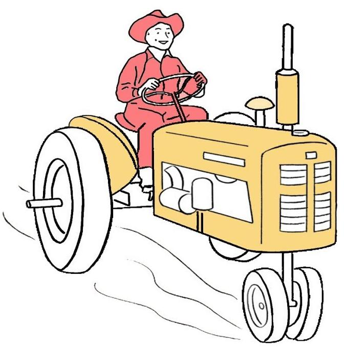

# Chuyen De Toan Thuc Te Toan 9

*thời gian 5 giây.*  

---

NGUYỄN NGỌC DŨNG TOÁN THẦY DŨNG TQB π π π π π π π π π π π π π π π π π π π π C E B A D 50m 34◦ 62◦ TOÁN TOÁN TOÁN TOÁN TOÁN TOÁN TOÁN TOÁN TOÁN TOÁN TOÁN TOÁN TOÁN TOÁN TOÁN TOÁN TOÁN TOÁN TOÁN TOÁN TOÁN TOÁN TOÁN TOÁN TOÁN TOÁN TOÁN TOÁN TOÁN TOÁN TOÁN TOÁN TOÁN TOÁN TOÁN TOÁN TOÁN TOÁN TOÁN TOÁN TOÁN TOÁN TOÁN TOÁN TOÁN TOÁN TOÁN TOÁN TOÁN TOÁN TOÁN TOÁN TOÁN TOÁN TOÁN TOÁN TOÁN TOÁN TOÁN TOÁN TOÁN TOÁN TOÁN TOÁN TOÁN TOÁN TOÁN TOÁN TOÁN TOÁN TOÁN TOÁN TOÁN TOÁN TOÁN TOÁN TOÁN CHUYÊN ĐỀTOÁN THỰC TẾ CHUYÊN ĐỀTOÁN THỰC TẾ9 2023 - 2024

MỤC LỤC Lớp Toán Thầy Dũng - TạQuang Bửu i MỤC LỤC Bài số1.
Định lý Vi-ét và ứng dụng . . . . . . . . . . . . . . . . . . . . . . . . . . . . . . . . . . . . . . . . . . . . . . . . . . . . . . . . . . . . . . . . . . . . . 1 Bài số2.
Kỹnăng làm toán thực tế"Hàm sốvà đồthị". . . . . . . . . . . . . . . . . . . . . . . . . . . . . . . . . . . . . . . . . . 2 Bài số3.
Giải toán bằng cách lập phương trình, hệphương trình . . . . . . . . . . . . . . . . . . . . . . . . . . . . . 15 Bài số4.
Các bài toán thực tếliên quan "Hình không gian" . . . . . . . . . . . . . . . . . . . . . . . . . . . . . . . . . . . 24 Bài số5.
Các bài toán thực tếliên quan "Hình học phẳng" . . . . . . . . . . . . . . . . . . . . . . . . . . . . . . . . . . . . 38 i/49 p Thầy Nguyễn Ngọc Dũng - Ô 0976.071.956

MỤC LỤC Lớp Toán Thầy Dũng - TạQuang Bửu 1 ĐỊNH LÝ VI-ÉT VÀ ỨNG DỤNG 1 Baâi söë CÁC CÔNG THỨC CẦN NHỚ . . . . . . . . . . . . . . . . . . . . . . . . . . . . . . . . . . . . . . . . . . . . . . . .
. . . . . . . . . . . . . . . . . . . . . . . . . . . . . . . . . . . . . . . . . . . . . . . .
. . . . . . . . . . . . . . . . . . . . . . . . . . . . . . . . . . . . . . . . . . . . . . . .
. . . . . . . . . . . . . . . . . . . . . . . . . . . . . . . . . . . . . . . . . . . . . . . .
. . . . . . . . . . . . . . . . . . . . . . . . . . . . . . . . . . . . . . . . . . . . . . . .
. . . . . . . . . . . . . . . . . . . . . . . . . . . . . . . . . . . . . . . . . . . . . . . .
. . . . . . . . . . . . . . . . . . . . . . . . . . . . . . . . . . . . . . . . . . . . . . . .
. . . . . . . . . . . . . . . . . . . . . . . . . . . . . . . . . . . . . . . . . . . . . . . .
. . . . . . . . . . . . . . . . . . . . . . . . . . . . . . . . . . . . . . . . . . . . . . . .
. . . . . . . . . . . . . . . . . . . . . . . . . . . . . . . . . . . . . . . . . . . . . . . .
. . . . . . . . . . . . . . . . . . . . . . . . . . . . . . . . . . . . . . . . . . . . . . . .
. . . . . . . . . . . . . . . . . . . . . . . . . . . . . . . . . . . . . . . . . . . . . . . .
. . . . . . . . . . . . . . . . . . . . . . . . . . . . . . . . . . . . . . . . . . . . . . . .
. . . . . . . . . . . . . . . . . . . . . . . . . . . . . . . . . . . . . . . . . . . . . . . .
. . . . . . . . . . . . . . . . . . . . . . . . . . . . . . . . . . . . . . . . . . . . . . . .
. . . . . . . . . . . . . . . . . . . . . . . . . . . . . . . . . . . . . . . . . . . . . . . .
. . . . . . . . . . . . . . . . . . . . . . . . . . . . . . . . . . . . . . . . . . . . . . . .
. . . . . . . . . . . . . . . . . . . . . . . . . . . . . . . . . . . . . . . . . . . . . . . .
. . . . . . . . . . . . . . . . . . . . . . . . . . . . . . . . . . . . . . . . . . . . . . . .
. . . . . . . . . . . . . . . . . . . . . . . . . . . . . . . . . . . . . . . . . . . . . . . .

### Bài 1. Cho phương trình 2x2 -3x + 1 = 0 có hai nghiệm x1; x2. Tính:

x2 1 + x2 2; a) x3 1 + x3 2. b) 1 x1 + 1 x2 ; c) x1 x2 + x2 x1 ; d) 1 - x1 x1 + 1 - x2 x2 ; e) x1 x2 + 1 + x2 x1 + 1; f) x1 + 2 x2 + x2 + 2 x1 ; g) 6x2 1 + 10x1x2 + 6x2 2 5x1x3 2 + 5x3 1x2 ; h) Bài 2. Cho phương trình 2x2 -3x -3 = 0 có hai nghiệm x1 và x2. Tính giá trịcác biểu thức sau A = x2 1 + x2 2 và B = x2 1x2 + x2 2x1.

### Bài 3. Cho phương trình 4x2 + 3x -1 = 0 có hai nghiệm x1, x2. Không giải phương trình, hãy tính giá trịcủa biểu thức A = (x1 -2) (x2 -2).

### Bài 4. Gọi x1 và x2 là các nghiệm của phương trình x2 -x -12 = 0. Không giải phương trình, tính giá trịcủa biểu thức A = x1 + 1 x2 + x2 + 1 x1 .

### Bài 5. Cho phương trình 2x2 + 3x -5 = 0 có 2 nghiệm là x1, x2. Không giải phương trình hãy tính giá trịcủa các biểu thức sau A = x2 1 + x2 2.

### Bài 6. Cho phương trình 20x2 + 5x -2020 = 0 có hai nghiệm là x1, x2. Không giải phương trình, hãy tính giá trịbiểu thức A = x1 x2 (1 - x2) + x2 x1 (1 - x1).

### Bài 7. Cho phương trình x2 -4x -m2 = 0 (x là ẩn số, m là tham số)

a) Chứng tỏrằng phương trình luôn có 2 nghiệm phân biệt với mọi giá trịcủa m.
b) Tìm các giá trịcủa m đểphương trình có 2 nghiệm x1, x2 thỏa mãn 2x1 + x2 (2 -3x1) = 8.

### Bài 8. Gọi x1, x2 là các nghiệm của phương trình x2 -x -12 = 0. Không giải phương trình, tính giá trịcủa biểu thức A = x1 + 1 x2 + x2 + 1 x1 .

### Bài 9. Cho phương trình 2x2 -3x -7 = 0 có nghiệm là x1; x2. Không giải phương trình. Tính A = x2 1 + x2 2 - x1 - x2. 1/49 p Thầy Nguyễn Ngọc Dũng - Ô 0976.071.956

2. Kỹnăng làm toán thực tế"Hàm sốvà đồthị" Lớp Toán Thầy Dũng - TạQuang Bửu 2 Bài 10. Cho phương trình x2 -5x -2 = 0 có hai nghiệm là x1 và x2. Không giải phương trình, hãy tính giá trịcủa biểu thức: A = x2 1 + x2 2 + x1 + x2.

### Bài 11. Cho phương trình x2 2 -x -1 = 0 có hai nghiệm x1, x2. Không giải phương trình hãy tính giá trịcủa biểu thức sau A = x1 x2 + x2 x1 - x1x2.

### Bài 12. Cho phương trình 2x2 -3x -4 = 0 có hai nghiệm là x1, x2. Không giải phương trình, hãy tính giá trịcủa biểu thức A = 1 x2 1 + 1 x2 2 .

### Bài 13. Cho phương trình 2x2 + 7x -5 = 0 có hai nghiệm x1, x2. Không giải phương trình, hãy tính giá trịbiểu thức P = (3x1 -5x2) (3x2 -5x1).

### Bài 14. Cho phương trình 2x2 -5x -1 = 0 có hai nghiệm x1 và x2. Không giải phương trình hãy tính giá trịbiểu thức (2x1 -x2) (2x2 -x1).

### Bài 15. Cho phương trình 3x2 -12x -5 = 0 có 2 nghiệm là x1, x2. Không giải phương trình, hãy tính giá trịcủa biểu thức T = x2 1 + 4x2 -x1x2 4x1 + x2 2 + x1x2 .

### Bài 16. Cho phương trình 3x2 + 4x -1 = 0 có hai nghiệm x1, x2. Không giải phương trình, hãy tính giá trịcủa biểu thức A = x1 - 1 x2 + 1 + x2 -1 x1 + 1.

### Bài 17. Cho phương trình -x2 -2x + 5 = 0 (m là tham số).

a) Chứng minh phương trình đã cho luôn có hai nghiệm trái dấu?
b) Tìm giá trịcủa biểu thức A =
x1 x2 - 1 - x2 1 - x1 + 2022.

### Bài 18. Cho phương trình x2 -3x + m = 0 (1) (m là tham số). Tìm m đểphương trình (1) có hai nghiệm x1, x2 thoảmãn 2x1 + 2x2 -3x1x2 = 7.

### Bài 19. Tìm m đểphương trình x2 -2mx + m2 -2m + 3 = 0 có hai nghiệm phân biệt thỏa x2 1 + x2 2 - 5 2x1 - 5 2x2 = 0.

### Bài 20. Cho phương trình bậc hai: x2 -2mx -1 = 0.

(1)
a) Chứng minh phương trình (1) luôn có hai nghiệm phân biệt x1 và x2.
b) Tìm các giá trịm để: x2
1 + x2 2 - x1x2 = 7.

### Bài 21. Cho phương trình 3x2 -11x -15 = 0 có hai nghiệm x1, x2. Không giải phương trình, hãy tính giá trịcủa biểu thức A = 3x1 x2 + 3x2 x1 .

KỸNĂNG LÀM TOÁN THỰC TẾ"HÀM SỐVÀ ĐỒTHỊ" 2 Baâi söë
| Dạng 1. Xác định công thức của hàm sốkhi đềbài cho bằng đồthị
○Xác định công thức của hàm sốnghĩa là đi tìm các hệsốtrong công thức đó.
○Từđồthịtìm mối liên hệgiữa đại lượng ởtrục trục hoành và trục tung, từđó thiết lập hệ phương trình đểtìm được các hệsốtrong công thức của hàm số.
cccVÍ DỤMINH HỌAccc 2/49 p Thầy Nguyễn Ngọc Dũng - Ô 0976.071.956

MỤC LỤC Lớp Toán Thầy Dũng - TạQuang Bửu 3 cVí dụ1.
Cho biểu đồbên, biết:
○x (năm) là sốnăm kểtừnăm 2012 (ví dụ: năm 2013 thì x = 1).
○y (triệu đồng) là thu nhập một tháng của gia đình bạn An. O x (năm) y (triệu đồng) 2 6 40 8 2 6 40 8 20 y = ax + b ○Mối liên hệgiữy và x được biểu diễn bởi công thức y = ax + b (a, b là hằng số).
a) Xác định a, b.
b) Tính thu nhập một tháng của gia đình bạn An năm 2014 và thu nhập một tháng của gia đình
bạn An năm 2018.
cVí dụ2.
Galilei là người phát hiện ra quãng đường chuyển động của vật rơi tự do tỉlệthuận với bình phương của thời gian chuyển động. Quan hệ giữa quãng đường chuyển động y (mét) và thời gian chuyển động x (giây) được biểu diễn bởi công thức y = ax2 (a là hằng số) và có đồ thịlà phần nét liền của Parabol trong hình vẽbên.
a) Xác định giá trịcủa a trong công thức trên.
b) Người ta thảmột vật nặng từđộcao 68 m. Hãy cho biết sau 3
giây thì vật nặng cách mặt đất bao nhiêu mét?
O x (giây) y (mét) y = ax2 1 4, 9 cVí dụ3. Do ảnh hưởng của tình hình dịch bệnh, thu nhập của một công ty bịgiảm dần trong năm 2021. Các sốliệu thống kê được thểhiện bằng đồthịnhư hình vẽbên.
O x tháng y trăm triệu/tháng A B 1 5 12 2 3/49 p Thầy Nguyễn Ngọc Dũng - Ô 0976.071.956

2. Kỹnăng làm toán thực tế"Hàm sốvà đồthị" Lớp Toán Thầy Dũng - TạQuang Bửu 4
a) Tìm hàm sốthểhiện sựliên quan của đại lượng y (trăm triệu/tháng) theo đại lượng x (tháng).
b) Biết một sản phẩm bán được thì công ty có lợi nhuận là 100 ngàn đồng, em hãy tính sốsản
phẩm mà công ty bán được trong tháng 9 năm 2021 (làm tròn đến hàng đơn vị).
cccBÀI TẬP VẬN DỤNGccc Bài 1.
Giá cước điện thoại di động của một công ty điện thoại trong 1 tháng được tính như sau: tiền thuê bao trảtrước 90000 đồng, gọi từ3000 phút trở xuống không phải trảtiền thêm, trên 3000 phút thì cứ1 phút gọi thêm trảthêm 100 đồng mỗi phút. Đồthị O x y cước phí 1 tháng (đồng) 3000 thời gian gọi thêm (phút) A 90000 390000 trên minh họa thời gian x (phút) gọi thêm và sốtiền cước y (đồng) phải trảtrong một tháng, được xác định bởi công thức y = ax + b.
a) Xác định các hệsốa và b.
b) Nếu gọi thêm 2000 phút thì tiền cước phải trảtrong một tháng là bao nhiêu tiền?

### Bài 2.

Một công ty địa ốc sau 2 năm thay đổi đã bán được 200 căn nhà và sau 7 năm bán được 275 căn nhà. Sốlượng nhà bán được của công ty địa ốc sau khi thay đổi được cho bởi công thức y = ax + b (trong đó y là số lượng nhà bán được; x là sốnăm bán) và đồthịnhư hình bên.
O x y 1 2 3 4 5 6 7 170 200 230 260 275
a) Xác định hệsốa và b?
b) Em hãy cho biết sau 10 năm công ty đó bán được bao nhiêu căn nhà?

### Bài 3. Nồng độcồn trong máu (BAC) được định nghĩa là phần trăm rượu (rượu ethyl hoặc ethanol) trong dòng máu của một người. BAC là 0,05% có nghĩa là có 0,05 gam rượu trong 100ml máu. Càng uống nhiều rượu bia thì nồng độcồn trong máu càng cao và càng nguy hiểm khi tham gia giao thông.

Nồng độBAC trong máu của một người được thểhiện qua đồthịsau:
4/49 p Thầy Nguyễn Ngọc Dũng - Ô 0976.071.956

MỤC LỤC Lớp Toán Thầy Dũng - TạQuang Bửu 5 O t (giờ) BAC (%) 1 0,068 0,076
a) Viết công thức biểu thịmối quan hệgiữa nồng độcồn trong máu (BAC) sau t giờsửdụng.
b) Theo nghịđịnh 100/2019/ND-CP vềxửphạt vi phạm hành chính, các mức phạt (đối với xe máy).
Hỏi sau 3 giờ, nếu người này tham gia giao thông thì sẽbịxửphạt ởmức độnào?
Mức 1: Nồng độcồn chưa vượt quá 50mg/100ml máu Phạt tiền từ02 -03 triệu đồng (tước bằng từ10 -12 tháng) Mức 2: Nồng độcồn vượt quá 50mg đến 80mg/100ml máu Phạt tiền từ04 -05 triệu đồng (tước bằng từ16 -18 tháng) Mức 3: Nồng độcồn vượt quá 80mg/100ml máu Phạt tiền từ06 -08 triệu đồng (tước bằng từ22 -24 tháng) ¤ a) BAC = -1 125 t + 0,076. b) Bịphạt tiền từ04 -05 triệu đồng và tước bằng từ16 -18 tháng.

### Bài 4.

Một chiếc cổng chào được thiết kếcó hình dạng như đồthị(P) của hàm sốy = ax2 (a là hằng số, a < 0) như hình v¯e. Biết AB = 4 m, chiều cao cánh cổng là OC = 8 (m).
a) Xác định hằng sốa.
b) Tại vịtrí cách mặt đất một đoạn CD = 6 m, người ta
đặt một thanh gỗsong song với mặt đất, hai đầu mút của thanh gỗlà hai điểm E, F thuộc (P). Tính chiều dài của thanh gỗ. O x y A B E F G H D C mặt đất
| Dạng 2. Xác định công thức của hàm số
khi đềbài cho bằng lời văn hoặc bằng bảng Từbảng hoặc lời văn tìm mối liên hệgiữa các đại lượng, từđó lập được công thức hoặc thiết lập hệphương trình đểtừđó tìm được các hệsốtrong công thức.
cccVÍ DỤMINH HỌAccc cVí dụ4. Tại bềmặt đại dương, áp suất nước bằng áp suất khí quyển và là 1 atm (atmosphere).
Bên dưới mặt nước, áp suất nước tăng thêm 1 atm cho mỗi 10 mét sâu xuống. Biết rằng mối liên 5/49 p Thầy Nguyễn Ngọc Dũng - Ô 0976.071.956

2. Kỹnăng làm toán thực tế"Hàm sốvà đồthị" Lớp Toán Thầy Dũng - TạQuang Bửu 6 hệgiữa áp suất y (atm) và độsâu x (m) dưới mặt nước là một hàm sốbậc nhất có dạng y = ax + b.
a) Xác định các hệsốa và b.
b) Một người thợlặn đang ởđộsâu bao nhiêu nếu người ấy chịu một áp suất là 2, 85 atm?
cVí dụ5. Có hai hãng điện thoại cốđịnh tính phí gọi cho các thuê bao như sau:
Hãng Gía thuê bao (nghìn đồng) Giá gọi nội hạt (nghìn đồng/30 phút) Hãng A 10 6 Hãng B 15 5 Gọi y là sốtiền mà khách hàng phải trảsau x lần 30 phút (x ∈N∗).
Biết cước phí hàng tháng bằng tổng tiền thuê bao và cước phí gọi nội hạt.
a) Hãy biểu diễn y theo x của từng hãng.
b) Hãy cho biết với cách tính phí như trên thì một khách hàng mỗi tháng gọi bình quân 6 giờ
nên sửdụng mạng của hãng nào sẽrẻhơn?
cVí dụ6. Ông Nam dùng một ống nước đểdẫn nước vào một bểtrống (không có nước) có thể tích 200 lít. Mỗi phút lượng nước trong bểtăng thêm 10 lít. Gọi y (lít) là thểtích nước cần thêm vào đểđầy bểsau khi vòi nước chảy được x phút.
a) Xem y là một hàm sốcủa x. Hãy lập công thức tính y theo x.
b) Sau khi vòi chảy được 3 phút thì cần thêm bao nhiêu lít nước nữa đểđầy bể? Khi thểtích
nước bằng 3 5 thểtích bểthì vòi nước đã chảy được bao nhiêu giây?
cVí dụ7. Xe Vinfast VF e34 - ôtô điện thông minh đầu tiên của người Việt Nam. Khách hàng khi mua xe Vinfast phải chọn 1 trong 2 gói thuê pin sau:
○Gói thuê pin linh hoạt: 657500 đồng/tháng cho quãng đường tối đa 500 km/tháng. Trường hợp đi quá 500 km/ tháng, khách hàng sẽtrảthêm phí thuê pin theo đơn giá 1315 đồng cho mỗi km vượt.
○Gói thuê pin cốđịnh: 1804000 đồng/tháng, không giới hạn sốkm sửdụng.
Gọi y (đồng) là sốtiền mà khách hàng phải trảmỗi tháng cho quãng đường x km/tháng (x ≥500) trong trường hợp khách hàng này chọn gói thuê pin linh hoạt.
a) Hãy viết công thức tính y theo x.
b) Em hãy cho biết khách hàng có quãng đường dựkiến di chuyển tối thiểu là bao nhiêu km thì
chọn gói thuê pin cốđịnh sẽcó lợi hơn? Giải thích. (Kết quảlàm tròn đến hàng đơn vị) cVí dụ8. Một hộgia đình dựđịnh mua máy nước nóng đểphục vụvào mùa đông. Gia đình đang cân nhắc giữa hai loại máy nước nóng dùng điện có chếđộbảo hành giống nhau sau:
6/49 p Thầy Nguyễn Ngọc Dũng - Ô 0976.071.956

MỤC LỤC Lớp Toán Thầy Dũng - TạQuang Bửu 7 ○Loại máy A giá 3 330 000 đồng và điện năng tiêu thụtrong một giờlà 2, 5 kW.
○Loại máy B giá 2 790 000 đồng và điện năng tiêu thụtrong một giờlà 4, 5 kW.
a) Xem chi phí gia đình phải trảlà một hàm sốphụthuộc sốgiờsửdụng, biết giá điện sinh hoạt
là 2000 đồng/kWh, hãy viết công thức của các hàm sốdựa trên thông tin đã cho theo từng yêu cầu:
i) Hàm sốf(x) đểtính chi phí gia đình phải trả(đơn vịnghìn đồng) nếu sửdụng máy loại A trong x giờ.
ii) Hàm sốg(x) đểtính chi phí gia đình phải trả(đơn vịnghìn đồng) nếu sửdụng máy loại B trong x giờ.
b) Hỏi sau mấy giờsửdụng thì chi phí mà gia đình phải trảkhi sửdụng máy loại A và B là bằng
nhau?
c) Từsau thời điểm chi phí bằng nhau tìm được ởtrên thì gia đình nên sửdụng máy loại nào sẽ
có lợi hơn? Vì sao?
cccBÀI TẬP VẬN DỤNGccc Bài 1. Qua nghiên cứu, người ta nhận thấy rằng với mỗi người trung bình nhiệt độmôi trường giảm đi 1◦C thì lượng calo cần tăng thêm khoảng 30 calo. Tại 21◦C, một người làm việc cần sửdụng khoảng 3000 calo mỗi ngày. Người ta thấy mối quan hệgiữa hai đại lượng này là một hàm bậc nhất y = ax + b (x là đại lượng biểu thịcho nhiệt độmôi trường và y là đại lượng biểu thịcho lượng calo).
a) Xác định hệsốa, b.
b) Nếu một người làm việc ởsa mạc Sahara trong nhiệt độ50◦C thì cần bao nhiêu calo?

### Bài 2. Một quyển tập giá 12 000 đồng, một hộp bút giá 30 000 đồng. Bạn An cần mua một sốquyển tập và một hộp bút.

a) Gọi x là sốquyển tập An mua và y là sốtiền phải trả(bao gồm tiền mua tập và một hôp bút).
Viết công thức biểu diễn y theo x.
b) Nếu bạn An có 400 000 đồng đểmua tập và một hộp bút thì tối đa bạn An mua được bao nhiêu
quyển tập?

### Bài 3. Hiện tại, Việt Nam và nhiều nước khác đang sửdụng thang đo nhiệt độ◦C (Celsius). Tuy nhiên, các nước sửdụng tiếng Anh đang sửdụng thang đo nhiệt độ◦F (Fahrenheit). Tại thời điểm nhiệt độ nước đóng băng 0◦C thì tương ứng 32◦F và cứđộC tăng 10◦thì độF lại tăng 18◦. Mối quan hệgiữa độC và độF là F = mC + n. Trong đó: F (đơn vị: ◦F) là nhiệt độcủa môi trường tại thời điểm nhiệt độcủa môi trường là C (đơn vị: (◦C); m, n là hằng số.

a) Hãy xác định giá trịm, n.
b) Khi nhiệt kếhiển thịđộC và độF cùng một giá trịthì nhiệt độkhi đó là bao nhiêu ◦C?

### Bài 4. Đoạn đường AB có độdài là 180 (km). Xe thứnhất đi từA đến B với vận tốc trung bình là 40 (km/h). Xe thứhai đi từB đến A với vận tốc trung bình là 50 (km/h). Xe thứnhất và xe thứhai xuất phát cùng lúc và gặp nhau ởvịtrí C (sau khi gặp nhau hai xe dừng lại).

a) Gọi S (km) là khoảng cách giữa xe thứnhất và xe thứhai sau khi di chuyển được x (giờ) (x ≤2).
Viết hàm sốbiểu diễn S theo x.
b) Khi xe thứnhất và xe thứhai cách nhau 120 km thì hai xe đã đi được bao nhiêu phút?
7/49 p Thầy Nguyễn Ngọc Dũng - Ô 0976.071.956

2. Kỹnăng làm toán thực tế"Hàm sốvà đồthị" Lớp Toán Thầy Dũng - TạQuang Bửu 8
c) Nếu hai xe xuất phát lúc 6 giờsáng thì hai xe đến vịtrí C lúc mấy giờ?

### Bài 5. Một cửa hàng bán loại bánh A như sau: nếu mua không quá 3 hộp thì giá mỗi hộp là 35 nghìn đồng, nếu mua nhiều hơn 3 hộp thì bắt đầu từhộp thứtư trởđi giá mỗi hộp sẽgiảm 20% so với giá ban đầu.

a) Viết công thức tính y (nghìn đồng) khi mua x hộp bánh (x > 3).
b) Lan và Hồng đều mua loại bánh A với sốhộp nhiều hơn 3. Hỏi mỗi bạn mua bao nhiêu hộp bánh,
biêt rằng sốhộp bánh Lan mua gấp đôi sốhộp Hồng mua, đồng thời sốtiền mua bánh của Lan nhiều hơn Hồng 140 nghìn đồng.

### Bài 6. Lớp 9A dựđịnh tổchức đi học tập trải nghiệm vào dịp cuối năm, do vậy cần một hướng dẫn viên du lịch cho chuyến đi trải nghiệm này. Giáo viên chủnhiệm lớp 9A đ¯a liên hệvới hai công ty A và B lấy thông tin vềgiá:

- Công ty A có phí dịch vụlà 500 (nghìn đồng) và mỗi ki-lô-mét s¯e cộng thêm 3 (nghìn đồng).
- Công ty B có phí dịch vụlà 400 (nghìn đồng) và mỗi ki-lô-mét sẽcộng thêm 5 (nghìn đồng).
Phí dịch vụcủa cảhai công ty chỉtính cho chiều đi (chiều vềkhông tính phí).
a) Gọi f(x), g(x) lần lượt là sốtiền phải trảcho công ty A và B khi qu¯ang đường chuyến đi trải
nghiệm học tập là x (km). Viết hàm sốf(x), g(x) theo x.
b) Nếu qu¯ang đường của chuyến đi trải nghiệm là 350 (km) thì nên chọn dịch vụcủa công ty nào để
tiết kiệm chi phí hơn?
| Dạng 3. Dựa vào công thức của hàm sốđểtính các giá trịliên quan
○Từcông thức của hàm sốđã cho, xác định rõ từng đại lượng trong công thức là gì, cần lưu ý tới đơn vịđược xét của các đại lượng đó.
○Thay giá trịcủa các đại lượng đã biết vào công thức đểtính các đại lượng mà bài toán yêu cầu.
cccVÍ DỤMINH HỌAccc cVí dụ9. Một hòn đá rơi xuống một cái hang, khoảng cách rơi xuống h (tính bằng mét) được cho bởi công thức h = 4,9t2, trong đó t là thời gian rơi (tính bằng giây).
a) Hãy tính độsâu của hang nếu mất 3 giây đểhòn đá chạm đáy.
b) Nếu hang sâu 122,5 mét thì phải mất bao lâu đểhòn đá chạm tới đáy?
cVí dụ10. Ông Sáu gửi X (triệu đồng) vào ngân hàng theo mức lãi suất tiết kiệm với kỳhạn 1 năm là 5%/năm. Sau khi gửi n năm, tổng sốtiền cảvốn lẫn lãi ông Sáu nhận được là T = X(1+5%)n (T đơn vịtriệu đồng).
a) Sau 3 năm, ông Sáu nhận được sốtiền là 11 576 250 (đồng). Hỏi ban đầu ông Sáu đã gửi bao
nhiều tiền?
b) Sốtiền nhàn rỗi y (triệu đồng) sau khoảng thời gian x (tháng) (0 < x ≤12) của ông Sáu là
y = 3x -1, 8. Ông muốn dùng 30% tiền nhàn rỗi trong 1 năm của mình đểgửi tiết kiệm vào ngân hàng trên. Sau 2 năm gửi ngân hàng với sốtiền trên, ông Sáu sẽnhận được bao nhiêu tiền cảvốn lẫn lãi? (Lãi suất không đổi trong 2 năm ông Sáu gửi).
8/49 p Thầy Nguyễn Ngọc Dũng - Ô 0976.071.956

MỤC LỤC Lớp Toán Thầy Dũng - TạQuang Bửu 9 cVí dụ11. Một vật rơi ởđộcao 396,9 m xuống mặt đất. Biết rằng quãng đường chuyển động S (m) của vật phụthuộc vào thời gian t (s) thông qua công thức S = 1 2gt2, với g là gia tốc rơi tựdo và g ≈9,8 (m/s2).
a) Hỏi sau giây thứ4, vật này cách mặt đất bao nhiêu mét?
b) Sau bao lâu thì vật chạm đất?
cVí dụ12.
Một vận động viên bơi lội nhảy từván nhảy xuống hồbơi, độ cao h (tính bằng mét) từngười đó tới mặt nước phụthuộc vào khoảng cách x (tính bằng mét) từngười đó tới ván nhảy theo công thức h = -(x-1)2 +4 (xem hình). Hỏi khoảng cách x bằng bao nhiêu: h x hồbơi ván nhảy
a) Khi vận động viên ởđộcao 4 m?
b) Khi vận động viên chạm mặt nước?
cVí dụ13. Cách đây hơn một thếkỷ, nhà khoa học người Hà Lan Hendrich Lorentz (1853-1928) đưa ra công thức tính sốcân nặng lí tưởng của con người theo chiều cao như sau M = T -100 -T -150 N (công thức Lorentz).
Trong đó ○M là sốcân nặng lí tưởng tính theo kg.
○T là chiều cao tính theo cm.
○N = 4 với nam giới và N = 2 với nữgiới.
a) Bạn A (là nam giới) chiều cao là 1, 6 m. Hỏi cân nặng của bạn nên là bao nhiêu kg đểđạt lí
tưởng?
b) Với chiều cao bằng bao nhiêu thì sốcân nặng lí tưởng của nam giới và nữgiới bằng nhau?
cVí dụ14. Mối quan hệgiữa thang nhiệt độF (Fahrenheit) và thang nhiệt độC (Celsius) được cho bởi công thức TF = 1, 8TC + 32, trong đó TC là nhiệt độtính theo độC và TF là nhiệt độtính theo độF. Ví dụTC = 0◦C tương ứng với TF = 32◦F.
a) Hỏi 25◦C tương ứng với bao nhiêu độF?
b) Các nhà khoa học đã tìm ra mối liên hệgiữa A là sốtiếng kêu của một con dếtrong một
phút và TF là nhiệt độcơ thểcủa nó bởi công thức A = 5, 6TF -275, trong đó nhiệt độTF tính theo độF. Hỏi nếu con dếkêu 106 tiếng trong một phút thì nhiệt độcủa nó khoảng bao nhiêu độC? (làm tròn đến hàng đơn vị) cccBÀI TẬP VẬN DỤNGccc 9/49 p Thầy Nguyễn Ngọc Dũng - Ô 0976.071.956

2. Kỹnăng làm toán thực tế"Hàm sốvà đồthị" Lớp Toán Thầy Dũng - TạQuang Bửu 10 Bài 1. Một vật rơi ởđộcao so với mặt đất là 400 mét. Quãng đường chuyển động s (mét) của vật rơi phụthuộc vào thời gian t (giây) bởi công thức: s = 4t2. Hỏi
a) Sau 5 giây, vật này cách mặt đất bao nhiêu mét?
b) Sau bao nhiêu lâu vật này tiếp đất?
¤ a) 300 m; b) 10 giây.

### Bài 2. Đểtính toán thời gian một chu kỳđong đưa (một chu kỳđong đưa dây đu được tính từlúc dây đu bắt đầu được đưa lên cao đến khi dừng hẳn) của một dây đu, người ta sửdụng công thức T = 2π

L g . Trong đó, T là thời gian một chu kỳđong đưa (s), L là chiều dài của dây đu (m), g = 9,81 m/s2.
a) Một sợi dây đu có chiều dài 2 +
√ 3 m, hỏi chu kỳđong đưa dài bao nhiêu giây?
b) Một người muốn thiết kếmột dây đu sao cho một chu kỳđong đưa kéo dài 4 giây. Hỏi người đó
phải làm một sợi dây đu dài bao nhiêu?
¤ a) 3,87 s; b) 3,98 m.

### Bài 3. Chim cắt là loài chim lớn, có bản tính hung dữ, đặc điểm nổi bật nhất của chúng là đôi mắt rực sáng, bộmóng vuốt và chiếc mỏsắc như dao nhọn, chúng có khảnăng lao nhanh như tên bắn và là nỗi khiếp đảm của không ít các loài chim trời, rắn và những loài thú nhỏ: chuột, thỏ, sóc, . . .

a) Từvịtrí 16 m so với mặt đất, đường bay lên của chim cắt là hàm sốđược cho bởi công thức
y = 30x + 16 (trong đó y là cao độso với mặt đất tính bằng mét, x là thời gian tính bằng giây, x ≥0 ). Hỏi nếu nó muốn bay lên đểđậu trên núi cao 256 m so với mặt đất thì tốn bao nhiêu giây?
b) Từvịtrí 256 m so với mặt đất hãy tìm cao độkhi nó bay xuống sau 3 giây. Biết đường bay xuống
của nó được cho bởi công thức y = -40x + 256 (trong đó y là cao độso với mặt đất tính bằng mét, x là thời gian tính bằng giây, x ≥0 ).
¤ a) 8 giây; b) 136 m.

### Bài 4. Sốcân nặng lý tưởng tương ứng với chiều cao được tính dựa theo công thức M = T -100 -

T - 150 N trong đó M là cân nặng tính theo kg, T là chiều cao tính theo cm, N = 4 nếu là nam, N = 2 nếu là nữ.
a) Một bạn nam cao 1,7 m. Hỏi bạn ấy có cân nặng là bao nhiêu thì gọi là lý tưởng?
b) Giảsử1 bạn nữcó cân nặng 40 kg. Hỏi bạn phải có chiều cao bao nhiêu đểcó cân nặng lý tưởng?
¤ a) 65 kg; b) 1, 3 m.

### Bài 5. Đại bàng là một loài chim săn mồi cỡlớn thuộc bộƯng, họAccipitridae. Chúng sinh sống trên mọi nơi có núi cao và rừng nguyên sinh còn chưa bịcon người chặt phá như bờbiển Úc, Indonesia, Phi châu. . . Loài đại bàng lớn nhất có chiều dài cơ thểhơn 1 m và nặng 7 kg. Sải cánh của chúng dài từ1,5 m cho đến 2 m.

a) Từvịtrí cao 16 m so với mặt đất, đường bay lên của đại bàng được cho bởi công thức: y = 24x+16
(trong đó y là độcao so với mặt đất, x là thời gian tính bằng giây, x ≥0). Hỏi nếu nó muốn bay lên đểđậu trên một núi đá cao 208 m so với mặt đất thì tốn bao nhiêu giây?
b) Từvịtrí cao 208 m so với mặt đất hãy tìm độcao khi nó bay xuống sau 5 giây. Biết đường bay
xuống của nó được cho bởi công thức: y = -14x + 208.
10/49 p Thầy Nguyễn Ngọc Dũng - Ô 0976.071.956

MỤC LỤC Lớp Toán Thầy Dũng - TạQuang Bửu 11 ¤ a) 8 giây; b) 138 m Bài 6. Một nhà máy sản xuất xi măng có sản lượng hàng năm được xác định theo hàm sốT = 12,5n + 360. Với T là sản lượng (đơn vịlà tấn) và n là sốnăm tính từnăm 2010.
a) Hãy tính sản lượng xi măng của nhà máy vào năm 2010.
b) Theo hàm sốtrên thì nhà máy đạt sản lượng 460 tấn vào năm nào?
¤ a) 360 tấn; b) Năm 2018 Bài 7. Tỉtrọng người cao tuổi ởViệt Nam được xác định bởi hàm sốR = 11 + 0,32t, trong đó R tính bằng %, t tính bằng sốnăm, kểtừnăm 2011.
a) Hãy tính tỉtrọng người cao tuổi ởViệt Nam vào năm 2011, 2018 và 2050.
b) Đểchuyển từgiai đoạn già hóa dân số(tỉtrọng người cao tuổi chiếm 11%) sang giai đoạn dân số
già (tỉtrọng người cao tuổi chiếm 20%) thì Australia mất 73 năm, Hoa Kỳ69 năm, Canada mất 65 năm. Em hãy tính xem Việt Nam mất khoảng bao nhiêu năm (làm tròn đến năm)? Tốc độgià hóa của Việt Nam nhanh hay chậm so với các nước trên.
¤ a) Năm 2011 có R = 11%, năm 2018 có R = 13,24%, năm 2050 có R = 23, 48%; b) 28 năm Bài 8. Quãng đường đi của một vật rơi tựdo không vận tốc đầu cho bởi công thức S = 1 2gt2 (trong đó g là gia tốc trọng trường g = 10 m/giây, t (giây) là thời gian rơi tựdo, S là quãng đường rơi tựdo).
Một vận động viên nhảy dù, nhảy khỏi máy bay ởđộcao 3200 mét (vận tốc ban đầu không đáng kể, bỏ qua các lực cản). Hỏi sau thời gian bao nhiêu giây, vận động viên phải mởdù đểkhoảng cách đến mặt đất là 1200 mét?
¤ 20 giây Bài 9. Bạn có thểước tính nhiệt độbên ngoài bằng cách sửdụng tiếng kêu của một con dế. Sửdụng công thức F = n 4 + 37, trong đó n là sốlần một con dếkêu trong một phút, và F là nhiệt độtính bằng độF. Bạn hãy ước lượng nhiệt độbên ngoài là bao nhiêu độC, khi một con dếkêu 100 lần trong một phút.
(Biết C = F -32 1,8 ) ¤ 16,6◦C Bài 10. Công thức h = 0,4 3√x biểu diễn mối tương quan giữa cân nặng x (tính bằng kg) và chiều cao h (tính bằng m) của một con hươu cao cổ.
a) Một con hươu cao cổcân nặng 180 kg thì cao bao nhiêu mét?
b) Một con hươu cao cổcó chiều cao 2,56 m thì cân nặng bao nhiêu kg?
¤ a) 2,26 m; b) 262, 14 kg cccBÀI TẬP TỔNG HỢPccc Bài 1. Ta được biết càng lên cao thì áp suất khí quyển càng giảm. Với những độcao không lớn lắm thì cứlên cao 12,5 m, áp suất khí quyển lại giảm đi 1 mmHg. Khi đó, theo các nhà khoa học thì mối liên hệgiữa áp suất p (đơn vịlà mmHg) và độcao h (đơn vịlà m) được cho bởi hàm sốsau: p = h 12,5. Hỏi thành phốĐà Lạt ởđộcao 1 500 m thì áp suất khí quyển là bao nhiêu (tính theo đơn vịatm)? Biết rằng 1 atm = 760 mmHg (làm tròn 2 chữsốthập phân).
¤ 0,16 atm Bài 2. Mối quan hệgiữa thang nhiệt độF (Fahrenheit) và thang nhiệt độC (Celsius) được cho bởi công thức TF = 1,8.TC + 32. Theo các chuyên gia vềsức khỏe, nhiệt độmôi trường lý tưởng nhất với cơ thểcủa con người là từ25◦C đến 28◦C. Vào buổi sáng bạn An dựđịnh cùng với nhóm bạn đi dã ngoại, bạn sửdụng nhiệt kếđểđo nhiệt độmôi trường ngày hôm đó là 79,7◦F. Vậy nhiệt độnày có thích hợp cho An và nhóm bạn không?
¤ 26,5◦C 11/49 p Thầy Nguyễn Ngọc Dũng - Ô 0976.071.956

2. Kỹnăng làm toán thực tế"Hàm sốvà đồthị" Lớp Toán Thầy Dũng - TạQuang Bửu 12 Bài 3. Công ty đồchơi Bingbon vừa cho ra đời một đồchơi tàu điện điều khiển từxa. Trong điều kiện phòng thí nghiệm, quãng đường s (cm) đi được của đoàn tàu đồchơi là một hàm sốcủa thời gian t (giây), hàm sốđó là s = 6t + 9. Trong điều kiện thực tếngười ta thấy rằng nếu đoàn tàu đồchơi di chuyển quãng đường 12 cm thì mất 2 giây, và cứtrong mỗi 10 giây thì nó đi được 52 cm.
a) Trong điều kiện phòng thí nghiệm, hãy tính quãng đường đoàn tàu đồchơi di chuyển được sau
b) Mẹbé An mua đồchơi này vềcho bé chơi, bé ngồi cách mẹ1,5 m. Hỏi cần bao nhiêu giây để
đoàn tàu đồchơi đi từchỗmẹđến chỗbé?
¤ a) 39 cm; b) 29, 6 giây Bài 4. Ởđộcao h (m) bạn có thểnhìn thấy đường chân trời cách xa V (km), những đại lượng này liên hệtheo công thức V = 3, 5 √ h.
a) Một người có thểnhìn thấy đường chân trời cách 392 km từcửa sổmáy bay, hỏi máy bay đang ở
độcao bao nhiêu?
b) Một người đang đứng ởtrên đỉnh Hoàng Liên Sơn cao 3143 m (cao nhất Việt Nam) thì có thể
nhìn thấy đường chân trời cách đó bao nhiêu km? (làm tròn đến chữsốthập phân thứhai) Bài 5. Công thức Lozentz tính cân nặng lý tưởng theo chiều cao dành cho nữlà F = T -100-T -150 2 (với T là chiều cao (cm) và F là cân nặng lý tưởng (kg))
a) Bạn Hoa có cân nặng 56 kg. Hỏi bạn Hoa phải đạt chiều cao bao nhiêu đểcó cân nặng lý tưởng?
b) Một công ty người mẫu đưa ra yêu cầu tuyển người mẫu nữcao 1,7 m trởlên với cân nặng lý
tưởng theo công thức Lozentz. Hỏi nếu người mẫu cao 1,7 m thì cân nặng là bao nhiêu kg đểđủ tiêu chuẩn người xét tuyển?

### Bài 6. Một xe ô tô chuyển động theo hàm sốS = 30t+4t2, trong đó S (km) là quãng đường xe đi được trong thời gian t (giờ); t là thời gian chuyển động của xe tính từlúc 7h00 sáng. Xem như xe chuyển động đềtrên một đoạn đường thẳng và không nghỉ.

a) Hỏi từlúc 7h30 phút đến lúc 8h15 phút xe đã đi được quãng đường dài bao nhiêu km?
b) Đến lúc mấy giờthì xe đi được quãng đường dài 34 km (tính từlúc 7h00).

### Bài 7. Càng lên cao không khí càng loãng nên áp suất khí quyển càng giảm. Với độcao không lớn lắm thì ta có công thức tính áp suất khí quyển tương ứng với độcao so với mực nước biển như sau:

p = 760 - 2h 25.
Trong đó p là áp suất khí quyển (đơn vị: mmHg), h là độcao so với mực nước biển (đơn vị: m).
Ví dụ: Các khu vực Thành PhốHồChí Minh đều có độcao sát với mực nước biển (h = 0 nên có áp suất khí quyển là 760 mmHg.
a) Hỏi Thành PhốĐà Lạt ởđộcao 1500 m so với mực nước biển thì có áp suất khí quyển là bao
nhiêu mmHg?
b) Dựa vào mối liên hệgiữa độcao so với mực nước biển và áp suất khí quyển người ta chếtạo một
dụng cụđo áp suất khí quyển gọi là “cao kế”. Một vận động viên leo núi dùng “cao kế” đo được áp suất khí quyển là 540 mmHg. Hỏi vận động viên leo núi đang ởđộcao bao nhiêu mét so với mực nước biển?
12/49 p Thầy Nguyễn Ngọc Dũng - Ô 0976.071.956

MỤC LỤC Lớp Toán Thầy Dũng - TạQuang Bửu 13 Bài 8. Một cửa hàng đồng loạt giảm giá các sản phẩm. Trong đó có chương trình nếu mua từhai gói kẹo trởlên thì gói kẹo thứhai trởđi sẽđược giảm 10% so với giá ban đầu là 50 000 đồng.
a) Nếu gọi sốgói kẹo đã mua là x (x > 1), sốtiền phải trảlà y. Hãy biểu diễn y theo x.
b) Bạn Thư muốn mua 10 gói kẹo thì hết bao nhiêu tiền.

### Bài 9. Minh đến nhà sách mua một quyển tập và một quyển sách thì phải thanh toán là 25000 đồng.

Nếu Minh mua thêm 1 quyển tập cùng loại nữa thì sốtiền phải thanh toán là 30000 đồng. Biết rằng mối liên hệgiữa sốtiền phải thanh toán y (đồng) cho nhà sách và sốtập x (quyển) mà Minh mua là một hàm sốbậc nhất có dạng y = ax + b (a̸ = 0).
a) Xác định các hệsốa và b.
b) Minh mang theo khi đến nhà sách là 70000 đồng thì có thểmua được bao nhiêu quyển tập và giá
của quyển tập mà Minh mua là bao nhiêu tiền?

### Bài 10. Trường tiểu học Lushan do kiến trức sư Zaha Hadid thiết kếlà nơi học tập của 120 học sinh.

Các khu nhà được thiết kếvới mái vòm hình parabol theo công thức (P): y = ax2 và được định hướng đểcung cấp điều kiện ánh sáng tối ưu nhất. Biết rằng cổng có độcao 7m và chiều rộng 8m. Hãy xác định phương trình của parabol (P).

### Bài 11. Một cửa hàng cho thuê sách cũ có quy định: Nếu khách hàng là hội viên của cửa hàng thì phải đóng phí 70000 đồng/năm và được thuê sách với giá 6000 đồng/quyển, còn nếu khách hàng không là hội viên phải thuê sách với giá 10000 đồng/quyển. Gọi y (đồng) là tổng sốtiền khách hàng phải trả trong một năm và x là sốquyển sách thuê trong một năm.

a) Lập hàm sốcủa y theo x với khách hàng là hội viên và với khách hàng không là hội viên của cửa
hàng.
b) Anh Nam là một hội viên của cửa hàng, năm vừa rồi anh Nam trảcho cửa hàng tổng cộng 322000
đồng. Hỏi nếu anh Nam không là hội viên của cửa hàng thì năm vừa rồi anh phải trảcho cửa hàng bao nhiêu tiền?

### Bài 12. Bạn Bình muốn mua một đôi giày thểthao mới. Hiện tại bạn đang có sẵn một sốtiền nhưng không đủđểmua. Vì vậy bạn lên kếhoạch tiết kiệm tiền từngày 01/02/2020 đến ngày 31/03/2020.

Tháng Tư, Bình rủAn đến cửa hàng đểmua giày. Sau khi mua giày xong, Bình mua hai thêm hai ly trà sữa với giá 30000 đồng một ly thì Bình còn dư lại 60000 đồng. Gọi y (đồng) là sốtiền bạn Bình có sẵn, x (đồng) là sốtiền bạn đểdành mỗi ngày từ01/02/2020 đến 31/03/2020.
a) Lập hàm sốy theo x biết giá đôi giày bạn mua là 680000 đồng.
b) Biết sốtiền bạn Bình có sẵn do ông bà lì xì Tết là 200000 đồng. Hỏi đểcó tiền mua giày thì mỗi
ngày Bình phải tiết kiệm bao nhiêu tiền?

### Bài 13.

Người ta đun sôi nước bằng ấm điện. Công suất hao phí P sẽphụ thuộc vào thời gian t. Biết rằng mối liên hệgiữa P và t là một hàm bậc nhất có dạng P = a · t + b được biểu diễn bằng đồthịhình bên
a) Xác định các hệsốa và b.
b) Tính công suất hao phí khi đun nước trong 30 giây.
O t (giây) P (W) 200 100 200 13/49 p Thầy Nguyễn Ngọc Dũng - Ô 0976.071.956

2. Kỹnăng làm toán thực tế"Hàm sốvà đồthị" Lớp Toán Thầy Dũng - TạQuang Bửu 14 Bài 14. Nhiệt độsôi của nước không phải lúc nào cũng là 100◦C mà phụthuộc vào độcao của nơi đó so với mực nước biển. Chẳng hạn, TP HồChí Minh có độcao xem như ngang mực nước biển (x = 0 m) thì nước có nhiệt độsôi y = 100◦C nhưng ởthủđô La Paz của Bolivia, Nam Mỹcó độcao x = 3600 m so với mực nước biển thì nhiệt độsôi của nước là y = 87◦C. Ởđộcao trong khoảng vài km, người ta thấy mối liên hệgiữa hai đại lượng này là một hàm sốbậc nhất y = ax + b có đồthịnhư sau:
O x (m) y (◦C) 100 3600 87 1500 x: là đại lượng biểu thịcho độcao so với mực nước biển.
y: là đại lượng biểu thịcho nhiệt độsôi của nước.
a) Xác định các hệsốa, b.
b) Thành phốĐà Lạt có độcao 1500 m so với mực nước biển. Hỏi nhiệt độsôi của nước ởthành
phốnày là bao nhiêu?

### Bài 15.

Càng lên cao không khí càng loãng nên áp suất khí quyển càng giảm. Ví dụcác khu vực ởThành phốHồChí Minh đều có độ cao ngang mực nước biển (h = 0) nên có áp suất khí quyển là p = 760 mmHg; còn ởthành phốAddis Ababa ởEthiopia có độ cao h = 2355 m so với mực nước biển thì áp suất khí quyển là O h(m) p(mmHg) 1000 2335 571,6 760 p = 571,6 mmHg. Với những độcao không lớn lắm thì ta có công thức tính áp suất khí quyển tương ứng với độcao so với mực nước biển là một hàm sốbậc nhấtp = ah + b (a̸ = 0) có đồthịnhư hình vẽ.
Trong đó: p là áp quyết khí quyển (mmHg); h là độcao so với mực nước biển (m).
a) Xác định hệsốa và b.
b) Dựa vào mối liên hệgiữa độcao so với mực nước biển và áp suất khí quyển người ta chếtạo ra
một loại dụng cụđo áp suất khí quyển đểsuy ra độcao gọi là “cao kế”. Một vận động viên leo núi dùng “cao kế”đo được áp suất khí quyển là 540 mmHg. Hỏi vận động viên leo núi đang ởđộ cao bao nhiêu mét so với mực nước biển?

### Bài 16. Bạn An mang theo x (nghìn đồng). An mua lần lượt ba món đồởba nơi khác nhau.

○Món đồthứnhất, An trảmột nửa sốtiền mang theo và thêm 10 000 (đồng).
○Món đồthứhai, An trảmột nửa sốtiền còn lại sau khi mua món đồthứnhất và thêm 10 000 (đồng).
○Món đồthứba, An trảmột nửa sốtiền còn lại sau khi mua món đồthứhai và thêm 10 000 (đồng).
Gọi y (nghìn đồng) là sốtiền còn lại sau khi An mua ba món đồtrên.
a) Viết công thức tính y theo x.
b) Sau khi mua 3 món đồtrên, An còn lại 22 500 (đồng). Hỏi An đã mang theo bao nhiêu tiền và
giá của mỗi món đồtrên là bao nhiêu?
14/49 p Thầy Nguyễn Ngọc Dũng - Ô 0976.071.956

MỤC LỤC Lớp Toán Thầy Dũng - TạQuang Bửu 15 Bài 17. Một công ty sản xuất áo thun, mỗi ngày may được 1000 áo loại A. Sau 15 ngày kểtừngày bắt đầu sản xuất áo loại A, công ty tuyển thêm nhân viên nên mỗi ngày công ty sản xuất được thêm 100 áo loại A.
a) Gọi y (áo) là sốáo loại A công ty sản xuất được sau x ngày (kểtừngày bắt đầu sản xuất áo loại
A) (x > 15). Viêt công thức tính y theo x.
b) Công ty cần giao cho khách 26000 chiếc áo thun loại A. Hỏi công ty cần bao nhiêu ngày đểsản
xuất lượng áo thun trên (tính từthời điểm bắt đầu sản xuất)?
GIẢI TOÁN BẰNG CÁCH LẬP PHƯƠNG TRÌNH, HỆ PHƯƠNG TRÌNH 3 Baâi söë Tóm tắt các bước giải bài toán bằng các lập phương trình (hệphương trình):
- Giai đoạn 1: Đọc kỹđềrồi ghi giảthiết kết luận của bài toán (có thểlập bảng).
- Giai đoạn 2: Trình bày lời giải:
+ B1. Chọn ẩn phù hợp, ghi rõ đơn vịvà điều kiện của ẩn.
+ B2. Lập phương trình (hệphương trình) (Giải thích rõ từng phương trình).
+ B3. Giải phương trình (hệphương trình) (Bấm máy tính).
+ B4. Kết luận.
| Dạng 1. Các bài toán đặt ẩn đơn giản
Làm theo 4 bước đã nêu ởphần kiến thức trọng tâm.
cccVÍ DỤMINH HỌAccc cVí dụ1. Có hai rổcó sốquảcam như nhau. Nếu lấy 6 quảcam từrổthứnhất bỏsang rổthứ hai thì sốquảcam ởrổhai bằng bình phương sốquảcam ởrổthứnhất. Hỏi ban đầu mỗi rổcó bao nhiêu quảcam?
cVí dụ2. Một lớp có 40 học sinh, trong đó nam nhiều hơn nữ. Trong giờra chơi, cô giáo đưa cả lớp 260000 đồng đểmỗi bạn nam mua một ly Côca với giá 5000 đồng/ly, mỗi bạn nữmua một bánh phô mai giá 8000 đồng/cái và được căn-tin trảlại 3000 đồng. Hỏi lớp có bao nhiêu học sinh nam và bao nhiêu học sinh nữ?
cVí dụ3. Trước ngày kết thúc năm học lớp tập thểcác học sinh lớp 9A muốn mua quà tặng cho các giáo viên giảng dạy lớp mình trong suốt năm học đểtỏlòng tri ân, mỗi món quà tặng cho thầy với giá là 50 ngàn đồng, mỗi món quà tặng cho cô có giá là 65 ngàn đồng, biết lớp muốn tặng quà cho 15 giáo viên tất cảvà tổng sốtiền mà lớp mua quà là 870 ngàn đồng. Em hãy tính sốthầy giáo và sốcô giáo lớp 9A dựđịnh mua quà tặng.
cVí dụ4. Sau buổi sinh hoạt ngoại khóa, nhóm bạn của Thư rủnhau đi ăn kem ởmột quán gần trường. Do quán mới khai trương nên có khuyến mãi, bắt đầu từly thứ5 mỗi ly kem được giảm giá 1 500 đồng so với giá ban đầu. Nhóm của Thư mua 9 ly kem với sốtiền là 154 500 đồng. Hỏi giá của một ly kem ban đầu?
15/49 p Thầy Nguyễn Ngọc Dũng - Ô 0976.071.956

3. Giải toán bằng cách lập phương trình, hệphương trình Lớp Toán Thầy Dũng - TạQuang Bửu 16 cccBÀI TẬP VẬN DỤNGccc Bài 1. Hai lớp 9A và 9B có tổng sốhọc sinh là 84. Trong đợt vận động mua bút ủng hộnạn nhân chất độc màu da cam, mỗi học sinh lớp 9A mua 3 bút, mỗi học sinh lớp 9B mua 2 bút. Tính sốhọc sinh mỗi lớp biết rằng tổng sốbút hai lớp mua là 209 chiếc.

### Bài 2. Bạn Nam đem 15 tờtiền giấy gồm hai loại 10000 đồng và 20000 đồng đến nhà sách mua một quyển sách trịgiá 195000 đồng và được thối lại 5000 đồng. Hỏi bạn Nam đem bao nhiêu tờtiền mỗi loại?

### Bài 3. Một công ty có 85 xe chởkhách gồm hai loại, loại xe chởđược 4 khách và loại xe chởđược 7 khách. Dùng tất cảsốxe đó, tối đa công ty chởmột lần được 445 khách. Hỏi mỗi loại công ty đó có mấy xe?

### Bài 4. Giá tiền 3 cây bút chì bằng giá tiền 2 cây bút bi. Bạn Lan mua một hộp bút chì và một hộp bút bi, mỗi hộp có 10 cây phải trảtất cảlà 200 000 đồng. Tìm giá tiền một cây bút chì, một cây bút bi.

### Bài 5. Bạn An có tổng cộng gồm 30 tờtiền gồm hai loại tiền: loại 10000 đồng và loại 5000 đồng. Bạn An dựtính mua 6 cây bút mỗi cây giá 7000 đồng và 20 quyển tập giá mỗi quyển 8000 đồng ,tính ra còn thiếu 2000 đồng. Hỏi bạn An có bao nhiêu tờtiền mỗi loại?

### Bài 6. Lớp 9A1 và 9A2 cùng nhau đóng góp sách tặng cho thư viện trường biết rằng sốsách lớp 9A2 đóng góp ít hơn sốsách lớp 9A1 là 25 quyển sách và 3 lần sốlượng sách đóng góp của 9A1 ít hơn 4 lần sốlượng sách đóng góp của 9A2 là 50 quyển. Hỏi tổng sốsách 2 lớp đóng góp cho thư viện là bao nhiêu?

### Bài 7. Bạn Bình và mẹdựđịnh đi du lịch tại Hội An và Bà Nà (Đà Nẵng) trong 6 ngày. Biết rằng chi phí trung bình mỗi ngày tại Hội An là 1 500 000 đồng, còn tại Bà Nà là 2 000 000 đồng và sốtiền phải chi cho toàn bộchuyến đi là 10 000 000 đồng. Tìm sốngày nghỉtại mỗi địa điểm của Bình và mẹ?

### Bài 8. Có hai thùng dầu, thùng thứnhất đựng nhiều hơn thùng thứhai 5 lít dầu và 2 lần sốlít dầu ở thùng thứnhất bằng 3 lần sốlít dầu ởthùng thứhai. Hỏi mỗi thùng đựng bao nhiêu lít dầu?

### Bài 9. Bạn An trung bình tiêu thụ18 calo cho mỗi phút bơi và 12 calo cho mỗi phút chạy bộ. Hôm nay, An mất 2, 75 giờcho cảhai hoạt động trên và tiêu thụhết 2520 calo. Hỏi hôm nay, bạn An mất bao nhiêu thời gian cho mỗi hoạt động.

### Bài 10. Đểtổchức tham quan khu di tích địa đạo CủChi cho 395 người gồm học sinh khối lớp 9 và giáo viên phụtrách, nhà trường đã thuê 10 chiếc xe gồm hai loại: loại 50 chỗngồi và loại 15 chỗngồi (không kểtài xế). Hỏi nhà trường cần thuê bao nhiêu xe mỗi loại? Biết rằng không có xe nào còn trống chỗ.

| Dạng 2. Bài toán có nội dung hình học
- Một hình chữnhật có chiều dài là a, chiều rộng là b. Khi đó
+ Diện tích hình chữnhật là S = a · b;
+ Chu vi hình chữnhật là P = 2(a + b).
- Một hình vuông có cạnh là a. Khi đó
+ Diện tích hình vuông là S = a2;
+ Chu vi hình vuông là P = 4a.
- Diện tích hình tam giác là S = 1
2a · ha; trong đó ha là chiều cao, a là cạnh đáy tương ứng.
cccVÍ DỤMINH HỌAccc 16/49 p Thầy Nguyễn Ngọc Dũng - Ô 0976.071.956

MỤC LỤC Lớp Toán Thầy Dũng - TạQuang Bửu 17 cVí dụ5. Một khu vườn hình chữnhật có chu vi là 36 m. Biết rằng chiều dài gấp 2 lần chiều rộng.
Hãy tính diện tích khu vườn này?
cVí dụ6. Một mảnh vườn hình chữnhật có diện tích 480 m2. Nếu tăng chiều dài lên 8 m và chiều rộng giảm 2 m thì diện tích không đổi. Hãy tính chu vi của mảnh vườn đó.
cVí dụ7. Ông Hai có một khu đất hình chữnhật trước nhà có chiều dài gấp 4 lần chiều rộng.
Ông cắt ra 1 phần hình chữnhật có kích thước 4m × 6m đểlàm khoảng sân, phần còn lại đểtrồng rau và hoa có diện tích là 120 m2. Tính các kích thước của cảkhu đất.
cVí dụ8. Bác An cần lát gạch một nền nhà hình chữnhật có chu vi là 48 m và chiều dài hơn chiều rộng là 12 m. Bác An chọn gạch hình vuông có cạnh là 60 cm đểlát gạch nền nhà, giá mỗi viên gạch là 120000 đồng. Hỏi bác An cần bao nhiêu tiền đểlát gạch nền nhà?
cccBÀI TẬP VẬN DỤNGccc Bài 1. Một mảnh vườn hình chữnhật có chu vi 140 m. Ba lần chiều rộng lớn hơn chiều dài 10 m. Tính chiều dài và chiều rộng.

### Bài 2. Một mảnh đất hình chữnhật có chu vi 80 m. Nếu giảm chiều rộng 3 m và tăng chiều dài 8 m thì diện tích tăng thêm 32 m2. Tính diện tích lúc đầu cùa mảnh đất hình chữnhật.

### Bài 3. Một hình chữnhật có chu vi là 96 m. Nếu tăng chiều rộng 3 m và giảm chiều dài 4 m, thì diện tích tăng 6 m2. Tính diện tích của hình chữnhật lúc đầu.

### Bài 4. Ông An mua được một miếng đất hình chữnhật có chu vi là 28 m, biết miếng đất có 2 lần chiều dài bằng 5 lần chiều rộng. Ông An dựtính xây căn nhà có 1 tầng trệt và 2 lầu trên toàn bộmiếng đất đó với giá tiền là 5 triệu đồng/m2 (chi phí được tính theo tổng diện tích các tầng). Em hãy tính sốtiền ông An cần đểxây nhà.

| Dạng 3. Bài toán liên quan đến tỉlệ, phần trăm, giá trịtrung bình
○Giá trịban đầu là 100%, nếu tăng x% thì ta cộng thêm thành 100% + x%, nếu giảm x% thì ta trừđi thành 100% -x%.
○Công thức tính tỉlệphần trăm:
% cái nào = giá trịcái đó giá trịtổng thể· 100% ○Giá trịtrung bình được tính bằng cách chia tổng của một tập hợp sốcho sốlượng các sốtrong tập hợp đó:
a = a1 + a2 + . . . + an n cccVÍ DỤMINH HỌAccc cVí dụ9. Một người mua hai loại hàng và phải trảtổng cộng 2,17 triệu đồng kểcảthuếgiá trị gia tăng (VAT) với mức 10% đối với loại hàng loạt hàng thứnhất và 8% đối với loại hàng thứhai.
Nếu thuếVAT là 9% đối với cảhai loại hàng thì người đó phải trảtổng cộng 2,18 triệu đồng. Hỏi nếu không kểthuếVAT thì người đó phải trảbao nhiêu tiền cho mỗi loại hàng?
17/49 p Thầy Nguyễn Ngọc Dũng - Ô 0976.071.956

3. Giải toán bằng cách lập phương trình, hệphương trình Lớp Toán Thầy Dũng - TạQuang Bửu 18 cVí dụ10. Một chủvườn trồng sầu riêng không hạt thu hoạch cảmùa được 3 000 kg. Đầu mùa giá sầu riêng bán được là 50000 đồng/kg, giữa mùa giá giảm 30% so với đầu mùa, đến cuối mùa giá tăng thêm 15% so với giữa mùa. Biết sốlượng bán đầu mùa bằng 1 3 sốlượng bán giữa mùa và bằng 1 2 sốlượng bán cuối mùa. Tính sốtiền chủvườn thu được vào đợt cuối mùa?
cVí dụ11. Bác Bình An vay ởmột ngân hàng 500 triệu đồng đểsản xuất trong thời hạn 1 năm.
Lẽra đúng 1 năm sau bác phải trảcảtiền vốn lẫn tiền lãi, song bác đã được ngân hàng cho kéo dài thời hạn thêm 1 năm nữa, sốtiền lãi của năm đầu được gộp vào với tiền vốn đểtính lãi năm sau và lãi suất vẫn như cũ. Hết 2 năm bác Bình An phải trảtất cả605 triệu đồng. Hỏi lãi suất cho vay của ngân hàng đó là bao nhiêu phần trăm trong 1 năm?
cVí dụ12. Trong một đợt khảo sát chiều cao của học sinh lớp 9 tại trường A, ta nhận được số liệu như sau: chiều cao trung bình của tất cảhọc sinh khối 9 là 157 cm, chiều cao trung bình của tất cảhọc sinh nam khối 9 là 161 cm và chiều cao trung bình của tất cảhọc sinh nữkhối 9 là 151, 8 cm. Hỏi sốhọc sinh nam của khối 9 là bao nhiêu? Biết sốhọc sinh của khối 9 tại trường A là 460 học sinh.
cccBÀI TẬP VẬN DỤNGccc Bài 1. Một người mua 3 đôi giày với hình thức khuyến mãi như sau: Nếu bạn mua một đôi giày với mức giá thông thường, bạn sẽđược giá giảm 30% khi mua đôi thứhai, và mua một đôi thứba với một nửa giá ban đầu. Bạn Anh đã trả1 320 000 cho 3 đôi giày.
a) Giá ban đầu của một đôi giày là bao nhiêu?
b) Nếu cửa hàng đưa ra hình thức khuyến mãi thứhai là giảm 20% mỗi đôi giày. Bạn Anh nên chọn
hình thức khuyến mãi nào nếu mua ba đôi giày.

### Bài 2. Sau khi xem bảng giá, mẹAn đưa 350000 đồng nhờAn mua 1 bàn ủi, 1 bộlau nhà. Hôm nay đúng đợt khuyến mãi, bàn ủi giảm 10%, bộlau nhà giảm 20% nên An chỉtrả300000 đồng. Hỏi giá tiền của bàn ủi và bộlau nhà lúc đầu là bao nhiêu?

### Bài 3. Anh Tường đến siêu thịđểmua một cái bàn ủi và một cái quạt điện với tổng sốtiền theo giá niêm yết là 850 nghìn đồng. Tuy nhiên, thực tếkhi trảtiền, nhờsiêu thịkhuyến mãi đểtri ân khách hàng nên giá của bàn ủi và quạt điện đã lần lượt giảm bớt 10% và 20% so với giá niêm yết. Do đó, anh Tường đã trảít hơn 125 nghìn đồng khi mua hai sản phẩm trên. Hỏi sốtiền niêm yết ban đầu của mỗi loại là bao nhiêu? Và sốtiền thực tếanh Tường phải trảcho mỗi loại là bao nhiêu (giá khuyến mãi)?

### Bài 4. Trong kho của một công ty xuất khẩu nông sản, có 2500 bao gạo và ngô, mỗi bao gạo nặng 20 kg, mỗi bao ngô nặng 15 kg. Do thời tiết ẩm ướt, nên 15% sốbao ngô đã bịhỏng không thểxuất khẩu.

Vì thế, tổng khối lượng gạo và ngô có thểxuất khẩu lúc này là 35500 kg. Hỏi ban đầu có bao nhiêu bao gạo?

### Bài 5. Một đoàn y tếcủa Bệnh viện ChợRẫy TP HCM gồm các bác sĩ và y tá tăng cường vềtỉnh Cà Mau đểkhám chữa bệnh cho người dân trong tỉnh. Đoàn gồm 135 người và có tuổi trung bình là 40 tuổi. Tính sốbác sĩ và y tá biết tuổi trung bình của các bác sĩ là 50 tuổi và tuổi trung bình của các y tá là 35 tuổi.

### Bài 6. Trong một đợt khám sức khỏe cho tất cảhọc sinh của hai lớp 9A và 9B, người ta thống kê được các sốliệu sau:

○Chiều cao trung bình của học sinh lớp 9A là 1, 6 (m).
○Chiều cao trung bình của học sinh lớp 9B là 1, 65 (m).
18/49 p Thầy Nguyễn Ngọc Dũng - Ô 0976.071.956

MỤC LỤC Lớp Toán Thầy Dũng - TạQuang Bửu 19 ○Chiều cao trung bình của tất cảhọc sinh lớp 9A và lớp 9B là 1, 6275 (m).
Tính sốhọc sinh của mỗi lớp. Biết lớp 9A ít hơn lớp 9B 10 học sinh.

### Bài 7. Thống kê điểm một bài kiểm tra môn toán của lớp 9A, người ta đã tính được điểm trung bình kiểm tra của lớp là 6,4. Nhưng do sai sót khi nhập dữliệu, sốhọc sinh đạt điểm 6 và điểm 7 đã bịmất.

Dựa vào bảng thống kê dưới đây em hãy tìm lại hai sốbịmất đó, biết lớp 9A có 40 học sinh.
Điểm 3 4 5 6 7 8 9 10 Sốhọc sinh 1 2 7 6 2 1 Bài 8. Trong một kho giấy ởnhà máy giấy Bãi Bằng có 1500 tấn giấy loại A4 và A3. Sau đó người ta bổsung vào trong kho thêm 255 tấn giấy cảhai loại, trong đó giấy loại A4 bằng 15% lượng giấy loại A4 trong kho ban đầu, giấy loại A3 bằng 20% lượng giấy loại A3 trong kho ban đầu. Hỏi ban đầu lượng giấy mỗi loại A4 và loại A3 trong kho là bao nhiêu?

### Bài 9. Năm học 2018 - 2019, Trường Trung học cơ sởThành Đô có ba lớp 9 gồm 9A; 9B; 9C trong đó sốhọc sinh các lớp 9A; 9B; 9C tỉlệvới 3; 4; 5. Tổng kết cuối năm học: lớp 9A có 50% học sinh đạt danh hiệu học sinh giỏi, lớp 9B có 40% học sinh đạt danh hiệu học sinh giỏi, còn lớp 9C có 30% học sinh đạt danh hiệu học sinh giỏi cho nên tổng sốhọc sinh đạt danh hiệu học sinh giỏi toàn khối 9 là 46 em. Tính sốhọc sinh của lớp 9A; 9B; 9C của Trường Trung học cơ sởThành Đô năm học 2018 - 2019.

### Bài 10. Vào cuối học kì I, trường trung học cơ sởA có tỉlệhọc sinh xếp loại học lực trung trình trở lên ởkhối 7 là 90% học sinh toàn khối 7 và ởkhối 9 là 84% học sinh toàn khối 9. Nếu tính chung cả hai khối thì sốhọc sinh xếp loại học lực trung bình trởlên là 864 em, chiếm tỉlệ86,4% sốhọc sinh cả khối 7 và 9. Hãy cho biết mỗi khối trên có bao nhiêu học sinh?

| Dạng 4. Bài toán sửdụng các kiến thức vật lý, hóa học
Các bài tập ởdạng này thường ởmức độnâng cao, các giảthiết cho nhiều và có sựliên hệlẫn nhau, do đó ta nên lập bảng đểdễdàng lập được phương trình (hệphương trình).
1. Bài toán chuyển động của một vật:
Gọi S là quãng đường vật chuyển động được trong thời gian t với vận tốc v thì ta có S = v · t hoặc v = S t hoặc t = S v .
2. Bài toán chuyển động của canô:
Gọi vận tốc thực của canô là v1, vận tốc dòng nước là v2. Khi đó:
+ Vận tốc canô khi xuôi dòng nước là v = v1 + v2.
+ Vận tốc canô khi ngược dòng nước là v = v1 -v2.
3. Bài toán pha trộn dung dịch:
Gọi khối lượng của chất tan là mct, khối lượng của dung dịch là mdd, sốmol của chất tan là nct, thểtích của dung dịch là Vdd. Khi đó:
+ Nồng độphần trăm của dung dịch là C% = mct mdd · 100%.
+ Nồng độphần mol của dung dịch là CM = nct Vdd . o Dung dịch bao gồm nước và chất tan. Do đó mdd = mnước + mct.
4. Bài toán khối lượng riêng:
Gọi khối lượng của vật là m, khối lượng riêng của vật là D và thểtích của vật là V . Khi đó:
m = D · V .
19/49 p Thầy Nguyễn Ngọc Dũng - Ô 0976.071.956

3. Giải toán bằng cách lập phương trình, hệphương trình Lớp Toán Thầy Dũng - TạQuang Bửu 20 cccVÍ DỤMINH HỌAccc cVí dụ13. Một ô tô dựđịnh đi từA đến B trong một thời gian nhất định. Nếu xe chạy mỗi giờ nhanh hơn 10 km thì đến nơi sớm hơn dựđịnh 3 giờ, nếu xe chạy chậm lại mỗi giờ10 km thì đến nơi chậm mất 5 giờ. Tính vận tốc của xe lúc đầu, thời gian dựđịnh và chiều dài AB.
cVí dụ14. Khoảng cách giữa hai bến sông A và B là 32 km. Một canô xuôi dòng từbến A đến bến B rồi lập tức quay vềbến A. Kểtừlúc khởi hành đến lúc vềtới bến A hết tất cả6 giờ. Tính vận tốc của ca nô khi nước yên lặng, biết vận tốc của dòng nước là 4 km/h.
cVí dụ15. Người ta đổthêm 20 gam nước vào một dung dịch chứa 4 gam muối thì nồng độcủa dung dịch giảm đi 10%. Hỏi trước khi đổthêm nước thì dung dịch chứa bao nhiêu gam nước.
cVí dụ16. Một chiếc vòng nữtrang chỉđược làm từvàng và bạc có thểtích là 9, 5 (cm3) và cân nặng là 155, 19 (g). Khối lượng riêng của vàng và bạc lần lượt là 19, 3 (g/cm3) và 10, 5 (g/cm3). Hỏi khối lượng của vàng và bạc được sửdụng đểlàm chiếc vòng trên là bao nhiêu? Biết m = V · D, trong đó m (g) là khối lượng của vật, D (g/cm3) là khối lượng riêng của vật và V (cm3) là thểtích của vật.
cccBÀI TẬP VẬN DỤNGccc Bài 1. Có hai chiếc bình, bình thứnhất chứa dung dịch muối NaCl có nồng độ5%, bình thứhai chứa dung dịch muối NaCl có nồng độ4%. Rót hết dung dịch trong hai bình trên vào một bình thứba, được dung dịch muối NaCl có khối lượng là 250 gam và nồng độ4, 4%. Tính khối lượng dung dịch trong bình thứnhất và bình thứhai.

### Bài 2. Nam dựđịnh đi xe đạp từA đến B rồi sau đó lại đi từB vềA đểtập thểdục. Khi đến B, Nam dừng lại nghỉ4 phút, do đó đểvềA đúng giờ, Nam phải tăng tốc thêm 2 km/h so với vận tốc dự định. Tính vận tốc dựđịnh và thời gian đi xe đạp của bạn Nam (không tính thời gian nghỉ). Biết độ dài quãng đường lúc đi bằng độdài quãng đường lúc vềbằng 4 km.

### Bài 3. Người ta trộn 8 g chất lỏng thứnhất với 6 g chất lỏng thứhai có khối lượng riêng lớn hơn khối lượng riêng chất lỏng thứnhất 0, 2 g/cm3 đểđược hỗn hợp có khối lượng riêng 0, 7 g/cm3. Tìm khối lượng riêng của mỗi chất lỏng (làm tròn đến chữsốthập phân thứba).

### Bài 4. Một vật có khối lượng 279 g và có thểtích 37 cm3 là hợp kim của sắt và kẽm. Tính xem trong đó có bao nhiêu gam sắt và bao nhiêu gam kẽm? Biết khối lượng riêng của sắt là 7800 kg/m3 và khối lượng riêng của kẽm là 7000 kg/m3.

### Bài 5. Hai người đi từtỉnh A đến tỉnh B. Người thứnhất đi bằng xe đạp trong 4 giờvới vận tốc 12 km/h, sau đó đi tiếp bằng xe lửa trong 6 giờ. Người thứhai lúc đầu đi bằng ô tô trong 3 giờ, sau đó đi tiếp bằng xe lửa trong 2 giờ. Cho biết vận tốc xe lửa mà hai người đi bằng nhau và bằng nửa vận tốc của ô tô. Hãy tính khoảng cách giữa hai tỉnh A và B.

Bài 6 (⋆). Có hai loại quặng sắt: quặng loại A chứa 60% sắt, quặng loại B chứa 50% sắt. Người ta trộn một lượng quặng loại A với một lượng quặng loại B thì được hỗn hợp chứa 8 15 sắt. Nếu lấy tăng hơn lúc đầu là 10 tấn quặng loại A và lấy giảm hơn lúc đầu là 10 tấn quặng loại B thì được hỗn hợp quặng chứa 17 30 sắt. Tính khối lượng quặng mỗi loại đem trộn lúc đầu.
Bài 7 (⋆). Lúc 7 giờsáng, một chiếc xe du lịch xuất phát từA và đến B lúc 9 giờsáng cùng ngày với vận tốc không đổi trên cảđoạn đường. Sang ngày hôm sau, chiếc xe du lịch xuất phát từB lúc 7 giờ sáng và đi trên tuyến đường cũ đểtrởvềA lúc 10 giờsáng cùng ngày với vận tốc không đổi trên cả đoạn đường. Trên đường về, bác tài xếnhận thấy rằng tại thời điểm xe du lịch đến vịtrí C (C nằm 20/49 p Thầy Nguyễn Ngọc Dũng - Ô 0976.071.956

MỤC LỤC Lớp Toán Thầy Dũng - TạQuang Bửu 21 giữa A và B), thời gian hiển thịtrên đồng hồhôm nay và hôm qua là như nhau. Hỏi xe du lịch đến C lúc mấy giờ?
| Dạng 5. Bài toán liên quan đến năng suất làm việc
○Năng suất làm việc là khối lượng công việc làm được trong một giờ. Ta có công thức Năng suất × Thời gian = Khối lượng công việc làm được ○Một đội hoàn thành công việc trong x ngày thì trong một ngày đội đó hoàn thành xong 1 x công việc.
cccVÍ DỤMINH HỌAccc cVí dụ17. Hưởng ứng Ngày Chủnhật xanh do UBND tỉnh phát động với chủđề“Hãy hành động đểThừa Thiên Huếthêm Xanh, Sạch, Sáng”, một trường THCS đã cửhọc sinh của hai lớp 9A và 9B cùng tham gia làm tổng vệsinh một con đường, sau 35 12 giờthì làm xong công việc. Nếu làm riêng từng lớp thì thời gian học sinh lớp 9A làm xong công việc ít hơn thời gian học sinh lớp 9B là 2 giờ. Hỏi nếu mỗi lớp làm riêng thì sau bao nhiêu giờsẽlàm xong công việc?
cVí dụ18. Một công ty X dựđịnh điều động một sốxe đểchở100 tấn hàng. Khi sắp khởi hành thì 5 xe được điều động đi làm việc khác nên mỗi xe còn lại phải chởthêm 1 tấn hàng so với dự định. Tính sốxe mà công ty X dựđịnh điều động, biết mỗi xe chởkhối lượng như nhau.
cccBÀI TẬP VẬN DỤNGccc Bài 1. Một đoàn xe vận tải nhận chuyên chở15 tấn hàng. Khi sắp khởi hành thì một xe phải điều đi làm công việc khác nên mỗi xe còn lại phải chởnhiều hơn 0,5 tấn hàng so với dựđịnh. Hỏi thực tếcó bao nhiêu xe tham gia vận chuyển (biết khối lượng hàng mỗi xe chờlà như nhau)?

### Bài 2. Hai máy photo cùng photo một lượng đềkiểm tra học kỳ2 mất 12 ngày. Nếu máy photo thứ nhất photo trong 4 ngày và máy photo thứhai photo trong 10 ngày thì chỉhoàn thành được 2 3 lượng đề kiểm tra. Hỏi nếu làm riêng thì mỗi máy photo hoàn thành lượng đềkiểm tra đó trong bao lâu? (Biết thời gian 2 máy photo mỗi ngày photo như nhau) Bài 3. Ông Nam thuê một đội gồm 3 công nhân đểlàm một đoạn đường, tổng tiền công ông Nam trả cho cả3 người là 18 (triệu đồng), tiền công mỗi người nhận được tỉlệvới phần đoạn đường mà mỗi người làm được. Biết rằng

- Ngày thứnhất: Công nhân A làm một mình trong 5 giờsau đó công nhân B làm một mình trong 4
giờthì được 2 9 đoạn đường.
- Ngày thứhai: Công nhân A và công nhân B làm chung trong 10 giờthì còn lại 5
18 đoạn đường chưa làm.
- Ngày thứba: Công nhân C một mình làm hết đoạn đường còn lại.
Tính sốtiền mỗi công nhân nhận được (năng suất làm việc của mỗi công nhân khác nhau và không đổi).

### Bài 4. Một nhóm học sinh được giao sắp xếp 270 quyển sách vào tủởthư viện trong một thời gian nhất đinh. Khi bắt đầu làm việc, nhóm được bổsung thêm học sinh nên mỗi giờnhóm xếp thêm nhiều 21/49 p Thầy Nguyễn Ngọc Dũng - Ô 0976.071.956

3. Giải toán bằng cách lập phương trình, hệphương trình Lớp Toán Thầy Dũng - TạQuang Bửu 22 hơn dựđịnh 20 quyển sách. Do đó, nhóm hoàn thành trước dựđịnh 1 giờmà còn vượt mức được giao 10 quyển sách. Hỏi sốquyển sách mỗi giờnhóm dựđịnh sắp xếp là bao nhiêu?
cccBÀI TẬP TỔNG HỢPccc Bài 1. Cuối năm học, cô Lan mua thước, compa làm phần thưởng tặng học sinh có tiến bộtrong học tập. Thước giá 3000 đồng/cây, compa giá 6000 đồng/cây. Tổng sốthước và compa là 40 cây và cô Lan đã bỏra sốtiền là 150000 đểmua. Hỏi có bao nhiêu thước, bao nhiêu compa?

### Bài 2. Mẹbạn Lan mua trái cây ởsiêu thịgồm hai loại cam và nho. Biết rằng 1 kg cam có giá 150 nghìn đồng, 1 kg nho có giá 250 nghìn đồng. Mẹbạn Lan mua 4 kg cảhai loại trái cây hết tất cả700 nghìn đồng. Hỏi mẹbạn Lan đã mua bao nhiêu kg cam, bao nhiêu kg nho?

### Bài 3. Nhà trường dựđịnh thuê tổng cộng 9 xe gồm 2 loại xe là 30 chỗvà 45 chỗ(không tính chỗcủa người lái xe và chỗcủa giáo viên đi cùng) đểchở375 học sinh đi tham quan. Biết rằng các chỗngồi trên mỗi xe đều được học sinh ngồi hết và tất cảhọc sinh đều có chỗngồi. Hỏi nhà trường đã thuê bao nhiêu xe mỗi loại?

### Bài 4. Sốhọc sinh giỏi của lớp 9A bằng 12, 5% sốhọc sinh lớp 9A. Sốhọc sinh giỏi của lớp 9B bằng 30% sốhọc sinh lớp 9B. Tổng sốhọc sinh giỏi của lớp 9A và lớp 9B là 14 học sinh chiếm 20% tổng số học sinh của cảhai lớp. Tính sốhọc sinh của lớp 9A và sốhọc sinh của lớp 9B.

### Bài 5. Sau một lần đến thăm các em nhỏởmái ấm tình thương, các học sinh lớp 9A lên kếhoạch quyên góp đểchuẩn bịmột sốgói quà cho các em nhỏởđây. Biết lớp 9A có 45 học sinh, mỗi người dự định đóng góp 15 000 đồng/tháng. Sau 4 tháng s¯e đủtiền mua tặng mỗi em ởmái ấm 3 gói quà (giá tiền mỗi gói quà như nhau). Khi các bạn gom đủsốtiền dựđịnh thì mái ấm đã nhận chăm sóc thêm 9 em nữa và giá tiền của mỗi gói quà tăng thêm 5% nên chỉcó thểtặng mỗi em 2 gói quà. Hỏi ban đầu mái ấm có bao nhiêu em nhỏ? Biết tất cảcác em nhỏởmái ấm đều được nhận quà.

### Bài 6. Sau giờtan học, hai nhóm bạn đi ăn phởvà uống nước ép tại cùng một quán ăn. Nhóm thứ nhất ăn 4 tô phở, uống 3 ly nước ép và phải trả185000 (đồng). Nhóm thứhai ăn 5 tô phở, uống 2 ly nước ép và phải trả205000 (đồng). Hỏi giá tiền của mỗi tô phở, mỗi ly nước ép là bao nhiêu? Biết giá các tô phởnhư nhau và giá các ly nước ép như nhau.

### Bài 7. Trong một phòng thi có 30 thí sinh, các thí sinh đều làm bài trên giấy thi do hội đồng thi phát.

Mỗi thí sinh cần 2 tờhoặc 3 tờđểlàm bài thi (không có thí sinh nào có sốtờlàm bài là 1 tờhoặc nhiều hơn 3 tờ). Cuối giờgiám thịthu bài và đếm được tổng cộng 78 tờgiấy thi. Hỏi có bao nhiêu thí sinh dùng 2 tờvà bao nhiều thí sinh dùng 3 tờđểlàm bài thi?

### Bài 8. Anh Mến đi làm thuê ởmột hãng nước mắm. Hôm nay, anh chuẩn bịvận chuyền 472 lít nước mắm thành phẩm đựng trong hai thùng gỗ. Khi bốc hai thùng lên xe tải thì phát hiện thùng thứnhất có một lỗmọt gần miệng thùng. Đểtránh nước mắm bịrò rỉra ngoài, anh Mến đã lấy bớt 50 lít ở thùng một đổvào thùng hai. Do đó thùng thứhai lúc này chứa nhiều hơn thùng thứnhất 24 lít nước mắm. Hỏi lúc đầu mỗi thùng chứa bao nhiêu lít nước mắm.

### Bài 9. Trong đợt dịch Covid-19, học sinh hai lớp 9A và 9B trường THCS BK ủng hộ212 chiếc khẩu trang cho những nơi cách ly tập trung. Biết rằng sốhọc sinh lớp 9A nhiều hơn sốhọc sinh lớp 9B là 1 học sinh và mỗi học sinh lớp 9A ủng hộ2 chiếc khẩu trang, mỗi học sinh lớp 9B ủng hộ3 chiếc khẩu trang. Tìm sốhọc sinh mỗi lớp.

### Bài 10. Nhân dịp lễ30/4, siêu thịđiện máy Nguyễn Kim đã giảm nhiều mặt hàng đểkích cầu mua sắm. Giá niêm yết tổng sốtiền một tivi và một máy giặt là 25,4 triệu đồng. Trong đợt này giá một tivi giảm 40%, giá một máy giặt giảm 25%, nên bác Hai mua một Tivi và một máy giặt với tổng sốtiền là 16,7 triệu đồng. Hỏi giá một chiếc tivi, một chiếc máy giặt khi chưa giảm giá là bao nhiêu triệu đồng?

(làm tròn kết quảđến chữsốthập phân thứnhất).

### Bài 11. Trong một phòng họp có 360 người họp, được sắp xếp ngồi đều trên các dãy ghế. Nếu bớt đi 3 dãy ghếthì mỗi dãy ghếphải xếp thêm 4 ghếmới đủchỗ. Hỏi lúc đầu có bao nhiêu dãy ghếvà mỗi dãy xếp mấy ghế?

22/49 p Thầy Nguyễn Ngọc Dũng - Ô 0976.071.956

MỤC LỤC Lớp Toán Thầy Dũng - TạQuang Bửu 23 Bài 12. Sau khi xem bảng báo giá trên tờrơi quảng cáo ởsiêu thị, mẹbạn Bình đưa bạn 370000 đồng ra siêu thịmua 1 gói bột ngọt loại 1 kg và một chai dầu ăn loại 5 lít thì vừa đủtiền. Hôm nay vì trúng đợt có chương trình khuyến mãi, dầu ăn được giảm bớt 20000 đồng/chai 5 lít và bột ngọt được giảm giá 10% so với giá niêm yết, do đó bạn Bình chỉphải trả337500 đồng. Hỏi giá niêm yết trên bảng báo giá hai mặt hàng này là bao nhiêu?

### Bài 13. Cuối học kì I, sốhọc sinh giỏi của lớp 9A bằng 20% sốhọc sinh cảlớp. Đến cuối học kì II, lớp có thêm 2 bạn đạt học sinh giỏi nên sốhọc sinh giỏi ởhọc kì II bằng 25% sốhọc sinh cảlớp. Hỏi lớp 9A có bao nhiêu học sinh?

### Bài 14. Năm ngoái, hai đơn vịsản xuất nông nghiệp thu hoạch được 720 tấn thóc. Năm nay, đơn vị thứnhất làm vượt mức 15%, đơn vịthứhai làm vượt mức 12% so với năm ngoái. Do đó cảhai đơn vị thu hoạch được 819 tấn thóc. Hỏi năm ngoái, mỗi đơn vịthu hoạch được bao nhiêu tấn thóc?

### Bài 15. Đầu năm học, khối lớp 9 có 210 học sinh kiểm tra sức khỏe định kì. Khi tổng hợp: chiều cao trung bình của cảkhối là 155 cm, chiều cao trung bình của nam là 159 cm và chiều cao trung bình của nữlà 150,6 cm. Hỏi lớp có bao nhiêu nam, bao nhiêu nữ?

### Bài 16. Một khu vườn hình chữnhật có chu vi 70m. Tính diện tích khu vườn biết 2 lần chiều dài nhỏ hơn 3 lần chiều rộng 5m.

### Bài 17. Một khu vườn hình chữnhật có chiều dài bằng 3 lần chiều rộng và diện tích là 300 m2. Tính chu vi của vườn.

### Bài 18. Một khu vườn hình chữnhật có chiều dài gấp 3 lần chiều rộng. Người ta làm một lối đi xung quanh vườn (thuộc đất trong vườn) rộng 1, 5 m. Tính kích thước của vườn, biết rằng đất còn lại trong vườn đềtrồng trọt là 4329 m2.

### Bài 19. Quãng đường từnhà An đến nhà Bình dài 3 km. Buổi sáng, An đi bộtừnhà An đến nhà Bình.

Buổi chiều cùng ngày, An đạp xe từnhà Bình vềnhà An trên cùng quãng đường đó với vận tốc lớn hơn vận tốc đi bộcủa An là 9 km/h. Tính vận tốc đi bộcủa An biết thời gian đi buổi chiều ít hơn thời gian đi buổi sáng là 45 phút. (Giảđịnh An đi bộvới vận tốc không đổi trên toàn bộquãng đường đó).

### Bài 20. Nhà bạn Lan cách trường học 5 km, nhà bạn Mai cách trường học 4 km. Mai bắt đầu đi học sớm hơn Lan 5 phút và hai bạn gặp nhau tại cổng trường lúc 6 giờ50 phút sáng. Biết rằng vận tốc xe của bạn Lan lớn hơn vận tốc xe của bạn Mai 8 km/h. Hỏi Mai bắt đầu đi học lúc mấy giờ?

### Bài 21. Quãng đường từA đến B dài 90 km. Một người đi xe máy từA đến B, khi đến B người đó nghỉ30 phút rồi quay trởvềA với vận tốc lớn hơn vận tốc lúc đi là 9 km/h. Thời gian kểtừlúc đi bắt đầu đi từA đến B và trởvềA là 5 giờ. Tính vận tốc xe máy lúc đi từA đến B.

### Bài 22. Một vật là hợp kim đồng và kẽm có khối lượng là 124 gam và có thểtích là 15 cm3. Tính xem trong đó có bao nhiêu gam đồng và bao nhiêu gam kẽm, biết rằng cứ89 gam đồng thì có thểtích là 10 cm3 và 7 gam kẽm thì có thểtích là 1 cm3.

### Bài 23. Hai chiếc bình đựng dung dịch muối NaCl. Bình thứnhất chứa 50 g dung dịch, bình thứhai chứa 40 g dung dịch.

○Trộn 1 5 lượng dung dịch trong bình thứnhất với 1 2 lượng dung dịch trong bình thứhai ta được một dung dịch mới có nồng độ10%.
○Trộn lượng dung dịch còn lại trong bình thứnhất với lượng dung dịch còn lại trong bình thứhai ta được một dung dịch mới có nồng độ15%.
Hỏi trước khi trộn, nồng độdụng dịch chứa trong bình thứnhất và nồng độdung dịch chứa trong bình thứhai là bao nhiêu?

### Bài 24. Một nhà máy theo kếhoạch phải sản xuất 2100 thùng nước sát khuẩn trong một thời gian quy định (sốthùng nước sát khuẩn nhà máy phải sản xuất trong mỗi ngày là bằng nhau). Đểđẩy nhanh tiến độcông việc trong giai đoạn tăng cường phòng chống đại dịch COVID-19, mỗi ngày nhà máy đã 23/49 p Thầy Nguyễn Ngọc Dũng - Ô 0976.071.956

4. Các bài toán thực tếliên quan "Hình không gian" Lớp Toán Thầy Dũng - TạQuang Bửu 24 sản xuất nhiều hơn dựđịnh 35 thùng nước sát khuẩn. Do đó nhà máy đã hoàn thành công việc trước thời hạn 3 ngày. Hỏi theo kếhoạch, mỗi ngày nhà máy phải sản xuất bao nhiêu thùng nước sát khuẩn?

### Bài 25. Một đội xe theo kếhoạch mỗi ngày chởsốtấn hàng như nhau và dựđịnh chở140 tấn hàng trong một sốngày. Do mỗi ngày đội xe đó chởvượt mức 5 tấn nên đội xe đã hoàn thành kếhoạch sớm hơn thời gian dựđịnh 1 ngày và chởthêm được 10 tấn hàng. Hỏi sốngày dựđịnh theo kếhoạch là bao nhiêu?

### Bài 26. Một đoàn xe nhận chở480 tấn hàng. Khi sắp khởi hành, đoàn có thêm 3 xe nữa nên mỗi xe chởít hơn 8 tấn so với dựđịnh. Hỏi lúc đầu đoàn xe có bao nhiêu chiếc? Biết rằng các xe chởkhối lượng hàng bằng nhau.

CÁC BÀI TOÁN THỰC TẾLIÊN QUAN "HÌNH KHÔNG GIAN" 4 Baâi söë A - TÓM TẮT LÝ THUYẾT Loại Hình minh họa Công thức Hình chóp B C A D O S ✓V = 1 3Sđáy · h Hình lăng trụ A′ B′ C′ B A C ✓V = Sđáy · h Hình trụ C D F E B A ✓Sxq = 2πRh ✓Stp = 2πRh + 2πR2 ✓V = πR2h Hình nón O D A C ✓Sxq = πRl ✓Stp = πRl + πR2 ✓V = 1 3πR2h 24/49 p Thầy Nguyễn Ngọc Dũng - Ô 0976.071.956

MỤC LỤC Lớp Toán Thầy Dũng - TạQuang Bửu 25 Hình nón cụt l h R1 R2 ✓Sxq = π(R1 + R2)l ✓Stp = π(R1 + R2)l + π (R2 1 + R2 2) ✓V = 1 3πh (R2 1 + R2 2 + R1R2) Hình cầu A B O ✓S = 4πR2 ✓V = 4 3πR3 B - CHÚ Ý
1) Diện tích xung quanh là diện tích mặt ngoài của hình, không tính các đáy.
2) Diện tích toàn phần bằng diện tích xung quanh cộng với diện tích các mặt đáy.
3) Khi tính thểtích (hoặc diện tích) của một hình, đôi khi ta cần tách ghép hình đó ra thành nhiều
hình đơn giản hơn.
C - CÁC DẠNG TOÁN VÀ PHƯƠNG PHÁP GIẢI
| Dạng 1. Hình chóp - Hình lăng trụ
Sửdụng công thức tính thểtích hình chóp, hình lăng trụởphần tóm tắt lý thuyết và công thức tính diện tích hình phẳng ởchủđềtrước.
cccVÍ DỤMINH HỌAccc cVí dụ1.
Bác Lan muốn may một cái lều cắm trại bằng vải bạt (có cảmặt đáy) có dạng hình chóp tứgiác đều với kích thước như hình vẽminh họa:
a) Bác Lan cần phải dùng ít nhất bao nhiêu m2 vải
bạt?
B C A D O S 12 cm 8 cm
b) Tính thểtích không khí trong lều sau khi làm xong?
25/49 p Thầy Nguyễn Ngọc Dũng - Ô 0976.071.956

4. Các bài toán thực tếliên quan "Hình không gian" Lớp Toán Thầy Dũng - TạQuang Bửu 26 cVí dụ2. Các khối Rubic hình lập phương có kích thước 5, 7 cm × 5, 7 cm × 5, 7 cm được đựng trong một cái hộp hình hộp chữnhật có kích thước đáy là 17, 1 cm×28, 5 cm và hộp chứa đầy được 60 khối Rubic. Tính chiều cao AA′ của hộp (làm tròn đến hàng đơn vị).
B C A′ D′ A B′ D C′ 17, 1 cm 28, 5 cm cVí dụ3.
Một cái lều ởtrại hè có dạng lăng trụđứng có đáy là tam giác ABC cân tại A (với các kích thước trên hình AH = 1, 2 m, BC = 3, 2 m, CC′ = 5 m).
a) Tính thểtích khoảng không ởbên trong lều.
A A′ C′ C B H 5 m 1,2 m 3,2 m
b) Cần phải có ít nhất bao nhiêu m2 vải bạt đểdựng lều đó? (Không tính các mép, nếp gấp và
nền của lều) cVí dụ4. Một xe tải đông lạnh chởhàng có thùng xe dạng hình hộp chữnhật với kích thước như hình bên. Bạn hãy tính giúp thểtích của thùng xe và diện tích phần Inox làm thùng xe (tính luôn sàn). 3 m 1.5 m 2 m A B C D A′ B′ C′ D′ 1, 5m 3m 2m cccBÀI TẬP VẬN DỤNGccc Bài 1. 26/49 p Thầy Nguyễn Ngọc Dũng - Ô 0976.071.956

MỤC LỤC Lớp Toán Thầy Dũng - TạQuang Bửu 27 Trong một khu vui chơi, người ta dựng một mô hình kim tựtháp bằng bê tông cốt thép. Kim tựtháp có dạng là hình chóp đều S.ABCD, đáy là hình vuông mỗi cạnh 3 m, chiều cao hình chóp 4 m. Tính khối lượng bê tông cốt thép đã sửdụng (biết rằng khối lượng bê tông cốt thép là 2,5 tấn/m3.
B C A D O S 3 m 4 m Bài 2.
Bạn An dựđịnh dựng một chiếc lều có dạng là hình lăng trụ đứng với các kích thước như hình vẽminh họa dưới đây:
a) Tính thểtích của lều sau khi đã được dựng?
A B C F D E 5 m 2 m
b) Bạn An cần phải mua bao nhiêu lượng bạt đểdựng được chiếc lều đó (không tính các mép, nếp
gấp và nền của lều).

### Bài 3. Một miếng bìa hình chữnhật có chiều dài và chiều rộng lần lượt là 60 cm và 40 cm. Người ta cắt 4 góc của miếng bìa này ra thành 4 hình chữnhật bằng nhau (dài 15 cm và rộng 8 cm). Sau đó gấp miếng bìa lên đểđược hình hộp như hình vẽ. Hỏi nếu dùng hình hộp này đểđựng nước thì nó chứa được thểtích nước là bao nhiêu?

8 cm 15cm 60 cm 40 cm 15 cm 8 cm Bài 4. Một phòng học hình hộp chữnhật có chiều dài 8 m, chiều rộng 6 m và chiều cao 3,8 m. Thầy hiệu trưởng muốn thuê người quét sơn trần phòng học và bốn bức tường. Người thợsơn báo giá sơn trọn gói 68000 VNĐ/m2. Biết rằng tổng diện tích các cửa không cần sơn là 6,8 m2. Tính sốtiền thầy hiệu trưởng cần trảcho người thợsơn.

### Bài 5.

Một bểbơi có dạng một khối hộp chữnhật, đáy lòng có chiều dài AB = 25 m, chiều ngang AD = 15 m, có độsâu AA′ = 2, 5 m.
Đểnước trong bểcó chỗnông, chỗsâu người ta đúc một khối xi măng hình lăng trụđứng AIB.DKC, đáy là △AIB vuông tại A có AI = 1, 2 m. Người ta bơm nước vào bểsao cho mặt B C A′ D′ C′ B′ A I K D nước cách mặt bể0, 5 m. Hãy tính xem bểlúc đó chứa bao nhiêu lít nước (1 dm3 nước = 1 lít nước).
27/49 p Thầy Nguyễn Ngọc Dũng - Ô 0976.071.956

4. Các bài toán thực tếliên quan "Hình không gian" Lớp Toán Thầy Dũng - TạQuang Bửu 28 Bài 6. Đểtạo một mô hình kim tựtháp (hình chóp tứgiác đều) từtấm bìa, bạn Hạcắt theo hình bên (ởgiữa là hình vuông cạnh 4 dm, các tam giác bên ngoài là tam giác cân có chiều cao 3 dm) rồi gấp 4 tam giác lại chung đỉnh (vừa khít). Hãy tính thểtích của mô hình được tạo thành ởtrên (làm tròn đến 1 chữsốthập phân).
gấp các tam giác lại 3 dm 4 dm S A D B C O Bài 7.
Một tháp đồng hồcó phần dưới có dạng hình hộp chữnhật, đáy là hình vuông có cạnh dài 5 m, chiều cao của hình hộp chữnhật là 12 m.
Phần trên của tháp có dạng hình chóp đều, các mặt bên là các tam giác cân chung đỉnh (hình vẽ). Mỗi cạnh bên của hình chóp là 8 m.
a) Tính theo mét chiều cao của tháp đồng hồ? (làm tròn đến chữ
sốthập phân thứnhất) S O D D′ C C′ B′ B A′ A O′ 8 m 12 m 5 m
b) Cho biết thểtích của hình hộp chữnhật được tính theo công thức V = Sh, trong đó S là diện
tích mặt đáy, h là chiều cao của hình hộp chữnhật. Thểtích của hình chóp được tính theo công thức V = 1 3Sh, trong đó S là diện tích mặt đáy, h là chiều cao của hình chóp. Tính thểtích của tháp đồng hồnày? (Làm làm tròn đến chữsốthập phân thứnhất) Bài 8.
Một nhà xưởng với sốliệu ghi trên hình (biết h là chiều cao từmặt đất tới nóc nhà). Tính chiều cao h của nhà. Làm tròn kết quảđến chữ sốthập phân thứnhất.
h 4 m 20 m 24 m 15◦ 10◦ Bài 9.
Người ta cần quét sơn toàn bộbên ngoài các bức tường của một kho lạnh bằng một loại sơn cách nhiệt. Nhà kho lạnh xây tường kín bao quanh tới mái và có duy nhất một cửa kho có kích thước 3 m x 2 m (xem hình vẽ). 3 m 2 m 20 m 8 m 4 m 5 m 28/49 p Thầy Nguyễn Ngọc Dũng - Ô 0976.071.956

MỤC LỤC Lớp Toán Thầy Dũng - TạQuang Bửu 29
a) Tính diện tích cần phải sơn tường.
b) Cho biết đơn giá quét sơn bao gồm công thợvà vật liệu là 24850 đồng/m2. Tính sốtiền phải trả
sau khi hoàn thành công việc.

### Bài 10. Một nhóm học sinh dựng lều khi đi dã ngoại bằng cách gấp đôi tấm bạt hình chữnhật có chiều dài 12m, chiều rộng 6m (gấp theo đường trong hình minh họa). Sau đó dựng hai cây gậy có chiều dài bằng nhau chống theo phương thẳng đứng vào hai mép gấp. Biết không gian trong lều khi dựng xong là 54 m3, tính chiều dài chiếc gậy đã dùng.

12 cm 6 cm A B C D E F H K Bài 11.
Một hồbơi có dạng là một lăng trụđứng tứgiác với đáy là hình thang vuông (mặt bên (1) của hồbơi là 1 đáy của lăng trụ) và các kích thước như đã cho (xem hình vẽ). Biết rằng người ta dùng 6 m 3 m 0.5 m (1) chiều dài một máy bơm với lưu lượng là 42 m3/phút và sẽbơm đầy hồmất 25 phút. Tính chiều dài của hồ.
| Dạng 2. Hình trụ
Sửdụng công thức tính thểtích, công thức tính diện tích xung quanh, diện tích toàn phần của hình trụởphần tóm tắt lý thuyết.
cccVÍ DỤMINH HỌAccc cVí dụ5. Bồn nước Inox đứng có dạng hình trụvới đường kính đáy 0,72 m và chiều cao của bồn là 1,235 m. Hỏi bồn có thểchứa được tối đa bao nhiêu lít nước (biết 1 dm3 = 1 lít)?
cVí dụ6. Có hai lọthủy tinh hình trụ, lọthứnhất phía bên trong có đường kính đáy là 30 cm, chiều cao 20 cm đựng đầy nước, lọthứhai bên trong có đường kính đáy là 40 cm, chiều cao là 12 cm và không chứa nước. Hỏi nếu đổhết nước từlọthứnhất sang lọthứhai nước có bịtràn ra ngoài hay không? Tại sao?
cVí dụ7. Một miếng tôn hình chữnhật có chiều dài 10, 2 dm, chiều rộng 2π dm được uốn lại thành mặt xung quanh của một chiếc thùng đựng nước có chiều cao 2π dm (như hình vẽ). Hỏi thùng sau khi làm xong đựng được bao nhiêu lít nước (biết rằng chỗghép mất 2 cm)?
29/49 p Thầy Nguyễn Ngọc Dũng - Ô 0976.071.956

4. Các bài toán thực tếliên quan "Hình không gian" Lớp Toán Thầy Dũng - TạQuang Bửu 30 10, 2 dm 2π dm cVí dụ8.
Bạn Dũng đi mua giúp cho bốcây lăn sơn ởcửa hàng nhà bác Học.
Một cây lăn sơn tường có dạng một khối trụvới đường kính đáy là 5 cm và chiều cao là 23 cm (hình vẽbên). Nhà sản xuất cho biết sau khi lăn 1000 vòng thì cây sơn tường có thểbịhỏng. Hỏi bạn Dũng cần mua ít nhất bao nhiêu cây sơn lăn tường biết diện tích tường mà bốbạn Dũng cần sơn là 100 m2?
23 cm 5 cm cccBÀI TẬP VẬN DỤNGccc Bài 1. Khi thảchìm hoàn toàn tượng một con ngựa nhỏbằng đá vào một ly nước có dạng hình trụ thì người ta thấy nước trong ly dâng lên 1,5 cm và nước không tràn ra ngoài. Biết diện tích đáy của ly nước bằng 80 cm2 . Hỏi thểtích của tượng ngựa đá bằng bao nhiêu?

### Bài 2.

Một hộp phô mai gồm 8 miếng, mỗi miếng có khối lượng 15 g, có độdày 20 mm. Nếu xếp chúng lại trên dĩa thì thành một hình trụ có đường kính 100 mm. Tính khối lượng riêng của miếng phô mai, biết D = m V , trong đó D (kg/m3) là khối lượng riêng, m (kg) là khối lượng, V (m3) là thểtích (lấy π = 3,14).

### Bài 3. Thùng phuy là một vật dụng hình trụdùng đểchứa và chuyên chởchất lỏng với dung tích lớn.

Một thùng phuy có đường kính nắp và đáy là 0, 584 m, chiều cao là 0, 876 m . Hãy tính diện tích xung quanh, diện tích toàn phần và thểtích của thùng phuy (làm tròn kết quảđến chữsốthập phân thứ ba)?

### Bài 4.

Có một chai đựng nước suối như trong hình vẽ. Bạn An đo đường kính của đáy chai bằng 6 cm, đo chiều cao của phần nước trong chai được 9 cm rồi lật ngược chai và đo chiều cao của phần hình trụkhông chứa nước được 7 cm (hình minh họa).
9 cm 7 cm
a) Tính thểtích lượng nước có trong chai.
b) Tính thểtích cái chai.
30/49 p Thầy Nguyễn Ngọc Dũng - Ô 0976.071.956

MỤC LỤC Lớp Toán Thầy Dũng - TạQuang Bửu 31 Bài 5. Các ống hút nhựa thường khó phân huỷvà gây hại cho môi trường. Mỗi ngày có 60 triệu ống hút thải ra môi trường gây hậu quảnghiêm trọng. Ngày nay người ta chủđộng sản suất các loại ống hút dễphân huỷ. Tại Đồng Tháp có cơ sởchuyên sản xuất ống hút “thân thiện với môi trường” xuất khẩu ra thịtrường thếgiới và được nhiều nước ưa chuộng. Ống hút hình trụ, đường kính 12 mm, bề dày ống 2 mm, chiều dài ống 180 mm. Em hãy tính xem đểsản xuất mỗi ống thì thểtích bột gạo được sửdụng là bao nhiêu?

### Bài 6.

Một cái mũ bằng vải của nhà ảo thuật với kích thước như hình vẽ.
Hãy tính tổng diện tích vải cần đểlàm cái mũ đó, biết rằng vành mũ hình tròn và ống mũ hình trụ(làm tròn kết quảđến hàng đơn vị). 35cm 30cm 10cm Bài 7.
Gia đình bạn Thiện cần làm 10 khối bê tông hình trụbao quanh ởcác gốc cây trong vườn. Biết bềdày của khối bê tông là 9 cm, chiều cao 10 cm và đường kính đáy của hình trụlớn là 90 cm (như hình vẽ). 90 cm 10 cm 9cm Tính thểtích vữa cần dùng đểthực hiện 10 khối bê tông trên (lấy π ≈3, 14).

### Bài 8.

Thểtích của một khối trụđược tính bởi công thức V = r2πh. Một khối đồchơi gồm hai khối trụ(H1), (H2) xếp chồng lên nhau, lần lượt có bán kính đáy và chiều cao tương ứng là r1, h1, r2, h2 thoảmãn r2 = 1 2r1, h2 = 2h1 (tham khảo hình vẽ).
Biết rằng thểtích của toàn bộkhối đồchơi bằng 30 cm3. Tính thểtích của khối trụ(H1). (H1) (H2)
| Dạng 3. Hình nón
Sửdụng công thức tính thểtích, công thức tính diện tích xung quanh, diện tích toàn phần của hình nón ởphần tóm tắt lý thuyết.
cccVÍ DỤMINH HỌAccc cVí dụ9.
Một chiếc bánh ống quếđựng kim Ý có dạng một hình nón có kích thức như hình vẽ: R = 3 cm, h = 10 cm. Cho biết 1 cm3 bánh quếcó khối lượng 0, 12 gam. Tính khối lượng bánh ống quếkhi học sinh ăn một cây kem (cho π = 3, 14). R = 3 h = 10 cVí dụ10. 31/49 p Thầy Nguyễn Ngọc Dũng - Ô 0976.071.956

4. Các bài toán thực tếliên quan "Hình không gian" Lớp Toán Thầy Dũng - TạQuang Bửu 32 Tính lượng vải cần dùng đểtạo ra bềmặt nón của chú Hềtrong hình bên.
Biết rằng tỉlệkhấu hao vải khi may nón là 15% (không kểriềm, mép, phần thừa) và công thức tính diện tích xung quanh của hình nón là Sxq = πrl (trong đó Sxq là diện tích xung quanh hình nón; r là bán kính đáy hình nón;
l là độdài đường sinh của hình nón).
10cm 30cm 35cm cVí dụ11.
Một chiếc nón lá có đường kính đáy nón bằng 41,25 cm, chiều cao của nón bằng 18,15 cm.
a) Tính diện tích lá tối thiểu cần đểlàm chiếc nón lá trên (không
kểviền, mép và phần thừa).
b) Khung của một chiếc nón lá có dạng hình nón được làm bởi các thanh gỗnối từđỉnh tới đáy
nón như các đường sinh. Mỗi thanh gỗcó 16 nấc tương ứng với 16 vành nón. Người ta lấy chiếc nón đựng gạo. Biết lượng gạo cao đến vành nón thứ14 (tính từđỉnh nón), khối lượng riêng của gạo là 1200 kg/m3. Tính khối lượng gạo đựng trong nón. Biết diện tích xung quanh của hình nón Sxq = πrl, thểtích hình nón V = 1 3πr2h, khối lượng riêng D = m V , trong đó r là bán kính đường tròn đáy, l là độdài đường sinh, h là chiều cao, m là khối lượng, V là thể tích (kết quảđược làm tròn một chữsốthập phân).
cccBÀI TẬP VẬN DỤNGccc Bài 1.
Khi quay tam giác vuông AOC một vòng quanh cạnh góc vuông OA cốđịnh thì được một hình nón. Tính thểtích V của hình nón biết AC = 13 cm, OC = 5 cm biết V = 1 3πr2h (lấy π = 3,14).
5 cm 13 cm A C O Bài 2.
Nón lá bài thơ là một đặc trưng của xứHuế. Một chiếc nón lá hoàn thiện cần qua nhiều công đoạn từlên rừng hái lá, rồi sấy lá, mở, ủi, chọn lá, xây độn vành, chằm, cắt lá, nức vành, cắt chỉ, . . . Nhằm làm đẹp và tôn vinh cho chiếc nón lá xưa Huế, các nghệnhân còn ép tranh và vài dòng thơ vào giữa hai lớp lá:
"Ai ra xứHuếmộng mơ Mua vềchiếc nón bài thơ làm quà." h r ℓ Khung của nón lá có dạng hình nón được làm bởi các thanh gỗnối từđỉnh tới đáy như các đường sinh 32/49 p Thầy Nguyễn Ngọc Dũng - Ô 0976.071.956

MỤC LỤC Lớp Toán Thầy Dũng - TạQuang Bửu 33 (ℓ), nhiều vành nón được làm từnhững thanh tre mảnh nhỏ, dẻo dai uốn thành những vòng tròn có đường kính to, nhỏkhác nhau, cái nhỏnhất to bằng đồng xu.
- Đường kính (d = 2r) của chiếc nón lá khoảng 40 (cm);
- Chiều cao (h) của chiếc nón lá khoáng 19 (cm).
a) Tính độdài của thanh tre uốn thành vòng tròn lớn nhất của vành chiếc nón lá (không kểphần
chắp nối, tính gần đúng đến 2 chữsốthập phân).
b) Tính diện tích phần lá phủxung quanh của chiếc nón lá (không kểphần chắp nối, tính gần đúng
đến 2 chữsốthập phân). Biết diện tích xung quanh của hình nón là Sxq = π · r · ℓ.

### Bài 3. Đểlàm mũ sinh nhật hình nón từmiếng giấy hình tròn bán kính 20 cm, ban An cắt bỏphần hình quạt tròn AOB với ’ AOB = 60◦. Sau đó dán phần hình quạt lớn còn lại sao cho A ≡B đểlàm cái mũ. B O R A h O r A ≡B R

a) Tính độdài cung lớn AB của miếng giấy?
b) Hỏi thểtích của cái nón là bao nhiêu? Biết rằng V = 1
3πr2h (trong đó h là chiều cao của cái nón).
| Dạng 4. Hình cầu
Sửdụng công thức tính thểtích, công thức tính diện tích của hình cầu ởphần tóm tắt lý thuyết.
cccVÍ DỤMINH HỌAccc cVí dụ12.
Một chiếc dù khi bọc gió thì không khí bên trong tạo cho chiếc dù thành một nửa hình cầu bán kính bằng 3,5 m (hình minh họa). Tính thểtích khối 3, 5 m không khí bên trong dù khi bọc gió. Bỏqua bềdày tấm vải dù (lấy π ≈3,14) (làm tròn 2 chữsố thập phân).
¤ 89,75 m3 cVí dụ13.
Một bồn chứa xăng đặt trên xe gồm hai nửa hình cầu có đường kính 2, 2 m và một hình trụcó chiều dài 3, 5 m (hình bên). Tính thểtích của 3,5 m 2,2 m bồn chứa xăng (kết quảlàm tròn đến chữsốthập phân thứ2).
cccBÀI TẬP VẬN DỤNGccc 33/49 p Thầy Nguyễn Ngọc Dũng - Ô 0976.071.956

4. Các bài toán thực tếliên quan "Hình không gian" Lớp Toán Thầy Dũng - TạQuang Bửu 34 Bài 1. Theo quy định trong thểthao, bán kính quảbóng rổcủa nữnhỏhơn quảbóng rổcủa nam. Bán kính của quảbóng rổđược cho bởi công thức: r = 3 … 3V 4π . Trong đó: r là bán kính của quảbóng rổ, tính bằng inch (1 inch = 2,54 cm), V là thểtích không khí được chứa trong quảbóng, tính bằng inch3.
a) Tính bán kính quảbóng rổcủa nữ, biết nó chứa được 413 inch3 không khí.
¤ Bán kính bằng 4,64 inch
b) Biết tỉlệthểtích không khí trong quảbóng rổcủa nữvà quảbóng rổcủa nam là 59
65. Tính bán kính quảbóng rổcủa nam.
¤ Bán kính bằng 4,77 inch Bài 2. Một công ty xăng dầu có hai bểchứa xăng hình cầu có thểtích bằng nhau, bán kính của bể xăng là R = 6 m, biết rằng bểthứnhất chỉcòn 50% xăng trong bể, bểthứhai còn 75% xăng trong bể.
Công ty chởxăng đến các cây xăng bằng xe thùng, thùng xe hình trụdài 5,5 m, bán kính đáy thùng là r = 2 m. Hỏi công ty phải chởtối thiểu bao nhiêu chuyến xe đểhết lượng xăng còn lại trong hai bể xăng?

### Bài 3. Một cái thùng hình trụcó đường kính 60 cm. Người ta đổvào thùng một lượng nước cao 80 cm. Sau đó người ta thảvào thùng một quảcầu sắt có đường kính bằng đường kính của thùng, lúc này mực nước trong thùng dâng lên, cách miệng thùng 30 cm. Tính thểtích của thùng (làm tròn đến chữ sốhàng đơn vị).

### Bài 4. Các viên kẹo mút có dạng hình cầu, bán kính 1,6 cm. Người ta dùng một que nhựa hình trụ tròn, bán kính 0,2 cm cấm vào đến phân nữa viên kẹo đểngười dùng dễsửdụng.

a) Tính thểtích phần ống nhựa cắm vào phân nửa viên kẹo.
b) Tính thểtích thực của viên kẹo sau khi trừphần ống nhựa cắm vào (làm tròn kết quảhai chữsố
thập phân).
D - BÀI TẬP TỔNG HỢP Bài 1. Một cốc nước hình trụcó chiều cao 15 cm, bán kính đáy là 3 cm và lượng nước ban đầu trong cốc cao 12 cm. Thảchìm hoàn toàn vào cốc nước 3 viên bi thủy tinh hình cầu có cùng bán kính là 2 cm thì nước bịtràn ra ngoài (Giảsửđộdày của thành cốc và đáy cốc không đáng kể).
a) Tính thểtích nước bịtràn ra ngoài (làm tròn đến chữsốthập phân thứhai). Cho biết công thức
tính thểtích hình trụ: V = π · R2 · h trong đó R là bán kính đáy và h là chiều cao hình trụ, thể tích của hình cầu được tính theo công thức V = 4 3 · π · r3 với r là bán kính hình cầu.
b) Thểtích nước tràn ra ngoài bằng bao nhiêu phần trăm của khối nón có chiều cao bằng chiều cao
của hình trụ, bán kính đáy bằng đường kính hình cầu? Biết công thức tính thểtích hình nón là V = 1 3π · R′2 · h.

### Bài 2.

Một cái xô bằng I-nốc có dạng hình nón cụt (độdày của thành xô nhỏkhông đáng kể) đựng hóa chất được đặt vào bên trong một cái thùng hình trụ, có miệng xô trùng khít với miệng thùng. Đáy xô sát với đáy thùng và có bán kính bằng 1 2 bán kính đáy thùng. Biết rằng, thùng có chiều cao bằng đường kính đáy và h diện tích xung quanh bằng 8π (dm2). Hỏi khi xô chứa đầy hóa chất thì dung tích của nó là bao nhiêu lít? (cho π ≈3,14 và kết quảlàm tròn đến chữsốthập phân thứnhất).
¤ 10,4 (lít).
34/49 p Thầy Nguyễn Ngọc Dũng - Ô 0976.071.956

MỤC LỤC Lớp Toán Thầy Dũng - TạQuang Bửu 35 Bài 3. Một cốc nước hình trụcao 15 cm, đường kính đáy là 6 cm. Lượng nước ban đầu cao 10 cm. Thả vào cốc 5 viên bi hình cầu cùng đường kính 2 cm. Hỏi sau khi thả5 viên bi thì mực nước cách miệng cốc bao nhiêu cm? (Làm tròn lấy 2 chữsốthập phân).

### Bài 4. Muối ăn không chỉlà gia vịmà còn là một vịthuốc quý được dùng đểchữa trịnhiều chứng bệnh. ỞViệt Nam vùng ven biển miền Trung và miền Nam nghềlàm muối dùng phương pháp phơi nước. Đểvận chuyển muối mà không làm ảnh hưởng đến ruộng những người phụnữdùng thúng và đàn ông dùng cần xé. Biết mỗi thúng muối có dạng nửa hình cầu đường kính 45 cm. Cần xé dạng nón cụt chiều cao 50 cm, bán kính đáy nhỏlà 40 cm, bán kính đáy lớn là 50 cm. Mỗi lần vận chuyển, đàn ông vác một cần xé, phụnữgánh hai thúng. Hỏi trong mỗi lần vận chuyển, ai chuyển được nhiều muối hơn (giảsửa muối được gạt ngang miệng cần xé và thúng).

45 cm Thúng 50 cm 50 cm 40 cm Cần xé Bài 5.
Một hộp phấn không bụi có dạng hình hộp chữnhật, có chiều cao 8, 2 cm và các kích thước mặt đáy là 10, 5 cm và 8, 5 cm. Hỏi 100 viên phấn trong hộp chiếm bao nhiêu phần trăm thểtích hộp (kết quảlàm 8, 5 cm 10, 5 cm 8, 2 cm tròn đến 1 chữsốthập phân)? Biết thểtích 1 viên phấn là 6967 mm3.

### Bài 6. Ởhai quầy hàng A và B trong hội hoa xuân, người ta bán hai loại bắp rang bơ lần lượt được đựng trong hai loại hộp hình nón và hình trụvới thông tin vềgiá cảvà định lượng như trong hình dưới đây. Vỏhộp được làm bằng giấy, phần này nhận được tài trợcủa công ty giấy, nên cảhai quầy không tốn chi phí làm vỏhộp. Hỏi bạn H nên mua bắp rang bơ ởquầy A hay quầy B đểbạn có lợi hơn? Tại sao?

3 inch 2 đô la 6 inch Quầy A 3 inch 4 đô la 6 inch Quầy B Bài 7. Đổnước vào một chiếc thùng hình trụcó bán kính đáy là 20 cm. Nghiêng thùng cho mặt nước chạm vào miệng cốc và đáy cốc (như hình vẽ) thì mặt nước tạo với đáy cốc một góc 30◦.
a) Tính chiều cao của chiếc thùng hình trụ.
b) Tính thểtích của chiếc thùng?
(Kết quảlàm tròn hai chữsốthập phân).
MDD - 282 MDD - 282 B A C 35/49 p Thầy Nguyễn Ngọc Dũng - Ô 0976.071.956

4. Các bài toán thực tếliên quan "Hình không gian" Lớp Toán Thầy Dũng - TạQuang Bửu 36 Bài 8. Một bồn nước hình trụcó bán kính đáy là 3m, chiều cao là 4m. Người ta đổnước vào trong bồn sao cho chiều cao của nước bằng đúng một nửa chiều cao của bồn và tiếp tục đặt vào trong bồn một phao nước dạng hình cầu bằng kim loại không thấm nước có bán kính 50cm và chìm hoàn toàn trong nước.
a) Hỏi khi đó mực nước trong bồn cao thêm bao nhiêu mét (làm tròn đến chữsốthập phân thứba)?
b) Sau đó, người ta lại bơm thêm nước vào bồn bằng một vòi có công suất chảy là 0,0024 m3 cho
mỗi giây. Hỏi sao bao nhiêu phút thì bồn đầy nước (làm tròn đến hàng đơn vị)?

### Bài 9.

Một chụp nhựa bảo vệchuông điện có cấu trúc gồm một phần là hình trụbán kính đáy R, chiều cao 6cm và một phần là hình bán cầu bán kính R (hình vẽ).
Cho biết diện tích mặt xung quanh của khối chụp là 120πcm2. Tính thểtích khối chụp (kết quảlàm tròn đến sốthập phân thứnhất).
MDD - 282 R R Bài 10. Một bình nước hình hộp chữnhật có chiều rộng, chiều dài đáy bình và chiều cao lần lượt tỉlệ với 2; 3 và 5. Biết chiều cao của bình là 20 cm.
a) Tính thểtích nước tối đa mà bình chứa được.
b) Bình nước được rót ra các ly hình trụcó đường kính đáy là 5 cm, chiều cao 12 cm. Biết bình
đựng đầy nước và rót vào ly 90% thểtích của ly. Tính sốly nước nhiều nhất có thểrót ra được (chỉtính các ly có đủlượng nước cần).

### Bài 11.

Một chiếc chao đèn có dạng hình nón với chiều cao là AB = 30 (cm) và bán kính đáy là BC = 20 (cm). Bên trong chao đèn, Nam gắn một bóng đèn tại đỉnh A và treo ởvịtrí cách mặt đất một khoảng AE = 2 (m). Khi mởđèn, trên mặt đất xuất hiện một vùng sáng hình tròn có bán kính ED. Tính diện tích vùng sáng trên mặt đất (kết quảlàm tròn đến chữsốthập phân thứnhất, đơn vịcm2). B A E C D Bài 12.
Một chiếc chao của đèn ngủđược thiết kếdạng hình nón cụt có các bán kính đáy là r1 = O1A = 8 cm, r2 = O2B = 10 cm và có chiều cao là h = O1O2 = 16 cm (như hình vẽ). Người ta dùng một miếng vải mỏng dán (phủkín, không dán chồng lên nhau) xung quanh chao đèn. Tính O2 O1 B A r1 = 8 cm r2 = 10 cm h = 16 cm l diện tích miếng vải (kết quảlàm tròn đến chữsốthập phân thứnhất). Biết diện tích xung quanh của hình nón cụt được tính bằng công thức Sxq = π (r1 + r2) l. Trong đó: r1, r2 là các bán kính đáy của hình nón cụt, l là độdài đường sinh của hình nón cụt.

### Bài 13. Một mẫu gỗ(hình 2) được cắt từmột khối gỗhình trụ(hình 1) có các kích thước như hình vẽ (các mặt cắt vuông góc với mặt phẳng đáy). Tính khối lượng của khối gỗban đầu và khối lượng của mẫu gỗ(kết quảlàm tròn đến chữsốthập phân thứnhất). Biết 1 m3 gỗnặng 800 kg; Vtrụ= π · R2 · h, trong đó Vtrụlà thểtích hình trụ, R là bán kính đáy của hình trụ, h là chiều cao hình trụ.

36/49 p Thầy Nguyễn Ngọc Dũng - Ô 0976.071.956

MỤC LỤC Lớp Toán Thầy Dũng - TạQuang Bửu 37 B′ O′ O B R = 20 cm h = 60 cm Hình 1 B′ B O O′ A A′ 120◦ 120◦ R = 20 cm h = 60 cm Hình 2 Bài 14. Một xe chởxăng dầu, bên trên có chởmột bồn chứa hình trụchiều dài 2,6 mét và đường kính đáy 1,4 mét. Theo tiêu chuẩn an toàn, thì bồn chỉchứa tối đa 80% thểtích khi xe di chuyển trên đường.
Vậy bồn đó có thểchứa được nhiều nhất là bao nhiêu lít nhiên liệu? (làm tròn đến hàng đơn vị).

### Bài 15.

Một dụng cụtrộn bê tông gồm một phần có dạng hình trụ, phần còn lại có dạng hình nón. Các kích thước cho trên hình bên. Hãy tính
a) Thểtích của dụng cụnày.
b) Diện tích mặt ngoài của dụng cụ(không tính nắp đậy, làm tròn
đến chữsốthập phân thứhai).
MDD - 282 70 cm 1,6 m 1,4 m Bài 16.
Xem như Trái Đất là một hình cầu có tâm là O và bán kính là OA = OB = OC = 6 400 km (ba vịtrí A, B, C nằm trên bềmặt Trái Đất), biết:
○BH  \perp OA, CH  \perp OA, BH  \perp HC (H ∈OA).
○Khoảng cách từvịtrí A đến vịtrí B là lAB ⌢= 1 600π km (lAB ⌢là độdài cung nhỏAB của (O; OB)).
O A B C H ○Khoảng cách từvịtrí A đến vịtrí C là lAC ⌢= 1 600π km (lAC ⌢là độdài cung nhỏAC của (O; OC)).
a) Tính BH; CH (không làm tròn kết quả).
b) Tính khoảng cách từvịtrí B đến vịtrí C (độdài cung nhỏBC của (O; OC)) (kết quảlàm tròn
đến chữsốthập phân thứnhất).
37/49 p Thầy Nguyễn Ngọc Dũng - Ô 0976.071.956

5. Các bài toán thực tếliên quan "Hình học phẳng" Lớp Toán Thầy Dũng - TạQuang Bửu 38 CÁC BÀI TOÁN THỰC TẾLIÊN QUAN "HÌNH HỌC PHẲNG" 5 Baâi söë
| Dạng 1. Các bài toán tính độdài, chu vi, diện tích
○Chu vi hình tròn: C = 2πR.
○Diện tích hình tròn: S = πR2.
○Độdài cung tròn: l = πRn 180 .
○Diện tích hình quạt: Squạt = πR2n 360 . O A C l n◦ o Khi tính diện tích một hình phức tạp, đôi khi ta cần phân chia hình đó thành các hình quen thuộc đã có công thức tính diện tích đểtừđó tính được diện tích hình ban đầu.
cccVÍ DỤMINH HỌAccc cVí dụ1.
Máy kéo công nghiệp có hai bánh sau to hơn hai bánh trước. Khi bơm căng, bánh xe sau có đường kính là 189 cm và bánh xe trước có đường kính là 90 cm. Hỏi khi xe chạy trên đoạn đường thẳng, bánh xe sau lăn được 10 vòng thì xe đi được bao xa và bánh xe trước lăn được mấy vòng?
cVí dụ2.
Các nhà khảo cổhọc tìm được một mảnh của chiếc đĩa hình tròn và muốn mô phỏng nó lại. Các nhà khảo cổđã xác định bán kính của chiếc đĩa B A C 120◦ 20 cm bằng cách lấy 3 điểm A, B, C trên cung tròn của mảnh đĩa sao cho ’ BAC = 120◦và cạnh BC = 20 cm. Hỏi bán kính của chiếc đĩa là bao nhiêu?
cccBÀI TẬP VẬN DỤNGccc Bài 1.
Cho ba điểm A, B, C thẳng hàng theo thứtựđó. Trên cùng một nửa mặt phẳng bờlà đường thẳng AB vẽcác nửa đường tròn có đường kính lần lượt là AB, BC, CA (xem hình vẽ).
Hai con robot chạy từA đến C, con robot thứ A B C đường số1 đường số2 nhất chạy theo đường số1 (nửa đường tròn đường kính AC), con robot thứhai chạy theo đường số2 (hai nửa đường tròn đường kính AB, BC). Biết chúng xuất phát cùng một thời điểm tại A và chạy 38/49 p Thầy Nguyễn Ngọc Dũng - Ô 0976.071.956

MỤC LỤC Lớp Toán Thầy Dũng - TạQuang Bửu 39 cùng vận tốc không đổi. Cảhai con robot cùng đến C một lúc. Em hãy giải thích vì sao?

### Bài 2.

Một viên gạch hình vuông (40 cm × 40 cm) được trang trí họa tiết như trên hình, tính diện tích phần chấm (làm tròn đến hàng đơn vị).
40 cm Bài 3. Vệtinh viễn thông Vinasat-1 của Việt Nam cách mặt đất khoảng 35 768 km. Tính đường kính vùng phủsóng tối đa trên mặt đất (xem như độdài cung AB) biết bán kính trái đất khoảng 6 400 km (làm tròn kết quảđến km).
A B Vinasat - 1 O A M B 35768 km 6400 km VINASAT - 1 Bài 4. Cho hai hình vẽbên dưới (hình 1 và hình 2) có các kích thước như trên hình.
C A O B D 3,5 cm Q P M N E F G H 4 cm Hình 1 Hình 2 Hỏi phần tô đậm của hình nào có diện tích lớn hơn?

### Bài 5. Thứ7 hàng tuần cửa hàng Domino’s pizza áp dụng giá cho bánh pizza loại Ocean Mania như sau 7 inch 9 inch 12 inch size S: 77000 đồng size M: 127000 đồng size L: 237000 đồng 39/49 p Thầy Nguyễn Ngọc Dũng - Ô 0976.071.956

5. Các bài toán thực tếliên quan "Hình học phẳng" Lớp Toán Thầy Dũng - TạQuang Bửu 40 Hỏi em nên chọn size bánh nào đểtốn ít tiền nhất mà vẫn được nhiều bánh nhất.

### Bài 6.

Một chi tiết máy (phần chấm) được thiết kếnhư hình vẽbên.
Trong đó dây AB song song với đường kính CD của nửa đường tròn lớn và tiếp xúc với nửa đường tròn nhỏtại E. Người ta đo được AB có độdài 10 cm. Biết hai đường tròn có cùng tâm là O.
Hãy tính diện tích của chi tiết máy.
C D G F O Bài 7.
Cho nửa đường tròn (O; R) đường kính BC, có bán kính OA vuông góc với BC. Đường tròn (C; CO) cắt nửa đường tròn (O; R) tại D. Tính diện tích phần gạch chéo trong hình theo R. A B C O D Bài 8. Hình bên dưới biếu diến một hệthống ròng rọc gồm 1 sợi dây quấn quanh hai bánh xe. Khoảng cách giữa hai tâm bánh xe là 80 cm. Bán kính bánh xe lớn là 50 cm, bán kính bánh xe nhỏlà 10 cm.
a) Tính chiều dài dây quấn quanh mỗi bánh xe (phần dây tiếp xúc với mỗi bánh xe).
b) Tính chiều dài toàn bộdây của hệthống ròng rọc.
(Lấy π ≈3,14 và làm tròn các kết quảđến chữsốthập phân thứ2)
| Dạng 2. Các bài toán vềtam giác
Áp dụng hệthức lượng và tỉsốlượng giác trong tam giác vuông.
Loại 1. Giải tam giác vuông Phương pháp: Sửdụng hệthức lượng và tỉsốlượng giác trong tam giác vuông đểtính các bài toán định lượng.
cccVÍ DỤMINH HỌAccc cVí dụ1. 40/49 p Thầy Nguyễn Ngọc Dũng - Ô 0976.071.956

MỤC LỤC Lớp Toán Thầy Dũng - TạQuang Bửu 41 Tia nắng mặt trời tạo với mặt đất một góc 34◦và bóng tháp dài 86 m.
Tính chiều cao của ngọn tháp (làm tròn đến mét)?
B A O 34◦ cVí dụ2.
Một cột đèn cao 7 m có bóng trên mặt đất dài 4 m. Hãy tính góc mà tia sáng mặt trời tạo với mặt đất (làm tròn đến độ)?
A B C cVí dụ3.
Một chiếc thang dài 4 m. Cần đặt chân thang cách chân tường bao nhiêu mét đểnó tạo với mặt đất một góc “an toàn” là 65◦(làm tròn đến chữsốthập phân thứhai).
4m cVí dụ4.
Bạn An đứng ởmặt đất dùng giác kếnhìn thấy ngọn cây dưới góc 37◦so với phương ngang song song với mặt đất.
Khoảng cách từbạn An đến cái cây là 30 m. Tính chiều cao của cây đó? Biết giác kếcao 1, 2 m (làm tròn một chữsốthập phân).
30m 37◦ A B C D E 1, 2 m cVí dụ5.
Ca nô kéo một người mang dù bay lên không bằng một sợi dây dài 10 m tạo với mặt nước biển một góc 60◦. Khi ca nô giảm tốc độthì độcao người đó giảm xuống 2 m. Hỏi lúc ca nô giảm tốc độthì người đó cách mặt nước biển bao nhiêu mét? (Làm tròn đến chữsốthập phân thứnhất).
10 m 60◦ 41/49 p Thầy Nguyễn Ngọc Dũng - Ô 0976.071.956

5. Các bài toán thực tếliên quan "Hình học phẳng" Lớp Toán Thầy Dũng - TạQuang Bửu 42 cVí dụ6.
Một người trinh sát đứng cách tòa nhà một khoảng 10 m.
Góc “nâng” từchỗanh ta đứng đến nóc nhà là 40◦. Nếu anh ta dịch chuyển ra xa sao cho góc "nâng" là 35◦thì lúc đó anh ta cách tòa nhà bao nhiêu mét (làm tròn đến mét)?
40◦ 35◦ A B C D 10m cccBÀI TẬP VẬN DỤNGccc Bài 1.
Một chiếc diều với đoạn dây thảdiều AB dài 100 m, dây thảdiều tạo với phương thẳng đứng một góc 40◦(hình bên). Tính chiều cao của diều (làm tròn đến số thập phân thứnhất).
H B A 40◦ x 100 Bài 2. Một con sông rộng 250 m. Một chiếc đò ngang chèo vuông góc với dòng nước, nhưng vì nước chảy nên phải bơi 320 m mới sang được đến bờbên kia. Hãy xác định xem, dòng nước đã làm chiếc đò bơi lệch đi một góc bao nhiêu độ?

### Bài 3.

Một người đi xe đạp lên một dốc có độnghiêng 10◦so với phương nằm ngang với vận tốc trung bình 8 km/h, biết đỉnh dốc cao khoảng 34,8 m so với mặt đất. Hỏi người đó phải mất bao nhiêu phút đểtới đỉnh?
10◦ A B H Bài 4.
Một người quan sát đứng cách một tòa nhà khoảng 25 m (điểm A). Góc nâng từchỗanh ta đứng đến nóc tòa nhà (điểm C) là 36◦.
a) Tính chiều cao BC của tòa nhà (làm tròn đến 0,1 mét).
b) Nếu anh ta đi thêm 5 m nữa, đến vịtrí D nằm giữa A và
B, thì góc nâng từD đến nóc tòa nhà là bao nhiêu (làm tròn đến phút)?
A B C 36◦ 25 m Bài 5. 42/49 p Thầy Nguyễn Ngọc Dũng - Ô 0976.071.956

MỤC LỤC Lớp Toán Thầy Dũng - TạQuang Bửu 43 Một chiếc trực thăng ởvịtrí A có độcao so với mặt đất là 920 mét, từtrên chiếc trực thăng này người ta nhìn hai điểm C và D của hai đầu cầu những góc so với đường vuông góc với mặt đất có các góc lần lượt là α = 37◦, β = 31◦. Tính chiều dài CD của cây cầu (làm tròn một chữsốthập phân).
A B D C 920 m 31◦ 37◦ Bài 6.
Bạn An đứng ởmặt đất cách một tòa tháp một khoảng 120 m dùng giác kếnhìn thấy đỉnh tháp ởgóc 53◦so với đường nằm ngang song song với mặt đất. Tính chiều cao của tháp (làm tròn hai chữsốthập phân)? Biết giác kếcó chiều cao 1, 6 m. 120 m 53◦ A B C D E 1, 6 m Bài 7.
Từđỉnh một ngọn tháp, bạn An dùng kính viễn vọng thấy được hai vịtrí C và D cách nhau 30 m với góc đo lần lượt là 35◦và 48◦theo phương ngang. Hỏi ngọn tháp cao bao nhiêu (làm tròn hai chữsốthập phân)?
35◦ 48◦ A B C D 30m Bài 8.
Một người đứng ởvịtrí điểm C trên mặt đất cách tháp ăng-ten một khoảng CD = 120 m (như hình vẽ). Biết rằng người ấy nhìn thấy đỉnh tháp với ’ AOB = 36◦so với đường nằm ngang;
khoảng cách từmắt đến mặt đất OC = 1,6 m. Tính chiều cao AD của tháp (làm tròn đến chữsốhàng đơn vị).
1,6m 120m O A D C B 36◦ Bài 9. 43/49 p Thầy Nguyễn Ngọc Dũng - Ô 0976.071.956

5. Các bài toán thực tếliên quan "Hình học phẳng" Lớp Toán Thầy Dũng - TạQuang Bửu 44 Một cây cọc cắm thẳng đứng xuống đáy hồsâu 1,5 m. Phần cọc nhô lên khỏi mặt nước là 0,5 m. Tia sáng mặt trời chiếu xuống hồtheo phương hợp với mặt nước góc 30◦. Nhưng khi vào trong nước tia sáng bịkhúc xạnên tia sáng hợp với mặt nước một góc 49◦. Tính chiều dài bóng cây cọc trên mặt nước và dưới đáy hồ?

---

## 📖 ĐÁP ÁN & HƯỚNG DẪN GIẢI CHI TIẾT

<b>Click để xem lời giải chi tiết 🔍</b>

cccVÍ DỤMINH HỌAccc cVí dụ1.
Hai bạn A và B đứng ởhai đầu bờhồcùng nhìn vềmột cái cây (gốc là điểm C). Biết góc nhìn tại A của bạn A là 51◦, góc nhìn tại B của bạn B là 30◦và khoảng cách từA, B đến C lần lượt là 224 m, 348 m. Hỏi hai bạn A và B đứng cách nhau bao nhiêu mét (làm tròn mét)?
51◦ 30◦ 224 m 348 m A B C HỒ cVí dụ2.
Một bức tượng mỹthuật có chiều cao 4m. Một người đang đứng cách chân tượng 5m và mắt người ấy cách mặt đất 1,5m (hình bên). Hỏi người đó nhìn toàn bộbức tượng dưới góc bao nhiêu? (“góc nhìn”làm tròn đến độ).
æ ♀ α 5m 4m 1,5m cccBÀI TẬP VẬN DỤNGccc Bài 1.
Một đồng hồcó kim giờdài 4 cm và kim phút dài 6 cm. Hỏi lúc 14 giờđúng, khoảng cách giữa hai đầu kim là bao nhiêu?
2 12 ?
6 cm 4 cm Bài 2. 44/49 p Thầy Nguyễn Ngọc Dũng - Ô 0976.071.956

MỤC LỤC Lớp Toán Thầy Dũng - TạQuang Bửu 45 Một tàu khách và một tàu hàng cùng xuất phát từmột vịtrí ởbến cảng, đi thẳng theo hai hướng tạo với nhau một góc 55◦. Tàu hàng chạy với tốc độ22 hải lý một giờ. Tàu khách chạy với tốc độ35 hải lý một giờ. Sau 2 giờ, hai tàu cách nhau bao nhiêu hải lý (làm tròn đến chữsốthập phân thứhai)?
55◦ Bến tàu Tàu khách Tàu hàng Bài 3.
Từnóc một tòa cao ốc 50 m người ta nhìn thấy chân và đỉnh một ăng-ten với các góc hạvà nâng lần lượt là 62◦và 34◦. Tính chiều cao của cột ăng-ten (làm tròn hai chữsốthập phân).
C E B A D 50m 34◦ 62◦ Bài 4.
Hai ngư dân đứng bên một bờsông tại N và M cách nhau 250 m cùng nhìn thấy một cù lao trên sông với các góc nâng lần lượt là 30◦và 40◦.
Tính khoảng cách AH từbờsông đến Cù lao (làm tròn một chữsố thập phân)?
Cù lao A M N H 40◦30◦ Bài 5.
Bạn Bình cao 1,5 m đứng trên nóc ngôi nhà cao 8 m nhìn thấy một cao ốc như hình vẽ. Tính chiều cao của cao ốc biết α = 15◦, β = 60◦ (lấy 1 chữsốthập phân).
B A H K 8 m α β A - BÀI TẬP TỔNG HỢP Bài 1. 45/49 p Thầy Nguyễn Ngọc Dũng - Ô 0976.071.956

5. Các bài toán thực tếliên quan "Hình học phẳng" Lớp Toán Thầy Dũng - TạQuang Bửu 46 Một máy bay phản lực cất cánh từvịtrí A, bay lên với một góc x = 30◦ so với phương nằm ngang, sau một khoảng thời gian 30 giây máy bay đạt được cao độlà BC = 3000 mét. Tính vận tốc trung bình của máy bay. 3000 m C B A Bài 2.
Hải đăng Đá Lát là một trong 7 ngọn Hải đăng cao nhất Việt Nam, được đặt trên đảo Đá Lát ởvịtrí cực Tây Quần đảo, thuộc xã đảo Trường sa, huyện Trường sa, tỉnh Khánh 10◦ Hòa. Ngọn Hải đăng được xây dựng năm 1994, cao 42 mét, có tác dụng chỉvịtrí đảo, giúp tàu, thuyền hoạt động trong vùng biển Trường sa định hướng và xác định được vịtrí mình. Một người đi trên tàu đánh cá muốn đến ngọn hải đăng Đá Lát, người đó đứng trên mũi tàu cá và dùng giác kếđo được góc giữa mũi tàu và tia nắng chiếu từđỉnh ngọn hải đăng đến tào là 10◦.
a) Tính khoảng cách từtàu đến ngọn hải đăng (làm tròn đến 1 chữsốthập phân).
b) Biết cứđi 10 mét thì tàu đó hao tốn hết 0, 02 lít dầu. Hỏi tàu đó đểđi đến ngọn hải đăng Đá Lát
cần tối thiểu bao nhiêu lít dầu?

### Bài 3.

Trên nóc một tòa nhà có một cột ăng-ten thẳng cao 4 m. Từ vịtrí quan sát A cao 7 m so với mặt đất có thểnhìn thấy đỉnh B và chân C của cột ăng-ten lần lượt dưới góc 50◦và 40◦so với phương nằm ngang. Tính chiều cao CH của tòa nhà (làm tròn đến chữsốthập phân thứba).
A C B H D 50◦ 40◦ Bài 4.
Kính lão đeo mắt của người già thường là loại thấu kính hội tụ. Bạn An đã dùng một chiếc kính lão của ông ngoại đểtạo ra hình ảnh của một cây nến O A B D A′ B′ F’ trên một tấm màn. Xét cây nến là một vật sáng có hình dạng là đoạn AB đặt vuông góc với trục chính của một thấu kính hội tụ, cách thấu kính một đoạn OA = 4 m. Thấu kính có quang tâm O và tiêu điểm F. Vật AB cho ảnh thật A′B′ gấp 3 lần AB. Tính tiêu cựcủa thấu kính. Biết rằng đường đi của tia sáng được mô tảtrong hình vẽbên.

### Bài 5. Nam chôn một cây cọc xuống đất đểcho chiều cao của một cái cây trước nhà, cọc cao 2 m và đặt cách cây khoảng 15 m. Từchỗcái cọc Nam lùi ra xa cách cọc 0,8 m thì thấy đầu cọc và đỉnh cây 46/49 p Thầy Nguyễn Ngọc Dũng - Ô 0976.071.956

MỤC LỤC Lớp Toán Thầy Dũng - TạQuang Bửu 47 nằm trên một đường thẳng. Hỏi cây cao bao nhiêu, biết rằng khoảng cách từmặt đất đến mắt của Nam là 1,6 m?
2 m 15 m 0,8 m 1,6 m H B F D E C A K Bài 6.
Hai chiếc tàu thủy cùng xuất phát từmột vịtrí A, đi thẳng theo hai hướng tạo với nhau góc 60◦. Tàu B chạy với tốc độ20 hải lí một giờ. Tàu C chạy với tốc độ15 hải lí một giờ. Sau 2 giờ, hai tàu cách nhau bao nhiêu hải lí?
(làm tròn 2 chữsốthập phân).
A B C 60◦ Bài 7.
Một viên gạch bông hình vuông có cạnh là 40 cm, bên trong có vẽ1 hình vuông khác có cạnh là 30 cm, lần lượt vẽcác cung tròn tâm là các đỉnh hình vuông bên trong và bán kính bằng 15 cm. Hãy tính diện tích phần chấm trên hình vẽ(làm tròn đến hàng đơn vị).

### Bài 8.

Một mảnh vườn hình chữnhật có AB = 240 m; BC = 100 m, người ta muốn dựng một hàng rào bằng thanh tre theo đường chéo AC đểchia mảnh vườn thành hai phần bằng nhau (một phần trồng chuối, một phần trồng rau). Biết rằng đường kính của mỗi thanh tre là 5 cm. Hỏi phải dùng bao nhiêu thanh tre đểdựng hàng rào trên?
A D B C Bài 9.
Trong giờhọc Mỹthuật, đểthực hiện yêu cầu trang trí hình vuông (có độdài cạnh 10 cm). Bạn Hải đã dùng kiến thức hình học của mình để tạo ra sản phẩm như hình bên, biết rằng đểtạo ra các cánh hoa, bạn Hải đã thực hiện như sau ○Xác định trung điểm I của đoạn BC.
10 cm A B C D I ○Vẽởtrong hình vuông 1 nửa đường tròn (I; IB).
47/49 p Thầy Nguyễn Ngọc Dũng - Ô 0976.071.956

5. Các bài toán thực tếliên quan "Hình học phẳng" Lớp Toán Thầy Dũng - TạQuang Bửu 48 ○Sau đó, tương tựbạn vẽthêm 3 nửa đường tròn và tô màu cho các cánh hoa tạo thành.
Hãy tính diện tích phần cánh hoa được bạn Hải tô màu (làm tròn đến hàng đơn vị)?

### Bài 10.

Một cửa sổdạng vòm trong hình vẽgồm phần hình chữnhật phía dưới và nửa hình tròn phía trên. Phần hình chữnhật có chiều dài của cạnh đứng là 1 m, chiều dài cạnh ngang là 1,2 m. Biết giá làm mỗi m2 cửa là 700 000 đồng.
Hãy tính giá tiền làm cửa sổvòm nói trên. (làm tròn đến nghìn đồng) 1,2 m 1 m Bài 11.
Một viên gạch hình vuông cạnh a (cm) có hoa văn như hình vẽ. M, N, P, Q lần lượt là trung điểm các cạnh AD, AB, BC, CD. Tính độdài a biết diện tích phần tô đậm là 200(4 -π) (cm2).
A B C D M N P Q Bài 12.
Cho đường tròn (O;R cm) nội tiếp hình vuông ABCD và ngoại tiếp hình vuông MNPQ (như hình vẽbên). Biết rằng BD = 12 cm, tính diện tích phần tô đậm. D A C B M P N Q O Bài 13.
Vĩ độcủa Hà Nội là 20◦01′. Mỗi vòng kinh tuyến của trái đất dài 40 000km.
a) Tính bán kính của trái đất.
b) Tính độdài cung kinh tuyến từHà Nội đến xích đạo.
O Hà Nội 20◦01′ Kính tuyến l xích đạo Bài 14. 48/49 p Thầy Nguyễn Ngọc Dũng - Ô 0976.071.956

MỤC LỤC Lớp Toán Thầy Dũng - TạQuang Bửu 49 Cầu Vàm Cống bắc ngang qua sông Hậu nối liền hai tỉnh Cần Thơ và Đồng Tháp thiết kếtheo kiểu dây giăng như hình vẽ. Chiều cao từsàn cầu đến đỉnh trụđỡAB = 120 m, dây giăng AC = 258 m, chiều dài sàn cầu từB đến C là 218 m. Hỏi góc B C A 258 m 218 m 120 m nghiêng của sàn cầu BC so với mặt nằm ngang là bao nhiêu độ? (Giảthiết xem như trụđỡAB thẳng đứng). 49/49 p Thầy Nguyễn Ngọc Dũng - Ô 0976.071.956

