# Chuyen De Tan So Va Tan So Tuong Doi Toan 9

*Thời gian (phút) [ ) 5;10 [ ) 10;15 [ ) 15;20 [ ) 20;25 Tần số tương đối 20% 37,5% 30% 12,5% Lời giải Bước 1. Vẽ các trục của biểu đồ, xác định đơn vị độ dài trên trục đứng, các nhóm trên trục ngang (H.7.18).*  
*Thời gian (phút)*  
*Thời gian (giờ) [ ) 0;0,5 [ ) 0,5;1,0 [ ) 1,0;1,5 [ ) 1,5;2,0 [ ) 2,0;2,5 Tỉ lệ*  
*Thời gian (giây) [ ) 13;15 [ ) 15;17 [ ) 17;19 [ ) 19;21 Số học sinh 5 20 13 2*  
*Thời gian (phút) [ ) 0;5 [ ) 5;10 [ ) 10;15 [ ) 15;20 [ ) 20;25 [ ) 25;30 Số cổ động viên 15 38 50 27 20 10*  
*Thời gian (phút) [ ) 0;15 [ ) 15;30 [ ) 30;45 [ ) 45;60 Tần số ?*  
*Thời gian (giờ) [ ) 0;3 [ ) 3;6 [ ) 6;9 [ ) 9;12 [ ) 12;15 Tần số tương đối 15% 20% 25% 30% 10%*  
*Thời gian (năm) [ ) 0;2 [ ) 2;4 [ ) 4;6 [ ) 6;8 [ ) 8;10 Số học sinh 8 12 15 10 5*  
*Thời gian (giờ) [ ) 6;6,5 [ ) 6,5;7 [ ) 7;7,5 [ ) 7,5;8 [ ) 8;8,5 Số lần 2 6 7 4 1*  
*Thời gian đến trường (phút) [ ) 0;10 [ ) 10;20 [ ) 20;30 Tần số tương đối 20 % 55 % 25 % Để vẽ biểu đồ tần số tương đối ghép nhóm dạng đoạn thẳng, ta dùng giá trị nào đại diện cho nhóm số liệu [ ) 10;20 ?*  
*Thời gian đến trường (phút) [ ) 0;10 [ ) 10;20 [ ) 20;30 Tần số tương đối 20% 55% 25% Để vẽ biểu đồ tần số tương đối ghép nhóm dạng đoạn thẳng, ta dùng giá trị nào đại diện cho nhóm số liệu [10;20) ?*  
*Thời gian (giờ) [ ) 0;1 [ ) 1;2 [ ) 2;3 [ ) 3;4 Tần số 10 15 8 7 Bảng 2 .*  
*Thời gian (giờ) [ ) 0;1 [ ) 1;2 [ ) 2;3 [ ) 3;4 Tần số tương đối*  
*Thời gian (giờ) [ ) 0;1 [ ) 1;2 [ ) 2;3 [ ) 3;4 [ ) 4;5 Tần số 3 6 9 8 4*  
*Thời gian (giờ)*  
*Thời gian đến trường của các bạn trong lớp*  
*Thời gian (giây) 25 27 29 61 33 Tần số tương đối (%) 6,25 25 31,25 25 12,5 Biểu đồ tần số tương đối ghép nhóm dạng đoạn thẳng:*  
*Thời gian (giờ) [ ) 0;0,5 [ ) 0,5;1,0 [ ) 1,0;1,5 [ ) 1,5;2,0 [ ) 2,0;2,5 Tần số 300 540 460 360 340 7.18. Ghi lại cấp độ động đất của các trận động đất xảy ra tại một vùng trong 10 năm người ta thu được kết quả sau:*  
*Thời gian (giây) [ ) 13;15 [ ) 15;17 [ ) 17;19 [ ) 19;21 Tần số tương đối 12,5% 50% 32,5% 5% 7.20. Người ta trồng cà rốt và thử nghiệm một loại phân bón mới. Khi thu hoạch người ta đo chiều dài các củ cà rốt thu được kết quả sau:*  
*Thời gian (phút) [ ) 0;5 [ ) 5;10 [ ) 10;15 [ ) 15;20 [ ) 20;25 [ ) 25;30 Tần số tương đối 9,375% 23,75% 31,25% 16,875% 12,5% 6,25% Vẽ biểu đồ tần số tương đối ghép nhóm dạng đoạn thẳng cho dữ liệu trên như sau:*  
*Thời gian (phút) 2,5 7,5 12,5 17,5 22,5 27,5 Tần số tương đối 9,375% 23,75% 31,25% 16,875% 12,5% 6,25% Bước 2. Vẽ các trục .*  
*Thời gian (phút) [ ) 0;15 [ ) 15;30 [ ) 30;45 [ ) 45;60 Tần số 8 15 12 5*  
*Thời gian (phút) [ ) 0;15 [ ) 15;30 [ ) 30;45 [ ) 45;60 Tần số tương đối 20% 37,5% 30% 12,5% Câu 2: Cho bảng tần số tương đối ghép nhóm về thời gian làm bài tập về nhà trong tuần (đơn vị tính là giờ) của 40 bạn học sinh lớp 9A.*  

---

CHƯƠNG VII. TẦN SỐ VÀ TẦN SỐ TƯƠNG ĐỐI.

### BÀI 22. BẢNG TẦN SỐ VÀ BIỂU ĐỒ TẦN SỐ.

A. KIẾN THỨC CƠ BẢN CẦN NẮM 1. BẢNG TẦN SỐ Tần số và bảng tần số
- Tần số của một giá trị là số lần xuất hiện giá trị đó trong mẫu dữ liệu.
- Bảng tần số là bảng thống kê cho biết tần số của các giá trị trong mẫu dữ liệu. Bảng tần số có dạng sau:
Giá trị 1x 2x … kx Tân số 1 m 2 m … k m trong đó 1 m là tần số của 1 2 , x m là tần số của 2, , k x m … là tần số của kx .
Chú ý. Người ta còn cho bảng tần số ở dạng cột: cột thứ nhất ghi các giá trị, cột thứ hai ghi tần số của các giá trị đó.
Ví dụ 1: Để mua giày thể thao cho các bạn nam trong lớp luyện tập chuẩn bị cho giải bóng đá của trường, Huy đã thu thập cỡ giày của các bạn nam trong lớp và thu được kết quả như sau:
40,36,37,36,40,38,39,38,37,36,40,39,36,38,37,38,38,37,38,38,38,36
a) Bạn Huy cần mua giày các cỡ nào? Mỗi loại bao nhiêu đôi?
b) Lập bảng tần số cho dãy dữ liệu trên. Từ bảng tần số, cho biết cỡ giày nào phù hợp với nhiều bạn nam
trong lớp nhất.

**Lời giải**

a) Bạn Huy cần mua giày với các cở 36,37,38,39,40. Giày cỡ 36 cần 5 đôi; cỡ 37 cần 4 đôi; cỡ 38 cần 8
đôi; cỡ 39 cần 2 đôi; cỡ 40 cần 3 đôi.
b) Bảng tần số
Cỡ giày 36 37 38 39 40 Tần số 5 4 8 2 3 Giày cỡ 38 phù hợp với nhiều bạn nam trong lớp nhất.
Nhận xét. Trong bảng tần số, ta chỉ liệt kê các giá trị ix khác nhau. Các giá trị ix này có thể không là số.
Tần số của một giá trị cho biết giá trị đó xuất hiện trong mẫu dữ liệu nhiều hay ít, từ đó ta dễ dàng xác định được giá trị xuất hiện nhiều nhất, ít nhất.
2. BIỂU ĐỒ TẦN SỐ Tìm hiểu về biểu đồ tần số Biểu đồ biểu diễn bảng tần số được gọi là biểu đồ tần số. Biểu đồ tần số thường gặp là biểu đồ tần số dạng cột (H .7 .1) và biểu đồ tần số dạng đoạn thẳng (H.7.2).
Lưu ý: Biểu đồ tần số dạng đoạn thẳng còn gọi là đa giác tần số (frequency polygon).

Nhận xét. Để vẽ biểu đồ tần số dạng đoạn thẳng ta thực hiện theo các bước sau:
Buớc 1. Vẽ trục ngang để biểu diễn các giá trị trong dãy dữ liệu, vẽ trục đứng thể hiện tần số.
Bước 2. Với mỗi giá trị trên trục ngang và tần số tương ứng ta xác định một điểm. Nối các điểm liên tiếp với nhau.
Bước 3. Ghi chú giải cho các trục, các điểm và tiều để của biểu đồ.
Ví dụ 2 Bạn Bình thống kê số anh, chị, em ruột của các bạn trong lớp và thu được bảng sau:
Số anh, chị, em ruột 0 1 2 3 Số bạn 8 19 6 4 Vẽ biểu đồ tần số dạng cột và biểu đồ tần số dạng đoạn thẳng biểu diễn bảng thống kê trên.

**Lời giải**

- Vẽ biểu đồ tần số dạng cột (H.7.3).

- Vẽ biểu đồ tần số dạng đoạn thẳng.
Buớc 1. Vẽ các trục (H.7.4).
Bước 2. Xác định các điểm và nối các điểm liên tiếp với nhau (H.7.4).
Buớc 3. Ghi chú giải cho các trục, các điểm và tiêu đề của biểu đồ (H.7.5).

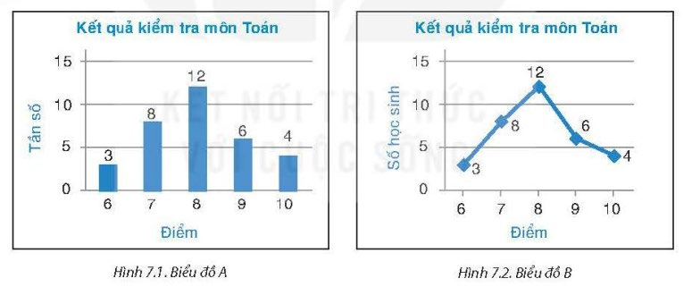

B. PHÂN LOẠI CÁC BÀI TẬP Dạng 1. Lập bảng tần số Ví dụ 1. Một đội bóng đã thi đấu 26 trận trong một mùa giải. Số bàn thắng mà đội đó ghi được trong từng trận đấu được thống kê lại như sau:

Mẫu dữ liệu trên có bao nhiêu giá trị khác nhau? Xác định tần số của mỗi giá trị và lập bảng tần số của mẫu dữ liệu.
Ví dụ 2. Người ta đếm số lượng người ngồi trên mỗi chiếc xe ô tô 5 chỗ đi qua một trạm thu phí trong khoảng thời gian từ 9 giờ đến 10 giờ sáng. Kết quả được ghi lại ở bảng sau:
5 4 5 2 3 2 5 2 1 2 1 1 2 5 1 1 1 3 2 1 1 4 1 1 4 1 2 1 4 1 2 3 2 3 2 3 2 3 3 1 2 1 3 2 2 1 4 3 2 3 1 3 5 1 2 3 5 1 2 1 Lập bảng tần số cho mẫu dữ liệu trên.
Ví dụ 3. Số cuộc gọi đến một tổng đài hỗ trợ khách hàng mỗi ngày trong tháng 4 / 2023 được ghi lại như sau: 4 2 6 3 6 3 2 5 4 2 5 4 3 3 3 3 5 4 4 3 4 6 5 3 6 3 5 3 5 5 Lập bảng tần số cho mẫu dữ liệu trên.
Ví dụ 4. Bảng sau đây ghi lại tên các bạn đạt điểm tốt vào các ngày trong tuần của lớp 9 E , mỗi điểm tốt ghi tên một lần.
Ngày Thứ Hai Thứ Ba Thứ Tư Thứ Năm Thứ Sáu Tên bạn đạt điểm tốt Bình Nam Tuấn Thảo Bình Yến Nam Nam Thảo Lập bảng tần số cho mẫu dữ liệu trên.
Ví dụ 5. Thống kê điểm kiểm tra môn Toán của 40 học sinh lớp 9C như sau:

Lập bảng tần số cho mẫu dữ liệu trên.
Ví dụ tương tự.
Thống kê thâm niên công tác (đơn vị: năm) của 33 nhân viên ở một công sở như sau:

Lập bảng tần số của mẫu số liệu thống kê trên.

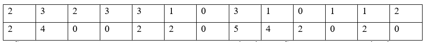

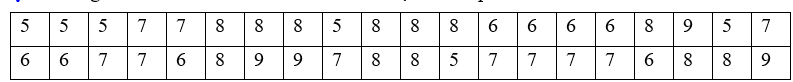

Dạng 2. Biểu đồ tần số Ví dụ 1. Vào đợt nghỉ hè vừa rồi, mỗi ngày bạn Bình đều học thêm một số từ vựng tiếng Anh mới. Số lượng từ vựng mới bạn Bình học mỗi ngày được biểu diễn ở biểu đồ cột như hình bên dưới.

a) Số lượng từ vựng mới mà bạn Bình học mỗi ngày nhận được những giá trị nào? Tìm tần số của mỗi giá
trị đó?
b) Bạn Bình đã học từ vựng tiếng Anh mới trong bao nhiêu ngày?
c) Có bao nhiêu ngày bạn Bình nhiều hơn 7 từ vựng mới?
Ví dụ 2. Biểu đồ bên dưới thống kê thời gian (theo năm) của các y tá ở một phòng khám.
a) Các y tá của phòng khám có thời gian công tác nhận được những giá trị nào? Tìm tần số của mọi giá trị
đó.
b) Phòng khám có tổng số bao nhiêu y tá?
c) Có bao nhiêu y tá đã công tác ở phòng khám ít nhất 3 năm?

Ví dụ 3. Cho hai biểu đồ sau:

12 8 5 4 2 0 2 4 6 8 10 12 14 5 6 7 8 9 Sốngày Sốtừmới 0 1 2 3 4 5 6 7 8 9 10 1 2 3 4 5 6 7 Sốy tá Sốnăm công tác 5 8 12 6 4 0 5 10 15 6 7 8 9 10 Tần số Kết quảkiểm tra môn toán Điểm 5 8 12 6 4 0 5 10 15 6 7 8 9 10 Sốhọc sinh Kết quảkiểm tra môn toán Điểm

Biểu đồ A

Biểu đồ B
a) Đọc và giải thích mỗi biểu đồ trên.
b) Hai biểu đồ trên có biểu diễn cùng một dữ liệu không? Lập bảng thống kê cho dữ liệu đó. Bảng thống
kê thu được có phải là bảng tần số hay không?
Ví dụ tương tự.
Lập bảng thống kê và kết quả khi gieo con xúc xắc từ biểu đồ đã cho.

Ví dụ 3. Một khu vui chơi dành cho trẻ em thống kê lại độ tuổi của một số trẻ em đến chơi trong một ngày ở bảng tần số như sau:

a) Hãy vẽ các biểu đồ cột và biểu đồ đoạn thẳng biểu diễn số liệu ở bảng tần số.
b) Theo biểu đồ ở câu a, trong số các trẻ em đến khu vui chơi, trẻ em ở độ tuổi nào là nhiều nhất?
Ví dụ tương tự.
Bác An thống kê lại số cuộc gọi điện thoại mà mình thực hiện mỗi ngày trong tháng 7 ở bảng tần số như sau:

Hãy vẽ biểu đồ cột và biểu đồ đoạn thẳng biểu diễn mẫu số trên.
Ví dụ 4. Bảng tần số sau cho biết sô học sinh của lớp 9D dự đoán đội bóng vô địch World Cup 2022 trước khi giải đấu bắt đầu.

Vẽ biểu đồ tần số dạng cột và biểu đồ tần số dạng đoạn thẳng biểu diễn bảng tần số trên.
Ví dụ 5. Một công ty xuất khẩu các mặt hàng nông hải sản thống kê lại trong bảng sau số đơn đặt hàng trong mỗi năm thuộc giai đoạn 2018 -2022 :
a) Hãy chọn loại biểu đồ thuận tiện cho việc so sánh số đơn đặt hàng của các năm. Vẽ biểu đồ đó. Số đơn
đặt hàng tập trung nhiều nhất vào năm nào? Số đơn đặt hàng của năm nào ít nhất?
0 1 2 3 4 5 6 7 1 2 3 4 5 6 Mặt xuất hiện Tần số 0 1 2 3 4 5 6 7 1 2 3 4 5 6 Mặt xuất hiện Tần số

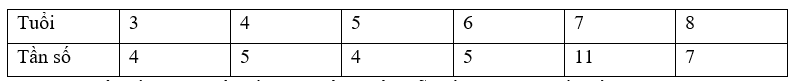

b) Hãy chọn loại biểu đồ thể hiện rõ xu hướng thay đổi số đơn hàng qua các năm. Vẽ biểu đồ đó. Dựa vào
biểu đồ này, cho biết vào những năm nào số đơn đặt hàng giảm sút so với năm trước đó? Năm nào giảm nhiều nhất?
Ví dụ 6. Biểu đồ được đưa ra để quảng cáo cho một website.
Quan sát biểu đồ, bạn Vân nhận xét: “Lượng người truy cập quý II tăng gấp đôi so với quý I. Sang quý III, lượng người truy cập lại tăng gấp 3 so với quý I”.

Ý kiến của bạn Vân đúng không? Giải thích vì sao?
C. GIẢI BÀI TẬP SÁCH GIÁO KHOA 7.1. Một nhóm học sinh đã khảo sát ý kiến về ý thức giữ gìn vệ sinh công cộng của các bạn trong trường với các mức đánh giá Tốt, Khá, Trung bình, Kém và thu được kết quả như sau:
Tốt, Trung bình, Tốt, Trung bình, Khá, Tốt, Khá, Tốt, Tốt, Khá, Trung bình, Kém, Khá, Tốt, Khá, Tốt, Trung bình, Khá, Tốt, Tốt, Tốt, Khá, Kém, Trung bình, Tốt, Khá, Tốt, Khá, Tốt, Khá, Khá.
a) Lập bảng tần số cho dãy dữ liệu trên.
b) Từ bảng tần số, hãy cho biết mức đánh giá nào chiếm ưu thế nhất. Vì sao?
7.2. Cho biểu đồ tranh biểu diễn số lượng học sinh trong lớp đăng kí tham gia các câu lạc bộ của trường như sau:

Lập bảng tần số cho dữ liệu được biểu diễn trong biểu đồ tranh trên.
7.3. Biểu đồ Hình 7.7 cho biết số ngày sử dụng phương tiện đến trường của bạn Mai trong tháng Chín.
Lập bảng tần số cho dữ liệu được biểu diễn trên biểu đồ.

0 500 1000 1500 2000 2500 3000 3500 I II III IV Qúy Lượng người truy cập website

7.4. Người ta thống kê các loại ô tô chạy qua một trạm thu phí trong 1 giờ và vẽ được biểu đồ tần số như Hình 7.8.

a) Lập bảng tần số cho dữ liệu được biểu diễn trên biểu đồ.
b) Từ bảng tần số, hãy cho biết loại xe nào đi qua trạm thu phí nhiều nhất.
7.5. Bảng thống kê sau cho biết số lượng các thiên tai xảy ra tại Việt Nam giai đoạn 1990 2021 - .
Loại thiên tai Hạn hán Bệnh dịch Lũ lụt Sạt lở đất Bão Số lượng 6 9 71 6 94 (Theo vietnam.opendevelopmentmekong.net) Vẽ biểu đồ tần số dạng cột và biểu đồ tần số dạng đoạn thẳng biểu diễn bảng thống kê trên.
D. BÀI TẬP TỰ LUYỆN Câu 1. Một công ty đã ghi lại nhóm máu của các thành viên trong công ty để chuẩn bị cho đợt hiến máu tình nguyện cho kết quả như sau:O, A, B,AB,O,O, A,O, B, A, B, B,O,O, B

B,O, B,O,O,O, B, A, B,O,O,O, B,O, B.
a) Có bao nhiêu nhóm máu? Đếm số thành viên trong công ty theo từng nhóm máu.
b) Lập bảng tần số cho dãy dữ liệu trên. Từ bảng tần số, hãy cho biết nhóm máu nào phổ biến nhất.

### Câu 2. (Mức 1: lưu thông bình thường; Mức 2: lưu thông khó khăn; Mức 3: lưu thông không ổn định;

Mức 4: ùn tắc nghiêm trọng) vào lúc 17 giờ các ngày trong tháng Chín tại một đoạn quốc lộ:
Mức độ Mức 1 Mức 2 Mức 3 Mức 4 Tần số 5 15 7 3
a) Dựa vào bảng tần số, hãy cho biết mức độ ùn tắc giao thông nào là phổ biến nhất vào lúc 17 giờ tại
đoạn quốc lộ trên.
b) Vẽ biểu đồ tần số dạng cột biểu diễn bảng tần số trên.

### Câu 3. Tính đến hết SEA Games 32 đã có năm quốc gia từng lên ngôi vô địch bóng đá nam SEA Games, cụ thể như sau:

Đội tuyển Năm vô địch Thái Lan 1975, 1981, 1983, 1985, 1993, 1995, 1997, 1999, 2001, 2003, 2005, 2007, 2013, 2015, 2017 Malaysia 1961, 1977, 1979, 1989, 2009, 2011 Myanmar 1965, 1967, 1969, 1971, 1973 Việt Nam 1959, 2019, 2021

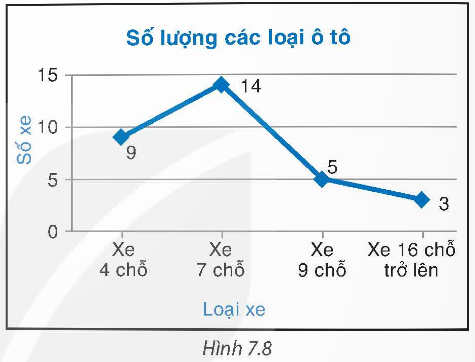

Indonesia 1987, 1991, 2023 (Theo sportingnews.com)
a) Lập bảng tần số biểu diễn số lần vô địch môn bóng đá nam SEA Games của các quốc gia trên.
b) Từ bảng tần số thu được ở câu a, hãy cho biết quốc gia nào vô địch môn Bóng đá nam SEA Games
nhiều nhất, với mấy lần vô địch.

### Câu 4. Giáo viên dạy Toán ghi lại số bài tập mỗi học sinh trong lớp đã làm sau bài học tuần trước cho kết quả như sau:

4,2,0,5,4,3,2,1,3,3,6,1,3,2,4,3,5,3 3,1,4,6,1,2,3,5,3,2,4,3,1,4,4,5,6,2 .
a) Lập bảng tần số cho dãy số liệu trên.
b) Có bao nhiêu bạn trong lớp làm ít nhất ba bài tập?

### Câu 5. Bảng sau cho biết kết quả bình chọn môn thể thao được yêu thích nhất của các bạn học sinh lớp 9A (mỗi gạch biểu diễn cho một bạn bình chọn):

Bóng đá
| | | | | | | | || | |
Cầu lông | | | | || | Bóng bàn || | | Môn khác | | | | | |
a) Lập bảng tần số cho kết quả bình chọn trên.
b) Dựa vào bảng tần số thu được ở câu a, cho biết môn thể thao nào được các bạn yêu thích nhất.

### Câu 6. Biểu đồ sau cho biết kết quả khảo sát trình độ tiếng Anh của sinh viên cuối năm thứ nhất ở một trường đại học:

a) Đọc và giải thích số liệu được biểu diễn trên hai cột bất kì của biểu đồ.
b) Lập bảng tần số cho dữ liệu được biểu diễn trên biểu đồ.
c) Để tốt nghiệp đại học, sinh viên cần có trình độ tiếng Anh ở mức B1 trở lên. Ước lượng tỉ lệ sinh viên
cuối năm thứ nhất đã đạt chuẩn trình độ tiếng Anh.

### Câu 7. Số π với 50 chữ số sau dấu phẩy thập phân như sau:

3,14159265358979323846264338327950288419716939937510 .
a) Lập bảng tần số cho các chữ số từ 0 đến 9 xuất hiện sau dấu phẩy thập phân.
102 115 345 35 3 0 50 100 150 200 250 300 350 400 A1 A2 B1 B2 C1 Số sinh viên Trình độ tiếng Anh Kết quả khảo sát trình độ tiếng Anh của sinh viện cuối năm thứ nhất

b) Chữ số nào xuất hiện nhiều nhất, ít nhất?

### Câu 8. Cho biểu đồ tần số dạng đoạn thẳng sau:

a) Lập bảng tần số cho dữ liệu được biểu diễn trên biểu đồ.
b) Điểm nào có nhiều học sinh đạt nhất?

### Câu 9. Một túi chứa một số viên bi có cùng kích thước, mỗi viên bi có một trong các màu đen, trắng, đỏ, vàng. Thực hiện lấy bi 20 lần, mỗi lần lấy một viên xem viên bi có màu gì sau đó trả bi lại túi, trộn đều.

Kết quả trong 20 lần lấy bi có 8 lần lấy được bi đen, 4 lần lấy được bi đỏ, 6 lần lấy được bi trắng, 2 lần lấy được bi vàng.
a) Lập bảng tần số cho kết quả thu được.
b) Vẽ biểu đồ tần số dạng cột biểu diễn bảng tần số thu được ở câu a.

### Câu 10. Thống kê số ngày nằm viện của 20 bệnh nhân được kết quả như sau:

5,7,4,6,8,10,6,7,8,8,6,5,8,5,4,6,5,7,4,6
a) Lập bảng tần số cho dãy số liệu trên.
b) Vẽ biểu đồ tần số dạng đoạn thẳng biểu diễn bảng tần số thu được ở câu a.
2 6 10 13 7 0 5 10 15 5 6 7 8 9 10 Số học sinh Điểm Kết quả kiểm tra môn toán

### BÀI 23. BẢNG TẦN SỐ TƯƠNG ĐỐI VÀ BIỂU ĐỒ TẦN SỐ TƯƠNG ĐỐI A. KIẾN THỨC CƠ BẢN CẦN NẮM 1. BẢNG TẦN SỐ TƯƠNG ĐỐI Tần số tương đối và bảng tần số tương đối Cho dãy dữ liệu 1 2 , , , n x x x … . Tần số tương đối if của giá trị 1x là tỉ số giữa tần số của ix (gọi là i m ) với n .

Bảng sau đây được gọi là bảng tần số tương đối.
Giá trị 1x … kx Tân số tương đối 1f … kf trong đó 1 k n m m = +…+ và 1 1 100(%) m f n = ⋅ là tần số tương đối của 1, x …, 100(%) k k m f n = ⋅ là tần số tương đối của kx Lưu ý: Tần số tương đối còn gọi là tần suất.
Chú ý. Người ta còn cho bảng tần số tưởng đối ở dạng cột: cột thứ nhất ghi các giá trị, cột thứ hai ghi tần số tương đối của các giá trị đó.
Ví dụ 1 Thu thập dữ liệu về chất lượng không khí tại một địa điểm trong 30 ngày mùa xuân cho kết quả như sau:
M1, M1, M2, M2, M2, M2, M1, M2, M2, M2, M2, M2, M2, M2, M2, M4, M1, M3, M3, M3, M4, M4, M1, M1, M1, M1, M3, M3, M3, M1.
(M1: Tốt; M2: Trung bình; M3: Kém; M4: Xấu)
a) Lập bảng tần số tương đối cho dãy dữ liệu trên.
b) Trong một ngày xuân, khả năng cao nhất địa điểm này có chất lượng không khí ở mức nào?

**Lời giải**

a) Tổng số ngày quan sát là
30 n = .
Số ngày có chất lượng không khí ở các múc M1, M2, M3, M4 tương ứng là 1 2 3 4 9, 12, 6, 3 m m m m = = = = .
Do đó các tần số tương đối cho các mức M1, M2, M3, M4 lần lượt là:
1 2 3 4 9 12 6 3 100% 30%;
100% 40%;
100% 20%;
100% 10%.
30 30 30 30 f f f f = ⋅ = = ⋅ = = ⋅ = = ⋅ =

Ta có bảng tần số tương đối sau:
Chất lượng không khí M1 M2 M3 M4 Tần số tương đối

30% 40% 20% 10%

b) Trong một ngày xuân, khả năng cao nhất là địa điểm này có chất lượng không khí ở mức M2, tức là
mức Trung bình.
Nhận xét. Tần số tương đối của một giá trị là ước lượng cho xác suất xuất hiện giá trị đó.
2. BIỂU ĐỒ TẦN SỐ TƯƠNG ĐỐI Tìm hiểu về biểu đồ tần số tương đối
- Biểu đồ biểu diễn bảng tần số tương đối được gọi là biểu đồ tần số tương đối. Dạng thường gặp của biểu
đồ tần số tương đối là biểu đồ cột và biểu đồ hình quạt tròn.
- Để vẽ biểu đồ hình quạt tròn ta thực hiện theo các bước sau:
Bước 1. Xác định số đo cung tương ứng của các hình quạt dùng để biểu diễn tần số tương đối của các giá trị theo công thức 360 if ° ⋅ với 1, , i k = … .
Bước 2. Vẽ hình tròn và chia hình tròn thành các hình quạt có số đo cung tương úng được xác định trong Bước 1.
Bước 3. Định dạng các hình quạt tròn (thường bằng cách tô màu), ghi tần số tương đối, chú giải và tiêu đề. Ví dụ 2:
Cho bảng tần số tương đối về loại phim yêu thích của các học sinh trong lớp 9A như sau:
Loại phim Hài Khoa học viễn tưởng Kinh dị Tỉ lệ bạn yêu thích 50% 37,5% 12,5% Vẽ biểu đồ hình quạt tròn biểu diễn bảng tần số tương đối trên.

**Lời giải Bước 1. Xác định số đo cung tương ưng của các hình quạt biểu diễn các tần số tương đối cho mỗi loại phim:**

Hài: 360 50% 180 ° ° ⋅ = ; Khoa học viễn tưởng: 360 37,5% 135 ° ° ⋅ = ; Kinh dị: 360 12,5% 45 ° ° ⋅ = .
Bước 2. Vẽ hình tròn và chia hình tròn thành các hình quạt (H.7.11).

Bước 3. Định dạng các hình quạt tròn, ghi tỉ lệ phần trăm, chú giải và tiêu đề (H.7.12).

B. CÁC DẠNG TOÁN Dạng 1. Tần số tương đối Ví dụ 1. Sau bài thi môn Ngữ văn, cô giáo ghi lại số lỗi chính tả mà một học sinh mắc phải vào bảng thống kê sau:

a) Mẫu số liệu trên gồm những giá trị khác nhau nào?
b) Hãy lập bảng tần số và bảng tần số tương đối của số lỗi chính tả mà học sinh mắc phải.
Ví dụ 2. Điều tra về “Loại nhạc cụ bạn muốn chơi nhất” đối với các bạn trong lớp, bạn Dương thu được ý kiến trả lời và ghi lại như dưới đây:

Lập bảng tần số tương đối của các loại nhạc cụ.
Hướng dẫn: Ta có thể lập bảng tần số và bảng tần số tương đối vào chung một hình vẽ.
Ví dụ 3. Thu thập dữ liệu về chất lượng không khí tại một địa điểm trong 30 ngày mùa xuân cho kết quả như sau:
M1, M1, M2, M2, M2, M1, M2, M2, M2, M2, M2, M2, M2, M2, M4, M3, M3, M3, M3, M4, M4, M1, M1, M1, M1, M3, M3, M3, M1.
(M1: Tốt; M2: Trung bình; M3: Kém; M4: Xấu) Lập bảng tần số tương đối.
Ví dụ 4. Quay 50 lần một tấm bìa hình tròn được chia thành ba hình quạt với các màu xanh, đỏ, vàng.
Quan sát và ghi lại mũi tên chỉ vào hình quạt có màu nào khi tấm bìa dừng lại. Kết quả thu được như sau:
Xanh: |||| |||| |||| Đỏ: |||| |||| |||| |||| |||| Vàng: |||| ||||

a) Lập bảng tần số tương đối cho kết quả thu được.
Xanh
b) Ước lượng xác suất mũi tên chỉ vào hình quạt màu đỏ.

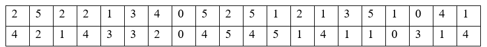

Dạng 2. Biểu đồ tần số tương đối Ví dụ 1. Một doanh nghiệp thu thập mức độ yêu thích của người tiêu dùng về một loại sản phẩm theo các mức: 1,2,3,4,5. Mẫu số liệu thống kê sau phản ánh ý kiến của 50 người tiêu dùng như sau:

a) Lập bảng tần số tương đối của mẫu số liệu thống kê đó.
b) Vẽ biểu đồ tần số tương đối ở dạng biểu đồ cột của mẫu số liệu thống kê đó.
Ví dụ 2. Gieo một xúc xắc 32 lần liên tiếp, ghi lại số chấm trên mặt xuất hiện của xúc xắc, ta được mẫu số liệu thống kê như sau:
Ví dụ 3. Thống kê điểm kiểm tra môn Toán của 40 học sinh lớp 9C (Xem Ví dụ 5 - Bài 22 . Bảng tần số và biểu đồ tần số). Vẽ biểu đồ cột và biểu đồ hình quạt tròn biểu diễn các số liệu thống kê đó.
Ví dụ 4. Câu lạc bộ mĩ thuật của nhà văn hoá thiếu nhi thống kê tuổi của các thành viên lớp hội hoạ và biểu diễn dữ liệu qua bảng sau:
Tuổi của các thành viên lớp hội hoạ

a) Tính tần số tương đối của mỗi giá trị và lập bảng tần số tương đối.
b) Vẽ biểu đồ tần số tương đối dạng biểu đồ cột và biểu đồ hình quạt tròn.
C. GIẢI BÀI TẬP SÁCH GIÁO KHOA 7.6. Lớp 9A có 40 bạn, trong đó 20 bạn mặc áo cỡ M, 13 bạn mặc áo cỡ S, 7 bạn mặc áo cỡ L. Hãy lập bảng tần số tương đối cho dữ liệu này.
7.7. Biểu đồ tranh sau đây biểu diễn số lượng học sinh lớp 9 B bình chọn phần mềm học trực tuyến được yêu thích nhất:

Lập bảng tần số tương đối cho dữ liệu được biểu diễn trong biểu đồ tranh trên.
7.8. Quay 150 lần một tấm bìa hình tròn được chia thành bốn hình quạt với các màu xanh, đỏ, tím, vàng.
Quan sát mũi tên chỉ vào hình quạt màu gì và ghi lại, thu được kết quả sau:
Màu Xanh Đỏ Tím Vàng Số lần 60 30 40 20
a) Lập bảng tần số tương đối cho dữ liệu trên.

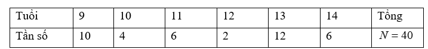

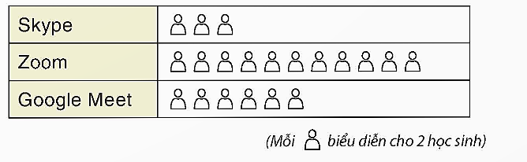

b) Ước lượng các xác suất mũi tên chỉ vào hình quạt màu xanh, màu vàng.
c) Vẽ biểu đồ hình quạt tròn biểu diễn bảng tần số tương đối thu được ở câu a.
7.9. Theo Tổng cục Thống kê, vào năm 2021 trong số 50,5 triệu lao động Việt Nam từ 15 tuổi trở lên có 13,9 triệu lao động đang làm việc trong lính vực nông nghiệp, lâm nghiệp và thuỷ sản; 16,9 triệu lao động đang làm việc trong lính vực công nghiệp và xây dựng; 19,7 triệu lao động đang làm việc trong lĩnh vực dịch vụ.
a) Lập bảng tần số tương đối cho dữ liệu trên.
b) Vẽ biểu đồ hình quạt tròn biểu diễn bảng tần số tương đối thu được ở câu a.
c) Tính tỉ lệ lao động không làm việc trong lĩnh vực nông nghiệp, lâm nghiệp và thuỷ sản.
7.10. Bảng thống kê sau cho biết tỉ lệ tăng trưởng GDP năm 2022 theo khu vực kinh tế.
Khu vực kinh tế Nông nghiệp, lâm nghiệp và thủy sản Công nghiệp và xây dựng Dịch vụ Mức tăng trưởng

3,36%

7,78%

9,99% (Theo Tổng cục Thống kê)
a) Bảng thống kê trên có là bảng tần số tương đối hay không?
b) Lựa chọn loại biểu đồ thích hợp và biểu diễn bảng thống kê trên bằng loại biểu đồ đó.
D. BÀI TẬP TỰ LUYỆN Câu 1. Bảng sau cho biết kết quả khảo sát về hoạt động được yêu thích nhất trong kì nghỉ hè của học sinh khối lớp 9: Hoạt động Thể thao Nghệ thuật Du lịch Khác Số bạn bình chọn 80 50 30 40 Lập bảng tần số tương đối và vẽ biểu đồ hình quạt tròn biểu diễn bảng tần số tương đối thu được.

### Câu 2: Biểu đồ dưới đây cho biết số lượng thí sinh đăng kí dự tuyển sinh vào lớp 10 năm 2023 tại khu vực tuyển sinh 1 của thành phố Hà Nội (gồm các trường Trung học phổ thông trên địa bàn các quận Ba Đình và Tây Hồ).

(Theo Sở Giáo dục và Đào tạo Hà Nội) 5376 4873 1247 0 1000 2000 3000 4000 5000 6000 Nguyện vọng 1 Nguyện vọng 2 Nguyện vọng 3 Số thí sinh Thứ tự nguyện vọng Số lượng đăng kí nguyện vọng vào các trường THPT thuộc khu vực tuyển sinh 1 ( Hà Nội)

Lập bảng tần số và bảng tần số tương đối cho dữ liệu được biểu diễn trên biểu đồ.

### Câu 3. Một xạ thủ bắn 50 lần vào bia và ghi lại điểm của 50 lần bắn như sau:

Điểm 10 9 8 7 Tần số 15 25 7 3
a) Lập bảng tần số tương đối cho kết quả thu được.
b) Ước lượng cho xác suât xạ thủ được điểm lớn hơn hoặc bằng 9 khi bắn vào bia.

### Câu 4. Bạn Giang chọn một đoạn văn gồm 100 từ và đếm số chữ cái trong mỗi từ của đoạn văn này cho kết quả như trong biểu đồ sau:

a) Lập bảng tần số tương đối cho dữ liệu được biểu diễn trên biểu đồ.
b) Tìm ước lượng cho xác suất một từ có nhiều hơn 5 chữ cái.

### Câu 5.  Kết quả bình chọn của khán giả cho danh hiệu cầu thủ xuất sắc nhất giải bóng đá học sinh trường Trung học cơ sở Chu Văn An năm học vừa qua đối với năm cầu thủ được ban tổ chức đề cử như sau:

Cầu thủ An Tân Việt Bình Lê Số lượng bình chọn 55 135 100 70 40
a) Lập bảng tần số tương đối cho bảng dứ liệu trên.
b) Vẽ biểu đồ hình quạt tròn biểu diễn bảng tần số tương đối thu được ở câu a.

### Câu 6. Bảng sau là kết quả đánh giá của khách hàng về chất lượng phục vụ của một lái xe công nghệ, mỗi gạch biểu diễn một lần đánh giá:


| | | | | | |

| | | | | | | |

| | | | | | | | | | | | | |

| | | | |
a) Lập bảng tần số và bảng tần số tương đối cho dữ liệu trên.
b) Ước lượng cho xác suất một khách hàng đánh giá ở mức từ ba sao trở xuống.

### Câu 7. Bảng tần số tương đối sau cho biết kết quả tập luyện của một vận động viên bắn súng:

Điểm 7 8 9 10 Tần số tương đối 5% 15% 55% % x

2 8 15 30 22 15 7 1 0 10 20 30 40 1 2 3 4 5 6 7 8 Tần số Số chữ cái Số chữ cái trong 100 từ

a) Xác định giá trị của x .
b) Ước lượng xác suất bắn trúng vòng 9 điểm hoặc vòng 10 điểm của vận động viên này.
c) Biết rằng vận động viên đã bắn 200 viên đạn trong quá trình luyện tập. Tính số lần bắn trúng vòng 9
điểm hoặc vòng 10 điểm của vận động viên này.

### Câu 8. Cho biểu đồ hình quạt tròn sau:

a) Giải thích các số liệu được biểu diễn trên biểu đồ.
b) Lập bảng tần số tương đối cho dữ liệu được biểu diễn trên biểu đồ.

### Câu 9. Cho bảng thống kê sau về số lượng học sinh tại một trường tham gia các câu lạc bộ (CLB):

CLB tiếng Anh CLB Toán CLB Khoa học Tổng Nam 40 60 50 150 Nữ 70 30 65 165 Tổng 110 90 115 315
a) Lập các bảng tần số tương đối biểu diễn tỉ lệ học sinh nam, nữ tham gia các câu lạc bộ.
b) Vẽ các biểu đồ hình quạt tròn biểu diễn các bảng tần số tương đối thu được ở câu a.

### Câu 10. Với số liệu cho trong bài tập 7.15, hãy:

a) Lập bảng tần số tương đối cho tỉ lệ học sinh tham gia các câu lạc bộ.
b) Vẽ biểu đồ cột biểu diễn bảng tần số tương đối thu được ở câu a.
Vật lý;
23% Hoá học;
20% Kinh tế;
9% Hoà bình;
11% Y học;
24% Văn học;
13% Tỉ lệ người đạt giải Nobel theo các lĩnh vực tính đến năm 2020

LUYỆN TẬP CHUNG PHẦN 1. GIẢI BÀI TẬP SÁCH GIÁO KHOA A. CÁC VÍ DỤ Ví dụ 1 Một vận động viên bắn 30 viên đạn vào bia với các điểm số thu được như sau:
10,8,9,9,10,9,9,9,8,7,10,10,9,8,7,10,9,8,7,9,9,9,10,9,10,8,9,8,8,10
a) Lập bảng tần số và tần số tương đối cho dãy dữ liệu trên.
b) Vẽ biểu đồ tần số dạng đoạn thẳng cho bảng tần số thu được ở câu a.
Ví dụ 2 Bảng thống kê sau cho biết số lượt mượn các loại sách trong một tuần tại thư viện của một trường Trung học cơ sở.
Loại sách Sách giáo khoa Sách tham khảo Truyện ngắn Tiểu thuyết Số lượt 20 80 70 30
a) Lập bảng tần số tương đối cho bảng thống kê trên.
b) Vẽ biểu đồ hình quạt tròn biểu diễn bảng tần số tương đối thu được ở câu a.
B. BÀI TẬP 7.11. Bảng thống kê sau cho biết số lượng học sinh của lớp 9B theo múc độ cận thị.
Mức độ Không cận thị Cận thị nhẹ Cận thị vừa Cận thị nặng Số học sinh 10 13 12 5
a) Lập bảng tần số tương đối cho bảng thống kê trên.
b) Đa số học sinh của lớp 9B cận thị hay không cận thị?
nghệ khối lớp 9 như sau:
Lớp 9 A 9 B 9 C 9 D Tỉ lệ học sinh bình chọn 35% 25% 30% 10% Biết rằng có 300 học sinh tham gia bình chọn. Lập bảng tần số biểu diễn số học sinh bình chọn cho tiết mục văn nghệ của mỗi lớp.
7.13. Bạn Hoàng khảo sát ý kiến của các bạn trong tổ về chất lượng phục vụ của căng tin trường thu được kết quả sau:
A, B, C, B, A, A, B, A, B, A, trong đó A là mức Tốt, B là mức Trung bình, C là mức Kém.
Hãy lập bảng tần số và bảng tẩn số tương đối biểu diễn kết quả bạn Hoàng thu được.
7.14. Biểu đồ cột Hình 7.16 cho biết cỡ giày của các bạn nam khối lớp 9 trong trường.

Lập bảng tần số và bảng tần số tương đối cho dữ liệu được biểu diễn trên biểu đồ.
7.15. Cho bảng tần số sau:
Điểm thi môn Toán 6 7 8 9 10 Số học sinh 5 8 12 10 4 Vẽ biểu đồ tần số dạng đoạn thẳng cho bảng tần số trên.
7.16. Theo dõi thời tiết tại một điểm du lịch trong 30 ngày người ta thu được bảng sau:
Thời tiết Không mưa Mưa nhỏ Mưa to Số ngày 10 8 12
a) Lập bảng tần số tương đối và vẽ biểu đồ hình quạt tròn biểu diễn bảng tần số tương đối thu được.
b) Uớc lượng xác suất để một ngày trời có mưa ở điểm du lịch này.
PHẦN 2. BÀI TẬP THÊM Bài 1. Thống kê khối lượng rau thu hoạch một vụ (đởn vị: tạ) của mỗi hộ gia đình trong 38 hộ gia đình tham gia chương trình trồng rau theo tiêu chuẩn VIETGAP như sau:

5 5 6 6 6 7 4 4 5 5 7 8 8

9 4 5 7 4 10 7 7 7 6 6 5 7

8 9 8 8 9 9 9 8 7 5 10 8
a) Trong 38 số liệu thống kê ở trên có bao nhiêu giá trị khác nhau?
b) Tìm tần số của mỗi giá trị đó.
c) Lập bảng tần số của mẫu số liệu thống kê trên.

### Bài 2. Tuổi nghề (đ̛ơn vị: năm) của 32 giáo viên ở một trường trung học cơ sở được ghi lại như sau:

7 7 10 3 4 4 9 3 3 7 7 10 9 7 10 4 12 4 3 12 9 12 9 10 7 7 12 9 7 10 10 4

a) Lập bảng tần số của mẫu số liệu thống kê đó.
b) Vẽ biểu đồ tần số ở dạng biểu đồ cột của mẫu số liệu thống kê đó.

### Bài 3. Trong bài thơ "Quê hương" của tác giả Đỗ Trung Quân có hai câu thơ:

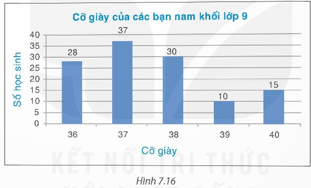

"Quê hương nếu ai không nhớ Sẽ không lớn nổi thành người".
Mẫu dữ liệu thống kê các chữ cái H;N;G;L lần lượt xuất hiện trong hai câu thơ trên là: H; N; G; N; H;
N; G; N; H; H; N; G; L; N; N; H; N; H; N; G. Lập bảng tần số tương đối của mẫu số liệu thống kê đó.

### Bài 4. Một công ty nông sản xuất khẩu 4 mặt hàng chủ lực là Chè (C), Hạt điều (Đ), Hạt tiêu (T), Sắn (S).

40 container hàng xuất khẩu của công ty được thông quan qua cửa khẩu quốc tế Móng Cái vào tháng 5 năm 2023 như sau:

C C C Ð Ð Ð Ð C C C T T S S S C C C Ð T T T S Ð Ð C S S S C T T Ð D T T T C C T
a) Lập bảng tần số tương đối của mẫu dữ liệu thống kê đó.
b) Vẽ biểu đồ tần số tương đối ở dạng biểu đồ cột của mẫu số liệu thống kê đó.

### Bài 5. Một trường trung học cơ sở thống kê số giờ (trung bình) chơi thể thao trong một tuần của 420 học sinh. Kết quả mẫu số liệu thống kê đó được cho ở bảng tần số sau (Bảng 23):

Số giờ chơi thể thao ( ) x 8 9 10 12 Cộng Tầm số ( ) n 147 126 84 63

420 N =

Bảng 23
a) Lập bảng tần số tương đối của mẫu dữ liệu thống kê đó.
b) Vẽ biểu đồ tần số tương đối ở dạng biểu đồ cột của mẫu số liệu thống kê đó.
c) Vẽ biểu đồ tần số tương đối ở dạng biểu đồ hình quạt tròn của mẫu số liệu thống kê đó.

### Bài 6. Điều tra phương tiện đi lại thích nhất của hai đối tượng người lớn và thiếu niên, ta có bảng sau:

Đối tượng Xe đạp Ô tô Xe buýt Cộng Thiếu niên 25 3 12 40 Người lớn 5 28 12 45 Lập biểu đồ tần số tương đối dạng hình quạt tròn thể hiện kết quả điều tra trên.

### Bài 7. Bảng dưới đây thống kê loại quả thích nhất của một số học sinh lớp 9A và lớp 9B.

Đối tượng Táo Cam Chuối Cộng Lớp 9A 18 10 22 … Lớp 9B 20 … 12 40 Cộng … 18 … 90
a) Hãy điền tiếp số liệu vào các chỗ trống của bảng.
b) Dùng tần số tương đối, cho biết mỗi loại quả được lớp nào thích hơn.

### Bài  8. Tổng điểm mà các thành viên đội tuyển Olympic Toán quốc tế (IMO - hình thức thi trực tiếp) của Việt Nam đạt được trong các năm 2008, 2009, 2010, 2011, 2012, 2013, 2014, 2015, 2016, 2017, 2018, 2019, 2020, 2022, 2023 được thống kê lần lượt như sau: 159; 161; 133; 113; 148; 180; 157; 151; 151;

155; 148; 177; 150; 196; 180.

a) Nêu các đối tượng thống kê và cho biết có bao nhiêu số liệu thống kê ở trên.
b) Trong các số liệu thống kê ở trên có bao nhiêu giá trị khác nhau?

### Bài 9. Thống kê lượng hàng bán được (đơn vị: chiếc) của 39 mặt hàng ở một siêu thị điện máy như sau:

4 7 4 5 7 9 5 10 4 8 5 8 9 9 5 10 8 4 5 7 5 10 9 4 7 4 8 9 8 4 9 8 9 5 10 5 7 10 9

a) Lập bảng tần số của mẫu số liệu thống kê đó.
b) Vẽ biểu đồ tần số ở dạng biểu đồ cột của mẫu số liệu thống kê đó.

### Bài 10. Bác An ghi lại số cuộc điện thoại bác đã gọi trong mỗi ngày của tháng 2 năm 2023 như sau:

5 5 8 7 8 7 9 10 10 7 7 5 9 5 10 8 8 7 9 7 5 10 8 8 10 9 7 10
a) Lập bảng tần số của mẫu số liệu thống kê đó.
b) Vẽ biểu đồ tần số ở dạng biểu đồ cột của mẫu số liệu thống kê đó.

### Bài 11. Thống kê số quyển sách quyên góp ủng hộ thư viện nhà trường của 100 học sinh khối 9 như sau:

38 38 35 32 35 38 38 50 32 47 27 38 35 27 47 35 38 38 32 35

a) Trong 100 số liệu thống kê ở trên, có bao nhiêu giá trị khác nhau?
b) Lập bảng tần số tương đối của mẫu số liệu thống kê đó.
c) Vẽ biểu đồ tần số tương đối ở dạng biểu đồ cột của mẫu số liệu thống kê đó.

### Bài 12. Điểm kiểm tra môn Toán của 200 học sinh khối 9 được thống kê như Bảng 25 sau:

Điểm 5 6 7 8 9 10 Số học sinhh 30 40 50 35 25 20

Bảng 25
a) Lập bảng tần số tương đối của mẫu số liệu thống kê đó.
b) Vẽ biểu đồ tần số tương đối (ở dạng biểu đồ cột và biểu đồ hình quạt tròn) của mẫu số liệu thống kê
đó.

### Bài 13. Khối lượng thức ăn trung bình (đơn vị: gam) trong một ngày cho mỗi con lợn 50 kg của một số hộ gia đình được thống kê như sau:

2200 2100 2150 2100 2100 2150 2200 2100 2100 2050 2100 2200 2050 2050 2100 2100 2150 2200 2150 2200

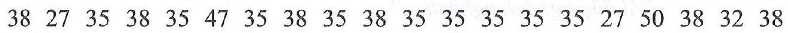

2200 2050 2150 2100 2200 2200 2150 2100 2150 2100 2100 2200 2150 2150 2100 2200 2050 2100 2100 2150 2100 2100 2200 2150 2200 2050 2050 2200 2100 2150

a) Lập bảng tần số tương đối của mẫu số liệu thống kê đó.
b) Vẽ biểu đồ tần số tương đối (ở dạng biểu đồ cột và biểu đồ hình quạt tròn) của mẫu số liệu thống kê
đó.

### Bài 14. Trong bài thơ "Lượm" nổi tiếng của nhà thơ Tố Hữu có nhũng câu thơ:

"Chú bé loắt choắt Cái xắc xinh xinh Cái chân thoăn thoắt Cái đầu nghênh nghênh..." Mẫu dữ liệu thống kê các chữ cái C;N;H;T;L lần lượt xuất hiện trong những câu thơ trên là:
C; H; L; T; C;H;T;C;C;N;H ;
N;H;C;C;H;N;T;H;N;T;H ;
T; C; N; H; N; H; N; H; N; H.
a) Lập bảng tần số tương đối của mẫu dữ liệu thống kê đó.
b) Vẽ biểu đồ tần số tương đối ở dạng biểu đồ hình quạt tròn của mẫu dữ liệu thống kê đó.

### Bài 15. Bảng sau cho kết quả loại màu thích nhất đối với một số học sinh nam và nữ.

Đối tượng Xanh lục Xanh lơ Màu khác Nam 15 5 10 Nữ 3 16 6 Lập biểu đồ tần số tương đối dạng hình quạt tròn thể hiện các thông tin trên.

### Bài 16. Thống kê loại nhạc thích nhất của một số học sinh lớp 6 và lớp 9 , kết quả được ghi ở bảng sau.

Đối tượng Nhạc truyền thống Nhạc hiện đại Nhạc khác Cộng Lớp 6 … 13 23 … Lớp 9 7 22 … 44 Cộng 25 … 38 98
a) Hãy điền tiếp số liệu vào các chỗ trống trong bảng.
b) Dùng tần số tương đối, cho biết mỗi loại nhạc được lớp nào thích hơn.

### BÀI 24. BẢNG TẦN SỐ, TẦN SỐ TƯƠNG ĐỐI GHÉP NHÓM VÀ BIỂU ĐỒ.

A. KIẾN THỨC CƠ BẢN CẦN NẮM 1. BẢNG TẦN SỐ, TẦN SỐ TƯƠNG ĐỐI GHÉP NHÓM Tìm hiểu bảng tần số ghép nhóm và bảng tần số tương đối ghép nhóm Bảng tần số ghép nhóm là bảng tần số của các nhóm số liệu:
Nhóm [ ) 1 2 ; a a

[ ) 2 3 ; a a

… [ ) 1 ; k k a a +

Tần số 1 m 2 m … k m Bảng 7.3. Bảng tần số ghép nhóm Tần số i m của nhóm [ ) 1 ; i i a a + là số giá trị của mẫu số liệu lớn hơn hoặc bằng ia và nhỏ hơn 1 ia + .
Bảng tần số tương đối ghép nhóm là bảng tần số tương đối của các nhóm số liệu:
Nhóm [ ) 1 2 ; a a

[ ] 2 3 ; a a

… [ ) 1 ; k k a a +

Tần số tương đối 1f 2f … kf Bảng 7.4. Bảng tần số tuơng đời ghép nhóm trong đó 1 k n m m = +…+ và 1 1 100% m f n = ⋅ là tần số tương đối của nhóm [ ) 1 2 ; , , a a … 100% k k m f n = ⋅ là tần số tương đối của nhóm [ ) 1 ; . k k a a +

Ví dụ 1 Đo chiều cao (đơn vị là cm ) của học sinh lớp 9C cho kết quả như sau:
156 157 164 166 166 165 157 154 155 158 160 163 163

161 162 159 159 160 160 160 159 158 160 160 158 163

162 162 162 161 162 161 163 161 163 161 164 166 165 165.
Lập bảng tần số ghép nhóm và bảng tần số tưởng đối ghép nhóm cho mẫu số liệu này với các nhóm [ ) [ ) [ ) [ ) 155;158 , 158;161 , 161;164 , 164;167 .

**Lời giải Số học sinh có chiều cao từ 150 cm đến dưới 158 cm là 5 học sinh; từ 158 cm đến dưới 161 cm là 12 học sinh; từ 161 cm đến dưới 164 cm là 15 học sinh; từ 164 cm đến dưới 167 cm là 8 học sinh. Do đó, tần số tương ứng với các nhóm là 1 2 5, 12 m m = = , 3 4 15, 8 m m = = . Ta có bảng tần số ghép nhóm như sau:**

Chiều cao ( ) cm [ ) 150;158 [ ) 158;161 [ ) 161;164 [ ) 164;167 Số học sinh 5 12 15 8 Tổng số học sinh trong lớp là 5 12 15 8 40 n = + + + = .

Tỉ lệ học sinh có chiều cao từ 150 cm đến dưới 158 cm là 5 100% 12,5% 40 ⋅ = ; từ 158 cm đến dưới 161 cm là 12 100% 30% 40 ⋅ = ; từ 161 cm đến dưới 164 cm là 15 100% 37,5% 40 ⋅ = ; từ 164 cm đến dưới 167 cm là 8 100% 20% 40 ⋅ = . Ta có bảng tần số tương đối ghép nhóm như sau:
Chiều cao (cm) [ ) 150;158 [ ) 158;161 [ ) 161;164 [ ) 164;167 Tần số tương đối 12,5%

30% 37,5%

20% Ví dụ 2 Chỉ số chất lượng không khí (AQI) cho biết tình trạng chất lượng không khí và mức độ ảnh hưởng đến sức khoẻ con người. Chất lượng không khí là Tốt nếu AQI từ 0 đến dưới 50 ; là Trung binh nếu AQI từ 50 đến dưới 100 ; là Kém nếu AQI từ 100 đến dưới 150; là Xấu nếu AQI từ 150 đến dưới 200. Chất lượng không khí tại Hà Nội từ ngày 4-2-2023 đến 5-3-2023 được cho như sau:
Trung bình, Trung bình, Trung bình, Trung bình, Trung bình, Trung bình, Trung bình, Trung bình, Kém, Kém, Kém, Kém, Xấu, Xấu, Kém, Xấu, Xấu, Xấu, Kém, Kém, Kém, Kém, Kém, Xấu, Kém, Xấu, Xấu, Xấu, Xấu, Xấu.
(Theo iqair.com) Lập bảng tần số ghép nhóm và bảng tần số tương đối ghép nhóm theo chỉ số AQI cho dãy dữ liệu trên.

**Lời giải Có 8 ngày chất lượng không khí ở múc Trung binh tương ứng với chỉ số AQI từ 50 đến dưới 100; có 11 ngày chất lượng không khí ở mức Kém tưởng ứng với chỉ số AQI từ 100 đến dưới 150; có 11 ngày chất lượng không khí ở mưc Xấu tương ứng với chỉ số AQI từ 150 đến dưới 200. Ta có bảng tần số ghép nhóm sau: Chỉ số AQI [ ) 50;100 [ ) 100;150 [ ) 150;200 Tần số 8 11 11 Tỉ lệ ngày có chất lượng không khí ở mức Trung bình là 8 100% 26,6% 30 ⋅ ≈ ; ở mức Kém là 11 100% 36,7% 30 ⋅ ≈ ; ở mức Xấu là 11 100% 36,7% 30 ⋅ ≈ . Ta có bảng tần số tương đối ghép nhóm sau:**

Chỉ số AQI [ ) 50;100 [ ) 100;150 [ ) 150;200 Tần số tương đối 26,6% 36,7% 36,7% 2. BIỂU ĐỒ TẦN SỐ TƯƠNG ĐỐI GHÉP NHÓM DẠNG CỘT Tìm hiểu về biểu đồ tần số tương đối ghép nhóm dạng cột
- Biểu đồ tần số tương đối ghép nhóm dạng cột là biểu đồ gồm các cột liền nhau để biểu diễn bảng tần số
tương đối ghép nhóm. Trong biểu đồ này, chiều cao mỗi cột biểu diễn tẩn số tương đối của nhóm số liệu.

- Để vẽ biểu đồ tần số tương đối ghép nhóm dạng cột biểu diễn bảng tần số tương đối ghép nhóm với các
nhóm số liệu có độ dài bằng nhau ta thực hiện theo các bước sau:
Bước 1. Vẽ trục đứng, trục ngang. Trên trục đứng xác định đơn vị độ dài phù hợp với các tần số tương đối. Trên trục ngang xác định các nhóm số liệu cần biểu diễn.
Bước 2. Dựng các hình cột (kề nhau) ứng với các nhóm dữ liệu, mỗi hình cột có chiều cao bằng tần số tương đối của nhóm số liệu.
Bước 3. Ghi chú giải cho các trục, các cột và tiêu đề cho biểu đồ.
- Biểu đồ tần số tương đối (tần số) ghép nhóm dạng cột còn gọi là tổ chức đồ (histogram).
Chú ý. Trong biểu đồ trên, nếu chiều cao mỗi cột biểu diễn tần số của nhóm số liệu thì ta có biểu đồ tần số ghép nhóm dạng cột.
Ví dụ 3: Vẽ biểu đổ tần số tương đối ghép nhóm dạng cột cho bảng thống kê sau về thời gian đi từ nhà tới trường của một số bạn trong lớp 9D.
Bước 2. Dựng các hình cột kề nhau ứng với các nhóm số liệu (H.7.18).

Bước 3. Ghi chú giải cho các trục, các cột và tiêu đề của biểu đồ (H.7.19).

3. BIỂU ĐỒ TẦN SỐ TƯƠNG ĐỐI GHÉP NHÓM DẠNG ĐOẠN THẲNG Cách vẽ biểu đồ tần số tương đối ghép nhóm dạng đoạn thẳng

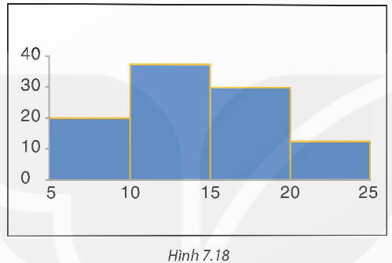

Để vẽ biểu đồ tần số tương đối ghép nhóm dạng đoạn thẳng cho mẫu số liệu ghép nhóm, ta thực hiện theo các bước sau:
Bước 1. Chọn giá trị 1 2 i i i a a x + + = đại diện cho nhóm số liệu [ ) 1 ; i i a a + với 1,2, , i k = … .
Bước 2. Vẽ trục ngang để biểu diễn các giá trị đại diện cho các nhóm số liệu, vẽ trục đứng thể hiện tần số tương đối.
Bước 3. Với mỗi giá trị đại diện ix trên trục ngang và tần số tương đối if tương ứng, ta xác định một điểm ( ) ; i i i M x f . Nối các điểm liên tiếp với nhau.
Buớc 4. Ghi chú giải cho các trục, các điểm và tiêu đề của biểu đồ.
Chú ý. Trong cách vẽ biểu đồ trên, nếu thay tần số tương đối bằng tần số thì ta có biểu đồ tần số ghép nhóm dạng đoạn thẳng.
Ví dụ 4 Cho bảng tần số tương đối ghép nhóm sau về tuổi thọ của một loại bóng đèn.
Tuổi thọ (năm) [ ) 1;1,5 [ ) 1,5;2 [ ) 2;2,5 [ ) 2,5;3 [ ) 3;3,5 Tần số tương đối 15% 20% 30% 25% 10% Vẽ biểu đồ tần số tương đối ghép nhóm dạng đoạn thẳng cho bảng thống kê trên.

**Lời giải Bước 1. Chọn giá trị đại diện cho các nhóm số liệu ta có bảng sau:**

Tuổi thọ (năm) 1,25 1,75 2,25 2,75 3,25 Tấn số tương đối 15% 20% 30% 25% 10% Bước 2. Vẽ các trục (H.7.20).
Bước 3. Xác định các điểm, nối các điểm liên tiếp với nhau (H.7.20).

Bước 4. Ghi chú giải cho các trục, các điểm và tiêu đề của biểu đồ tần số tương đối ghép nhóm (H.7.21).

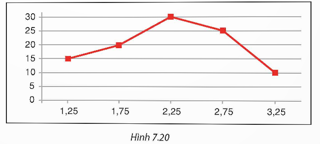

Chú ý. Trên trục ngang ta cũng có thể điền các nhóm số liệu thay cho các giá trị đại diện.
B. PHÂN LOẠI CÁC BÀI TẬP Dạng 1. Tần số ghép nhóm, tần số tương đối ghép nhóm Ví dụ 1. Giáo viên chủ nhiệm lớp 9 C đã thu được kết quả như sau: Thời gian tự học dưới 1 giờ có 10 bạn; từ 1 giờ đến dưới 2 giờ có 15 bạn; từ 2 giờ đến dưới 3 giờ có 8 bạn; từ 3 giờ đến dưới 4 giờ có 7 bạn.
Dựa vào dữ liệu dưới, hãy hoàn thiện các bảng sau vào vở:
Bảng 1 Thời gian (giờ)

[ ) 0;1 [ ) 1;2 [ ) 2;3 [ ) 3;4 Tần số

?

?

?

?

Bảng 2 Thời gian (giờ)

[ ) 0;1 [ ) 1;2 [ ) 2;3 [ ) 3;4 Tần số tương đối

?

?

?

?

Hướng dẫn: Nhóm số liệu [a; b) là nhóm gồm các số liệu lớn hơn hoặc bằng a và nhỏ hơn b .
Ví dụ 2. Cho bảng tần số ghép nhóm về tuổi thọ của một số ong mật cái như sau:
Tuổi thọ (ngày) [ ) 30;40

[ ) 40;50 [ ) 50;60 Tần số 12 23 15

a) Đọc và giải thích bảng thống kê trên.
b) Lập bảng tần số tương đối ghép nhóm cho bảng thống kê này.
Ví dụ 3. Nhà may Hưng Thịnh tặng áo phông cho 40 học sinh lớp 9A. Nhà may đo chiều cao (đơn vị:
centimét) của cả lớp để quyết định chọn các cỡ áo khi may, kết quả như sau:

Lập bảng tần số tương đối ghép nhóm của mẫu số liệu trên.
Hướng dẫn: Ta có thể ghép các số liệu thành 5 nhóm, có độ dài bằng nhau.
Vì 174 175 < , ta có: 175 150 25 - = và 25:5 6 = [ ) [ ) [ ) [ ) [ ) 150;155 , 155;160 , 160;165 , 165;170 , 170;175 ⇒ .
Ví dụ 4. Mẫu số liệu dưới đây ghi lại tốc độ (đơn vị: km / h ) của 44 ô tô khi đi qua một trạm đo tốc độ:
48,5 43 50 55 45 60 53 55,5 44 65 54,5 51 62,5 41 44,5 57 57 68 49 46,5 53,5 49 61 49,5 54 62 59 56 47 50 59,5 61 46,5 49,5 52,5 57 47 59 55 45 47,5 48 61,5 48,5
a) Ghép các số liệu thành 6 nhóm.
b) Lập bảng tần số ghép nhóm.

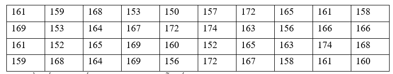

Huớng dẫn:
a) Ta có số liệu có giá trị nhỏ nhất là 41 ; số liệu có giá trị lớn nhất là 68 .
Ta có 40 41,68 70 < < .70 40 30;30:6 5 - = =

b) Xem Ví dụ 3 .
Ví dụ tương tự.
Thống kê số lần truy cập Internet của 30 người trong một tuần là:

Lập bảng tần số ghép nhóm của mẫu số liệu đó sau khi được ghép nhóm theo sáu nhóm.
Ví dụ 5. Chỉ số phát triển con người (HDI) là chỉ tiêu tổng hợp phản ánh các mặt thu nhập, sức khoẻ, giáo dục của người dân trong một quốc gia. Các nước và vùng lãnh thổ trên thế giới được chia thành bốn nhóm theo HDI: Nhóm 1 (rất cao) có HDI từ 0,8 trở lên; Nhóm 2 (cao) có HDI từ 0,7 đến dưới 0,8 ; Nhóm 3 (trung bình) có HDI từ 0,55 đến dưới 0,7 ; Nhóm 4 (thấp) có HDI dưới 0,55 . Năm 2021 , chỉ số HDI của 11 quốc gia Đông Nam Á như sau:

Dựa vào dữ liệu trên, hãy hoàn thành bảng tần số ghép nhóm và bảng tần số tương đối ghép nhóm:
Chỉ số HDI

[ ) 0;0,55 [ ) 0,55;0,7 [ ) 0,7;0,8 [ ) 0,8;1,0 Tần số

Tần số tương đối

Hướng dẫn: Tần số tương đối tính theo số phần trăm. Ta có: n 11 = .
Tần số ghép nhóm của nhóm 1: [ ) 0,8;1,0 là 4. Ta có tần số tương đối ghép nhóm của nhóm 1 là:
4 36% 11 = .
Ví dụ 6. Bác Quảng ghi lại thời gian truy cập Internet của mình mỗi ngày (đơn vị: giờ) trong vòng 1 tháng như sau:

a) Lập bảng tần số ghép nhóm theo 5 nhóm: [
) [ ) [ ) [ ) [ ) 0;1 , 1;2 , 2;3 , 3;4 , 4;5 .
b) Lập bảng tần số tương đối ghép nhóm.

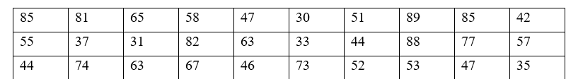

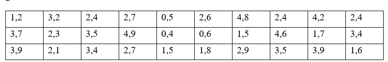

Ví dụ tương tự.
Cô Loan ghi lại chiều cao (đơn vị: cm ) của các cây bạch đàn gióng vừa được chuyển đến nông trường ở bảng sau: 16,4 19 29,6 18,3 21,8 20,6 22,2 27,1 23,3 19,5 21,2 15,9 28,6 18 29,8 27,2 18,1 28,4 18,8 23,5 29,2 23,8 29,6 25 24,4 15,4 23,8 16 17,2 23,5 23,2 17 17,8 19,8 16,8 18,4 21,9 24,3 27,3 21 Ví dụ 7. Kết quả đo chiều cao của 40 học sinh được thống kê trong bảng sau:

Theo quy định của công ty may mặc, cỡ S tương ứng với chiều cao từ 146 cm đến dưới 152 cm . Cỡ M tương ứng với chiều cao từ 152 cm đến dưới 158 cm. Cỡ L tương ứng với chiều cao từ 158 cm đến dưới 164cm . Cỡ XL tương ứng với chiều cao từ 164cm đến 170cm . Đối với 40 học sinh này, làm thế nào để xác định số quần áo cần may ở mỗi kích cỡ?
Dạng 2. Biểu đồ tần số tương đối ghép nhóm dạng cột Ví dụ 1. Thủy thống kê lại độ dài quãng đường (đơn vị: km ) mình đi bộ mỗi ngày trong tháng Sáu ở bảng sau: Quãng đường ( ) km

[ ) 4;5 [ ) 5;6 [ ) 6;7 [ ) 7;8 [ ) 8;9 Tần số (số ngày) 6 12 8 3 1

Hãy vẽ biểu đồ tần số ghép nhóm dạng cột biểu diễn mẫu số liệu trên.
Hướng dẫn:
Trước hết, ta lập bảng tần số tương đối ghép nhóm (tính theo tỉ lệ phần trăm).
Ví dụ tương tự.
Vẽ biểu đồ tần số ghép nhóm dạng cột cho bảng thống kê sau về thời gian đi từ nhà tới trường của một số bạn trong lớp 9D.

[ ) 5;10 [ ) 10;15 [ ) 15;20 [ ) 20;25 Tần số tương đối

20%

37,5%

30% 12,5%

Ví dụ 2. Vẽ biểu đồ tần số ghép nhóm dạng cột cho bảng sau về chiều cao của một số cây chà là giống 3 tháng tuổi. ường ( ) km ) 38 ) ;42 ) 2;46 ố ngày) % 0% 5%

**Lời giải Biểu đồ tần số tương đối ghép nhóm dạng cột:**

Ví dụ 3. Xét mẫu số liệu ghép nhóm có bảng tần số ghép nhóm sau đây:
Nhóm [ ) 10;15 [ ) 15;20 [ ) 20;25 [ ) 25;30

[ ) 30;35 Tần số 4 12 7 8 9
a) Lập bảng tần số tương đối ghép nhóm của mẫu số liệu ghép nhóm đó.
b) Vẽ biểu đồ tần số tương đối ghép nhóm dạng cột.
Ví dụ 4. Sau khi thống kê độ dài (đơn vị: centimét) của 50 lá dương xỉ trưởng thành, người ta có bảng tần số ghép nhóm như sau:
Vẽ biểu đồ tần số tương đối ghép nhóm dạng biểu đồ cột.
Hướng dẫn: Lập bảng tần số tương đối ghép nhóm, tính theo phần trăm.
Ví dụ 5. Biểu đồ bên biểu diễn tỉ lệ đại biểu tham dự hội nghị theo độ tuổi. Biết rằng có 54 dại biểu từ 25 đến 35 tuổi.
a) Có bao nhiêu đại biểu tham dự hội nghị?
b) Lập bảng tần số ghép nhóm tương ứng.
c) Một người cho rằng có trên 50% số đại biểu tham dự hội nghị dưới 45 tuổi. Nhận định đó đúng hay
sai? Tại sao?

Hướng dẫn: Nhóm [25;35) chiếm 33,75% so với tổng số đại biểu và có 54 người.
Ta có: 54:33,75% 160 = (người).
Dạng 3. Biểu đồ tần số tương đối ghép nhóm dạng đoạn thẳng Ví dụ 1. Cho bảng tần số tương đối ghép nhóm sau về tuổi thọ của một bóng đèn.
33,75% 28,75% 26,25% 11,25% 0,00% 5,00% 10,00% 15,00% 20,00% 25,00% 30,00% 35,00% 40,00% 35 45 55 65 Tần số tương đối (%) Độ tuổi

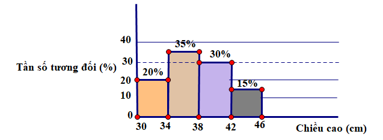

Vẽ biểu đồ tần số tương đối ghép nhóm dạng đoạn thẳng cho bảng thống kê trên.
Hướng dẫn: Chọn giá trị đại diện cho các nhóm.
1 1,5 1,5 2 2 2,5 2,5 3 3 3,5 1,25; 1,75; 2,25; 2,75; 3,25 2 2 2 2 2 + + + + + = = = = =

Xem phần A. Kiến thức cần nhớ.
Ví dụ 2. Bảng sau thống kê chiều cao (đơn vị: mét) của các cây keo 3 năm tuổi ở một nông trường.

Hãy vẽ biểu đồ tần số tương đối ghép nhóm dạng đoạn thẳng biểu diễn số liệu trên.
Hướng dẫn: Chọn giá trị đại diện cho các nhóm.
8,5 8,7 8,7 8,9 8,9 9,1 9,1 9,3 9,3 9,5 8,6; 8,8; 9,0; 9,2; 9,4 2 2 2 2 2 + + + + + = = = = =

Ví dụ 3. Bảng dưới đây được lấy từ dữ liệu do một trọng tài ghi lại về thành tích của các vận động viên nam trong cuộc thi bơi tự do dài 50 m được một trung tâm thể dục thể thao tổ chức.
Thành tích bơi tự do 50m nam

Vẽ biểu đồ tần số tương đối ghép nhóm dạng đoạn thẳng biểu diễn số liệu trên.
Hướng dẫn: - Lập bảng tần số tương đối ghép nhóm.
- Chọn các giá trị đại diện cho nhóm số liệu.
- Vẽ biểu đồ.
- Tần số tương đối của nhóm [
) 24;26 là 1 2 0,0625 6,25% 32 f = = = .
- Tần số tương đối của nhóm [
) 26;28 là 2 8 0,25 25% 32 f = = = .

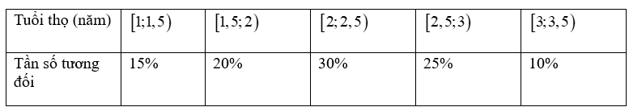

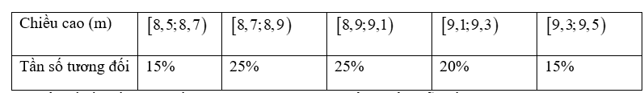

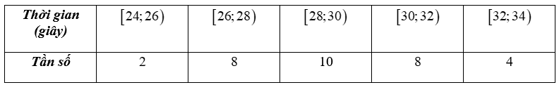

- Tương tự với các nhóm tiếp theo:
3 10 0,3125 31,25% 32 f = = = . 4 5 10 8 4 0,25 25%;
0,125 12,5% 32 32 32 f f = = = = = =

Ta lập được bảng tần số tương đối ghép nhóm dưới đây:
Bảng tần số tuơng đối ghép nhóm thành tích bơi tư do 50m nam

C. GIẢI BÀI TẬP SÁCH GIÁO KHOA 7.17. Một cuộc điểu tra về thời gian dùng mạng Internet trong ngày của học sinh lớp 9 tại một thành phố cho kết quả như sau:

15% 27% 23% 18% 17%
a) Đọc và giải thích bảng thống kê trên.
b) Để thu được bảng thống kê trên, người ta đã lập phiếu điều tra và thu về tổng cộng 2000 phiếu trả lời.
Lập bảng tần số ghép nhóm cho kết quả thu được.
7.18. Ghi lại cấp độ động đất của các trận động đất xảy ra tại một vùng trong 10 năm người ta thu được kết quả sau:
I, V, II, III, VI, V, IV, II, III, V, VI, VII, VIII, I, I, II, VI, VII, IV.
Biết rằng theo thang Richter thì trận động đất cấp I có độ Iớn từ 1 đến dưới 3 ; cấp II và III có độ lớn từ 3 đến dưới 4 ; cấp IV và V có độ lớn từ 4 đến dưới 5 ; cấp VI và VII có độ Iớn từ 5 đến dưới 6 ; cấp VIII có độ lớn từ 6 đến dưới 6,9.
Lập bảng tần số ghép nhóm cho độ lớn các trận động đất xảy ra ở vùng này theo thang Richter.
7.19. Giáo viên ghi lại thời gian chạy cự li 100 mét của các học sinh lớp 9 A cho kết quả nhu sau:
a) Nêu các nhóm số liệu và tần số tương ứng.
b) Lập bảng tần số tương đối ghép nhóm.
7.20. Người ta trồng cà rốt và thử nghiệm một loại phân bón mới. Khi thu hoạch người ta đo chiều dài các củ cà rốt thu được kết quả sau:
Chiều dài ( ) cm [ ) 15;16 [ ) 16;17 [ ) 17;18 [ ) 18;19 [ ) 19;20 [ ) 20;21 Số củ cà rốt 8 17 30 28 12 5 Vẽ biểu đồ tần số tương đối ghép nhóm dạng cột cho bảng thống kê trên.

7.21. Thời gian chờ mua vé xem bóng đá của một số cổ động viên được cho như sau:
a) Lập bảng tần số tương đối ghép nhóm.
b) Vẽ biểu đồ tần số tương đối ghép nhóm dạng đoạn thẳng cho bảng thống kê thu được ở câu a.
D. BÀI TẬP TỰ LUYỆN Câu 1: Thống kê thời gian đi từ nhà đến cơ quan (đơn vị tính là phút) của40 nhân viên một công ty được kết quả như sau:
9 12 59 47 53 5 14 32 35 40 35 10 10 4 8 20 28 23 42 44 33 39 18 20 16 25 29 27 18 17 20 23 27 29 31 41 40 40 55 50
a) Hoàn thiện bảng tần số ghép nhóm sau:
?
?
?
b) Lập bảng tần số tương đối ghép nhóm cho bảng tần số ghép nhóm thu được.

### Câu 2: Cho bảng tần số tương đối ghép nhóm về thời gian làm bài tập về nhà trong tuần (đơn vị tính là giờ) của 40 bạn học sinh lớp 9A.

a) Tính tỉ lệ học sinh trong lớp dành ít nhất 6 giờ trong tuần để làm bài tập về nhà.
b) Có bao nhiêu học sinh lớp 9 A dành ít nhất 6 giờ trong tuần để làm bài tập về nhà?
c) Vẽ biểu đồ tần số tương đối ghép nhóm dạng cột biểu diễn bảng tần số tương đối ghép nhóm trên.

### Câu 3. Bảng tần số ghép nhóm sau cho biết cân nặng của một số con voi khi vừa sinh ra (đơn vị tính là kg ):

Cân nặng (kg) [ ) 110;115 [ ) 115;120 [ ) 120;125 [ ) 125;130 Tần số 8 15 17 10
a) Đọc và giải thích dữ liệu cho bởi bảng tần số ghép nhóm trên.
b) Lập bảng tần số tương đối ghép nhóm.

### Câu 4. Một nhóm học sinh lớp 9B thực hiện 20 lần đo hiệu điện thế và cường độ dòng điện để xác định công suất của một chiếc quạt điện và thu được bảng tần số tương đối ghép nhóm sau:

Công suất (W) [ ) 72;73 [ ) 73;74 [ ) 74;75 [ ) 75;76 [ ) 76;77 Tần số tương đối 10% 20% 30% 25% 15%
a) Đọc và giải thích thông tin của hai nhóm dữ liệu cho bởi bảng tần số tương đối ghép nhóm trên.
b) Lập bảng tần số ghép nhóm cho kết quả 20 lần đo của nhóm học sinh.

### Câu 5. Một phòng khám đo và ghi lại huyết áp tâm thu (đơn vị tính là mmHg ) của một số người đến khám bệnh thu được kết quả như sau:

118 100 107 135 127 158 179 95 127 130 135 116 182 166 164 99 112 129 134 144 158 97 175 110 99 128 134 192 149 135 90 Theo Hiệp hội Tim mạch Hoa Kỳ, người bình thường có huyết áp tâm thu từ 90mmHg đến dưới 120mmHg , người ở dạng tiền tăng huyết áp có huyết áp tâm thu từ 120mmHg đến dưới 140mmHg ;
người bị tăng huyết áp có huyết áp tâm thu lớn hơn hoặc bằng 140mmHg .
Lập bảng tần số ghép nhóm và bảng tần số tương đối ghép nhóm cho dãy số liệu trên theo các mức bệnh huyết áp.

### Câu 6. Một công ty quản lý phần mềm ứng dưng trực tuyến đã thống kê tỉ lệ người dùng phần mềm này theo dung lượng bộ nhớ dành cho lưu trữ ảnh và biểu diễn dưới dạng biểu đồ tần số tương đối ghép nhóm dạng cột như sau:

### Câu 7. Cho biểu đồ tần số tương đối ghép nhóm dạng đoạn thẳng sau:

a) Đọc và giải thích thông tin về hai nhóm dữ liệu được biểu diễn trên biểu đồ.
b) Lập bảng tần số tương đối ghép nhóm cho dữ liệu được biểu diễn trên biểu đồ.
c) Biết rằng công ty A có 300 người, lập bảng tần số ghép nhóm cho lương của công nhân công ty này.

### Câu 8. Bảng thống kê sau cho biết thời gian học tiếng Anh (đơn vị là năm, tính từ lúc bắt đầu học tiếng Anh đến thời điểm khảo sát) của một số học sinh lớp 9.

a) Lập bảng tần số tương đối ghép nhóm cho bảng thóng kê trên.
6% 10% 24% 30% 16% 0% 10% 20% 30% 40% [7;10) [10;13) [13;16) [16;19) [19;22) [22;25) Tỉ lệ Mức lương (triệu đồng) Lương của công nhân công ty A

b) Vẽ biểu đồ tần số tương đối ghép nhóm dạng cột biểu điễn bảng tần số tương đối ghép nhóm thu được
ở câu a.

### Câu 9. Bảng tần số ghép nhóm sau cho biết thành tích luyện tập của một vận động viên nghiệp dư chạy maraton 42 km.

a) Lập bảng tần số tương đối ghép nhóm cho bảng thống kê trên.
b) Vẽ biểu đồ tần số tương đối ghép nhóm dạng đoạn thẳng biểu diễn bảng tần số tương đối ghép nhóm
thu được.

### Câu 10. Kiểm tra khối lượng của một số bao xi măng trước khi xuất xưởng cho kết quả như sau:

Khối lượng (kg) [ ) 48,5;49 [ ) 49;49,5 [ ) 49,5;50 [ ) 50;50,5 [ ) 50,5;51 Tỉ lệ 5% 10% 35% 40% 10% Vẽ biểu đồ tần số tương đối ghép nhóm dạng cột và dạng đoạn thẳng biểu diễn dữ liệu trên.

ÔN TẬP CHƯƠNG V PHẦN 1. BÀI TẬP SÁCH GIÁO KHOA A. TRẮC NGHIỆM Sử dụng dữ liệu sau để trả lời các bài tập từ 7.22 đến 7.24 .
Gieo một con xúc xắc 50 lần cho kết quả như sau:
Số chấm xuất hiện 1 2 3 4 5 6 Tần số 8 7 ?
8 6 11 7.22. Tần số xuất hiện của mặt 3 chấm là A. 9 . B. 10 . C. 11 . D. 12 .
7.23. Tần số tương đối xuất hiện của mặt 5 chấm là A. 6% .
B. 8%.
C. 12% .
D. 14% .
7.24. Để biểu diễn bảng thống kê trên, không thể dùng loại biểu đồ nào sau đây?
A. Biểu đồ tranh.
B. Biểu đồ tần số dạng cột.
C. Biểu đồ tần số dạng đoạn thẳng.
D. Biểu đồ cột kép.
7.25. Cho bảng tần số tương đối ghép nhóm về thời gian đi từ nhà đến trường của học sinh lớp 9A như sau:
A. 10 . B. 15 . C. 20 . D. 30 . B. TỰ LUẬN 7.26. Biểu đồ tần số tương đối ghép nhóm Hình 7.22 cho biết tỉ lệ chiều cao của các cây keo giống do một kĩ sư lâm nghiệp đã trồng trong nhà kính.

Lập bảng tần số tương đối ghép nhóm cho dữ liệu được biểu diễn trên biểu đồ.
7.27. Kĩ sư lâm nghiệp trên cũng trồng một số cây keo giống khác ngoài trời và thu được kết quả như sau:

Chiều cao ( ) cm

[ ) 0;10

[ ) 10;20

[ ) 20;30

[ ) 30;40 Số cây 5 9 4 2
a) Vẽ biểu đồ tần số tương đối ghép nhóm dạng cột cho bảng thống kê trên.
b) Từ biểu đồ vừa vẽ và biểu đồ cho trong bài tập 7.26 , hãy so sánh chiểu cao của các cây keo giống
được trồng trong nhà kính và trồng ngoài trời.
7.28. Tỉ lệ học sinh bình chọn cho danh hiệu cầu thủ xuất sắc nhất trong giải bóng đá của trường được cho trong bảng sau:
Cầu thủ Huy Minh An Thảo Tỉ lệ học sinh bình chọn 30% 25% 10% 35% Biết rằng có 500 học sinh tham gia bình chọn.
a) Vẽ biểu đồ hình quạt tròn biểu diễn bảng tần số tương đối trên.
b) Lập bảng tần số biểu diễn số học sinh bình chọn cho danh hiệu cầu thủ xuất sắc nhất trong giải bóng đá
của trường.
7.29. Qua đợt khám mắt, lớp 9A có 20 học sinh bị cận thị trong đó có 10 học sinh cận thị nhẹ, 8 học sinh cận thị vừa và 2 học sinh cận thị nặng. Biết rằng cận thị có số đo từ 0,25 đến dưới 3,25 dioptre là cận thị nhẹ; từ 3,25 đến dưới 6,25 dioptre là cận thị vừa; từ 6,25 đến dưới 10,25 dioptre là cận thị nặng.
a) Lập bảng tần số và bảng tần số tương đối ghép nhóm theo độ cận thị của các học sinh này.
b) Vẽ biểu đồ tần số tương đối ghép nhóm dạng đoạn thẳng cho bảng tần số tương đối ghép nhóm thu
được ở câu a.
7.30. Lương của các công nhân một nhà máy được cho trong bảng sau:
Lương (triệu đồng) [ ) 5;7 [ ) 7;9 [ ) 9;11 [ ) 11;13 [ ) 13;15 Số công nhân 20 50 70 40 20
a) Nêu các nhóm số liệu và tần số. Giải thích ý nghĩa cho một nhóm số liệu và tần số của nó.
b) Vẽ biểu đồ tần số tương đối ghép nhóm dạng cột cho bảng thống kê trên.
PHẦN 2. BÀI TẬP THÊM A. TRẮC NGHIỆM Sử dụng dữ liệu sau để trả lời các bài tập từ 1 đến 3.
Gieo một con xúc xắc 50 lần cho kết quả như sau:
Số chấm xuất hiện 1 2 3 4 5 6 Tần số tương đối 8 7 ?
8 6 11 1. Tần số xuất hiện của mặt 3 chấm là:
A. 9. B. 10. C. 11. D. 12.
2. Tần số tương đối xuất hiện của mặt 5 chấm là:
A. 6% .
B. 8%.
C. 12% .
D. 14% .

3. Để biểu diễn bảng thống kê trên, không thể cùng loại biểu đồ nào sao đây?
A. Biểu đồ tranh.
B. Biểu đồ tần số dạng cột.
C. Biểu đồ tần số dạng đoạn thẳng.
D. Biểu đồ cột kép.
4. Cho bảng tần số tương đối ghép nhóm về thời gian đi từ nhà đến trường của học sinh lớp 9A như sau:
A. 10. B. 15. C. 20. D. 30.
5. Tần số xuất hiện của điểm 8 trong dãy dữ liệu trên là A. 8. B. 9. C. 10. D. 11.
6. Tần số tương đối của điểm 10 trong dãy dữ liệu trên là A. 5%.
B. 10% .
C. 15% .
D. 20% .
7. Để biểu diễn số lượng học sinh theo điểm thi môn Toán đạt được thì ta không thể dùng biểu đồ nào?
A. Biểu đồ cột kép.
B. Biểu đồ tần số dạng cột.
C. Biểu đồ tần số dạng đoạn thẳng.
D. Biểu đồ tranh.
8. Giá trị của x là A. 10. B. 15. C. 20. D. 25.
9. Muốn biểu diễn bảng tần số tương đối ghép nhóm trên ta có thể dùng biểu đồ nào sau đây?
A. Biểu đồ tần số ghép nhóm.
B. Biểu đồ tần số dạng cột.
C. Biểu đồ tần số dạng đoạn thẳng.
D. Biều đồ tần số tương đối ghép nhóm.
10. Để vẽ biểu đồ tần số tương đối ghép nhóm dạng đoạn thẳng biểu diễn bảng thống kê trên ta chọn giá trị nào làm giá trị đại diện cho nhóm [ ) 2;3 ?
A. 0,5 . B. 1,5 . C. 2,5 . D. 3,5 . B. TỰ LUẬN Câu 1. Biểu đồ tần số tương đối ghép nhóm (hình vẽ) cho biết tỉ lệ chiều cao của các cây keo giống do một kỹ sư lâm nghiệp đã trồng trong nhà kính.

Lập bảng tần số tương đối ghép nhóm cho dữ liệu được biểu diễn trên biểu đồ.

### Câu 2. Kĩ sư lâm nghiệp trên cũng trồng một số cây keo giống khác ngoài trời thu được kết quả như sau:

Chiều cao (cm) [ ) 0;10 [ ) 10;20 [ ) 20;30 [ ) 30;40 Số cây 5 9 4 2
a) Vẽ biểu đồ tần số tương đối ghép nhóm dạng cột cho bảng thống kê trên.
b) Từ biểu đồ vừa vẽ và biểu đồ cho trong bài 1, hãy so sánh chiều cao của các cây keo giống được trồng
trong nhà kính và trồng ngoài trời.

### Câu 3. Tỉ lệ học sinh bình chọn cho danh hiệu cầu thủ xuất sắc nhất trong giải bóng đá của trường được ghi trong bảng sau:

Cầu thủ Huy Minh An Thảo Tỉ lệ học sinh bình chọn 30% 25% 10% 35% Biết rằng có 500 học sinh tham gia bình chọn.
a) Vẽ biểu đồ hình quạt tròn biểu diễn bảng tần số tương đối trên.
b) Lập bảng tần số biểu diễn số học sinh bình chọn cho danh hiệu cầu thủ xuất sắc nhất trong giải bóng đá
của trường.

### Câu 4. Qua đợt khám mắt, lớp 9 A có 20 học sinh bị cận thị trong đó có 10 học sinh cận thị nhẹ, 8 học sinh cận thị vừa và 2 học sinh cận thị nặng. Biết rằng cận thị có số đo từ 0,25 đến dưới 3,25 dioptre là cận thị nhẹ; từ 3,25 đến dưới 6,25 dioptre là cận thị vừa; từ 6,25 đến dưới 10,25 dioptre là cận thị nặng.

a) Lập bảng tần số và bảng tần số tương đối ghép nhóm theo độ cận thị của các học sinh này.
b) Vẽ biểu đồ tần số tương đối ghép nhóm dạng đoạn thẳng cho bảng tần số tương đối ghép nhóm thu
được ở câu a.

### Câu 5. Lương của các công nhân một nhà máy được cho trong bảng sau:

Lương (triệu đồng) [ ) 5;7 [ ) 7;9 [ ) 9;11 [ ) 11;13 [ ) 13;15 Số công nhân 20 50 70 40 20
a) Nêu các nhóm số liệu và tần số. Giải thích ý nghĩa cho một nhóm số liệu và tần số của nó.
b) Vẽ biểu đồ tần số tương đối ghép nhóm dạng cột cho bảng thống kê trên.
10% 20% 40% 30% 0% 5% 10% 15% 20% 25% 30% 35% 40% 45% 10 20 30 40 Tỉ lệ Chiều cao (cm) Tỉ lệ chiều cao của các cây keo giống trồng trong nhà kính

### Câu 6. Kết thúc vòng tứ kết giải bóng đá của một trường Trung học cơ sở, có 4 đội lọt vào bán kết là các đội bóng lớp 9A, 9C, 8B và 7D. Ban tổ chức đã khảo sát học sinh trong trường với câu hỏi “Theo bạn, đội bóng nào sẽ vô địch?” với 4 phương án trả lời:

1. Đội bóng lớp 9A, 2. Đội bóng lớp 9C, 3. Đội bóng lớp 8B, 4. Đội bóng lớp 7D, và thu được 500 phản hồi với 150 lựa chọn phương án 1, 200 lựa chọn phương án 2, 50 lựa chọn phương án 3 và 100 lựa chọn phương án 4.
a) Lập bảng tần số và bảng tần số tương đối cho kết quả thu được.
b) Tìm tỉ lệ học sinh không dự đoán hai đội bóng của khối lớp 9 vô địch giải bóng đá trường.
c) Vẽ biểu đồ hình quạt tròn biểu diễn tỉ lệ học sinh dự đoán mỗi đội vô địch.

### Câu 7. Biểu đồ hình quạt tròn sau đây cho biết tỉ lệ vô địch bóng đá nam SEA Games của các đội bóng trong khu vực tính đến năm 2023.

(Theo Liên đoàn Bóng đá Đông Nam Á)
a) Lập bảng tần số tương đối cho biết tỉ lệ vô địch bóng đá nam SEA Games của các quốc gia trong khu
vực.
b) Biết rằng tính đến năm 2023 môn Bóng đá nam đã được tổ chức ở 32 kì SEA Games. Lập bảng tần số
cho số lần vô địch của các đội tuyển (làm tròn số liệu đến số nguyên gần nhất).
c) Vẽ biểu đồ tần số dạng cột biểu diễn bảng tần số thu được ở câu b.
d) Đội tuyển quốc gia nào có số lần vô địch bóng đá nam SEA Games nhiều nhất, với bao nhiêu lần?

### Câu 8. Biểu đồ sau cho biết số lượng các loại ô tô một cửa hàng bán được trong năm 2023:

47% 19% 16% 9% 9% Tỉ lệ vô địch bóng đá nam SEA Games Thái Lan Malaysia Myanmar Việt Nam Indonesia

a) Lập bảng tần số và bảng tần số tương đối cho dữ liệu được biểu diễn trên biểu đồ.
b) Vẽ biểu đồ hình quạt tròn biểu diễn bảng tần số tương đối thu được ở câu a.
c) Giả sử tỉ lệ các loại xe bán được không đổi và cửa hàng bán được tổng số 200 ô tô các loại trong năm
2024. Hãy ước lượng số ô tô 7 chỗ cửa hàng bán được.

### Câu 9.  Biểu đồ tần số tương đối ghép nhóm sau cho biết thành tich ném lao của các vận động viên nữ tại một giải đấu:

a) Đọc và giải thích thông tin cho hai nhóm dữ liệu được biểu diễn trên biểu đồ.
b) Lập bảng tần số tương đối ghép nhóm cho dữ liệu này.
c) Biết rằng có 40 vận động viên nữ tham dự giải. Lập bảng tần số ghép nhóm (các tần số làm tròn đến số
nguyên gần nhất).

### Câu 10. Thành tích ném lao của 40 vận động viên nam trong giải thể thao trên được cho như sau:

Thành tích (m) [ ) 70,5;71 [ ) 71;71,5 [ ) 71,5;72 [ ) 72;72,5 [ ) 72,5;73 [ ) 73;73,5 Số vận động viên 2 5 7 15 8 3
a) Lập bảng tần số tương đối ghép nhóm.
b) Vẽ biểu đồ tần số tương đối ghép nhóm dạng cột biểu diễn bảng tần số tương đối ghép nhóm thu được
ở câu a.
c) Từ biểu đồ thu được ở câu b và biểu đồ cho trong bài tập 7.28, hãy nhận xét về thành tích ném lao của
các vận động viên nam và nữ.

### Câu 11. Dữ liệu dưới đây cho biết cỡ giày của một nhóm 30 học sinh tại trường Trung học cơ sở C:

35 20 15 10 0 10 20 30 40 Xe 4 chỗ ngồi Xe 7 chỗ ngồi Xe 16 chỗ ngồi Xe trên 16 chỗ ngồi Tần số Loại xe Số lượng xe các loại bán được năm 2023 0% 10% 20% 30% 40% [53,5;54) [54;54,5) [54,5;55) [55;55,5) [55,5;56) Tỉ lệ Thành tích (m) Thành tích ném lao của các vận động viên nữ

32 33 36 34 33 32 36 34 35 34 32 33 34 36 35 34 34 34 34 34 35 34 35 33 34 34 34 35 33 34
a) Lập bảng tần số cho dãy dữ liệu trên. Cỡ giày nào phù hợp với nhiều bạn nhất?
b) Lập bảng tần số tương đối cho dãy dữ liệu trên. Chọn ngẫu nhiên một học sinh trường Trung học cơ sở
C, hãy ước lượng xác suất để học sinh này đi giày cỡ 34 .
c) Bảng sau quy định cỡ giày theo chiều dài của bàn chân:
Chiều dài bàn chân (cm) [ ) 19;19,4 [ ) 19,4;19,7 [ ) 19,7;20,6 [ ) 20,6;21,6 [ ) 21,6;22,2 Cỡ giày 32 33 34 35 36 Lập bảng tần số và bảng tần số tương đối ghép nhóm theo chiều dài bàn chân của nhóm học sinh trên.

CHƯƠNG VII. TẦN SỐ VÀ TẦN SỐ TƯƠNG ĐỐI.

### BÀI 22. BẢNG TẦN SỐ VÀ BIỂU ĐỒ TẦN SỐ.

A. KIẾN THỨC CƠ BẢN CẦN NẮM 1. BẢNG TẦN SỐ Tần số và bảng tần số
- Tần số của một giá trị là số lần xuất hiện giá trị đó trong mẫu dữ liệu.
- Bảng tần số là bảng thống kê cho biết tần số của các giá trị trong mẫu dữ liệu. Bảng tần số có dạng sau:
Giá trị 1x 2x … kx Tân số 1 m 2 m … k m trong đó 1 m là tần số của 1 2 , x m là tần số của 2, , k x m … là tần số của kx .
Chú ý. Người ta còn cho bảng tần số ở dạng cột: cột thứ nhất ghi các giá trị, cột thứ hai ghi tần số của các giá trị đó.
Ví dụ 1: Để mua giày thể thao cho các bạn nam trong lớp luyện tập chuẩn bị cho giải bóng đá của trường, Huy đã thu thập cỡ giày của các bạn nam trong lớp và thu được kết quả như sau:
40,36,37,36,40,38,39,38,37,36,40,39,36,38,37,38,38,37,38,38,38,36
a) Bạn Huy cần mua giày các cỡ nào? Mỗi loại bao nhiêu đôi?
b) Lập bảng tần số cho dãy dữ liệu trên. Từ bảng tần số, cho biết cỡ giày nào phù hợp với nhiều bạn nam
trong lớp nhất.

**Lời giải**

a) Bạn Huy cần mua giày với các cở 36,37,38,39,40. Giày cỡ 36 cần 5 đôi; cỡ 37 cần 4 đôi; cỡ 38 cần 8
đôi; cỡ 39 cần 2 đôi; cỡ 40 cần 3 đôi.
b) Bảng tần số
Cỡ giày 36 37 38 39 40 Tần số 5 4 8 2 3 Giày cỡ 38 phù hợp với nhiều bạn nam trong lớp nhất.
Nhận xét. Trong bảng tần số, ta chỉ liệt kê các giá trị ix khác nhau. Các giá trị ix này có thể không là số.
Tần số của một giá trị cho biết giá trị đó xuất hiện trong mẫu dữ liệu nhiều hay ít, từ đó ta dễ dàng xác định được giá trị xuất hiện nhiều nhất, ít nhất.
2. BIỂU ĐỒ TẦN SỐ Tìm hiểu về biểu đồ tần số Biểu đồ biểu diễn bảng tần số được gọi là biểu đồ tần số. Biểu đồ tần số thường gặp là biểu đồ tần số dạng cột (H .7 .1) và biểu đồ tần số dạng đoạn thẳng (H.7.2).
Lưu ý: Biểu đồ tần số dạng đoạn thẳng còn gọi là đa giác tần số (frequency polygon).

Nhận xét. Để vẽ biểu đồ tần số dạng đoạn thẳng ta thực hiện theo các bước sau:
Buớc 1. Vẽ trục ngang để biểu diễn các giá trị trong dãy dữ liệu, vẽ trục đứng thể hiện tần số.
Bước 2. Với mỗi giá trị trên trục ngang và tần số tương ứng ta xác định một điểm. Nối các điểm liên tiếp với nhau.
Bước 3. Ghi chú giải cho các trục, các điểm và tiều để của biểu đồ.
Ví dụ 2 Bạn Bình thống kê số anh, chị, em ruột của các bạn trong lớp và thu được bảng sau:
Số anh, chị, em ruột 0 1 2 3 Số bạn 8 19 6 4 Vẽ biểu đồ tần số dạng cột và biểu đồ tần số dạng đoạn thẳng biểu diễn bảng thống kê trên.

**Lời giải**

- Vẽ biểu đồ tần số dạng cột (H.7.3).

- Vẽ biểu đồ tần số dạng đoạn thẳng.
Buớc 1. Vẽ các trục (H.7.4).
Bước 2. Xác định các điểm và nối các điểm liên tiếp với nhau (H.7.4).
Buớc 3. Ghi chú giải cho các trục, các điểm và tiêu đề của biểu đồ (H.7.5).

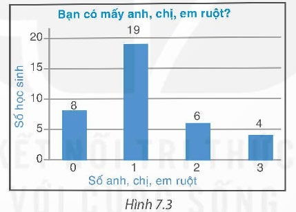

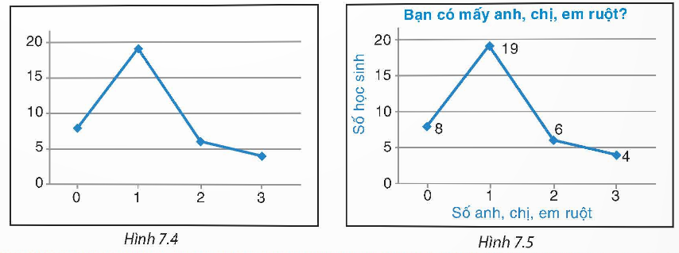

B. PHÂN LOẠI CÁC BÀI TẬP Dạng 1. Lập bảng tần số Ví dụ 1. Một đội bóng đã thi đấu 26 trận trong một mùa giải. Số bàn thắng mà đội đó ghi được trong từng trận đấu được thống kê lại như sau:

Mẫu dữ liệu trên có bao nhiêu giá trị khác nhau? Xác định tần số của mỗi giá trị và lập bảng tần số của mẫu dữ liệu. Lời giải Mẫu dữ liệu có các giá trị là:0;1;2;3;4;5 .
Tần số của các giá trị 0;1;2;3;4;5 lần lượt là: 7;4;8;4;2;1.
Bảng tần số: Số bàn thắng 0 1 2 3 4 5 Tần số 7 4 8 4 2 1 Chú ý 1: Số giá trị của mẫu dữ liệu gọi là cỡ mẫu. Trong Ví dụ 1 , tổng các tần số 7 4 8 4 2 1 26 + + + + + =

Cỡ mẫu là 26.
Chú ý 2: Có thể lập bảng tần số ở dạng cột thứ nhất ghi các giá trị, cột thứ hai ghi tần số của các giá trị đó. Số bàn thắng Tần số 0 7 1 4 2 8 3 4 4 2 5 1 Ví dụ 2. Người ta đếm số lượng người ngồi trên mỗi chiếc xe ô tô 5 chỗ đi qua một trạm thu phí trong khoảng thời gian từ 9 giờ đến 10 giờ sáng. Kết quả được ghi lại ở bảng sau:
5 4 5 2 3 2 5 2 1 2 1 1 2 5 1 1 1 3 2 1 1 4 1 1 4 1 2 1 4 1 2 3 2 3 2 3 2 3 3 1 2 1 3 2 2 1 4 3 2 3 1 3 5 1 2 3 5 1 2 1 Lập bảng tần số cho mẫu dữ liệu trên.

**Lời giải Bảng tần số: Số người 1 2 3 4 5 Tần số 20 17 12 5 6 Nhận xét: Số người ngồi trên xe phổ biến nhất là 1 người. Cỡ mẫu: 60 .**

Ví dụ 3. Số cuộc gọi đến một tổng đài hỗ trợ khách hàng mỗi ngày trong tháng 4 / 2023 được ghi lại như sau: 4 2 6 3 6 3 2 5 4 2 5 4 3 3 3 3 5 4 4 3 4 6 5 3 6 3 5 3 5 5 Lập bảng tần số cho mẫu dữ liệu trên.

**Lời giải Bảng tần số:**

Số cuộc gọi một ngày 2 3 4 5 6 Tần số 3 10 6 7 4 Nhận xét: Tháng 4 có 30 ngày. Cỡ mẫu: 30 .
Ví dụ 4. Bảng sau đây ghi lại tên các bạn đạt điểm tốt vào các ngày trong tuần của lớp 9 E , mỗi điểm tốt ghi tên một lần.
Ngày Thứ Hai Thứ Ba Thứ Tư Thứ Năm Thứ Sáu Tên bạn t điểm tốt Bình Nam Tuấn Thảo Bình Yến Nam Nam Thảo Lập bảng tần số cho mẫu dữ liệu trên.

**Lời giải Bảng tần số: Tên người Bình Nam Tuấn Thảo Yến Tần số 2 3 1 2 1 Nhận xét: - Có thể lập bảng tần số dạng cột.**

- Người có số lần đạt điểm tốt nhiều nhất là bạn Nam, Nam được 3 lần đạt điểm tốt.
Ví dụ 5. Thống kê điểm kiểm tra môn Toán của 40 học sinh lớp 9C như sau:

Lập bảng tần số cho mẫu dữ liệu trên.

**Lời giải Bảng tần số của mẫu số liệu:**

Ví dụ tương tự.
Thống kê thâm niên công tác (đơn vị: năm) của 33 nhân viên ở một công sở như sau:

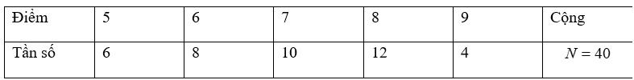

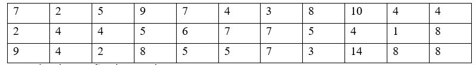

Lập bảng tần số của mẫu số liệu thống kê trên.
Hướng dẫn Bảng tần số của mẫu số liệu:

Dạng 2. Biểu đồ tần số Ví dụ 1. Vào đợt nghỉ hè vừa rồi, mỗi ngày bạn Bình đều học thêm một số từ vựng tiếng Anh mới. Số lượng từ vựng mới bạn Bình học mỗi ngày được biểu diễn ở biểu đồ cột như hình bên dưới.

a) Số lượng từ vựng mới mà bạn Bình học mỗi ngày nhận được những giá trị nào? Tìm tần số của mỗi giá
trị đó?
b) Bạn Bình đã học từ vựng tiếng Anh mới trong bao nhiêu ngày?
c) Có bao nhiêu ngày bạn Bình nhiều hơn 7 từ vựng mới?

**Lời giải**

a) Số lượng từ vựng mới mà bạn Bình học mỗi ngày nhận được những giá trị là 5;6;7;8;9 .
Tần số của các giá trị đó lần lượt là 12;8;5;4;2.
b) Số ngày bạn Bình học từ vựng mới là: 12
8 5 4 2 31 + + + + = (ngày)
c) Số ngày bạn Bình học nhiều hơn 7 từ vựng mới là 4
2 6 + = (ngày).
Ví dụ 2. Biểu đồ bên dưới thống kê thời gian (theo năm) của các y tá ở một phòng khám.
a) Các y tá của phòng khám có thời gian công tác nhận được những giá trị nào? Tìm tần số của mọi giá trị
đó.
b) Phòng khám có tổng số bao nhiêu y tá?
c) Có bao nhiêu y tá đã công tác ở phòng khám ít nhất 3 năm?
12 8 5 4 2 0 2 4 6 8 10 12 14 5 6 7 8 9 Sốngày Sốtừmới

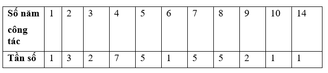

**Lời giải**

a) Các giá trị: 1;2;3;4;5;6;7 . Tần số của mỗi giá trị đó lần lượt là 6;5;5;7;9;5;2.
b) Ta có: 6 5 5 7 9 5 2 39 + + + + + + = (y tá). c) Ta có: 5 7 9 5 2 28 + + + + = (y tá) Nhận xét:
1. Từ biểu đồ trên, ta có thể lập bảng thống kê cho dữ liệu đó.

2. Ta có thể vẽ biểu đồ đoạn thẳng.
Ví dụ 3. Cho hai biểu đồ sau:

Biểu đồ A

Biểu đồ B
a) Đọc và giải thích mỗi biểu đồ trên.
b) Hai biểu đồ trên có biểu diễn cùng một dữ liệu không? Lập bảng thống kê cho dữ liệu đó. Bảng thống
kê thu được có phải là bảng tần số hay không?

**Lời giải**

a) Biểu đồ A : biểu đồ cột. Số học sinh đạt điểm 6;7;8;9;10 tương ứng là 5;8;12;6;4.
Biểu đồ B : biểu đồ đoạn thẳng. Biểu đồ tần số dạng đoạn thẳng còn gọi là đa giác tần số (frequecy pologon)
b) Hai biểu đồ trên cùng biểu diễn một dữ liệu.
Bảng thống kê 0 1 2 3 4 5 6 7 8 9 10 1 2 3 4 5 6 7 Sốy tá Sốnăm công tác 5 8 12 6 4 0 5 10 15 6 7 8 9 10 Tần số Kết quảkiểm tra môn toán Điểm 5 8 12 6 4 0 5 10 15 6 7 8 9 10 Sốhọc sinh Kết quảkiểm tra môn toán Điểm

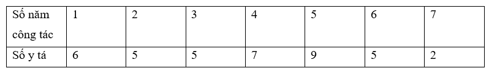

nh (tần số) Bảng thống kê trên cùng là bảng tần số.
Ví dụ tương tự.
Lập bảng thống kê và kết quả khi gieo con xúc xắc từ biểu đồ đã cho.

Ví dụ 3. Một khu vui chơi dành cho trẻ em thống kê lại độ tuổi của một số trẻ em đến chơi trong một ngày ở bảng tần số như sau:

a) Hãy vẽ các biểu đồ cột và biểu đồ đoạn thẳng biểu diễn số liệu ở bảng tần số.
b) Theo biểu đồ ở câu a, trong số các trẻ em đến khu vui chơi, trẻ em ở độ tuổi nào là nhiều nhất?

**Lời giải**

a) Biểu đồ cột.
Số lượng trẻ em phân theo độ tuổi

Biểu đồ đoạn thẳng Số lượng trẻ em phân theo độ tuổi 0 1 2 3 4 5 6 7 1 2 3 4 5 6 Mặt xuất hiện Tần số 0 1 2 3 4 5 6 7 1 2 3 4 5 6 Mặt xuất hiện Tần số 0 2 4 6 8 10 12 3 4 5 6 7 8 Tuổi Tần số

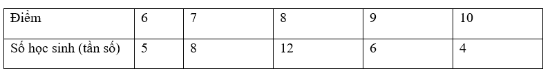

b) Theo biểu đồ trên, trong số các trẻ em đến khu vui chơi, trẻ em 7 tuổi là nhiều nhất.
Ví dụ tương tự.
Bác An thống kê lại số cuộc gọi điện thoại mà mình thực hiện mỗi ngày trong tháng 7 ở bảng tần số như sau:

Hãy vẽ biểu đồ cột và biểu đồ đoạn thẳng biểu diễn mẫu số trên.
Hướng dẫn Xem hình vẽ. Biểu đồ cột:
Biểu đồ đoạn thẳng:

Ví dụ 4. Bảng tần số sau cho biết sô học sinh của lớp 9D dự đoán đội bóng vô địch World Cup 2022 trước khi giải đấu bắt đầu.

Vẽ biểu đồ tần số dạng cột và biểu đồ tần số dạng đoạn thẳng biểu diễn bảng tần số trên.

**Lời giải Biểu đồ cột:**

Biểu đồ đoạn thẳng:
0 2 4 6 8 10 12 3 4 5 6 7 8 Tuổi Tần số 0 2 4 6 8 10 12 5 6 7 8 9 sốcuộc gọi Tần số 0 2 4 6 8 10 12 5 6 7 8 9 Sốcuộc gọi Tần số

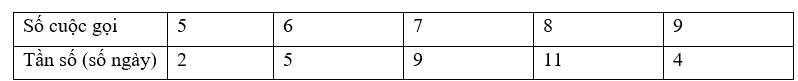

Ví dụ 5. Một công ty xuất khẩu các mặt hàng nông hải sản thống kê lại trong bảng sau số đơn đặt hàng trong mỗi năm thuộc giai đoạn 2018 -2022 :
a) Hãy chọn loại biểu đồ thuận tiện cho việc so sánh số đơn đặt hàng của các năm. Vẽ biểu đồ đó. Số đơn
đặt hàng tập trung nhiều nhất vào năm nào? Số đơn đặt hàng của năm nào ít nhất?
b) Hãy chọn loại biểu đồ thể hiện rõ xu hướng thay đổi số đơn hàng qua các năm. Vẽ biểu đồ đó. Dựa vào
biểu đồ này, cho biết vào những năm nào số đơn đặt hàng giảm sút so với năm trước đó? Năm nào giảm nhiều nhất?

**Lời giải**

a) Để so sánh số đơn hàng trong các năm thì biểu đồ tần số dạng cột là loại biểu đồ phù hợp. Biểu đồ
được vẽ ở hình dưới đây, trong đó trục ngang biểu thị các năm và trục đứng biểu thị tần số ứng với mỗi năm.

Biểu đồ cho thấy rõ là số đơn hàng tập trung vào năm 2019. Năm 2021 có số đơn hàng ít nhất và chênh lệch khá nhiều so với các nǎm còn lại (chẳng hạn chỉ bằng một nửa số đơn hàng của năm 2022 hay chưa đến một phần tư số đơn hàng của năm 2019).
b) Để thể hiện rõ xu hướng thay đổi qua các năm thì ta vẽ biểu đồ tần số dạng đoạn thẳng.
0 4 8 12 16 Brazil Anh Pháp Agrentina Đội bóng Tần số 0 4 8 12 16 Brazil Anh Pháp Agrentina Sốcuộc gọi Tần số 16 26 20 6 12 0 5 10 15 20 25 30 2018 2019 2020 2021 2022 Sốđơn hàng các năm

Quan sát biểu đồ, ta thấy năm 2020 và năm 2021 đều có số đơn hàng giảm so với năm trước đó. Đoạn thẳng đi xuống “dốc” hơn là đoạn chuyển từ năm 2020 sang năm 2021, chứng tỏ năm 2021 có số đơn đặt hàng giảm nhiều nhất so với năm trước đó.
Ví dụ 6. Biểu đồ được đưa ra để quảng cáo cho một website.
Quan sát biểu đồ, bạn Vân nhận xét: “Lượng người truy cập quý II tăng gấp đôi so với quý I. Sang quý III, lượng người truy cập lại tăng gấp 3 so với quý I”.

Ý kiến của bạn Vân đúng không? Giải thích vì sao?

**Lời giải Hình vẽ người ta đã thu gọn đoạn ứng với số 2000 trên trục tung. Mỗi đơn vị tiếp theo ứng với 500 (người).**

Như vậy từ quý I sang quý II chỉ tăng 500 người chứ không phải tăng gấp đôi (từ 2000 lên 4000). Tương tự, lượng người truy cập từ quý I sang quý III chỉ tăng 1000 chứ không phải tăng gấp 3 (từ 2000 lên
6000).
Như vậy ý kiến của bạn Vân không đúng vì chỉ nhìn chiều cao của các cột mà không để ý đến số liệu trên trục tần số.
Chú ý: Khi vẽ biểu đồ, ta nên chọn đơn vị phù hợp cho trục tần số để có thể bắt đầu tù số 0 , không gây nhầm lẫn về thị giác. Chẳng hạn, biểu đồ ở hình trên có thể vẽ lại như sau:
0 5 10 15 20 25 30 2018 2019 2020 2021 2022 Sốđơn hàng các năm 0 500 1000 1500 2000 2500 3000 3500 I II III IV Qúy Lượng người truy cập website

Hình b Hình c C. GIẢI BÀI TẬP SÁCH GIÁO KHOA 7.1. Một nhóm học sinh đã khảo sát ý kiến về ý thức giữ gìn vệ sinh công cộng của các bạn trong trường với các mức đánh giá Tốt, Khá, Trung bình, Kém và thu được kết quả như sau:
Tốt, Trung bình, Tốt, Trung bình, Khá, Tốt, Khá, Tốt, Tốt, Khá, Trung bình, Kém, Khá, Tốt, Khá, Tốt, Trung bình, Khá, Tốt, Tốt, Tốt, Khá, Kém, Trung bình, Tốt, Khá, Tốt, Khá, Tốt, Khá, Khá.
a) Lập bảng tần số cho dãy dữ liệu trên.
b) Từ bảng tần số, hãy cho biết mức đánh giá nào chiếm ưu thế nhất. Vì sao?

**Lời giải**

a) Bảng tần số cho dãy dữ liệu trên như sau:
Mức đánh giá Tốt Khá Trung bình Kém Tần số 13 11 5 2
b) Từ bảng tần số, ta thấy mức đánh giá Tốt chiếm ưu thế nhất vì mức đánh giá Tốt có tần số lớn nhất (13
bạn).
7.2. Cho biểu đồ tranh biểu diễn số lượng học sinh trong lớp đăng kí tham gia các câu lạc bộ của trường như sau:

Lập bảng tần số cho dữ liệu được biểu diễn trong biểu đồ tranh trên.
0 1000 2000 3000 4000 I II III IV Qúy Lượng người truy cập website 0 10 20 30 40 50 60 70 80 90 100 Hạn hán Bệnh dịch Lũ Lụt Sạt lở đất Bão 6 9 71 6 94 0 10 20 30 40 50 60 70 80 90 100 Hạn hán Bệnh dịch Lũ Lụt Sạt lở đất Bão Số lượng Loại thiên tai Số lượng các thiên tai xảy ra tại Việt Nam giai đoạn 1990-2021

**Lời giải Từ biểu đồ tranh, ta có:**

- Số học sinh đăng kí tham gia câu lạc bộ võ thuật là: 6 học sinh
- Số học sinh đăng kí tham gia câu lạc bộ tiếng Anh là: 9 học sinh.
- Số học sinh đăng kí tham gia câu lạc bộ nghệ thuật là: 5 học sinh.
Bảng tần số cho dữ liệu được biểu diễn trong biểu đồ tranh như sau:
Câu lạc bộ Võ thuật Tiếng Anh Nghệ thuật Tần số 6 9 5 7.3. Biểu đồ Hình 7.7 cho biết số ngày sử dụng phương tiện đến trường của bạn Mai trong tháng Chín.
Lập bảng tần số cho dữ liệu được biểu diễn trên biểu đồ.

**Lời giải Từ biểu đồ Hình 7.7 , ta thấy có 9 ngày bạn Mai đến trường bằng xe buýt, 5 ngày bạn Mai đến trường bằng xe máy và 8 ngày bạn Mai đến trường bằng xe đạp.**

Bảng tần số cho dữ liệu được biểu diễn trên biểu đồ Hình 7.7  như sau:
Phương tiện Xe buýt Xe máy Xe đạp Tần số 9 5 8 7.4. Người ta thống kê các loại ô tô chạy qua một trạm thu phí trong 1 giờ và vẽ được biểu đồ tần số như Hình 7.8.

a) Lập bảng tần số cho dữ liệu được biểu diễn trên biểu đồ.
b) Từ bảng tần số, hãy cho biết loại xe nào đi qua trạm thu phí nhiều nhất.

**Lời giải**

a) Từ biểu đồ tần số Hình 7.8 , ta thấy có 9 xe 4 chỗ, 14 xe 7 chỗ, 5 xe 9 chỗ và 3 xe 16 chỗ trở lên chạy
qua trạm thu phí trong 1 giờ.

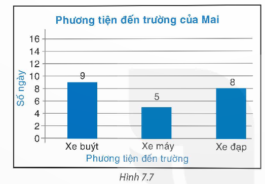

Bảng tần số cho dữ liệu được biểu diễn trên biểu đồ như sau:
Loại ô tô Xe 4 chỗ Xe 7 chỗ Xe 9 chỗ Xe 16 chỗ trở lên Tần số 9 14 5 3
b) Từ bảng tần số, ta thấy 14
9 5 3 > > > nên loại xe 7 chỗ đi qua trạm thu phí nhiều nhất.
7.5. Bảng thống kê sau cho biết số lượng các thiên tai xảy ra tại Việt Nam giai đoạn 1990 2021 - .
Loại thiên tai Hạn hán Bệnh dịch Lũ lụt Sạt lở đất Bão Số lượng 6 9 71 6 94 (Theo vietnam.opendevelopmentmekong.net) Vẽ biểu đồ tần số dạng cột và biểu đồ tần số dạng đoạn thẳng biểu diễn bảng thống kê trên.

**Lời giải**

- Vẽ biểu đồ tần số dạng cột .

⦁ Vẽ biểu đồ tần số dạng đoạn thẳng.
Bước 1. Vẽ các trục (Hình b).
Bước 2. Xác định các điểm và nối các điểm liên tiếp với nhau (Hình b).
Bước 3. Ghi chú giải cho các trục, các điểm và tiêu đề của biểu đồ (Hình c).
D. BÀI TẬP TỰ LUYỆN Câu 1. Một công ty đã ghi lại nhóm máu của các thành viên trong công ty để chuẩn bị cho đợt hiến máu tình nguyện cho kết quả như sau:O, A, B,AB,O,O, A,O, B, A, B, B,O,O, B

B,O, B,O,O,O, B, A, B,O,O,O, B,O, B.
a) Có bao nhiêu nhóm máu? Đếm số thành viên trong công ty theo từng nhóm máu.
b) Lập bảng tần số cho dãy dữ liệu trên. Từ bảng tần số, hãy cho biết nhóm máu nào phổ biến nhất.

**Lời giải**

a) Có 4 nhóm máu là
, , , A B O AB . Trong số 30 thành viên của công ty có 14 người có nhóm máu O,4 người có nhóm máu A, 11 người có nhóm máu B , 1 người có nhóm máu AB .
b) Bảng tần số:
Nhóm máu A B O AB Tần số 4 11 14 1 Từ bảng tần số trên, ta thấy nhóm máu O là phổ biến nhất.

### Câu 2. (Mức 1: lưu thông bình thường; Mức 2: lưu thông khó khăn; Mức 3: lưu thông không ổn định;

Mức 4: ùn tắc nghiêm trọng) vào lúc 17 giờ các ngày trong tháng Chín tại một đoạn quốc lộ:
6 9 71 6 94 0 20 40 60 80 100 Hạn hán Bệnh dịch Lũ Lụt Sạt lở đất Bão Số lượng Loại thiên tai Số lượng các thiên tai xảy ra tại Việt Nam giai đoạn 1990-2021

Mức độ Mức 1 Mức 2 Mức 3 Mức 4 Tần số 5 15 7 3
a) Dựa vào bảng tần số, hãy cho biết mức độ ùn tắc giao thông nào là phổ biến nhất vào lúc 17 giờ tại
đoạn quốc lộ trên.
b) Vẽ biểu đồ tần số dạng cột biểu diễn bảng tần số trên.

**Lời giải**

a) Mức 2 là mức độ ùn tắc giao thông phổ biến nhất vào lúc 17 giờ tại đoạn quốc lộ trên vì nó tương ứng
với tần số lớn nhất.
b) Biểu đồ tần số dạng cột:

### Câu 3. Tính đến hết SEA Games 32 đã có năm quốc gia từng lên ngôi vô địch bóng đá nam SEA Games, cụ thể như sau:

Đội tuyển Năm vô địch Thái Lan 1975, 1981, 1983, 1985, 1993, 1995, 1997, 1999, 2001, 2003, 2005, 2007, 2013, 2015, 2017 Malaysia 1961, 1977, 1979, 1989, 2009, 2011 Myanmar 1965, 1967, 1969, 1971, 1973 Việt Nam 1959, 2019, 2021 Indonesia 1987, 1991, 2023 (Theo sportingnews.com)
a) Lập bảng tần số biểu diễn số lần vô địch môn bóng đá nam SEA Games của các quốc gia trên.
b) Từ bảng tần số thu được ở câu a, hãy cho biết quốc gia nào vô địch môn Bóng đá nam SEA Games
nhiều nhất, với mấy lần vô địch.

**Lời giải**

a) Bảng tần số:
Đội tuyển Thái Lan Malaysia Myanmar Việt Nam Indonesia Tần số 15 6 5 3 3
b) Thái Lan có số lần vô địch đá nam SEA Games nhiều nhất, với 15 lần.

### Câu 4. Giáo viên dạy Toán ghi lại số bài tập mỗi học sinh trong lớp đã làm sau bài học tuần trước cho kết quả như sau:

4,2,0,5,4,3,2,1,3,3,6,1,3,2,4,3,5,3 5 15 7 4,5 0 2 4 6 8 10 12 14 16 Mức 1 Mức 2 Mức 4 Mức 5 Số ngày Mức độ ùn tắc Mức độ ùn tắc giao thông trong tháng chín

3,1,4,6,1,2,3,5,3,2,4,3,1,4,4,5,6,2 .
a) Lập bảng tần số cho dãy số liệu trên.
b) Có bao nhiêu bạn trong lớp làm ít nhất ba bài tập?

**Lời giải**

a) Bảng tần số:
Số bài tập 0 1 2 3 4 5 6 Tần số 1 5 6 10 7 4 3
b) Có 24 bạn trong lớp làm ít nhất ba bài tập.

### Câu 5. Bảng sau cho biết kết quả bình chọn môn thể thao được yêu thích nhất của các bạn học sinh lớp 9A (mỗi gạch biểu diễn cho một bạn bình chọn):

Bóng đá
| | | | | | | | || | |
Cầu lông | | | | || | Bóng bàn || | | Môn khác | | | | | |
a) Lập bảng tần số cho kết quả bình chọn trên.
b) Dựa vào bảng tần số thu được ở câu a, cho biết môn thể thao nào được các bạn yêu thích nhất.

**Lời giải**

a) Bảng tần số:
Môn thể thao Bóng đá Cầu lông Bóng bàn Môn khác Tần số 14 8 4 7
b) Bóng đá được nhiều nhất bạn yêu thích nhất.

### Câu 6. Biểu đồ sau cho biết kết quả khảo sát trình độ tiếng Anh của sinh viên cuối năm thứ nhất ở một trường đại học:

a) Đọc và giải thích số liệu được biểu diễn trên hai cột bất kì của biểu đồ.
b) Lập bảng tần số cho dữ liệu được biểu diễn trên biểu đồ.
c) Để tốt nghiệp đại học, sinh viên cần có trình độ tiếng Anh ở mức B1 trở lên. Ước lượng tỉ lệ sinh viên
cuối năm thứ nhất đã đạt chuẩn trình độ tiếng Anh.
102 115 345 35 3 0 50 100 150 200 250 300 350 400 A1 A2 B1 B2 C1 Số sinh viên Trình độ tiếng Anh Kết quả khảo sát trình độ tiếng Anh của sinh viện cuối năm thứ nhất

**Lời giải**

a) Cuối năm thứ nhất, có 102 sinh viên đạt trình độ tiếng Anh mức A1,115 sinh viên đạt trinh độ tiếng
Anh mức A2.
b) Bảng tần số:
Trình độ A1 A2 B1 B2 C1 Tần số 102 115 345 35 3
c) Tổng số sinh viên là
102 115 345 35 3 600 n = + + + + = . Cuối năm thứ nhất, số sinh viên đạt trình độ tiếng Anh mức B1 trở lên là 345 35 3 383 + + = .
Ước lượng tỉ lệ sinh viên cuối năm thứ nhất đạt chuẩn trình độ tiếng Anh là 383.100% 64% 600 ≈ .

### Câu 7. Số π với 50 chữ số sau dấu phẩy thập phân như sau:

3,14159265358979323846264338327950288419716939937510 .
a) Lập bảng tần số cho các chữ số từ 0 đến 9 xuất hiện sau dấu phẩy thập phân.
b) Chữ số nào xuất hiện nhiều nhất, ít nhất?

**Lời giải**

a) Bảng tần số:
Chữ số 0 1 2 3 4 5 6 7 8 9 Tần số 2 5 5 8 4 5 4 4 5 8
b) Hai chữ số xuất hiện nhiều nhất là 3 và 9; chữ số xuất hiện ít nhất là 0.

### Câu 8. Cho biểu đồ tần số dạng đoạn thẳng sau:

a) Lập bảng tần số cho dữ liệu được biểu diễn trên biểu đồ.
b) Điểm nào có nhiều học sinh đạt nhất?

**Lời giải**

a) Bảng tần số:
Điểm 5 6 7 8 9 10 Tần số 2 6 10 13 7 1
b) Có nhiều học sinh được điểm 8 nhất, với 13 bạn.

### Câu 9. Một túi chứa một số viên bi có cùng kích thước, mỗi viên bi có một trong các màu đen, trắng, đỏ, vàng. Thực hiện lấy bi 20 lần, mỗi lần lấy một viên xem viên bi có màu gì sau đó trả bi lại túi, trộn đều.

2 6 10 13 7 0 5 10 15 5 6 7 8 9 10 Số học sinh Điểm Kết quả kiểm tra môn toán

Kết quả trong 20 lần lấy bi có 8 lần lấy được bi đen, 4 lần lấy được bi đỏ, 6 lần lấy được bi trắng, 2 lần lấy được bi vàng.
a) Lập bảng tần số cho kết quả thu được.
b) Vẽ biểu đồ tần số dạng cột biểu diễn bảng tần số thu được ở câu a.

**Lời giải**

a) Các giá trị là đen, đỏ, trắng, vàng với tần số tương ứng là 8,4,6,2.
b)

### Câu 10. Thống kê số ngày nằm viện của 20 bệnh nhân được kết quả như sau:

5,7,4,6,8,10,6,7,8,8,6,5,8,5,4,6,5,7,4,6
a) Lập bảng tần số cho dãy số liệu trên.
b) Vẽ biểu đồ tần số dạng đoạn thẳng biểu diễn bảng tần số thu được ở câu a.

**Lời giải**

a) Đếm số lần xuất hiện của các giá trị 4, 5, 6, 7, 8, 10 và lập bảng tần số.

8 4 6 2 0 2 4 6 8 10 Đen Đỏ Trắng Vàng Tần số Màu viên bi Kết quả 20 lần lấy viên bi 3 4 5 3 4 0 1 2 3 4 5 6 4 5 6 7 8 10 Tần số Số ngày Số ngày nằm viện của bệnh nhân

### BÀI 23. BẢNG TẦN SỐ TƯƠNG ĐỐI VÀ BIỂU ĐỒ TẦN SỐ TƯƠNG ĐỐI A. KIẾN THỨC CƠ BẢN CẦN NẮM 1. BẢNG TẦN SỐ TƯƠNG ĐỐI Tần số tương đối và bảng tần số tương đối Cho dãy dữ liệu 1 2 , , , n x x x … . Tần số tương đối if của giá trị 1x là tỉ số giữa tần số của ix (gọi là i m ) với n .

Bảng sau đây được gọi là bảng tần số tương đối.
Giá trị 1x … kx Tân số tương đối 1f … kf trong đó 1 k n m m = +…+ và 1 1 100(%) m f n = ⋅ là tần số tương đối của 1, x …, 100(%) k k m f n = ⋅ là tần số tương đối của kx Lưu ý: Tần số tương đối còn gọi là tần suất.
Chú ý. Người ta còn cho bảng tần số tưởng đối ở dạng cột: cột thứ nhất ghi các giá trị, cột thứ hai ghi tần số tương đối của các giá trị đó.
Ví dụ 1 Thu thập dữ liệu về chất lượng không khí tại một địa điểm trong 30 ngày mùa xuân cho kết quả như sau:
M1, M1, M2, M2, M2, M2, M1, M2, M2, M2, M2, M2, M2, M2, M2, M4, M1, M3, M3, M3, M4, M4, M1, M1, M1, M1, M3, M3, M3, M1.
(M1: Tốt; M2: Trung bình; M3: Kém; M4: Xấu)
a) Lập bảng tần số tương đối cho dãy dữ liệu trên.
b) Trong một ngày xuân, khả năng cao nhất địa điểm này có chất lượng không khí ở mức nào?

**Lời giải**

a) Tổng số ngày quan sát là
30 n = .
Số ngày có chất lượng không khí ở các múc M1, M2, M3, M4 tương ứng là 1 2 3 4 9, 12, 6, 3 m m m m = = = = .
Do đó các tần số tương đối cho các mức M1, M2, M3, M4 lần lượt là:
1 2 3 4 9 12 6 3 100% 30%;
100% 40%;
100% 20%;
100% 10%.
30 30 30 30 f f f f = ⋅ = = ⋅ = = ⋅ = = ⋅ =

Ta có bảng tần số tương đối sau:
Chất lượng không khí M1 M2 M3 M4 Tần số tương đối

30% 40% 20% 10%

b) Trong một ngày xuân, khả năng cao nhất là địa điểm này có chất lượng không khí ở mức M2, tức là
mức Trung bình.
Nhận xét. Tần số tương đối của một giá trị là ước lượng cho xác suất xuất hiện giá trị đó.
2. BIỂU ĐỒ TẦN SỐ TƯƠNG ĐỐI Tìm hiểu về biểu đồ tần số tương đối
- Biểu đồ biểu diễn bảng tần số tương đối được gọi là biểu đồ tần số tương đối. Dạng thường gặp của biểu
đồ tần số tương đối là biểu đồ cột và biểu đồ hình quạt tròn.
- Để vẽ biểu đồ hình quạt tròn ta thực hiện theo các bước sau:
Bước 1. Xác định số đo cung tương ứng của các hình quạt dùng để biểu diễn tần số tương đối của các giá trị theo công thức 360 if ° ⋅ với 1, , i k = … .
Bước 2. Vẽ hình tròn và chia hình tròn thành các hình quạt có số đo cung tương úng được xác định trong Bước 1.
Bước 3. Định dạng các hình quạt tròn (thường bằng cách tô màu), ghi tần số tương đối, chú giải và tiêu đề. Ví dụ 2:
Cho bảng tần số tương đối về loại phim yêu thích của các học sinh trong lớp 9A như sau:
Loại phim Hài Khoa học viễn tưởng Kinh dị Tỉ lệ bạn yêu thích 50% 37,5% 12,5% Vẽ biểu đồ hình quạt tròn biểu diễn bảng tần số tương đối trên.

**Lời giải Bước 1. Xác định số đo cung tương ưng của các hình quạt biểu diễn các tần số tương đối cho mỗi loại phim:**

Hài: 360 50% 180 ° ° ⋅ = ; Khoa học viễn tưởng: 360 37,5% 135 ° ° ⋅ = ; Kinh dị: 360 12,5% 45 ° ° ⋅ = .
Bước 2. Vẽ hình tròn và chia hình tròn thành các hình quạt (H.7.11).

Bước 3. Định dạng các hình quạt tròn, ghi tỉ lệ phần trăm, chú giải và tiêu đề (H.7.12).

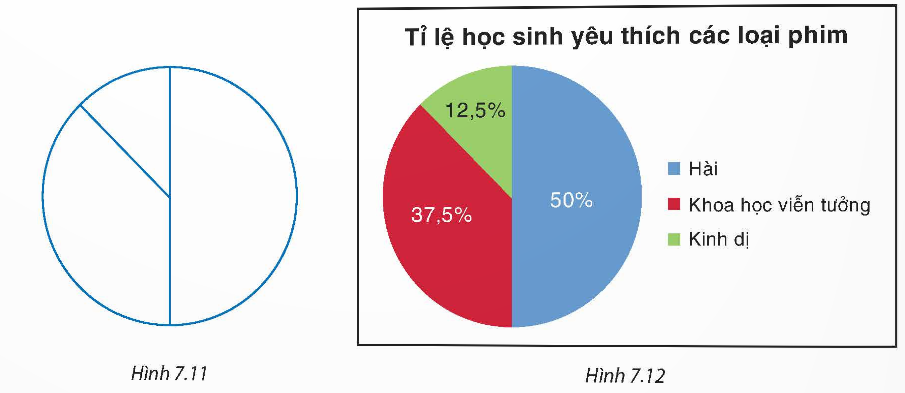

B. CÁC DẠNG TOÁN Dạng 1. Tần số tương đối Ví dụ 1. Sau bài thi môn Ngữ văn, cô giáo ghi lại số lỗi chính tả mà một học sinh mắc phải vào bảng thống kê sau:

a) Mẫu số liệu trên gồm những giá trị khác nhau nào?
b) Hãy lập bảng tần số và bảng tần số tương đối của số lỗi chính tả mà học sinh mắc phải.

**Lời giải**

a) Các giá trị khác nhau của mẫu số liệu là: 0;1;2;3;4;5 .
b) Cỡ mẫu n 40 = . Bảng tần số:

Vì tần số của giá trị 0 là 4 nên tần số tương đối của giá trị 0 là 4 .100% 10,0% 40 = .
Vì tần số của giá trị 1 là 10 nên tần số tương đối của giá trị 1 là 10 .100% 25,0% 40 = .
Tương tự, ta tính được tần số tương đối của các giá trị 2;3;4;5 lần lượt là 17,5%;12,5%;20,0%;15,0%.
Bảng tần số tương đối:

Ví dụ 2. Điều tra về “Loại nhạc cụ bạn muốn chơi nhất” đối với các bạn trong lớp, bạn Dương thu được ý kiến trả lời và ghi lại như dưới đây:

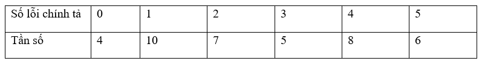

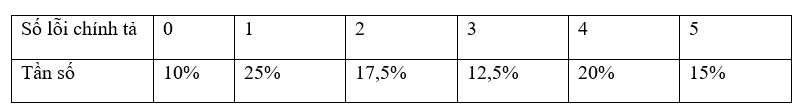

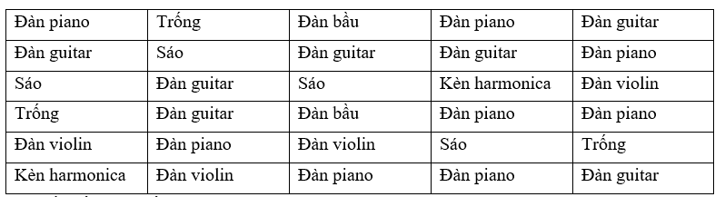

Lập bảng tần số tương đối của các loại nhạc cụ.
Hướng dẫn: Ta có thể lập bảng tần số và bảng tần số tương đối vào chung một hình vẽ.

**Lời giải Ta có: n 30 = . Bảng tần số - tần số tương đối.**

Ví dụ 3. Thu thập dữ liệu về chất lượng không khí tại một địa điểm trong 30 ngày mùa xuân cho kết quả như sau:
M1, M1, M2, M2, M2, M1, M2, M2, M2, M2, M2, M2, M2, M2, M4, M3, M3, M3, M3, M4, M4, M1, M1, M1, M1, M3, M3, M3, M1.
(M1: Tốt; M2: Trung bình; M3: Kém; M4: Xấu) Lập bảng tần số tương đối.

**Lời giải Ta có: 30 n = . Bảng tần số - tần số tương đối.**

Ví dụ 4. Quay 50 lần một tấm bìa hình tròn được chia thành ba hình quạt với các màu xanh, đỏ, vàng.
Quan sát và ghi lại mũi tên chỉ vào hình quạt có màu nào khi tấm bìa dừng lại. Kết quả thu được như sau:
Xanh: |||| |||| |||| Đỏ: |||| |||| |||| |||| |||| Vàng: |||| ||||

a) Lập bảng tần số tương đối cho kết quả thu được.
Xanh
b) Ước lượng xác suất mũi tên chỉ vào hình quạt màu đỏ.

**Lời giải**

a) Bảng tần số - tần số tương đối.

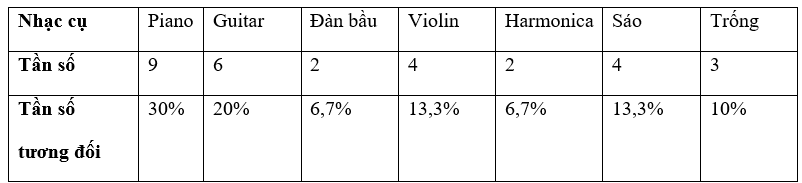

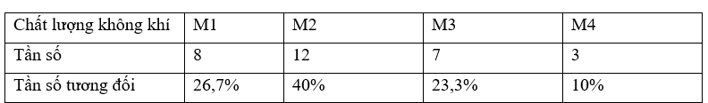

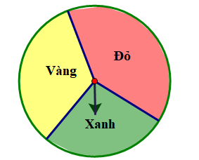

b) 50%.
Dạng 2. Biểu đồ tần số tương đối Ví dụ 1. Một doanh nghiệp thu thập mức độ yêu thích của người tiêu dùng về một loại sản phẩm theo các mức: 1,2,3,4,5. Mẫu số liệu thống kê sau phản ánh ý kiến của 50 người tiêu dùng như sau:

a) Lập bảng tần số tương đối của mẫu số liệu thống kê đó.
b) Vẽ biểu đồ tần số tương đối ở dạng biểu đồ cột của mẫu số liệu thống kê đó.

**Lời giải a) Ta có: 50 n = . Bảng tần số - tần số tương đối.**

b) Biểu đồ (xem hình vẽ)

Nhận xét: Ta có thể vẽ biểu đồ tần số tương đối ở dạng biểu đồ hình quạt tròn của mẫu số liệu trên.
Xem hình vẽ. 10 12 14 44 20 0 5 10 15 20 25 30 35 40 45 50 1 2 3 4 5 Tần số tương đối (%) Mức độ yêu thích

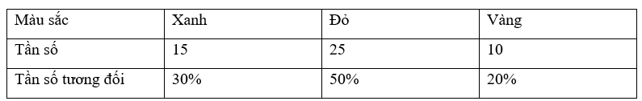

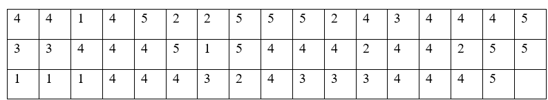

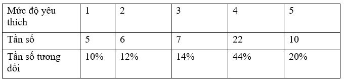

Ví dụ 2. Gieo một xúc xắc 32 lần liên tiếp, ghi lại số chấm trên mặt xuất hiện của xúc xắc, ta được mẫu số liệu thống kê như sau:

**Lời giải a) Ta có: 32 n = . Bảng tần số - tần số tương đối.**

b) Biểu đồ cột.

Biểu đồ hình quạt tròn.
Hướng dẫn: Vẽ đường tròn, 12,5% ứng với hình quạt có góc ở tâm là 45 ;25% ° ứng với hình quạt có góc ở tâm là 90° (Xem hình vẽ).

12% 10% 20% 44% 14% 12,50% 25% 12,50% 25% 12,50% 12,50% 0,00% 12,50% 25,00% 1 2 3 4 5 6 sốchấm Tần số tương đối (%)

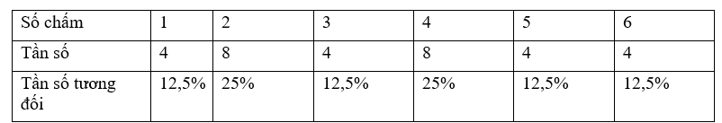

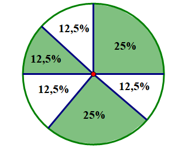

Ví dụ 3. Thống kê điểm kiểm tra môn Toán của 40 học sinh lớp 9C (Xem Ví dụ 5 - Bài 22 . Bảng tần số và biểu đồ tần số). Vẽ biểu đồ cột và biểu đồ hình quạt tròn biểu diễn các số liệu thống kê đó.

**Lời giải Bảng tần số - tần số tương đối.**

Biểu đồ cột:
Biểu đồ hình quạt tròn:

Ví dụ 4. Câu lạc bộ mĩ thuật của nhà văn hoá thiếu nhi thống kê tuổi của các thành viên lớp hội hoạ và biểu diễn dữ liệu qua bảng sau:
Tuổi của các thành viên lớp hội hoạ

a) Tính tần số tương đối của mỗi giá trị và lập bảng tần số tương đối.
b) Vẽ biểu đồ tần số tương đối dạng biểu đồ cột và biểu đồ hình quạt tròn.

**Lời giải**

a) Bảng tần số - tần số tương đối.

b) Xem hình vẽ
Biểu đồ cột:
Biểu đồ tròn:
15 20 25 30 10 0 10 20 30 40 5 6 7 8 9 Điểm Tần sốtương đối (%)

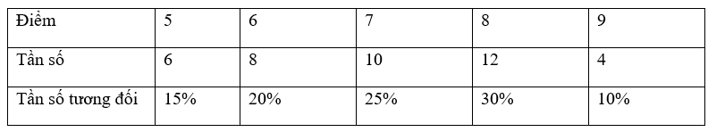

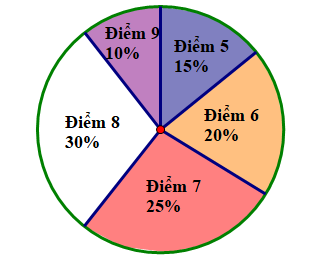

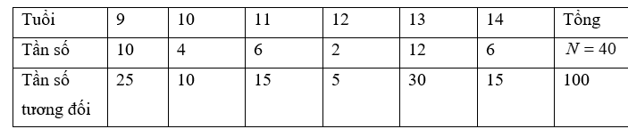

C. GIẢI BÀI TẬP SÁCH GIÁO KHOA 7.6. Lớp 9A có 40 bạn, trong đó 20 bạn mặc áo cỡ M, 13 bạn mặc áo cỡ S, 7 bạn mặc áo cỡ L. Hãy lập bảng tần số tương đối cho dữ liệu này.

**Lời giải Tổng số bạn là n 40 = . Số bạn mặc áo cỡ S, cỡ M , cỡ L tương ứng là 1 2 3 m 13, m 20, m 7 = = = . Do đó các tần số tương đối cho các cỡ S,M,L lần lượt là:**

1 2 3 13 20 7 100% 32,5%;
100% 50%;
100% 17,5%.
40 40 40 f f f = ⋅ = = ⋅ = = ⋅ =

Ta có bảng tần số tương đối như sau:
Cỡ áo S M L Tần số tương đối 32,5% 50% 17,5% .
7.7. Biểu đồ tranh sau đây biểu diễn số lượng học sinh lớp 9 B bình chọn phần mềm học trực tuyến được yêu thích nhất:

Lập bảng tần số tương đối cho dữ liệu được biểu diễn trong biểu đồ tranh trên.

**Lời giải Tổng số học sinh lớp 9B là n (3 11 6).2 40 = + + = .**

Số học sinh bình chọn phần mềm Skype, Zoom, Google Meet tương ứng là 1 2 3 m 6;m 22;m 12 = = = .
Do đó các tần số tương đối cho các phần mềm Skype, Zoom, Google Meet lần Iượt là:
1 2 3 6 22 12 100% 15%;
100% 55%;
100% 30%.
40 40 40 f f f = ⋅ = = ⋅ = = ⋅ =

Ta có bảng tần số tương đối như sau:
Phần mềm học trực tuyến Skype Zoom Google Meet 25 10 15 5 30 15 0 10 20 30 40 9 10 11 12 13 14 tuổi Tần sốtương đối (%)

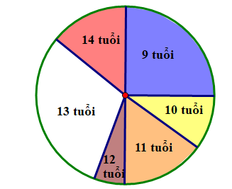

Tần số tương đối 15% 55% 30% 7.8. Quay 150 lần một tấm bìa hình tròn được chia thành bốn hình quạt với các màu xanh, đỏ, tím, vàng.
Quan sát mũi tên chỉ vào hình quạt màu gì và ghi lại, thu được kết quả sau:
Màu Xanh Đỏ Tím Vàng Số lần 60 30 40 20
a) Lập bảng tần số tương đối cho dữ liệu trên.
b) Ước lượng các xác suất mũi tên chỉ vào hình quạt màu xanh, màu vàng.
c) Vẽ biểu đồ hình quạt tròn biểu diễn bảng tần số tương đối thu được ở câu a.

**Lời giải**

a) Tổng số lần quay là
150 n = . Số lần quay vào hình quạt màu xanh, đỏ, tím, vàng tương ứng là 1 2 3 m 60;m 30;m = = = 4 40, m 20 = . Do đó các tần số tương đối cho các hình quạt màu xanh, đỏ, tím, vàng lần lượt là:
1 2 60 30 100% 40%;
100% 20%;
150 150 f f = ⋅ = = ⋅ = 3 4 40 20 100% 26,67%;
100% 13,33%.
150 150 f f = ⋅ ≈ = ⋅ ≈

Ta có bảng tần số tương đối như sau:
Màu hình quạt Xanh Đỏ Tím Vàng Tần số tương đối 40% 20% 26,67% 13,33%
b) Xác suất mũi tên chỉ vào hình quạt màu xanh là 60
2 150 5 = .
Xác suất múi tên chỉ vào hình quạt màu vàng là 20 2 150 15 = .
c) Bước 1. Xác định số đo cung tương ứng của các hình quạt biểu diễn các tần số tương đối cho mỗi màu
của hình quạt:Xanh: 360 .40% 144 ° ° = ; Đỏ: 360 20% 72 ° ° ⋅ = ; Tím: 360 26,67% 96,012 96 ° ° ° ⋅ = ≈ ;
Vàng: 360 13,33% 47,988 48 ° ° ° ⋅ = ≈ .
Bước 2. Vẽ hình tròn và chia hình tròn thành các hình quạt (Hình a).

Bước 3. Định dạng các hình quạt tròn, ghi tỉ lệ phần trăm, chú giải và tiêu đề.

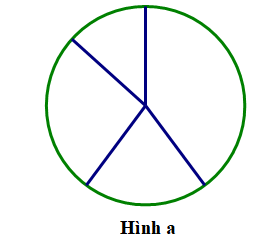

7.9. Theo Tổng cục Thống kê, vào năm 2021 trong số 50,5 triệu lao động Việt Nam từ 15 tuổi trở lên có 13,9 triệu lao động đang làm việc trong lính vực nông nghiệp, lâm nghiệp và thuỷ sản; 16,9 triệu lao động đang làm việc trong lính vực công nghiệp và xây dựng; 19,7 triệu lao động đang làm việc trong lĩnh vực dịch vụ.
a) Lập bảng tần số tương đối cho dữ liệu trên.
b) Vẽ biểu đồ hình quạt tròn biểu diễn bảng tần số tương đối thu được ở câu a.
c) Tính tỉ lệ lao động không làm việc trong lĩnh vực nông nghiệp, lâm nghiệp và thuỷ sản.

**Lời giải**

a) Tổng số triệu người lao động là
50,5 n = . Số triệu người lao động làm việc trong lĩnh vực nông nghiệp, lâm nghiệp và thủy sản; công nghiệp và xây dựng; dịch vụ tương ứng là 1 2 3 m 13,9;m 16,9;m 19,7 = = = .
Do đó các tần số tương đối cho các lĩnh vực nông nghiệp, lâm nghiệp và thủy sản; công nghiệp và xây dựng; dịch vụ lần lượt là:
1 2 3 13,9 16,9 19,7 100% 27,52%;
100% 33,47%;
100% 39,01% 50,5 50,5 50,5 f f f = ⋅ ≈ = ⋅ ≈ = ⋅ ≈

Ta có bảng tần số tương đối như sau:
Lĩnh vực Nông nghiệp, lâm nghiệp và thủy sản Công nghiệp và xây dựng Dịch vụ Tần số tương đối 27,52% 33,47% 39,01%
b) Bước 1. Xác định số đo cung tương ứng của các hình quạt biểu diễn các tần số tương đối cho mỗi lĩnh
vực:
Nông nghiệp, lâm nghiệp và thủy sản: 360 27,52% 99,072 99,1 ° ° ° ⋅ = ≈ ;
Công nghiệp và xây dựng: 360 .33,47% 120,492 120,5 ° ° ° = ≈ ;
Dịch vụ: 360 39,01% 140,436 140,4 ° ° ° ⋅ = ≈ .
Bước 2. Vẽ hình tròn và chia hình tròn thành các hình quạt (Hình a).
40% 20% 26,67% 13,33% Tỉ lệ mũi tên chỉ vào hình quạt các màu Xanh đỏ Tím Vàng

Bước 3. Định dạng các hình quạt tròn, ghi tỉ lệ phần trăm, chú giải và tiêu đề (Hình b).

c) Tỉ lệ lao động không làm việc trong lĩnh vực nông nghiệp, lâm nghiệp và thuỷ sản là:
100% 27,52% 72,48%
- =

7.10. Bảng thống kê sau cho biết tỉ lệ tăng trưởng GDP năm 2022 theo khu vực kinh tế.
Khu vực kinh tế Nông nghiệp, lâm nghiệp và thủy sản Công nghiệp và xây dựng Dịch vụ Mức tăng trưởng

3,36%

7,78%

9,99% (Theo Tổng cục Thống kê)
a) Bảng thống kê trên có là bảng tần số tương đối hay không?
b) Lựa chọn loại biểu đồ thích hợp và biểu diễn bảng thống kê trên bằng loại biểu đồ đó.

**Lời giải**

a) Ta có 3,36%
7,78% 9,99% 21,13% 100% + + = ≠ nên bảng thống kê trên không là bảng tần số tương đối.
b) Loại biểu đồ thích hợp biểu diễn bảng thống kê trên là biểu đồ cột.
Ta vẽ biểu đồ cột biểu diễn bảng thống kê trên như sau:
27,52% 33,47% 39,01% Tỉ lệ lao động trong các lĩnh vực Nông nghiệp, lâm nghiệp và thuỷ sản Công nghiệp và xây dựng Dịch vụ

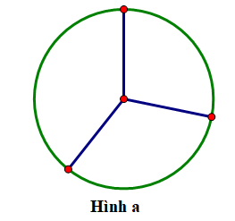

D. BÀI TẬP TỰ LUYỆN Câu 1. Bảng sau cho biết kết quả khảo sát về hoạt động được yêu thích nhất trong kì nghỉ hè của học sinh khối lớp 9: Hoạt động Thể thao Nghệ thuật Du lịch Khác Số bạn bình chọn 80 50 30 40 Lập bảng tần số tương đối và vẽ biểu đồ hình quạt tròn biểu diễn bảng tần số tương đối thu được.

**Lời giải Tổng số học sinh bình chọn là 80 50 30 40 200 n = + + + = .**

Tỉ lệ bình chọn cho mỗi hoạt động là:
Thể thao: 80 .100% 40% 200 = ; Nghệ thuật: 50 .100% 25% 200 = ;
Du lịch: 30 .100% 15% 200 = ; Khác: 40 .100% 20% 200 = .
Bảng tần số tương đối:
Hoạt động Thể thao Nghệ thuật Du lịch Khác Tần số tương đối 40% 25% 15% 20% Biểu đồ hình quạt tròn:

Thể thao;
40% Nghệ thuật;
25% Du lịch;
15% Khác; 20% Các hoạt động hè được yêu thích

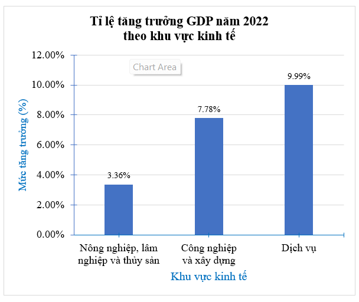

### Câu 2: Biểu đồ dưới đây cho biết số lượng thí sinh đăng kí dự tuyển sinh vào lớp 10 năm 2023 tại khu vực tuyển sinh 1 của thành phố Hà Nội (gồm các trường Trung học phổ thông trên địa bàn các quận Ba Đình và Tây Hồ).

(Theo Sở Giáo dục và Đào tạo Hà Nội) Lập bảng tần số và bảng tần số tương đối cho dữ liệu được biểu diễn trên biểu đồ.

**Lời giải Bảng tần số: Nguyện vọng 1 2 3 Tần số 5376 4873 1247 Tổng số nguyện vọng là 5376 4873 1247 11496 n = + + = .**

Tỉ lệ nguyện vọng 5376 1:
.100% 46,8% 11496 ≈ ; tỉ lệ nguyện vọng 2 : 4873 .100% 42,4% 11496 ≈ ;
tỉ lệ nguyện vọng 1247 3:
.100% 10,8% 11496 ≈ .
Bảng tần số tương đối:
Nguyện vọng 1 2 3 Tần sô tương đối 46,8% 42,4% 10,8% Câu 3. Một xạ thủ bắn 50 lần vào bia và ghi lại điểm của 50 lần bắn như sau:
Điểm 10 9 8 7 Tần số 15 25 7 3
a) Lập bảng tần số tương đối cho kết quả thu được.
b) Ước lượng cho xác suât xạ thủ được điểm lớn hơn hoặc bằng 9 khi bắn vào bia.

**Lời giải**

a) Tổng số lần bắn là
15 25 7 3 50 n = + + + = . Tần số tương đối của các điểm số 10,9,8,7 lần lượt là 15 25 .100% 30%;
.100% 50% 50 50 = = ; 7 3 .100% 14%;
.100% 6% 50 50 = = .
Ta có bảng tần số tương đối:
5376 4873 1247 0 1000 2000 3000 4000 5000 6000 Nguyện vọng 1 Nguyện vọng 2 Nguyện vọng 3 Số thí sinh Thứ tự nguyện vọng Số lượng đăng kí nguyện vọng vào các trường THPT thuộc khu vực tuyển sinh 1 ( Hà Nội)

Điểm 10 9 8 7 Tần số tương đối 30% 50% 14% 6%
b) Ước lượng cho xác suất xạ thủ được điểm lớn hơn hoặc bằng 9 là:30%
50% 80%.
+ =

### Câu 4. Bạn Giang chọn một đoạn văn gồm 100 từ và đếm số chữ cái trong mỗi từ của đoạn văn này cho kết quả như trong biểu đồ sau:

a) Lập bảng tần số tương đối cho dữ liệu được biểu diễn trên biểu đồ.
b) Tìm ước lượng cho xác suất một từ có nhiều hơn 5 chữ cái.

**Lời giải**

a) Bảng tần số tương đối
Số chữ cái 1 2 3 4 5 6 7 8 Tần số tương đối 2% 8% 15% 30% 22% 15% 7% 1%
b) 23%

### Câu 5.  Kết quả bình chọn của khán giả cho danh hiệu cầu thủ xuất sắc nhất giải bóng đá học sinh trường Trung học cơ sở Chu Văn An năm học vừa qua đối với năm cầu thủ được ban tổ chức đề cử như sau:

Cầu thủ An Tân Việt Bình Lê Số lượng bình chọn 55 135 100 70 40
a) Lập bảng tần số tương đối cho bảng dứ liệu trên.
b) Vẽ biểu đồ hình quạt tròn biểu diễn bảng tần số tương đối thu được ở câu a.

**Lời giải**

a) Tổng số bình chọn là
400 n = . Các tần số tương đối của An,..., Lê lần lượt là 55 40 .100% 13,75%;
;
.100% 10% 400 400 = … = . Từ đó lập bảng tần số tương đối.
b) Biểu đồ hình quạt tròn:
2 8 15 30 22 15 7 1 0 10 20 30 40 1 2 3 4 5 6 7 8 Tần số Số chữ cái Số chữ cái trong 100 từ

### Câu 6. Bảng sau là kết quả đánh giá của khách hàng về chất lượng phục vụ của một lái xe công nghệ, mỗi gạch biểu diễn một lần đánh giá:


| | | | | | |

| | | | | | | |

| | | | | | | | | | | | | |

| | | | |
a) Lập bảng tần số và bảng tần số tương đối cho dữ liệu trên.
b) Ước lượng cho xác suất một khách hàng đánh giá ở mức từ ba sao trở xuống.

**Lời giải**

a) Bảng tần số
Mức đánh giá     Tần số 8 9 17 6 Tổng số đánh giá là 8 9 17 6 40 n = + + + = . Các tần số tương đối lần lượt là:
8 9 17 6 .100% 20%;
.100% 22,5%;
.100% 42,5%;
.100% 15% 40 40 40 40 = = = =

Bảng tần số tương đối:
Mức đánh giá     Tần số tương đối 20% 22,5% 42,5% 15%
b) Ước lượng cho xác suất một khách hàng đánh giá ở mức từ ba sao trở xuống là 22,5%
20% 42,5% + = .

### Câu 7. Bảng tần số tương đối sau cho biết kết quả tập luyện của một vận động viên bắn súng:

Điểm 7 8 9 10 Tần số tương đối 5% 15% 55% % x

a) Xác định giá trị của x .
b) Ước lượng xác suất bắn trúng vòng 9 điểm hoặc vòng 10 điểm của vận động viên này.
13,75% 33,75% 25% 17,50% 10% Kết quả bình chọn cho danh hiệu cầu thủ xuất sắc nhất An Tân Việt Bình Lê

c) Biết rằng vận động viên đã bắn 200 viên đạn trong quá trình luyện tập. Tính số lần bắn trúng vòng 9
điểm hoặc vòng 10 điểm của vận động viên này.

**Lời giải a) 25 x = .**

b) 80%.
c) 160 lần bắn trúng vòng 9 điểm hoặc 10 điểm.

### Câu 8. Cho biểu đồ hình quạt tròn sau:

a) Giải thích các số liệu được biểu diễn trên biểu đồ.
b) Lập bảng tần số tương đối cho dữ liệu được biểu diễn trên biểu đồ.

**Lời giải**

a) Trong số những người đạt giải Nobel tính đến năm 2020, số người đạt giải Nobel về Vật lí, Hoá học,
Kinh tế, Hoà bình, Y học, Văn học chiếm các tỉ lệ tương ứng là 23%,20%,9%,11%,24%,13% .
b) Bảng tần số tương đối:
Lĩnh vực Vật lý Hóa học Kinh tế Hòa bình Y học Văn học Tần số tương đối 23% 20% 9% 11% 24% 13% Câu 9. Cho bảng thống kê sau về số lượng học sinh tại một trường tham gia các câu lạc bộ (CLB):

CLB tiếng Anh CLB Toán CLB Khoa học Tổng Nam 40 60 50 150 Nữ 70 30 65 165 Tổng 110 90 115 315
a) Lập các bảng tần số tương đối biểu diễn tỉ lệ học sinh nam, nữ tham gia các câu lạc bộ.
b) Vẽ các biểu đồ hình quạt tròn biểu diễn các bảng tần số tương đối thu được ở câu a.

**Lời giải Vật lý;**

23% Hoá học;
20% Kinh tế;
9% Hoà bình;
11% Y học;
24% Văn học;
13% Tỉ lệ người đạt giải Nobel theo các lĩnh vực tính đến năm 2020

a) Lập hai bảng tần số tương đối. Với học sinh nam, các tần số tương đối biểu diễn tỉ lệ tham gia CLB
tiếng Anh, Toán, Khoa học lần lượt là 40 60 50 .100% 26,7%;
.100% 40%;
.100% 33,3% 150 150 150 ≈ = ≈ .
Với học sinh nữ, các tần số tương đối biểu diễn tỉ lệ tham gia CLB tiếng Anh, Toán, Khoa học lần lượt là:
70 30 65 .100% 42,4%;
.100% 18,2%;
.100% 39,4% 165 165 165 ≈ ≈ ≈

b) Các biểu đồ hình quạt tròn

### Câu 10. Với số liệu cho trong bài tập 7.15, hãy:

a) Lập bảng tần số tương đối cho tỉ lệ học sinh tham gia các câu lạc bộ.
b) Vẽ biểu đồ cột biểu diễn bảng tần số tương đối thu được ở câu a.

**Lời giải**

a) Các tần số tương đối biểu diễn tỉ lệ học sinh tham gia CLB tiếng Anh, Toán, Khoa học lần lượt là:
110 90 115 .100% 34,9%;
.100% 28,6%;
.100% 36,5%.
315 315 315 ≈ ≈ ≈

b) Biểu đồ cột:

26,70% 40% 33,30% Tỉ lệ học sinh nam tham gia các câu lạc bộ Tiếng Anh Toán Khoa học 42,40% 18,20% 39,40% Tỉ lệ học sinh nữ tham gia các câu lạc bộ Tiếng Anh Toán Khoa học 34,90% 28,60% 36,50% 0,00% 10,00% 20,00% 30,00% 40,00% Tiếng Anh Toán Khoa học Tần số tương đối Câu lạc bộ Tỉ lệ học sinh tham gia các câu lạc bộ

LUYỆN TẬP CHUNG PHẦN 1. GIẢI BÀI TẬP SÁCH GIÁO KHOA A. CÁC VÍ DỤ Ví dụ 1 Một vận động viên bắn 30 viên đạn vào bia với các điểm số thu được như sau:
10,8,9,9,10,9,9,9,8,7,10,10,9,8,7,10,9,8,7,9,9,9,10,9,10,8,9,8,8,10
a) Lập bảng tần số và tần số tương đối cho dãy dữ liệu trên.
b) Vẽ biểu đồ tần số dạng đoạn thẳng cho bảng tần số thu được ở câu a.

**Lời giải**

a) Số lần vận động viên được 10,9,8,7 điểm tương ứng là 8,12,7,3. Ta có bảng tần số sau:
Điểm 10 9 8 7 Tần số 8 12 7 3 Tổng số lần bắn là 30 n = .
Tỉ lệ được 10,9,8,7 điểm tương ứng là 8 12 100% 26,7%;
100% 40% 30 30 ⋅ ≈ ⋅ = ; 7 3 100% 23,3%;
100% 10% 30 30 ⋅ ≈ ⋅ = .
Ta có bảng tần số tương đối sau:
Điểm 10 9 8 7 Tần số tương đối 26,7% 40% 23,3% 10%

b) Vẽ biểu đồ tần số dạng đoạn thẳng (H.7.14).

Ví dụ 2 Bảng thống kê sau cho biết số lượt mượn các loại sách trong một tuần tại thư viện của một trường Trung học cơ sở.
Loại sách Sách giáo khoa Sách tham khảo Truyện ngắn Tiểu thuyết Số lượt 20 80 70 30
a) Lập bảng tần số tương đối cho bảng thống kê trên.
b) Vẽ biểu đồ hình quạt tròn biểu diễn bảng tần số tương đối thu được ở câu a.

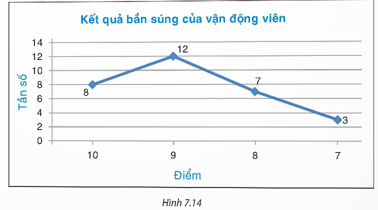

**Lời giải**

a) Tổng số lượt mượn sách là 20
80 70 30 200 + + + = .
Tỉ lệ lượt mượn sách giáo khoa, sách tham khảo, truyện ngắn, tiểu thuyết tương ứng là 20 80 70 30 100% 10%;
100% 40%;
100% 35%;
100% 15%.
200 200 200 200 ⋅ = ⋅ = ⋅ = ⋅ =

Ta có bảng tần số tương đối như sau:
Loại sách Sách giáo khoa Sách tham khảo Truyện ngắn Tiểu thuyết Tần số tương đối 10% 40% 35% 15%
b) Số đo cung tương ứng của các hình quạt biểu diễn tỉ lệ các loại sách được mượn là:
Sách giáo khoa: 360 10% 36 ° ° ⋅ = ; Sách tham khảo: 360 40% 144 ° ° ⋅ = ;
Truyện ngắn: 360 35% 126 ° ° ⋅ = ; Tiểu thuyết: 360 15% 54 ° ° ⋅ = .
Biểu đồ hình quạt tròn như Hình 7.15.

B. BÀI TẬP 7.11. Bảng thống kê sau cho biết số lượng học sinh của lớp 9B theo múc độ cận thị.
Mức độ Không cận thị Cận thị nhẹ Cận thị vừa Cận thị nặng Số học sinh 10 13 12 5
a) Lập bảng tần số tương đối cho bảng thống kê trên.
b) Đa số học sinh của lớp 9B cận thị hay không cận thị?

**Lời giải**

a) Tổng số học sinh là n
10 13 12 5 40 = + + + = .
Số học sinh không cận thị, cận thị nhẹ, cận thị vừa, cận thị nặng tương ứng là 1 2 3 4 10; 13; 12, 5 m m m m = = = = . Do đó các tần số tương đối cho các mức độ không cận thị, cận thị nhẹ, cận thị vừa, cận thị nặng lần lượt là:

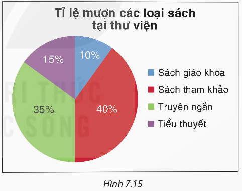

1 2 10 13 100% 25%;
100% 32,5% 40 40 f f = ⋅ = = ⋅ = ; 3 4 12 5 100% 30%;
100% 12,5% 40 40 f f = ⋅ = = ⋅ =

Ta có bảng tần số tương đối như sau:
Mức độ Không cận thị Cận thị nhẹ Cận thị vừa Cận thị nặng Tần số tương đối 25% 32,5% 30% 12,5%
b) Tỉ lệ học sinh lớp 9B bị cận thị là: 100%
25% 75%
- = .
Do 75% > 25% nên đa số học sinh của lớp 9B cận thị.
7.12. Tỉ lệ bình chọn các tiết mục văn nghệ của các lớp 9A, 9B, 9C, 9D tham gia hội diễn văn nghệ khối lớp 9 như sau:
Lớp 9 A 9 B 9 C 9 D Tỉ lệ học sinh bình chọn 35% 25% 30% 10% Biết rằng có 300 học sinh tham gia bình chọn. Lập bảng tần số biểu diễn số học sinh bình chọn cho tiết mục văn nghệ của mỗi lớp.

**Lời giải Số học sinh lớp 9A là: 300.35% 105 = (học sinh).**

Số học sinh lớp 9B là: 300.25% 75 = (học sinh).
Số học sinh lớp 9C là: 300 30% 90 ⋅ = (học sinh).
Số học sinh lớp 9D là: 300 10% 30 ⋅ = (học sinh).
Vậy ta có bảng tần số biểu diễn số học sinh bình chọn cho tiết mục văn nghệ của mỗi lớp như sau:
Lớp 9 A 9 B 9 C 9 D Số học sinh bình chọn 105 75 90 30 7.13. Bạn Hoàng khảo sát ý kiến của các bạn trong tổ về chất lượng phục vụ của căng tin trường thu được kết quả sau:
A, B, C, B, A, A, B, A, B, A, trong đó A là mức Tốt, B là mức Trung bình, C là mức Kém.
Hãy lập bảng tần số và bảng tẩn số tương đối biểu diễn kết quả bạn Hoàng thu được.

**Lời giải Số bạn bình chọn chất lượng phục vụ của căng tin trường mức Tốt, Trung bình, Kém tương ứng là 5 ; 4 ; 1.Ta có bảng tần số biểu diễn kết quả bạn Hoàng thu được như sau:**

Chất lượng phục vụ Tốt Trung bình Kém

Tần số 5 4 1 Tổng số bạn tham gia bình chọn là: n 5 4 1 10 = + + = .
Số học sinh bình chọn chất lượng phục vụ của căng tin trường mức Tốt, Trung bình, Kém tương ứng là 1 2 m 5;m 4 = = ; 3 1 m = . Do đó các tần số tương đối cho các mức độ chất lượng phục vụ Tốt, Trung bình, Kém lần lượt là:
1 2 3 5 4 1 100% 50%;
100% 40%;
100% 10%.
10 10 10 f f f = ⋅ = = ⋅ = = ⋅ =

Ta có bảng tần số tương đối biểu diễn kết quả bạn Hoàng thu được như sau:
Chất lượng phục vụ Tốt Trung bình Kém Tần số tương đối 50% 40% 10% 7.14. Biểu đồ cột Hình 7.16 cho biết cỡ giày của các bạn nam khối lớp 9 trong trường.

Lập bảng tần số và bảng tần số tương đối cho dữ liệu được biểu diễn trên biểu đồ.

**Lời giải Từ biểu đồ cột Hình 7.16, ta có số bạn nam mang cỡ giày 36,37,38,39,40 tương ứng là: 28;37;30;10;15.**

Ta có bảng tần số biễu diễn dứ liệu trên biểu đồ như sau:
Cỡ giày 36 37 38 39 40 Tần số 28 37 30 10 15 Tổng số bạn nam là: n 28 37 30 10 15 120 = + + + + = .
Số bạn nam mang cỡ giày 36,37,38,39,40 tương ứng là:
1 2 3 4 5 m 28;m 37;m 30;m 10;m 15 = = = = = . Do đó các tần số tương đối cho các cỡ giày 36,37,38,39,40 lần lượt là:
1 2 3 28 37 30 100% 23,33%;
100% 30,83%;
100% 25% 120 120 120 f f f = ⋅ ≈ = ⋅ ≈ = ⋅ = 4 5 10 15 100% 8,34%;
100% 12,5% 120 120 f f = ⋅ ≈ = ⋅ =

Ta có bảng tần số tương đối biểu diễn dữ liệu trên biểu đồ như sau:

Cỡ giày 36 37 38 39 40 Tần số tương đối 23,33% 30,83% 25% 8,34% 12,5% 7.15. Cho bảng tần số sau:
Điểm thi môn Toán 6 7 8 9 10 Số học sinh 5 8 12 10 4 Vẽ biểu đồ tần số dạng đoạn thẳng cho bảng tần số trên.

**Lời giải Vẽ biểu đồ tần số dạng đoạn thẳng.**

Bước 1. Vẽ các trục (Hình b).
Bước 2. Xác định các điểm và nối các điểm liên tiếp với nhau .

Bước 3. Ghi chú giải cho các trục, các điểm và tiêu đề của biểu đồ .

7.16. Theo dõi thời tiết tại một điểm du lịch trong 30 ngày người ta thu được bảng sau:
Thời tiết Không mưa Mưa nhỏ Mưa to Số ngày 10 8 12
a) Lập bảng tần số tương đối và vẽ biểu đồ hình quạt tròn biểu diễn bảng tần số tương đối thu được.
b) Uớc lượng xác suất để một ngày trời có mưa ở điểm du lịch này.

**Lời giải 0 2 4 6 8 10 12 14 6 7 8 9 10 5 8 12 10 4 0 2 4 6 8 10 12 14 6 7 8 9 10 Số học sinh Điểm Điểm thi môn toán**

a) Tổng số ngày là
30 n = . Số ngày có thời tiết không mưa, mưa nhỏ, mưa to tương ứng là 1 2 3 m 10;m 8;m 12 = = = . Do đó tần số tương đối cho thời tiết không mưa, mưa nhỏ, mưa to lần lượt là:
1 2 3 10 8 12 100% 33,33%;
100% 26,67%;
100% 40%.
30 30 30 f f f = ⋅ ≈ = ⋅ ≈ = ⋅ =

Ta có bảng tần số tương đối biểu diễn dứ liệu trên như sau:
Thời tiết Không mưa Mưa nhỏ Mưa to Tần số tương đối 33,33% 26,67% 40%
- Vẽ biểu đồ hình quạt tròn biểu diễn bảng tần số tương đối trên như sau:
Bước 1. Xác định số đo cung tương ứng của các hình quạt biểu diễn các tần số tương đối cho mỗi loại thời tiết:
Không mưa: 360 33,33% 119,988 120 ° ° ° ⋅ = ≈ ; Mưa nhỏ: 360 26,67% 96,012 96 ° ° ° ⋅ = ≈ ; Mưa to: 360 40% 144 ° ° ⋅ = .
Bước 2. Vẽ hình tròn và chia hình tròn thành các hình quạt (Hình a).

Bước 3. Định dạng các hình quạt tròn, ghi tỉ lệ phần trăm, chú giải và tiêu đề.

b) Xác suất để một ngày trời có mưa ở địa điểm du lịch này là: 8 12
2 30 3 + = .
33,33% 26,67% 40% Thời tiết tại một điểm du lịch trong 30 ngày Không mưa Mưa nhỏ Mưa to

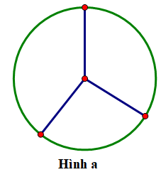

PHẦN 2. BÀI TẬP THÊM Bài 1. Thống kê khối lượng rau thu hoạch một vụ (đởn vị: tạ) của mỗi hộ gia đình trong 38 hộ gia đình tham gia chương trình trồng rau theo tiêu chuẩn VIETGAP như sau:

5 5 6 6 6 7 4 4 5 5 7 8 8

9 4 5 7 4 10 7 7 7 6 6 5 7

8 9 8 8 9 9 9 8 7 5 10 8
a) Trong 38 số liệu thống kê ở trên có bao nhiêu giá trị khác nhau?
b) Tìm tần số của mỗi giá trị đó.
c) Lập bảng tần số của mẫu số liệu thống kê trên.
Giải
a) Trong 38 số liệu thống kể ở trên có 7 giá trị khác nhau là:

1 2 3 4 5 6 7 4; 5; 6; 7; 8; 9; 10 x x x x x x x = = = = = = =

b) Tần số của giá trị
1 2 3 4 5 6 7 , , , , , , x x x x x x x lần lượt là:

1 2 3 4 5 6 7 4; 7; 5; 8; 7; 5; 2 n n n n n n n = = = = = = =

c) Bảng tần số của mẫu số liệu thống kê trên như Bảng 19 sau:
Số tạ ( ) x 4 5 6 7 8 9 10 Cộng Tần số ( ) n 4 7 5 8 7 5 2

38 N =

Bảng 19 Bài 2. Tuổi nghề (đ̛ơn vị: năm) của 32 giáo viên ở một trường trung học cơ sở được ghi lại như sau:
7 7 10 3 4 4 9 3 3 7 7 10 9 7 10 4 12 4 3 12 9 12 9 10 7 7 12 9 7 10 10 4

a) Lập bảng tần số của mẫu số liệu thống kê đó.
b) Vẽ biểu đồ tần số ở dạng biểu đồ cột của mẫu số liệu thống kê đó.
Giải
a) Bảng tần số của mẫu số liệu thống kê đó như Bảng 20 sau:
Tuổi nghề ( ) x 3 4 7 9 10 12 Cộng Tần số ( ) n 4 5 8 5 6 4

32 N =

Bảng 20
b) Biểu đồ tần số của mẫu số liệu thống kê đó như Hinh 12.

### Bài 3. Trong bài thơ "Quê hương" của tác giả Đỗ Trung Quân có hai câu thơ:

"Quê hương nếu ai không nhớ Sẽ không lớn nổi thành người".
Mẫu dữ liệu thống kê các chữ cái H;N;G;L lần lượt xuất hiện trong hai câu thơ trên là: H; N; G; N; H;
N; G; N; H; H; N; G; L; N; N; H; N; H; N; G. Lập bảng tần số tương đối của mẫu số liệu thống kê đó.
Giải Mẫu dữ liệu thống kê đó có 20 dữ liệu ( ) 20 N = và có 4 giá trị khác nhau là H;N;
G;L . Các giá trị H;N;G;L lần lượt có tần số, tần số tương đối là:
1 2 3 4 6; 9; 4; 1 n n n n = = = = ; 1 2 6 100 9.100 % 30%;
% 45% 20 20 f f ⋅ = = = = ; 3 4 4.100 1.100 % 20%;
% 5% 20 20 f f = = = = .
Bảng tần số tương đối của mẫu số liệu thống kê đó như Bảng 21 sau:
Chữ cái ( ) x H N G L Cộng Tần số tương đốí ( ) % 30 45 20 5 100

Bảng 21 Bài 4. Một công ty nông sản xuất khẩu 4 mặt hàng chủ lực là Chè (C), Hạt điều (Đ), Hạt tiêu (T), Sắn (S).
40 container hàng xuất khẩu của công ty được thông quan qua cửa khẩu quốc tế Móng Cái vào tháng 5 năm 2023 như sau:

C C C Ð Ð Ð Ð C C C T T S S S C C C Ð T T T S Ð Ð C S S S C T T Ð D T T T C C T
a) Lập bảng tần số tương đối của mẫu dữ liệu thống kê đó.
b) Vẽ biểu đồ tần số tương đối ở dạng biểu đồ cột của mẫu số liệu thống kê đó.
Giải
a) Mẫu dữ liệu thống kê đó có 40 dữ liệu (
) 40 N = và có 4 giá trị khác nhau là C,D,T,S .
Các giá trị C,D,T,S lần lượt có tần số, tần số tương đối là:

1 2 3 4 1 2 3 4 13; 9; 11; 7 13 100 9 100 % 32,5%;
% 22,5% 40 40 11 100 7 100 % 27,5%;
% 17,5% 40 40 n n n n f f f f = = = = ⋅ ⋅ = = = = ⋅ ⋅ = = = =

Bảng tần số tưởng đối của mẫu số liệu thống kê đó như Bảng 22 sau:
Mặt hàmg ( ) x

C

D

T

S Cộng Tầm số tươơng đơ̂i (%) 32,5 22,5 27,5 17,5 100

Bảng 22
b) Biểu đồ tần số tương đối ở dạng biểu đồ cột của mẫu số liệu thống kê đó như Hình 13.

Hinh 13 Bài 5. Một trường trung học cơ sở thống kê số giờ (trung bình) chơi thể thao trong một tuần của 420 học sinh. Kết quả mẫu số liệu thống kê đó được cho ở bảng tần số sau (Bảng 23):
Số giờ chơi thể thao ( ) x 8 9 10 12 Cộng Tầm số ( ) n 147 126 84 63

420 N =

Bảng 23
a) Lập bảng tần số tương đối của mẫu dữ liệu thống kê đó.
b) Vẽ biểu đồ tần số tương đối ở dạng biểu đồ cột của mẫu số liệu thống kê đó.
c) Vẽ biểu đồ tần số tương đối ở dạng biểu đồ hình quạt tròn của mẫu số liệu thống kê đó.
Giải
a) Bảng tần số tương đối của mẫu dữ liệu thống kê đó như Bảng 24 sau:
Số giờ chơi thể thao ( ) x 8 9 10 12 Cộng Tần số tương đối ( ) % 35 30 20 15 100

Bảng 24

b) Biểu đồ tần số tương đối ở dạng biểu đồ cột của mẫu số liệu thống kê đó như Hinh 14.

Hinh 14

Hinh 15
c) Biểu đồ tần số tương đối ở dạng biểu đồ hình quạt tròn của mẫu số liệu thống kê đó như Hình 15 .

### Bài 6. Điều tra phương tiện đi lại thích nhất của hai đối tượng người lớn và thiếu niên, ta có bảng sau:

Đối tượng Xe đạp Ô tô Xe buýt Cộng Thiếu niên 25 3 12 40 Người lớn 5 28 12 45 Lập biểu đồ tần số tương đối dạng hình quạt tròn thể hiện kết quả điều tra trên.

**Lời giải Tính tỉ số phần trăm số người thích từng loại phương tiện so với tổng số (người lớn hoặc thiếu niên) ta có:**

Đối tượng Xe đạp Ô tô Xe buýt Thiếu niên 25 62,5% 40 =

3 7,5% 40 =

12 30% 40 =

Người lớn 5 11,1% 45 =

28 62,2% 45 =

12 26,7% 45 =

Lập biểu đồ tần số tương đối: hình 9 .

### Bài 7. Bảng dưới đây thống kê loại quả thích nhất của một số học sinh lớp 9A và lớp 9B.

Đối tượng Táo Cam Chuối Cộng Lớp 9A 18 10 22 … Lớp 9B 20 … 12 40 Cộng … 18 … 90
a) Hãy điền tiếp số liệu vào các chỗ trống của bảng.
b) Dùng tần số tương đối, cho biết mỗi loại quả được lớp nào thích hơn.

**Lời giải**

a) Xem bảng dưới.
Đối tượng Táo Cam Chuối Cộng Lớp 9A 18 10 22 50 Lớp 9B 20 8 12 40 Cộng 38 18 34 90 b) ở lớp 9A:
Số học sinh thích táo chiếm 18 0,36 50 = .
Số học sinh thích cam chiếm 10 0,2 50 = .
Số học sinh thích chuối chiếm 22 0,44 50 = . ở lớp 9B:
Số học sinh thích táo chiếm 20 0,5 40 = .
Số học sinh thích cam chiếm 8 0,2 40 = .
Số học sinh thích chuối chiếm 12 0,3 40 = . Ta thấy: 0,36 0,5 < nên táo được lớp 9B thích hơn.

0,2 0,2 = nên cam được hai lớp thích như nhau.
0,44 0,3 > nên chuối được lớp 9 A thích hơn.

### Bài  8. Tổng điểm mà các thành viên đội tuyển Olympic Toán quốc tế (IMO - hình thức thi trực tiếp) của Việt Nam đạt được trong các năm 2008, 2009, 2010, 2011, 2012, 2013, 2014, 2015, 2016, 2017, 2018, 2019, 2020, 2022, 2023 được thống kê lần lượt như sau: 159; 161; 133; 113; 148; 180; 157; 151; 151;

155; 148; 177; 150; 196; 180.
a) Nêu các đối tượng thống kê và cho biết có bao nhiêu số liệu thống kê ở trên.
b) Trong các số liệu thống kê ở trên có bao nhiêu giá trị khác nhau?

**Lời giải**

a) - Các đối tượng thống kê là: Tổng điểm mà các thành viên đội tuyển Olympic Toán quốc tế (IMO) của
Việt Nam đạt được trong các năm 2008, 2009, 2010, 2011, 2012, 2013, 2014, 2015, 2016, 2017, 2018, 2019, 2020, 2022, 2023.
Có 15 số liệu thống kê.
b) Các số liệu thống kê đó có 12 giá trị khác nhau là:
1 2 3 4 5 6 7 8 9 10 11 12 113; 133; 148; 150; 151; 155; 157; 159; 161; 177; 180; 196 x x x x x x x x x x x x = = = = = = = = = = = =

### Bài 9. Thống kê lượng hàng bán được (đơn vị: chiếc) của 39 mặt hàng ở một siêu thị điện máy như sau:

4 7 4 5 7 9 5 10 4 8 5 8 9 9 5 10 8 4 5 7 5 10 9 4 7 4 8 9 8 4 9 8 9 5 10 5 7 10 9

a) Lập bảng tần số của mẫu số liệu thống kê đó.
b) Vẽ biểu đồ tần số ở dạng biểu đồ cột của mẫu số liệu thống kê đó.

**Lời giải a) Số chiếc ( ) x 4 5 7 8 9 10 Cộng Tầm số ( ) n 7 8 5 6 8 5 39 N =**

b) Tần số ( n )

### Bài 10. Bác An ghi lại số cuộc điện thoại bác đã gọi trong mỗi ngày của tháng 2 năm 2023 như sau:

5 5 8 7 8 7 9 10 10 7 7 5 9 5 10 8 8 7 9 7 5 10 8 8 10 9 7 10
a) Lập bảng tần số của mẫu số liệu thống kê đó.
b) Vẽ biểu đồ tần số ở dạng biểu đồ cột của mẫu số liệu thống kê đó.

**Lời giải a) Số cuộc điện thoại ( ) x 5 7 8 9 10 Cộng Tầm số (n) 5 7 6 4 6 28 N =**

b) Tà̀n số ( )
n

### Bài 11. Thống kê số quyển sách quyên góp ủng hộ thư viện nhà trường của 100 học sinh khối 9 như sau:

38 38 35 32 35 38 38 50 32 47 27 38 35 27 47 35 38 38 32 35

a) Trong 100 số liệu thống kê ở trên, có bao nhiêu giá trị khác nhau?
b) Lập bảng tần số tương đối của mẫu số liệu thống kê đó.
c) Vẽ biểu đồ tần số tương đối ở dạng biểu đồ cột của mẫu số liệu thống kê đó.

**Lời giải**

a) Trong 100 số liệu thống kê ở trên có 6 giá trị khác nhau là:
1 2 3 4 5 6 27; 32; 35; 38; 47; 50 x x x x x x = = = = = =

b)
Số quyển sách quyê̂n góp ( ) x 27 32 35 38 47 50 Cộng Tầm số tương đối (%) 15 20 25 30 5 5 100

c)

### Bài 12. Điểm kiểm tra môn Toán của 200 học sinh khối 9 được thống kê như Bảng 25 sau:

Điểm 5 6 7 8 9 10 Số học sinhh 30 40 50 35 25 20

Bảng 25
a) Lập bảng tần số tương đối của mẫu số liệu thống kê đó.
b) Vẽ biểu đồ tần số tương đối (ở dạng biểu đồ cột và biểu đồ hình quạt tròn) của mẫu số liệu thống kê
đó. Lời giải a) Điểm ( ) x 5 6 7 8 9 10 Cộng Tần số tương đối ( ) % 15 20 25 17,5 12,5 10 100

### Bài 13. Khối lượng thức ăn trung bình (đơn vị: gam) trong một ngày cho mỗi con lợn 50 kg của một số hộ gia đình được thống kê như sau:

2200 2100 2150 2100 2100 2150 2200 2100 2100 2050 2100 2200 2050 2050 2100 2100 2150 2200 2150 2200 2200 2050 2150 2100 2200 2200 2150 2100 2150 2100 2100 2200 2150 2150 2100 2200 2050 2100 2100 2150 2100 2100 2200 2150 2200 2050 2050 2200 2100 2150

a) Lập bảng tần số tương đối của mẫu số liệu thống kê đó.

b) Vẽ biểu đồ tần số tương đối (ở dạng biểu đồ cột và biểu đồ hình quạt tròn) của mẫu số liệu thống kê
đó. Lời giải a) Số gam thức ăn ( ) x 2050 2100 2150 2200 Cộng Tần số tương đối (%) 14 36 24 26 100

b)

### Bài 14. Trong bài thơ "Lượm" nổi tiếng của nhà thơ Tố Hữu có nhũng câu thơ:

"Chú bé loắt choắt Cái xắc xinh xinh Cái chân thoăn thoắt Cái đầu nghênh nghênh..." Mẫu dữ liệu thống kê các chữ cái C;N;H;T;L lần lượt xuất hiện trong những câu thơ trên là:
C; H; L; T; C;H;T;C;C;N;H ;
N;H;C;C;H;N;T;H;N;T;H ;
T; C; N; H; N; H; N; H; N; H.
a) Lập bảng tần số tương đối của mẫu dữ liệu thống kê đó.
b) Vẽ biểu đồ tần số tương đối ở dạng biểu đồ hình quạt tròn của mẫu dữ liệu thống kê đó.

**Lời giải**

a) C;N;H;T;L lần lượt có tần số là:
1 2 3 4 5 7; 8; 11; 5; 1 n n n n n = = = = = . Chữ cái ( ) x C N H T L Cộng Tầm số tượng đđối ( ) % 21,875 25 34,375 15,625 3,125 100

b)

### Bài 15. Bảng sau cho kết quả loại màu thích nhất đối với một số học sinh nam và nữ.

Đối tượng Xanh lục Xanh lơ Màu khác Nam 15 5 10 Nữ 3 16 6 Lập biểu đồ tần số tương đối dạng hình quạt tròn thể hiện các thông tin trên.

**Lời giải Tính tỉ số phần trăm số học sinh thích từng loại màu so với tổng số (nam và nữ), ta có:**

Đối tượng Xanh lục Xanh lơ Màu khác Nam 15 50% 30 =

5 16,7% 30 =

10 33,3% 30 =

Nữ 3 12% 25 =

16 64% 25 =

6 24% 25 =

Lập biểu đồ tần số tương đối: hình.

### Bài 16. Thống kê loại nhạc thích nhất của một số học sinh lớp 6 và lớp 9 , kết quả được ghi ở bảng sau.

Đối tượng Nhạc truyền thống Nhạc hiện đại Nhạc khác Cộng Lớp 6 … 13 23 … Lớp 9 7 22 … 44 Cộng 25 … 38 98
a) Hãy điền tiếp số liệu vào các chỗ trống trong bảng.
b) Dùng tần số tương đối, cho biết mỗi loại nhạc được lớp nào thích hơn.

**Lời giải**

a) Ta có bảng sau:

Đối tượng Nhạc truyền thống Nhạc hiện đại Nhạc khác Cộng Lớp 6 18 13 23 54 Lớp 9 7 22 15 44 Cộng 25 35 38 98

b) Tính tỉ số phần trăm số học sinh thích từng loại nhạc so với tổng số (lớp 6 hoặc lớp 9), ta có:
Đối tượng Nhạc truyền thống Nhạc hiện đại Nhạc khác Lớp 6 18 33,3% 54 =

13 24,1% 54 =

23 42,6% 54 =

Lớp 9 7 15,9% 44 =

22 50% 44 =

15 34,1% 44 =

33,3 15,9 > nên nhạc truyền thống được lớp 6 thích hơn.
24,1 50 < nên nhạc hiện đại được lớp 9 thích hơn.
42,6 34,1 > nên nhạc khác được lớp 6 thích hơn.

### BÀI 24. BẢNG TẦN SỐ, TẦN SỐ TƯƠNG ĐỐI GHÉP NHÓM VÀ BIỂU ĐỒ.

A. KIẾN THỨC CƠ BẢN CẦN NẮM 1. BẢNG TẦN SỐ, TẦN SỐ TƯƠNG ĐỐI GHÉP NHÓM Tìm hiểu bảng tần số ghép nhóm và bảng tần số tương đối ghép nhóm Bảng tần số ghép nhóm là bảng tần số của các nhóm số liệu:
Nhóm [ ) 1 2 ; a a

[ ) 2 3 ; a a

… [ ) 1 ; k k a a +

Tần số 1 m 2 m … k m Bảng 7.3. Bảng tần số ghép nhóm Tần số i m của nhóm [ ) 1 ; i i a a + là số giá trị của mẫu số liệu lớn hơn hoặc bằng ia và nhỏ hơn 1 ia + .
Bảng tần số tương đối ghép nhóm là bảng tần số tương đối của các nhóm số liệu:
Nhóm [ ) 1 2 ; a a

[ ] 2 3 ; a a

… [ ) 1 ; k k a a +

Tần số tương đối 1f 2f … kf Bảng 7.4. Bảng tần số tuơng đời ghép nhóm trong đó 1 k n m m = +…+ và 1 1 100% m f n = ⋅ là tần số tương đối của nhóm [ ) 1 2 ; , , a a … 100% k k m f n = ⋅ là tần số tương đối của nhóm [ ) 1 ; . k k a a +

Ví dụ 1 Đo chiều cao (đơn vị là cm ) của học sinh lớp 9C cho kết quả như sau:
156 157 164 166 166 165 157 154 155 158 160 163 163

161 162 159 159 160 160 160 159 158 160 160 158 163

162 162 162 161 162 161 163 161 163 161 164 166 165 165.
Lập bảng tần số ghép nhóm và bảng tần số tưởng đối ghép nhóm cho mẫu số liệu này với các nhóm [ ) [ ) [ ) [ ) 155;158 , 158;161 , 161;164 , 164;167 .

**Lời giải Số học sinh có chiều cao từ 150 cm đến dưới 158 cm là 5 học sinh; từ 158 cm đến dưới 161 cm là 12 học sinh; từ 161 cm đến dưới 164 cm là 15 học sinh; từ 164 cm đến dưới 167 cm là 8 học sinh. Do đó, tần số tương ứng với các nhóm là 1 2 5, 12 m m = = , 3 4 15, 8 m m = = . Ta có bảng tần số ghép nhóm như sau:**

Chiều cao ( ) cm [ ) 150;158 [ ) 158;161 [ ) 161;164 [ ) 164;167 Số học sinh 5 12 15 8 Tổng số học sinh trong lớp là 5 12 15 8 40 n = + + + = .

Tỉ lệ học sinh có chiều cao từ 150 cm đến dưới 158 cm là 5 100% 12,5% 40 ⋅ = ; từ 158 cm đến dưới 161 cm là 12 100% 30% 40 ⋅ = ; từ 161 cm đến dưới 164 cm là 15 100% 37,5% 40 ⋅ = ; từ 164 cm đến dưới 167 cm là 8 100% 20% 40 ⋅ = . Ta có bảng tần số tương đối ghép nhóm như sau:
Chiều cao (cm) [ ) 150;158 [ ) 158;161 [ ) 161;164 [ ) 164;167 Tần số tương đối 12,5%

30% 37,5%

20% Ví dụ 2 Chỉ số chất lượng không khí (AQI) cho biết tình trạng chất lượng không khí và mức độ ảnh hưởng đến sức khoẻ con người. Chất lượng không khí là Tốt nếu AQI từ 0 đến dưới 50 ; là Trung binh nếu AQI từ 50 đến dưới 100 ; là Kém nếu AQI từ 100 đến dưới 150; là Xấu nếu AQI từ 150 đến dưới 200. Chất lượng không khí tại Hà Nội từ ngày 4-2-2023 đến 5-3-2023 được cho như sau:
Trung bình, Trung bình, Trung bình, Trung bình, Trung bình, Trung bình, Trung bình, Trung bình, Kém, Kém, Kém, Kém, Xấu, Xấu, Kém, Xấu, Xấu, Xấu, Kém, Kém, Kém, Kém, Kém, Xấu, Kém, Xấu, Xấu, Xấu, Xấu, Xấu.
(Theo iqair.com) Lập bảng tần số ghép nhóm và bảng tần số tương đối ghép nhóm theo chỉ số AQI cho dãy dữ liệu trên.

**Lời giải Có 8 ngày chất lượng không khí ở múc Trung binh tương ứng với chỉ số AQI từ 50 đến dưới 100; có 11 ngày chất lượng không khí ở mức Kém tưởng ứng với chỉ số AQI từ 100 đến dưới 150; có 11 ngày chất lượng không khí ở mưc Xấu tương ứng với chỉ số AQI từ 150 đến dưới 200. Ta có bảng tần số ghép nhóm sau: Chỉ số AQI [ ) 50;100 [ ) 100;150 [ ) 150;200 Tần số 8 11 11 Tỉ lệ ngày có chất lượng không khí ở mức Trung bình là 8 100% 26,6% 30 ⋅ ≈ ; ở mức Kém là 11 100% 36,7% 30 ⋅ ≈ ; ở mức Xấu là 11 100% 36,7% 30 ⋅ ≈ . Ta có bảng tần số tương đối ghép nhóm sau:**

Chỉ số AQI [ ) 50;100 [ ) 100;150 [ ) 150;200 Tần số tương đối 26,6% 36,7% 36,7% 2. BIỂU ĐỒ TẦN SỐ TƯƠNG ĐỐI GHÉP NHÓM DẠNG CỘT Tìm hiểu về biểu đồ tần số tương đối ghép nhóm dạng cột
- Biểu đồ tần số tương đối ghép nhóm dạng cột là biểu đồ gồm các cột liền nhau để biểu diễn bảng tần số
tương đối ghép nhóm. Trong biểu đồ này, chiều cao mỗi cột biểu diễn tẩn số tương đối của nhóm số liệu.

- Để vẽ biểu đồ tần số tương đối ghép nhóm dạng cột biểu diễn bảng tần số tương đối ghép nhóm với các
nhóm số liệu có độ dài bằng nhau ta thực hiện theo các bước sau:
Bước 1. Vẽ trục đứng, trục ngang. Trên trục đứng xác định đơn vị độ dài phù hợp với các tần số tương đối. Trên trục ngang xác định các nhóm số liệu cần biểu diễn.
Bước 2. Dựng các hình cột (kề nhau) ứng với các nhóm dữ liệu, mỗi hình cột có chiều cao bằng tần số tương đối của nhóm số liệu.
Bước 3. Ghi chú giải cho các trục, các cột và tiêu đề cho biểu đồ.
- Biểu đồ tần số tương đối (tần số) ghép nhóm dạng cột còn gọi là tổ chức đồ (histogram).
Chú ý. Trong biểu đồ trên, nếu chiều cao mỗi cột biểu diễn tần số của nhóm số liệu thì ta có biểu đồ tần số ghép nhóm dạng cột.
Ví dụ 3: Vẽ biểu đổ tần số tương đối ghép nhóm dạng cột cho bảng thống kê sau về thời gian đi từ nhà tới trường của một số bạn trong lớp 9D.
Bước 2. Dựng các hình cột kề nhau ứng với các nhóm số liệu (H.7.18).

Bước 3. Ghi chú giải cho các trục, các cột và tiêu đề của biểu đồ (H.7.19).

3. BIỂU ĐỒ TẦN SỐ TƯƠNG ĐỐI GHÉP NHÓM DẠNG ĐOẠN THẲNG Cách vẽ biểu đồ tần số tương đối ghép nhóm dạng đoạn thẳng

Để vẽ biểu đồ tần số tương đối ghép nhóm dạng đoạn thẳng cho mẫu số liệu ghép nhóm, ta thực hiện theo các bước sau:
Bước 1. Chọn giá trị 1 2 i i i a a x + + = đại diện cho nhóm số liệu [ ) 1 ; i i a a + với 1,2, , i k = … .
Bước 2. Vẽ trục ngang để biểu diễn các giá trị đại diện cho các nhóm số liệu, vẽ trục đứng thể hiện tần số tương đối.
Bước 3. Với mỗi giá trị đại diện ix trên trục ngang và tần số tương đối if tương ứng, ta xác định một điểm ( ) ; i i i M x f . Nối các điểm liên tiếp với nhau.
Buớc 4. Ghi chú giải cho các trục, các điểm và tiêu đề của biểu đồ.
Chú ý. Trong cách vẽ biểu đồ trên, nếu thay tần số tương đối bằng tần số thì ta có biểu đồ tần số ghép nhóm dạng đoạn thẳng.
Ví dụ 4 Cho bảng tần số tương đối ghép nhóm sau về tuổi thọ của một loại bóng đèn.
Tuổi thọ (năm) [ ) 1;1,5 [ ) 1,5;2 [ ) 2;2,5 [ ) 2,5;3 [ ) 3;3,5 Tần số tương đối 15% 20% 30% 25% 10% Vẽ biểu đồ tần số tương đối ghép nhóm dạng đoạn thẳng cho bảng thống kê trên.

**Lời giải Bước 1. Chọn giá trị đại diện cho các nhóm số liệu ta có bảng sau:**

Tuổi thọ (năm) 1,25 1,75 2,25 2,75 3,25 Tấn số tương đối 15% 20% 30% 25% 10% Bước 2. Vẽ các trục (H.7.20).
Bước 3. Xác định các điểm, nối các điểm liên tiếp với nhau (H.7.20).

Bước 4. Ghi chú giải cho các trục, các điểm và tiêu đề của biểu đồ tần số tương đối ghép nhóm (H.7.21).

Chú ý. Trên trục ngang ta cũng có thể điền các nhóm số liệu thay cho các giá trị đại diện.
B. PHÂN LOẠI CÁC BÀI TẬP Dạng 1. Tần số ghép nhóm, tần số tương đối ghép nhóm Ví dụ 1. Giáo viên chủ nhiệm lớp 9 C đã thu được kết quả như sau: Thời gian tự học dưới 1 giờ có 10 bạn; từ 1 giờ đến dưới 2 giờ có 15 bạn; từ 2 giờ đến dưới 3 giờ có 8 bạn; từ 3 giờ đến dưới 4 giờ có 7 bạn.
Dựa vào dữ liệu dưới, hãy hoàn thiện các bảng sau vào vở:
Bảng 1 Thời gian (giờ)

[ ) 0;1 [ ) 1;2 [ ) 2;3 [ ) 3;4 Tần số

?

?

?

?

Bảng 2 Thời gian (giờ)

[ ) 0;1 [ ) 1;2 [ ) 2;3 [ ) 3;4 Tần số tương đối

?

?

?

?

Hướng dẫn: Nhóm số liệu [a; b) là nhóm gồm các số liệu lớn hơn hoặc bằng a và nhỏ hơn b .

**Lời giải Bảng 1.**

25% 37,5%

20%

17,5%

Nhận xét:
1. Bảng 1 gọi là bảng tần số ghép nhóm. Bảng 2 gọi là bảng tần số tương đối ghép nhóm. (Kết quả viết dưới dạng phần trăm).
2. Ta có thể ghi chung trong một bảng.
Bảng tần số - Tần số tương đối ghép nhóm Thời gian (giờ) [ ) 0;1 [ ) 1;2 [ ) 2;3 [ ) 3;4 Tần số 10 15 8 7 Tần số tương đối 25% 37,5%

20%

17,5% Ví dụ 2. Cho bảng tần số ghép nhóm về tuổi thọ của một số ong mật cái như sau:
Tuổi thọ (ngày) [ ) 30;40

[ ) 40;50 [ ) 50;60 Tần số 12 23 15

a) Đọc và giải thích bảng thống kê trên.
b) Lập bảng tần số tương đối ghép nhóm cho bảng thống kê này.

**Lời giải**

a) Tuổi thọ từ 30 ngày đến dưới 40 ngày là 12 con; tuổi thọ từ 40 ngày đến dưới 50 ngày là 23 con; tuổi
thọ từ 50 ngày đến dưới 60 ngày là 15 con.
b) Ta có: n 12 23 15 50 = + + = . 12 23 15
% 24%;
% 46%;
% 30% 50 50 50 = = =

b) Bảng tần số tương đối ghép nhóm.
Tuổi thọ (ngày)

[ ) 30;40 [ ) 40;50 [ ) 50;60 Tần số tương đối 24% 46%

30%

Ví dụ 3. Nhà may Hưng Thịnh tặng áo phông cho 40 học sinh lớp 9A. Nhà may đo chiều cao (đơn vị:
centimét) của cả lớp để quyết định chọn các cỡ áo khi may, kết quả như sau:

Lập bảng tần số tương đối ghép nhóm của mẫu số liệu trên.
Hướng dẫn: Ta có thể ghép các số liệu thành 5 nhóm, có độ dài bằng nhau.
Vì 174 175 < , ta có: 175 150 25 - = và 25:5 6 = [ ) [ ) [ ) [ ) [ ) 150;155 , 155;160 , 160;165 , 165;170 , 170;175 ⇒ . Lời giải Nhó m

[ ) 150;155

[ ) 155;160

[ ) 160;165

[ ) 165;170

[ ) 170;175 Tần số (n) 5 7 10 13 5 Tần số tương đối

12,5%

17,5%

25%

32,5%

12,5% Ví dụ 4. Mẫu số liệu dưới đây ghi lại tốc độ (đơn vị: km / h ) của 44 ô tô khi đi qua một trạm đo tốc độ:
48,5 43 50 55 45 60 53 55,5 44 65 54,5 51 62,5 41 44,5 57 57 68 49 46,5 53,5 49 61 49,5 54 62 59 56 47 50 59,5 61 46,5 49,5 52,5 57 47 59 55 45 47,5 48 61,5 48,5
a) Ghép các số liệu thành 6 nhóm.
b) Lập bảng tần số ghép nhóm.
Huớng dẫn:
a) Ta có số liệu có giá trị nhỏ nhất là 41 ; số liệu có giá trị lớn nhất là 68 .
Ta có 40 41,68 70 < < .70 40 30;30:6 5 - = =

b) Xem Ví dụ 3 .

**Lời giải**

a) Ta có 6 nhóm: [
) [ ) [ ) [ ) [ ) [ ) 40;45 , 45;50 , 50;55 , 55;60 , 60;65 , 65;70 .
b) Bảng tần số ghép nhóm.
Tố c độ

[ ) 40;45

[ ) 45;50

[ ) 50;55

[ ) 55;60

[ ) 60;65

[ ) 65;70 Tầ n số 4 14 8 10 6 2

Ví dụ tương tự.
Thống kê số lần truy cập Internet của 30 người trong một tuần là:

Lập bảng tần số ghép nhóm của mẫu số liệu đó sau khi được ghép nhóm theo sáu nhóm.
Hướng dẫn: Ta có 89 90,90 30 60 < - = . Ta ghép thành 6 nhóm [ ) [ ) [ ) [ ) [ ) [ ) 30;40 , 40;50 , 50;60 , 60;70 , 70;80 , 80;90 .
Ví dụ 5. Chỉ số phát triển con người (HDI) là chỉ tiêu tổng hợp phản ánh các mặt thu nhập, sức khoẻ, giáo dục của người dân trong một quốc gia. Các nước và vùng lãnh thổ trên thế giới được chia thành bốn nhóm theo HDI: Nhóm 1 (rất cao) có HDI từ 0,8 trở lên; Nhóm 2 (cao) có HDI từ 0,7 đến dưới 0,8 ; Nhóm 3 (trung bình) có HDI từ 0,55 đến dưới 0,7 ; Nhóm 4 (thấp) có HDI dưới 0,55 . Năm 2021 , chỉ số HDI của 11 quốc gia Đông Nam Á như sau:

Dựa vào dữ liệu trên, hãy hoàn thành bảng tần số ghép nhóm và bảng tần số tương đối ghép nhóm:
Chỉ số HDI

[ ) 0;0,55 [ ) 0,55;0,7 [ ) 0,7;0,8 [ ) 0,8;1,0 Tần số

Tần số tương đối

Hướng dẫn: Tần số tương đối tính theo số phần trăm. Ta có: n 11 = .
Tần số ghép nhóm của nhóm 1: [ ) 0,8;1,0 là 4. Ta có tần số tương đối ghép nhóm của nhóm 1 là:
4 36% 11 = . Lời giải Chỉ số HDI

[ ) 0;0,55

[ ) 0,55;0,7

[ ) 0,7;0,8

[ ) 0,8;1,0

Tần số 0 5 2 4 Tần số tương đối 0% 45,46% 18,18% 36,36%

Ví dụ 6. Bác Quảng ghi lại thời gian truy cập Internet của mình mỗi ngày (đơn vị: giờ) trong vòng 1 tháng như sau:

a) Lập bảng tần số ghép nhóm theo 5 nhóm: [
) [ ) [ ) [ ) [ ) 0;1 , 1;2 , 2;3 , 3;4 , 4;5 .
b) Lập bảng tần số tương đối ghép nhóm.

**Lời giải**

a) Bảng tần số ghép nhóm

b) Bảng tần số tương đối ghép nhóm.

[ ) 0;1

[ ) 1;2

[ ) 2;3

[ ) 3;4

[ ) 4;5 Tần số tương đối 10,0% 20;0% 30,0% 26,7% 13,3%

Chú ý: Tương tự như bảng tần số - tần số tương đối, ta có thể ghép được Bảng tần số ghép nhóm - tần số tương đối ghép nhóm như sau:

[ ) 0;1

[ ) 1;2

[ ) 2;3

[ ) 3;4

[ ) 4;5 Tần số 3 6 9 8 4 Tần số tương đối

10,0% 20,0% 30,0% 26,7% 13,3% Ví dụ tương tự.
Cô Loan ghi lại chiều cao (đơn vị: cm ) của các cây bạch đàn gióng vừa được chuyển đến nông trường ở bảng sau: 16,4 19 29,6 18,3 21,8 20,6 22,2 27,1 23,3 19,5 21,2 15,9 28,6 18 29,8 27,2 18,1 28,4 18,8 23,5 29,2 23,8 29,6 25 24,4 15,4 23,8 16 17,2 23,5 23,2 17 17,8 19,8 16,8 18,4 21,9 24,3 27,3 21

Hướng dẫn:
Bảng tần số ghép nhóm - tần số tương đối ghép: ( ) n 40 =

Chiều cao

[ ) 15;18 [ ) 18;21 [ ) 21;24 [ ) 24;27 [ ) 27;30 Tần số 8 9 11 3 9 Tần số tương đối

20%

22,5%

27,5% 7,5% 22,5%

Ví dụ 7. Kết quả đo chiều cao của 40 học sinh được thống kê trong bảng sau:

Theo quy định của công ty may mặc, cỡ S tương ứng với chiều cao từ 146 cm đến dưới 152 cm . Cỡ M tương ứng với chiều cao từ 152 cm đến dưới 158 cm. Cỡ L tương ứng với chiều cao từ 158 cm đến dưới 164cm . Cỡ XL tương ứng với chiều cao từ 164cm đến 170cm . Đối với 40 học sinh này, làm thế nào để xác định số quần áo cần may ở mỗi kích cỡ?
Hướng dẫn:
Cỡ S: [146; 152), Cỡ M: [152; 158), Cỡ L: [158; 164), Cỡ XL: [164; 170). Ta có n 40 = . Lời giải
a) Bảng tần số ghép nhóm - tần số tương đối ghép nhóm.
Chiều cao

[ ) 146;152 [ ) 152;158 [ ) 158;164 [ ) 164;170 Tần số 7 18 9 6 Tần số tương đối

17,5%

45%

22,5%

15%

Dạng 2. Biểu đồ tần số tương đối ghép nhóm dạng cột Ví dụ 1. Thủy thống kê lại độ dài quãng đường (đơn vị: km ) mình đi bộ mỗi ngày trong tháng Sáu ở bảng sau: Quãng đường ( ) km

[ ) 4;5 [ ) 5;6 [ ) 6;7 [ ) 7;8 [ ) 8;9 Tần số (số ngày) 6 12 8 3 1

Hãy vẽ biểu đồ tần số ghép nhóm dạng cột biểu diễn mẫu số liệu trên.
Hướng dẫn:
Trước hết, ta lập bảng tần số tương đối ghép nhóm (tính theo tỉ lệ phần trăm).

**Lời giải Bảng tần số tương đối ghép nhóm: (tháng Sáu có 30 ngày: n 30 = ).**

Quãng đường ( ) km

[ ) 4;5

[ ) 5;6

[ ) 6;7

[ ) 7;8

[ ) 8;9 Tần số (số ngày)

20,0% 40,0% 26,7% 10,0% 3,3%

Biểu đồ tần số ghép nhóm dạng cột biểu diễn mẫu số liệu:
Tần số tương đối của số ngày theo độ dài quãng đường đi được mỗi ngày

Ví dụ tương tự.
Vẽ biểu đồ tần số ghép nhóm dạng cột cho bảng thống kê sau về thời gian đi từ nhà tới trường của một số bạn trong lớp 9D.

[ ) 5;10 [ ) 10;15 [ ) 15;20 [ ) 20;25 Tần số tương đối

20%

37,5%

30% 12,5%

Hướng dẫn: (Xem hình vẽ).

Ví dụ 2. Vẽ biểu đồ tần số ghép nhóm dạng cột cho bảng sau về chiều cao của một số cây chà là giống 3 tháng tuổi. ường ( ) km ) 38 ) ;42 ) 2;46 ố ngày) % 0% 5%

**Lời giải Biểu đồ tần số tương đối ghép nhóm dạng cột:**

Ví dụ 3. Xét mẫu số liệu ghép nhóm có bảng tần số ghép nhóm sau đây:
Nhóm [ ) 10;15 [ ) 15;20 [ ) 20;25 [ ) 25;30

[ ) 30;35 Tần số 4 12 7 8 9
a) Lập bảng tần số tương đối ghép nhóm của mẫu số liệu ghép nhóm đó.
b) Vẽ biểu đồ tần số tương đối ghép nhóm dạng cột.

**Lời giải**

a) Bảng tần số ghép nhóm - tần số tương đối ghép nhóm: (
) 40 n =

Nhóm [ ) 10;15 [ ) 15;20 [ ) 20;25 [ ) 25;30

[ ) 30;35 Tần số 4 12 7 8 9 Tần số tương đối 10%

30%

17,5% 20%

22,5%

b) Xem hình vẽ.

Ví dụ 4. Sau khi thống kê độ dài (đơn vị: centimét) của 50 lá dương xỉ trưởng thành, người ta có bảng tần số ghép nhóm như sau:
Vẽ biểu đồ tần số tương đối ghép nhóm dạng biểu đồ cột.
Hướng dẫn: Lập bảng tần số tương đối ghép nhóm, tính theo phần trăm.

**Lời giải Bảng tần số ghép nhóm - tần số tương đối ghép nhóm: ( ) 50 n =**

10% 30% 17,50% 20% 22,50% 0% 5% 10% 15% 20% 25% 30% 35% 5 6 7 8 9 Tần số tương đối (%) Nhóm

Biểu đồ tần số tương đối ghép nhóm dạng cột.

Ví dụ 5. Biểu đồ bên biểu diễn tỉ lệ đại biểu tham dự hội nghị theo độ tuổi. Biết rằng có 54 dại biểu từ 25 đến 35 tuổi.
a) Có bao nhiêu đại biểu tham dự hội nghị?
b) Lập bảng tần số ghép nhóm tương ứng.
c) Một người cho rằng có trên 50% số đại biểu tham dự hội nghị dưới 45 tuổi. Nhận định đó đúng hay
sai? Tại sao?

Hướng dẫn: Nhóm [25;35) chiếm 33,75% so với tổng số đại biểu và có 54 người.
Ta có: 54:33,75% 160 = (người). Lời giải
a) Ta có: 54:33,75%
160 = (người) Tổng số đại biểu tham dự hội nghị là 160 người.
b) Từ câu a, ta tìm được số người tham dự của các nhóm. Ta có bảng tần số ghép nhóm như sau:
16% 36% 28,00% 20% 0% 5% 10% 15% 20% 25% 30% 35% 40% 20 30 40 50 Tần số tương đối (%) cm 33,75% 28,75% 26,25% 11,25% 0,00% 5,00% 10,00% 15,00% 20,00% 25,00% 30,00% 35,00% 40,00% 35 45 55 65 Tần số tương đối (%) Độ tuổi

c) 33,75%
28,75% 62,5% 50% + = > .
Nhận định trên là đúng.
Chú ý: Các Ví dụ 8 ; 9 ; 10 ; 11, em hãy đặt ra Ví dụ mới, khi biết biểu đồ tần số ghép nhóm tương đối và bổ sung số lượng n trong mỗi bài.
Dạng 3. Biểu đồ tần số tương đối ghép nhóm dạng đoạn thẳng Ví dụ 1. Cho bảng tần số tương đối ghép nhóm sau về tuổi thọ của một bóng đèn.

Vẽ biểu đồ tần số tương đối ghép nhóm dạng đoạn thẳng cho bảng thống kê trên.
Hướng dẫn: Chọn giá trị đại diện cho các nhóm.
1 1,5 1,5 2 2 2,5 2,5 3 3 3,5 1,25; 1,75; 2,25; 2,75; 3,25 2 2 2 2 2 + + + + + = = = = =

Xem phần A. Kiến thức cần nhớ.

**Lời giải Ta có bảng sau:**

Biểu đồ tần số tương đối ghép nhóm dạng đoạn thẳng

Ví dụ 2. Bảng sau thống kê chiều cao (đơn vị: mét) của các cây keo 3 năm tuổi ở một nông trường.
15,00% 20% 30,00% 25% 15,00% 0,00% 5,00% 10,00% 15,00% 20,00% 25,00% 30,00% 35,00% 1,25 1,75 2,25 2,75 3,25 Tần số tương đối (%) Tuổi thọ (năm) Tuổi thọ bóng đèn

Hãy vẽ biểu đồ tần số tương đối ghép nhóm dạng đoạn thẳng biểu diễn số liệu trên.
Hướng dẫn: Chọn giá trị đại diện cho các nhóm.
8,5 8,7 8,7 8,9 8,9 9,1 9,1 9,3 9,3 9,5 8,6; 8,8; 9,0; 9,2; 9,4 2 2 2 2 2 + + + + + = = = = =

**Lời giải Ta có bảng sau:**

Biểu đồ tần số tương đối ghép nhóm dạng đoạn thẳng.

Ví dụ 3. Bảng dưới đây được lấy từ dữ liệu do một trọng tài ghi lại về thành tích của các vận động viên nam trong cuộc thi bơi tự do dài 50 m được một trung tâm thể dục thể thao tổ chức.
Thành tích bơi tự do 50m nam

Vẽ biểu đồ tần số tương đối ghép nhóm dạng đoạn thẳng biểu diễn số liệu trên.
Hướng dẫn: - Lập bảng tần số tương đối ghép nhóm.
- Chọn các giá trị đại diện cho nhóm số liệu.
15,00% 25% 25,00% 20% 12,50% 0,00% 5,00% 10,00% 15,00% 20,00% 25,00% 30,00% 8,6 8,8 9 9,2 9,4 Tần số tương đối (%) Chiều cao (m) Tần số tương đối của số cây theo chiều cao

- Vẽ biểu đồ.
- Tần số tương đối của nhóm [
) 24;26 là 1 2 0,0625 6,25% 32 f = = = .
- Tần số tương đối của nhóm [
) 26;28 là 2 8 0,25 25% 32 f = = = .
- Tương tự với các nhóm tiếp theo:
3 10 0,3125 31,25% 32 f = = = . 4 5 10 8 4 0,25 25%;
0,125 12,5% 32 32 32 f f = = = = = =

Ta lập được bảng tần số tương đối ghép nhóm dưới đây:
Bảng tần số tuơng đối ghép nhóm thành tích bơi tư do 50m nam

**Lời giải Та со́: 24 26 26 28 28 30 30 32 32 34 25; 27; 29; 31; 33 2 2 2 2 2 + + + + + = = = = = .**

Bảng tần số tương đối ghép nhóm:

6,25% 25% 31,25% 25% 0 0,00% 5,00% 10,00% 15,00% 20,00% 25,00% 30,00% 35,00% 25 27 29 61 33 Tần số tương đối (%) Thời gian (giây)

C. GIẢI BÀI TẬP SÁCH GIÁO KHOA 7.17. Một cuộc điểu tra về thời gian dùng mạng Internet trong ngày của học sinh lớp 9 tại một thành phố cho kết quả như sau:

15% 27% 23% 18% 17%
a) Đọc và giải thích bảng thống kê trên.
b) Để thu được bảng thống kê trên, người ta đã lập phiếu điều tra và thu về tổng cộng 2000 phiếu trả lời.
Lập bảng tần số ghép nhóm cho kết quả thu được.

**Lời giải**

a) Bảng thống kê trên cho biết thông tin về thời gian dùng mạng Internet trong ngày của học sinh lớp 9 tại
một thành phố: Thời gian dùng mạng Internet trong ngày của học sinh lớp 9 từ 0 đến dưới 0,5 giờ chiếm tỉ lệ 15% , từ 0,5 giờ đến dưới 1 giờ chiếm 27% , từ 1 giờ đến dưới 1,5 giờ chiếm 23% , từ 1,5 giờ đến dưới 2 giờ chiếm 18% , từ 2 giờ đến dưới 2,5 giờ chiếm 17% .
b) Số phiếu điều tra học sinh lớp 9 dùng mạng Internet trong ngày trong thời gian từ 0 giờ đến dưới 0,5
giờ là: 2000.15% 300 = (phiếu).
Số phiếu điều tra học sinh lớp 9 dùng mạng Internet trong ngày trong thời gian từ 0,5 giờ đến dưới 1 giờ là: 2000.27% 540 = (phiếu).
Số phiếu điều tra học sinh lớp 9 dùng mạng Internet trong ngày trong thời gian từ 1 giờ đến dưới 1,5 giờ là: 2000.23% 460 = (phiếu).
Số phiếu điều tra học sinh lớp 9 dùng mạng Internet trong ngày trong thời gian từ 1,5 giờ đến dưới 2 giờ là: 2000.18% 360 = (phiếu).
Số phiếu điều tra học sinh lớp 9 dùng mạng Internet trong ngày trong thời gian từ 2 giờ đến dưới 2,5 giờ là: 2000.17% 340 = (phiếu).
Ta có bảng tần số ghép nhóm như sau:
I, V, II, III, VI, V, IV, II, III, V, VI, VII, VIII, I, I, II, VI, VII, IV.
Biết rằng theo thang Richter thì trận động đất cấp I có độ Iớn từ 1 đến dưới 3 ; cấp II và III có độ lớn từ 3 đến dưới 4 ; cấp IV và V có độ lớn từ 4 đến dưới 5 ; cấp VI và VII có độ Iớn từ 5 đến dưới 6 ; cấp VIII có độ lớn từ 6 đến dưới 6,9.
Lập bảng tần số ghép nhóm cho độ lớn các trận động đất xảy ra ở vùng này theo thang Richter.

**Lời giải Có 3 trận động đất cấp I có độ lớn từ 1 đến dưới 3;5 trận động đất cấp II và cấp III có độ lớn từ 3 đến dưới 4;5 trận động đất cấp IV và V có độ lớn từ 4 đến dưới 5;5 trận động đất cấp VI và VII có độ lớn từ 5 đến dưới 6;1 trận động đất cấp độ VIII có độ lớn từ 6 đến dưới 6,9.**

Ta có bảng tần số ghép nhóm cho độ lớn các trận động đất xảy ra ở vùng này theo thang Richter như sau:
Độ lớn động đất (Richter) [ ) 1;3 [ ) 3;4 [ ) 4;5 [ ) 5;6 [ ) 6;6,9 Tần số 3 5 5 5 1 7.19. Giáo viên ghi lại thời gian chạy cự li 100 mét của các học sinh lớp 9 A cho kết quả nhu sau:
a) Nêu các nhóm số liệu và tần số tương ứng.
b) Lập bảng tần số tương đối ghép nhóm.

**Lời giải a) Nhóm [ ) 13;15 có tần số tương ứng là 5 ;**

Nhóm [ ) 15;17 có tần số tương ứng là 20 ;
Nhóm [ ) 17;19 có tần số tương ứng là 13 ;
Nhóm [ ) 19;21 có tần số tương ứng là 2 .
b) Tổng số học sinh là: n
5 20 13 2 40 = + + + = .
Tỉ lệ học sinh chạy được từ 13 giây đến dưới 15 giây là 5 100% 12,5% 40 ⋅ = ;
Tỉ lệ học sinh chạy được từ 15 giây đến dưới 17 giây là 20 100% 50% 40 ⋅ = ;
Tỉ lệ học sinh chạy được từ 17 giây đến dưới 19 giây là 13 100% 32,5% 40 ⋅ = ;
Tỉ lệ học sinh chạy được từ 19 giây đến dưới 21 giây là 2 100% 5% 40 ⋅ = .
Ta có bảng tần số tương đối ghép nhóm như sau:
Chiều dài ( ) cm [ ) 15;16 [ ) 16;17 [ ) 17;18 [ ) 18;19 [ ) 19;20 [ ) 20;21 Số củ cà rốt 8 17 30 28 12 5 Vẽ biểu đồ tần số tương đối ghép nhóm dạng cột cho bảng thống kê trên.

**Lời giải**

- Tổng số củ cà rốt là: n
8 17 30 28 12 5 100 = + + + + + = .
Tỉ lệ số củ cà rốt có chiều dài từ 15 cm đến dưới 16 cm là 8 100% 8% 100 ⋅ = ;
Tỉ lệ số củ cà rốt có chiều dài từ 16 cm đến dưới 17 cm là 17 100% 17% 100 ⋅ = ;

Tỉ lệ số củ cà rốt có chiều dài từ 17 cm đến dưới 18 cm là 30 100% 30% 100 ⋅ = ;
Tỉ lệ số củ cà rốt có chiều dài từ 18 cm đến dưới 19 cm là 28 100% 28% 100 ⋅ = ;
Tỉ lệ số củ cà rốt có chiều dài từ 19 cm đến dưới 20 cm là 12 100% 12% 100 ⋅ = ;
Tỉ lệ số củ cà rốt có chiều dài từ 20 cm đến dưới 21 cm là 5 100% 5% 100 ⋅ = .
Ta có bảng tần số tương đối ghép nhóm sau:
Chiều dài ( ) cm [ ) 15;16 [ ) 16;17 [ ) 17;18 [ ) 18;19 [ ) 19;20 [ ) 20;21 Tần số tương đối 8% 17% 30% 28% 12% 5%

Vẽ biểu đồ tần số tương đối ghép nhóm dạng cột cho dữ liệu trên.
Bước 1. Vẽ các trục của biểu đồ, xác định đơn vị độ dài trên trục đứng, các nhóm trên trục ngang (Hình
a).
Bước 2. Dựng các hình cột kề nhau ứng với các nhóm số liệu.

Bước 3. Ghi chú giải cho các trục, các cột và tiêu đề của biểu đồ.

7.21. Thời gian chờ mua vé xem bóng đá của một số cổ động viên được cho như sau:

a) Lập bảng tần số tương đối ghép nhóm.
b) Vẽ biểu đồ tần số tương đối ghép nhóm dạng đoạn thẳng cho bảng thống kê thu được ở câu a.

**Lời giải Tổng số cổ động viên là:**

15 38 50 27 20 10 160 n = + + + + + = .
Tỉ lệ số cổ động viên có thời gian chờ từ 0 phút đến dưới 5 phút là 15 100% 9,375% 160 ⋅ = ;
Tỉ lệ số cổ động viên có thời gian chờ từ 5 phút đến dưới 10 phút là 38 100% 23,75% 160 ⋅ = ;
Tỉ lệ số cổ động viên có thời gian chờ từ 10 phút đến dưới 15 phút là 50 100% 31,25% 160 ⋅ = ;
Tỉ lệ số cổ động viên có thời gian chờ từ 15 phút đến dưới 20 phút là 27 100% 16,875% 160 ⋅ = ;
Tỉ lệ số cổ động viên có thời gian chờ từ 20 phút đến dưới 25 phút là 20 100% 12,5% 160 ⋅ = ;
Tỉ lệ số cổ động viên có thời gian chờ từ 25 phút đến dưới 30 phút là 10 100% 6,25% 160 ⋅ = .
Ta có bảng tần số tương đối ghép nhóm sau:
Bước 1. Chọn giá trị đại diện cho các nhóm số liệu ta có bảng sau:
Bước 3. Xác định các điểm, nối các điểm liên tiếp với nhau.

Bước 4. Ghi chú cho các trục, các điểm và tiêu đề của biểu đồ tần số tương đối ghép nhóm .

D. BÀI TẬP TỰ LUYỆN Câu 1: Thống kê thời gian đi từ nhà đến cơ quan (đơn vị tính là phút) của40 nhân viên một công ty được kết quả như sau:
9 12 59 47 53 5 14 32 35 40 35 10 10 4 8 20 28 23 42 44 33 39 18 20 16 25 29 27 18 17 20 23 27 29 31 41 40 40 55 50
a) Hoàn thiện bảng tần số ghép nhóm sau:
?
?
?
b) Lập bảng tần số tương đối ghép nhóm cho bảng tần số ghép nhóm thu được.

**Lời giải**

a) Có 8 nhân viên của công ty đi làm hết dưới 15 phút; 15 nhân viên đi làm hết từ 15 phút đến dưới 30
phút; 12 nhân viên đi làm hết từ 30 phút đến dưới 45 phút; 5 nhân viên đi làm hết từ 45 phút đến dưới 60 phút.
Ta có bảng tần số ghép nhóm sau:
b) Số nhân viên của công ty là
40 n = . Các tần số tương đối tương ứng là:
0 5 10 15 20 25 30 35 2,5 7,5 12,5 17,5 22,5 27,5 9,375 23,75 31,25 16,875 12,5 6,25 0 5 10 15 20 25 30 35 2,5 7,5 12,5 17,5 22,5 27,5 Tần số tương đối (%) Thời gian (phút) Thời gian chờ mua vé xem bóng đá của một số cổ động viên

1 2 8 15 .100% 20%;
.100% 37,5% 40 40 f f = = = = ; 3 4 12 5 .100% 30%;
.100% 12,5% 40 40 f f = = = =

Ta có bảng tần số tương đối ghép nhóm sau:
a) Tính tỉ lệ học sinh trong lớp dành ít nhất 6 giờ trong tuần để làm bài tập về nhà.
b) Có bao nhiêu học sinh lớp 9 A dành ít nhất 6 giờ trong tuần để làm bài tập về nhà?
c) Vẽ biểu đồ tần số tương đối ghép nhóm dạng cột biểu diễn bảng tần số tương đối ghép nhóm trên.

**Lời giải**

a) Tỉ lệ học sinh trong lớp dành ít nhất 6 giờ trong tuần để làm bài tập về nhà là:
25% 30% 10% 65%.
+ + =

b) Số học sinh lớp 9 A dành ít nhất 6 giờ trong tuần để làm bài tập về nhà là:40 65%
26 ⋅ = (học sinh).
c) Biểu đồ tần số tương đối ghép nhóm dạng cột:

### Câu 3. Bảng tần số ghép nhóm sau cho biết cân nặng của một số con voi khi vừa sinh ra (đơn vị tính là kg ):

Cân nặng (kg) [ ) 110;115 [ ) 115;120 [ ) 120;125 [ ) 125;130 Tần số 8 15 17 10
a) Đọc và giải thích dữ liệu cho bởi bảng tần số ghép nhóm trên.
b) Lập bảng tần số tương đối ghép nhóm.

**Lời giải**

a) Khi mới sinh, có 8 con voi có cân nặng từ 110 kg đến dưới 115 kg;15 con có cân nặng từ 115 kg đến
dưới 120 kg;17 con có cân nặng từ 120 kg đến dưới 125 kg;10 con có cân nặng từ 125 kg đến dưới 130 kg .

b) Tổng số con voi là
8 15 17 10 50 n = + + + = . Các tần số tương đối tương ứng là:
8 15 17 10 .100% 16%;
.100% 30%;
.100% 34%;
.100% 20% 50 50 50 50 = = = =

Ta có bảng tần số tương đối ghép nhóm sau:
Cân nặng (kg) [ ) 110;115 [ ) 115;120 [ ) 120;125 [ ) 125;130 Tần số tương đối 16% 30% 34% 20% Câu 4. Một nhóm học sinh lớp 9B thực hiện 20 lần đo hiệu điện thế và cường độ dòng điện để xác định công suất của một chiếc quạt điện và thu được bảng tần số tương đối ghép nhóm sau:
Công suất (W) [ ) 72;73 [ ) 73;74 [ ) 74;75 [ ) 75;76 [ ) 76;77 Tần số tương đối 10% 20% 30% 25% 15%
a) Đọc và giải thích thông tin của hai nhóm dữ liệu cho bởi bảng tần số tương đối ghép nhóm trên.
b) Lập bảng tần số ghép nhóm cho kết quả 20 lần đo của nhóm học sinh.

**Lời giải**

a) Nhóm [72;73) có tần số tương đối là 10% tức là có 10% số lần đo cho kết quả có giá trị từ 72 W đến
dưới 73 W. Nhóm [73; 74) có tần số tương đối là 20% tức là có 20% số lần đo cho kết quả có giá trị từ 73 W đến đưới 74 W .
b) Các tần số tương ứng là 20.10%
2;20.20% 4;20.30% 6 = = = ; 20.25% 5;20.15% 3 = = .
Ta có bảng tần số ghép nhóm sau:
Công suất (W) [ ) 72;73 [ ) 73;74 [ ) 74;75 [ ) 75;76 [ ) 76;77 Tần số 2 4 6 5 3 Câu 5. Một phòng khám đo và ghi lại huyết áp tâm thu (đơn vị tính là mmHg ) của một số người đến khám bệnh thu được kết quả như sau:
118 100 107 135 127 158 179 95 127 130 135 116 182 166 164 99 112 129 134 144 158 97 175 110 99 128 134 192 149 135 90 Theo Hiệp hội Tim mạch Hoa Kỳ, người bình thường có huyết áp tâm thu từ 90mmHg đến dưới 120mmHg , người ở dạng tiền tăng huyết áp có huyết áp tâm thu từ 120mmHg đến dưới 140mmHg ;
người bị tăng huyết áp có huyết áp tâm thu lớn hơn hoặc bằng 140mmHg .
Lập bảng tần số ghép nhóm và bảng tần số tương đối ghép nhóm cho dãy số liệu trên theo các mức bệnh huyết áp. Lời giải Bảng tần số ghép nhóm:
Mức huyết áp (mmHg) [ ) 90;120 Bình thường [ ) 120;140 Tiền tăng huyết áp Từ 140 trở lên Tăng huyết áp Tần số 11 11 9

Bảng tần số tương đối ghép nhóm:
Mức huyết áp (mmHg) [ ) 90;120 Bình thường [ ) 120;140 Tiền tăng huyết áp Từ 140 trở lên Tăng huyết áp Tần số 35,5% 35,5% 29% Câu 6. Một công ty quản lý phần mềm ứng dưng trực tuyến đã thống kê tỉ lệ người dùng phần mềm này theo dung lượng bộ nhớ dành cho lưu trữ ảnh và biểu diễn dưới dạng biểu đồ tần số tương đối ghép nhóm dạng cột như sau:

**Lời giải**

a) Nhóm [0;5) có tỉ lệ là 45% nghĩa là có 45% người dùng phần mềm ứng dụng có dung lượng bộ nhớ
dùng để lưu trữ ảnh dưới 5 GB.
b) Bảng tần số tương đối ghép nhóm:
Dung lượng (GB) [ ) 0;5 [ ) 5;10 [ ) 10;15 [ ) 15;20 Tần số tương đối 45% 30% 15% 10% Câu 7. Cho biểu đồ tần số tương đối ghép nhóm dạng đoạn thẳng sau:

a) Đọc và giải thích thông tin về hai nhóm dữ liệu được biểu diễn trên biểu đồ.
b) Lập bảng tần số tương đối ghép nhóm cho dữ liệu được biểu diễn trên biểu đồ.
c) Biết rằng công ty A có 300 người, lập bảng tần số ghép nhóm cho lương của công nhân công ty này.

**Lời giải**

a).b) Bảng tần số tương đối ghép nhóm:
Mức lương [ ) 7;10 [ ) 10;13 [ ) 13;16 [ ) 16;19 [ ) 19;22 [ ) 22;25 6% 10% 24% 30% 16% 0% 10% 20% 30% 40% [7;10) [10;13) [13;16) [16;19) [19;22) [22;25) Tỉ lệ Mức lương (triệu đồng) Lương của công nhân công ty A

(triệu đồng) Tần số tương đối 6% 10% 24% 30% 16% 14%
c) Bảng tần số ghép nhóm:
Mức lương (triệu đồng) [ ) 7;10 [ ) 10;13 [ ) 13;16 [ ) 16;19 [ ) 19;22 [ ) 22;25 Tần số 18 30 72 90 48 42 Câu 8. Bảng thống kê sau cho biết thời gian học tiếng Anh (đơn vị là năm, tính từ lúc bắt đầu học tiếng Anh đến thời điểm khảo sát) của một số học sinh lớp 9.
a) Lập bảng tần số tương đối ghép nhóm cho bảng thóng kê trên.
b) Vẽ biểu đồ tần số tương đối ghép nhóm dạng cột biểu điễn bảng tần số tương đối ghép nhóm thu được
ở câu a. Lời giải
a) Tổng số học sinh
50 n = . Các tần số tương đối tương ứng là:
8 12 15 10 5 .100% 16%;
.100% 24%;
.100% 30%;
.100% 20%;
.100% 10% 50 50 50 50 50 = = = = =

b) Biểu đồ tần số tương đối ghép nhóm dạng cột là

### Câu 9. Bảng tần số ghép nhóm sau cho biết thành tích luyện tập của một vận động viên nghiệp dư chạy maraton 42 km.

a) Lập bảng tần số tương đối ghép nhóm cho bảng thống kê trên.
b) Vẽ biểu đồ tần số tương đối ghép nhóm dạng đoạn thẳng biểu diễn bảng tần số tương đối ghép nhóm
thu được. Lời giải
a) Số vận động viên là
20 n = . Các tần số tương đối tương ứng là:
16% 24% 30% 20% 10% 0% 10% 20% 30% 40% 2 4 6 8 8 Tần số tương đối Thời gian (năm) Thời gian học tiếng Anh của học sinh

2 6 7 4 1 .100% 10%;
.100% 30%;
.100% 35%;
.100% 20%;
.100% 5% 20 20 20 20 20 = = = = =

b) Biểu đồ tần số tương đối ghép nhóm dạng đoạn thẳng:

### Câu 10. Kiểm tra khối lượng của một số bao xi măng trước khi xuất xưởng cho kết quả như sau:

Khối lượng (kg) [ ) 48,5;49 [ ) 49;49,5 [ ) 49,5;50 [ ) 50;50,5 [ ) 50,5;51 Tỉ lệ 5% 10% 35% 40% 10% Vẽ biểu đồ tần số tương đối ghép nhóm dạng cột và dạng đoạn thẳng biểu diễn dữ liệu trên.

**Lời giải Biểu đồ tần số ghép nhóm dạng cột:**

Bảng tần số tương đối ghép nhóm dạng đoạn thẳng:

10% 30% 35% 20% 5% 0% 10% 20% 30% 40% [6;6,5) [6,5;7) [7;7,5) [7,5;8) [8;8,5) Tần số tương đối Thời gian (giờ) Thành tích luyện tập chạy maraton 42km 5% 10% 35% 40% 10% 0% 10% 20% 30% 40% 50% 49 49,5 50 50,5 51 Tần số tương đối Khối lượng (kg) Khối lượng bao xi măng trước khi xuất xưởng 5% 10% 35% 40% 10% 0% 10% 20% 30% 40% 50% 49 49,5 50 50,5 51 Tần số tương đối Khối lượng (kg) Khối lượng bao xi măng trước khi xuất xưởng

ÔN TẬP CHƯƠNG V PHẦN 1. BÀI TẬP SÁCH GIÁO KHOA A. TRẮC NGHIỆM Sử dụng dữ liệu sau để trả lời các bài tập từ 7.22 đến 7.24 .
Gieo một con xúc xắc 50 lần cho kết quả như sau:
Số chấm xuất hiện 1 2 3 4 5 6 Tần số 8 7 ?
8 6 11 7.22. Tần số xuất hiện của mặt 3 chấm là A. 9 . B. 10 . C. 11 . D. 12 . Lời giải Chọn B Tần số xuất hiện của mặt 3 chấm là: 50 8 7 8 6 11 10 - - - - - =

7.23. Tần số tương đối xuất hiện của mặt 5 chấm là A. 6% .
B. 8%.
C. 12% .
D. 14% .

**Lời giải Chọn C Tần số tương đối xuất hiện của mặt 5 chấm là: 6 100% 12%.**

50 ⋅ =

7.24. Để biểu diễn bảng thống kê trên, không thể dùng loại biểu đồ nào sau đây?
A. Biểu đồ tranh.
B. Biểu đồ tần số dạng cột.
C. Biểu đồ tần số dạng đoạn thẳng.
D. Biểu đồ cột kép.

**Lời giải Chọn D Không thể dùng biểu đồ cột kép biểu diễn bảng thống kê trên vì biểu đồ cột kép dùng để biểu diễn hai dữ liệu cùng loại, mà trong trong thống kê này chỉ có 1 dãy dữ liệu.**

7.25. Cho bảng tần số tương đối ghép nhóm về thời gian đi từ nhà đến trường của học sinh lớp 9A như sau:
A. 10 . B. 15 . C. 20 . D. 30 .

**Lời giải Chọn B Giá trị nào đại diện cho nhóm số liệu [ ) 10;20 là:10 20 15. 2 + =**

B. TỰ LUẬN 7.26. Biểu đồ tần số tương đối ghép nhóm Hình 7.22 cho biết tỉ lệ chiều cao của các cây keo giống do một kĩ sư lâm nghiệp đã trồng trong nhà kính.

Lập bảng tần số tương đối ghép nhóm cho dữ liệu được biểu diễn trên biểu đồ.

**Lời giải Từ biểu đồ Hình 7.22 , ta thấy tỉ lệ cây có chiều cao từ 0 cm đến dưới 10 cm chiếm 10% ; tỉ lệ cây có chiều cao từ 10 cm đến dưới 20 cm chiếm 20% ; tỉ lệ cây có chiều cao từ 20 cm đến dưới 30 cm chiếm 40% ; tỉ lệ cây có chiều cao từ 30 cm đến dưới 40 cm chiếm 30%.**

Ta có bảng tần số tương đối ghép nhóm cho dữ liệu được biểu diễn trên biểu đồ như sau:
Chiều cao ( ) cm [ ) 0;10 [ ) 10;20 [ ) 20;30 [ ) 30;40 Tần số tương đối 10% 20% 40% 30% 7.27. Kĩ sư lâm nghiệp trên cũng trồng một số cây keo giống khác ngoài trời và thu được kết quả như sau:
Chiều cao ( ) cm

[ ) 0;10

[ ) 10;20

[ ) 20;30

[ ) 30;40 Số cây 5 9 4 2
a) Vẽ biểu đồ tần số tương đối ghép nhóm dạng cột cho bảng thống kê trên.
b) Từ biểu đồ vừa vẽ và biểu đồ cho trong bài tập 7.26 , hãy so sánh chiểu cao của các cây keo giống
được trồng trong nhà kính và trồng ngoài trời.

**Lời giải**

a) Tổng số cây là:
5 9 4 2 20 n = + + + = .
Tỉ lệ cây có chiều cao từ 0 cm đến dưới 10 cm là 5 100% 25% 20 ⋅ = ;
Tỉ lệ cây có chiều cao từ 10 cm đến dưới 20 cm là 9 100% 45% 20 ⋅ = ;

Tỉ lệ cây có chiều cao từ 20 cm đến dưới 30 cm là 4 100% 20% 20 ⋅ = ;
Tỉ lệ cây có chiều cao từ 30 cm đến dưới 40 cm là 2 100% 10% 20 ⋅ = .
Ta có bảng tần số tương đối ghép nhóm như sau:
Chiều cao ( ) cm [ ) 0;10 [ ) 10;20 [ ) 20;30 [ ) 30;40 Tần số tương đối 25% 45% 20% 10%
- Vẽ biểu đồ tần số tương đối ghép nhóm dạng cột cho bảng thống kê:
Bước 1. Vẽ các trục của biểu đồ, xác định đơn vị độ dài trên trục đứng, các nhóm trên trục ngang (Hình
a).
Bước 2. Dựng các hình cột kề nhau ứng với các nhóm số liệu

Bước 3. Ghi chú giải cho các trục, các cột và tiêu đề của biểu đồ

b) Từ biểu đồ vừa vẽ và biểu đồ cho trong bài tập 7.26 , ta thấy các cây keo giống được trồng trong nhà
kính sinh trưởng tốt hơn, cụ thể đạt được chiều cao tốt hơn các cây keo giống trồng ngoài trời. Tỉ lệ cây keo giống đạt được độ cao [ ) 20;30 và [ ) 30;40 khi trồng trong nhà kính đều lớn hơn khi trồng ngoài trời.
7.28. Tỉ lệ học sinh bình chọn cho danh hiệu cầu thủ xuất sắc nhất trong giải bóng đá của trường được cho trong bảng sau:
Cầu thủ Huy Minh An Thảo

Tỉ lệ học sinh bình chọn 30% 25% 10% 35% Biết rằng có 500 học sinh tham gia bình chọn.
a) Vẽ biểu đồ hình quạt tròn biểu diễn bảng tần số tương đối trên.
b) Lập bảng tần số biểu diễn số học sinh bình chọn cho danh hiệu cầu thủ xuất sắc nhất trong giải bóng đá
của trường. Lời giải
a) Vẽ biểu đồ hình quạt tròn biểu diễn bảng tần số tương đối trên:
Bước 1. Xác định số đo cung tương ứng của các hình quạt biểu diễn các tần số tương đối cho mỗi cầu thủ Huy: 360 30% 108 ° ° ⋅ = ;Minh: 360 25% 90 ° ° ⋅ = ;An: 360 10% 36 ° ° ⋅ = ;Thảo: 360 35% 126 ° ° ⋅ = .
Bước 2. Vẽ hình tròn và chia hình tròn thành các hình quạt.

Bước 3. Định dạng các hình quạt tròn, ghi tỉ lệ phần trăm, chú giải và tiêu đề.

b) Số học sinh bình chọn Huy là cầu thủ xuất sắc nhất là:500.30%
150 =

Số học sinh bình chọn Minh là cầu thủ xuất sắc nhất là:500.25% 125 =

Số học sinh bình chọn An là cầu thủ xuất sắc nhất là:500 10% 50 ⋅ =

Số học sinh bình chọn Thảo là cầu thủ xuất sắc nhất là:500.35% 175 =

Ta có bảng tần số biểu diễn số học sinh bình chọn cho danh hiệu cầu thủ xuất sắc nhất trong giải bóng đá của trường như sau:
30% 25% 10% 35% Tỉ lệ học sinh bình chọn cho danh hiệu cầu thủ xuất sắc nhất Huy Minh An Thảo

Cầu thủ Huy Minh An Thảo Số học sinh bình chọn 150 125 50 175 7.29. Qua đợt khám mắt, lớp 9A có 20 học sinh bị cận thị trong đó có 10 học sinh cận thị nhẹ, 8 học sinh cận thị vừa và 2 học sinh cận thị nặng. Biết rằng cận thị có số đo từ 0,25 đến dưới 3,25 dioptre là cận thị nhẹ; từ 3,25 đến dưới 6,25 dioptre là cận thị vừa; từ 6,25 đến dưới 10,25 dioptre là cận thị nặng.
a) Lập bảng tần số và bảng tần số tương đối ghép nhóm theo độ cận thị của các học sinh này.
b) Vẽ biểu đồ tần số tương đối ghép nhóm dạng đoạn thẳng cho bảng tần số tương đối ghép nhóm thu
được ở câu a.

**Lời giải**

a) - Vì có 10 học sinh có số đo từ 0,25 đến dưới 3,25 dioptre (cận thị nhẹ); 8 học sinh có số đo từ 3,25 đến
dưới 6,25 dioptre (cận thị vừa) và 2 học sinh có số đo từ 6,25 đến dưới 10,25 dioptre (cận thị nặng) nên ta có bảng tần số ghép nhóm theo độ cận thị của các học sinh này như sau:
Độ cận thị [ ) 0,25;3,25 [ ) 3,25;6,25 [ ) 6,25;10,25 Tần số 10 8 2 - Ta có 20 n = .
Tỉ lệ học sinh có độ cận thị từ 0,25 đến dưới 3,25 dioptre là: 10 100% 50% 20 ⋅ = .
Tỉ lệ học sinh có độ cận thị từ 3,25 đến dưới 6,25 dioptre là: 8 100% 40% 20 ⋅ = .
Tỉ lệ học sinh có độ cận thị từ 6,25 đến dưới 10,25 dioptre là: 2 100% 10% 20 ⋅ = .
Ta có bảng tần số tương đối ghép nhóm theo độ cận thị của các học sinh này như sau:
Độ cận thị [ ) 0,25;3,25 [ ) 3,25;6,25 [ ) 6,25;10,25 Tần số tương đối 50% 40% 10%
b) Vẽ biểu đồ tần số tương đối ghép nhóm dạng đoạn thẳng cho dữ liệu trên như sau:
Bước 1. Chọn giá trị đại diện cho các nhóm số liệu ta có bảng sau:
Độ cận thị 1,75 4,75 8,25 Tần số tương đối 50% 40% 10% Bước 2. Vẽ các trục.
Bước 3. Xác định các điểm, nối các điểm liên tiếp với nhau.

Bước 4. Ghi chú cho các trục, các điểm và tiêu đề của biểu đồ tần số tương đối ghép nhóm.

7.30. Lương của các công nhân một nhà máy được cho trong bảng sau:
Lương (triệu đồng) [ ) 5;7 [ ) 7;9 [ ) 9;11 [ ) 11;13 [ ) 13;15 Số công nhân 20 50 70 40 20
a) Nêu các nhóm số liệu và tần số. Giải thích ý nghĩa cho một nhóm số liệu và tần số của nó.
b) Vẽ biểu đồ tần số tương đối ghép nhóm dạng cột cho bảng thống kê trên.

**Lời giải**

a) Nhóm số liệu [
) 5;7 có tần số là 20 . Nghĩa là: Mức lương từ 5 triệu đồng đến dưới 7 triệu đồng có 20 công nhân. Nhóm số liệu [ ) 7;9 có tần số là 50 . Nghĩa là: Mức lương từ 7 triệu đồng đến dưới 9 triệu đồng có 50 công nhân. Nhóm số liệu [ ) 9 ; 11  có tần số là 70 . Nghĩa là: Mức lương từ 9 triệu đồng đến dưới 11 triệu đồng có 70 công nhân.Nhóm số liệu [ ) 11; 13 có tần số là 40 . Nghĩa là: Mức lương từ 11 triệu đồng đến dưới 13 triệu đồng có 40 công nhân.Nhóm số liệu [ ) 13; 15 có tần số là 20. Nghĩa là: Mức lương từ 13 triệu đồng đến dưới 16 triệu đồng có 20 công nhân.
b) Tổng số công nhân là: n
20 50 70 40 20 200 = + + + + = .
Tỉ lệ số công nhân có lương từ 5 triệu đồng đến dưới 7 triệu đồng là 20 100% 10% 200 ⋅ = ; 0 10 20 30 40 50 60 1,75 4,75 8,25 50 40 10 0 10 20 30 40 50 60 1,75 4,75 8,25 Tần số tương đối (%) Độ cận thị (dioptre) Độ cận thị của 20 học sinh lớp 9A

Tỉ lệ số công nhân có lương từ 7 triệu đồng đến dưới 9 triệu đồng là 50 100% 25% 200 ⋅ = ;
Tỉ lệ số công nhân có lương từ 9 triệu đồng đến dưới 11 triệu đồng là 70 100% 35% 200 ⋅ = ;
Tỉ lệ số công nhân có lương từ 11 triệu đồng đến dưới 13 triệu đồng là 40 100% 20% 200 ⋅ = ;
Tỉ lệ số công nhân có lương từ 13 triệu đồng đến đưới 15 triệu đồng là 20 100% 10% 200 ⋅ = .
Ta có bảng tần số tương đối ghép nhóm như sau:
Lương (triệu đồng) [ ) 5;7 [ ) 7;9 [ ) 9;11 [ ) 11;13 [ ) 13;15 Tần số tương đối 10% 25% 35% 20% 10%
- Vẽ biểu đồ tần số tương đối ghép nhóm dạng cột cho bảng thống kê:
Bước 1. Vẽ các trục của biểu đồ, xác định đơn vị độ dài trên trục đứng, các nhóm trên trục ngang.
Bước 2. Dựng các hình cột kề nhau ứng với các nhóm số liệu.

Bước 3. Ghi chú giải cho các trục, các cột và tiêu đề của biểu đồ.

PHẦN 2. BÀI TẬP THÊM A. TRẮC NGHIỆM Sử dụng dữ liệu sau để trả lời các bài tập từ 1 đến 3.
Gieo một con xúc xắc 50 lần cho kết quả như sau:

Số chấm xuất hiện 1 2 3 4 5 6 Tần số tương đối 8 7 ?
8 6 11 1. Tần số xuất hiện của mặt 3 chấm là:
A. 9. B. 10. C. 11. D. 12. Lời giải Chọn C Ta có ( ) 50 8 7 8 6 1 10 - + + + + = .
2. Tần số tương đối xuất hiện của mặt 5 chấm là:
A. 6% .
B. 8%.
C. 12% .
D. 14% .

**Lời giải Chọn C Ta có 6 % 12% 50 =**

3. Để biểu diễn bảng thống kê trên, không thể cùng loại biểu đồ nào sao đây?
A. Biểu đồ tranh.
B. Biểu đồ tần số dạng cột.
C. Biểu đồ tần số dạng đoạn thẳng.
D. Biểu đồ cột kép.

**Lời giải Chọn D 4. Cho bảng tần số tương đối ghép nhóm về thời gian đi từ nhà đến trường của học sinh lớp 9A như sau:**

A. 10. B. 15. C. 20. D. 30. Lời giải Chọn B Ta có 10 20 15 2 + =

Sử dụng dữ liệu sau để trả lời các câu hỏi từ câu 5 đến câu 7.
Dữ liệu về điểm thi học kì môn Toán của 40 học sinh lớp 9D được cho như sau:
8 7 9 8 7 6 5 3 10 9 8 7 7 8 8 9 6 5 7 10 9 8 6 8 9 10 6 7 2 8 7 6 9 10 8 8 6 5 9 7 5. Tần số xuất hiện của điểm 8 trong dãy dữ liệu trên là A. 8. B. 9. C. 10. D. 11.

**Lời giải Chọn C 6. Tần số tương đối của điểm 10 trong dãy dữ liệu trên là A. 5%.**

B. 10% .
C. 15% .
D. 20% .

**Lời giải Chọn B 7. Để biểu diễn số lượng học sinh theo điểm thi môn Toán đạt được thì ta không thể dùng biểu đồ nào?**

A. Biểu đồ cột kép.
B. Biểu đồ tần số dạng cột.
C. Biểu đồ tần số dạng đoạn thẳng.
D. Biểu đồ tranh.

**Lời giải Chọn A Sử dụng dữ liệu sau để trả lời các câu hỏi từ câu 4 đến câu 6.**

Bảng tần số tương đối ghép nhóm sau cho biết thông tin về tỉ lệ học sinh lớp 9A theo khoảng cách từ nhà đến trường: Khoảng cách (km) [ ) 0;1 [ ) 1;2 [ ) 2;3 [ ) 3;4 Tần số tương đối 25% 50% % x

10% 8. Giá trị của x là A. 10. B. 15. C. 20. D. 25. Lời giải Chọn B 9. Muốn biểu diễn bảng tần số tương đối ghép nhóm trên ta có thể dùng biểu đồ nào sau đây?
A. Biểu đồ tần số ghép nhóm.
B. Biểu đồ tần số dạng cột.
C. Biểu đồ tần số dạng đoạn thẳng.
D. Biều đồ tần số tương đối ghép nhóm.

**Lời giải Chọn D 10. Để vẽ biểu đồ tần số tương đối ghép nhóm dạng đoạn thẳng biểu diễn bảng thống kê trên ta chọn giá trị nào làm giá trị đại diện cho nhóm [ ) 2;3 ?**

A. 0,5 . B. 1,5 . C. 2,5 . D. 3,5 . Lời giải Chọn C

B. TỰ LUẬN Câu 1. Biểu đồ tần số tương đối ghép nhóm (hình vẽ) cho biết tỉ lệ chiều cao của các cây keo giống do một kỹ sư lâm nghiệp đã trồng trong nhà kính.

Lập bảng tần số tương đối ghép nhóm cho dữ liệu được biểu diễn trên biểu đồ.

**Lời giải Bảng tần số tương đối ghép nhóm:**

Nhóm [ ) 0;10 [ ) 10;20 [ ) 20;30 [ ) 30;40 Tần số tương đối 10% 20% 40% 30% Câu 2. Kĩ sư lâm nghiệp trên cũng trồng một số cây keo giống khác ngoài trời thu được kết quả như sau:
Chiều cao (cm) [ ) 0;10 [ ) 10;20 [ ) 20;30 [ ) 30;40 Số cây 5 9 4 2
a) Vẽ biểu đồ tần số tương đối ghép nhóm dạng cột cho bảng thống kê trên.
b) Từ biểu đồ vừa vẽ và biểu đồ cho trong bài 1, hãy so sánh chiều cao của các cây keo giống được trồng
trong nhà kính và trồng ngoài trời.

**Lời giải**

a) Bảng tần số tương đối ghép nhóm:
Chiều cao (cm) [ ) 0;10 [ ) 10;20 [ ) 20;30 [ ) 30;40 Tần số tương đối 25% 45% 20% 10% Dựa vào bảng trên, học sinh tự vẽ biểu đồ dạng cột. ( Xem Ví dụ 8).
b) Trồng trong nhà kính cây lớn nhanh hơn.

### Câu 3. Tỉ lệ học sinh bình chọn cho danh hiệu cầu thủ xuất sắc nhất trong giải bóng đá của trường được ghi trong bảng sau:

Cầu thủ Huy Minh An Thảo 10% 20% 40% 30% 0% 5% 10% 15% 20% 25% 30% 35% 40% 45% 10 20 30 40 Tỉ lệ Chiều cao (cm) Tỉ lệ chiều cao của các cây keo giống trồng trong nhà kính

Tỉ lệ học sinh bình chọn 30% 25% 10% 35% Biết rằng có 500 học sinh tham gia bình chọn.
a) Vẽ biểu đồ hình quạt tròn biểu diễn bảng tần số tương đối trên.
b) Lập bảng tần số biểu diễn số học sinh bình chọn cho danh hiệu cầu thủ xuất sắc nhất trong giải bóng đá
của trường. Lời giải
a) Xem hình vẽ.

Hình quạt tròn tương ứng với 30%;25%;10%;35% . Có góc ở tâm là 108 ;90 ;36 ;126 ° ° ° °
b) Bảng tần số: 500.30%
150;500.25% 125;500.10% 50;500.35% 175 = = = =

Cầu thủ Huy Minh An Thảo Tỉ lệ học sinh bình chọn 150 125 50 175 Câu 4. Qua đợt khám mắt, lớp 9 A có 20 học sinh bị cận thị trong đó có 10 học sinh cận thị nhẹ, 8 học sinh cận thị vừa và 2 học sinh cận thị nặng. Biết rằng cận thị có số đo từ 0,25 đến dưới 3,25 dioptre là cận thị nhẹ; từ 3,25 đến dưới 6,25 dioptre là cận thị vừa; từ 6,25 đến dưới 10,25 dioptre là cận thị nặng.
a) Lập bảng tần số và bảng tần số tương đối ghép nhóm theo độ cận thị của các học sinh này.
b) Vẽ biểu đồ tần số tương đối ghép nhóm dạng đoạn thẳng cho bảng tần số tương đối ghép nhóm thu
được ở câu a.

**Lời giải**

a) Bảng tần số ghép nhóm - tần số tương đối ghép nhóm:
Ta có: 10 8 2 % 50%;
% 40%;
% 10% 20 20 20 = = = ; Độ cận thị [ ) 0,25;3,25 [ ) 3,25;6,25 [ ) 6,25;10,25 Tần số 10 8 2 Tần số tương đối 50% 40% 10%
b) Em tự vẽ hình (Xem Ví dụ 13).

### Câu 5. Lương của các công nhân một nhà máy được cho trong bảng sau:

Lương (triệu đồng) [ ) 5;7 [ ) 7;9 [ ) 9;11 [ ) 11;13 [ ) 13;15 Số công nhân 20 50 70 40 20 30% 25% 10% 35%

a) Nêu các nhóm số liệu và tần số. Giải thích ý nghĩa cho một nhóm số liệu và tần số của nó.
b) Vẽ biểu đồ tần số tương đối ghép nhóm dạng cột cho bảng thống kê trên.

**Lời giải**

a) Số người có lương từ 5 triệu đồng đến dưới 7 triệu đồng là 20 người;
Số người có lương từ 7 triệu đồng đến dưới 9 triệu đồng là 50 người;
Số người có lương từ 9 triệu đồng đến dưới 11 triệu đồng là 70 người;
Số người có lương từ 11 triệu đồng đến dưới 13 triệu đồng là 40 người;
Số người có lương từ 13 triệu đồng đến dưới 15 triệu đồng là 20 người.
Các số ở dòng thứ hai chỉ tần số của bảng thống kê.
b) Xem Ví dụ 13. Học sinh tự vẽ hình.

### Câu 6. Kết thúc vòng tứ kết giải bóng đá của một trường Trung học cơ sở, có 4 đội lọt vào bán kết là các đội bóng lớp 9A, 9C, 8B và 7D. Ban tổ chức đã khảo sát học sinh trong trường với câu hỏi “Theo bạn, đội bóng nào sẽ vô địch?” với 4 phương án trả lời:

1. Đội bóng lớp 9A, 2. Đội bóng lớp 9C, 3. Đội bóng lớp 8B, 4. Đội bóng lớp 7D, và thu được 500 phản hồi với 150 lựa chọn phương án 1, 200 lựa chọn phương án 2, 50 lựa chọn phương án 3 và 100 lựa chọn phương án 4.
a) Lập bảng tần số và bảng tần số tương đối cho kết quả thu được.
b) Tìm tỉ lệ học sinh không dự đoán hai đội bóng của khối lớp 9 vô địch giải bóng đá trường.
c) Vẽ biểu đồ hình quạt tròn biểu diễn tỉ lệ học sinh dự đoán mỗi đội vô địch.

**Lời giải**

a) Bảng tần số
Đội bóng 9A 9C 8B 7D Tần số 150 200 50 100 Bảng tần số tương đối:
Đội bóng 9A 9C 8B 7D Tần số tương đối 30% 40% 10% 20%
b) 30%
c) Vẽ biểu đồ hình quạt theo các bước đã học.

### Câu 7. Biểu đồ hình quạt tròn sau đây cho biết tỉ lệ vô địch bóng đá nam SEA Games của các đội bóng trong khu vực tính đến năm 2023.

(Theo Liên đoàn Bóng đá Đông Nam Á)
a) Lập bảng tần số tương đối cho biết tỉ lệ vô địch bóng đá nam SEA Games của các quốc gia trong khu
vực.
b) Biết rằng tính đến năm 2023 môn Bóng đá nam đã được tổ chức ở 32 kì SEA Games. Lập bảng tần số
cho số lần vô địch của các đội tuyển (làm tròn số liệu đến số nguyên gần nhất).
c) Vẽ biểu đồ tần số dạng cột biểu diễn bảng tần số thu được ở câu b.
d) Đội tuyển quốc gia nào có số lần vô địch bóng đá nam SEA Games nhiều nhất, với bao nhiêu lần?

**Lời giải**

a) Bảng tần số tương đối:
Đội tuyển Thái Lan Malaysia Myanmar Việt Nam Indonesia Tần số tương đối 47% 19% 16% 9% 9%
b) Bảng tần số:
Đội tuyển Thái Lan Malaysia Myanmar Việt Nam Indonesia Tần số 15 6 5 3 3
c) Vẽ biểu đồ tần số dạng cột biểu diễn bảng tần số thu được ở câu b theo các bước đã học.
d) Thái Lan là đội vô địch bóng đá nam SEA Games nhiều lần nhất, với 15 lần.

### Câu 8. Biểu đồ sau cho biết số lượng các loại ô tô một cửa hàng bán được trong năm 2023:

47% 19% 16% 9% 9% Tỉ lệ vô địch bóng đá nam SEA Games Thái Lan Malaysia Myanmar Việt Nam Indonesia 35 20 15 10 0 10 20 30 40 Xe 4 chỗ ngồi Xe 7 chỗ ngồi Xe 16 chỗ ngồi Xe trên 16 chỗ ngồi Tần số Loại xe Số lượng xe các loại bán được năm 2023

a) Lập bảng tần số và bảng tần số tương đối cho dữ liệu được biểu diễn trên biểu đồ.
b) Vẽ biểu đồ hình quạt tròn biểu diễn bảng tần số tương đối thu được ở câu a.
c) Giả sử tỉ lệ các loại xe bán được không đổi và cửa hàng bán được tổng số 200 ô tô các loại trong năm
2024. Hãy ước lượng số ô tô 7 chỗ cửa hàng bán được.

**Lời giải**

a) Bảng tần số:
Loại xe 4 chỗ 7 chỗ 16 chỗ trên 16 chỗ Tần số 35 20 15 10 Bảng tần số tương đối:
Loại xe 4 chỗ 7 chỗ 16 chỗ trên 16 chỗ Tần số tương đối 43,75% 25% 18,75% 12,5%
b) Vẽ biểu đồ hình quạt tròn biểu diễn bảng tần số tương đối thu được ở câu a theo các bước đã học.
c) 50 xe.

### Câu 9.  Biểu đồ tần số tương đối ghép nhóm sau cho biết thành tich ném lao của các vận động viên nữ tại một giải đấu:

a) Đọc và giải thích thông tin cho hai nhóm dữ liệu được biểu diễn trên biểu đồ.
b) Lập bảng tần số tương đối ghép nhóm cho dữ liệu này.
c) Biết rằng có 40 vận động viên nữ tham dự giải. Lập bảng tần số ghép nhóm (các tần số làm tròn đến số
nguyên gần nhất).

**Lời giải**

a) Nhóm [53,5;54) có tỉ lệ là 15% nghĩa là có 15% số vận động viên nữ có thành tích ném lao từ 53,5 m
đến dưới 54 m. Nhóm [54; 54,5) có tỉ lệ 25% nghĩa là có 25% số vận động viên nữ có thành tích ném lao từ 54 m đến dưới 54,5 m.
b) Bảng tần số tương đối ghép nhóm:
Thành tích (m) [ ) 53,5;54 [ ) 54;54,5 [ ) 54,5;55 [ ) 55;55,5 [ ) 55,5;56 0% 10% 20% 30% 40% [53,5;54) [54;54,5) [54,5;55) [55;55,5) [55,5;56) Tỉ lệ Thành tích (m) Thành tích ném lao của các vận động viên nữ

Tần số tương đối 15% 25% 30% 20% 10%
c) Các tần số tương ứng với các nhóm là: 40.15%
6;40.25% 10 = = ;
40.30% 12;40.20% 8;40.10% 4 = = = . Bảng tần số ghép nhóm:
Thành tích (m) [ ) 53,5;54 [ ) 54;54,5 [ ) 54,5;55 [ ) 55;55,5 [ ) 55,5;56 Tần số 6 10 12 8 4 Câu 10. Thành tích ném lao của 40 vận động viên nam trong giải thể thao trên được cho như sau:
Thành tích (m) [ ) 70,5;71 [ ) 71;71,5 [ ) 71,5;72 [ ) 72;72,5 [ ) 72,5;73 [ ) 73;73,5 Số vận động viên 2 5 7 15 8 3
a) Lập bảng tần số tương đối ghép nhóm.
b) Vẽ biểu đồ tần số tương đối ghép nhóm dạng cột biểu diễn bảng tần số tương đối ghép nhóm thu được
ở câu a.
c) Từ biểu đồ thu được ở câu b và biểu đồ cho trong bài tập 7.28, hãy nhận xét về thành tích ném lao của
các vận động viên nam và nữ.

**Lời giải**

a) Bảng tần số tương đối ghép nhóm:
Thành tích (m) [ ) 70,5;71 [ ) 71;71,5 [ ) 71,5;72 [ ) 72;72,5 [ ) 72,5;73 [ ) 73;73,5 Tần số tương đối 5% 12,5% 17,5% 37,5% 20% 7,5%
b) Vẽ biểu đồ tần số tương đối ghép nhóm dạng cột biểu diễn bảng tần số tương đối ghép nhóm thu được
ở câu a theo các bước đã học.
c) Thành tích ném lao của vận động viên nam cao hơn của vận động viên nữ.

### Câu 11. Dữ liệu dưới đây cho biết cỡ giày của một nhóm 30 học sinh tại trường Trung học cơ sở C:

32 33 36 34 33 32 36 34 35 34 32 33 34 36 35 34 34 34 34 34 35 34 35 33 34 34 34 35 33 34
a) Lập bảng tần số cho dãy dữ liệu trên. Cỡ giày nào phù hợp với nhiều bạn nhất?
b) Lập bảng tần số tương đối cho dãy dữ liệu trên. Chọn ngẫu nhiên một học sinh trường Trung học cơ sở
C, hãy ước lượng xác suất để học sinh này đi giày cỡ 34 .
c) Bảng sau quy định cỡ giày theo chiều dài của bàn chân:
Chiều dài bàn chân (cm) [ ) 19;19,4 [ ) 19,4;19,7 [ ) 19,7;20,6 [ ) 20,6;21,6 [ ) 21,6;22,2 Cỡ giày 32 33 34 35 36 Lập bảng tần số và bảng tần số tương đối ghép nhóm theo chiều dài bàn chân của nhóm học sinh trên.

**Lời giải**

a) Bảng tần số:
Cỡ giày 32 33 34 35 36 Tần số 3 5 13 6 3 Cỡ giày 34 phù hợp với nhiều bạn nhất.
b) Bảng tần số tương đối:
Cỡ giày 32 33 34 35 36 Tần số tương đối 10% 16,7% 43,3% 20% 10% Ước lượng xác suất để một học sinh đi giày cỡ 34 là 43,3%.
c) Bảng tần số ghép nhóm theo chiều dài bàn chân là:
Chiều dài bàn chân (cm) [ ) 19;19,4 [ ) 19,4;19,7 [ ) 19,7;20,6 [ ) 20,6;21,6 [ ) 21,6;22,2 Tần số 3 5 13 6 3 Bảng tần số tương đối ghép nhóm theo chiều dài bàn chân:
Chiều dài bàn chân (cm) [ ) 19;19,4 [ ) 19,4;19,7 [ ) 19,7;20,6 [ ) 20,6;21,6 [ ) 21,6;22,2 Tần số tương đối 10% 16,7% 43,3% 20% 10%
