# Chuyen De Hinh Thuc Te Non Tru Cau

Chương 5. Chuyên đềhình thực tếnón, trụ, cầu Trang 198 CHUYÊN ĐỀHÌNH THỰC TẾNÓN, TRỤ, CẦU 9 CHUYÊN ĐỀHÌNH THỰC TẾNÓN, TRỤ, CẦU ÔN THI VÀO 10 HÀ NỘI Chương 5 §1. BÀI TẬP TỔNG HỢP NÓN TRỤCẦU K9 - CHƯƠNG 5 Àinh Viïåt:
The Best or Nothing Hoå vaâ tïn hoåc sinh:
Lúáp: A. LÝ THUYẾT 1 Hình trụ 1 1.1. Khái niệm ○Khi quay hình chữnhật O′ABO một vòng quanh OO′ cốđịnh thì ta được một hình trụ(Hình
2), trong đó
— Hai đáy của hình trụlà hai hình tròn bằng nhau (O′; O′A) và (O; OB).
— Mỗi đường sinh là một vịtrí của AB khi quay. Vậy hình trụcó vô sốđường sinh. R = O′A = OB gọi là bán kính đáy của hình trụ.
— Độdài của đoạn OO′ gọi là chiều cao của hình trụ. Các đường sinh bằng nhau và bằng OO′.
SỮA ĐẶC a) D C O O′ A B R Đáy Đường sinh Bán kính đáy b) Hình 1 O O′ A B O O′ A B Hình 2 Một sốyếu tốcủa hình trụ ○Chiều cao h = O′O.
○Bán kính đáy R = OB.
○Đường sinh l = AB.
A B O O′ h R l ™ Hồng Hà, Đan Phượng, Hà Nội Đinh Việt h

1. Bài tập tổng hợp nón trụcầu 199 Trang o Từmột hình trụ, nếu ta cắt rời hai đáy và cắt theo một đường sinh nào đó rồi trải phẳng ra thì ta được một hình phẳng (gồm hai hình tròn và một hình chữnhật) như hình bên dưới gọi là hình khai triển của hình trụđã cho.
A B A B 1 1.2. Diện tích xung quanh của hình trụ Cho hình trụcó bán kính đáy R và chiều cao h. Khi đó ○Diện tích xung quanh Sxq = 2πRh.
○Diện tích toàn phần bằng tổng diện tích xung quanh và diện tích hai đáy:
Stp = 2πRh + 2πR2.
1 1.3. Thểtích của hình trụ Thểtích V của hình trụcó bán kính đáy R và chiều cao h là:
V = S · h = πR2h (S là diện tích đáy của hình trụ).
2 Hình nón 1 2.1. Khái niệm ○Một sốyếu tốcủa hình nón được thểhiện trên Hình 3b.
A B O S R Đỉnh Đường cao Đường sinh Đáy Bán kính đáy Hình 3b ○Khi quay tam giác vuông SOA (vuông ởO) một vòng quanh SO cốđịnh thì ta được một hình nón đỉnh S, trong đó ™ Hồng Hà, Đan Phượng, Hà Nội Đinh Việt h

Chương 5. Chuyên đềhình thực tếnón, trụ, cầu Trang 200 — Đáy của hình nón là hình tròn (O; OA), R = OA gọi là bán kính đáy của hình nón.
— Mỗi đường sinh là một vịtrí của SA khi quay. Vậy hình nón có vô sốđường sinh dài bằng nhau.
— SO gọi là đường cao của hình nón. Độdài đoạn SO được gọi là chiều cao của hình nón.
A O S O S A Một sốyếu tốcủa hình nón ○Đỉnh S.
○Chiều cao h = SO.
○Đường sinh l = SA = SB.
○Bán kính đáy R = OA.
A B O S l h R o
- Độdài đường sinh l của hình nón được tính bởi công thức l =
√ r2 + h2.
- Cho một hình nón. Nếu ta cắt rời đáy và cắt mặt xung quanh của nó theo đường sinh SA
rồi trải phẳng ra thì được một hình phẳng (gồm một hình tròn và một hình quạt tròn) như hình dưới gọi là hình khai triển của hình nón đã cho.
A O S l A O S B 1 2.2. Diện tích xung quanh của hình nón ○Diện tích xung quanh Sxq của hình nón có bán kính đáy r, độdài đường sinh l là Sxq = πrl.
○Diện tích toàn phần của hình nón bằng tổng diện tích xung quanh và diện tích đáy.
Stp = πrl + πr2 1 2.3. Thểtích của hình nón Thểtích V của hình nón có bán kính đáy r và chiều cao h là:
V = 1 3Sh = 1 3πr2h.
(S là diện tích đáy của hình nón).
™ Hồng Hà, Đan Phượng, Hà Nội Đinh Việt h

1. Bài tập tổng hợp nón trụcầu 201 Trang 3 Mặt cầu và hình cầu 1 3.1. Khái niệm ○Khi quay nửa đường tròn quanh đường kính AB cốđịnh của nó, ta được một mặt cầu.
Khi quay nửa hình tròn quanh đường kính AB cốđịnh của nó, ta được một hình cầu.
Tâm và bán kính của nửa đường tròn (hình tròn) cũng là tâm và bán kính của mặt cầu (hình cầu). a) O A B b) Bán kính Tâm A B O M Một sốyếu tốcủa mặt cầu:
Tâm mặt cầu: O.
Bán kính mặt cầu: R = OB R A B O ○Nếu cắt một hình cầu bởi một mặt phẳng thì phần chung của mặt phẳng và hình cầu (còn gọi là mặt cắt) là một hình tròn.
○Nếu cắt một mặt cầu bán kính R bởi một mặt phẳng thì phần chung của mặt phẳng và mặt cầu là một đường tròn.
— Khi mặt phẳng đi qua tâm thì đường tròn đó có bán kính R và được gọi là đường tròn lớn.
— Khi mặt phẳng không đi qua tâm thì đường tròn đó có bán kính nhỏhơn R. R O 1 3.2. Diện tích mặt cầu và thểtích hình cầu Người ta chứng minh được công thức tính diện tích mặt cầu và thểtích hình cầu có bán kính R là:
S = 4πR2 V = 4 3πR3. R 4 Một sốđơn vịhay dùng ○Độdài: 1 m = 10 dm = 100 cm = 1000 mm ○Diện tích: 1 m2 = 100 dm2 = 10000 cm2 ○Thểtích: 1 m3 = 1000 dm3 = 1000000 cm3 ™ Hồng Hà, Đan Phượng, Hà Nội Đinh Việt h

Chương 5. Chuyên đềhình thực tếnón, trụ, cầu Trang 202 5 Các kiến thức bổtrợ 1 5.1. Hình hộp chữnhật, Hình lập phương Đại lượng Hình hộp chữnhật Hình lập phương Ký hiệu cạnh Chiều dài: a Chiều rộng: b Chiều cao: c Cạnh: a Diện tích mặt đáy Sđáy = a × b Smặt = a2 Diện tích mặt trước Strước = a × c Smặt = a2 Diện tích mặt bên Sbên = b × c Smặt = a2 Diện tích xung quanh Sxq = 2c(a + b) Sxq = 4a2 Diện tích toàn phần Stp = 2(ab + bc + ac) Stp = 6a2 Thểtích V = a × b × c V = a3 Đường chéo d = √ a2 + b2 + c2 d = a √ 3 1 5.2. Bài toán thảvật vào — nước dâng lên Nguyên lý cơ bản: Nếu vật chìm hoàn toàn hoặc một phần, thểtích nước dâng lên bằng thểtích phần vật bịngập trong nước.
Công thức:
Vnước dâng = Vphần vật chìm trong nước Ngoài ra có thểtư duy như công thức sau:
Vnước dâng = Vsau -Vtrước Công thức tính độcao nước dâng Nếu biết diện tích đáy bình chứa là S, thểtích nước dâng là V , thì chiều cao mực nước dâng thêm:
∆h = V S Trong đó:
○∆h là chiều cao nước dâng lên.
○V là thểtích nước dâng (bằng thểtích phần vật chìm).
○S là diện tích mặt đáy của bình.
™ Hồng Hà, Đan Phượng, Hà Nội Đinh Việt h

1. Bài tập tổng hợp nón trụcầu 203 Trang B. BÀI TẬP RÈN LUYỆN  CÂU 1 Vòng đệm có bềmặt là một hình vành khuyên. Tính diện tích bềmặt (một mặt) của chiếc long đen này biết rằng bán kính của hai đường tròn đồng tâm lần lượt bằng 2 cm và 3 cm. (Lấy π ≈3, 14).
Đáp án: 15,7 cm2.
 CÂU 2 Ngày 4 - 6 - 1783, anh em nhà Mông-gôn-fi-ê (người Pháp) phát minh ra khinh khí cầu dùng không khí nóng. Coi khinh khí cầu này là hình cầu có đường kính 11 m và được làm bằng vải dù. Hãy tính diện tích vải dù đểlàm khinh khí cầu đó.
Đáp án: 121π.
 CÂU 3 Một quảbàn có dạng hình cầu với đường kính bằng 4 cm.
a) Tính bán kính của quảbóng bàn.
b) Người ta tiến hành sơn phủbềmặt của quảbóng bàn. Tính diện tích bềmặt được sơn của
quảbóng bàn đó (lấy π ≈3, 14).
Đáp án: R = 2 cm, S = 50, 25 cm3.
 CÂU 4 Một Téc nước hình trụtròn có bán kính 60 cm, chiều cao 220 cm. Lấy π ≈3, 14.
a) Diện tích Inox cần làm ra cái Téc nước (có nắp) là bao nhiêu mét vuông (giảsửphần nắp
cong không đáng kể)?
b) Khi Téc nước hình trụchứa đầy nước thì được bao nhiêu lít?
Đáp án: 105504 (cm2), 2484, 7 (lít)  CÂU 5 Gia đình bạn Khánh đang sửdụng một thùng đựng nước dạng hình trụvới bán kính đáy bằng 50 cm và chiều cao bằng 150 cm. Thùng đựng nước được đặt thẳng đứng trên mặt sàn như hình minh hoạbên. (Lấy π ≈3, 14 và coi chiều dày của thùng không đáng kể).
a) Tính diện tích xung quanh của thùng đựng nước.
b) Sau một thời gian gia đình bạn Khánh sửdụng nước trong thùng thì mực nước còn lại đã thấp
hơn 40 cm so với mực nước ban đầu. Tính thểtích nước trong thùng mà gia đình bạn Khánh đã sửdụng trong khoảng thời gian đó.
™ Hồng Hà, Đan Phượng, Hà Nội Đinh Việt h

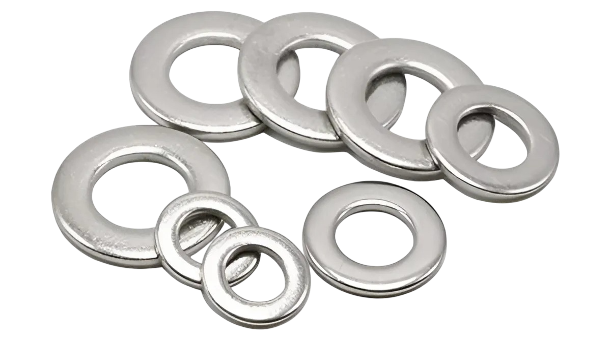

Chương 5. Chuyên đềhình thực tếnón, trụ, cầu Trang 204 Đáp án: Sxq ≈47100 cm2, V ≈314000 cm3.
 CÂU 6 Một lọthuốc hình trụcó chiều cao 10 cm và đường kính đáy bằng 8 cm. Nhà sản xuất phủkín xung quanh của lọthuốc bằng giấy in các thông tin và hướng dẫn sửdụng vềloại thuốc ấy. Em hãy tính diện tích phần giấy cần dùng của lọthuốc. (Biết phần mép dán không đáng kểvà lấy π ≈3, 14).
Đáp án: 251,2 cm2  CÂU 7 Công ty sữa Vinamilk chuyên sản xuất sữa Ông Thọ, hộp sữa dạng hình trụcó đường kính là 7 cm, chiều cao là 8 cm. Lấy π ≈3, 14.
a) Tính thểtích của hộp sữa đó.
b) Tính diện tích giấy làm nhãn mác cho 12 hộp sữa cùng loại trên. Biết nhãn dán kín phần thân
hộp sữa vẽvà không tính phần mép dán.
Đáp án: V ≈307, 72 cm3, S ≈2110, 08 cm2  CÂU 8 Một hộp sữa có dạng hình trụvới đường kính đáy 8 cm và chiều cao của hộp sữa gấp đôi bán kính đáy.
a) Tính bán kính đáy của hộp sữa.
b) Tính thểtích lượng sữa chứa bên trong hộp. Biết rằng đểđảm bảo chất lượng khi đóng gói và
vận chuyển, lượng sữa trong hộp chỉchiếm 85% thểtích hộp sữa (bỏqua bềdày của hộp sữa, lấy π ≈3, 14, kết quảlàm tròn đến sốthập phân thứnhất).
Đáp án: R = 4 cm, V ≈341, 6 cm3.
 CÂU 9 Một hộp đựng chè hình trụcó đường kính đáy bằng 8 cm và chiều cao bằng 12 cm. Lấy π = 3, 14
a) Tính thểtích của hộp.
b) Tính diện tích giấy carton đểlàm một hộp chè đó, biết tỉlệgiấy carton hao hụt khi làm một
hộp chè là 5%.
Đáp án: V = 602, 88 cm3, S = 422, 016 cm2.
 CÂU 10 Một bóng đèn huỳnh quang có dạng hình trụđược đặt khít vào một hộp giấy cứng dạng hình hộp chữnhật. Hộp giấy có chiều dài bằng 0,6 m, đáy là hình vuông cạnh 4 cm. Tính diện tích xung quanh và thểtích của bóng đèn (giảsửbềdày của hộp giấy không đáng kể).
Đáp án: Sxq = 240π cm2, V = 240π cm3.
™ Hồng Hà, Đan Phượng, Hà Nội Đinh Việt h

1. Bài tập tổng hợp nón trụcầu 205 Trang  CÂU 11 Một khúc gỗcó dạng hình trụvới bán kính đáy 10 cm và chiều cao gấp đôi đường kính đáy.
a) Tính chiều cao của khúc gỗ.
b) Biết 1 m3 gỗcó khối lượng 1 000 kg. Hỏi khúc gỗnặng bao nhiêu kilogam? (Lấy π ≈3, 14).
Đáp án: h = 40 cm, nặng 12,56 kg  CÂU 12 Có hai lọthủy tinh hình trụ, lọthứnhất phía bên trong có đường kính đáy là 15 cm, chiều cao 10 cm, đựng đầy nước. Lọthứhai bên trong có đường kính đáy là 20 cm, chiều cao 6 cm.
a) Tính thểtích lượng nước được chứa trong lọthứnhất.
b) Nếu đổhết nước từtrong lọthứnhất sang lọthứhai, nước có bịtràn ra ngoài không, tại sao?
Đáp án: V1 = 562, 5π, không tràn.
 CÂU 13 Một lon coca hình trụcó chiều cao là 11,7 cm, bán kính đáy bằng 3 cm.
a) Tính thểtích của một lon coca (lấy π ≈3, 14 và làm tròn kết quảđến chữsốthập phân thứ
hai).
b) Hỏi 5 lon coca như vậy có thểđổđầy một chai có thểtích 1,5 lít không?
Đáp án: V ≈330, 64 cm3, có thểđổđầy  CÂU 14 Cốc đựng kem có dạng hình nón với bềdày không đáng kể, chiều cao bằng 10 cm, đường kính miệng cốc bằng 6 cm. Kem được đổđầy vào cốc mà không tràn ra ngoài. Lấy π ≈3, 14
a) Tính thểtích của lượng kem trong cốc.
b) Cơ sởsản xuất muốn cho thêm kem lên trên miệng cốc như hình vẽbên dưới. Biết lượng kem
thêm đó bằng 10% lượng kem trong cốc. Đểlàm được 1500 chiếc kem đó thì cơ sởsản xuất cần phải chuẩn bịmột lượng kem là bao nhiêu centimet khối? (Kết quảlàm tròn đến hàng đơn vị).
™ Hồng Hà, Đan Phượng, Hà Nội Đinh Việt h

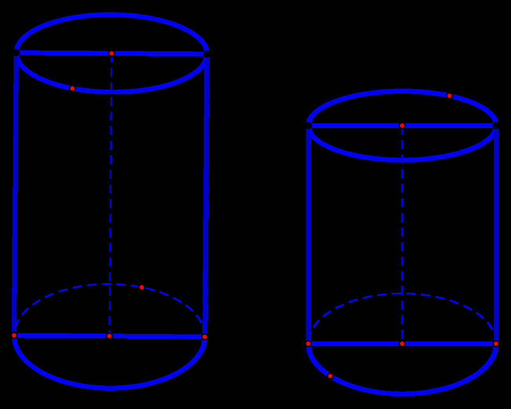

Chương 5. Chuyên đềhình thực tếnón, trụ, cầu Trang 206 Đáp án: V ≈94, 2 cm3, cần chuẩn bị155430 cm3  CÂU 15 Một lon nước dạng hình trụcó thểtích bằng 108π cm3. Biết chiều cao của lon nước gấp bốn lần bán kính đáy.
a) Tính bán kính đáy và chiều cao của lon nước.
b) Người ta sơn tĩnh điện bên ngoài vỏlon, không sơn hai đáy. Tính diện tích phần được sơn (bỏ
qua bềdày vỏlon và phần ghép nối).
Đáp án: R = 3 cm, S = 72π cm2.
 CÂU 16 Một bồn nước inox có dạng một hình trụvới chiều cao 1,75 m và diện tích đáy là 0,32 m2.
a) Hỏi bồn nước này đựng đầy được bao nhiêu mét khối nước? (Bỏqua bềdày của bồn nước).
b) Nếu người ta đổ5 can 30 lít vào bồn thì chiều cao của cột nước là bao nhiêu m (kết quảlàm
tròn đến hàng phần trăm)?
Đáp án: 0, 24 mét khối và 0, 47 m.
 CÂU 17 Một chiếc nón lá có dạng hình nón với bán kính là 0, 25 m, chiều cao 0, 3 m như hình bên. Lấy π = 3, 14 và các kết quảlàm tròn đến hàng phần trăm.
™ Hồng Hà, Đan Phượng, Hà Nội Đinh Việt h

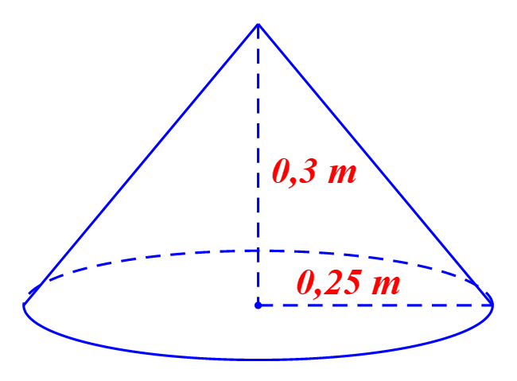

1. Bài tập tổng hợp nón trụcầu 207 Trang
a) Tính diện tích xung quanh của hình nón trên.
b) Biết cứ1 kg lá nón có thểlàm ra sốnón có tổng diện tích xung quanh là 6, 13 m2. Hỏi sốkg
lá nón cần dùng đểlàm được 1 chiếc nón lá trên? .
Đáp án: Sxq ≈0, 31 m3 và 0, 05 kg lá.
 CÂU 18 Bạn Việt đo đường kính của một chai đựng nước bằng 6 cm, chiều cao của phần nước hình trụtrong chai là 9 cm (Hình a). Khi lật ngược chai và đo chiều cao của phần hình trụkhông chứa nước được 7 cm (Hình b). Giảsửđộdày của vỏchai không đáng kể.
a) Tính thểtích lượng nước ởtrong chai.
b) Tính thểtích của chai nước trên.
Đáp án: 81π và 144π.
 CÂU 19 Một thùng nước bằng tôn có dạng hình trụvới đường kính đáy và chiều cao đều bằng 0,8 m.
a) Tính bán kính đáy của thùng nước.
b) Người ta mởmột vòi nước chảy vào bể(ban đầu bểkhông có nước). Biết mỗi phút, vòi chảy
được 10 lít nước. Hỏi sau bao lâu thì bểđầy nước? (Bỏqua độdày của thùng nước, lấy π ≈3, 14).
Đáp án: R = 0, 4 m, 40, 2 phút.
 CÂU 20 Một bồn chứa xăng bằng thép không gỉgồm hai đầu là hai nửa hình cầu và phần thân là một hình trụ(như hình bên). Đường kính của hình cầu và đường kính đáy hình trụđều bằng 18 dm, chiều cao của hình trụlà 36 dm (kích thước đo bên ngoài bồn chứa).Lấy π ≈3, 14.
™ Hồng Hà, Đan Phượng, Hà Nội Đinh Việt h

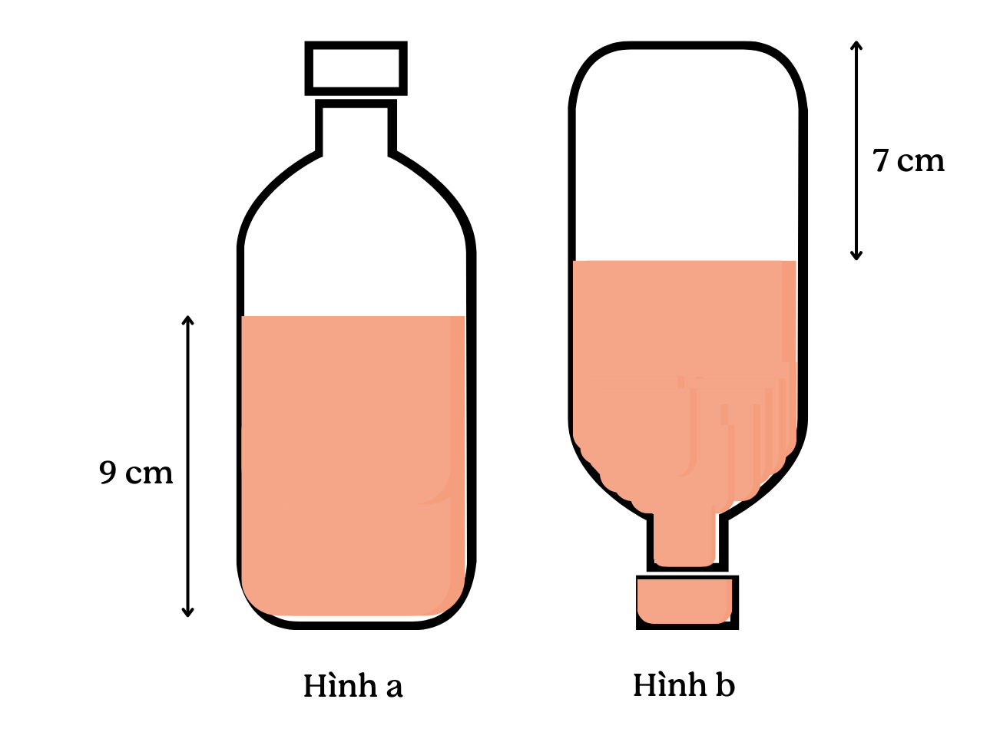

Chương 5. Chuyên đềhình thực tếnón, trụ, cầu Trang 208
a) Tính diện tích bềmặt của bồn chứa xăng.
b) Hỏi bồn chứa được tối đa bao nhiêu lít xăng? Biết thểtích của vật liệu làm vỏvà bệtrong
bồn chứa là 200 dm3 (lấy ).
Đáp án: S = 3053, 04 dm, 12018, 88 lít xăng.
 CÂU 21 Một hộp đựng bóng tennis có dạng hình trụchứa vừa khít 3 quảbóng tennis xếp theo chiều dọc như hình bên. Các quảbóng có dạng hình cầu, đường kính 6, 5 cm. Lấy π ≈3, 14 và làm tròn các kết quảđến hàng đơn vị
a) Tính thểtích của mỗi quảbóng.
b) Tính diện tích xung quanh của hộp bóng ().
Đáp án: V ≈144 cm3, Sxq ≈398 cm2.
 CÂU 22 Một hộp đựng bóng tennis có dạng hình trụchứa vừa khít 3 quảbóng tennis xếp theo chiều dọc như hình bên. Các quảbóng có dạng hình cầu, đường kính 5 cm. Bỏqua bềdày của vỏhộp, lấy π ≈3, 14 ™ Hồng Hà, Đan Phượng, Hà Nội Đinh Việt h

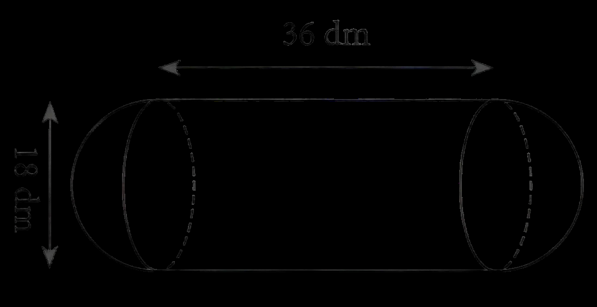

1. Bài tập tổng hợp nón trụcầu 209 Trang
a) Tính thểtích hộp đựng bóng.
b) Tính thểtích bên trong hộp đựng bóng không bịchiếm bởi 3 quảbóng tennis.
Đáp án: Vhộp = 294, 375 cm3, VKK = 98, 125 cm3.
 CÂU 23 Một công ty thiết kếmẫu hộp đựng làm từbìa mỏng dạng hình hộp chữnhật đểđóng gói 6 quả bóng bàn có thông sốkĩ thuật 40 (đường kính bóng là 40 mm).
a) Tính diện tích xung quanh của hộp (theo đơn vịcm2) biết rằng đáy hộp là hình vuông cạnh
40 mm và chiều cao của hộp vừa đủđểxếp khít 6 quảbóng bàn.
b) Tính thểtích phần không gian trống của hộp (theo đơn vịcm3) khi chứa 6 quảbóng bàn (Lấy
π ≈3, 14, kết quảlàm tròn đến hàng phần mười).
Đáp án: Sxq = 224 cm2, V ≈183, 0 cm3.
 CÂU 24 Một lon nước ngọt có dạng hình trụvới chiều cao 14 cm, đường kính đáy là 6 cm. Lấy π ≈3, 14.
a) Tính thểtích của lon nước ngọt.
b) Nhà sản xuất thường sản xuất các lốc nước ngọt gồm 6 lon được đặt sát vào nhau vừa khít
trong một thùng carton có dạng hình hộp chữnhật (tính cảnắp) đểlàm quà tặng (hình bên).
Tính diện tích giấy đểlàm thùng carton (coi diện tích các mép dán là không đáng kể).
™ Hồng Hà, Đan Phượng, Hà Nội Đinh Việt h

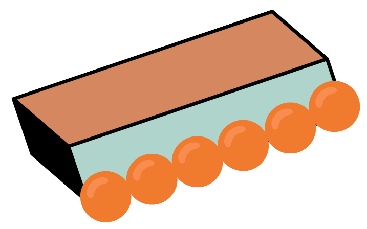

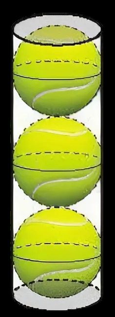

Chương 5. Chuyên đềhình thực tếnón, trụ, cầu Trang 210 Đáp án: V ≈395, 64 cm3, S = 1272 cm2  CÂU 25 Bềmặt của thớt gỗcó dạng hình tròn với đường kính 34 cm. Lấy π ≈3, 14.
a) Tính tổng diện tích hai mặt thớt.
b) Biết rằng 1 gam bột baking soda có thểlàm sạch được diện tích 50 cm2. Hỏi cần ít nhất bao
nhiêu gam bột baking soda đểlàm sạch cảhai mặt của thớt? Kết quảlàm tròn đến hàng phần mười).
Đáp án: S ≈1814, 92 cm2, 36, 3 gam.
 CÂU 26 Một khúc gỗcó dạng hình trụ, chiều cao 1, 5 m, đường kính đáy bằng 40 cm. Lấy π ≈3, 14.
a) Tính thểtích của khúc gỗ.
b) Nếu mỗi mét khối gỗgiá 8 triệu đồng thì khúc gỗnày giá bao nhiêu tiền?
Đáp án: V ≈0, 1884 m3, 1 507 200 đồng ™ Hồng Hà, Đan Phượng, Hà Nội Đinh Việt h

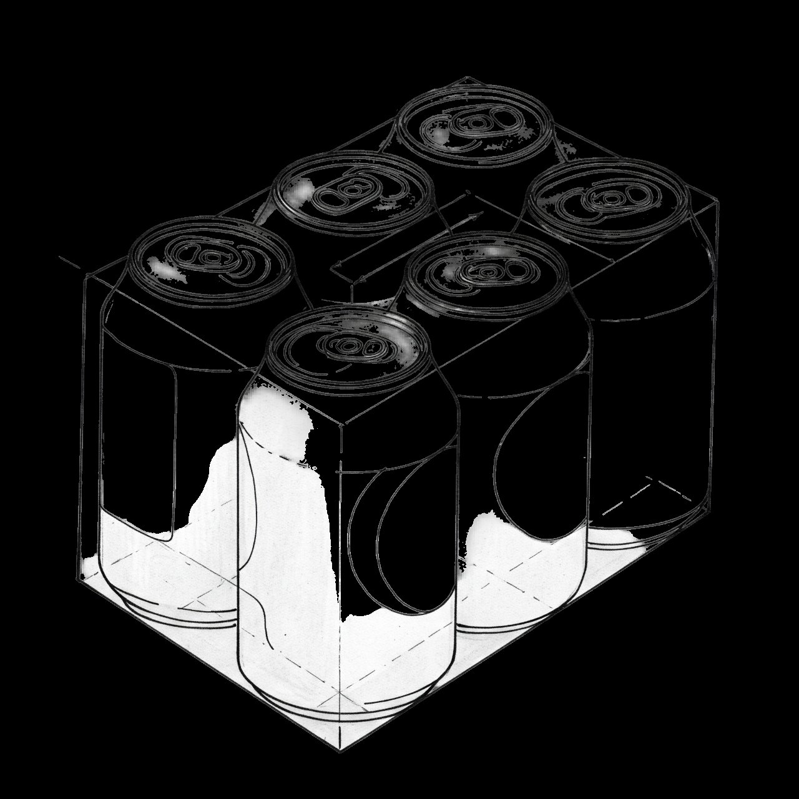

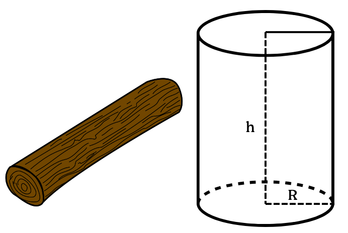

1. Bài tập tổng hợp nón trụcầu 211 Trang  CÂU 27 Một doanh nghiệp sản xuất vỏhộp sữa ông thọdạng hình trụ(như hình minh họa bên dưới), có chiều cao bằng 12 cm. Biết thểtích của hộp là 192π cm3.
a) Tính bán kính đáy của hình trụ.
b) Tính sốtiền mà doanh nghiệp cần chi đểsản xuất 10 000 vỏhộp sữa ông thọ(kểcảhai nắp
hộp), biết chi phí đểsản xuất vỏhộp đó là 80 000 đồng/m2 (làm tròn kết quảđến phần nghìn).
Đáp án: R = 4 cm, chi phí ≈32 170 000 đồng  CÂU 28 Một chiếc đèn khung tre đan trang trí phòng khách có dạng hai hình trụvới cùng chiều cao được lồng vào nhau. Mặt xung quanh của hình trụbên trong được dán bằng vải màu mỡgà, mặt xung quanh của hình trụbên ngoài được dán bằng vải màu tím. Các kích thước của hai hình trụđó được mô tảnhư ởhình bên dưới.
a) Tính tỉsốphần trăm diện tích vải màu mỡgà và diện tích vải màu tím cần sửdụng.
b) Hỏi tổng sốtiền mua vải màu tím và vải màu mỡgà đểlàm chiếc đèn đó bằng bao nhiêu nghìn
đồng (làm tròn kết quảđến hàng đơn vị)? Biết 1 m2 vải màu tím và 1 m2 vải màu mỡgà có giá lần lượt là 95 nghìn đồng và 115 nghìn đồng.
Đáp án: 20% và 74 nghìn đồng.
 CÂU 29 Khi uống nước giải khát, người ta sửdụng ống hút bằng nhựa hình trụcó đường kính đáy là 0,4 cm, độdài ống là 16 cm. Biết π ≈3, 14.
™ Hồng Hà, Đan Phượng, Hà Nội Đinh Việt h

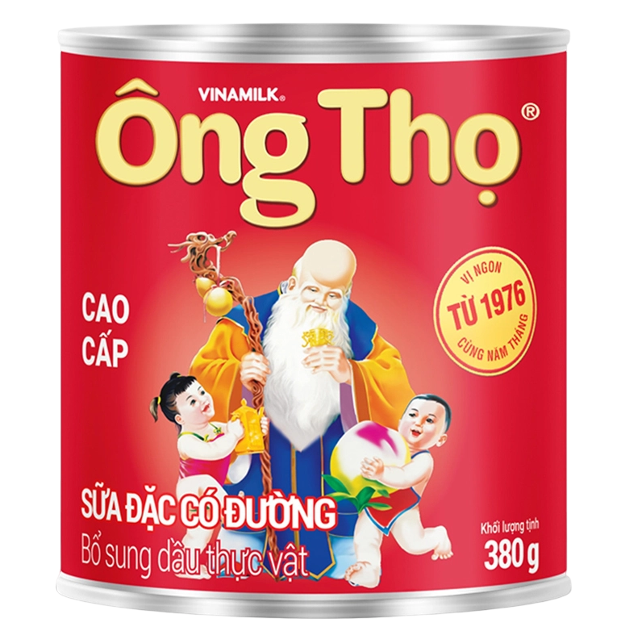

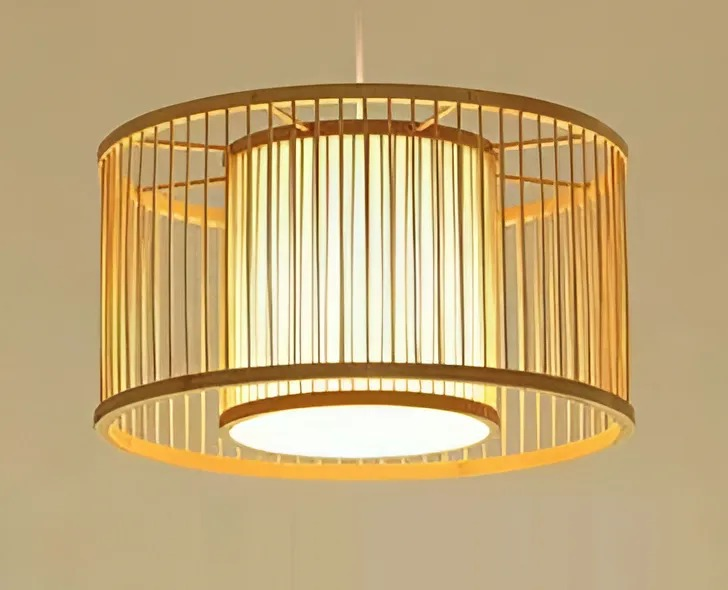

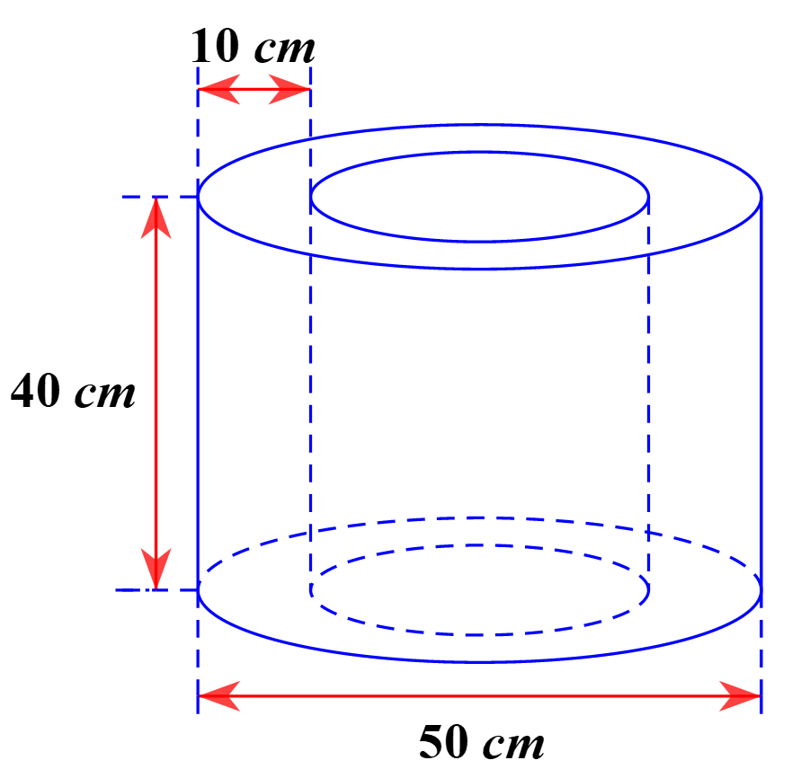

Chương 5. Chuyên đềhình thực tếnón, trụ, cầu Trang 212
a) Tính diện tích xung quanh của ống hút?
b) Biết mỗi ống nhựa nặng khoảng 1 gam và sốtiền cần chi trảđểtái chế1 kg nhựa ống hút là
10 450 đồng. Hỏi chi phí đểtái chế5000 ống hút bằng nhựa là bao nhiêu?
Đáp án: Sxq ≈20, 096 và chi phí là 52 250 đồng.
 CÂU 30 Một trục lăn sơn nước có dạng hình trụ. Đường kính của đường tròn đáy trục lăn là 5 cm, chiều dài trục lăn là 23 cm (hình bên). Lấy π ≈3, 14.
a) Tính diện tích xung quanh của trục lăn sơn.
b) Sau khi lăn trục lăn trọn 15 vòng trên một bức tường phẳng thì diện tích phủsơn là bao nhiêu
cm2 (giảsửcác đường lăn không chồng lấn lên nhau).
Đáp án: Sxq ≈361, 1 cm2, Sphủ= 5416, 5 cm2.
™ Hồng Hà, Đan Phượng, Hà Nội Đinh Việt h

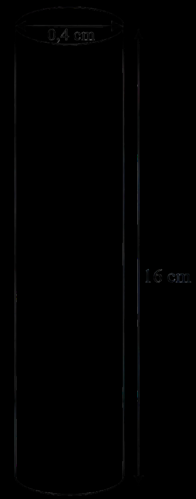

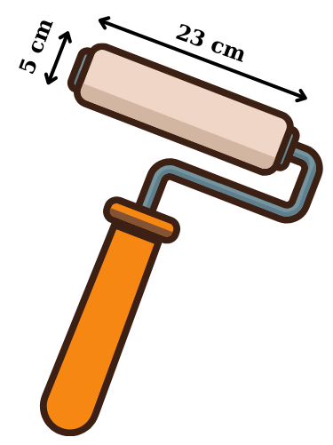

1. Bài tập tổng hợp nón trụcầu 213 Trang  CÂU 31 Một cái trục lăn sơn có dạng hình trụ. Đường kính ống là 6 cm, chiều dài trục là 25 cm. Biết rằng π ≈3, 14.
a) Tính diện tích xung quanh của trục lăn sơn.
b) Tính sốtiền phải trảsau khi lăn hết 2000 vòng sơn liên tiếp, biết cứ1 m2 hết 16 800 đồng chi
phí.
Đáp án: 471cm2 , 1 582 560 đồng  CÂU 32 Hộp phô mai hình trụcó đường kính đáy 12, 2 cm, chiều cao 2, 4 cm.
a) Biết rằng 8 miếng phô mai được xếp nằm sát nhau vừa khít trong hộp. Hỏi thểtích một miếng
phô mai là bao nhiêu?
b) Người ta gói từng miếng phô mai bằng một loại giấy đặc biệt. Giảsửphần giấy gói vừa khít
miếng phô mai. Hãy tính diện tích phần giấy gói mỗi miếng phô mai.
Đáp án:
 CÂU 33 Trái bóng (hình cầu) Telstar xuất hiện lần đầu tiên ởWorld Cup 1970 ởMexico do hãng Adidas sản xuất có đường kính 22, 3 cm. Trái bóng được may từ32 múi da đen và trắng. Các múi da màu đen có hình ngũ giác đều, các múi da màu trắng có hình lục giác đều.
™ Hồng Hà, Đan Phượng, Hà Nội Đinh Việt h

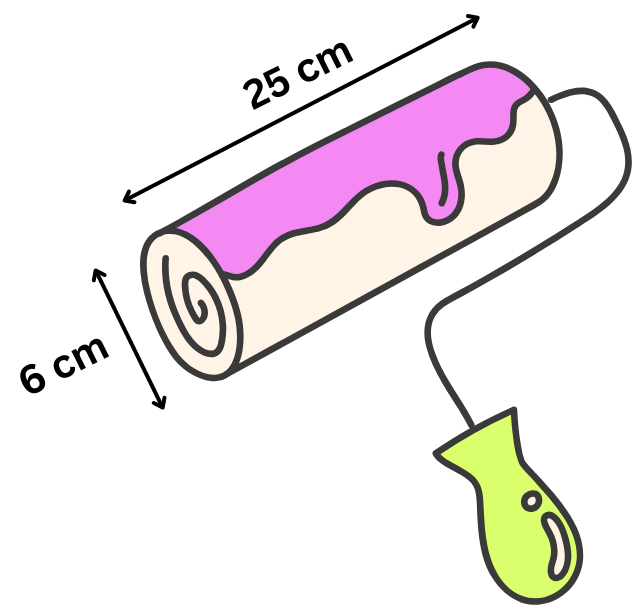

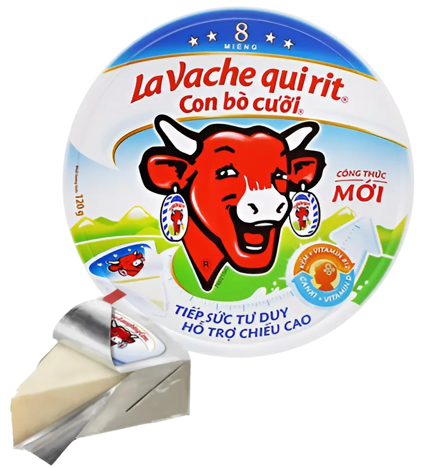

Chương 5. Chuyên đềhình thực tếnón, trụ, cầu Trang 214
a) Tính diện tích bềmặt của trái bóng Telstar. (Lấy π ≈3, 14, kết quảlàm tròn đến hàng đơn
vị).
b) Biết trên bềmặt trái bóng mỗi múi da màu đen có diện tích 37 cm2 và mỗi múi da màu trắng
có diện tích 55, 85 cm2. Hỏi trên trái bóng có bao nhiêu múi da màu đen và màu trắng?
Đáp án: 1561 cm2, 12 múi da màu đen và 20 múi da màu trắng.
 CÂU 34 Một khối gỗdạng hình trụ, bán kính đường tròn đáy r = 10 cm, chiều cao h = 20 cm. Người ta khoét rỗng hai nửa hình cầu như hình vẽ. Lấy π ≈3, 14
a) Tính thểtích của khối gỗkhi chưa khoét.
b) Hãy tính diện tích bềmặt của khối gỗcòn lại sau khi khoét (diện tích cảngoài lẫn trong).
Đáp án: V ≈6280 cm3, S ≈2512 cm2.
 CÂU 35 Người ta xếp hai quảcầu có cùng bán kính r cm vào một chiếc hộp hình trụsao cho các quảcầu đều tiếp xúc với hai đáy, đồng thời hai quảcầu tiếp xúc với nhau và mỗi quảcầu đều tiếp xúc với đường sinh của hình trụ(tham khảo hình vẽ). Biết thểtích của chiếc hộp hình trụlà 120 cm3.
a) Tính thểtích của mỗi quảcầu.
b) Tính thểtích phần còn lại bên trong chiếc hộp hình trụ.
Đáp án: Vcầu = 40 (cm3), Vtrống = 40 (cm3) ™ Hồng Hà, Đan Phượng, Hà Nội Đinh Việt h

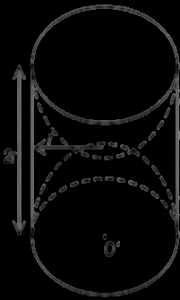

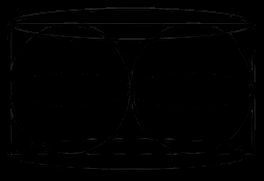

1. Bài tập tổng hợp nón trụcầu 215 Trang  CÂU 36 Hình bên là một túi chứa các đồ. Biết cung CDE là nửa đường tròn. Lấy π ≈3, 14.
A B G D E C H 90 cm 60 cm 40 cm
a) Tính thểtích của túi đồ.
b) Người ta muốn sơn tất cảcác mặt ngoài của túi (kểcảđáy). Hỏi diện tích sơn cần là bao nhiêu
mét vuông? (Kết quảlàm tròn đến hàng phần mười).
Đáp án: V ≈272520 cm3, S ≈24168 cm2.
 CÂU 37 Một cái gáo nước có dạng nửa hình cầu được làm từđất sét có kích thước như hình bên (đơn vị:
centimet).
a) Hỏi gáo nước này chứa được tối đa bao nhiêu mililit nước?
b) Người ta muốn tráng men toàn bộcái gáo nước, bao gồm cảmặt trong, mặt ngoài và phần
miệng của gáo nước. Hỏi diện tích cần tráng men bằng bao nhiêu? (Làm tròn kết quảđến hàng đơn vị) Đáp án: 40π mm3, 624 cm2.
 CÂU 38 Một kho chứa ngũ cốc có dạng một hình trụvà một mái vòm có dạng nửa hình cầu. Phần hình trụ có đường kính đáy là 10 m và chiều cao là 12 m. Phần mái vòm là nửa hình cầu đường kính 10 m.
Lấy π ≈3, 14.
™ Hồng Hà, Đan Phượng, Hà Nội Đinh Việt h

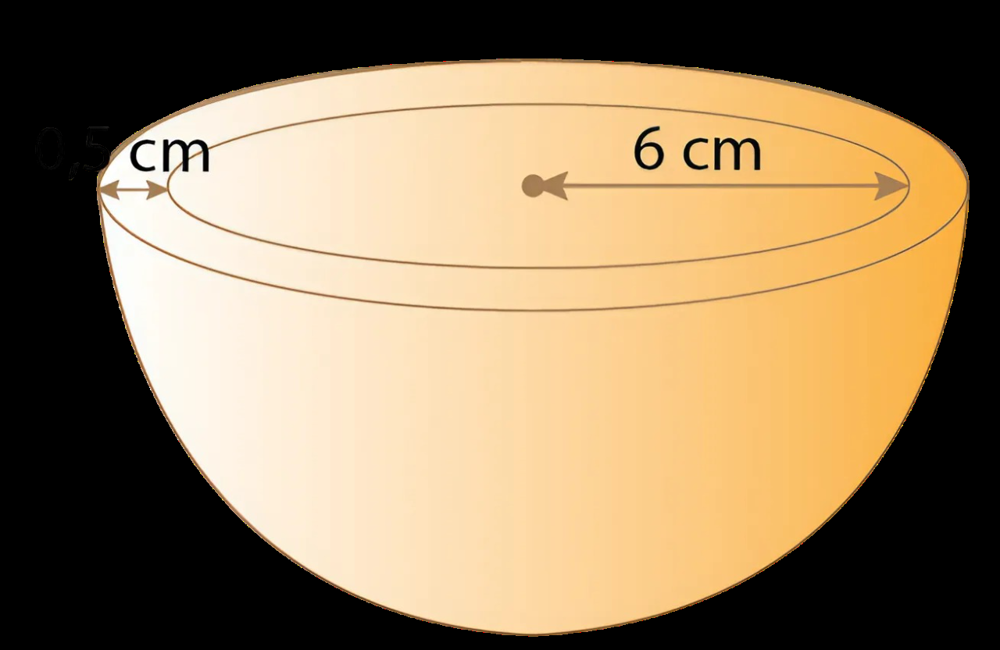

Chương 5. Chuyên đềhình thực tếnón, trụ, cầu Trang 216 O O’ 5 cm 12 cm
a) Hỏi dung tích của kho đó là bao nhiêu mét khối (bỏqua bềdày của tường nhà kho, làm tròn
kết quảđến hàng phần trăm)?
b) Đểđảm bảo ngũ cốc trong kho không bịmốc người ta sơn mặt trong kho (biết rằng không
sơn sàn kho). Biết tiền công là 30 000 đồng/m2. Sốtiền công cần phải trảlà bao nhiêu?
Đáp án: 1203, 67 cm3, 16014000 (đồng)  CÂU 39 Người ta thảchìm hoàn toàn một viên bi sắt đặc vào một cốc thủy tinh chứa nước có dạng hình trụ thì mực nước trong cốc dâng lên 3 cm và không tràn ra ngoài cốc (như hình bên). Biết đường kính của đáy cốc là 6 cm (bỏqua bềdày của thành cốc).
a) Tính bán kính đáy của cốc.
b) Tính thểtích của viên bi.
Đáp án: R = 3 cm, Vbi = 27π cm3.
 CÂU 40 Một ly nước dạng hình trụcó chiều cao là 15 cm, đường kính đáy là 5 cm, lượng nước tinh khiết trong ly cao 10 cm. Ly nước được đặt cốđịnh trên mặt bàn bằng phẳng như hình vẽdưới đây.
™ Hồng Hà, Đan Phượng, Hà Nội Đinh Việt h

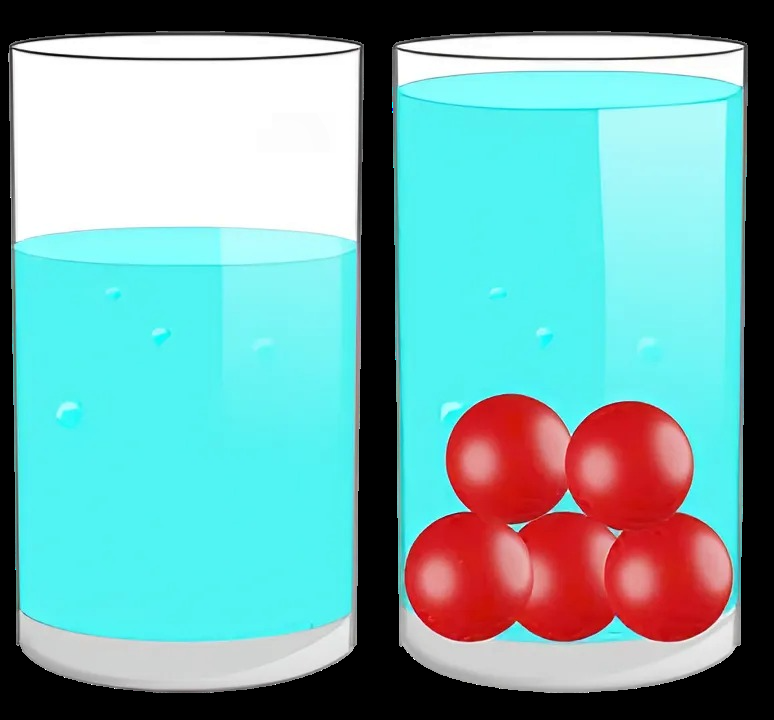

1. Bài tập tổng hợp nón trụcầu 217 Trang
a) Tính thểtích lượng nước tinh khiết được chứa trong ly.
b) Người ta thảvào ly nước 5 viên bi hình cầu giống hệt nhau, có cùng thểtích, đồng chất và
ngập hoàn toàn trong nước, làm nước trong ly dâng lên đúng bằng miệng ly, không tràn ra ngoài. Hỏi thểtích của mỗi viên bi là bao nhiêu xăng-ti-mét khối? (Giảsửđộdày của ly là không đáng kể).
Đáp án: Vnước = 62, 7π cm3, Vbi = 6, 25π cm3.
 CÂU 41 Thả10 chiếc đinh có kích thước như hình dưới vào một cốc nước thuỷtinh. Đinh chìm hẳn xuống và nước trong cốc không bịtràn ra ngoài. Hỏi thểtích nước trong cốc tăng thêm bao nhiêu mililít (làm tròn kết quảđến hàng phần mười)?
4 mm 8 mm 4 mm 25 mm 2 mm Đáp án ≈4, 3 ml.
 CÂU 42 Một cái bình hình trụ, có bán kính đáy là 4 cm, chiều cao 30 cm. Cò chỉđổsúp sao cho phần súp trong bình đó cao 10 cm và mời Cáo dùng bữa.
a) Tính thểtích của phần súp mà Cò mời Cáo ăn tiệc.
b) Cáo cho từng viên sỏi hình cầu giống hệt nhau, bán kính là 2 cm vào bình súp đến khi súp
dâng lên vừa đầy đến miệng bình. Hỏi Cáo đã cho vào bình bao nhiêu viên bi.
Đáp án: V = 60π cm3, 30 viên.
 CÂU 43 Một viên bi bằng sắt, đặc ruột, hình cầu có đường kính 6 cm. Một cái cốc hình trụđựng đầy nước có chiều cao 10 cm và có bán kính đáy là 5 cm. Người ta thảviên bi vào trong cái cốc đểnước tràn ra ngoài và nước vẫn đầy đến miệng cốc, sau đó bỏviên bi ra. (Lấy π ≈3, 14).
a) Tính diện tích cần sơn viên bi theo cm2.
b) Hỏi thểtích nước còn lại trong cốc bao nhiêu cm3 (Lượng nước hao hụt khi bỏviên bi ra khỏi
cốc không đáng kể).
™ Hồng Hà, Đan Phượng, Hà Nội Đinh Việt h

Chương 5. Chuyên đềhình thực tếnón, trụ, cầu Trang 218 Đáp án: S ≈113, 04 cm2, V ≈113, 04 cm3.
 CÂU 44 Một chiếc cốc hình trụcó đáy là hình tròn bán kính bằng 12 cm. Chiều cao của mực nước trong cốc là 10 cm.
a) Tính thểtích nước trong cốc (coi độdày của cốc không đáng kể).
b) Thảmột quảcầu bằng kim loại có bán kính 4 cm vào cốc cho đến khi quảcầu chìm hẳn xuống
đáy cốc và làm mực nước trong cốc tăng lên. Hỏi mực nước trong cốc tăng thêm bao nhiêu centimet? Biết rằng khi thảquảcầu thì lượng nước trong cốc không bịtràn ra ngoài. (Làm tròn kết quảđến hàng phần trăm).
Đáp án: V = 1440π, tăng thêm 0, 59 cm.
 CÂU 45 Một cốc nước có dạng hình trụvới chiều cao 20 cm, bán kính đáy bằng 4 cm, lượng nước ban đầu trong cốc cao 9 cm.
a) Tính thểtích lượng nước trong cốc.
b) Người ta thảchìm vào cốc nước đó 4 viên bi thủy tinh hình cầu có cùng bán kính là 3 cm. Hỏi
sau khi thảvào cốc nước thì mực nước trong cốc cách miệng cốc bao nhiêu cm?
Đáp án: V = 144π cm3, cách miệng cốc 2 cm  CÂU 46 Một bình thủy tinh có dạng hình trụvới đường kính đáy 30 cm và chiều cao 20 cm, mức nước trong bình cao 10 cm (như hình bên). Một khối thủy tinh đặc có dạng hình trụvới bán kính đáy 14 cm, chiều cao 11 cm. Lấy π ≈3, 14.
™ Hồng Hà, Đan Phượng, Hà Nội Đinh Việt h

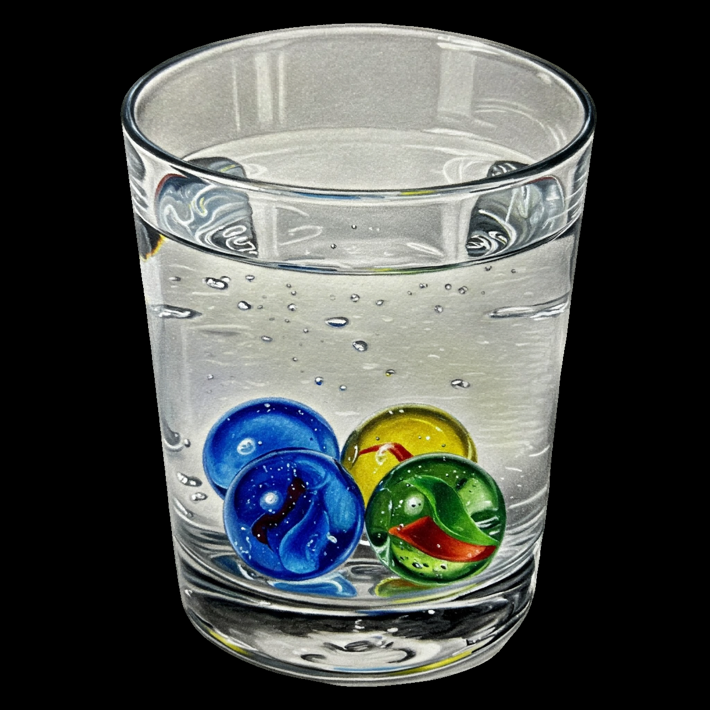

1. Bài tập tổng hợp nón trụcầu 219 Trang
a) Tính thểtích của khối thủy tinh.
b) Nếu thảchìm khối thủy tinh vào bình thủy tinh thì lượng nước trong bình có bịtràn ra ngoài
không? Tại sao?
Đáp án: V = 2156π cm3, không tràn vì Vthủy tinh + Vnước < Vbình  CÂU 47 Một ly nước dạng hình trụcao 12 cm, đường kính đáy là 6 cm, lượng nước tinh khiết trong ly cao 7, 5 cm. Ly nước được đặt trên mặt bàn phẳng như hình vẽ.
a) Tính thểtích lượng nước tinh khiết được chứa trong ly.
b) Người ta thảvào ly nước đó 3 viên “đá lạnh vĩnh cửu” hình lập phương giống hệt nhau và
có cùng thểtích, đồng chất và ngập hoàn toàn trong nước, làm nước trong ly dâng lên cách miệng cốc một khoảng 1, 75 cm. Hỏi cạnh của viên “đá lạnh vĩnh cửu” là bao nhiêu? (Giảsử độdày của ly không đáng kể).
Đáp án: V = 67, 5π, cạnh 3√8, 25π.
 CÂU 48 Khi thảchìm hoàn toàn một con xúc xắc nhỏbằng thép đặc có dạng hình lập phương vào một cốc nước có dạng hình trụthì mực nước trong cốc dâng lên 0,4 cm và không tràn ra ngoài. Biết diện tích đáy của cốc nước bằng 540 cm2.
a) Tính thểtích của phần nước dâng lên.
b) Hỏi cạnh của con xúc xắc dài bao nhiêu?
Đáp án: V = 216 cm3, cạnh 6 cm.
 CÂU 49 Đểlàm thí nghiệm vềsựnổi của các vật thể, Minh chuẩn bịmột cái cốc thủy tinh có dạng lòng ™ Hồng Hà, Đan Phượng, Hà Nội Đinh Việt h

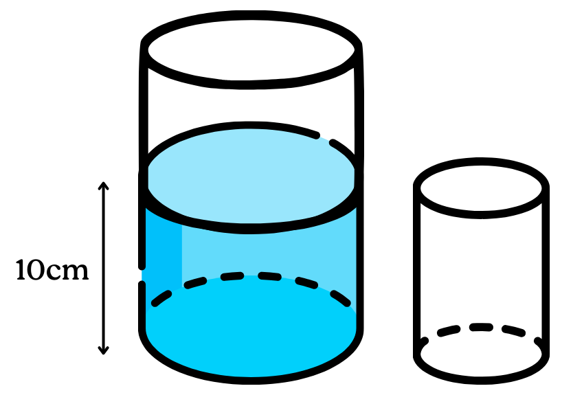

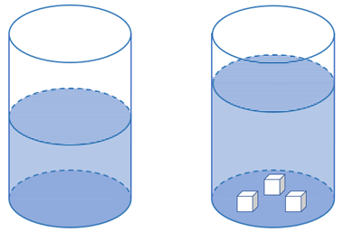

Chương 5. Chuyên đềhình thực tếnón, trụ, cầu Trang 220 trong hình trụcó đường kính đáy 6 cm và chiều cao là 10 cm; một quảbóng bàn tiêu chuẩn của các giải đấu quốc tếcó dạng hình cầu đường kính 40 mm. Minh bỏquảbóng bàn vào trong cốc, rót từ từ200 cm3 nước và đo được mực nước dâng lên cao 7, 2 cm. Lấy π ≈3, 14.
a) Tính thểtích của quảbóng bàn.
b) Tính tỉlệphần trăm thểtích phần nổi của quảbóng bàn trong thí nghiệm trên. (Kết quảlàm
tròn đến chữsốthập phân thứhai).
Đáp án: V = 33, 49 cm3, 89, 63%  CÂU 50 Một thùng lấy nước bằng tôn có dạng hình trụcó chiều cao là 36 cm và đường kính đáy là 3 dm.
a) Tính thểtích của thùng nước đó (Lấy π ≈3, 14 và các kết quảlàm tròn đến hàng đơn vị).
b) Người ta sửdụng thùng nước trên đểmúc nước đổvào một bểchứa có dung tích 1 m3. Hỏi
cần phải đổít nhất bao nhiêu thùng thì mới đầy bểchứa? Biết rằng mỗi lần xách người ta chỉ đổđầy 90% thùng đểnước không đổra ngoài.
Đáp án: 8100 cm3 , 44 thùng.
 CÂU 51 Một hộp kem hình trụcó đường kính 12 cm và chiều cao 15 cm đựng đầy kem được đặt trên mặt bàn phẳng.
a) Tính thểtích hộp kem.
b) Hộp kem chứa kem sẽđược chia vào các bánh ốc quếhình nón có chiều cao 12 cm và đường
kính 6 cm, có hình bán cầu trên đỉnh như hình vẽ. Hãy tìm sốque kem có thểchia được.
™ Hồng Hà, Đan Phượng, Hà Nội Đinh Việt h

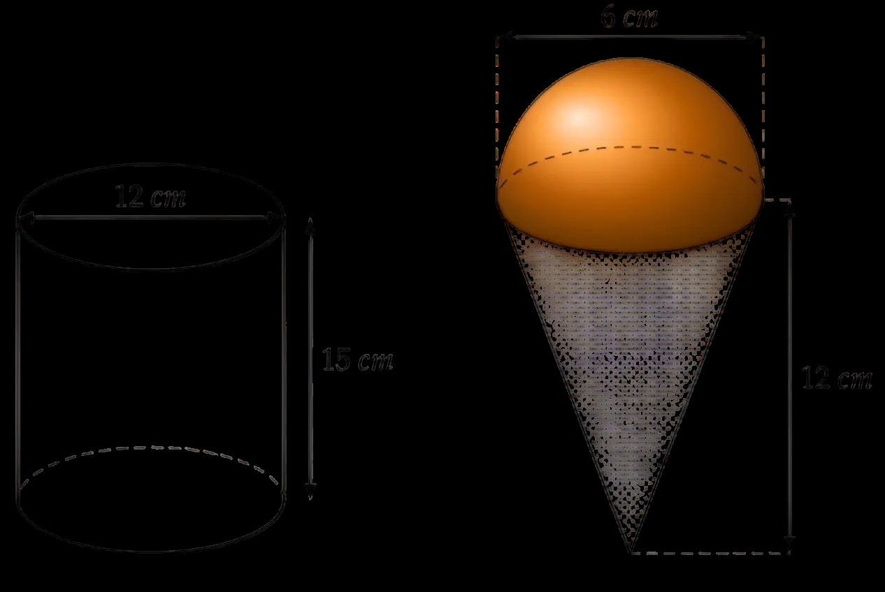

1. Bài tập tổng hợp nón trụcầu 221 Trang Đáp án: V = 540π , 10 que.
 CÂU 52 Giảsửmột quảdưa hấu không hạt ruột đỏdạng hình cầu có đường kính 25 cm và phần vỏdày 2 cm.
a) Coi phần ruột màu đỏcũng có dạng hình cầu và đặc. Hỏi thểtích phần ruột màu đỏchiếm
bao nhiêu phần trăm thểtích quảdưa hấu?
b) Người ta ép phần ruột màu đỏcủa quảdưa hấu trên thì thểtích nước ép thu được bằng 80%
thểtích phần ruột. Nước ép dưa hấu được đựng trong một ly thủy tinh, phần lòng trong dạng hình trụcó chiều cao 10 cm và đường kính đáy lòng trong là 5 cm. Mỗi ly chỉchứa 70% nước ép dưa hấu. Hỏi nếu dùng nước ép của một quảdưa hấu nói trên thì cần bao nhiêu chiếc ly đểđựng hết?
Đáp án: 59, 2704%, 29 ly.
 CÂU 53 Bạn Nam dựđịnh tổchức buổi tiệc sinh nhật và chọn loại ly có phần chứa nước dạng hình nón với bán kính đáy R = 4 cm và độdài đường sinh l = 12 cm đểkhách uống nước trái cây.
a) Tính thểtích phần chứa nước của ly (Kết quảlàm tròn đến hàng đơn vị).
b) Bạn Nam cần chuẩn bịmột sốhộp nước trái cây có lượng nước trong mỗi hộp là 1,2 lít. Biết
rằng buổi tiệc sinh nhật có 14 người (đã bao gồm cảNam). Nếu mỗi người trung bình uống 3 ly nước trái cây và lượng nước rót bằng 90% thểtích ly thì bạn Nam cần chuẩn bịít nhất bao nhiêu hộp nước trái cây?
™ Hồng Hà, Đan Phượng, Hà Nội Đinh Việt h

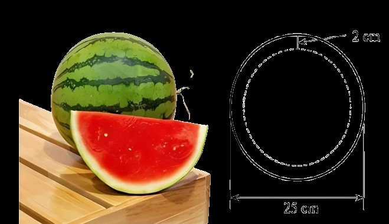

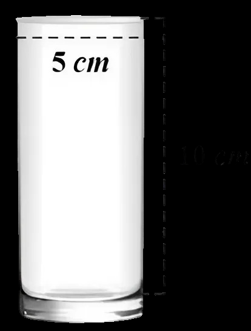

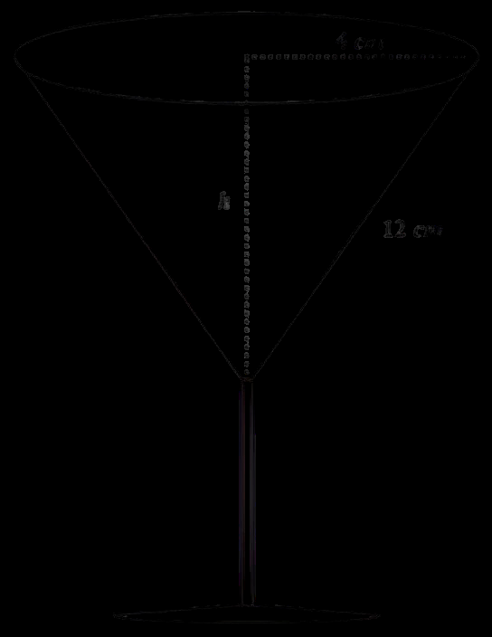

Chương 5. Chuyên đềhình thực tếnón, trụ, cầu Trang 222 Đáp án: 190 cm3, 6 hộp.
 CÂU 54 Một đống cát dạng hình nón có chu vi đáy là 25, 12 m và độcao là 1, 5 m.
a) Tính thểtích của đống cát trên. (Lấy π = 3, 14).
b) Người ta dùng xe cải tiến đểvận chuyển đống cát đó đến khu vực xây dựng. Biết thùng chứa
của xe cải tiến có dạng hình hộp chữnhật có kích thước dài 1 m, rộng 6 dm và cao 3 dm.
Trong mỗi chuyến xe, thùng xe có thểchứa nhiều hơn thểtích thực của nó là 10%. Hỏi cần ít nhất bao nhiêu chuyến xe cải tiến đểchuyển hết đống cát trên?
Đáp án: V = 25, 12 m3 ,127 chuyến xe.
 CÂU 55 Một tháp nước có bểchứa hình cầu, đường kính bên trong của bểđo được là 6 m. Lấy π = 3, 14.
a) Tính thểtích của tháp nước đó.
b) Biết rằng lượng nước đựng đầu trong bểđủdùng cho một khu dân cư trong 5 ngày. Cho biết
khu dân cư có 1304 người. Hỏi trong một ngày mức bình quân mỗi người dùng bao nhiêu lít nước (biết 1 m3 = 1000 lít).
Đáp án: V ≈113, 04 cm3, 17, 34 lít.
 CÂU 56 Một nhà kính trồng rau sạch có dạng nửa hình trụđường kính đáy là 30 m, chiều dài là 45 m. Người ta dùng màng nhà kính Politiv - Israel đểbao quanh phần diện tích xung quanh nửa hình trụvà hai nửa đáy hình trụ. Biết khi thi công thực tếsẽhao phí khoảng 10% diện tích nhà kính.
a) Tính diện tích phần màng thực tếcần cho nhà trồng rau trên, làm tròn kết quảđến hàng đơn
vị).
b) Tính chi phí cần có đểmua màng làm kính trên biết rằng một cuộn màng rộng 2, 2 m, chiều
dài 100 m có giá 13 000 đồng/cm2 (biết đơn vịcung cấp chỉbán theo cuộn).
Đáp án: S ≈3110 cm2, 42 900 000 đồng.
™ Hồng Hà, Đan Phượng, Hà Nội Đinh Việt h

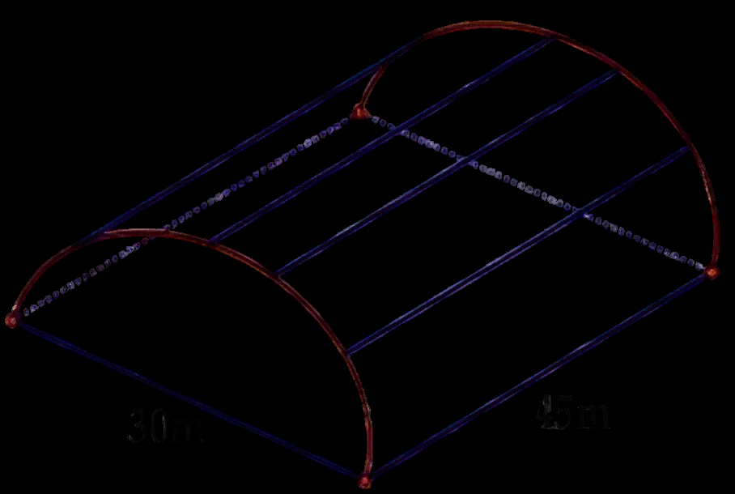

