# He Thuc Luong Tam Giac Vuong Toan 9

HỆTHỐNG BÀI TẬP THEO CHƯƠNG SGK TOÁN 9 -- KẾT NỐI TRI THỨC CHƯƠNG IV HỆTHỨC LƯỢNG TRONG TAM GIÁC VUÔNG Bài 11. Tỉsốlượng giác của góc nhọn Trang 1 Bài 12. Một sốhệthức giữa cạnh, góc trong tam giác vuông và ứng dụng Trang 24 SÁCH ÔN THI VÀO 10 MÔN TOÁN HẢI PHÒNG NĂM HỌC 2026 -- 2027 NHÓM TRUYỀN CẢM HỨNG MÔN TOÁN HẢI PHÒNG BIÊN SOẠN: MẠNH HOA PHƯỢNG -- 0972 234 612

SÁCH ÔN THI VÀO 10 MÔN TOÁN HẢI PHÒNG NĂM HỌC 2026 -- 2027 BÀI 11 TỈSỐLƯỢNG GIÁC CỦA GÓC NHỌN PHẦN 1. LÝ THUYẾT 1. Định nghĩa các tỉsốlượng giác của góc nhọn $IP UBN HJ¾D WVÑOH DÐ HÐD OIʯO α
 LIJ ėÐ TJO α = DƼOI ėʜJ DƼOI IVZDzO DPT α = DƼOI LDz DƼOI IVZDzO UBO α = DƼOI ėʜJ DƼOI LDz DPU α = DƼOI LDz DƼOI ėʜJ 2. Một sốtính chất của các tỉsốlượng giác
a) Cho góc nhọn α, ta có:
u 0 < TJO α < 1 0 < DPT α < 1 TJO2 α + DPT2 α = 1 u UBO α = TJO α DPT α DPU α = DPT α TJO α UBO α. DPU α = 1
b) Cho hai góc nhọn α và β phụnhau, ta có:
u TJO α = DPT β DPT α = TJO β u UBO α = DPU β DPU α = UBO β Trang 1 NHÓM TRUYỀN CẢM HỨNG MÔN TOÁN HẢI PHÒNG TOÁN 9 -- KẾT NỐI TRI THỨC BIÊN SOẠN: MẠNH HOA PHƯỢNG -- 0972 234 612 TRANG 1

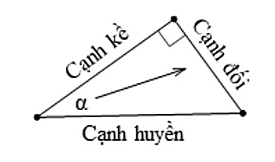

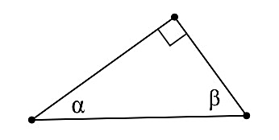

SÁCH ÔN THI VÀO 10 MÔN TOÁN HẢI PHÒNG NĂM HỌC 2026 -- 2027 PHẦN 2. VÍ DỤMINH HỌA Ví dụ1. $IP IÉOI WȒ CxO )ÀZ UÊOI D¾D Uɓ Tʜ MČʹOH HJ¾D D̟ B HÐD B Ví dụ2. $IP UBN HJ¾D ABC WVÑOH UƼJ A WʶJ AB = 5 DN
 AC = 12 DN 5ÊOI D¾D Uɓ Tʜ MČʹOH HJ¾D D̟ B HÐD B Ví dụ3. ΎJDzO Tʜ ėP HÐD W½P DIʨ USʜOH ėǵ ėČʹD NʟU LIƟOH ėɏOI ėÖOH B TJO 42◦= DPT . . .
C DPT 85◦= TJO . . .
D UBO 23◦= DPU . . .
E DPU 2◦30′ = UBO . . .
Ví dụ4. 5ÊOI HJ¾ USɏ D̟ B D¾D CJǵV UI̢ D TBV B A = TJO 30◦. DPT 30◦ DPU 45◦ C B = UBO 30◦ DPT 45◦. DPT 60◦ Trang 2 NHÓM TRUYỀN CẢM HỨNG MÔN TOÁN HẢI PHÒNG TOÁN 9 -- KẾT NỐI TRI THỨC BIÊN SOẠN: MẠNH HOA PHƯỢNG -- 0972 234 612 TRANG 2

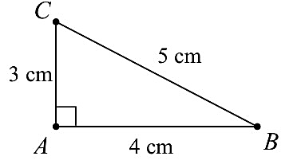

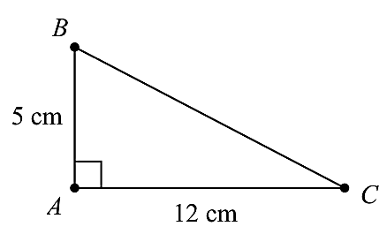

SÁCH ÔN THI VÀO 10 MÔN TOÁN HẢI PHÒNG NĂM HỌC 2026 -- 2027 Ví dụ5. 5ÊOI TJO 25◦ DPT 65◦W½ UBO 58◦-DPU 32◦ Ví dụ6. 5ÉN ėʟ E½J DƼOI DIČB CJǬU 	UÉN x  -½N USÏO LǬU RVǃ ėǬO Tʜ UIƬQ QI¿O UI̢ IBJ Ví dụ7. .ʟU D¾J UIBOH E½J 4,1 N E̥ OH MxO NʟU C̢ D UČʼOH DBP 3,5 N 	OIČ IÉOI WȒ  5ÊOI HÐD UƼP CʿJ D¾J UIBOH W½ NƙU ėƩU PHẦN 3. BÀI TẬP TỰLUẬN Dạng 1: Nhận biết tỉsốlượng giác của góc nhọn. Tính tỉsốlượng giác của góc nhọn trong tam giác vuông Trang 3 NHÓM TRUYỀN CẢM HỨNG MÔN TOÁN HẢI PHÒNG TOÁN 9 -- KẾT NỐI TRI THỨC BIÊN SOẠN: MẠNH HOA PHƯỢNG -- 0972 234 612 TRANG 3

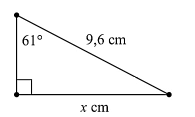

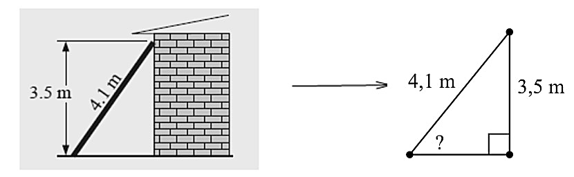

SÁCH ÔN THI VÀO 10 MÔN TOÁN HẢI PHÒNG NĂM HỌC 2026 -- 2027 Bài 1. (NB) $IP UBN HJ¾D DEF WVÑOH UƼJ D WʶJ D¾D Tʜ ėP OIČ IÉOI EČʶJ ė¿Z 5ÊOI D¾D Uɓ Tʜ MČʹOH HJ¾D D̟ B !F Bài 2. (NB) 7ʶJ NʨJ IÉOI WȒ IÀZ UÊOI TJO α, DPT α, UBO α, DPU α, TJO β, DPT β, UBO β, DPU β Bài 3. (TH) 7ʶJ UBN HJ¾D MNP WVÑOH UƼJ M DÐ NP = 3 DN
 MN = 1 DN 5ÊOI D¾D Uɓ Tʜ MČʹOH HJ¾D D̟ B HÐD P Trang 4 NHÓM TRUYỀN CẢM HỨNG MÔN TOÁN HẢI PHÒNG TOÁN 9 -- KẾT NỐI TRI THỨC BIÊN SOẠN: MẠNH HOA PHƯỢNG -- 0972 234 612 TRANG 4

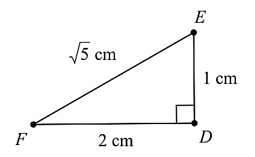

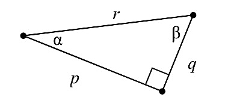

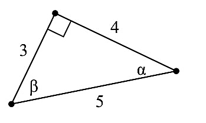

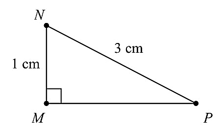

SÁCH ÔN THI VÀO 10 MÔN TOÁN HẢI PHÒNG NĂM HỌC 2026 -- 2027 Bài 4. (TH) $IP UBN HJ¾D PQR DÐ PQ = 6 DN
 QR = 10 DN
 RP = 8 DN B $I̢ OH NJOI △PQR WVÑOH C 5ÊOI D¾D Uɓ Tʜ MČʹOH HJ¾D D̟ B HÐD Q Bài 5. (TH) $IP △ABC D¿O UƼJ A DÐ AB = AC = 3 DN
 BC = 4 DN ,Ȇ ėČʼOH DBP AH D̟ B △ABC B 5ÊOI ėʟ E½J BH, HC C 5ÊOI ėʟ E½J AH D 5ÊOI D¾D Uɓ Tʜ MČʹOH HJ¾D D̟ B HÐD B Trang 5 NHÓM TRUYỀN CẢM HỨNG MÔN TOÁN HẢI PHÒNG TOÁN 9 -- KẾT NỐI TRI THỨC BIÊN SOẠN: MẠNH HOA PHƯỢNG -- 0972 234 612 TRANG 5

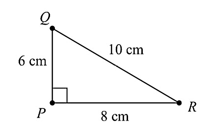

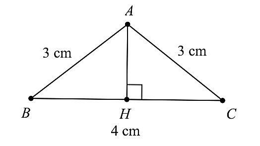

SÁCH ÔN THI VÀO 10 MÔN TOÁN HẢI PHÒNG NĂM HỌC 2026 -- 2027 Dạng 2: Sửdụng tỉsốlượng giác của hai góc phụnhau so sánh, sắp xếp các tỉsốlượng giác Bài 1. (NB) 7JǬU D¾D Uɓ Tʜ MČʹOH HJ¾D TBV UI½OI Uɓ Tʜ MČʹOH HJ¾D D̟ B D¾D HÐD OIʳ IċO 45◦ TJO 79◦, DPT 80◦15′, TJO 65◦, UBO 84◦, DPU 89◦.

### Bài 2. (NB) 4P T¾OI D¾D Tʜ TBV B TJO 5◦W½ TJO 6◦ C TJO 1◦W½ DPT 89◦ D UBO 20◦W½ UBO 30◦ E UBO 75◦W½ DPU 15◦ Bài 3. (NB) ,IÑOH EÕOH N¾Z UÊOI
 IÀZ TƖQ YǬQ D¾D Uɓ Tʜ MČʹOH HJ¾D TBV UIFP UI̢ U̥ UƓOH EƯO B TJO 10◦, TJO 32◦, TJO 25◦, TJO 89◦, TJO 2◦ C UBO 12◦, UBO 15◦, UBO 6◦, UBO 75◦ Bài 4. (TH) 4P T¾OI D¾D Tʜ TBV B DPT 85◦W½ TJO 10◦ C UBO 65◦W½ DPU 35◦ Trang 6 NHÓM TRUYỀN CẢM HỨNG MÔN TOÁN HẢI PHÒNG TOÁN 9 -- KẾT NỐI TRI THỨC BIÊN SOẠN: MẠNH HOA PHƯỢNG -- 0972 234 612 TRANG 6

SÁCH ÔN THI VÀO 10 MÔN TOÁN HẢI PHÒNG NĂM HỌC 2026 -- 2027 Dạng 3: Tính góc, cạnh trong tam giác vuông Bài 1. (NB) 5ÉN x -½N USÏO LǬU RVǃ ėǬO Tʜ UIƬQ QI¿O UI̢ IBJ Bài 2. (TH) 5ÉN UƩU Dǃ D¾D DƼOI W½ D¾D HÐD DIČB CJǬU USxO IÉOI Bài 3. (NB) 5ÉN Tʜ ėP HÐD θ 	M½N USÏO LǬU RVǃ ėǬO QIÖU  Trang 7 NHÓM TRUYỀN CẢM HỨNG MÔN TOÁN HẢI PHÒNG TOÁN 9 -- KẾT NỐI TRI THỨC BIÊN SOẠN: MẠNH HOA PHƯỢNG -- 0972 234 612 TRANG 7

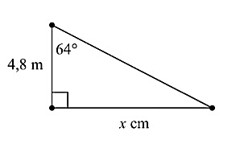

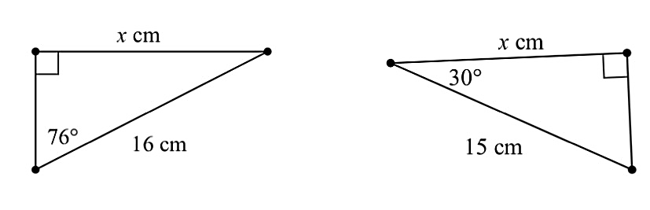

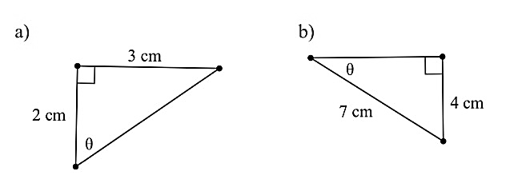

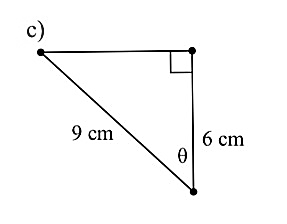

SÁCH ÔN THI VÀO 10 MÔN TOÁN HẢI PHÒNG NĂM HỌC 2026 -- 2027 B TJO θ = 2 3 C UBO α = √ 5 D DPT α = 1 √ 3 E DPU α = 3,51 Bài 4. (TH) $IP △ABC WVÑOH UƼJ A DÐ AB = 21 DN
 HÐD C CƜOH 40◦ 5ÊOI ėʟ E½J AC, BC Bài 5. (TH) $IP △ABC WVÑOH UƼJ A 5ÉN Tʜ ėP D̟ B D¾D HÐD B W½ C
 CJǬU AB = 9 DN W½ AC = 12 DN ,ǬU RVǃ M½N USÏO UʶJ QIÖU Bài 6. (TH) $IP UBN HJ¾D ABC WVÑOH UƼJ A DÐ DƼOI AB = c W½ !C = 60◦ 5ÊOI UIFP c ėʟ E½J D¾D DƼOI AC W½ BC Trang 8 NHÓM TRUYỀN CẢM HỨNG MÔN TOÁN HẢI PHÒNG TOÁN 9 -- KẾT NỐI TRI THỨC BIÊN SOẠN: MẠNH HOA PHƯỢNG -- 0972 234 612 TRANG 8

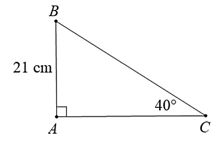

SÁCH ÔN THI VÀO 10 MÔN TOÁN HẢI PHÒNG NĂM HỌC 2026 -- 2027 Dạng 4: Tính giá trịbiểu thức liên quan đến tỉsốlượng giác Bài 1. (NB) 5ÊOI B TJO2 45◦+ DPT2 45◦ C UBO 30◦. DPU 30◦ D TJO 60◦-DPT 60◦. UBO 60◦ Bài 2. (NB) 5ÊOI HJ¾ USɏ D̟ B CJǵV UI̢ D B A = 4 -TJO2 45◦+ 2 DPT2 60◦-3 DPU3 45◦ C B = UBO 45◦. DPT 30◦. DPU 30◦ Bài 3. (TH) 4̫ E̛ OH Uɓ Tʜ MČʹOH HJ¾D D̟ B IBJ HÐD QI̛ OIBV
 UÊOI HJ¾ USɏ CJǵV UI̢ D B A = TJO 25◦+ DPT 25◦-TJO 65◦-DPT 65◦ C B = TJO 15◦+ TJO 75◦-DPT 15◦-DPT 75◦+ TJO 30◦ Bài 4. (TH) $I̢ OH NJOI D¾D ėƟOH UI̢ D TBV B UBO α = TJO α DPT α C DPU α = DPT α TJO α  D UBO α. DPU α = 1 E TJO2 α + DPT2 α = 1 Bài 5. (TH) B $IP UBO α = 2 5ÊOI A = 3 TJO α + DPT α DPT α  C $IP DPU α = √ 3 5ÊOI B = 5 TJO α + 6 DPT α TJO α  Trang 9 NHÓM TRUYỀN CẢM HỨNG MÔN TOÁN HẢI PHÒNG TOÁN 9 -- KẾT NỐI TRI THỨC BIÊN SOẠN: MẠNH HOA PHƯỢNG -- 0972 234 612 TRANG 9

SÁCH ÔN THI VÀO 10 MÔN TOÁN HẢI PHÒNG NĂM HỌC 2026 -- 2027 Dạng 5: Bài toán thực tế Bài 1. (TH) 7½P MÖD 3 HJʼ DIJDzV NʟU OH½Z NÕB IÅ
 DIJǬD DʟU Dʼ DBP 10 N DÐ CÐOH ėʥ USxO NƙU ėƩU E½J 3,3 N 5ÊOI HÐD UƼP CʿJ UJB OƖOH NƙU USʼJ W½ NƙU ėƩU UƼJ UIʼJ ėJǵN ėÐ ,ǬU RVǃ M½N USÏO ėǬO ėʟ Bài 2. (TH) .ʟU D¿Z DʟU ėJǯO Cɏ HÀZ YVʜOH DIƼN NƙU ėƩU 1IƯO OHʯO DIƼN ėƩU D¾DI HʜD D¿Z DʟU ėJǯO 15 N 1IƯO Cɏ HÀZ UƼP WʶJ NƙU ėƩU NʟU HÐD 25◦ 5ÊOI DIJDzV E½J CBO ėƯV D̟ B D¿Z DʟU ėJǯO ,ǬU RVǃ M½N USÏO ėǬO Tʜ UIƬQ QI¿O UI̢ IBJ Bài 3. (TH) 7½P CVʥJ DIJDzV
 MÖD ¾OI T¾OH NƙU USʼJ UƼP WʶJ NƙU ėƩU NʟU HÐD 30◦
 NʟU UI¾Q ėʢOH Iʢ DÐ CÐOH USxO NƙU ėƩU E½J 15 N )ÀZ UÊOI DIJDzV DBP D̟ B UI¾Q ėʢOH Iʢ ėÐ Trang 10 NHÓM TRUYỀN CẢM HỨNG MÔN TOÁN HẢI PHÒNG TOÁN 9 -- KẾT NỐI TRI THỨC BIÊN SOẠN: MẠNH HOA PHƯỢNG -- 0972 234 612 TRANG 10

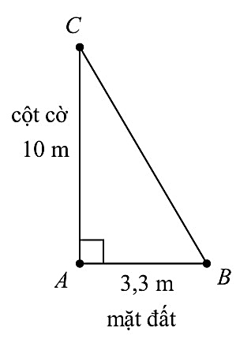

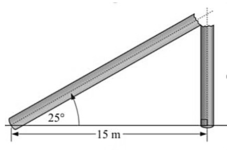

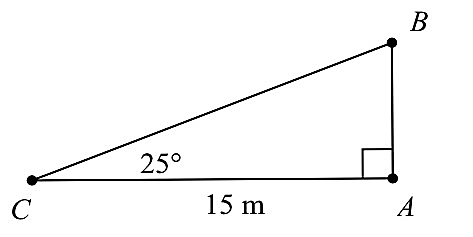

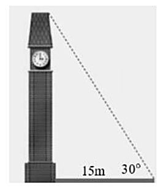

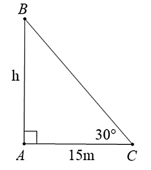

SÁCH ÔN THI VÀO 10 MÔN TOÁN HẢI PHÒNG NĂM HỌC 2026 -- 2027 PHẦN 4. BÀI TẬP TRẮC NGHIỆM 1. Trắc nghiệm nhiều lựa chọn Dạng 1: Nhận biết tỉsốlượng giác của góc nhọn Câu 1. (NB) $IP △ABC WVÑOH UƼJ A $IʯO LIƟOH ėɏOI ėÖOH A. TJO B = AB AC  B. TJO B = AC BC  C. TJO B = AC AB  D. TJO B = AB BC  Câu 2. (NB) $IP IÉOI WȒ TBV $IʯO LIƟOH ėɏOI ėÖOH A. TJO B = 9 12 B. DPU B = 9 12 C. DPT B = 9 12 D. UBO B = 9 12 Câu 3. (TH) $IP △ABC OIČ IÉOI WȒ 5ÊOI TJO B A. TJO B = 5 8 B. TJO B = √ 39 8  C. TJO B = √ 89 8  D. TJO B = 7 8 Trang 11 NHÓM TRUYỀN CẢM HỨNG MÔN TOÁN HẢI PHÒNG TOÁN 9 -- KẾT NỐI TRI THỨC BIÊN SOẠN: MẠNH HOA PHƯỢNG -- 0972 234 612 TRANG 11

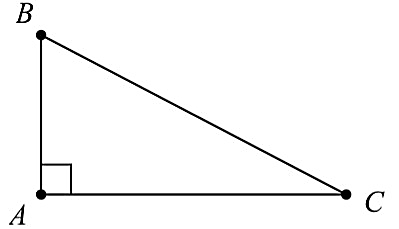

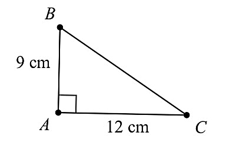

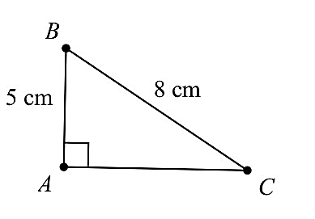

SÁCH ÔN THI VÀO 10 MÔN TOÁN HẢI PHÒNG NĂM HỌC 2026 -- 2027 Câu 4. (TH) $IP △ABC OIČ IÉOI WȒ 5ÊOI DPT C A. DPT C = √ 3 2  B. DPT C = 1 2 C. DPT C = √ 3 4  D. DPT C = 1 √ 3 Câu 5. (VD) $IP UBN HJ¾D ABC WVÑOH UƼJ A
 ėČʼOH DBP AH (H ∈BC) DÐ AB = 15 DN BH = 6 DN 5ɓ Tʜ MČʹOH HJ¾D DPT C CƜOH CBP OIJxV A. 5 √ 21 B.
√ 21 5  C. 3 5 D. 2 5 Câu 6. (VD) $IP △ABC WVÑOH UƼJ A
 ėČʼOH DBP AH ,IƟOH ėɏOI sai M½ A. UBO B = DPU C B. "AH AB
#2
+ "AB BC
#2
= 1 C. TJO !
BAH = AH AB  D. DPT C = HC AC  Dạng 2: Sửdụng tỉsốlượng giác của hai góc phụnhau so sánh, sắp xếp Câu 1. (NB) )ǯ UI̢ D O½P TBV ė¿Z sai A. TJO 38◦= DPT 52◦ B. DPT 42◦= TJO 48◦ C. UBO 50◦= DPU 40◦ D. DPU 20◦= UBO 80◦ Câu 2. (NB) $IP IBJ HÐD OIʯO α, β #JǬU α < β
 Iǯ UI̢ D O½P TBV ė¿Z không đúng A. TJO α < TJO β B. DPT α > DPT β C. DPU α < DPU β D. UBO α < UBO β Câu 3. (TH) (J¾ USɏ D̟ B CJǵV UI̢ D UBO 47◦ DPU 43◦CƜOH A. 1 B. 0 C. 2 UBO 47◦ D. 2 DPU 43◦ Trang 12 NHÓM TRUYỀN CẢM HỨNG MÔN TOÁN HẢI PHÒNG TOÁN 9 -- KẾT NỐI TRI THỨC BIÊN SOẠN: MẠNH HOA PHƯỢNG -- 0972 234 612 TRANG 12

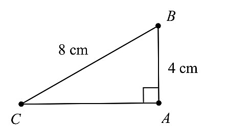

SÁCH ÔN THI VÀO 10 MÔN TOÁN HẢI PHÒNG NĂM HỌC 2026 -- 2027 Câu 4. (TH) $IP UBN HJ¾D ABC WVÑOH UƼJ A )ÀZ UÊOI UBO C CJǬU SƜOH UBO B = 2 A. UBO C = 1 2 B. UBO C = 2 C. UBO C = 1 D. UBO C = √ 2 Câu 5. (VD) 4ƖQ YǬQ D¾D Uɓ Tʜ MČʹOH HJ¾D TJO 34◦; DPT 55◦; TJO 28◦; DPT 63◦UIFP UI̢ U̥ UƓOH EƯO UB ėČʹD LǬU RVǃ M½ A. DPT 63◦< TJO 28◦< TJO 34◦< DPT 55◦ B. TJO 28◦< TJO 34◦< DPT 55◦< DPT 63◦ C. DPT 55◦< TJO 34◦< TJO 28◦< DPT 63◦ D. DPT 55◦< DPT 63◦< TJO 28◦< TJO 34◦ Dạng 3: Tính góc, cạnh trong tam giác vuông Câu 1. (NB) $IP UBN HJ¾D ABC WVÑOH UƼJ A
 CJǬU UBO B = 2 3
 AB = 6 DN Ύʟ E½J DƼOI AC M½ A. 3 DN B. 4 DN C. 9 DN D. 16 DN Câu 2. (TH) $IP △ABC WVÑOH UƼJ A
 CJǬU AB = 6 DN
 AC = 8 DN 4ʜ ėP HÐD C 	M½N USÏO ėǬO ėʟ M½ A. 41◦ B. 53◦ C. 37◦ D. 45◦ Câu 3. (TH) $IP UBN HJ¾D ABC WVÑOH UƼJ A OIČ IÉOI WȒ 4ʜ ėP D̟ B HÐD C 	M½N USÏO ėǬO QIÖU M½ A. !C = 37◦ B. !C = 36◦52′12 C. !C = 36◦52′ D. !C = 36◦ Trang 13 NHÓM TRUYỀN CẢM HỨNG MÔN TOÁN HẢI PHÒNG TOÁN 9 -- KẾT NỐI TRI THỨC BIÊN SOẠN: MẠNH HOA PHƯỢNG -- 0972 234 612 TRANG 13

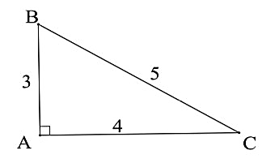

SÁCH ÔN THI VÀO 10 MÔN TOÁN HẢI PHÒNG NĂM HỌC 2026 -- 2027 Câu 4. (VD) ,IJ UJB OƖOH NƙU USʼJ UƼP WʶJ NƙU ėƩU NʟU HÐD 72◦UIÉ CÐOH D̟ B NʟU UÏB OI½ DBP UƯOH USxO NƙU ėƩU E½J 36 N 	IÉOI WȒ  $IJDzV DBP D̟ B UP½ OI½ 	M½N USÏO ėǬO I½OH ėċO Wɏ M½ A. 111 N B. 112 N C. 110 N D. 113 N Câu 5. (VD) $IP UBN HJ¾D MNP WVÑOH UƼJ M DÐ MN = 5 DN NP = 10 DN ,IJ ėÐ !
N -!P CƜOH A. 30◦ B. 45◦ C. 60◦ D. 90◦ Dạng 4: Tính giá trịbiểu thức liên quan đến tỉsốlượng giác Câu 1. (NB) $IP HÐD OIʯO α
 QI¾U CJǵV O½P TBV ė¿Z M½ sai A. UBO α. DPU α = 1 B. UBO α = TJO α DPT α C. DPU α = DPT α TJO α  D. TJO2 α. DPT2 α = 1 Câu 2. (NB) $IP HÐD OIʯO α #JǬU TJO α = 2 5 LIJ ėÐ DPT α DÐ HJ¾ USɏ M½ A.
√ 21 25  B. 3 5 C.
√ 21 3  D.
√ 21 5  Câu 3. (TH) #JǬU TJO α = 0,6 ,IJ ėÐ
 UBO α CƜOH A. 4 3 B. 3 4 C. 0,8 D. 5 3 Câu 4. (TH) (J¾ USɏ D̟ B CJǵV UI̢ D P = DPT2 15◦+ DPT2 25◦+ DPT2 65◦+ DPT2 75◦CƜOH A. 2 TJO2 90◦ B. 2 DPT2 90◦ C. 2 D. 1 Câu 5. (VD) $IP α M½ HÐD OIʯO
 CJǬU SƜOH DPT α -TJO α = 1 3 (J¾ USɏ D̟ B DPT α. TJO α M½ A. 2 3 B. 3 2 C. 4 9 D. 9 4 Trang 14 NHÓM TRUYỀN CẢM HỨNG MÔN TOÁN HẢI PHÒNG TOÁN 9 -- KẾT NỐI TRI THỨC BIÊN SOẠN: MẠNH HOA PHƯỢNG -- 0972 234 612 TRANG 14

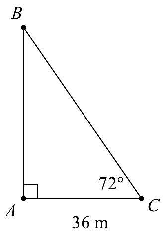

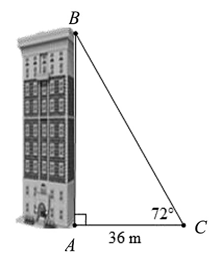

SÁCH ÔN THI VÀO 10 MÔN TOÁN HẢI PHÒNG NĂM HỌC 2026 -- 2027 Dạng 5: Bài toán thực tế Câu 1. (VD) .ʟU OHČʼJ ėJ Cʟ OIÉO MxO NʟU OHʯO ėʢJ WʶJ HÐD O¿OH 20◦ /ǬV OHČʼJ ėÐ ėJ Cʟ UIFP ėČʼOH UIƟOH Ų DI¿O ėʢJ ėǬO ėɓOI ėʢJ E½J 100 N
 ėʟ DBP D̟ B OHʯO ėʢJ M½ A. 94,0 N B. 36,4 N C. 27,5 N D. 34,2 N Câu 2. (VD) .ʟU OHʯO ėÅO ėČʼOH DBP 8 N ėʥ CÐOH E½J 6 N USxO NƙU ėƩU (ÐD UƼP CʿJ OHVʢO T¾OH W½ NƙU ėƩU M½ A. 37◦ B. 53◦ C. 49◦ D. 41◦ Câu 3. (VD) .ʟU D¾J D¿Z DÐ CÐOH USxO NƙU ėƩU E½J 4,2 N $IP CJǬU UJB OƖOH RVB OHʯO D¿Z OHIJxOH NʟU HÐD 38◦TP WʶJ NƙU ėƩU $IJDzV DBP D̟ B D¿Z 	M½N USÏO ėǬO DI̮ Tʜ UIƬQ QI¿O UI̢ 2 M½ A. 5,37 N B. 3,28 N C. 5,38 N D. 3,31 N Trang 15 NHÓM TRUYỀN CẢM HỨNG MÔN TOÁN HẢI PHÒNG TOÁN 9 -- KẾT NỐI TRI THỨC BIÊN SOẠN: MẠNH HOA PHƯỢNG -- 0972 234 612 TRANG 15

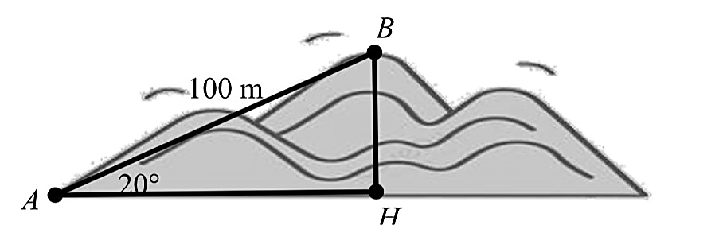

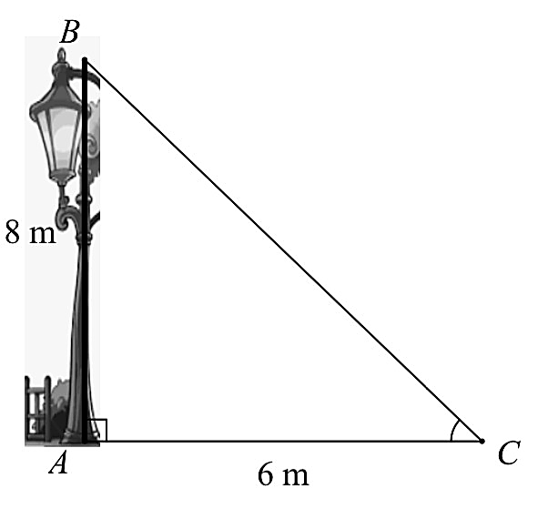

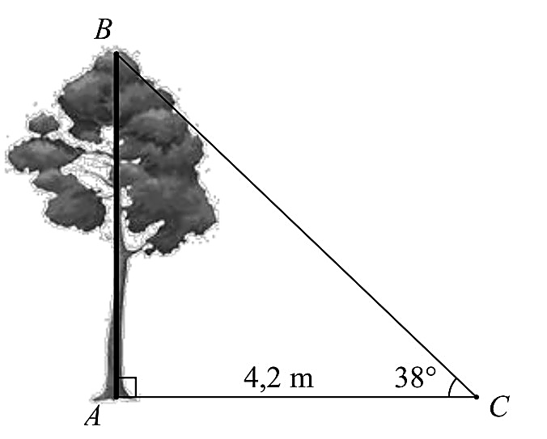

SÁCH ÔN THI VÀO 10 MÔN TOÁN HẢI PHÒNG NĂM HỌC 2026 -- 2027 Câu 4. (VD) .ʟU OHČʼJ ė̢ OH D¾DI UÏB OI½ DBP UƯOH 62 N
 OHČʼJ ėÐ OIÉO MxO ėɓOI UÏB OI½ WʶJ QIČċOH OIÉO UƼP WʶJ QIČċOH OHBOH NʟU HÐD CƜOH 35◦W½ NƖU OHČʼJ O½Z D¾DI NƙU ėƩU 1,6 N $IJDzV DBP D̟ B UÏB OI½ 	M½N USÏO ėǬO DI̮ Tʜ UIƬQ QI¿O UI̢ OIƩU M½ A. 43,4 N B. 37,2 N C. 52,4 N D. 45,0 N Câu 5. (VD) .ʟU DIJǬD UIBOH E½J 5,5 N E̥ B W½P UČʼOH #JǬU DI¿O UIBOH D¾DI UČʼOH 3 N (ÐD UƼP CʿJ UIBOH W½ NƙU ėƩU 	M½N USÏO ėǬO ėʟ M½ A. 56◦ B. 57◦ C. 33◦ D. 34◦ 2. Trắc nghiệm đúng sai Dạng 1: Nhận biết tỉsốlượng giác của góc nhọn Câu 1. $IP △POQ WVÑOH UƼJ P
 ėČʼOH DBP PH 	IÉOI WȒ 
a) TJO Q = PH
PQ 
b) DPT Q = PH
QH 
c) DPU Q = PQ
PO
d) UBO Q = PH
QH  B C D E Trang 16 NHÓM TRUYỀN CẢM HỨNG MÔN TOÁN HẢI PHÒNG TOÁN 9 -- KẾT NỐI TRI THỨC BIÊN SOẠN: MẠNH HOA PHƯỢNG -- 0972 234 612 TRANG 16

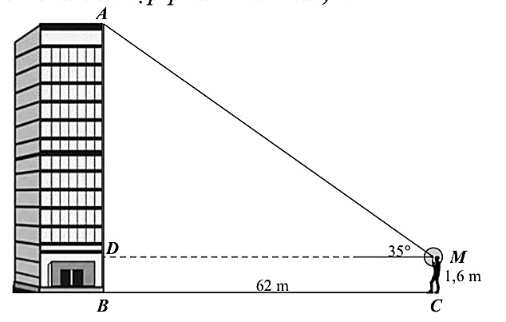

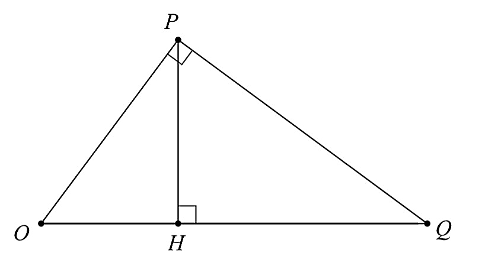

SÁCH ÔN THI VÀO 10 MÔN TOÁN HẢI PHÒNG NĂM HỌC 2026 -- 2027 Câu 2. $IP △ABC WVÑOH UƼJ A 	IÉOI WȒ WʶJ AC = 3 DN
 AB = 4 DN
a) TJO C = 4
5
b) DPT C = 3
4
c) DPU C = 3
4
d) UBO C = 4
3 B C D E Dạng 2: Sửdụng tỉsốlượng giác của hai góc phụnhau Câu 1. $IP HÐD OIʯO α DÐ DPU α = √ 3
a) α = 30◦
b) UBO α = 1
√ 3
c) TJO α =
√ 3
d) DPT α =
√ 6 3  B C D E Câu 2. $IP HÐD α UIPǃ NÀO TJO α = 3 5
a) DPT α = 4
5
b) UBO α = 3
4
c) 1
DPT2 α -TJO2 α = 7 25
d) DPU α + UBO α
DPU α -UBO α = 25 7  Trang 17 NHÓM TRUYỀN CẢM HỨNG MÔN TOÁN HẢI PHÒNG TOÁN 9 -- KẾT NỐI TRI THỨC BIÊN SOẠN: MẠNH HOA PHƯỢNG -- 0972 234 612 TRANG 17

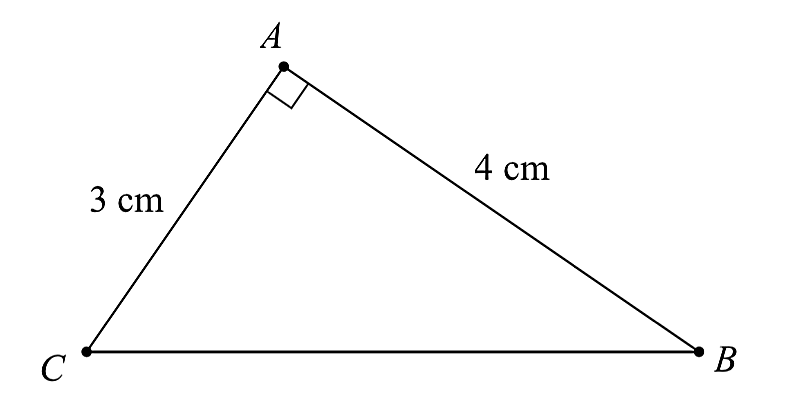

SÁCH ÔN THI VÀO 10 MÔN TOÁN HẢI PHÒNG NĂM HỌC 2026 -- 2027 B C D E Dạng 3: Tính góc, cạnh trong tam giác vuông Câu 1. .ʟU DʟU ėÅO AB DBP 6 N DÐ CÐOH JO USxO NƙU ėƩU M½ AC E½J 4,5 N 	Tʜ ėP HÐD M½N USÏO ėǬO ėċO Wɏ ėʟ 
a) UBO C = 4
3
b) TJO B = 3
4
c) B ≈53◦
d) C ≈53◦
B C D E Câu 2. 2VÀOH ėČʼOH AC HʢN NʟU ėPƼO MxO EʜD WʶJ ėʟ EʜD 10◦TP WʶJ QIČċOH OƜN OHBOH W½ NʟU ėPƼO YVʜOH EʜD DÐ ėʟ EʜD 15◦TP WʶJ QIČċOH OƜN OHBOH 	IÉOI WȒ  "OI 7JǯU M¾J YF USxO DPO ėČʼOH MxO EʜD WʶJ WƬO UʜD 30 LNI IǬU 10 QIÖU
a) $IJDzV E½J ėPƼO MxO EʜD M½ 5000 N
b) Ύʟ DBP D̟ B DPO EʜD M½N USÏO ėǬO I½OH ėċO Wɏ M½ 860 N
c) $IJDzV E½J ėPƼO YVʜOH EʜD M½N USÏO ėǬO I½OH ėċO Wɏ M½ 3500 N
d) 2VÀOH ėČʼOH AC M½N USÏO ėǬO I½OH ėċO Wɏ M½ 7533 N
B C D E Trang 18 NHÓM TRUYỀN CẢM HỨNG MÔN TOÁN HẢI PHÒNG TOÁN 9 -- KẾT NỐI TRI THỨC BIÊN SOẠN: MẠNH HOA PHƯỢNG -- 0972 234 612 TRANG 18

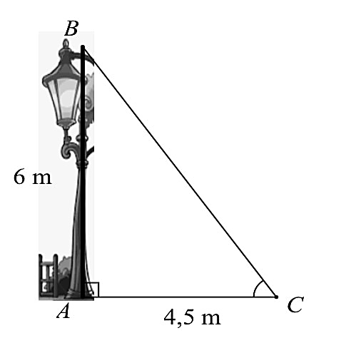

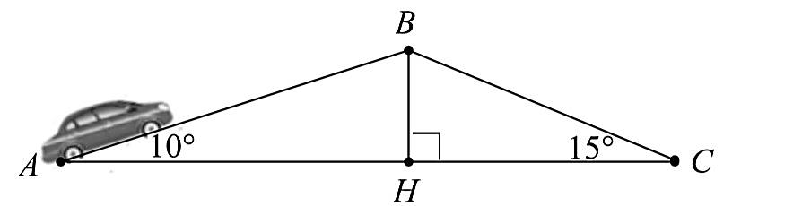

SÁCH ÔN THI VÀO 10 MÔN TOÁN HẢI PHÒNG NĂM HỌC 2026 -- 2027 Dạng 4: Tính giá trịbiểu thức liên quan đến tỉsốlượng giác Câu 1.
a) DPT2 15◦+ DPT2 25◦+ DPT2 35◦+ DPT2 45◦+ DPT2 55◦+ DPT2 65◦+ DPT2 75◦= 7
2
b) UBO 1◦UBO 2◦UBO 3◦. . . UBO 89◦= 1
c) DPU 1◦DPU 2◦DPU 3◦. . . DPU 89◦= 44
d) TJO2 1◦+ TJO2 2◦+ TJO2 3◦+ . . . + TJO2 89◦= 44
B C D E 3. Trắc nghiệm trảlời ngắn Dạng 1: Nhận biết tỉsốlượng giác của góc nhọn Câu 1. (TH) $IP △ABC WVÑOH UƼJ A
 AB = 4 DN
 BC = 7 DN ,IJ ėÐ TJO C DÐ HJ¾ USɏ M½e Ύ¾Q Tʜ Câu 2. (TH) $IP △ABC WVÑOH UƼJ A
 AB = 4 DN
 AC = 3 DN ,IJ ėÐ UBO B DÐ HJ¾ USɏ M½e Ύ¾Q Tʜ Câu 3. (TH) $IP △MNP WVÑOH UƼJ M
 MN = 6 DN
 MP = 8 DN ,IJ ėÐ UBO P DÐ HJ¾ USɏ M½e Ύ¾Q Tʜ Câu 4. (VD) $IP △ABC WVÑOH UƼJ B
 AB = 9 DN
 BC = 12 DN ,IJ ėÐ TJO C DÐ HJ¾ USɏ M½e Ύ¾Q Tʜ Câu 5. (VD) $IP △OPQ WVÑOH ʿ P
 ėČʼOH DBP PH #JǬU OH = 2 EN
 QH = 8 EN ,IJ ėÐ UBO O DÐ HJ¾ USɏ M½e Ύ¾Q Tʜ Dạng 2: Sửdụng tỉsốlượng giác của hai góc phụnhau Câu 1. (TH) (J¾ USɏ D̟ B CJǵV UI̢ D A = TJO 38◦-DPT 52◦CƜOHe Ύ¾Q Tʜ Trang 19 NHÓM TRUYỀN CẢM HỨNG MÔN TOÁN HẢI PHÒNG TOÁN 9 -- KẾT NỐI TRI THỨC BIÊN SOẠN: MẠNH HOA PHƯỢNG -- 0972 234 612 TRANG 19

SÁCH ÔN THI VÀO 10 MÔN TOÁN HẢI PHÒNG NĂM HỌC 2026 -- 2027 Câu 2. (TH) (J¾ USɏ D̟ B CJǵV UI̢ D A = TJO 37◦+UBO 25◦ DPU 65◦+DPT 53◦CƜOHe Ύ¾Q Tʜ Câu 3. (VD) (J¾ USɏ CJǵV UI̢ D A = TJO 33◦+ UBO 35◦ DPU 55◦-DPT 57◦CƜOH Ύ¾Q Tʜ Câu 4. (VD) (J¾ USɏ D̟ B CJǵV UI̢ D M = TJO2 42◦+ TJO2 48◦+ UBO 20◦. UBO 70◦CƜOH Ύ¾Q Tʜ Dạng 3: Tính góc, cạnh trong tam giác vuông Câu 1. (TH) $IP UBN HJ¾D ABC WVÑOH UƼJ A
 CJǬU AB = 12 DN
 BC = 15 DN 4ʜ ėP HÐD B 	M½N USÏO ėǬO ėʟ M½e Ύ¾Q Tʜ Câu 2. (TH) $IP UBN HJ¾D ABC WVÑOH UƼJ A
 CJǬU B = 60◦
 BC = 7 DN Ύʟ E½J DƼOI AC M½e 	-½N USÏO ėǬO I½OH QIƯO NČʼJ Ύ¾Q Tʜ Câu 3. (VD) .ʟU D¾J UIBOH E½J 4 N U̥ B W½P UČʼOH M½N UI½OI HÐD 63◦WʶJ NƙU ėƩU ,IPǃOH D¾DI Ų DI¿O UIBOH ėǬO UČʼOH 	M½N USÏO ėǬO 2 DI̮ Tʜ UIƬQ QI¿O M½e Ύ¾Q Tʜ Trang 20 NHÓM TRUYỀN CẢM HỨNG MÔN TOÁN HẢI PHÒNG TOÁN 9 -- KẾT NỐI TRI THỨC BIÊN SOẠN: MẠNH HOA PHƯỢNG -- 0972 234 612 TRANG 20

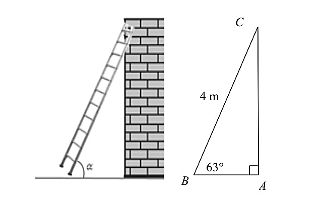

SÁCH ÔN THI VÀO 10 MÔN TOÁN HẢI PHÒNG NĂM HỌC 2026 -- 2027 Câu 4. (VDC) "OI 5P½O M¾J YF USxO DPO ėČʼOH YVʜOH EʜD DÐ CJǵO DǃOI C¾P ėʟ EʜD 6
#BO ėƯV BOI ʿ Wɏ USÊ " DBP 35 N TP WʶJ N̥ D OČʶD CJǵO )ʳJ TBV LIJ M¾J YF YVʜOH EʜD ėČʹD
RVÀOH ėČʼOH 300 N 	Wɏ USÊ # UIÉ Wɏ USÊ O½Z DBP ee NÆU TP WʶJ N̥ D OČʶD CJǵO 	M½N USÏO ėǬO I½OH ėċO Wɏ  Ύ¾Q Tʜ Câu 5. (VDC) $IP UBN HJ¾D ABC OIʯO
 HÐD B = 45◦
 HÐD C = 30◦
 BC = 10 DN 5ÊOI ėʟ E½J DƼOI AC Ύ¾Q Tʜ Dạng 4: Tính giá trịbiểu thức liên quan đến tỉsốlượng giác Câu 1. (TH) $IP HÐD OIʯO α #JǬU DPU α = 2 LIJ ėÐ UBO α DÐ HJ¾ USɏ M½e Ύ¾Q Tʜ Câu 2. (TH) $IP HÐD OIʯO α #JǬU DPT α = 0,6 LIJ ėÐ TJO α DÐ HJ¾ USɏ M½e Ύ¾Q Tʜ Câu 3. (VD) $IP HÐD OIʯO α (J¾ USɏ CJǵV UI̢ D A = TJO4 α + DPT4 α + 2 TJO2 α. DPT2 α CƜOHe Ύ¾Q Tʜ Câu 4. (VDC) $IP HÐD α OIʯO W½ UBO α = 1 2
 LIJ ėÐ CJǵV UI̢ D A = 2 TJO α + DPT α + TJO α. DPT α DÐ HJ¾ USɏ M½ 	MƩZ LǬU RVǃ ėǬO DI̮ Tʜ UIƬQ QI¿O UI̢ IBJ ee Ύ¾Q Tʜ Dạng 5: Bài toán thực tế Trang 21 NHÓM TRUYỀN CẢM HỨNG MÔN TOÁN HẢI PHÒNG TOÁN 9 -- KẾT NỐI TRI THỨC BIÊN SOẠN: MẠNH HOA PHƯỢNG -- 0972 234 612 TRANG 21

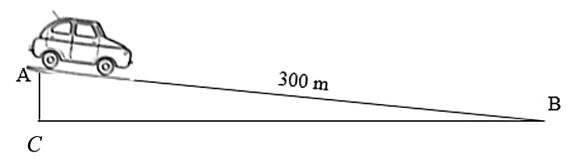

SÁCH ÔN THI VÀO 10 MÔN TOÁN HẢI PHÒNG NĂM HỌC 2026 -- 2027 Câu 1. (VD) 5̨ ėɓOI NʟU UÏB OI½ DBP 30 N
 OHČʼJ UB OIÉO UIƩZ NʟU Ñ UÑ ėBOH ėʨ EČʶJ NʟU HÐD OHIJxOH YVʜOH M½ 40◦TP WʶJ QIČċOH OHBOH 	OIČ IÉOI WȒ  ,IJ ėÐ LIPǃOH D¾DI HJ̮ B Ñ UÑ ėǬO UÏB OI½ M½e 	LǬU RVǃ M½N USÏO ėǬO I½OH QIƯO NČʼJ Ύ¾Q Tʜ Câu 2. (VD) 5I¾Q &JêFM M½ NʟU DÑOH USÉOI LJǬO USÖD CƜOH TƖU OʥJ UJǬOH ʿ UI½OI QIʜ 1BSJT 1I¾Q Ύǵ ėP DIJDzV DBP UI¾Q OHČʼJ UB ėP ėČʹD HÐD UƼP CʿJ UJB OƖOH NƙU USʼJ WʶJ NƙU ėƩU M½ 62◦W½ CÐOH D̟ B UI¾Q USxO NƙU ėƩU LIJ ėÐ M½ 172 N 	IÉOI WȒ  7ƬZ DIJDzV DBP D̟ B UI¾Q &JêFM 	M½N USÏO LǬU RVǃ ėǬO I½OH ėċO Wɏ M½  Ύ¾Q Tʜ Câu 3. (VD) .ʟU N¾Z CBZ DƩU D¾OI Ų NƙU ėƩU
 CBZ MxO WʶJ NʟU HÐD 30◦TP WʶJ QIČċOH OƜN OHBOH
 TBV NʟU LIPǃOH UIʼJ HJBO N¾Z CBZ ėƼU ėČʹD DBP ėʟ M½ 3000 N 	IÉOI WȒ  2VÀOH ėČʼOH D̟ B N¾Z CBZ 	M½N USÏO ėǬO I½OH ėċO Wɏ M½ee Ύ¾Q Tʜ Trang 22 NHÓM TRUYỀN CẢM HỨNG MÔN TOÁN HẢI PHÒNG TOÁN 9 -- KẾT NỐI TRI THỨC BIÊN SOẠN: MẠNH HOA PHƯỢNG -- 0972 234 612 TRANG 22

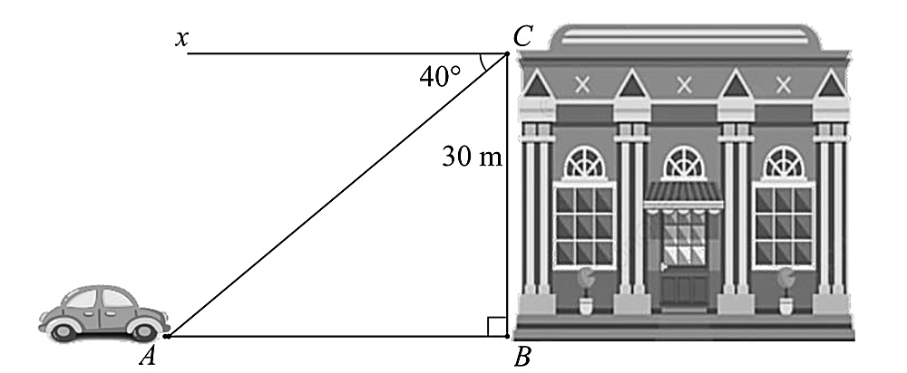

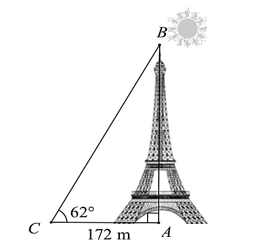

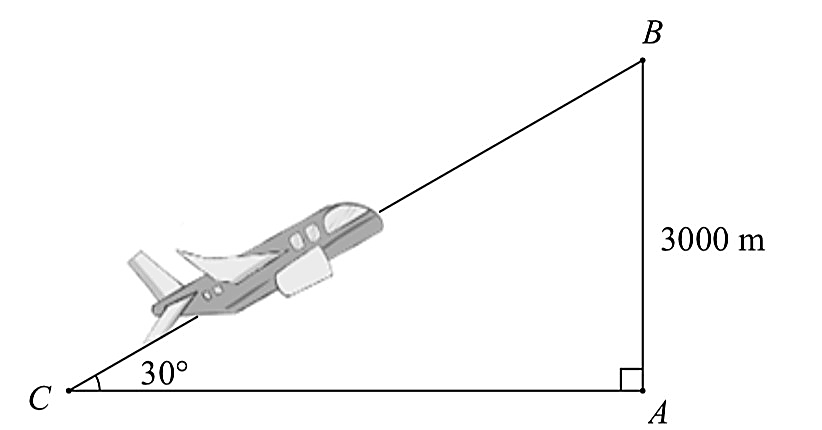

SÁCH ÔN THI VÀO 10 MÔN TOÁN HẢI PHÒNG NĂM HỌC 2026 -- 2027 Câu 4. (VD) .ʟU LIÖD TÑOH SʟOH LIPǃOH 130 N .ʟU DPO ėÏ E̥ ėɏOI DIÅP Ų Cʼ CxO O½Z TBOH Cʼ CxO LJB UIFP QIČċOH WVÑOH HÐD WʶJ Cʼ TÑOH
 OIČOH EP Cɏ EÏOH OČʶD ėƲZ YJxO OxO QIǃJ DIÅP LIPǃOH 150 N NʶJ TBOH ėČʹD Cʼ CxO LJB (ÐD N½ EÏOH OČʶD ėÀ ėƲZ DPO UIVZDzO ėJ MǯDI TP WʶJ CBO ėƯV 	M½N USÏO ėǬO ėʟ M½ Ύ¾Q Tʜ Câu 5. (VDC) $ƯV $ƯO 5Iċ M½ D¿Z DƯV E¿Z WƓOH DÐ OIɏQ DIÊOI E½J OIƩU LIV W̥ D ΎÑOH /BN ž #JǬU UƼJ IBJ ėJǵN 	ʿ DÕOH NʟU QIÊB TP WʶJ DƯV D¾DI OIBV 89 N USxO NƙU TÑOH OHČʼJ UB OIÉO UIƩZ ėɓOI US̛ DƯV WʶJ HÐD O¿OH MƯO MČʹU M½ 40◦W½ 30◦ $IJDzV DBP D̟ B US̛ DƯV $ƯO 5Iċ TP WʶJ NƙU TÑOH )ƬV 	M½N USÏO ėǬO I½OH ėċO Wɏ M½eeN Ύ¾Q Tʜ Trang 23 NHÓM TRUYỀN CẢM HỨNG MÔN TOÁN HẢI PHÒNG TOÁN 9 -- KẾT NỐI TRI THỨC BIÊN SOẠN: MẠNH HOA PHƯỢNG -- 0972 234 612 TRANG 23

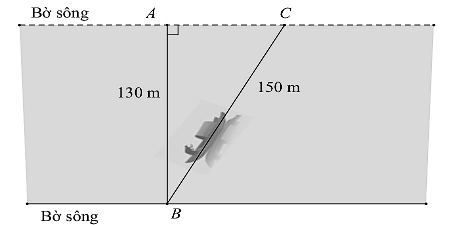

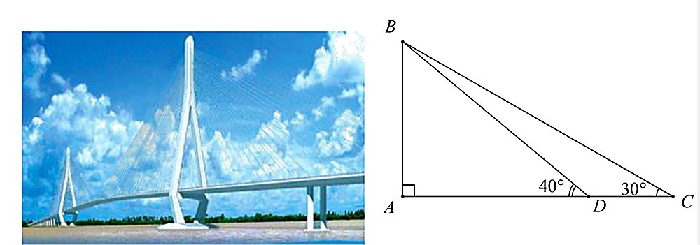

SÁCH ÔN THI VÀO 10 MÔN TOÁN HẢI PHÒNG NĂM HỌC 2026 -- 2027 BÀI 12 MỘT SỐHỆTHỨC GIỮA CẠNH, GÓC TRONG TAM GIÁC VUÔNG VÀ ỨNG DỤNG PHẦN 1. LÝ THUYẾT 1. Hệthức giữa cạnh huyền và cạnh góc vuông Trong tam giác vuông, mỗi cạnh góc vuông bằng cạnh huyền nhân với sin góc đối hoặc nhân với cos góc kề.
Trong tam giác ABC vuông tại A ta có:
b = a. sin B = a. cos C c = a. sin C = a. cos B 2. Hệthức giữa hai cạnh góc vuông Trong tam giác vuông, mỗi cạnh góc vuông bằng cạnh góc vuông kia nhân với tan góc đối hoặc nhân với cot góc kề.
Trong tam giác ABC vuông tại A ta có:
b = c. tan B = c. cot C c = b. tan C = b. cot B Trang 24 NHÓM TRUYỀN CẢM HỨNG MÔN TOÁN HẢI PHÒNG TOÁN 9 -- KẾT NỐI TRI THỨC BIÊN SOẠN: MẠNH HOA PHƯỢNG -- 0972 234 612 TRANG 24

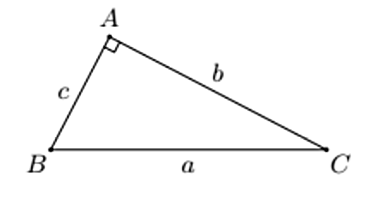

SÁCH ÔN THI VÀO 10 MÔN TOÁN HẢI PHÒNG NĂM HỌC 2026 -- 2027 3. Giải tam giác vuông Giải tam giác vuông là tìm tất cảcác cạnh và các góc còn lại của tam giác khi biết một sốyếu tố(hai cạnh, hoặc một cạnh và một góc nhọn).
Trong đo đạc, khi người quan sát có hướng nhìn ngang theo tia Ox:
• Góc !
xOA gọi là góc nghiêng lên hay góc nâng.
• Góc !
xOB gọi là góc nghiêng xuống hay góc hạ.
PHẦN 2. VÍ DỤMINH HỌA Dạng 1: Giải tam giác vuông Phương pháp giải: Đểgiải tam giác vuông ta dùng hệthức giữa cạnh và các góc trong tam giác vuông.
Ví dụ1. Giải các tam giác vuông ởhình sau. Làm tròn kết quảđộdài đến hàng đơn vị và sốđo góc đến độ.

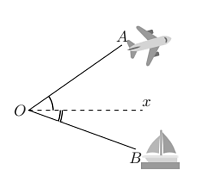

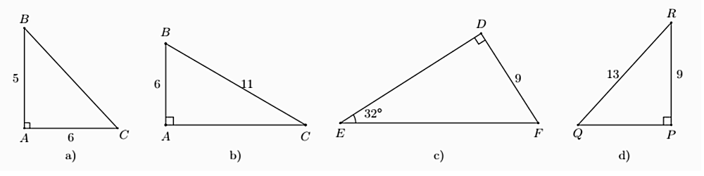

SÁCH ÔN THI VÀO 10 MÔN TOÁN HẢI PHÒNG NĂM HỌC 2026 -- 2027 Ví dụ2. Cho tam giác ABC vuông tại A, đường cao AH. Biết AB = 2,5; BH = 1,5. Tính !B, !C và AC (làm tròn kết quả).
Dạng 2: Giải tam giác nhọn Phương pháp giải: Làm xuất hiện tam giác vuông đểáp dụng các hệthức trên bằng cách kẻthêm đường cao.
Ví dụ3. Giải tam giác ABC có !B = 65◦, !C = 45◦và AB = 2,8 cm.
Ví dụ4. Giải tam giác ABC có !B = 65◦, !C = 40◦và BC = 4,2 cm.

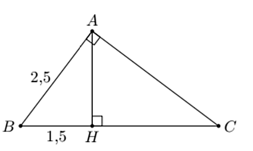

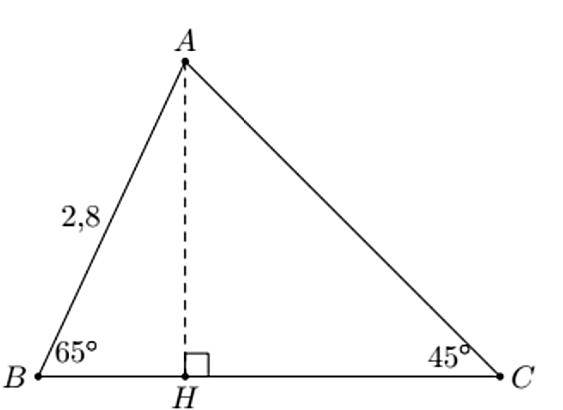

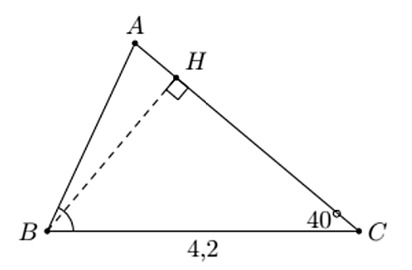

SÁCH ÔN THI VÀO 10 MÔN TOÁN HẢI PHÒNG NĂM HỌC 2026 -- 2027 Ví dụ5. Giải tam giác ABC có !B = 70◦và AB = 2,1; AC = 3,8 cm.
Ví dụ6. Giải tam giác ABC có AB = 15 cm, AC = 18 cm, BC = 20 cm.
Ví dụ7. Trong hình bên, tính độdài của mỗi đoạn thẳng sau (làm tròn kết quả):
a) HB và HC b) AH và AC Trang 27
NHÓM TRUYỀN CẢM HỨNG MÔN TOÁN HẢI PHÒNG TOÁN 9 -- KẾT NỐI TRI THỨC BIÊN SOẠN: MẠNH HOA PHƯỢNG -- 0972 234 612 TRANG 27

SÁCH ÔN THI VÀO 10 MÔN TOÁN HẢI PHÒNG NĂM HỌC 2026 -- 2027 Dạng 3: Tính diện tích tam giác Phương pháp giải: Áp dụng công thức S = 1 2.a.h hoặc S = 1 2.b.c. sin α, trong đó a, b, c là độdài các cạnh, h là đường cao tương ứng, α là góc xen giữa hai cạnh b, c.
Ví dụ8. Tính diện tích tam giác ABC, biết AB = 16, AC = 14 và !B = 60◦.
Ví dụ9. Hình thang ABCD (AB ∥CD) có !D = 90◦; !C = 38◦, AB = 3,5; AD = 3,1. Tính diện tích hình thang.
Ví dụ10. Tứgiác ABCD như hình vẽ. Biết AB = 3,8; BD = 5,0 và α = 65◦. Tính diện tích của tứgiác đó.

SÁCH ÔN THI VÀO 10 MÔN TOÁN HẢI PHÒNG NĂM HỌC 2026 -- 2027 Dạng 4: Bài toán ứng dụng thực tế Phương pháp giải: Dùng hệthức giữa cạnh và góc trong tam giác vuông đểgiải quyết tình huống trong thực tế.
Ví dụ11. Một cái thang dài 5 m dựa vào tường. Bạn An đo được từchân thang tới mép tường dài 2,8 m. Tính xem thang chạm tường ởđộcao bao nhiêu mét so với mặt đất, thang tạo với mặt đất một góc bao nhiêu độ(độdài làm tròn đến chữsốthập phân thứ hai, góc làm tròn đến độ).
Ví dụ12. Một khúc sông rộng khoảng 250 m. Một con đò chèo qua sông bịdòng nước chảy đẩy xiên nên phải chèo khoảng 320 m mới sang được bờbên kia. Hỏi dòng nước chảy đã đẩy con đò đi lệch một góc α bằng bao nhiêu độ(làm tròn đến phút)?

SÁCH ÔN THI VÀO 10 MÔN TOÁN HẢI PHÒNG NĂM HỌC 2026 -- 2027 Ví dụ13. Hai con thuyền P và Q cách nhau 300 m và thẳng hàng với chân B của tháp hải đăng ởtrên bờbiển. TừP và Q người ta nhìn thấy tháp hải đăng dưới các góc " BPQ = 14◦ và !
BQA = 42◦. Đặt h = AB là chiều cao của tháp hải đăng. Tính chiều cao của tháp hải đăng (kết quảlàm tròn đến hàng phần mười).
Ví dụ14. Trong hình bên cho OH = 4 m; " AOH = 42◦; " HOB = 28◦. Tính chiều cao AB của cây.
Ví dụ15. Một tàu đánh cá xuất phát từcảng A đến đánh cá ởvịtrí B. Do tránh một luồng gió mạnh nên tàu đi thẳng từcảng A đến vịtrí C cách A là 30 hải lí, rồi từvịtrí C đi thẳng đến vịtrí B cách C là 27 hải lí. Biết góc tạo bởi hai hướng đi AC và AB bằng 30◦. Hỏi so với việc đi thẳng từA đến B, tàu đã đi xa thêm bao nhiêu hải lí? (Làm tròn kết quảđến hàng phần mười).

SÁCH ÔN THI VÀO 10 MÔN TOÁN HẢI PHÒNG NĂM HỌC 2026 -- 2027 Ví dụ16. Hai xe máy khởi hành cùng lúc tại A và đi theo hai hướng tạo thành góc 60◦. Xe thứnhất đi với vận tốc trung bình 40 km/h, xe thứhai đi với vận tốc trung bình 50 km/h.
Hỏi sau khi khởi hành 150 phút, hai xe cách nhau một khoảng BC bao nhiêu km? (Kết quảlàm tròn đến độchính xác 0,005).

SÁCH ÔN THI VÀO 10 MÔN TOÁN HẢI PHÒNG NĂM HỌC 2026 -- 2027 PHẦN 3. BÀI TẬP TRẮC NGHIỆM 1. Trắc nghiệm nhiều lựa chọn Câu 1. (NB) Cho tam giác ABC vuông tại A. Hệthức nào sau đây là đúng?
A. AB = BC. sin C.
B. AB = BC. cos C.
C. AC = BC. sin C.
D. AC = BC. tan C.

### Câu 2. (NB) Cho △MNP vuông tại N. Hệthức nào sau đây là đúng?

A. NP = MP. cos P.
B. NP = MN. cos P.
C. NP = MN. tan P.
D. NP = MP. cot P.

### Câu 3. (TH) Cho tam giác ABC vuông tại A có AC = 8 cm và !B = 60◦. Độdài cạnh BC bằng: A. 5 √ 3 3 cm. B. 8 √ 3 3 cm. C. 10 √ 3 3 cm. D. 16 √ 3 3 cm.

### Câu 4. (TH) Cho tam giác ABC vuông tại A có AC = 10 cm, !C = 30◦. Độdài cạnh AB (kết quảlàm tròn đến chữsốthứhai phần thập phân) là:

A. 5 √ 3 3 cm. B. 10 √ 3 3 cm. C. 8 √ 3 3 cm. D. 12 √ 3 3 cm.

### Câu 5. (TH) Cho △ABC vuông tại A có AC = 20 cm, !C = 60◦. Tính AB, BC.

A. AB = 20 cm; BC = 20 √ 3 cm. B. AB = 20 √ 3 cm; BC = 40 cm.
C. AB = 20 √ 3 cm; BC = 40 √ 3 cm.
D. AB = 20 cm; BC = 40 cm.

### Câu 6. (TH) Cho tam giác ABC vuông tại A, đường cao AH. Biết BH = 1,8 cm, BC = 5 cm thì độdài cạnh AB bằng A. 4,5 cm. B. 3,2 cm. C. 9 cm. D. 3 cm. Trang 32 NHÓM TRUYỀN CẢM HỨNG MÔN TOÁN HẢI PHÒNG TOÁN 9 -- KẾT NỐI TRI THỨC BIÊN SOẠN: MẠNH HOA PHƯỢNG -- 0972 234 612 TRANG 32

SÁCH ÔN THI VÀO 10 MÔN TOÁN HẢI PHÒNG NĂM HỌC 2026 -- 2027 Câu 7. (VD) Cho tam giác ABC, biết !B = 60◦, AB = 6 cm, BC = 4 cm. Tính độdài của cạnh AC. A. 4 √ 5 cm. B.
√ 52 cm. C. 2 √ 3 cm. D. 2 √ 7 cm.

### Câu 8. (VD) Cho △ABC vuông tại A có AB = 3 cm, AC = 4 cm, đường cao AH và đường trung tuyến AM. Độdài đoạn thẳng HM bằng:

A. 0,7 cm. B. 2,5 cm. C. 4,3 cm. D. 1,8 cm.

### Câu 9. (VD) Cho tam giác vuông tại C, biết AB = 4 cm; !B = 60◦. Tính diện tích tam giác ABC. A. 2 √ 3 cm2. B. 4 √ 3 cm2. C. 8 √ 3 cm2. D. 16 √ 3 cm2.

### Câu 10. (VD) Cho tam giác ABC có AB = 16, AC = 14 và !B = 60◦. Tính BC.

A. BC = 10. B. BC = 11. C. BC = 9. D. BC = 12.

### Câu 11. (VD) Cho tam giác DEF có DE = 7 cm; !D = 30◦; !F = 58◦. Kẻđường cao EI của tam giác đó. Độdài của đường cao EI (kết quảlàm tròn đến chữsốthập phân thứ nhất) là: A. 4,5 cm. B. 5,4 cm. C. 5,9 cm. D. 5,6 cm.

### Câu 12. (VD) Cho tam giác ABC cân tại A có BC = 4 cm; !

BAC = 120◦. Tính độdài đường cao AH (H ∈BC).
A. 3 √ 3 cm. B. 2 √ 3 cm. C. 4 √ 3 cm. D. 3 cm. Trang 33 NHÓM TRUYỀN CẢM HỨNG MÔN TOÁN HẢI PHÒNG TOÁN 9 -- KẾT NỐI TRI THỨC BIÊN SOẠN: MẠNH HOA PHƯỢNG -- 0972 234 612 TRANG 33

SÁCH ÔN THI VÀO 10 MÔN TOÁN HẢI PHÒNG NĂM HỌC 2026 -- 2027 Câu 13. (VD) Tam giác ABC ởhình bên (có !
BAC = 90◦) mô tảcột cờAB và bóng nắng của cột cờtrên mặt đất là AC. Người ta đo được AC = 8 cm; !
ACB = 60◦. Tính chiều cao AB của cột cờ(kết quảlàm tròn đến hàng phần trăm của mét).
A. 13,90 m. B. 13,86 m. C. 13,80 m. D. 13,85 m.

### Câu 14. (VD) Từđỉnh một tòa nhà mắt người cách mặt đất 50 m, người ta nhìn thấy một ô tô đang đỗtrên mặt đường dưới một góc 40◦so với phương nằm ngang. Hỏi khoảng cách giữa ô tô và tòa nhà đó là bao nhiêu mét? (làm tròn kết quảđến hàng đơn vị) A. 16 m. B. 30 m. C. 19 m. D. 60 m.

### Câu 15. (VD) Một tòa tháp có bóng trên mặt đất dài 15 m, biết rằng góc tạo bởi tia nắng mặt trời với mặt đất là 55◦. Tính chiều cao của tòa tháp (làm tròn đến chữsốthập phân thứhai của mét)?

A. 21,43 m. B. 21,4 m. C. 21 m. D. 21,42 m. Trang 34 NHÓM TRUYỀN CẢM HỨNG MÔN TOÁN HẢI PHÒNG TOÁN 9 -- KẾT NỐI TRI THỨC BIÊN SOẠN: MẠNH HOA PHƯỢNG -- 0972 234 612 TRANG 34

SÁCH ÔN THI VÀO 10 MÔN TOÁN HẢI PHÒNG NĂM HỌC 2026 -- 2027 2. Trắc nghiệm đúng sai Câu 1. Cho hình vẽ, biết △ABC vuông tại A, có !
ABC = 60◦, AC = 4 cm.
a) cos !
ABC = AB BC . b) AH BH = √ 3 3 . c) tan " HAC = AC AB .
d) Độdài đường phân giác CD (làm tròn đến chữsốthập phân thứnhất) của !
ACB (với D nằm trên cạnh AB) khoảng 21 cm.
a) b) c) d)

### Câu 2. Cho △ABC vuông tại A có BC = 26 cm, AB = 10 cm, đường cao AH (H ∈BC).

(sốđo góc làm tròn đến độ)
a) cos B = 12
13.
b) !C ≈23◦.
c) AC = 24 cm.
d) Diện tích của tam giác AHC là 34560
169 cm2. a) b) c) d) Trang 35 NHÓM TRUYỀN CẢM HỨNG MÔN TOÁN HẢI PHÒNG TOÁN 9 -- KẾT NỐI TRI THỨC BIÊN SOẠN: MẠNH HOA PHƯỢNG -- 0972 234 612 TRANG 35

SÁCH ÔN THI VÀO 10 MÔN TOÁN HẢI PHÒNG NĂM HỌC 2026 -- 2027 Câu 3. Một bạn muốn tính khoảng cách A và B ởhai bên hồnước. Biết rằng !
ACB = 120◦, các khoảng cách từmột điểm C đến các điểm A và B lần lượt là CA = 90 m và CB = 150 m. Với góc làm tròn đến độ, ta có kết quả:
a) tan B = AH
HC . b) AH = 45 √ 3 m. c) " ABH ≈12◦(làm tròn đến độ).
d) Khoảng cách giữa hai điểm A và B là 210 m.
a) b) c) d)

### Câu 4. Một chiếc thang AC được dựng vào một bức tường thẳng đứng. Ban đầu khoảng cách từchân thang đến tường là BC = 1,3 m và góc tạo bởi thang và phương nằm ngang là !

ACB = 66◦.
a) tan !
ACB = BD BC .
b) Độdài của thang khoảng 3,19 m (làm tròn đến hàng phần trăm).
c) Nếu đầu A của thang bịtrượt xuống 40 cm đến vịtrí D thì góc "
DEB (làm tròn đến độ) tạo bởi thang và phương nằm ngang bằng 65◦.
d) Khi đầu A trượt xuống vịtrí D thì chân thang bịtrượt đi khoảng 67 cm.
a) b) c) d) Trang 36
NHÓM TRUYỀN CẢM HỨNG MÔN TOÁN HẢI PHÒNG TOÁN 9 -- KẾT NỐI TRI THỨC BIÊN SOẠN: MẠNH HOA PHƯỢNG -- 0972 234 612 TRANG 36

SÁCH ÔN THI VÀO 10 MÔN TOÁN HẢI PHÒNG NĂM HỌC 2026 -- 2027 Câu 5. Một người ởvịtrí K nhìn thấy một chiếc máy bay trực thăng (ởvịtrí M) với góc nâng 35◦so với phương nằm ngang. Biết máy đang ởcách mặt đất theo phương thẳng đứng 1200 m. (kết quảlàm tròn đến một chữsốthập phân)
a) Sốđo góc NMK là 55◦.
b) Độdài đoạn thẳng KN bằng 1713,8.
c) Khoảng cách từK đến M bằng 2092,2.
d) Khi máy bay đáp xuống mặt đất theo đường MI tạo với phương thẳng đứng một
góc 20◦thì sau 6 phút máy bay chạm đất. Vận tốc trung bình của máy bay khi đáp xuống là 212,8 m/phút.
a) b) c) d)

### Câu 6. Lúc 6h30 sáng bạn An đi từnhà (điểm A) đến trường (điểm B) phải leo lên và xuống dốc như hình vẽ. Cho biết đoạn AB dài 762 m, góc !A = 6◦và !B = 4◦.

a) AH = CH
tan 6◦(m).
b) AB = AC + CB.
c) Chiều cao đỉnh dốc 32 m (làm tròn đến hàng đơn vị).
d) Nếu tốc độlên dốc 4 km/h và tốc độxuống dốc 19 km/h thì An đến trường lúc 6h38
(làm tròn đến phút).
a) b) c) d) Trang 37
NHÓM TRUYỀN CẢM HỨNG MÔN TOÁN HẢI PHÒNG TOÁN 9 -- KẾT NỐI TRI THỨC BIÊN SOẠN: MẠNH HOA PHƯỢNG -- 0972 234 612 TRANG 37

SÁCH ÔN THI VÀO 10 MÔN TOÁN HẢI PHÒNG NĂM HỌC 2026 -- 2027 Câu 7. Từsân thượng một tòa nhà tại vịtrí A, một người quan sát một người đi xe máy di chuyển từvịtrí C đến vịtrí D với vận tốc trung bình là 18 km/h. Biết AB = 14 m;
BC = 9 m; " CAD = 45◦. (sốđo góc làm tròn đến độ, độdài đoạn thẳng làm tròn đến hàng đơn vị)
a) tan !
BAC = 14 9 .
b) Sốđo của "
ADB là 12◦.
c) Khi người đó đến D thì cách A là 68 m.
d) Thời gian người đó đi từC đến D là 30 giây.
a) b) c) d)

### Câu 8. Cho hình vẽsau, BD là đường phân giác trong tam giác ABC với AC = 12 cm, AB = 7 cm. (độdài đoạn thẳng làm tròn đến chữsốthập phân thứnhất, sốđo góc làm tròn đến độ)

a) cos !
ABC = AB BC .
b) Sốđo góc !
ABC xấp xỉbằng 54◦.
c) BD ≈6,9 m.
d) Tỉsốdiện tích △ADB và △ABC là 7
12. a) b) c) d) Trang 38 NHÓM TRUYỀN CẢM HỨNG MÔN TOÁN HẢI PHÒNG TOÁN 9 -- KẾT NỐI TRI THỨC BIÊN SOẠN: MẠNH HOA PHƯỢNG -- 0972 234 612 TRANG 38

SÁCH ÔN THI VÀO 10 MÔN TOÁN HẢI PHÒNG NĂM HỌC 2026 -- 2027 Câu 9. Hai con thuyền P và Q cách nhau 300 m và thẳng hàng với chân B của tháp hải đăng trên bờbiển. Từđiểm A của ngọn tháp người ta nhìn thấy hai con thuyền dưới các góc !
BPA = 14◦và !
BQA = 42◦. (kết quảlàm tròn đến hàng đơn vị)
a) sin !
APB = cos !
PAB.
b) PQ = AB. tan 42◦+ AB. tan 14◦.
c) Chiều cao của tháp là 103 m.
d) Khoảng cách từđiểm A đến thuyền P xa hơn khoảng cách từđiểm A đến thuyền Q
là 272 m. a) b) c) d) Câu 10. Hai trụđiện có cùng chiều cao h được dựng thẳng đứng hai bên lềđối diện một đại lộrộng 80 m. Từmột điểm M trên mặt đường giữa hai trụđiện người ta nhìn thấy đỉnh hai trụđiện với góc nâng lần lượt là 60◦và 30◦.
a) BM. tan 60◦= MD. cot 30◦.
b) AM 2 + MC2 = AC2.
c) MD = h
√ 3.
d) Chiều cao của cột điện là khoảng 34,64 m.
a) b) c) d) Trang 39
NHÓM TRUYỀN CẢM HỨNG MÔN TOÁN HẢI PHÒNG TOÁN 9 -- KẾT NỐI TRI THỨC BIÊN SOẠN: MẠNH HOA PHƯỢNG -- 0972 234 612 TRANG 39

SÁCH ÔN THI VÀO 10 MÔN TOÁN HẢI PHÒNG NĂM HỌC 2026 -- 2027 3. Trắc nghiệm trảlời ngắn Câu 1. (TH) Cho tam giác ABC có !B = 78◦, đường cao AH = 10 cm. Tính độdài cạnh AB của tam giác ABC. (làm tròn kết quảđến hàng phần mười) Đáp số:

### Câu 2. (TH) Một cánh diều được thảtrên bầu trời với chiều dài dây là AD = 150 m, góc tạo bởi dây diều và phương nằm ngang là " DAH = 40◦. Độcao DH của cánh diều so với mặt đất là bao nhiêu mét (làm tròn kết quảđến chữsốthập phân thứnhất).

Đáp số:

### Câu 3. (TH) Tính diện tích △ABC, biết AB = 16, AC = 14 và !B = 60◦. (làm tròn kết quảđến hàng phần mười) Đáp số: Trang 40 NHÓM TRUYỀN CẢM HỨNG MÔN TOÁN HẢI PHÒNG TOÁN 9 -- KẾT NỐI TRI THỨC BIÊN SOẠN: MẠNH HOA PHƯỢNG -- 0972 234 612 TRANG 40

SÁCH ÔN THI VÀO 10 MÔN TOÁN HẢI PHÒNG NĂM HỌC 2026 -- 2027 Câu 4. (TH) Đểphục vụviệc di chuyển của khách hàng giữa các tầng hàng trong siêu thị, thang cuốn có góc nghiêng là 35◦so với phương ngang và tốc độtruyền là 0,65 m/s, khoảng cách giữa hai tầng liên tiếp là 4,2 m. Hỏi một người khi bước vào thang cuốn và đứng yên thì cần bao nhiêu giây đểdi chuyển từtầng 1 lên tầng 2? (làm tròn kết quả đến chữsốthập phân thứnhất) Đáp số:

### Câu 5. (TH) Cẩu tựhành gồm xe tải gắn cần trục, cần trục gồm tay nâng và dây cáp gắn móc treo. Tay nâng MC có độdài 16 m và chiều cao của xe là 2,8 m. Khi tay nâng có góc nghiêng so với mặt đất nằm ngang là 40◦và chiều cao của vật nặng là 1 m thì độdài dây cáp AC là bao nhiêu mét (làm tròn đến hàng phần chục)?

Đáp số:

### Câu 6. (TH) Một nhà trẻmuốn thiết kếhai cái cầu tuột trong sân chơi. Đối với trẻdưới 5 tuổi, cầu tuột cao 1,5 m và nghiêng với mặt đất một góc 30◦. Đối với trẻtrên 5 tuổi, cầu tuột cao 3 m và nghiêng với mặt đất một góc 60◦. Tính chiều dài của mỗi máng tuột. (làm tròn kết quảđến chữsốthập phân thứnhất) Đáp số: Trang 41 NHÓM TRUYỀN CẢM HỨNG MÔN TOÁN HẢI PHÒNG TOÁN 9 -- KẾT NỐI TRI THỨC BIÊN SOẠN: MẠNH HOA PHƯỢNG -- 0972 234 612 TRANG 41

SÁCH ÔN THI VÀO 10 MÔN TOÁN HẢI PHÒNG NĂM HỌC 2026 -- 2027 Câu 7. (VD) Một người đứng tại điểm A, cách gương phẳng đặt nằm trên mặt đất tại điểm B là 1,2 m, nhìn thấy hình phản chiếu qua gương B của ngọn cây (cây có gốc tại điểm C cách B là 4,8 m, B nằm giữa A và C). Biết khoảng cách từmặt đất đến mắt người đó là 1,65 m. Tính chiều cao của cây.
Đáp số:

### Câu 8. (TH) Hằng ngày bạn Trúc phải đi học từnhà (vịtrí C) rồi đến bờsông (vịtrí H) sau đó lên theo đường mòn ra đến đầu đường (vịtrí A), cuối cùng đi thẳng đến trường (vịtrí B). Biết CH = 2,25 km; AH = 3 km. Hãy tính quãng đường từnhà đến trường mà bạn Trúc đã đi?

Đáp số:

### Câu 9. (VD) Hai chiếc tàu thủy cùng xuất phát từmột vịtrí A, đi thẳng theo hai hướng tạo với nhau góc 60◦. Tàu B chạy với tốc độ20 hải lí một giờ. Tàu C chạy với tốc độ15 hải lí một giờ. Sau 2 giờ, hai tàu cách nhau bao nhiêu km? (1 hải lí ≈1,852 km, làm tròn đến chữsốthứnhất).

Đáp số: Trang 42 NHÓM TRUYỀN CẢM HỨNG MÔN TOÁN HẢI PHÒNG TOÁN 9 -- KẾT NỐI TRI THỨC BIÊN SOẠN: MẠNH HOA PHƯỢNG -- 0972 234 612 TRANG 42

SÁCH ÔN THI VÀO 10 MÔN TOÁN HẢI PHÒNG NĂM HỌC 2026 -- 2027 Câu 10. (VD) Từvịtrí A ởphía trên một tòa nhà, bác Minh nhìn thấy vịtrí C cao nhất của một tháp truyền hình, góc tạo bởi tia AC và tia AH theo phương nằm ngang là 45◦.
Bác Minh cũng nhìn thấy chân tháp tại vịtrí B mà góc tạo bởi tia AB và tia AH là 28◦, điểm H thuộc đoạn thẳng BC (AH  \perp BC), BD = 128 m. Tính chiều cao BC của tháp truyền hình (kết quảlàm tròn đến hàng đơn vị).
Đáp số:

### Câu 11. (VD) Tại khu du lịch Hòn Dáu (ĐồSơn, Hải Phòng), có một ngọn hải đăng nổi tiếng. Một người quan sát đứng tại đài quan sát K trên ngọn hải đăng, ởđộcao 150 m so với mực nước biển, nhìn thấy hai con thuyền A và B đang neo đậu ởhai phía ngược nhau so với chân ngọn hải đăng H. Góc hạkhi nhìn vào thuyền A là 34◦và thuyền B là 42◦. Giảsửba điểm A, H, B thẳng hàng. Hãy tính khoảng cách giữa hai con thuyền. (kết quảlàm tròn đến hàng đơn vị) Đáp số:

### Câu 12. (VD) Từvịtrí A ởphía trên một tòa nhà có chiều cao AD = 68 m, người ta nhìn thấy vịtrí C cao nhất của một tháp truyền hình, góc tạo bởi tia AC và tia AH theo phương nằm ngang là " CAH = 43◦. Người ta cũng nhìn thấy chân tháp tại vịtrí B mà góc tạo bởi tia AB và tia AH là " BAH = 28◦, điểm H thuộc đoạn thẳng BC. Chiều cao BC của tháp truyền hình (làm tròn kết quảđến hàng đơn vị) là bao nhiêu mét?

Đáp số: Trang 43 NHÓM TRUYỀN CẢM HỨNG MÔN TOÁN HẢI PHÒNG TOÁN 9 -- KẾT NỐI TRI THỨC BIÊN SOẠN: MẠNH HOA PHƯỢNG -- 0972 234 612 TRANG 43

SÁCH ÔN THI VÀO 10 MÔN TOÁN HẢI PHÒNG NĂM HỌC 2026 -- 2027 Câu 13. (VD) Một người đứng trên tầng thượng (tại vịtrí điểm B) của một tòa nhà cao 500 m quan sát một người đi xe máy đang chuyển động thẳng đều trên mặt đất, hướng vềphía tòa nhà. Lần thứnhất, người quan sát nhìn thấy xe máy tại vịtrí điểm C với góc hạ30◦; sau đó nhìn thấy xe máy tại vịtrí điểm D với góc hạ60◦. Trên đoạn đường CD có cắm biển giới hạn tốc độ. Biết rằng người đi xe máy không vượt quá tốc độcho phép, thời gian ngắn nhất đểđi từC đến D là 1 phút. Hỏi con sốghi trên biển báo giới hạn tốc độlà bao nhiêu km/h? (làm tròn đến chữsốhàng đơn vị) Đáp số:

### Câu 14. (VD) Một người đang ởvịtrí B cách C là 400 m, quan sát hai lần một khinh khí cầu đang bay thẳng lên. Lần thứnhất, người đó nhìn thấy khinh khí cầu với góc nâng là 24◦, lần thứhai, người đó nhìn thấy khinh khí cầu với góc nâng là 50◦. Hỏi khinh khí cầu đã bay lên bao nhiêu mét giữa hai lần quan sát? (kết quảlàm tròn đến hàng đơn vị) Đáp số:

### Câu 15. (VD) Người ta cần lắp đặt một thiết bịchiếu sáng gắn trên tường cho một phòng triển lãm, biết tường vuông góc với sàn. Thiết bịnày có góc chiếu sáng là 15◦và cần đặt cao hơn mặt đất a m. Người ta đặt thiết bịchiếu sáng này sát tường AB và được căn chỉnh sao cho trên mặt đất dải ánh sáng bắt đầu từvịtrí C cách tường b m. Tính độdài vùng được chiếu sáng CD trên mặt đất (làm tròn kết quảđến chữsốthập phân thứ nhất). Biết a = 2 √ 3; b = 2. Đáp số: Trang 44 NHÓM TRUYỀN CẢM HỨNG MÔN TOÁN HẢI PHÒNG TOÁN 9 -- KẾT NỐI TRI THỨC BIÊN SOẠN: MẠNH HOA PHƯỢNG -- 0972 234 612 TRANG 44

SÁCH ÔN THI VÀO 10 MÔN TOÁN HẢI PHÒNG NĂM HỌC 2026 -- 2027 Câu 16. (VD) Trên nóc của một tòa nhà tại một trường THCS ởPhường Thái Bình tỉnh Hưng Yên có một cột ăng-ten cao 5 m. Từvịtrí quan sát A cao 7 m so với mặt đất, có thểnhìn thấy đỉnh B và chân C của cột ăng-ten dưới góc 50◦và 40◦so với phương nằm ngang. Tính chiều cao của tòa nhà (làm tròn đến chữsốthập phân thứnhất).
Đáp số:

### Câu 17. (VD) Một bạn muốn tính khoảng cách giữa hai địa điểm A, B ởhai bên hồnước.

Biết rằng các khoảng cách từmột điểm C đến A và đến B là AC = 90 m, CB = 150 m và !
ACB = 120◦. Hãy tính AB giúp bạn.
Đáp số:

### Câu 18. (VDC) Bạn An đứng ởđỉnh của tòa nhà và quan sát chiếc diều, nhận thấy góc nâng là α = 35◦; khoảng cách từmắt bạn An đến đỉnh của tòa nhà 1,5 m. Cùng lúc đó ở dưới chân tòa nhà này, bạn Bình cũng quan sát chiếc diều đó và thấy góc nâng là β = 75◦;

khoảng cách từmắt bạn Bình đến mặt đất 1,5 m. Biết chiều cao của tòa nhà là h = 20 m.
Chiếc diều bay cao bao nhiêu mét so với mặt đất? (kết quảđến hàng đơn vị) Đáp số: Trang 45 NHÓM TRUYỀN CẢM HỨNG MÔN TOÁN HẢI PHÒNG TOÁN 9 -- KẾT NỐI TRI THỨC BIÊN SOẠN: MẠNH HOA PHƯỢNG -- 0972 234 612 TRANG 45

SÁCH ÔN THI VÀO 10 MÔN TOÁN HẢI PHÒNG NĂM HỌC 2026 -- 2027 Câu 22. (VDC) Tính độdài đường gấp khúc ABCDEGH (độchính xác 0,005) biết các tam giác OAB; OBC; OCD; ODE; OEG; OGH là các tam giác vuông tại các đỉnh lần lượt là B, C, D, E, G, H các góc O1; O2; O3; O4; O5; O6 đều bằng 30◦và OA = 2 cm.
Đáp số: Trang 47 NHÓM TRUYỀN CẢM HỨNG MÔN TOÁN HẢI PHÒNG TOÁN 9 -- KẾT NỐI TRI THỨC BIÊN SOẠN: MẠNH HOA PHƯỢNG -- 0972 234 612 TRANG 46

